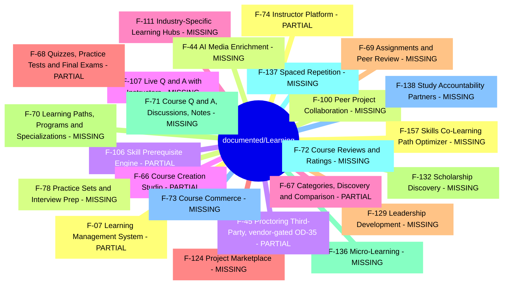

# documented/Learning (MOD-213)

Generated by `docs/mindmap/tools/catalog.py` from `master/MASTER_PROJECT_GRAPH.json` at commit `9b3032f`. Do not edit by hand. Back to the [feature catalog](../FEATURE_CATALOG.md).

**Application:** Documented scope (registry features) (APP-001). **Purpose:** Registry features in category 'Learning'.

**Nodes by level:** MODULE 1, MAJOR 24. **Status:** NOT_IMPLEMENTED 17, PARTIALLY_IMPLEMENTED 7, UNKNOWN 1. **Verification:** UNKNOWN 1.

## Module map (to minor features)

## F-07 Learning Management System

Learning Management System

| ID   | Level | Parent  | Name                       | Description | Status                | Verification | Evidence                               | Related |
| ---- | ----- | ------- | -------------------------- | ----------- | --------------------- | ------------ | -------------------------------------- | ------- |
| F-07 | MAJOR | MOD-213 | Learning Management System |             | PARTIALLY_IMPLEMENTED |              | docs/registries/FEATURE_REGISTRY.md:23 |         |

## F-100 Peer Project Collaboration

Peer Project Collaboration

| ID    | Level | Parent  | Name                       | Description | Status          | Verification | Evidence                                | Related |
| ----- | ----- | ------- | -------------------------- | ----------- | --------------- | ------------ | --------------------------------------- | ------- |
| F-100 | MAJOR | MOD-213 | Peer Project Collaboration |             | NOT_IMPLEMENTED |              | docs/registries/FEATURE_REGISTRY.md:116 |         |

## F-106 Skill Prerequisite Engine

Skill Prerequisite Engine

| ID    | Level | Parent  | Name                      | Description | Status                | Verification | Evidence                                | Related |
| ----- | ----- | ------- | ------------------------- | ----------- | --------------------- | ------------ | --------------------------------------- | ------- |
| F-106 | MAJOR | MOD-213 | Skill Prerequisite Engine |             | PARTIALLY_IMPLEMENTED |              | docs/registries/FEATURE_REGISTRY.md:122 |         |

## F-107 Live Q&A with Instructors

Live Q&A with Instructors

| ID    | Level | Parent  | Name                      | Description | Status          | Verification | Evidence                                | Related |
| ----- | ----- | ------- | ------------------------- | ----------- | --------------- | ------------ | --------------------------------------- | ------- |
| F-107 | MAJOR | MOD-213 | Live Q&A with Instructors |             | NOT_IMPLEMENTED |              | docs/registries/FEATURE_REGISTRY.md:123 |         |

## F-111 Industry-Specific Learning Hubs

Industry-Specific Learning Hubs

| ID    | Level | Parent  | Name                            | Description | Status          | Verification | Evidence                                | Related |
| ----- | ----- | ------- | ------------------------------- | ----------- | --------------- | ------------ | --------------------------------------- | ------- |
| F-111 | MAJOR | MOD-213 | Industry-Specific Learning Hubs |             | NOT_IMPLEMENTED |              | docs/registries/FEATURE_REGISTRY.md:127 |         |

## F-124 Project Marketplace

Project Marketplace

| ID    | Level | Parent  | Name                | Description | Status          | Verification | Evidence                                | Related |
| ----- | ----- | ------- | ------------------- | ----------- | --------------- | ------------ | --------------------------------------- | ------- |
| F-124 | MAJOR | MOD-213 | Project Marketplace |             | NOT_IMPLEMENTED |              | docs/registries/FEATURE_REGISTRY.md:145 |         |

## F-129 Leadership Development

Leadership Development

| ID    | Level | Parent  | Name                   | Description | Status          | Verification | Evidence                                | Related |
| ----- | ----- | ------- | ---------------------- | ----------- | --------------- | ------------ | --------------------------------------- | ------- |
| F-129 | MAJOR | MOD-213 | Leadership Development |             | NOT_IMPLEMENTED |              | docs/registries/FEATURE_REGISTRY.md:150 |         |

## F-132 Scholarship Discovery

Scholarship Discovery

| ID    | Level | Parent  | Name                  | Description | Status          | Verification | Evidence                                | Related |
| ----- | ----- | ------- | --------------------- | ----------- | --------------- | ------------ | --------------------------------------- | ------- |
| F-132 | MAJOR | MOD-213 | Scholarship Discovery |             | NOT_IMPLEMENTED |              | docs/registries/FEATURE_REGISTRY.md:153 |         |

## F-136 Micro-Learning

Micro-Learning

| ID    | Level | Parent  | Name           | Description | Status          | Verification | Evidence                                | Related |
| ----- | ----- | ------- | -------------- | ----------- | --------------- | ------------ | --------------------------------------- | ------- |
| F-136 | MAJOR | MOD-213 | Micro-Learning |             | NOT_IMPLEMENTED |              | docs/registries/FEATURE_REGISTRY.md:157 |         |

## F-137 Spaced Repetition

Spaced Repetition

| ID    | Level | Parent  | Name              | Description | Status          | Verification | Evidence                                | Related |
| ----- | ----- | ------- | ----------------- | ----------- | --------------- | ------------ | --------------------------------------- | ------- |
| F-137 | MAJOR | MOD-213 | Spaced Repetition |             | NOT_IMPLEMENTED |              | docs/registries/FEATURE_REGISTRY.md:158 |         |

## F-138 Study Accountability Partners

Study Accountability Partners

| ID    | Level | Parent  | Name                          | Description | Status          | Verification | Evidence                                | Related |
| ----- | ----- | ------- | ----------------------------- | ----------- | --------------- | ------------ | --------------------------------------- | ------- |
| F-138 | MAJOR | MOD-213 | Study Accountability Partners |             | NOT_IMPLEMENTED |              | docs/registries/FEATURE_REGISTRY.md:159 |         |

## F-157 Skills Co-Learning Path Optimizer

Skills Co-Learning Path Optimizer

| ID    | Level | Parent  | Name                              | Description | Status          | Verification | Evidence                                | Related |
| ----- | ----- | ------- | --------------------------------- | ----------- | --------------- | ------------ | --------------------------------------- | ------- |
| F-157 | MAJOR | MOD-213 | Skills Co-Learning Path Optimizer |             | NOT_IMPLEMENTED |              | docs/registries/FEATURE_REGISTRY.md:183 |         |

## F-44 AI Media Enrichment

AI Media Enrichment

| ID   | Level | Parent  | Name                | Description | Status          | Verification | Evidence                               | Related |
| ---- | ----- | ------- | ------------------- | ----------- | --------------- | ------------ | -------------------------------------- | ------- |
| F-44 | MAJOR | MOD-213 | AI Media Enrichment |             | NOT_IMPLEMENTED |              | docs/registries/FEATURE_REGISTRY.md:60 |         |

## F-45 Proctoring (Third-Party, vendor-gated OD-35)

Proctoring (Third-Party, vendor-gated OD-35)

| ID   | Level | Parent  | Name                                         | Description | Status                | Verification | Evidence                               | Related |
| ---- | ----- | ------- | -------------------------------------------- | ----------- | --------------------- | ------------ | -------------------------------------- | ------- |
| F-45 | MAJOR | MOD-213 | Proctoring (Third-Party, vendor-gated OD-35) |             | PARTIALLY_IMPLEMENTED |              | docs/registries/FEATURE_REGISTRY.md:61 |         |

## F-66 Course Creation Studio

Course Creation Studio

| ID   | Level | Parent  | Name                   | Description | Status                | Verification | Evidence                               | Related |
| ---- | ----- | ------- | ---------------------- | ----------- | --------------------- | ------------ | -------------------------------------- | ------- |
| F-66 | MAJOR | MOD-213 | Course Creation Studio |             | PARTIALLY_IMPLEMENTED |              | docs/registries/FEATURE_REGISTRY.md:82 |         |

## F-67 Categories, Discovery & Comparison

Categories, Discovery & Comparison

| ID   | Level | Parent  | Name                               | Description | Status                | Verification | Evidence                               | Related |
| ---- | ----- | ------- | ---------------------------------- | ----------- | --------------------- | ------------ | -------------------------------------- | ------- |
| F-67 | MAJOR | MOD-213 | Categories, Discovery & Comparison |             | PARTIALLY_IMPLEMENTED |              | docs/registries/FEATURE_REGISTRY.md:83 |         |

## F-68 Quizzes, Practice Tests & Final Exams

Quizzes, Practice Tests & Final Exams

| ID   | Level | Parent  | Name                                  | Description | Status                | Verification | Evidence                               | Related |
| ---- | ----- | ------- | ------------------------------------- | ----------- | --------------------- | ------------ | -------------------------------------- | ------- |
| F-68 | MAJOR | MOD-213 | Quizzes, Practice Tests & Final Exams |             | PARTIALLY_IMPLEMENTED |              | docs/registries/FEATURE_REGISTRY.md:84 |         |

## F-69 Assignments & Peer Review

Assignments & Peer Review

| ID   | Level | Parent  | Name                      | Description | Status          | Verification | Evidence                               | Related |
| ---- | ----- | ------- | ------------------------- | ----------- | --------------- | ------------ | -------------------------------------- | ------- |
| F-69 | MAJOR | MOD-213 | Assignments & Peer Review |             | NOT_IMPLEMENTED |              | docs/registries/FEATURE_REGISTRY.md:85 |         |

## F-70 Learning Paths, Programs & Specializations

Learning Paths, Programs & Specializations

| ID   | Level | Parent  | Name                                       | Description | Status          | Verification | Evidence                               | Related |
| ---- | ----- | ------- | ------------------------------------------ | ----------- | --------------- | ------------ | -------------------------------------- | ------- |
| F-70 | MAJOR | MOD-213 | Learning Paths, Programs & Specializations |             | NOT_IMPLEMENTED |              | docs/registries/FEATURE_REGISTRY.md:86 |         |

## F-71 Course Q&A, Discussions, Notes

Course Q&A, Discussions, Notes

| ID   | Level | Parent  | Name                           | Description | Status          | Verification | Evidence                               | Related |
| ---- | ----- | ------- | ------------------------------ | ----------- | --------------- | ------------ | -------------------------------------- | ------- |
| F-71 | MAJOR | MOD-213 | Course Q&A, Discussions, Notes |             | NOT_IMPLEMENTED |              | docs/registries/FEATURE_REGISTRY.md:87 |         |

## F-72 Course Reviews & Ratings

Course Reviews & Ratings

| ID   | Level | Parent  | Name                     | Description | Status          | Verification | Evidence                               | Related |
| ---- | ----- | ------- | ------------------------ | ----------- | --------------- | ------------ | -------------------------------------- | ------- |
| F-72 | MAJOR | MOD-213 | Course Reviews & Ratings |             | NOT_IMPLEMENTED |              | docs/registries/FEATURE_REGISTRY.md:88 |         |

## F-73 Course Commerce

Course Commerce

| ID   | Level | Parent  | Name            | Description | Status          | Verification | Evidence                               | Related |
| ---- | ----- | ------- | --------------- | ----------- | --------------- | ------------ | -------------------------------------- | ------- |
| F-73 | MAJOR | MOD-213 | Course Commerce |             | NOT_IMPLEMENTED |              | docs/registries/FEATURE_REGISTRY.md:89 |         |

## F-74 Instructor Platform

Instructor Platform

| ID   | Level | Parent  | Name                | Description | Status                | Verification | Evidence                               | Related |
| ---- | ----- | ------- | ------------------- | ----------- | --------------------- | ------------ | -------------------------------------- | ------- |
| F-74 | MAJOR | MOD-213 | Instructor Platform |             | PARTIALLY_IMPLEMENTED |              | docs/registries/FEATURE_REGISTRY.md:90 |         |

## F-78 Practice Sets & Interview Prep

Practice Sets & Interview Prep

| ID   | Level | Parent  | Name                           | Description | Status          | Verification | Evidence                               | Related |
| ---- | ----- | ------- | ------------------------------ | ----------- | --------------- | ------------ | -------------------------------------- | ------- |
| F-78 | MAJOR | MOD-213 | Practice Sets & Interview Prep |             | NOT_IMPLEMENTED |              | docs/registries/FEATURE_REGISTRY.md:94 |         |
