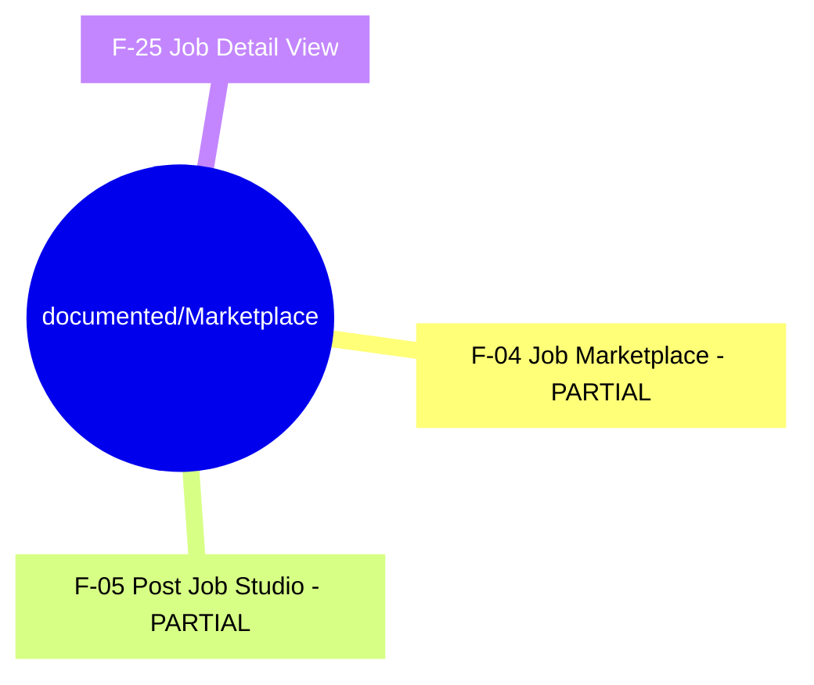

# documented/Marketplace (MOD-211)

Generated by `docs/mindmap/tools/catalog.py` from `master/MASTER_PROJECT_GRAPH.json` at commit `9b3032f`. Do not edit by hand. Back to the [feature catalog](../FEATURE_CATALOG.md).

**Application:** Documented scope (registry features) (APP-001). **Purpose:** Registry features in category 'Marketplace'.

**Nodes by level:** MODULE 1, MAJOR 3. **Status:** IMPLEMENTED 1, PARTIALLY_IMPLEMENTED 2, UNKNOWN 1. **Verification:** UNKNOWN 1.

## Module map (to minor features)

## F-04 Job Marketplace

Job Marketplace

| ID   | Level | Parent  | Name            | Description | Status                | Verification | Evidence                               | Related |
| ---- | ----- | ------- | --------------- | ----------- | --------------------- | ------------ | -------------------------------------- | ------- |
| F-04 | MAJOR | MOD-211 | Job Marketplace |             | PARTIALLY_IMPLEMENTED |              | docs/registries/FEATURE_REGISTRY.md:20 |         |

## F-05 Post Job Studio

Post Job Studio

| ID   | Level | Parent  | Name            | Description | Status                | Verification | Evidence                               | Related |
| ---- | ----- | ------- | --------------- | ----------- | --------------------- | ------------ | -------------------------------------- | ------- |
| F-05 | MAJOR | MOD-211 | Post Job Studio |             | PARTIALLY_IMPLEMENTED |              | docs/registries/FEATURE_REGISTRY.md:21 |         |

## F-25 Job Detail View

Job Detail View

| ID   | Level | Parent  | Name            | Description | Status      | Verification | Evidence                               | Related |
| ---- | ----- | ------- | --------------- | ----------- | ----------- | ------------ | -------------------------------------- | ------- |
| F-25 | MAJOR | MOD-211 | Job Detail View |             | IMPLEMENTED |              | docs/registries/FEATURE_REGISTRY.md:41 |         |
