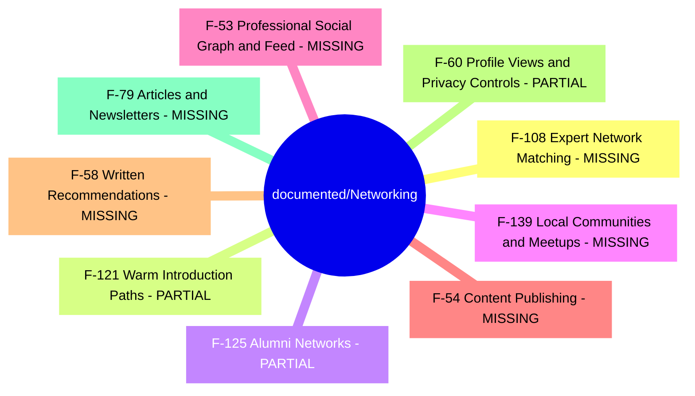

# documented/Networking (MOD-220)

Generated by `docs/mindmap/tools/catalog.py` from `master/MASTER_PROJECT_GRAPH.json` at commit `9b3032f`. Do not edit by hand. Back to the [feature catalog](../FEATURE_CATALOG.md).

**Application:** Documented scope (registry features) (APP-001). **Purpose:** Registry features in category 'Networking'.

**Nodes by level:** MODULE 1, MAJOR 9. **Status:** NOT_IMPLEMENTED 6, PARTIALLY_IMPLEMENTED 3, UNKNOWN 1. **Verification:** UNKNOWN 1.

## Module map (to minor features)

## F-108 Expert Network Matching

Expert Network Matching

| ID    | Level | Parent  | Name                    | Description | Status          | Verification | Evidence                                | Related |
| ----- | ----- | ------- | ----------------------- | ----------- | --------------- | ------------ | --------------------------------------- | ------- |
| F-108 | MAJOR | MOD-220 | Expert Network Matching |             | NOT_IMPLEMENTED |              | docs/registries/FEATURE_REGISTRY.md:124 |         |

## F-121 Warm Introduction Paths

Warm Introduction Paths

| ID    | Level | Parent  | Name                    | Description | Status                | Verification | Evidence                                | Related |
| ----- | ----- | ------- | ----------------------- | ----------- | --------------------- | ------------ | --------------------------------------- | ------- |
| F-121 | MAJOR | MOD-220 | Warm Introduction Paths |             | PARTIALLY_IMPLEMENTED |              | docs/registries/FEATURE_REGISTRY.md:142 |         |

## F-125 Alumni Networks

Alumni Networks

| ID    | Level | Parent  | Name            | Description | Status                | Verification | Evidence                                | Related |
| ----- | ----- | ------- | --------------- | ----------- | --------------------- | ------------ | --------------------------------------- | ------- |
| F-125 | MAJOR | MOD-220 | Alumni Networks |             | PARTIALLY_IMPLEMENTED |              | docs/registries/FEATURE_REGISTRY.md:146 |         |

## F-139 Local Communities & Meetups

Local Communities & Meetups

| ID    | Level | Parent  | Name                        | Description | Status          | Verification | Evidence                                | Related |
| ----- | ----- | ------- | --------------------------- | ----------- | --------------- | ------------ | --------------------------------------- | ------- |
| F-139 | MAJOR | MOD-220 | Local Communities & Meetups |             | NOT_IMPLEMENTED |              | docs/registries/FEATURE_REGISTRY.md:160 |         |

## F-53 Professional Social Graph & Feed

Professional Social Graph & Feed

| ID   | Level | Parent  | Name                             | Description | Status          | Verification | Evidence                               | Related |
| ---- | ----- | ------- | -------------------------------- | ----------- | --------------- | ------------ | -------------------------------------- | ------- |
| F-53 | MAJOR | MOD-220 | Professional Social Graph & Feed |             | NOT_IMPLEMENTED |              | docs/registries/FEATURE_REGISTRY.md:69 |         |

## F-54 Content Publishing

Content Publishing

| ID   | Level | Parent  | Name               | Description | Status          | Verification | Evidence                               | Related |
| ---- | ----- | ------- | ------------------ | ----------- | --------------- | ------------ | -------------------------------------- | ------- |
| F-54 | MAJOR | MOD-220 | Content Publishing |             | NOT_IMPLEMENTED |              | docs/registries/FEATURE_REGISTRY.md:70 |         |

## F-58 Written Recommendations

Written Recommendations

| ID   | Level | Parent  | Name                    | Description | Status          | Verification | Evidence                               | Related |
| ---- | ----- | ------- | ----------------------- | ----------- | --------------- | ------------ | -------------------------------------- | ------- |
| F-58 | MAJOR | MOD-220 | Written Recommendations |             | NOT_IMPLEMENTED |              | docs/registries/FEATURE_REGISTRY.md:74 |         |

## F-60 Profile Views & Privacy Controls

Profile Views & Privacy Controls

| ID   | Level | Parent  | Name                             | Description | Status                | Verification | Evidence                               | Related |
| ---- | ----- | ------- | -------------------------------- | ----------- | --------------------- | ------------ | -------------------------------------- | ------- |
| F-60 | MAJOR | MOD-220 | Profile Views & Privacy Controls |             | PARTIALLY_IMPLEMENTED |              | docs/registries/FEATURE_REGISTRY.md:76 |         |

## F-79 Articles & Newsletters

Articles & Newsletters

| ID   | Level | Parent  | Name                   | Description | Status          | Verification | Evidence                               | Related |
| ---- | ----- | ------- | ---------------------- | ----------- | --------------- | ------------ | -------------------------------------- | ------- |
| F-79 | MAJOR | MOD-220 | Articles & Newsletters |             | NOT_IMPLEMENTED |              | docs/registries/FEATURE_REGISTRY.md:95 |         |
