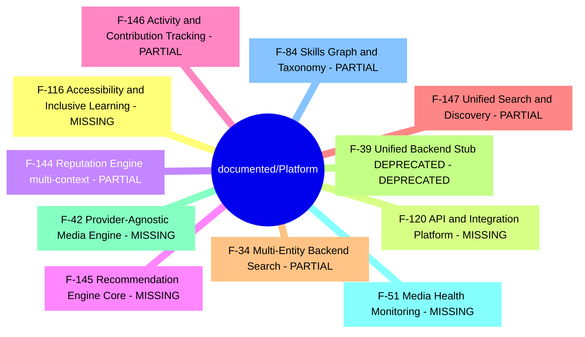

# documented/Platform (MOD-225)

Generated by `docs/mindmap/tools/catalog.py` from `master/MASTER_PROJECT_GRAPH.json` at commit `9b3032f`. Do not edit by hand. Back to the [feature catalog](../FEATURE_CATALOG.md).

**Application:** Documented scope (registry features) (APP-001). **Purpose:** Registry features in category 'Platform'.

**Nodes by level:** MODULE 1, MAJOR 11. **Status:** DEPRECATED 1, NOT_IMPLEMENTED 5, PARTIALLY_IMPLEMENTED 5, UNKNOWN 1. **Verification:** UNKNOWN 1.

## Module map (to minor features)

## F-116 Accessibility & Inclusive Learning

Accessibility & Inclusive Learning

| ID    | Level | Parent  | Name                               | Description | Status          | Verification | Evidence                                | Related |
| ----- | ----- | ------- | ---------------------------------- | ----------- | --------------- | ------------ | --------------------------------------- | ------- |
| F-116 | MAJOR | MOD-225 | Accessibility & Inclusive Learning |             | NOT_IMPLEMENTED |              | docs/registries/FEATURE_REGISTRY.md:132 |         |

## F-120 API & Integration Platform

API & Integration Platform

| ID    | Level | Parent  | Name                       | Description | Status          | Verification | Evidence                                | Related |
| ----- | ----- | ------- | -------------------------- | ----------- | --------------- | ------------ | --------------------------------------- | ------- |
| F-120 | MAJOR | MOD-225 | API & Integration Platform |             | NOT_IMPLEMENTED |              | docs/registries/FEATURE_REGISTRY.md:136 |         |

## F-144 Reputation Engine (multi-context)

Reputation Engine (multi-context)

| ID    | Level | Parent  | Name                              | Description | Status                | Verification | Evidence                                | Related |
| ----- | ----- | ------- | --------------------------------- | ----------- | --------------------- | ------------ | --------------------------------------- | ------- |
| F-144 | MAJOR | MOD-225 | Reputation Engine (multi-context) |             | PARTIALLY_IMPLEMENTED |              | docs/registries/FEATURE_REGISTRY.md:170 |         |

## F-145 Recommendation Engine Core

Recommendation Engine Core

| ID    | Level | Parent  | Name                       | Description | Status          | Verification | Evidence                                | Related |
| ----- | ----- | ------- | -------------------------- | ----------- | --------------- | ------------ | --------------------------------------- | ------- |
| F-145 | MAJOR | MOD-225 | Recommendation Engine Core |             | NOT_IMPLEMENTED |              | docs/registries/FEATURE_REGISTRY.md:171 |         |

## F-146 Activity & Contribution Tracking

Activity & Contribution Tracking

| ID    | Level | Parent  | Name                             | Description | Status                | Verification | Evidence                                | Related |
| ----- | ----- | ------- | -------------------------------- | ----------- | --------------------- | ------------ | --------------------------------------- | ------- |
| F-146 | MAJOR | MOD-225 | Activity & Contribution Tracking |             | PARTIALLY_IMPLEMENTED |              | docs/registries/FEATURE_REGISTRY.md:172 |         |

## F-147 Unified Search & Discovery

Unified Search & Discovery

| ID    | Level | Parent  | Name                       | Description | Status                | Verification | Evidence                                | Related |
| ----- | ----- | ------- | -------------------------- | ----------- | --------------------- | ------------ | --------------------------------------- | ------- |
| F-147 | MAJOR | MOD-225 | Unified Search & Discovery |             | PARTIALLY_IMPLEMENTED |              | docs/registries/FEATURE_REGISTRY.md:173 |         |

## F-34 Multi-Entity Backend Search

Multi-Entity Backend Search

| ID   | Level | Parent  | Name                        | Description | Status                | Verification | Evidence                               | Related |
| ---- | ----- | ------- | --------------------------- | ----------- | --------------------- | ------------ | -------------------------------------- | ------- |
| F-34 | MAJOR | MOD-225 | Multi-Entity Backend Search |             | PARTIALLY_IMPLEMENTED |              | docs/registries/FEATURE_REGISTRY.md:50 |         |

## F-39 Unified Backend Stub (DEPRECATED)

Unified Backend Stub (DEPRECATED)

| ID   | Level | Parent  | Name                              | Description | Status     | Verification | Evidence                               | Related |
| ---- | ----- | ------- | --------------------------------- | ----------- | ---------- | ------------ | -------------------------------------- | ------- |
| F-39 | MAJOR | MOD-225 | Unified Backend Stub (DEPRECATED) |             | DEPRECATED |              | docs/registries/FEATURE_REGISTRY.md:55 |         |

## F-42 Provider-Agnostic Media Engine

Provider-Agnostic Media Engine

| ID   | Level | Parent  | Name                           | Description | Status          | Verification | Evidence                               | Related |
| ---- | ----- | ------- | ------------------------------ | ----------- | --------------- | ------------ | -------------------------------------- | ------- |
| F-42 | MAJOR | MOD-225 | Provider-Agnostic Media Engine |             | NOT_IMPLEMENTED |              | docs/registries/FEATURE_REGISTRY.md:58 |         |

## F-51 Media Health Monitoring

Media Health Monitoring

| ID   | Level | Parent  | Name                    | Description | Status          | Verification | Evidence                               | Related |
| ---- | ----- | ------- | ----------------------- | ----------- | --------------- | ------------ | -------------------------------------- | ------- |
| F-51 | MAJOR | MOD-225 | Media Health Monitoring |             | NOT_IMPLEMENTED |              | docs/registries/FEATURE_REGISTRY.md:67 |         |

## F-84 Skills Graph & Taxonomy

Skills Graph & Taxonomy

| ID   | Level | Parent  | Name                    | Description | Status                | Verification | Evidence                                | Related |
| ---- | ----- | ------- | ----------------------- | ----------- | --------------------- | ------------ | --------------------------------------- | ------- |
| F-84 | MAJOR | MOD-225 | Skills Graph & Taxonomy |             | PARTIALLY_IMPLEMENTED |              | docs/registries/FEATURE_REGISTRY.md:100 |         |
