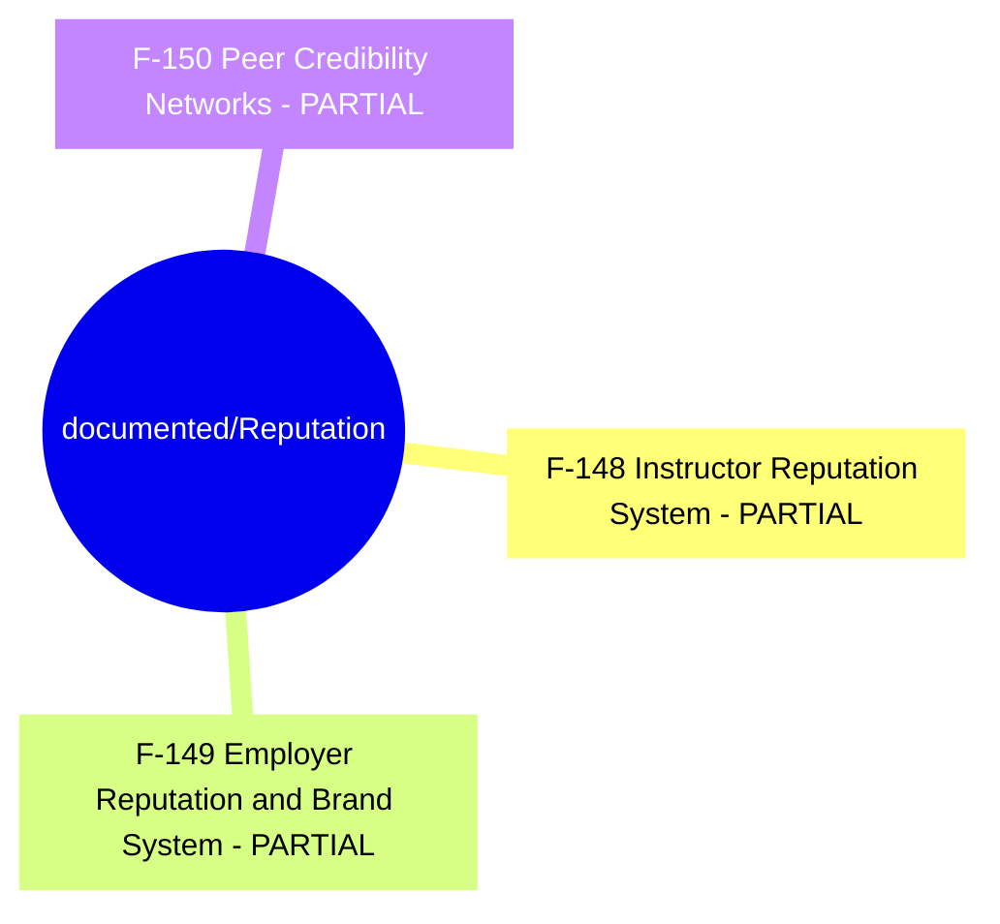

# documented/Reputation (MOD-233)

Generated by `docs/mindmap/tools/catalog.py` from `master/MASTER_PROJECT_GRAPH.json` at commit `9b3032f`. Do not edit by hand. Back to the [feature catalog](../FEATURE_CATALOG.md).

**Application:** Documented scope (registry features) (APP-001). **Purpose:** Registry features in category 'Reputation'.

**Nodes by level:** MODULE 1, MAJOR 3. **Status:** PARTIALLY_IMPLEMENTED 3, UNKNOWN 1. **Verification:** UNKNOWN 1.

## Module map (to minor features)

## F-148 Instructor Reputation System

Instructor Reputation System

| ID    | Level | Parent  | Name                         | Description | Status                | Verification | Evidence                                | Related |
| ----- | ----- | ------- | ---------------------------- | ----------- | --------------------- | ------------ | --------------------------------------- | ------- |
| F-148 | MAJOR | MOD-233 | Instructor Reputation System |             | PARTIALLY_IMPLEMENTED |              | docs/registries/FEATURE_REGISTRY.md:174 |         |

## F-149 Employer Reputation & Brand System

Employer Reputation & Brand System

| ID    | Level | Parent  | Name                               | Description | Status                | Verification | Evidence                                | Related |
| ----- | ----- | ------- | ---------------------------------- | ----------- | --------------------- | ------------ | --------------------------------------- | ------- |
| F-149 | MAJOR | MOD-233 | Employer Reputation & Brand System |             | PARTIALLY_IMPLEMENTED |              | docs/registries/FEATURE_REGISTRY.md:175 |         |

## F-150 Peer Credibility Networks

Peer Credibility Networks

| ID    | Level | Parent  | Name                      | Description | Status                | Verification | Evidence                                | Related |
| ----- | ----- | ------- | ------------------------- | ----------- | --------------------- | ------------ | --------------------------------------- | ------- |
| F-150 | MAJOR | MOD-233 | Peer Credibility Networks |             | PARTIALLY_IMPLEMENTED |              | docs/registries/FEATURE_REGISTRY.md:176 |         |
