# Documented scope (registry features) modules

Generated by `docs/mindmap/tools/catalog.py` from `master/MASTER_PROJECT_GRAPH.json` at commit `eb166ea`. Do not edit by hand. Back to the [feature catalog](../FEATURE_CATALOG.md).

| Module                                                           | ID      |
| ---------------------------------------------------------------- | ------- |
| [documented/Identity](#documentedidentity-mod-209)               | MOD-209 |
| [documented/Shell](#documentedshell-mod-210)                     | MOD-210 |
| [documented/Marketplace](#documentedmarketplace-mod-211)         | MOD-211 |
| [documented/Recruiting](#documentedrecruiting-mod-212)           | MOD-212 |
| [documented/Learning](#documentedlearning-mod-213)               | MOD-213 |
| [documented/Assessment](#documentedassessment-mod-214)           | MOD-214 |
| [documented/Social](#documentedsocial-mod-215)                   | MOD-215 |
| [documented/Communication](#documentedcommunication-mod-216)     | MOD-216 |
| [documented/Gamification](#documentedgamification-mod-217)       | MOD-217 |
| [documented/Hiring](#documentedhiring-mod-218)                   | MOD-218 |
| [documented/Analytics](#documentedanalytics-mod-219)             | MOD-219 |
| [documented/Networking](#documentednetworking-mod-220)           | MOD-220 |
| [documented/Career](#documentedcareer-mod-221)                   | MOD-221 |
| [documented/AI](#documentedai-mod-222)                           | MOD-222 |
| [documented/Verification](#documentedverification-mod-223)       | MOD-223 |
| [documented/Candidate](#documentedcandidate-mod-224)             | MOD-224 |
| [documented/Platform](#documentedplatform-mod-225)               | MOD-225 |
| [documented/Intelligence](#documentedintelligence-mod-226)       | MOD-226 |
| [documented/Jobs](#documentedjobs-mod-227)                       | MOD-227 |
| [documented/Careers](#documentedcareers-mod-228)                 | MOD-228 |
| [documented/Companies](#documentedcompanies-mod-229)             | MOD-229 |
| [documented/Community](#documentedcommunity-mod-230)             | MOD-230 |
| [documented/Skills](#documentedskills-mod-231)                   | MOD-231 |
| [documented/Portfolio](#documentedportfolio-mod-232)             | MOD-232 |
| [documented/Reputation](#documentedreputation-mod-233)           | MOD-233 |
| [documented/Personalization](#documentedpersonalization-mod-234) | MOD-234 |
| [documented/Discovery](#documenteddiscovery-mod-235)             | MOD-235 |
| [documented/Monetization](#documentedmonetization-mod-236)       | MOD-236 |
| [documented/Enterprise](#documentedenterprise-mod-237)           | MOD-237 |
| [documented/Credential](#documentedcredential-mod-238)           | MOD-238 |
| [documented/Governance](#documentedgovernance-mod-239)           | MOD-239 |
| [documented/Company](#documentedcompany-mod-240)                 | MOD-240 |
| [documented/Edge](#documentededge-mod-241)                       | MOD-241 |
| [documented/Telemetry](#documentedtelemetry-mod-242)             | MOD-242 |
| [documented/Engagement](#documentedengagement-mod-243)           | MOD-243 |
| [documented/Safety](#documentedsafety-mod-244)                   | MOD-244 |
| [documented/Administration](#documentedadministration-mod-245)   | MOD-245 |
| [documented/Institutions](#documentedinstitutions-mod-246)       | MOD-246 |
| [documented/OS](#documentedos-mod-247)                           | MOD-247 |
| [documented/Business](#documentedbusiness-mod-248)               | MOD-248 |
| [documented/Integration](#documentedintegration-mod-249)         | MOD-249 |
| [documented/Foundation](#documentedfoundation-mod-250)           | MOD-250 |
| [documented/Profile](#documentedprofile-mod-251)                 | MOD-251 |

## documented/Identity (MOD-209)

**Application:** Documented scope (registry features) (APP-001). **Purpose:** Registry features in category 'Identity'.

**Nodes by level:** MODULE 1, MAJOR 4. **Status:** PARTIALLY_IMPLEMENTED 4, UNKNOWN 1. **Verification:** UNKNOWN 1.

### Module map (to minor features)

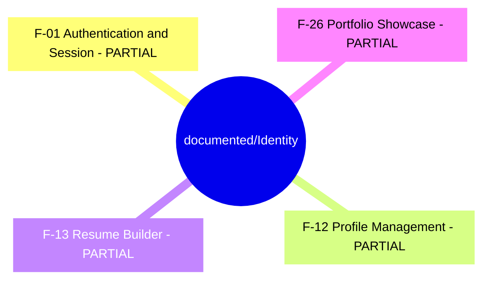

### F-01 Authentication & Session

Authentication & Session

| ID   | Level | Parent  | Name                     | Description | Status                | Verification | Evidence                               | Related |
| ---- | ----- | ------- | ------------------------ | ----------- | --------------------- | ------------ | -------------------------------------- | ------- |
| F-01 | MAJOR | MOD-209 | Authentication & Session |             | PARTIALLY_IMPLEMENTED |              | docs/registries/FEATURE_REGISTRY.md:17 |         |

### F-12 Profile Management

Profile Management

| ID   | Level | Parent  | Name               | Description | Status                | Verification | Evidence                               | Related |
| ---- | ----- | ------- | ------------------ | ----------- | --------------------- | ------------ | -------------------------------------- | ------- |
| F-12 | MAJOR | MOD-209 | Profile Management |             | PARTIALLY_IMPLEMENTED |              | docs/registries/FEATURE_REGISTRY.md:28 |         |

### F-13 Resume Builder

Resume Builder

| ID   | Level | Parent  | Name           | Description | Status                | Verification | Evidence                               | Related |
| ---- | ----- | ------- | -------------- | ----------- | --------------------- | ------------ | -------------------------------------- | ------- |
| F-13 | MAJOR | MOD-209 | Resume Builder |             | PARTIALLY_IMPLEMENTED |              | docs/registries/FEATURE_REGISTRY.md:29 |         |

### F-26 Portfolio Showcase

Portfolio Showcase

| ID   | Level | Parent  | Name               | Description | Status                | Verification | Evidence                               | Related |
| ---- | ----- | ------- | ------------------ | ----------- | --------------------- | ------------ | -------------------------------------- | ------- |
| F-26 | MAJOR | MOD-209 | Portfolio Showcase |             | PARTIALLY_IMPLEMENTED |              | docs/registries/FEATURE_REGISTRY.md:42 |         |

## documented/Shell (MOD-210)

**Application:** Documented scope (registry features) (APP-001). **Purpose:** Registry features in category 'Shell'.

**Nodes by level:** MODULE 1, MAJOR 5. **Status:** IMPLEMENTED 3, PARTIALLY_IMPLEMENTED 2, UNKNOWN 1. **Verification:** UNKNOWN 1.

### Module map (to minor features)

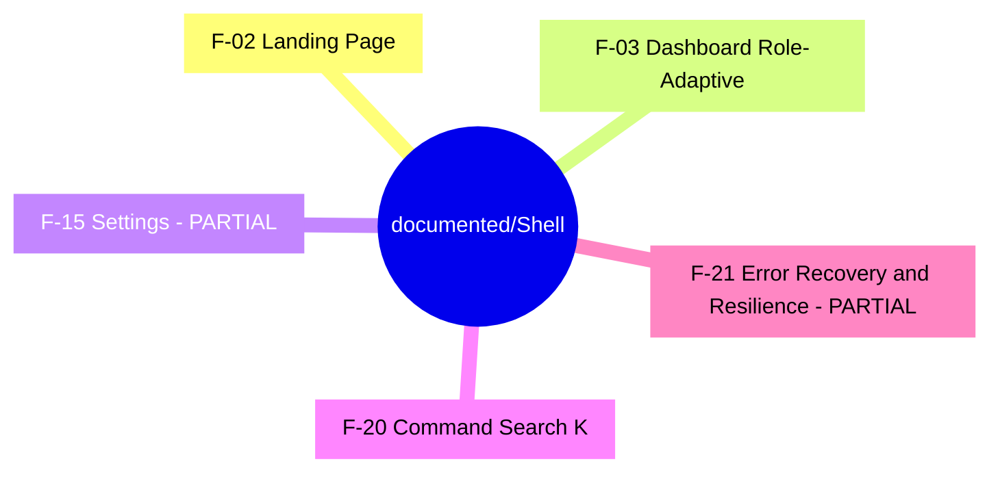

### F-02 Landing Page

Landing Page

| ID   | Level | Parent  | Name         | Description | Status      | Verification | Evidence                               | Related |
| ---- | ----- | ------- | ------------ | ----------- | ----------- | ------------ | -------------------------------------- | ------- |
| F-02 | MAJOR | MOD-210 | Landing Page |             | IMPLEMENTED |              | docs/registries/FEATURE_REGISTRY.md:18 |         |

### F-03 Dashboard (Role-Adaptive)

Dashboard (Role-Adaptive)

| ID   | Level | Parent  | Name                      | Description | Status      | Verification | Evidence                               | Related |
| ---- | ----- | ------- | ------------------------- | ----------- | ----------- | ------------ | -------------------------------------- | ------- |
| F-03 | MAJOR | MOD-210 | Dashboard (Role-Adaptive) |             | IMPLEMENTED |              | docs/registries/FEATURE_REGISTRY.md:19 |         |

### F-15 Settings

Settings

| ID   | Level | Parent  | Name     | Description | Status                | Verification | Evidence                               | Related |
| ---- | ----- | ------- | -------- | ----------- | --------------------- | ------------ | -------------------------------------- | ------- |
| F-15 | MAJOR | MOD-210 | Settings |             | PARTIALLY_IMPLEMENTED |              | docs/registries/FEATURE_REGISTRY.md:31 |         |

### F-20 Command Search (⌘K)

Command Search (⌘K)

| ID   | Level | Parent  | Name                | Description | Status      | Verification | Evidence                               | Related |
| ---- | ----- | ------- | ------------------- | ----------- | ----------- | ------------ | -------------------------------------- | ------- |
| F-20 | MAJOR | MOD-210 | Command Search (⌘K) |             | IMPLEMENTED |              | docs/registries/FEATURE_REGISTRY.md:36 |         |

### F-21 Error Recovery & Resilience

Error Recovery & Resilience

| ID   | Level | Parent  | Name                        | Description | Status                | Verification | Evidence                               | Related |
| ---- | ----- | ------- | --------------------------- | ----------- | --------------------- | ------------ | -------------------------------------- | ------- |
| F-21 | MAJOR | MOD-210 | Error Recovery & Resilience |             | PARTIALLY_IMPLEMENTED |              | docs/registries/FEATURE_REGISTRY.md:37 |         |

## documented/Marketplace (MOD-211)

**Application:** Documented scope (registry features) (APP-001). **Purpose:** Registry features in category 'Marketplace'.

**Nodes by level:** MODULE 1, MAJOR 3. **Status:** IMPLEMENTED 1, PARTIALLY_IMPLEMENTED 2, UNKNOWN 1. **Verification:** UNKNOWN 1.

### Module map (to minor features)

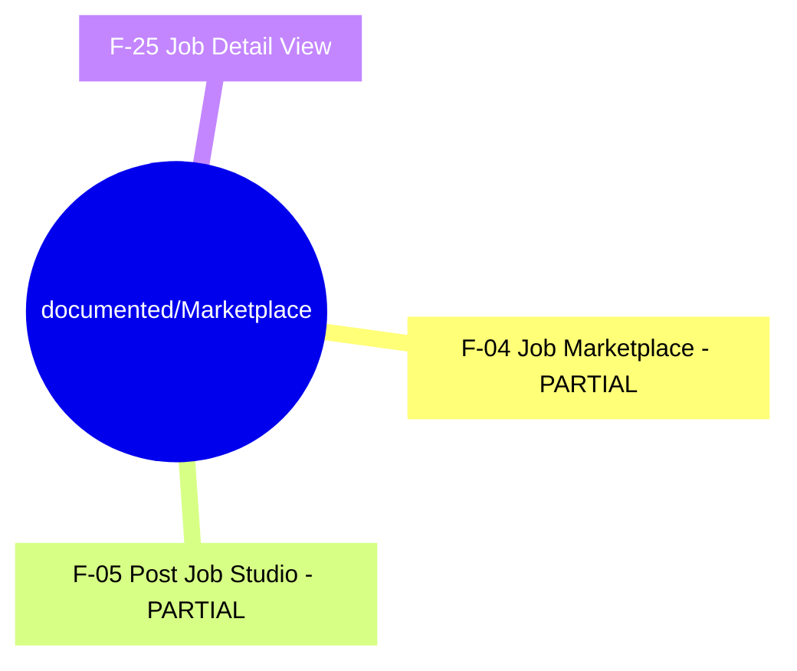

### F-04 Job Marketplace

Job Marketplace

| ID   | Level | Parent  | Name            | Description | Status                | Verification | Evidence                               | Related |
| ---- | ----- | ------- | --------------- | ----------- | --------------------- | ------------ | -------------------------------------- | ------- |
| F-04 | MAJOR | MOD-211 | Job Marketplace |             | PARTIALLY_IMPLEMENTED |              | docs/registries/FEATURE_REGISTRY.md:20 |         |

### F-05 Post Job Studio

Post Job Studio

| ID   | Level | Parent  | Name            | Description | Status                | Verification | Evidence                               | Related |
| ---- | ----- | ------- | --------------- | ----------- | --------------------- | ------------ | -------------------------------------- | ------- |
| F-05 | MAJOR | MOD-211 | Post Job Studio |             | PARTIALLY_IMPLEMENTED |              | docs/registries/FEATURE_REGISTRY.md:21 |         |

### F-25 Job Detail View

Job Detail View

| ID   | Level | Parent  | Name            | Description | Status      | Verification | Evidence                               | Related |
| ---- | ----- | ------- | --------------- | ----------- | ----------- | ------------ | -------------------------------------- | ------- |
| F-25 | MAJOR | MOD-211 | Job Detail View |             | IMPLEMENTED |              | docs/registries/FEATURE_REGISTRY.md:41 |         |

## documented/Recruiting (MOD-212)

**Application:** Documented scope (registry features) (APP-001). **Purpose:** Registry features in category 'Recruiting'.

**Nodes by level:** MODULE 1, MAJOR 9. **Status:** NOT_IMPLEMENTED 2, PARTIALLY_IMPLEMENTED 7, UNKNOWN 1. **Verification:** UNKNOWN 1.

### Module map (to minor features)

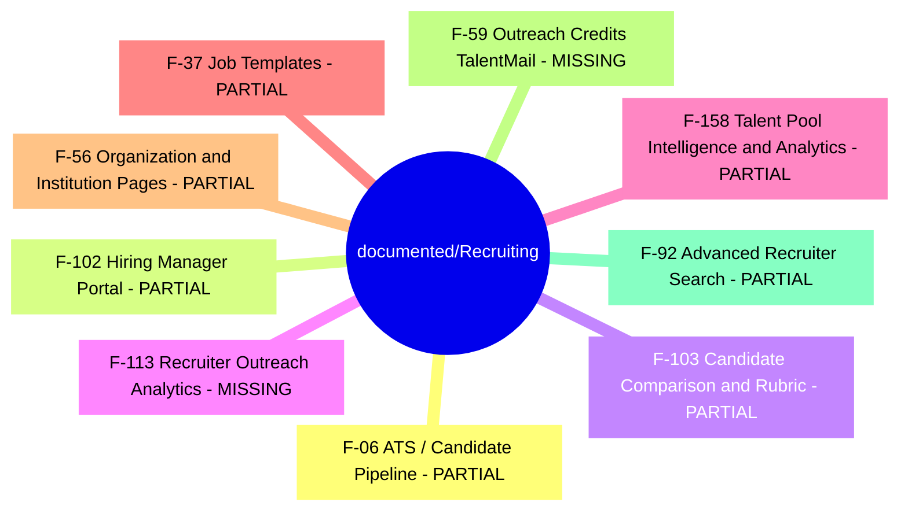

### F-06 ATS / Candidate Pipeline

ATS / Candidate Pipeline

| ID   | Level | Parent  | Name                     | Description | Status                | Verification | Evidence                               | Related |
| ---- | ----- | ------- | ------------------------ | ----------- | --------------------- | ------------ | -------------------------------------- | ------- |
| F-06 | MAJOR | MOD-212 | ATS / Candidate Pipeline |             | PARTIALLY_IMPLEMENTED |              | docs/registries/FEATURE_REGISTRY.md:22 |         |

### F-102 Hiring Manager Portal

Hiring Manager Portal

| ID    | Level | Parent  | Name                  | Description | Status                | Verification | Evidence                                | Related |
| ----- | ----- | ------- | --------------------- | ----------- | --------------------- | ------------ | --------------------------------------- | ------- |
| F-102 | MAJOR | MOD-212 | Hiring Manager Portal |             | PARTIALLY_IMPLEMENTED |              | docs/registries/FEATURE_REGISTRY.md:118 |         |

### F-103 Candidate Comparison & Rubric

Candidate Comparison & Rubric

| ID    | Level | Parent  | Name                          | Description | Status                | Verification | Evidence                                | Related |
| ----- | ----- | ------- | ----------------------------- | ----------- | --------------------- | ------------ | --------------------------------------- | ------- |
| F-103 | MAJOR | MOD-212 | Candidate Comparison & Rubric |             | PARTIALLY_IMPLEMENTED |              | docs/registries/FEATURE_REGISTRY.md:119 |         |

### F-113 Recruiter Outreach Analytics

Recruiter Outreach Analytics

| ID    | Level | Parent  | Name                         | Description | Status          | Verification | Evidence                                | Related |
| ----- | ----- | ------- | ---------------------------- | ----------- | --------------- | ------------ | --------------------------------------- | ------- |
| F-113 | MAJOR | MOD-212 | Recruiter Outreach Analytics |             | NOT_IMPLEMENTED |              | docs/registries/FEATURE_REGISTRY.md:129 |         |

### F-158 Talent Pool Intelligence & Analytics

Talent Pool Intelligence & Analytics

| ID    | Level | Parent  | Name                                 | Description | Status                | Verification | Evidence                                | Related |
| ----- | ----- | ------- | ------------------------------------ | ----------- | --------------------- | ------------ | --------------------------------------- | ------- |
| F-158 | MAJOR | MOD-212 | Talent Pool Intelligence & Analytics |             | PARTIALLY_IMPLEMENTED |              | docs/registries/FEATURE_REGISTRY.md:184 |         |

### F-37 Job Templates

Job Templates

| ID   | Level | Parent  | Name          | Description | Status                | Verification | Evidence                               | Related |
| ---- | ----- | ------- | ------------- | ----------- | --------------------- | ------------ | -------------------------------------- | ------- |
| F-37 | MAJOR | MOD-212 | Job Templates |             | PARTIALLY_IMPLEMENTED |              | docs/registries/FEATURE_REGISTRY.md:53 |         |

### F-56 Organization & Institution Pages

Organization & Institution Pages

| ID   | Level | Parent  | Name                             | Description | Status                | Verification | Evidence                               | Related |
| ---- | ----- | ------- | -------------------------------- | ----------- | --------------------- | ------------ | -------------------------------------- | ------- |
| F-56 | MAJOR | MOD-212 | Organization & Institution Pages |             | PARTIALLY_IMPLEMENTED |              | docs/registries/FEATURE_REGISTRY.md:72 |         |

### F-59 Outreach Credits (TalentMail)

Outreach Credits (TalentMail)

| ID   | Level | Parent  | Name                          | Description | Status          | Verification | Evidence                               | Related |
| ---- | ----- | ------- | ----------------------------- | ----------- | --------------- | ------------ | -------------------------------------- | ------- |
| F-59 | MAJOR | MOD-212 | Outreach Credits (TalentMail) |             | NOT_IMPLEMENTED |              | docs/registries/FEATURE_REGISTRY.md:75 |         |

### F-92 Advanced Recruiter Search

Advanced Recruiter Search

| ID   | Level | Parent  | Name                      | Description | Status                | Verification | Evidence                                | Related |
| ---- | ----- | ------- | ------------------------- | ----------- | --------------------- | ------------ | --------------------------------------- | ------- |
| F-92 | MAJOR | MOD-212 | Advanced Recruiter Search |             | PARTIALLY_IMPLEMENTED |              | docs/registries/FEATURE_REGISTRY.md:108 |         |

## documented/Learning (MOD-213)

**Application:** Documented scope (registry features) (APP-001). **Purpose:** Registry features in category 'Learning'.

**Nodes by level:** MODULE 1, MAJOR 24. **Status:** NOT_IMPLEMENTED 17, PARTIALLY_IMPLEMENTED 7, UNKNOWN 1. **Verification:** UNKNOWN 1.

### Module map (to minor features)

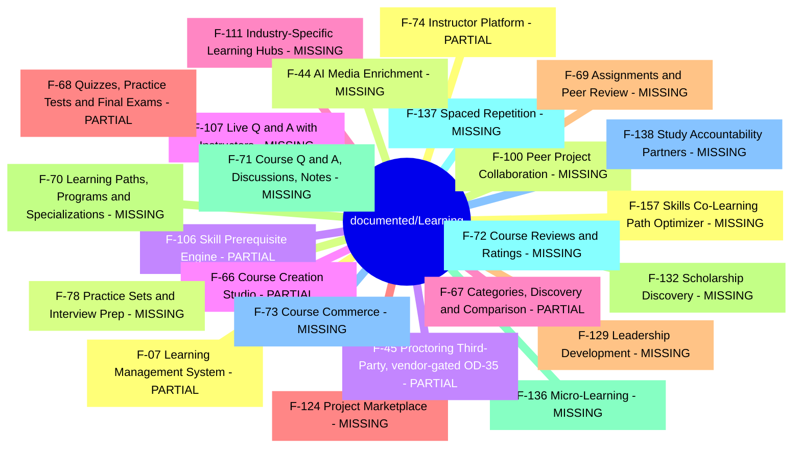

### F-07 Learning Management System

Learning Management System

| ID   | Level | Parent  | Name                       | Description | Status                | Verification | Evidence                               | Related |
| ---- | ----- | ------- | -------------------------- | ----------- | --------------------- | ------------ | -------------------------------------- | ------- |
| F-07 | MAJOR | MOD-213 | Learning Management System |             | PARTIALLY_IMPLEMENTED |              | docs/registries/FEATURE_REGISTRY.md:23 |         |

### F-100 Peer Project Collaboration

Peer Project Collaboration

| ID    | Level | Parent  | Name                       | Description | Status          | Verification | Evidence                                | Related |
| ----- | ----- | ------- | -------------------------- | ----------- | --------------- | ------------ | --------------------------------------- | ------- |
| F-100 | MAJOR | MOD-213 | Peer Project Collaboration |             | NOT_IMPLEMENTED |              | docs/registries/FEATURE_REGISTRY.md:116 |         |

### F-106 Skill Prerequisite Engine

Skill Prerequisite Engine

| ID    | Level | Parent  | Name                      | Description | Status                | Verification | Evidence                                | Related |
| ----- | ----- | ------- | ------------------------- | ----------- | --------------------- | ------------ | --------------------------------------- | ------- |
| F-106 | MAJOR | MOD-213 | Skill Prerequisite Engine |             | PARTIALLY_IMPLEMENTED |              | docs/registries/FEATURE_REGISTRY.md:122 |         |

### F-107 Live Q&A with Instructors

Live Q&A with Instructors

| ID    | Level | Parent  | Name                      | Description | Status          | Verification | Evidence                                | Related |
| ----- | ----- | ------- | ------------------------- | ----------- | --------------- | ------------ | --------------------------------------- | ------- |
| F-107 | MAJOR | MOD-213 | Live Q&A with Instructors |             | NOT_IMPLEMENTED |              | docs/registries/FEATURE_REGISTRY.md:123 |         |

### F-111 Industry-Specific Learning Hubs

Industry-Specific Learning Hubs

| ID    | Level | Parent  | Name                            | Description | Status          | Verification | Evidence                                | Related |
| ----- | ----- | ------- | ------------------------------- | ----------- | --------------- | ------------ | --------------------------------------- | ------- |
| F-111 | MAJOR | MOD-213 | Industry-Specific Learning Hubs |             | NOT_IMPLEMENTED |              | docs/registries/FEATURE_REGISTRY.md:127 |         |

### F-124 Project Marketplace

Project Marketplace

| ID    | Level | Parent  | Name                | Description | Status          | Verification | Evidence                                | Related |
| ----- | ----- | ------- | ------------------- | ----------- | --------------- | ------------ | --------------------------------------- | ------- |
| F-124 | MAJOR | MOD-213 | Project Marketplace |             | NOT_IMPLEMENTED |              | docs/registries/FEATURE_REGISTRY.md:145 |         |

### F-129 Leadership Development

Leadership Development

| ID    | Level | Parent  | Name                   | Description | Status          | Verification | Evidence                                | Related |
| ----- | ----- | ------- | ---------------------- | ----------- | --------------- | ------------ | --------------------------------------- | ------- |
| F-129 | MAJOR | MOD-213 | Leadership Development |             | NOT_IMPLEMENTED |              | docs/registries/FEATURE_REGISTRY.md:150 |         |

### F-132 Scholarship Discovery

Scholarship Discovery

| ID    | Level | Parent  | Name                  | Description | Status          | Verification | Evidence                                | Related |
| ----- | ----- | ------- | --------------------- | ----------- | --------------- | ------------ | --------------------------------------- | ------- |
| F-132 | MAJOR | MOD-213 | Scholarship Discovery |             | NOT_IMPLEMENTED |              | docs/registries/FEATURE_REGISTRY.md:153 |         |

### F-136 Micro-Learning

Micro-Learning

| ID    | Level | Parent  | Name           | Description | Status          | Verification | Evidence                                | Related |
| ----- | ----- | ------- | -------------- | ----------- | --------------- | ------------ | --------------------------------------- | ------- |
| F-136 | MAJOR | MOD-213 | Micro-Learning |             | NOT_IMPLEMENTED |              | docs/registries/FEATURE_REGISTRY.md:157 |         |

### F-137 Spaced Repetition

Spaced Repetition

| ID    | Level | Parent  | Name              | Description | Status          | Verification | Evidence                                | Related |
| ----- | ----- | ------- | ----------------- | ----------- | --------------- | ------------ | --------------------------------------- | ------- |
| F-137 | MAJOR | MOD-213 | Spaced Repetition |             | NOT_IMPLEMENTED |              | docs/registries/FEATURE_REGISTRY.md:158 |         |

### F-138 Study Accountability Partners

Study Accountability Partners

| ID    | Level | Parent  | Name                          | Description | Status          | Verification | Evidence                                | Related |
| ----- | ----- | ------- | ----------------------------- | ----------- | --------------- | ------------ | --------------------------------------- | ------- |
| F-138 | MAJOR | MOD-213 | Study Accountability Partners |             | NOT_IMPLEMENTED |              | docs/registries/FEATURE_REGISTRY.md:159 |         |

### F-157 Skills Co-Learning Path Optimizer

Skills Co-Learning Path Optimizer

| ID    | Level | Parent  | Name                              | Description | Status          | Verification | Evidence                                | Related |
| ----- | ----- | ------- | --------------------------------- | ----------- | --------------- | ------------ | --------------------------------------- | ------- |
| F-157 | MAJOR | MOD-213 | Skills Co-Learning Path Optimizer |             | NOT_IMPLEMENTED |              | docs/registries/FEATURE_REGISTRY.md:183 |         |

### F-44 AI Media Enrichment

AI Media Enrichment

| ID   | Level | Parent  | Name                | Description | Status          | Verification | Evidence                               | Related |
| ---- | ----- | ------- | ------------------- | ----------- | --------------- | ------------ | -------------------------------------- | ------- |
| F-44 | MAJOR | MOD-213 | AI Media Enrichment |             | NOT_IMPLEMENTED |              | docs/registries/FEATURE_REGISTRY.md:60 |         |

### F-45 Proctoring (Third-Party, vendor-gated OD-35)

Proctoring (Third-Party, vendor-gated OD-35)

| ID   | Level | Parent  | Name                                         | Description | Status                | Verification | Evidence                               | Related |
| ---- | ----- | ------- | -------------------------------------------- | ----------- | --------------------- | ------------ | -------------------------------------- | ------- |
| F-45 | MAJOR | MOD-213 | Proctoring (Third-Party, vendor-gated OD-35) |             | PARTIALLY_IMPLEMENTED |              | docs/registries/FEATURE_REGISTRY.md:61 |         |

### F-66 Course Creation Studio

Course Creation Studio

| ID   | Level | Parent  | Name                   | Description | Status                | Verification | Evidence                               | Related |
| ---- | ----- | ------- | ---------------------- | ----------- | --------------------- | ------------ | -------------------------------------- | ------- |
| F-66 | MAJOR | MOD-213 | Course Creation Studio |             | PARTIALLY_IMPLEMENTED |              | docs/registries/FEATURE_REGISTRY.md:82 |         |

### F-67 Categories, Discovery & Comparison

Categories, Discovery & Comparison

| ID   | Level | Parent  | Name                               | Description | Status                | Verification | Evidence                               | Related |
| ---- | ----- | ------- | ---------------------------------- | ----------- | --------------------- | ------------ | -------------------------------------- | ------- |
| F-67 | MAJOR | MOD-213 | Categories, Discovery & Comparison |             | PARTIALLY_IMPLEMENTED |              | docs/registries/FEATURE_REGISTRY.md:83 |         |

### F-68 Quizzes, Practice Tests & Final Exams

Quizzes, Practice Tests & Final Exams

| ID   | Level | Parent  | Name                                  | Description | Status                | Verification | Evidence                               | Related |
| ---- | ----- | ------- | ------------------------------------- | ----------- | --------------------- | ------------ | -------------------------------------- | ------- |
| F-68 | MAJOR | MOD-213 | Quizzes, Practice Tests & Final Exams |             | PARTIALLY_IMPLEMENTED |              | docs/registries/FEATURE_REGISTRY.md:84 |         |

### F-69 Assignments & Peer Review

Assignments & Peer Review

| ID   | Level | Parent  | Name                      | Description | Status          | Verification | Evidence                               | Related |
| ---- | ----- | ------- | ------------------------- | ----------- | --------------- | ------------ | -------------------------------------- | ------- |
| F-69 | MAJOR | MOD-213 | Assignments & Peer Review |             | NOT_IMPLEMENTED |              | docs/registries/FEATURE_REGISTRY.md:85 |         |

### F-70 Learning Paths, Programs & Specializations

Learning Paths, Programs & Specializations

| ID   | Level | Parent  | Name                                       | Description | Status          | Verification | Evidence                               | Related |
| ---- | ----- | ------- | ------------------------------------------ | ----------- | --------------- | ------------ | -------------------------------------- | ------- |
| F-70 | MAJOR | MOD-213 | Learning Paths, Programs & Specializations |             | NOT_IMPLEMENTED |              | docs/registries/FEATURE_REGISTRY.md:86 |         |

### F-71 Course Q&A, Discussions, Notes

Course Q&A, Discussions, Notes

| ID   | Level | Parent  | Name                           | Description | Status          | Verification | Evidence                               | Related |
| ---- | ----- | ------- | ------------------------------ | ----------- | --------------- | ------------ | -------------------------------------- | ------- |
| F-71 | MAJOR | MOD-213 | Course Q&A, Discussions, Notes |             | NOT_IMPLEMENTED |              | docs/registries/FEATURE_REGISTRY.md:87 |         |

### F-72 Course Reviews & Ratings

Course Reviews & Ratings

| ID   | Level | Parent  | Name                     | Description | Status          | Verification | Evidence                               | Related |
| ---- | ----- | ------- | ------------------------ | ----------- | --------------- | ------------ | -------------------------------------- | ------- |
| F-72 | MAJOR | MOD-213 | Course Reviews & Ratings |             | NOT_IMPLEMENTED |              | docs/registries/FEATURE_REGISTRY.md:88 |         |

### F-73 Course Commerce

Course Commerce

| ID   | Level | Parent  | Name            | Description | Status          | Verification | Evidence                               | Related |
| ---- | ----- | ------- | --------------- | ----------- | --------------- | ------------ | -------------------------------------- | ------- |
| F-73 | MAJOR | MOD-213 | Course Commerce |             | NOT_IMPLEMENTED |              | docs/registries/FEATURE_REGISTRY.md:89 |         |

### F-74 Instructor Platform

Instructor Platform

| ID   | Level | Parent  | Name                | Description | Status                | Verification | Evidence                               | Related |
| ---- | ----- | ------- | ------------------- | ----------- | --------------------- | ------------ | -------------------------------------- | ------- |
| F-74 | MAJOR | MOD-213 | Instructor Platform |             | PARTIALLY_IMPLEMENTED |              | docs/registries/FEATURE_REGISTRY.md:90 |         |

### F-78 Practice Sets & Interview Prep

Practice Sets & Interview Prep

| ID   | Level | Parent  | Name                           | Description | Status          | Verification | Evidence                               | Related |
| ---- | ----- | ------- | ------------------------------ | ----------- | --------------- | ------------ | -------------------------------------- | ------- |
| F-78 | MAJOR | MOD-213 | Practice Sets & Interview Prep |             | NOT_IMPLEMENTED |              | docs/registries/FEATURE_REGISTRY.md:94 |         |

## documented/Assessment (MOD-214)

**Application:** Documented scope (registry features) (APP-001). **Purpose:** Registry features in category 'Assessment'.

**Nodes by level:** MODULE 1, MAJOR 4. **Status:** BROKEN 1, NOT_IMPLEMENTED 2, PARTIALLY_IMPLEMENTED 1, UNKNOWN 1. **Verification:** UNKNOWN 1.

### Module map (to minor features)

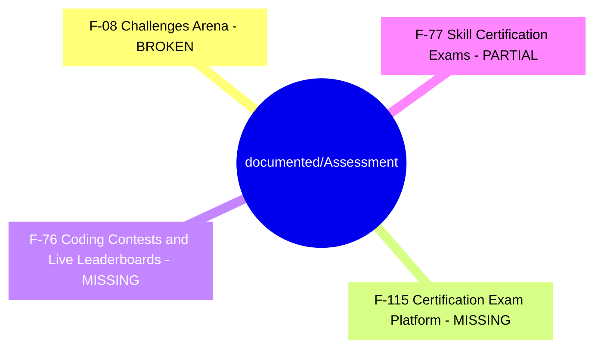

### F-08 Challenges Arena

Challenges Arena

| ID   | Level | Parent  | Name             | Description | Status | Verification | Evidence                               | Related |
| ---- | ----- | ------- | ---------------- | ----------- | ------ | ------------ | -------------------------------------- | ------- |
| F-08 | MAJOR | MOD-214 | Challenges Arena |             | BROKEN |              | docs/registries/FEATURE_REGISTRY.md:24 |         |

### F-115 Certification Exam Platform

Certification Exam Platform

| ID    | Level | Parent  | Name                        | Description | Status          | Verification | Evidence                                | Related |
| ----- | ----- | ------- | --------------------------- | ----------- | --------------- | ------------ | --------------------------------------- | ------- |
| F-115 | MAJOR | MOD-214 | Certification Exam Platform |             | NOT_IMPLEMENTED |              | docs/registries/FEATURE_REGISTRY.md:131 |         |

### F-76 Coding Contests & Live Leaderboards

Coding Contests & Live Leaderboards

| ID   | Level | Parent  | Name                                | Description | Status          | Verification | Evidence                               | Related |
| ---- | ----- | ------- | ----------------------------------- | ----------- | --------------- | ------------ | -------------------------------------- | ------- |
| F-76 | MAJOR | MOD-214 | Coding Contests & Live Leaderboards |             | NOT_IMPLEMENTED |              | docs/registries/FEATURE_REGISTRY.md:92 |         |

### F-77 Skill Certification Exams

Skill Certification Exams

| ID   | Level | Parent  | Name                      | Description | Status                | Verification | Evidence                               | Related |
| ---- | ----- | ------- | ------------------------- | ----------- | --------------------- | ------------ | -------------------------------------- | ------- |
| F-77 | MAJOR | MOD-214 | Skill Certification Exams |             | PARTIALLY_IMPLEMENTED |              | docs/registries/FEATURE_REGISTRY.md:93 |         |

## documented/Social (MOD-215)

**Application:** Documented scope (registry features) (APP-001). **Purpose:** Registry features in category 'Social'.

**Nodes by level:** MODULE 1, MAJOR 1. **Status:** PARTIALLY_IMPLEMENTED 1, UNKNOWN 1. **Verification:** UNKNOWN 1.

### Module map (to minor features)

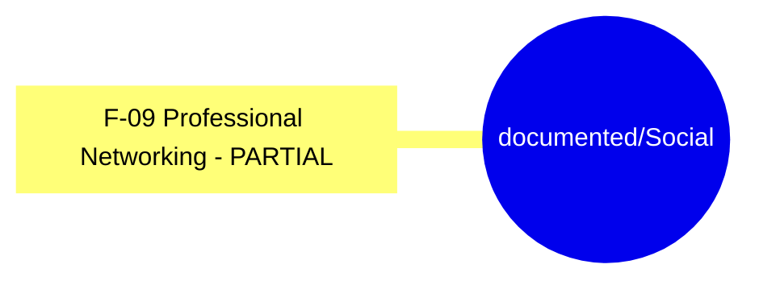

### F-09 Professional Networking

Professional Networking

| ID   | Level | Parent  | Name                    | Description | Status                | Verification | Evidence                               | Related |
| ---- | ----- | ------- | ----------------------- | ----------- | --------------------- | ------------ | -------------------------------------- | ------- |
| F-09 | MAJOR | MOD-215 | Professional Networking |             | PARTIALLY_IMPLEMENTED |              | docs/registries/FEATURE_REGISTRY.md:25 |         |

## documented/Communication (MOD-216)

**Application:** Documented scope (registry features) (APP-001). **Purpose:** Registry features in category 'Communication'.

**Nodes by level:** MODULE 1, MAJOR 5. **Status:** DEPRECATED 1, IMPLEMENTED 2, PARTIALLY_IMPLEMENTED 2, UNKNOWN 1. **Verification:** UNKNOWN 1.

### Module map (to minor features)

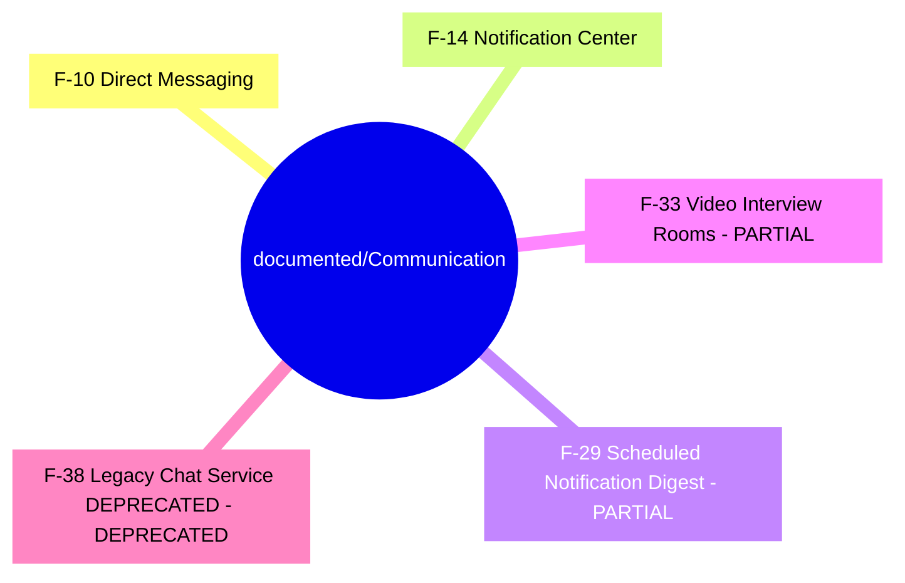

### F-10 Direct Messaging

Direct Messaging

| ID   | Level | Parent  | Name             | Description | Status      | Verification | Evidence                               | Related |
| ---- | ----- | ------- | ---------------- | ----------- | ----------- | ------------ | -------------------------------------- | ------- |
| F-10 | MAJOR | MOD-216 | Direct Messaging |             | IMPLEMENTED |              | docs/registries/FEATURE_REGISTRY.md:26 |         |

### F-14 Notification Center

Notification Center

| ID   | Level | Parent  | Name                | Description | Status      | Verification | Evidence                               | Related |
| ---- | ----- | ------- | ------------------- | ----------- | ----------- | ------------ | -------------------------------------- | ------- |
| F-14 | MAJOR | MOD-216 | Notification Center |             | IMPLEMENTED |              | docs/registries/FEATURE_REGISTRY.md:30 |         |

### F-29 Scheduled Notification Digest

Scheduled Notification Digest

| ID   | Level | Parent  | Name                          | Description | Status                | Verification | Evidence                               | Related |
| ---- | ----- | ------- | ----------------------------- | ----------- | --------------------- | ------------ | -------------------------------------- | ------- |
| F-29 | MAJOR | MOD-216 | Scheduled Notification Digest |             | PARTIALLY_IMPLEMENTED |              | docs/registries/FEATURE_REGISTRY.md:45 |         |

### F-33 Video Interview Rooms

Video Interview Rooms

| ID   | Level | Parent  | Name                  | Description | Status                | Verification | Evidence                               | Related |
| ---- | ----- | ------- | --------------------- | ----------- | --------------------- | ------------ | -------------------------------------- | ------- |
| F-33 | MAJOR | MOD-216 | Video Interview Rooms |             | PARTIALLY_IMPLEMENTED |              | docs/registries/FEATURE_REGISTRY.md:49 |         |

### F-38 Legacy Chat Service (DEPRECATED)

Legacy Chat Service (DEPRECATED)

| ID   | Level | Parent  | Name                             | Description | Status     | Verification | Evidence                               | Related |
| ---- | ----- | ------- | -------------------------------- | ----------- | ---------- | ------------ | -------------------------------------- | ------- |
| F-38 | MAJOR | MOD-216 | Legacy Chat Service (DEPRECATED) |             | DEPRECATED |              | docs/registries/FEATURE_REGISTRY.md:54 |         |

## documented/Gamification (MOD-217)

**Application:** Documented scope (registry features) (APP-001). **Purpose:** Registry features in category 'Gamification'.

**Nodes by level:** MODULE 1, MAJOR 1. **Status:** PARTIALLY_IMPLEMENTED 1, UNKNOWN 1. **Verification:** UNKNOWN 1.

### Module map (to minor features)

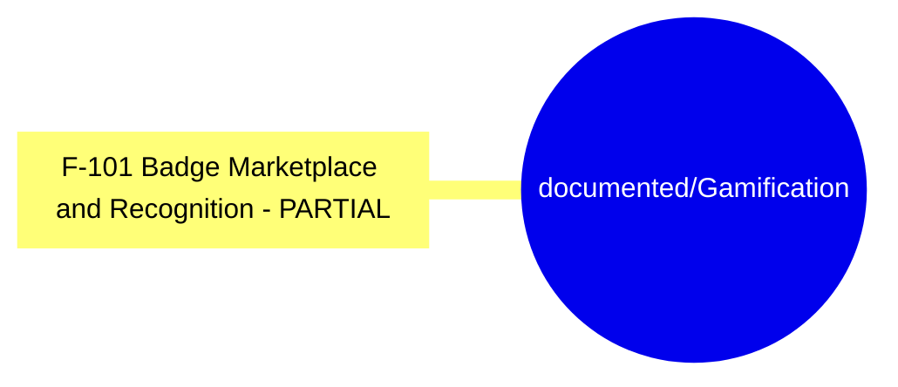

### F-101 Badge Marketplace & Recognition

Badge Marketplace & Recognition

| ID    | Level | Parent  | Name                            | Description | Status                | Verification | Evidence                                | Related |
| ----- | ----- | ------- | ------------------------------- | ----------- | --------------------- | ------------ | --------------------------------------- | ------- |
| F-101 | MAJOR | MOD-217 | Badge Marketplace & Recognition |             | PARTIALLY_IMPLEMENTED |              | docs/registries/FEATURE_REGISTRY.md:117 |         |

## documented/Hiring (MOD-218)

**Application:** Documented scope (registry features) (APP-001). **Purpose:** Registry features in category 'Hiring'.

**Nodes by level:** MODULE 1, MAJOR 5. **Status:** NOT_IMPLEMENTED 3, PARTIALLY_IMPLEMENTED 2, UNKNOWN 1. **Verification:** UNKNOWN 1.

### Module map (to minor features)

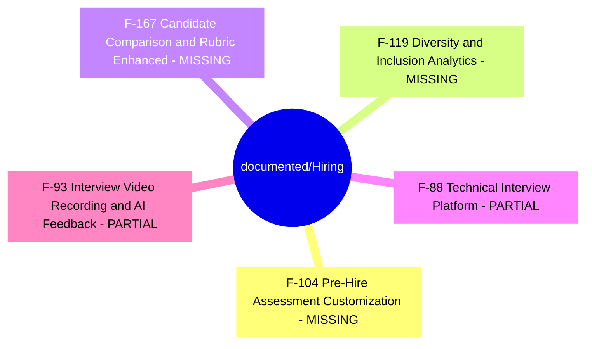

### F-104 Pre-Hire Assessment Customization

Pre-Hire Assessment Customization

| ID    | Level | Parent  | Name                              | Description | Status          | Verification | Evidence                                | Related |
| ----- | ----- | ------- | --------------------------------- | ----------- | --------------- | ------------ | --------------------------------------- | ------- |
| F-104 | MAJOR | MOD-218 | Pre-Hire Assessment Customization |             | NOT_IMPLEMENTED |              | docs/registries/FEATURE_REGISTRY.md:120 |         |

### F-119 Diversity & Inclusion Analytics

Diversity & Inclusion Analytics

| ID    | Level | Parent  | Name                            | Description | Status          | Verification | Evidence                                | Related |
| ----- | ----- | ------- | ------------------------------- | ----------- | --------------- | ------------ | --------------------------------------- | ------- |
| F-119 | MAJOR | MOD-218 | Diversity & Inclusion Analytics |             | NOT_IMPLEMENTED |              | docs/registries/FEATURE_REGISTRY.md:135 |         |

### F-167 Candidate Comparison & Rubric (Enhanced)

Candidate Comparison & Rubric (Enhanced)

| ID    | Level | Parent  | Name                                     | Description | Status          | Verification | Evidence                                | Related |
| ----- | ----- | ------- | ---------------------------------------- | ----------- | --------------- | ------------ | --------------------------------------- | ------- |
| F-167 | MAJOR | MOD-218 | Candidate Comparison & Rubric (Enhanced) |             | NOT_IMPLEMENTED |              | docs/registries/FEATURE_REGISTRY.md:193 |         |

### F-88 Technical Interview Platform

Technical Interview Platform

| ID   | Level | Parent  | Name                         | Description | Status                | Verification | Evidence                                | Related |
| ---- | ----- | ------- | ---------------------------- | ----------- | --------------------- | ------------ | --------------------------------------- | ------- |
| F-88 | MAJOR | MOD-218 | Technical Interview Platform |             | PARTIALLY_IMPLEMENTED |              | docs/registries/FEATURE_REGISTRY.md:104 |         |

### F-93 Interview Video Recording & AI Feedback

Interview Video Recording & AI Feedback

| ID   | Level | Parent  | Name                                    | Description | Status                | Verification | Evidence                                | Related |
| ---- | ----- | ------- | --------------------------------------- | ----------- | --------------------- | ------------ | --------------------------------------- | ------- |
| F-93 | MAJOR | MOD-218 | Interview Video Recording & AI Feedback |             | PARTIALLY_IMPLEMENTED |              | docs/registries/FEATURE_REGISTRY.md:109 |         |

## documented/Analytics (MOD-219)

**Application:** Documented scope (registry features) (APP-001). **Purpose:** Registry features in category 'Analytics'.

**Nodes by level:** MODULE 1, MAJOR 9. **Status:** NOT_IMPLEMENTED 4, PARTIALLY_IMPLEMENTED 5, UNKNOWN 1. **Verification:** UNKNOWN 1.

### Module map (to minor features)

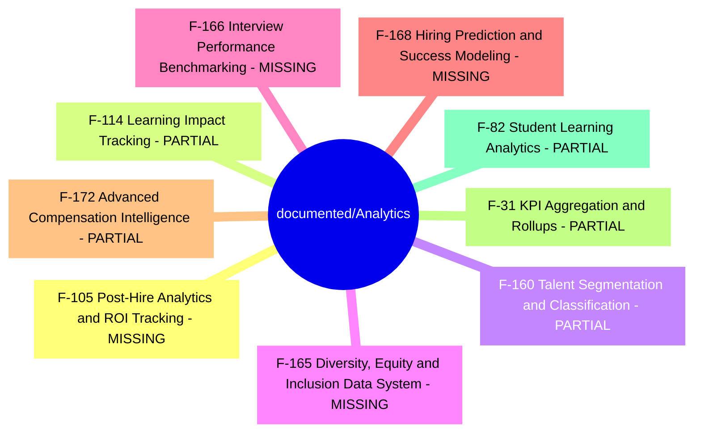

### F-105 Post-Hire Analytics & ROI Tracking

Post-Hire Analytics & ROI Tracking

| ID    | Level | Parent  | Name                               | Description | Status          | Verification | Evidence                                | Related |
| ----- | ----- | ------- | ---------------------------------- | ----------- | --------------- | ------------ | --------------------------------------- | ------- |
| F-105 | MAJOR | MOD-219 | Post-Hire Analytics & ROI Tracking |             | NOT_IMPLEMENTED |              | docs/registries/FEATURE_REGISTRY.md:121 |         |

### F-114 Learning Impact Tracking

Learning Impact Tracking

| ID    | Level | Parent  | Name                     | Description | Status                | Verification | Evidence                                | Related |
| ----- | ----- | ------- | ------------------------ | ----------- | --------------------- | ------------ | --------------------------------------- | ------- |
| F-114 | MAJOR | MOD-219 | Learning Impact Tracking |             | PARTIALLY_IMPLEMENTED |              | docs/registries/FEATURE_REGISTRY.md:130 |         |

### F-160 Talent Segmentation & Classification

Talent Segmentation & Classification

| ID    | Level | Parent  | Name                                 | Description | Status                | Verification | Evidence                                | Related |
| ----- | ----- | ------- | ------------------------------------ | ----------- | --------------------- | ------------ | --------------------------------------- | ------- |
| F-160 | MAJOR | MOD-219 | Talent Segmentation & Classification |             | PARTIALLY_IMPLEMENTED |              | docs/registries/FEATURE_REGISTRY.md:186 |         |

### F-165 Diversity, Equity & Inclusion Data System

Diversity, Equity & Inclusion Data System

| ID    | Level | Parent  | Name                                      | Description | Status          | Verification | Evidence                                | Related |
| ----- | ----- | ------- | ----------------------------------------- | ----------- | --------------- | ------------ | --------------------------------------- | ------- |
| F-165 | MAJOR | MOD-219 | Diversity, Equity & Inclusion Data System |             | NOT_IMPLEMENTED |              | docs/registries/FEATURE_REGISTRY.md:191 |         |

### F-166 Interview Performance Benchmarking

Interview Performance Benchmarking

| ID    | Level | Parent  | Name                               | Description | Status          | Verification | Evidence                                | Related |
| ----- | ----- | ------- | ---------------------------------- | ----------- | --------------- | ------------ | --------------------------------------- | ------- |
| F-166 | MAJOR | MOD-219 | Interview Performance Benchmarking |             | NOT_IMPLEMENTED |              | docs/registries/FEATURE_REGISTRY.md:192 |         |

### F-168 Hiring Prediction & Success Modeling

Hiring Prediction & Success Modeling

| ID    | Level | Parent  | Name                                 | Description | Status          | Verification | Evidence                                | Related |
| ----- | ----- | ------- | ------------------------------------ | ----------- | --------------- | ------------ | --------------------------------------- | ------- |
| F-168 | MAJOR | MOD-219 | Hiring Prediction & Success Modeling |             | NOT_IMPLEMENTED |              | docs/registries/FEATURE_REGISTRY.md:194 |         |

### F-172 Advanced Compensation Intelligence

Advanced Compensation Intelligence

| ID    | Level | Parent  | Name                               | Description | Status                | Verification | Evidence                                | Related |
| ----- | ----- | ------- | ---------------------------------- | ----------- | --------------------- | ------------ | --------------------------------------- | ------- |
| F-172 | MAJOR | MOD-219 | Advanced Compensation Intelligence |             | PARTIALLY_IMPLEMENTED |              | docs/registries/FEATURE_REGISTRY.md:198 |         |

### F-31 KPI Aggregation & Rollups

KPI Aggregation & Rollups

| ID   | Level | Parent  | Name                      | Description | Status                | Verification | Evidence                               | Related |
| ---- | ----- | ------- | ------------------------- | ----------- | --------------------- | ------------ | -------------------------------------- | ------- |
| F-31 | MAJOR | MOD-219 | KPI Aggregation & Rollups |             | PARTIALLY_IMPLEMENTED |              | docs/registries/FEATURE_REGISTRY.md:47 |         |

### F-82 Student Learning Analytics

Student Learning Analytics

| ID   | Level | Parent  | Name                       | Description | Status                | Verification | Evidence                               | Related |
| ---- | ----- | ------- | -------------------------- | ----------- | --------------------- | ------------ | -------------------------------------- | ------- |
| F-82 | MAJOR | MOD-219 | Student Learning Analytics |             | PARTIALLY_IMPLEMENTED |              | docs/registries/FEATURE_REGISTRY.md:98 |         |

## documented/Networking (MOD-220)

**Application:** Documented scope (registry features) (APP-001). **Purpose:** Registry features in category 'Networking'.

**Nodes by level:** MODULE 1, MAJOR 9. **Status:** NOT_IMPLEMENTED 6, PARTIALLY_IMPLEMENTED 3, UNKNOWN 1. **Verification:** UNKNOWN 1.

### Module map (to minor features)

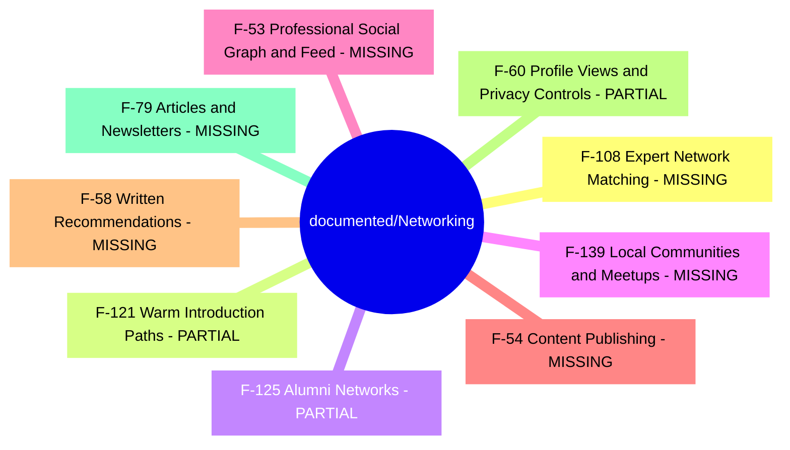

### F-108 Expert Network Matching

Expert Network Matching

| ID    | Level | Parent  | Name                    | Description | Status          | Verification | Evidence                                | Related |
| ----- | ----- | ------- | ----------------------- | ----------- | --------------- | ------------ | --------------------------------------- | ------- |
| F-108 | MAJOR | MOD-220 | Expert Network Matching |             | NOT_IMPLEMENTED |              | docs/registries/FEATURE_REGISTRY.md:124 |         |

### F-121 Warm Introduction Paths

Warm Introduction Paths

| ID    | Level | Parent  | Name                    | Description | Status                | Verification | Evidence                                | Related |
| ----- | ----- | ------- | ----------------------- | ----------- | --------------------- | ------------ | --------------------------------------- | ------- |
| F-121 | MAJOR | MOD-220 | Warm Introduction Paths |             | PARTIALLY_IMPLEMENTED |              | docs/registries/FEATURE_REGISTRY.md:142 |         |

### F-125 Alumni Networks

Alumni Networks

| ID    | Level | Parent  | Name            | Description | Status                | Verification | Evidence                                | Related |
| ----- | ----- | ------- | --------------- | ----------- | --------------------- | ------------ | --------------------------------------- | ------- |
| F-125 | MAJOR | MOD-220 | Alumni Networks |             | PARTIALLY_IMPLEMENTED |              | docs/registries/FEATURE_REGISTRY.md:146 |         |

### F-139 Local Communities & Meetups

Local Communities & Meetups

| ID    | Level | Parent  | Name                        | Description | Status          | Verification | Evidence                                | Related |
| ----- | ----- | ------- | --------------------------- | ----------- | --------------- | ------------ | --------------------------------------- | ------- |
| F-139 | MAJOR | MOD-220 | Local Communities & Meetups |             | NOT_IMPLEMENTED |              | docs/registries/FEATURE_REGISTRY.md:160 |         |

### F-53 Professional Social Graph & Feed

Professional Social Graph & Feed

| ID   | Level | Parent  | Name                             | Description | Status          | Verification | Evidence                               | Related |
| ---- | ----- | ------- | -------------------------------- | ----------- | --------------- | ------------ | -------------------------------------- | ------- |
| F-53 | MAJOR | MOD-220 | Professional Social Graph & Feed |             | NOT_IMPLEMENTED |              | docs/registries/FEATURE_REGISTRY.md:69 |         |

### F-54 Content Publishing

Content Publishing

| ID   | Level | Parent  | Name               | Description | Status          | Verification | Evidence                               | Related |
| ---- | ----- | ------- | ------------------ | ----------- | --------------- | ------------ | -------------------------------------- | ------- |
| F-54 | MAJOR | MOD-220 | Content Publishing |             | NOT_IMPLEMENTED |              | docs/registries/FEATURE_REGISTRY.md:70 |         |

### F-58 Written Recommendations

Written Recommendations

| ID   | Level | Parent  | Name                    | Description | Status          | Verification | Evidence                               | Related |
| ---- | ----- | ------- | ----------------------- | ----------- | --------------- | ------------ | -------------------------------------- | ------- |
| F-58 | MAJOR | MOD-220 | Written Recommendations |             | NOT_IMPLEMENTED |              | docs/registries/FEATURE_REGISTRY.md:74 |         |

### F-60 Profile Views & Privacy Controls

Profile Views & Privacy Controls

| ID   | Level | Parent  | Name                             | Description | Status                | Verification | Evidence                               | Related |
| ---- | ----- | ------- | -------------------------------- | ----------- | --------------------- | ------------ | -------------------------------------- | ------- |
| F-60 | MAJOR | MOD-220 | Profile Views & Privacy Controls |             | PARTIALLY_IMPLEMENTED |              | docs/registries/FEATURE_REGISTRY.md:76 |         |

### F-79 Articles & Newsletters

Articles & Newsletters

| ID   | Level | Parent  | Name                   | Description | Status          | Verification | Evidence                               | Related |
| ---- | ----- | ------- | ---------------------- | ----------- | --------------- | ------------ | -------------------------------------- | ------- |
| F-79 | MAJOR | MOD-220 | Articles & Newsletters |             | NOT_IMPLEMENTED |              | docs/registries/FEATURE_REGISTRY.md:95 |         |

## documented/Career (MOD-221)

**Application:** Documented scope (registry features) (APP-001). **Purpose:** Registry features in category 'Career'.

**Nodes by level:** MODULE 1, MAJOR 4. **Status:** NOT_IMPLEMENTED 2, PARTIALLY_IMPLEMENTED 2, UNKNOWN 1. **Verification:** UNKNOWN 1.

### Module map (to minor features)

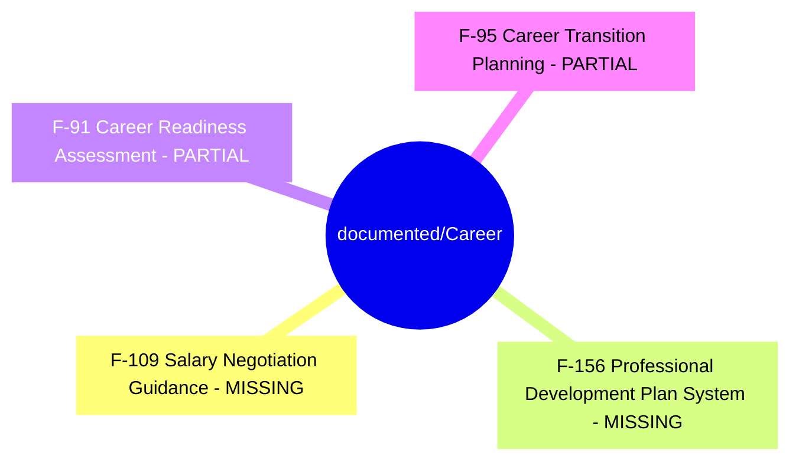

### F-109 Salary Negotiation Guidance

Salary Negotiation Guidance

| ID    | Level | Parent  | Name                        | Description | Status          | Verification | Evidence                                | Related |
| ----- | ----- | ------- | --------------------------- | ----------- | --------------- | ------------ | --------------------------------------- | ------- |
| F-109 | MAJOR | MOD-221 | Salary Negotiation Guidance |             | NOT_IMPLEMENTED |              | docs/registries/FEATURE_REGISTRY.md:125 |         |

### F-156 Professional Development Plan System

Professional Development Plan System

| ID    | Level | Parent  | Name                                 | Description | Status          | Verification | Evidence                                | Related |
| ----- | ----- | ------- | ------------------------------------ | ----------- | --------------- | ------------ | --------------------------------------- | ------- |
| F-156 | MAJOR | MOD-221 | Professional Development Plan System |             | NOT_IMPLEMENTED |              | docs/registries/FEATURE_REGISTRY.md:182 |         |

### F-91 Career Readiness Assessment

Career Readiness Assessment

| ID   | Level | Parent  | Name                        | Description | Status                | Verification | Evidence                                | Related |
| ---- | ----- | ------- | --------------------------- | ----------- | --------------------- | ------------ | --------------------------------------- | ------- |
| F-91 | MAJOR | MOD-221 | Career Readiness Assessment |             | PARTIALLY_IMPLEMENTED |              | docs/registries/FEATURE_REGISTRY.md:107 |         |

### F-95 Career Transition Planning

Career Transition Planning

| ID   | Level | Parent  | Name                       | Description | Status                | Verification | Evidence                                | Related |
| ---- | ----- | ------- | -------------------------- | ----------- | --------------------- | ------------ | --------------------------------------- | ------- |
| F-95 | MAJOR | MOD-221 | Career Transition Planning |             | PARTIALLY_IMPLEMENTED |              | docs/registries/FEATURE_REGISTRY.md:111 |         |

## documented/AI (MOD-222)

**Application:** Documented scope (registry features) (APP-001). **Purpose:** Registry features in category 'AI'.

**Nodes by level:** MODULE 1, MAJOR 2. **Status:** PARTIALLY_IMPLEMENTED 2, UNKNOWN 1. **Verification:** UNKNOWN 1.

### Module map (to minor features)


### F-11 AI Career Assistant (Basic)

AI Career Assistant (Basic)

| ID   | Level | Parent  | Name                        | Description | Status                | Verification | Evidence                               | Related |
| ---- | ----- | ------- | --------------------------- | ----------- | --------------------- | ------------ | -------------------------------------- | ------- |
| F-11 | MAJOR | MOD-222 | AI Career Assistant (Basic) |             | PARTIALLY_IMPLEMENTED |              | docs/registries/FEATURE_REGISTRY.md:27 |         |

### F-99 AI Career Coach (Enhanced)

AI Career Coach (Enhanced)

| ID   | Level | Parent  | Name                       | Description | Status                | Verification | Evidence                                | Related |
| ---- | ----- | ------- | -------------------------- | ----------- | --------------------- | ------------ | --------------------------------------- | ------- |
| F-99 | MAJOR | MOD-222 | AI Career Coach (Enhanced) |             | PARTIALLY_IMPLEMENTED |              | docs/registries/FEATURE_REGISTRY.md:115 |         |

## documented/Verification (MOD-223)

**Application:** Documented scope (registry features) (APP-001). **Purpose:** Registry features in category 'Verification'.

**Nodes by level:** MODULE 1, MAJOR 8. **Status:** PARTIALLY_IMPLEMENTED 8, UNKNOWN 1. **Verification:** UNKNOWN 1.

### Module map (to minor features)

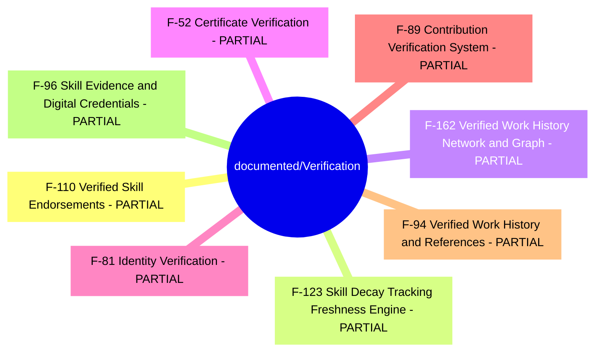

### F-110 Verified Skill Endorsements

Verified Skill Endorsements

| ID    | Level | Parent  | Name                        | Description | Status                | Verification | Evidence                                | Related |
| ----- | ----- | ------- | --------------------------- | ----------- | --------------------- | ------------ | --------------------------------------- | ------- |
| F-110 | MAJOR | MOD-223 | Verified Skill Endorsements |             | PARTIALLY_IMPLEMENTED |              | docs/registries/FEATURE_REGISTRY.md:126 |         |

### F-123 Skill Decay Tracking (Freshness Engine)

Skill Decay Tracking (Freshness Engine)

| ID    | Level | Parent  | Name                                    | Description | Status                | Verification | Evidence                                | Related |
| ----- | ----- | ------- | --------------------------------------- | ----------- | --------------------- | ------------ | --------------------------------------- | ------- |
| F-123 | MAJOR | MOD-223 | Skill Decay Tracking (Freshness Engine) |             | PARTIALLY_IMPLEMENTED |              | docs/registries/FEATURE_REGISTRY.md:144 |         |

### F-162 Verified Work History Network & Graph

Verified Work History Network & Graph

| ID    | Level | Parent  | Name                                  | Description | Status                | Verification | Evidence                                | Related |
| ----- | ----- | ------- | ------------------------------------- | ----------- | --------------------- | ------------ | --------------------------------------- | ------- |
| F-162 | MAJOR | MOD-223 | Verified Work History Network & Graph |             | PARTIALLY_IMPLEMENTED |              | docs/registries/FEATURE_REGISTRY.md:188 |         |

### F-52 Certificate Verification

Certificate Verification

| ID   | Level | Parent  | Name                     | Description | Status                | Verification | Evidence                               | Related |
| ---- | ----- | ------- | ------------------------ | ----------- | --------------------- | ------------ | -------------------------------------- | ------- |
| F-52 | MAJOR | MOD-223 | Certificate Verification |             | PARTIALLY_IMPLEMENTED |              | docs/registries/FEATURE_REGISTRY.md:68 |         |

### F-81 Identity Verification

Identity Verification

| ID   | Level | Parent  | Name                  | Description | Status                | Verification | Evidence                               | Related |
| ---- | ----- | ------- | --------------------- | ----------- | --------------------- | ------------ | -------------------------------------- | ------- |
| F-81 | MAJOR | MOD-223 | Identity Verification |             | PARTIALLY_IMPLEMENTED |              | docs/registries/FEATURE_REGISTRY.md:97 |         |

### F-89 Contribution Verification System

Contribution Verification System

| ID   | Level | Parent  | Name                             | Description | Status                | Verification | Evidence                                | Related |
| ---- | ----- | ------- | -------------------------------- | ----------- | --------------------- | ------------ | --------------------------------------- | ------- |
| F-89 | MAJOR | MOD-223 | Contribution Verification System |             | PARTIALLY_IMPLEMENTED |              | docs/registries/FEATURE_REGISTRY.md:105 |         |

### F-94 Verified Work History & References

Verified Work History & References

| ID   | Level | Parent  | Name                               | Description | Status                | Verification | Evidence                                | Related |
| ---- | ----- | ------- | ---------------------------------- | ----------- | --------------------- | ------------ | --------------------------------------- | ------- |
| F-94 | MAJOR | MOD-223 | Verified Work History & References |             | PARTIALLY_IMPLEMENTED |              | docs/registries/FEATURE_REGISTRY.md:110 |         |

### F-96 Skill Evidence & Digital Credentials

Skill Evidence & Digital Credentials

| ID   | Level | Parent  | Name                                 | Description | Status                | Verification | Evidence                                | Related |
| ---- | ----- | ------- | ------------------------------------ | ----------- | --------------------- | ------------ | --------------------------------------- | ------- |
| F-96 | MAJOR | MOD-223 | Skill Evidence & Digital Credentials |             | PARTIALLY_IMPLEMENTED |              | docs/registries/FEATURE_REGISTRY.md:112 |         |

## documented/Candidate (MOD-224)

**Application:** Documented scope (registry features) (APP-001). **Purpose:** Registry features in category 'Candidate'.

**Nodes by level:** MODULE 1, MAJOR 5. **Status:** NOT_IMPLEMENTED 1, PARTIALLY_IMPLEMENTED 4, UNKNOWN 1. **Verification:** UNKNOWN 1.

### Module map (to minor features)

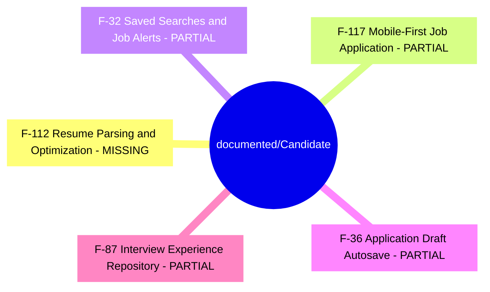

### F-112 Resume Parsing & Optimization

Resume Parsing & Optimization

| ID    | Level | Parent  | Name                          | Description | Status          | Verification | Evidence                                | Related |
| ----- | ----- | ------- | ----------------------------- | ----------- | --------------- | ------------ | --------------------------------------- | ------- |
| F-112 | MAJOR | MOD-224 | Resume Parsing & Optimization |             | NOT_IMPLEMENTED |              | docs/registries/FEATURE_REGISTRY.md:128 |         |

### F-117 Mobile-First Job Application

Mobile-First Job Application

| ID    | Level | Parent  | Name                         | Description | Status                | Verification | Evidence                                | Related |
| ----- | ----- | ------- | ---------------------------- | ----------- | --------------------- | ------------ | --------------------------------------- | ------- |
| F-117 | MAJOR | MOD-224 | Mobile-First Job Application |             | PARTIALLY_IMPLEMENTED |              | docs/registries/FEATURE_REGISTRY.md:133 |         |

### F-32 Saved Searches & Job Alerts

Saved Searches & Job Alerts

| ID   | Level | Parent  | Name                        | Description | Status                | Verification | Evidence                               | Related |
| ---- | ----- | ------- | --------------------------- | ----------- | --------------------- | ------------ | -------------------------------------- | ------- |
| F-32 | MAJOR | MOD-224 | Saved Searches & Job Alerts |             | PARTIALLY_IMPLEMENTED |              | docs/registries/FEATURE_REGISTRY.md:48 |         |

### F-36 Application Draft Autosave

Application Draft Autosave

| ID   | Level | Parent  | Name                       | Description | Status                | Verification | Evidence                               | Related |
| ---- | ----- | ------- | -------------------------- | ----------- | --------------------- | ------------ | -------------------------------------- | ------- |
| F-36 | MAJOR | MOD-224 | Application Draft Autosave |             | PARTIALLY_IMPLEMENTED |              | docs/registries/FEATURE_REGISTRY.md:52 |         |

### F-87 Interview Experience Repository

Interview Experience Repository

| ID   | Level | Parent  | Name                            | Description | Status                | Verification | Evidence                                | Related |
| ---- | ----- | ------- | ------------------------------- | ----------- | --------------------- | ------------ | --------------------------------------- | ------- |
| F-87 | MAJOR | MOD-224 | Interview Experience Repository |             | PARTIALLY_IMPLEMENTED |              | docs/registries/FEATURE_REGISTRY.md:103 |         |

## documented/Platform (MOD-225)

**Application:** Documented scope (registry features) (APP-001). **Purpose:** Registry features in category 'Platform'.

**Nodes by level:** MODULE 1, MAJOR 11. **Status:** DEPRECATED 1, NOT_IMPLEMENTED 5, PARTIALLY_IMPLEMENTED 5, UNKNOWN 1. **Verification:** UNKNOWN 1.

### Module map (to minor features)

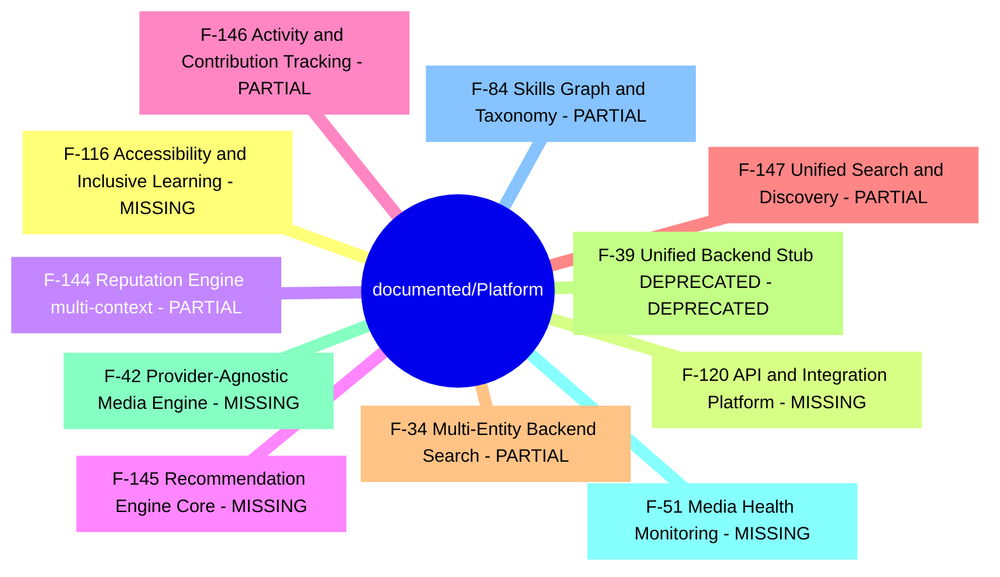

### F-116 Accessibility & Inclusive Learning

Accessibility & Inclusive Learning

| ID    | Level | Parent  | Name                               | Description | Status          | Verification | Evidence                                | Related |
| ----- | ----- | ------- | ---------------------------------- | ----------- | --------------- | ------------ | --------------------------------------- | ------- |
| F-116 | MAJOR | MOD-225 | Accessibility & Inclusive Learning |             | NOT_IMPLEMENTED |              | docs/registries/FEATURE_REGISTRY.md:132 |         |

### F-120 API & Integration Platform

API & Integration Platform

| ID    | Level | Parent  | Name                       | Description | Status          | Verification | Evidence                                | Related |
| ----- | ----- | ------- | -------------------------- | ----------- | --------------- | ------------ | --------------------------------------- | ------- |
| F-120 | MAJOR | MOD-225 | API & Integration Platform |             | NOT_IMPLEMENTED |              | docs/registries/FEATURE_REGISTRY.md:136 |         |

### F-144 Reputation Engine (multi-context)

Reputation Engine (multi-context)

| ID    | Level | Parent  | Name                              | Description | Status                | Verification | Evidence                                | Related |
| ----- | ----- | ------- | --------------------------------- | ----------- | --------------------- | ------------ | --------------------------------------- | ------- |
| F-144 | MAJOR | MOD-225 | Reputation Engine (multi-context) |             | PARTIALLY_IMPLEMENTED |              | docs/registries/FEATURE_REGISTRY.md:170 |         |

### F-145 Recommendation Engine Core

Recommendation Engine Core

| ID    | Level | Parent  | Name                       | Description | Status          | Verification | Evidence                                | Related |
| ----- | ----- | ------- | -------------------------- | ----------- | --------------- | ------------ | --------------------------------------- | ------- |
| F-145 | MAJOR | MOD-225 | Recommendation Engine Core |             | NOT_IMPLEMENTED |              | docs/registries/FEATURE_REGISTRY.md:171 |         |

### F-146 Activity & Contribution Tracking

Activity & Contribution Tracking

| ID    | Level | Parent  | Name                             | Description | Status                | Verification | Evidence                                | Related |
| ----- | ----- | ------- | -------------------------------- | ----------- | --------------------- | ------------ | --------------------------------------- | ------- |
| F-146 | MAJOR | MOD-225 | Activity & Contribution Tracking |             | PARTIALLY_IMPLEMENTED |              | docs/registries/FEATURE_REGISTRY.md:172 |         |

### F-147 Unified Search & Discovery

Unified Search & Discovery

| ID    | Level | Parent  | Name                       | Description | Status                | Verification | Evidence                                | Related |
| ----- | ----- | ------- | -------------------------- | ----------- | --------------------- | ------------ | --------------------------------------- | ------- |
| F-147 | MAJOR | MOD-225 | Unified Search & Discovery |             | PARTIALLY_IMPLEMENTED |              | docs/registries/FEATURE_REGISTRY.md:173 |         |

### F-34 Multi-Entity Backend Search

Multi-Entity Backend Search

| ID   | Level | Parent  | Name                        | Description | Status                | Verification | Evidence                               | Related |
| ---- | ----- | ------- | --------------------------- | ----------- | --------------------- | ------------ | -------------------------------------- | ------- |
| F-34 | MAJOR | MOD-225 | Multi-Entity Backend Search |             | PARTIALLY_IMPLEMENTED |              | docs/registries/FEATURE_REGISTRY.md:50 |         |

### F-39 Unified Backend Stub (DEPRECATED)

Unified Backend Stub (DEPRECATED)

| ID   | Level | Parent  | Name                              | Description | Status     | Verification | Evidence                               | Related |
| ---- | ----- | ------- | --------------------------------- | ----------- | ---------- | ------------ | -------------------------------------- | ------- |
| F-39 | MAJOR | MOD-225 | Unified Backend Stub (DEPRECATED) |             | DEPRECATED |              | docs/registries/FEATURE_REGISTRY.md:55 |         |

### F-42 Provider-Agnostic Media Engine

Provider-Agnostic Media Engine

| ID   | Level | Parent  | Name                           | Description | Status          | Verification | Evidence                               | Related |
| ---- | ----- | ------- | ------------------------------ | ----------- | --------------- | ------------ | -------------------------------------- | ------- |
| F-42 | MAJOR | MOD-225 | Provider-Agnostic Media Engine |             | NOT_IMPLEMENTED |              | docs/registries/FEATURE_REGISTRY.md:58 |         |

### F-51 Media Health Monitoring

Media Health Monitoring

| ID   | Level | Parent  | Name                    | Description | Status          | Verification | Evidence                               | Related |
| ---- | ----- | ------- | ----------------------- | ----------- | --------------- | ------------ | -------------------------------------- | ------- |
| F-51 | MAJOR | MOD-225 | Media Health Monitoring |             | NOT_IMPLEMENTED |              | docs/registries/FEATURE_REGISTRY.md:67 |         |

### F-84 Skills Graph & Taxonomy

Skills Graph & Taxonomy

| ID   | Level | Parent  | Name                    | Description | Status                | Verification | Evidence                                | Related |
| ---- | ----- | ------- | ----------------------- | ----------- | --------------------- | ------------ | --------------------------------------- | ------- |
| F-84 | MAJOR | MOD-225 | Skills Graph & Taxonomy |             | PARTIALLY_IMPLEMENTED |              | docs/registries/FEATURE_REGISTRY.md:100 |         |

## documented/Intelligence (MOD-226)

**Application:** Documented scope (registry features) (APP-001). **Purpose:** Registry features in category 'Intelligence'.

**Nodes by level:** MODULE 1, MAJOR 12. **Status:** DEPRECATED 1, NOT_IMPLEMENTED 2, PARTIALLY_IMPLEMENTED 9, UNKNOWN 1. **Verification:** UNKNOWN 1.

### Module map (to minor features)

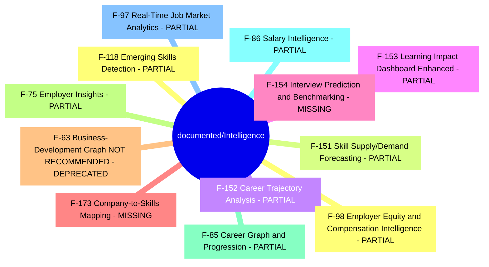

### F-118 Emerging Skills Detection

Emerging Skills Detection

| ID    | Level | Parent  | Name                      | Description | Status                | Verification | Evidence                                | Related |
| ----- | ----- | ------- | ------------------------- | ----------- | --------------------- | ------------ | --------------------------------------- | ------- |
| F-118 | MAJOR | MOD-226 | Emerging Skills Detection |             | PARTIALLY_IMPLEMENTED |              | docs/registries/FEATURE_REGISTRY.md:134 |         |

### F-151 Skill Supply/Demand Forecasting

Skill Supply/Demand Forecasting

| ID    | Level | Parent  | Name                            | Description | Status                | Verification | Evidence                                | Related |
| ----- | ----- | ------- | ------------------------------- | ----------- | --------------------- | ------------ | --------------------------------------- | ------- |
| F-151 | MAJOR | MOD-226 | Skill Supply/Demand Forecasting |             | PARTIALLY_IMPLEMENTED |              | docs/registries/FEATURE_REGISTRY.md:177 |         |

### F-152 Career Trajectory Analysis

Career Trajectory Analysis

| ID    | Level | Parent  | Name                       | Description | Status                | Verification | Evidence                                | Related |
| ----- | ----- | ------- | -------------------------- | ----------- | --------------------- | ------------ | --------------------------------------- | ------- |
| F-152 | MAJOR | MOD-226 | Career Trajectory Analysis |             | PARTIALLY_IMPLEMENTED |              | docs/registries/FEATURE_REGISTRY.md:178 |         |

### F-153 Learning Impact Dashboard (Enhanced)

Learning Impact Dashboard (Enhanced)

| ID    | Level | Parent  | Name                                 | Description | Status                | Verification | Evidence                                | Related |
| ----- | ----- | ------- | ------------------------------------ | ----------- | --------------------- | ------------ | --------------------------------------- | ------- |
| F-153 | MAJOR | MOD-226 | Learning Impact Dashboard (Enhanced) |             | PARTIALLY_IMPLEMENTED |              | docs/registries/FEATURE_REGISTRY.md:179 |         |

### F-154 Interview Prediction & Benchmarking

Interview Prediction & Benchmarking

| ID    | Level | Parent  | Name                                | Description | Status          | Verification | Evidence                                | Related |
| ----- | ----- | ------- | ----------------------------------- | ----------- | --------------- | ------------ | --------------------------------------- | ------- |
| F-154 | MAJOR | MOD-226 | Interview Prediction & Benchmarking |             | NOT_IMPLEMENTED |              | docs/registries/FEATURE_REGISTRY.md:180 |         |

### F-173 Company-to-Skills Mapping

Company-to-Skills Mapping

| ID    | Level | Parent  | Name                      | Description | Status          | Verification | Evidence                                | Related |
| ----- | ----- | ------- | ------------------------- | ----------- | --------------- | ------------ | --------------------------------------- | ------- |
| F-173 | MAJOR | MOD-226 | Company-to-Skills Mapping |             | NOT_IMPLEMENTED |              | docs/registries/FEATURE_REGISTRY.md:199 |         |

### F-63 Business-Development Graph (NOT RECOMMENDED)

Business-Development Graph (NOT RECOMMENDED)

| ID   | Level | Parent  | Name                                         | Description | Status     | Verification | Evidence                               | Related |
| ---- | ----- | ------- | -------------------------------------------- | ----------- | ---------- | ------------ | -------------------------------------- | ------- |
| F-63 | MAJOR | MOD-226 | Business-Development Graph (NOT RECOMMENDED) |             | DEPRECATED |              | docs/registries/FEATURE_REGISTRY.md:79 |         |

### F-75 Employer Insights

Employer Insights

| ID   | Level | Parent  | Name              | Description | Status                | Verification | Evidence                               | Related |
| ---- | ----- | ------- | ----------------- | ----------- | --------------------- | ------------ | -------------------------------------- | ------- |
| F-75 | MAJOR | MOD-226 | Employer Insights |             | PARTIALLY_IMPLEMENTED |              | docs/registries/FEATURE_REGISTRY.md:91 |         |

### F-85 Career Graph & Progression

Career Graph & Progression

| ID   | Level | Parent  | Name                       | Description | Status                | Verification | Evidence                                | Related |
| ---- | ----- | ------- | -------------------------- | ----------- | --------------------- | ------------ | --------------------------------------- | ------- |
| F-85 | MAJOR | MOD-226 | Career Graph & Progression |             | PARTIALLY_IMPLEMENTED |              | docs/registries/FEATURE_REGISTRY.md:101 |         |

### F-86 Salary Intelligence

Salary Intelligence

| ID   | Level | Parent  | Name                | Description | Status                | Verification | Evidence                                | Related |
| ---- | ----- | ------- | ------------------- | ----------- | --------------------- | ------------ | --------------------------------------- | ------- |
| F-86 | MAJOR | MOD-226 | Salary Intelligence |             | PARTIALLY_IMPLEMENTED |              | docs/registries/FEATURE_REGISTRY.md:102 |         |

### F-97 Real-Time Job Market Analytics

Real-Time Job Market Analytics

| ID   | Level | Parent  | Name                           | Description | Status                | Verification | Evidence                                | Related |
| ---- | ----- | ------- | ------------------------------ | ----------- | --------------------- | ------------ | --------------------------------------- | ------- |
| F-97 | MAJOR | MOD-226 | Real-Time Job Market Analytics |             | PARTIALLY_IMPLEMENTED |              | docs/registries/FEATURE_REGISTRY.md:113 |         |

### F-98 Employer Equity & Compensation Intelligence

Employer Equity & Compensation Intelligence

| ID   | Level | Parent  | Name                                        | Description | Status                | Verification | Evidence                                | Related |
| ---- | ----- | ------- | ------------------------------------------- | ----------- | --------------------- | ------------ | --------------------------------------- | ------- |
| F-98 | MAJOR | MOD-226 | Employer Equity & Compensation Intelligence |             | PARTIALLY_IMPLEMENTED |              | docs/registries/FEATURE_REGISTRY.md:114 |         |

## documented/Jobs (MOD-227)

**Application:** Documented scope (registry features) (APP-001). **Purpose:** Registry features in category 'Jobs'.

**Nodes by level:** MODULE 1, MAJOR 4. **Status:** NOT_IMPLEMENTED 2, PARTIALLY_IMPLEMENTED 2, UNKNOWN 1. **Verification:** UNKNOWN 1.

### Module map (to minor features)

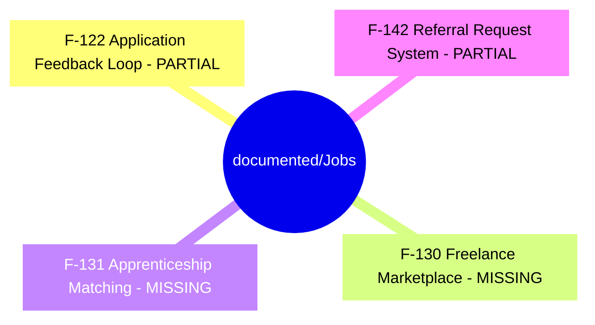

### F-122 Application Feedback Loop

Application Feedback Loop

| ID    | Level | Parent  | Name                      | Description | Status                | Verification | Evidence                                | Related |
| ----- | ----- | ------- | ------------------------- | ----------- | --------------------- | ------------ | --------------------------------------- | ------- |
| F-122 | MAJOR | MOD-227 | Application Feedback Loop |             | PARTIALLY_IMPLEMENTED |              | docs/registries/FEATURE_REGISTRY.md:143 |         |

### F-130 Freelance Marketplace

Freelance Marketplace

| ID    | Level | Parent  | Name                  | Description | Status          | Verification | Evidence                                | Related |
| ----- | ----- | ------- | --------------------- | ----------- | --------------- | ------------ | --------------------------------------- | ------- |
| F-130 | MAJOR | MOD-227 | Freelance Marketplace |             | NOT_IMPLEMENTED |              | docs/registries/FEATURE_REGISTRY.md:151 |         |

### F-131 Apprenticeship Matching

Apprenticeship Matching

| ID    | Level | Parent  | Name                    | Description | Status          | Verification | Evidence                                | Related |
| ----- | ----- | ------- | ----------------------- | ----------- | --------------- | ------------ | --------------------------------------- | ------- |
| F-131 | MAJOR | MOD-227 | Apprenticeship Matching |             | NOT_IMPLEMENTED |              | docs/registries/FEATURE_REGISTRY.md:152 |         |

### F-142 Referral Request System

Referral Request System

| ID    | Level | Parent  | Name                    | Description | Status                | Verification | Evidence                                | Related |
| ----- | ----- | ------- | ----------------------- | ----------- | --------------------- | ------------ | --------------------------------------- | ------- |
| F-142 | MAJOR | MOD-227 | Referral Request System |             | PARTIALLY_IMPLEMENTED |              | docs/registries/FEATURE_REGISTRY.md:163 |         |

## documented/Careers (MOD-228)

**Application:** Documented scope (registry features) (APP-001). **Purpose:** Registry features in category 'Careers'.

**Nodes by level:** MODULE 1, MAJOR 3. **Status:** NOT_IMPLEMENTED 3, UNKNOWN 1. **Verification:** UNKNOWN 1.

### Module map (to minor features)

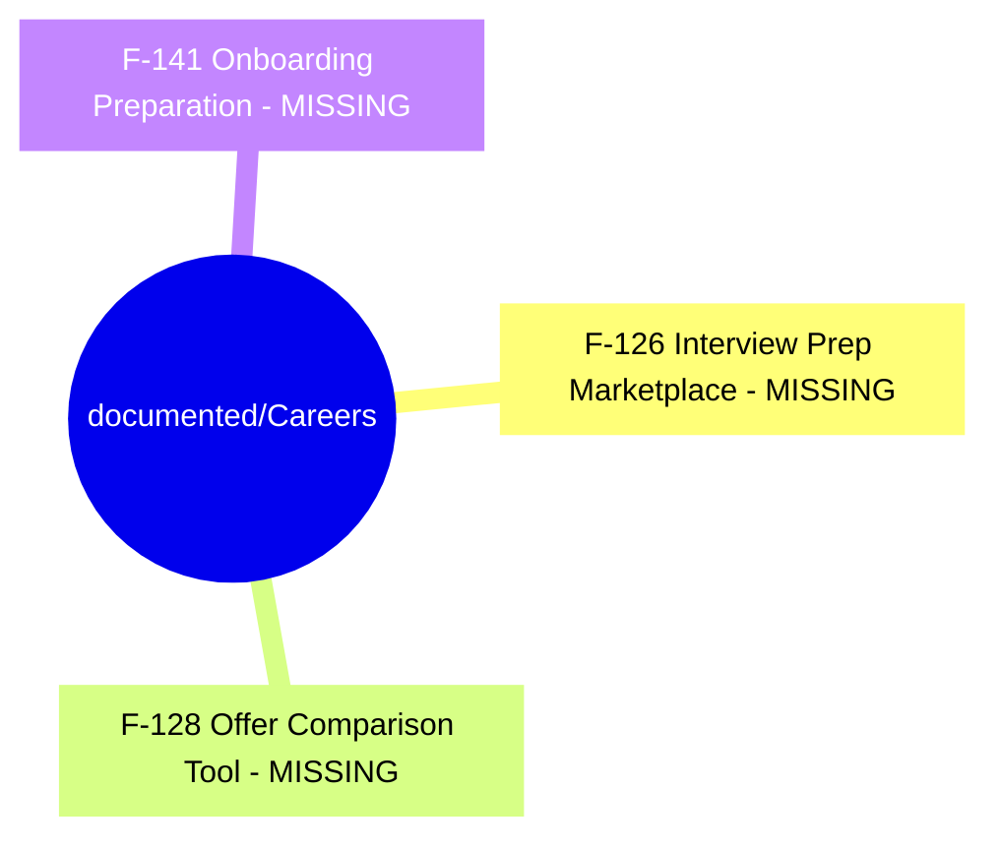

### F-126 Interview Prep Marketplace

Interview Prep Marketplace

| ID    | Level | Parent  | Name                       | Description | Status          | Verification | Evidence                                | Related |
| ----- | ----- | ------- | -------------------------- | ----------- | --------------- | ------------ | --------------------------------------- | ------- |
| F-126 | MAJOR | MOD-228 | Interview Prep Marketplace |             | NOT_IMPLEMENTED |              | docs/registries/FEATURE_REGISTRY.md:147 |         |

### F-128 Offer Comparison Tool

Offer Comparison Tool

| ID    | Level | Parent  | Name                  | Description | Status          | Verification | Evidence                                | Related |
| ----- | ----- | ------- | --------------------- | ----------- | --------------- | ------------ | --------------------------------------- | ------- |
| F-128 | MAJOR | MOD-228 | Offer Comparison Tool |             | NOT_IMPLEMENTED |              | docs/registries/FEATURE_REGISTRY.md:149 |         |

### F-141 Onboarding Preparation

Onboarding Preparation

| ID    | Level | Parent  | Name                   | Description | Status          | Verification | Evidence                                | Related |
| ----- | ----- | ------- | ---------------------- | ----------- | --------------- | ------------ | --------------------------------------- | ------- |
| F-141 | MAJOR | MOD-228 | Onboarding Preparation |             | NOT_IMPLEMENTED |              | docs/registries/FEATURE_REGISTRY.md:162 |         |

## documented/Companies (MOD-229)

**Application:** Documented scope (registry features) (APP-001). **Purpose:** Registry features in category 'Companies'.

**Nodes by level:** MODULE 1, MAJOR 1. **Status:** NOT_IMPLEMENTED 1, UNKNOWN 1. **Verification:** UNKNOWN 1.

### Module map (to minor features)

```mermaid
mindmap
  root((documented/Companies))
    F_127[F-127 Company Culture Assessment - MISSING]
```

### F-127 Company Culture Assessment

Company Culture Assessment

| ID    | Level | Parent  | Name                       | Description | Status          | Verification | Evidence                                | Related |
| ----- | ----- | ------- | -------------------------- | ----------- | --------------- | ------------ | --------------------------------------- | ------- |
| F-127 | MAJOR | MOD-229 | Company Culture Assessment |             | NOT_IMPLEMENTED |              | docs/registries/FEATURE_REGISTRY.md:148 |         |

## documented/Community (MOD-230)

**Application:** Documented scope (registry features) (APP-001). **Purpose:** Registry features in category 'Community'.

**Nodes by level:** MODULE 1, MAJOR 7. **Status:** NOT_IMPLEMENTED 4, PARTIALLY_IMPLEMENTED 3, UNKNOWN 1. **Verification:** UNKNOWN 1.

### Module map (to minor features)

```mermaid
mindmap
  root((documented/Community))
    F_133[F-133 Volunteer Matching - MISSING]
    F_140[F-140 Affinity Groups - MISSING]
    F_169[F-169 Community Contribution Scoring and Recognition - PARTIAL]
    F_170[F-170 Expert Network Enhanced - MISSING]
    F_55[F-55 Groups and Communities - PARTIAL]
    F_57[F-57 Events and Webinars - MISSING]
    F_90[F-90 Peer Mentorship and Advisor Network - PARTIAL]
```

### F-133 Volunteer Matching

Volunteer Matching

| ID    | Level | Parent  | Name               | Description | Status          | Verification | Evidence                                | Related |
| ----- | ----- | ------- | ------------------ | ----------- | --------------- | ------------ | --------------------------------------- | ------- |
| F-133 | MAJOR | MOD-230 | Volunteer Matching |             | NOT_IMPLEMENTED |              | docs/registries/FEATURE_REGISTRY.md:154 |         |

### F-140 Affinity Groups

Affinity Groups

| ID    | Level | Parent  | Name            | Description | Status          | Verification | Evidence                                | Related |
| ----- | ----- | ------- | --------------- | ----------- | --------------- | ------------ | --------------------------------------- | ------- |
| F-140 | MAJOR | MOD-230 | Affinity Groups |             | NOT_IMPLEMENTED |              | docs/registries/FEATURE_REGISTRY.md:161 |         |

### F-169 Community Contribution Scoring & Recognition

Community Contribution Scoring & Recognition

| ID    | Level | Parent  | Name                                         | Description | Status                | Verification | Evidence                                | Related |
| ----- | ----- | ------- | -------------------------------------------- | ----------- | --------------------- | ------------ | --------------------------------------- | ------- |
| F-169 | MAJOR | MOD-230 | Community Contribution Scoring & Recognition |             | PARTIALLY_IMPLEMENTED |              | docs/registries/FEATURE_REGISTRY.md:195 |         |

### F-170 Expert Network (Enhanced)

Expert Network (Enhanced)

| ID    | Level | Parent  | Name                      | Description | Status          | Verification | Evidence                                | Related |
| ----- | ----- | ------- | ------------------------- | ----------- | --------------- | ------------ | --------------------------------------- | ------- |
| F-170 | MAJOR | MOD-230 | Expert Network (Enhanced) |             | NOT_IMPLEMENTED |              | docs/registries/FEATURE_REGISTRY.md:196 |         |

### F-55 Groups & Communities

Groups & Communities

| ID   | Level | Parent  | Name                 | Description | Status                | Verification | Evidence                               | Related |
| ---- | ----- | ------- | -------------------- | ----------- | --------------------- | ------------ | -------------------------------------- | ------- |
| F-55 | MAJOR | MOD-230 | Groups & Communities |             | PARTIALLY_IMPLEMENTED |              | docs/registries/FEATURE_REGISTRY.md:71 |         |

### F-57 Events & Webinars

Events & Webinars

| ID   | Level | Parent  | Name              | Description | Status          | Verification | Evidence                               | Related |
| ---- | ----- | ------- | ----------------- | ----------- | --------------- | ------------ | -------------------------------------- | ------- |
| F-57 | MAJOR | MOD-230 | Events & Webinars |             | NOT_IMPLEMENTED |              | docs/registries/FEATURE_REGISTRY.md:73 |         |

### F-90 Peer Mentorship & Advisor Network

Peer Mentorship & Advisor Network

| ID   | Level | Parent  | Name                              | Description | Status                | Verification | Evidence                                | Related |
| ---- | ----- | ------- | --------------------------------- | ----------- | --------------------- | ------------ | --------------------------------------- | ------- |
| F-90 | MAJOR | MOD-230 | Peer Mentorship & Advisor Network |             | PARTIALLY_IMPLEMENTED |              | docs/registries/FEATURE_REGISTRY.md:106 |         |

## documented/Skills (MOD-231)

**Application:** Documented scope (registry features) (APP-001). **Purpose:** Registry features in category 'Skills'.

**Nodes by level:** MODULE 1, MAJOR 2. **Status:** NOT_IMPLEMENTED 2, UNKNOWN 1. **Verification:** UNKNOWN 1.

### Module map (to minor features)

```mermaid
mindmap
  root((documented/Skills))
    F_134[F-134 Code Review Practice - MISSING]
    F_135[F-135 System Design Practice - MISSING]
```

### F-134 Code Review Practice

Code Review Practice

| ID    | Level | Parent  | Name                 | Description | Status          | Verification | Evidence                                | Related |
| ----- | ----- | ------- | -------------------- | ----------- | --------------- | ------------ | --------------------------------------- | ------- |
| F-134 | MAJOR | MOD-231 | Code Review Practice |             | NOT_IMPLEMENTED |              | docs/registries/FEATURE_REGISTRY.md:155 |         |

### F-135 System Design Practice

System Design Practice

| ID    | Level | Parent  | Name                   | Description | Status          | Verification | Evidence                                | Related |
| ----- | ----- | ------- | ---------------------- | ----------- | --------------- | ------------ | --------------------------------------- | ------- |
| F-135 | MAJOR | MOD-231 | System Design Practice |             | NOT_IMPLEMENTED |              | docs/registries/FEATURE_REGISTRY.md:156 |         |

## documented/Portfolio (MOD-232)

**Application:** Documented scope (registry features) (APP-001). **Purpose:** Registry features in category 'Portfolio'.

**Nodes by level:** MODULE 1, MAJOR 1. **Status:** NOT_IMPLEMENTED 1, UNKNOWN 1. **Verification:** UNKNOWN 1.

### Module map (to minor features)

```mermaid
mindmap
  root((documented/Portfolio))
    F_143[F-143 OSS Contribution Discovery - MISSING]
```

### F-143 OSS Contribution Discovery

OSS Contribution Discovery

| ID    | Level | Parent  | Name                       | Description | Status          | Verification | Evidence                                | Related |
| ----- | ----- | ------- | -------------------------- | ----------- | --------------- | ------------ | --------------------------------------- | ------- |
| F-143 | MAJOR | MOD-232 | OSS Contribution Discovery |             | NOT_IMPLEMENTED |              | docs/registries/FEATURE_REGISTRY.md:164 |         |

## documented/Reputation (MOD-233)

**Application:** Documented scope (registry features) (APP-001). **Purpose:** Registry features in category 'Reputation'.

**Nodes by level:** MODULE 1, MAJOR 3. **Status:** PARTIALLY_IMPLEMENTED 3, UNKNOWN 1. **Verification:** UNKNOWN 1.

### Module map (to minor features)

```mermaid
mindmap
  root((documented/Reputation))
    F_148[F-148 Instructor Reputation System - PARTIAL]
    F_149[F-149 Employer Reputation and Brand System - PARTIAL]
    F_150[F-150 Peer Credibility Networks - PARTIAL]
```

### F-148 Instructor Reputation System

Instructor Reputation System

| ID    | Level | Parent  | Name                         | Description | Status                | Verification | Evidence                                | Related |
| ----- | ----- | ------- | ---------------------------- | ----------- | --------------------- | ------------ | --------------------------------------- | ------- |
| F-148 | MAJOR | MOD-233 | Instructor Reputation System |             | PARTIALLY_IMPLEMENTED |              | docs/registries/FEATURE_REGISTRY.md:174 |         |

### F-149 Employer Reputation & Brand System

Employer Reputation & Brand System

| ID    | Level | Parent  | Name                               | Description | Status                | Verification | Evidence                                | Related |
| ----- | ----- | ------- | ---------------------------------- | ----------- | --------------------- | ------------ | --------------------------------------- | ------- |
| F-149 | MAJOR | MOD-233 | Employer Reputation & Brand System |             | PARTIALLY_IMPLEMENTED |              | docs/registries/FEATURE_REGISTRY.md:175 |         |

### F-150 Peer Credibility Networks

Peer Credibility Networks

| ID    | Level | Parent  | Name                      | Description | Status                | Verification | Evidence                                | Related |
| ----- | ----- | ------- | ------------------------- | ----------- | --------------------- | ------------ | --------------------------------------- | ------- |
| F-150 | MAJOR | MOD-233 | Peer Credibility Networks |             | PARTIALLY_IMPLEMENTED |              | docs/registries/FEATURE_REGISTRY.md:176 |         |

## documented/Personalization (MOD-234)

**Application:** Documented scope (registry features) (APP-001). **Purpose:** Registry features in category 'Personalization'.

**Nodes by level:** MODULE 1, MAJOR 1. **Status:** NOT_IMPLEMENTED 1, UNKNOWN 1. **Verification:** UNKNOWN 1.

### Module map (to minor features)

```mermaid
mindmap
  root((documented/Personalization))
    F_155[F-155 Adaptive Learning System - MISSING]
```

### F-155 Adaptive Learning System

Adaptive Learning System

| ID    | Level | Parent  | Name                     | Description | Status          | Verification | Evidence                                | Related |
| ----- | ----- | ------- | ------------------------ | ----------- | --------------- | ------------ | --------------------------------------- | ------- |
| F-155 | MAJOR | MOD-234 | Adaptive Learning System |             | NOT_IMPLEMENTED |              | docs/registries/FEATURE_REGISTRY.md:181 |         |

## documented/Discovery (MOD-235)

**Application:** Documented scope (registry features) (APP-001). **Purpose:** Registry features in category 'Discovery'.

**Nodes by level:** MODULE 1, MAJOR 1. **Status:** PARTIALLY_IMPLEMENTED 1, UNKNOWN 1. **Verification:** UNKNOWN 1.

### Module map (to minor features)

```mermaid
mindmap
  root((documented/Discovery))
    F_159[F-159 Behavioral Talent Discovery - PARTIAL]
```

### F-159 Behavioral Talent Discovery

Behavioral Talent Discovery

| ID    | Level | Parent  | Name                        | Description | Status                | Verification | Evidence                                | Related |
| ----- | ----- | ------- | --------------------------- | ----------- | --------------------- | ------------ | --------------------------------------- | ------- |
| F-159 | MAJOR | MOD-235 | Behavioral Talent Discovery |             | PARTIALLY_IMPLEMENTED |              | docs/registries/FEATURE_REGISTRY.md:185 |         |

## documented/Monetization (MOD-236)

**Application:** Documented scope (registry features) (APP-001). **Purpose:** Registry features in category 'Monetization'.

**Nodes by level:** MODULE 1, MAJOR 1. **Status:** PARTIALLY_IMPLEMENTED 1, UNKNOWN 1. **Verification:** UNKNOWN 1.

### Module map (to minor features)

```mermaid
mindmap
  root((documented/Monetization))
    F_16[F-16 Billing and Subscriptions - PARTIAL]
```

### F-16 Billing & Subscriptions

Billing & Subscriptions

| ID   | Level | Parent  | Name                    | Description | Status                | Verification | Evidence                               | Related |
| ---- | ----- | ------- | ----------------------- | ----------- | --------------------- | ------------ | -------------------------------------- | ------- |
| F-16 | MAJOR | MOD-236 | Billing & Subscriptions |             | PARTIALLY_IMPLEMENTED |              | docs/registries/FEATURE_REGISTRY.md:32 |         |

## documented/Enterprise (MOD-237)

**Application:** Documented scope (registry features) (APP-001). **Purpose:** Registry features in category 'Enterprise'.

**Nodes by level:** MODULE 1, MAJOR 1. **Status:** NOT_IMPLEMENTED 1, UNKNOWN 1. **Verification:** UNKNOWN 1.

### Module map (to minor features)

```mermaid
mindmap
  root((documented/Enterprise))
    F_161[F-161 Internal Mobility and Succession Platform - MISSING]
```

### F-161 Internal Mobility & Succession Platform

Internal Mobility & Succession Platform

| ID    | Level | Parent  | Name                                    | Description | Status          | Verification | Evidence                                | Related |
| ----- | ----- | ------- | --------------------------------------- | ----------- | --------------- | ------------ | --------------------------------------- | ------- |
| F-161 | MAJOR | MOD-237 | Internal Mobility & Succession Platform |             | NOT_IMPLEMENTED |              | docs/registries/FEATURE_REGISTRY.md:187 |         |

## documented/Credential (MOD-238)

**Application:** Documented scope (registry features) (APP-001). **Purpose:** Registry features in category 'Credential'.

**Nodes by level:** MODULE 1, MAJOR 2. **Status:** NOT_IMPLEMENTED 2, UNKNOWN 1. **Verification:** UNKNOWN 1.

### Module map (to minor features)

```mermaid
mindmap
  root((documented/Credential))
    F_163[F-163 Credential Wallet and Portability - MISSING]
    F_164[F-164 Skills Evidence Narrative and Storytelling - MISSING]
```

### F-163 Credential Wallet & Portability

Credential Wallet & Portability

| ID    | Level | Parent  | Name                            | Description | Status          | Verification | Evidence                                | Related |
| ----- | ----- | ------- | ------------------------------- | ----------- | --------------- | ------------ | --------------------------------------- | ------- |
| F-163 | MAJOR | MOD-238 | Credential Wallet & Portability |             | NOT_IMPLEMENTED |              | docs/registries/FEATURE_REGISTRY.md:189 |         |

### F-164 Skills Evidence Narrative & Storytelling

Skills Evidence Narrative & Storytelling

| ID    | Level | Parent  | Name                                     | Description | Status          | Verification | Evidence                                | Related |
| ----- | ----- | ------- | ---------------------------------------- | ----------- | --------------- | ------------ | --------------------------------------- | ------- |
| F-164 | MAJOR | MOD-238 | Skills Evidence Narrative & Storytelling |             | NOT_IMPLEMENTED |              | docs/registries/FEATURE_REGISTRY.md:190 |         |

## documented/Governance (MOD-239)

**Application:** Documented scope (registry features) (APP-001). **Purpose:** Registry features in category 'Governance'.

**Nodes by level:** MODULE 1, MAJOR 1. **Status:** PARTIALLY_IMPLEMENTED 1, UNKNOWN 1. **Verification:** UNKNOWN 1.

### Module map (to minor features)

```mermaid
mindmap
  root((documented/Governance))
    F_17[F-17 Admin Console - PARTIAL]
```

### F-17 Admin Console

Admin Console

| ID   | Level | Parent  | Name          | Description | Status                | Verification | Evidence                               | Related |
| ---- | ----- | ------- | ------------- | ----------- | --------------------- | ------------ | -------------------------------------- | ------- |
| F-17 | MAJOR | MOD-239 | Admin Console |             | PARTIALLY_IMPLEMENTED |              | docs/registries/FEATURE_REGISTRY.md:33 |         |

## documented/Company (MOD-240)

**Application:** Documented scope (registry features) (APP-001). **Purpose:** Registry features in category 'Company'.

**Nodes by level:** MODULE 1, MAJOR 1. **Status:** NOT_IMPLEMENTED 1, UNKNOWN 1. **Verification:** UNKNOWN 1.

### Module map (to minor features)

```mermaid
mindmap
  root((documented/Company))
    F_171[F-171 Employer Brand Management System - MISSING]
```

### F-171 Employer Brand Management System

Employer Brand Management System

| ID    | Level | Parent  | Name                             | Description | Status          | Verification | Evidence                                | Related |
| ----- | ----- | ------- | -------------------------------- | ----------- | --------------- | ------------ | --------------------------------------- | ------- |
| F-171 | MAJOR | MOD-240 | Employer Brand Management System |             | NOT_IMPLEMENTED |              | docs/registries/FEATURE_REGISTRY.md:197 |         |

## documented/Edge (MOD-241)

**Application:** Documented scope (registry features) (APP-001). **Purpose:** Registry features in category 'Edge'.

**Nodes by level:** MODULE 1, MAJOR 3. **Status:** NOT_IMPLEMENTED 3, UNKNOWN 1. **Verification:** UNKNOWN 1.

### Module map (to minor features)

```mermaid
mindmap
  root((documented/Edge))
    F_18[F-18 Chrome Extension Companion - MISSING]
    F_27[F-27 Local Resume Match Preview - MISSING]
    F_28[F-28 External Job Page Scanner - MISSING]
```

### F-18 Chrome Extension Companion

Chrome Extension Companion

| ID   | Level | Parent  | Name                       | Description | Status          | Verification | Evidence                               | Related |
| ---- | ----- | ------- | -------------------------- | ----------- | --------------- | ------------ | -------------------------------------- | ------- |
| F-18 | MAJOR | MOD-241 | Chrome Extension Companion |             | NOT_IMPLEMENTED |              | docs/registries/FEATURE_REGISTRY.md:34 |         |

### F-27 Local Resume Match Preview

Local Resume Match Preview

| ID   | Level | Parent  | Name                       | Description | Status          | Verification | Evidence                               | Related |
| ---- | ----- | ------- | -------------------------- | ----------- | --------------- | ------------ | -------------------------------------- | ------- |
| F-27 | MAJOR | MOD-241 | Local Resume Match Preview |             | NOT_IMPLEMENTED |              | docs/registries/FEATURE_REGISTRY.md:43 |         |

### F-28 External Job Page Scanner

External Job Page Scanner

| ID   | Level | Parent  | Name                      | Description | Status          | Verification | Evidence                               | Related |
| ---- | ----- | ------- | ------------------------- | ----------- | --------------- | ------------ | -------------------------------------- | ------- |
| F-28 | MAJOR | MOD-241 | External Job Page Scanner |             | NOT_IMPLEMENTED |              | docs/registries/FEATURE_REGISTRY.md:44 |         |

## documented/Telemetry (MOD-242)

**Application:** Documented scope (registry features) (APP-001). **Purpose:** Registry features in category 'Telemetry'.

**Nodes by level:** MODULE 1, MAJOR 1. **Status:** PARTIALLY_IMPLEMENTED 1, UNKNOWN 1. **Verification:** UNKNOWN 1.

### Module map (to minor features)

```mermaid
mindmap
  root((documented/Telemetry))
    F_19[F-19 Product Analytics - PARTIAL]
```

### F-19 Product Analytics

Product Analytics

| ID   | Level | Parent  | Name              | Description | Status                | Verification | Evidence                               | Related |
| ---- | ----- | ------- | ----------------- | ----------- | --------------------- | ------------ | -------------------------------------- | ------- |
| F-19 | MAJOR | MOD-242 | Product Analytics |             | PARTIALLY_IMPLEMENTED |              | docs/registries/FEATURE_REGISTRY.md:35 |         |

## documented/Engagement (MOD-243)

**Application:** Documented scope (registry features) (APP-001). **Purpose:** Registry features in category 'Engagement'.

**Nodes by level:** MODULE 1, MAJOR 3. **Status:** NOT_IMPLEMENTED 1, PARTIALLY_IMPLEMENTED 2, UNKNOWN 1. **Verification:** UNKNOWN 1.

### Module map (to minor features)

```mermaid
mindmap
  root((documented/Engagement))
    F_22[F-22 Gamification and XP Ledger - PARTIAL]
    F_23[F-23 Leaderboard and Badges - PARTIAL]
    F_30[F-30 Networking Stale-Request Nudges - MISSING]
```

### F-22 Gamification & XP Ledger

Gamification & XP Ledger

| ID   | Level | Parent  | Name                     | Description | Status                | Verification | Evidence                               | Related |
| ---- | ----- | ------- | ------------------------ | ----------- | --------------------- | ------------ | -------------------------------------- | ------- |
| F-22 | MAJOR | MOD-243 | Gamification & XP Ledger |             | PARTIALLY_IMPLEMENTED |              | docs/registries/FEATURE_REGISTRY.md:38 |         |

### F-23 Leaderboard & Badges

Leaderboard & Badges

| ID   | Level | Parent  | Name                 | Description | Status                | Verification | Evidence                               | Related |
| ---- | ----- | ------- | -------------------- | ----------- | --------------------- | ------------ | -------------------------------------- | ------- |
| F-23 | MAJOR | MOD-243 | Leaderboard & Badges |             | PARTIALLY_IMPLEMENTED |              | docs/registries/FEATURE_REGISTRY.md:39 |         |

### F-30 Networking Stale-Request Nudges

Networking Stale-Request Nudges

| ID   | Level | Parent  | Name                            | Description | Status          | Verification | Evidence                               | Related |
| ---- | ----- | ------- | ------------------------------- | ----------- | --------------- | ------------ | -------------------------------------- | ------- |
| F-30 | MAJOR | MOD-243 | Networking Stale-Request Nudges |             | NOT_IMPLEMENTED |              | docs/registries/FEATURE_REGISTRY.md:46 |         |

## documented/Safety (MOD-244)

**Application:** Documented scope (registry features) (APP-001). **Purpose:** Registry features in category 'Safety'.

**Nodes by level:** MODULE 1, MAJOR 1. **Status:** PARTIALLY_IMPLEMENTED 1, UNKNOWN 1. **Verification:** UNKNOWN 1.

### Module map (to minor features)

```mermaid
mindmap
  root((documented/Safety))
    F_24[F-24 Trust, Safety and Moderation - PARTIAL]
```

### F-24 Trust, Safety & Moderation

Trust, Safety & Moderation

| ID   | Level | Parent  | Name                       | Description | Status                | Verification | Evidence                               | Related |
| ---- | ----- | ------- | -------------------------- | ----------- | --------------------- | ------------ | -------------------------------------- | ------- |
| F-24 | MAJOR | MOD-244 | Trust, Safety & Moderation |             | PARTIALLY_IMPLEMENTED |              | docs/registries/FEATURE_REGISTRY.md:40 |         |

## documented/Administration (MOD-245)

**Application:** Documented scope (registry features) (APP-001). **Purpose:** Registry features in category 'Administration'.

**Nodes by level:** MODULE 1, MAJOR 2. **Status:** PARTIALLY_IMPLEMENTED 2, UNKNOWN 1. **Verification:** UNKNOWN 1.

### Module map (to minor features)

```mermaid
mindmap
  root((documented/Administration))
    F_35[F-35 Feature Flag Console - PARTIAL]
    F_83[F-83 Admin Platform Expansion - PARTIAL]
```

### F-35 Feature Flag Console

Feature Flag Console

| ID   | Level | Parent  | Name                 | Description | Status                | Verification | Evidence                               | Related |
| ---- | ----- | ------- | -------------------- | ----------- | --------------------- | ------------ | -------------------------------------- | ------- |
| F-35 | MAJOR | MOD-245 | Feature Flag Console |             | PARTIALLY_IMPLEMENTED |              | docs/registries/FEATURE_REGISTRY.md:51 |         |

### F-83 Admin Platform Expansion

Admin Platform Expansion

| ID   | Level | Parent  | Name                     | Description | Status                | Verification | Evidence                               | Related |
| ---- | ----- | ------- | ------------------------ | ----------- | --------------------- | ------------ | -------------------------------------- | ------- |
| F-83 | MAJOR | MOD-245 | Admin Platform Expansion |             | PARTIALLY_IMPLEMENTED |              | docs/registries/FEATURE_REGISTRY.md:99 |         |

## documented/Institutions (MOD-246)

**Application:** Documented scope (registry features) (APP-001). **Purpose:** Registry features in category 'Institutions'.

**Nodes by level:** MODULE 1, MAJOR 6. **Status:** NOT_IMPLEMENTED 5, PARTIALLY_IMPLEMENTED 1, UNKNOWN 1. **Verification:** UNKNOWN 1.

### Module map (to minor features)

```mermaid
mindmap
  root((documented/Institutions))
    F_40[F-40 Institutional Managed Learning - PARTIAL]
    F_41[F-41 Procurement and Seat Licensing - MISSING]
    F_43[F-43 B2B2C Graduation Flywheel - MISSING]
    F_46[F-46 Institutional Analytics - MISSING]
    F_47[F-47 Faculty Dashboard - MISSING]
    F_50[F-50 Institutional Course Marketplace - MISSING]
```

### F-40 Institutional Managed Learning

Institutional Managed Learning

| ID   | Level | Parent  | Name                           | Description | Status                | Verification | Evidence                               | Related |
| ---- | ----- | ------- | ------------------------------ | ----------- | --------------------- | ------------ | -------------------------------------- | ------- |
| F-40 | MAJOR | MOD-246 | Institutional Managed Learning |             | PARTIALLY_IMPLEMENTED |              | docs/registries/FEATURE_REGISTRY.md:56 |         |

### F-41 Procurement & Seat Licensing

Procurement & Seat Licensing

| ID   | Level | Parent  | Name                         | Description | Status          | Verification | Evidence                               | Related |
| ---- | ----- | ------- | ---------------------------- | ----------- | --------------- | ------------ | -------------------------------------- | ------- |
| F-41 | MAJOR | MOD-246 | Procurement & Seat Licensing |             | NOT_IMPLEMENTED |              | docs/registries/FEATURE_REGISTRY.md:57 |         |

### F-43 B2B2C Graduation Flywheel

B2B2C Graduation Flywheel

| ID   | Level | Parent  | Name                      | Description | Status          | Verification | Evidence                               | Related |
| ---- | ----- | ------- | ------------------------- | ----------- | --------------- | ------------ | -------------------------------------- | ------- |
| F-43 | MAJOR | MOD-246 | B2B2C Graduation Flywheel |             | NOT_IMPLEMENTED |              | docs/registries/FEATURE_REGISTRY.md:59 |         |

### F-46 Institutional Analytics

Institutional Analytics

| ID   | Level | Parent  | Name                    | Description | Status          | Verification | Evidence                               | Related |
| ---- | ----- | ------- | ----------------------- | ----------- | --------------- | ------------ | -------------------------------------- | ------- |
| F-46 | MAJOR | MOD-246 | Institutional Analytics |             | NOT_IMPLEMENTED |              | docs/registries/FEATURE_REGISTRY.md:62 |         |

### F-47 Faculty Dashboard

Faculty Dashboard

| ID   | Level | Parent  | Name              | Description | Status          | Verification | Evidence                               | Related |
| ---- | ----- | ------- | ----------------- | ----------- | --------------- | ------------ | -------------------------------------- | ------- |
| F-47 | MAJOR | MOD-246 | Faculty Dashboard |             | NOT_IMPLEMENTED |              | docs/registries/FEATURE_REGISTRY.md:63 |         |

### F-50 Institutional Course Marketplace

Institutional Course Marketplace

| ID   | Level | Parent  | Name                             | Description | Status          | Verification | Evidence                               | Related |
| ---- | ----- | ------- | -------------------------------- | ----------- | --------------- | ------------ | -------------------------------------- | ------- |
| F-50 | MAJOR | MOD-246 | Institutional Course Marketplace |             | NOT_IMPLEMENTED |              | docs/registries/FEATURE_REGISTRY.md:66 |         |

## documented/OS (MOD-247)

**Application:** Documented scope (registry features) (APP-001). **Purpose:** Registry features in category 'OS'.

**Nodes by level:** MODULE 1, MAJOR 2. **Status:** NOT_IMPLEMENTED 2, UNKNOWN 1. **Verification:** UNKNOWN 1.

### Module map (to minor features)

```mermaid
mindmap
  root((documented/OS))
    F_48[F-48 OS Shell and Workbench - MISSING]
    F_49[F-49 Automation and Agents - MISSING]
```

### F-48 OS Shell & Workbench

OS Shell & Workbench

| ID   | Level | Parent  | Name                 | Description | Status          | Verification | Evidence                               | Related |
| ---- | ----- | ------- | -------------------- | ----------- | --------------- | ------------ | -------------------------------------- | ------- |
| F-48 | MAJOR | MOD-247 | OS Shell & Workbench |             | NOT_IMPLEMENTED |              | docs/registries/FEATURE_REGISTRY.md:64 |         |

### F-49 Automation & Agents

Automation & Agents

| ID   | Level | Parent  | Name                | Description | Status          | Verification | Evidence                               | Related |
| ---- | ----- | ------- | ------------------- | ----------- | --------------- | ------------ | -------------------------------------- | ------- |
| F-49 | MAJOR | MOD-247 | Automation & Agents |             | NOT_IMPLEMENTED |              | docs/registries/FEATURE_REGISTRY.md:65 |         |

## documented/Business (MOD-248)

**Application:** Documented scope (registry features) (APP-001). **Purpose:** Registry features in category 'Business'.

**Nodes by level:** MODULE 1, MAJOR 2. **Status:** DEPRECATED 1, PARTIALLY_IMPLEMENTED 1, UNKNOWN 1. **Verification:** UNKNOWN 1.

### Module map (to minor features)

```mermaid
mindmap
  root((documented/Business))
    F_61[F-61 Premium Candidate Tier OD-34 gated - PARTIAL]
    F_62[F-62 Sponsored Content NOT RECOMMENDED - DEPRECATED]
```

### F-61 Premium Candidate Tier (OD-34 gated)

Premium Candidate Tier (OD-34 gated)

| ID   | Level | Parent  | Name                                 | Description | Status                | Verification | Evidence                               | Related |
| ---- | ----- | ------- | ------------------------------------ | ----------- | --------------------- | ------------ | -------------------------------------- | ------- |
| F-61 | MAJOR | MOD-248 | Premium Candidate Tier (OD-34 gated) |             | PARTIALLY_IMPLEMENTED |              | docs/registries/FEATURE_REGISTRY.md:77 |         |

### F-62 Sponsored Content (NOT RECOMMENDED)

Sponsored Content (NOT RECOMMENDED)

| ID   | Level | Parent  | Name                                | Description | Status     | Verification | Evidence                               | Related |
| ---- | ----- | ------- | ----------------------------------- | ----------- | ---------- | ------------ | -------------------------------------- | ------- |
| F-62 | MAJOR | MOD-248 | Sponsored Content (NOT RECOMMENDED) |             | DEPRECATED |              | docs/registries/FEATURE_REGISTRY.md:78 |         |

## documented/Integration (MOD-249)

**Application:** Documented scope (registry features) (APP-001). **Purpose:** Registry features in category 'Integration'.

**Nodes by level:** MODULE 1, MAJOR 1. **Status:** NOT_IMPLEMENTED 1, UNKNOWN 1. **Verification:** UNKNOWN 1.

### Module map (to minor features)

```mermaid
mindmap
  root((documented/Integration))
    F_64[F-64 LinkedIn Migration Engine - MISSING]
```

### F-64 LinkedIn Migration Engine

LinkedIn Migration Engine

| ID   | Level | Parent  | Name                      | Description | Status          | Verification | Evidence                               | Related |
| ---- | ----- | ------- | ------------------------- | ----------- | --------------- | ------------ | -------------------------------------- | ------- |
| F-64 | MAJOR | MOD-249 | LinkedIn Migration Engine |             | NOT_IMPLEMENTED |              | docs/registries/FEATURE_REGISTRY.md:80 |         |

## documented/Foundation (MOD-250)

**Application:** Documented scope (registry features) (APP-001). **Purpose:** Registry features in category 'Foundation'.

**Nodes by level:** MODULE 1, MAJOR 1. **Status:** NOT_IMPLEMENTED 1, UNKNOWN 1. **Verification:** UNKNOWN 1.

### Module map (to minor features)

```mermaid
mindmap
  root((documented/Foundation))
    F_65[F-65 LinkedIn Decoupling and Independence - MISSING]
```

### F-65 LinkedIn Decoupling & Independence

LinkedIn Decoupling & Independence

| ID   | Level | Parent  | Name                               | Description | Status          | Verification | Evidence                               | Related |
| ---- | ----- | ------- | ---------------------------------- | ----------- | --------------- | ------------ | -------------------------------------- | ------- |
| F-65 | MAJOR | MOD-250 | LinkedIn Decoupling & Independence |             | NOT_IMPLEMENTED |              | docs/registries/FEATURE_REGISTRY.md:81 |         |

## documented/Profile (MOD-251)

**Application:** Documented scope (registry features) (APP-001). **Purpose:** Registry features in category 'Profile'.

**Nodes by level:** MODULE 1, MAJOR 1. **Status:** PARTIALLY_IMPLEMENTED 1, UNKNOWN 1. **Verification:** UNKNOWN 1.

### Module map (to minor features)

```mermaid
mindmap
  root((documented/Profile))
    F_80[F-80 Profile Enhancements - PARTIAL]
```

### F-80 Profile Enhancements

Profile Enhancements

| ID   | Level | Parent  | Name                 | Description | Status                | Verification | Evidence                               | Related |
| ---- | ----- | ------- | -------------------- | ----------- | --------------------- | ------------ | -------------------------------------- | ------- |
| F-80 | MAJOR | MOD-251 | Profile Enhancements |             | PARTIALLY_IMPLEMENTED |              | docs/registries/FEATURE_REGISTRY.md:96 |         |
