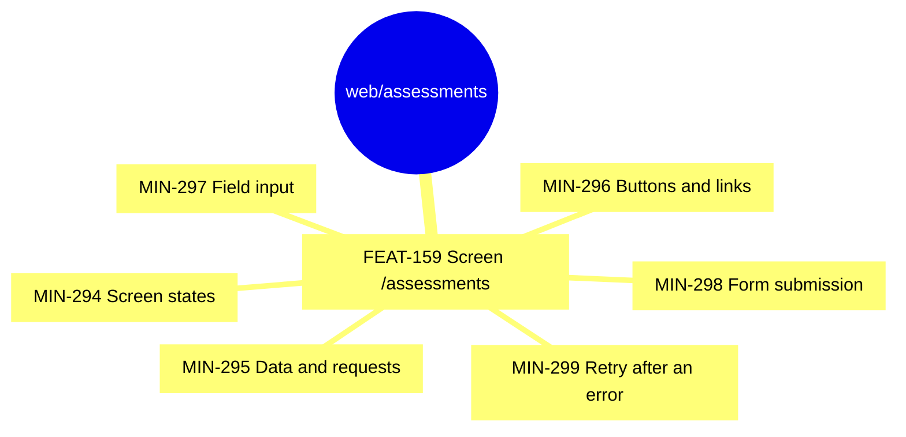
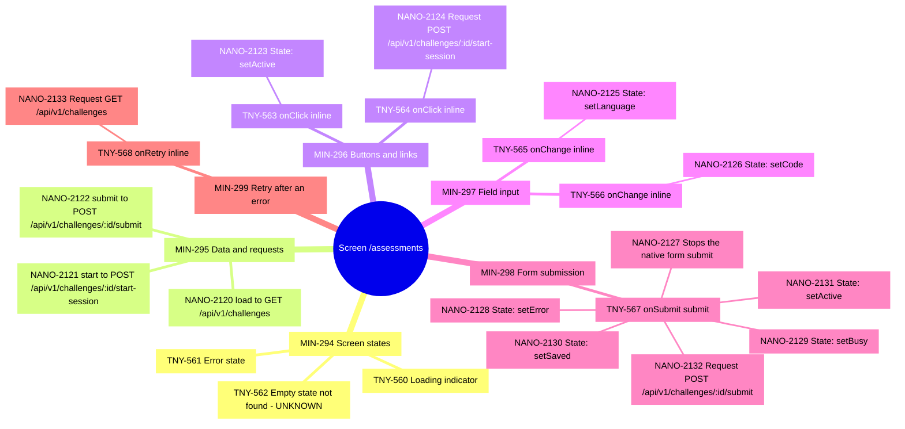

# web/assessments (MOD-164)

Generated by `docs/mindmap/tools/catalog.py` from `master/MASTER_PROJECT_GRAPH.json` at commit `9b3032f`. Do not edit by hand. Back to the [feature catalog](../FEATURE_CATALOG.md).

**Application:** apps/web (MOD-002). **Purpose:** Routed screens under /assessments in apps/web/src/App.tsx.

**Nodes by level:** MODULE 1, MAJOR 1, MINOR 6, TINY 9, NANO 14. **Status:** IMPLEMENTED 30, UNKNOWN 1. **Verification:** PATH_LEVEL 14, UNKNOWN 16, VERIFIED 1.

## Module map (to minor features)

## FEAT-159 Screen /assessments

AssessmentsPage at route /assessments (signed-in only); 3 buttons, 1 forms, 0 inputs; calls 3 endpoint(s).

| ID        | Level | Parent   | Name                                               | Description                                                                                                                                                                              | Status      | Verification | Evidence                                   | Related                               |
| --------- | ----- | -------- | -------------------------------------------------- | ---------------------------------------------------------------------------------------------------------------------------------------------------------------------------------------- | ----------- | ------------ | ------------------------------------------ | ------------------------------------- |
| FEAT-159  | MAJOR | MOD-164  | Screen /assessments                                | AssessmentsPage at route /assessments (signed-in only); 3 buttons, 1 forms, 0 inputs; calls 3 endpoint(s).                                                                               | IMPLEMENTED | VERIFIED     | apps/web/src/App.tsx:83                    | SCR-027, TEST-162, TEST-176, TEST-220 |
| MIN-294   | MINOR | FEAT-159 | Screen states                                      | Loading, empty and error presentation found in the screen source; not found: Empty state.                                                                                                | IMPLEMENTED | PATH_LEVEL   | apps/web/src/pages/AssessmentsPage.tsx     |                                       |
| TNY-560   | TINY  | MIN-294  | Loading indicator                                  | Loading indicator rendered by AssessmentsPage (detected in source).                                                                                                                      | IMPLEMENTED | PATH_LEVEL   | apps/web/src/pages/AssessmentsPage.tsx     |                                       |
| TNY-561   | TINY  | MIN-294  | Error state                                        | Error state rendered by AssessmentsPage (detected in source).                                                                                                                            | IMPLEMENTED | PATH_LEVEL   | apps/web/src/pages/AssessmentsPage.tsx     |                                       |
| TNY-562   | TINY  | MIN-294  | Empty state (not found)                            | No empty state pattern was detected in apps/web/src/pages/AssessmentsPage.tsx although the screen calls the API. May be handled by a shared component; confirm before treating as a gap. | UNKNOWN     | UNKNOWN      | apps/web/src/pages/AssessmentsPage.tsx     |                                       |
| MIN-295   | MINOR | FEAT-159 | Data and requests                                  | API endpoints this screen calls (3).                                                                                                                                                     | IMPLEMENTED | PATH_LEVEL   | apps/web/src/pages/AssessmentsPage.tsx     |                                       |
| NANO-2120 | NANO  | MIN-295  | load -> GET /api/v1/challenges                     | load() at apps/web/src/pages/AssessmentsPage.tsx:74 sends GET /api/v1/challenges.                                                                                                        | IMPLEMENTED | UNKNOWN      | apps/web/src/pages/AssessmentsPage.tsx:74  | API-091                               |
| NANO-2121 | NANO  | MIN-295  | start -> POST /api/v1/challenges/:id/start-session | start() at apps/web/src/pages/AssessmentsPage.tsx:92 sends POST /api/v1/challenges/:id/start-session.                                                                                    | IMPLEMENTED | UNKNOWN      | apps/web/src/pages/AssessmentsPage.tsx:92  | API-094                               |
| NANO-2122 | NANO  | MIN-295  | submit -> POST /api/v1/challenges/:id/submit       | submit() at apps/web/src/pages/AssessmentsPage.tsx:115 sends POST /api/v1/challenges/:id/submit.                                                                                         | IMPLEMENTED | UNKNOWN      | apps/web/src/pages/AssessmentsPage.tsx:115 | API-095                               |
| MIN-296   | MINOR | FEAT-159 | Buttons and links                                  | 2 'buttons and links' binding(s) in apps/web/src/pages/AssessmentsPage.tsx.                                                                                                              | IMPLEMENTED | PATH_LEVEL   | apps/web/src/pages/AssessmentsPage.tsx:201 |                                       |
| TNY-563   | TINY  | MIN-296  | onClick inline                                     | onClick at apps/web/src/pages/AssessmentsPage.tsx:201 runs inline: () => setActive(null); changes state setActive.                                                                       | IMPLEMENTED | PATH_LEVEL   | apps/web/src/pages/AssessmentsPage.tsx:201 | INT-057                               |
| NANO-2123 | NANO  | TNY-563  | State: setActive                                   | Updates component state through setActive.                                                                                                                                               | IMPLEMENTED | UNKNOWN      | apps/web/src/pages/AssessmentsPage.tsx:201 |                                       |
| TNY-564   | TINY  | MIN-296  | onClick inline                                     | onClick at apps/web/src/pages/AssessmentsPage.tsx:237 runs inline: () => void start(c); calls POST /api/v1/challenges/:id/start-session.                                                 | IMPLEMENTED | PATH_LEVEL   | apps/web/src/pages/AssessmentsPage.tsx:237 | INT-059                               |
| NANO-2124 | NANO  | TNY-564  | Request POST /api/v1/challenges/:id/start-session  | Sends POST /api/v1/challenges/:id/start-session through apiFetch/apiJson (apps/web/src/lib/api.ts).                                                                                      | IMPLEMENTED | UNKNOWN      | apps/web/src/pages/AssessmentsPage.tsx:237 | API-094                               |
| MIN-297   | MINOR | FEAT-159 | Field input                                        | 2 'field input' binding(s) in apps/web/src/pages/AssessmentsPage.tsx.                                                                                                                    | IMPLEMENTED | PATH_LEVEL   | apps/web/src/pages/AssessmentsPage.tsx:181 |                                       |
| TNY-565   | TINY  | MIN-297  | onChange inline                                    | onChange at apps/web/src/pages/AssessmentsPage.tsx:181 runs inline: (e) => setLanguage(e.target.value); changes state setLanguage.                                                       | IMPLEMENTED | PATH_LEVEL   | apps/web/src/pages/AssessmentsPage.tsx:181 | INT-055                               |
| NANO-2125 | NANO  | TNY-565  | State: setLanguage                                 | Updates component state through setLanguage.                                                                                                                                             | IMPLEMENTED | UNKNOWN      | apps/web/src/pages/AssessmentsPage.tsx:181 |                                       |
| TNY-566   | TINY  | MIN-297  | onChange inline                                    | onChange at apps/web/src/pages/AssessmentsPage.tsx:188 runs inline: (e) => setCode(e.target.value); changes state setCode.                                                               | IMPLEMENTED | PATH_LEVEL   | apps/web/src/pages/AssessmentsPage.tsx:188 | INT-056                               |
| NANO-2126 | NANO  | TNY-566  | State: setCode                                     | Updates component state through setCode.                                                                                                                                                 | IMPLEMENTED | UNKNOWN      | apps/web/src/pages/AssessmentsPage.tsx:188 |                                       |
| MIN-298   | MINOR | FEAT-159 | Form submission                                    | 1 'form submission' binding(s) in apps/web/src/pages/AssessmentsPage.tsx.                                                                                                                | IMPLEMENTED | PATH_LEVEL   | apps/web/src/pages/AssessmentsPage.tsx:175 |                                       |
| TNY-567   | TINY  | MIN-298  | onSubmit submit                                    | onSubmit at apps/web/src/pages/AssessmentsPage.tsx:175 runs submit; changes state setError, setBusy, setSaved, setActive; calls POST /api/v1/challenges/:id/submit.                      | IMPLEMENTED | PATH_LEVEL   | apps/web/src/pages/AssessmentsPage.tsx:175 | INT-054                               |
| NANO-2127 | NANO  | TNY-567  | Stops the native form submit                       | Calls event.preventDefault() so the page does not reload.                                                                                                                                | IMPLEMENTED | UNKNOWN      | apps/web/src/pages/AssessmentsPage.tsx:104 |                                       |
| NANO-2128 | NANO  | TNY-567  | State: setError                                    | Updates component state through setError.                                                                                                                                                | IMPLEMENTED | UNKNOWN      | apps/web/src/pages/AssessmentsPage.tsx:104 |                                       |
| NANO-2129 | NANO  | TNY-567  | State: setBusy                                     | Updates component state through setBusy.                                                                                                                                                 | IMPLEMENTED | UNKNOWN      | apps/web/src/pages/AssessmentsPage.tsx:104 |                                       |
| NANO-2130 | NANO  | TNY-567  | State: setSaved                                    | Updates component state through setSaved.                                                                                                                                                | IMPLEMENTED | UNKNOWN      | apps/web/src/pages/AssessmentsPage.tsx:104 |                                       |
| NANO-2131 | NANO  | TNY-567  | State: setActive                                   | Updates component state through setActive.                                                                                                                                               | IMPLEMENTED | UNKNOWN      | apps/web/src/pages/AssessmentsPage.tsx:104 |                                       |
| NANO-2132 | NANO  | TNY-567  | Request POST /api/v1/challenges/:id/submit         | Sends POST /api/v1/challenges/:id/submit through apiFetch/apiJson (apps/web/src/lib/api.ts).                                                                                             | IMPLEMENTED | UNKNOWN      | apps/web/src/pages/AssessmentsPage.tsx:104 | API-095                               |
| MIN-299   | MINOR | FEAT-159 | Retry after an error                               | 1 'retry after an error' binding(s) in apps/web/src/pages/AssessmentsPage.tsx.                                                                                                           | IMPLEMENTED | PATH_LEVEL   | apps/web/src/pages/AssessmentsPage.tsx:210 |                                       |
| TNY-568   | TINY  | MIN-299  | onRetry inline                                     | onRetry at apps/web/src/pages/AssessmentsPage.tsx:210 runs inline: () => void load(); calls GET /api/v1/challenges.                                                                      | IMPLEMENTED | PATH_LEVEL   | apps/web/src/pages/AssessmentsPage.tsx:210 | INT-058                               |
| NANO-2133 | NANO  | TNY-568  | Request GET /api/v1/challenges                     | Sends GET /api/v1/challenges through apiFetch/apiJson (apps/web/src/lib/api.ts).                                                                                                         | IMPLEMENTED | UNKNOWN      | apps/web/src/pages/AssessmentsPage.tsx:210 | API-091                               |
