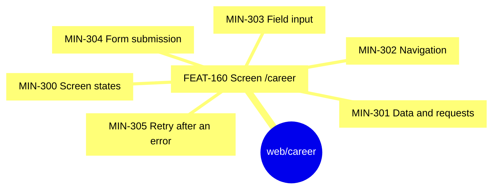
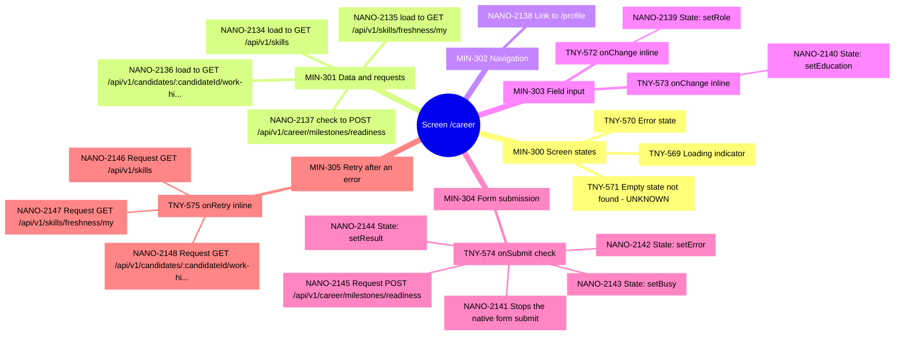

# web/career (MOD-165)

Generated by `docs/mindmap/tools/catalog.py` from `master/MASTER_PROJECT_GRAPH.json` at commit `9b3032f`. Do not edit by hand. Back to the [feature catalog](../FEATURE_CATALOG.md).

**Application:** apps/web (MOD-002). **Purpose:** Routed screens under /career in apps/web/src/App.tsx.

**Nodes by level:** MODULE 1, MAJOR 1, MINOR 6, TINY 7, NANO 15. **Status:** IMPLEMENTED 29, UNKNOWN 1. **Verification:** PATH_LEVEL 12, UNKNOWN 17, VERIFIED 1.

## Module map (to minor features)

## FEAT-160 Screen /career

CareerPage at route /career (signed-in only); 1 buttons, 1 forms, 0 inputs; calls 4 endpoint(s).

| ID        | Level | Parent   | Name                                                     | Description                                                                                                                                                                                   | Status      | Verification | Evidence                              | Related           |
| --------- | ----- | -------- | -------------------------------------------------------- | --------------------------------------------------------------------------------------------------------------------------------------------------------------------------------------------- | ----------- | ------------ | ------------------------------------- | ----------------- |
| FEAT-160  | MAJOR | MOD-165  | Screen /career                                           | CareerPage at route /career (signed-in only); 1 buttons, 1 forms, 0 inputs; calls 4 endpoint(s).                                                                                              | IMPLEMENTED | VERIFIED     | apps/web/src/App.tsx:77               | SCR-021, TEST-173 |
| MIN-300   | MINOR | FEAT-160 | Screen states                                            | Loading, empty and error presentation found in the screen source; not found: Empty state.                                                                                                     | IMPLEMENTED | PATH_LEVEL   | apps/web/src/pages/CareerPage.tsx     |                   |
| TNY-569   | TINY  | MIN-300  | Loading indicator                                        | Loading indicator rendered by CareerPage (detected in source).                                                                                                                                | IMPLEMENTED | PATH_LEVEL   | apps/web/src/pages/CareerPage.tsx     |                   |
| TNY-570   | TINY  | MIN-300  | Error state                                              | Error state rendered by CareerPage (detected in source).                                                                                                                                      | IMPLEMENTED | PATH_LEVEL   | apps/web/src/pages/CareerPage.tsx     |                   |
| TNY-571   | TINY  | MIN-300  | Empty state (not found)                                  | No empty state pattern was detected in apps/web/src/pages/CareerPage.tsx although the screen calls the API. May be handled by a shared component; confirm before treating as a gap.           | UNKNOWN     | UNKNOWN      | apps/web/src/pages/CareerPage.tsx     |                   |
| MIN-301   | MINOR | FEAT-160 | Data and requests                                        | API endpoints this screen calls (4).                                                                                                                                                          | IMPLEMENTED | PATH_LEVEL   | apps/web/src/pages/CareerPage.tsx     |                   |
| NANO-2134 | NANO  | MIN-301  | load -> GET /api/v1/skills                               | load() at apps/web/src/pages/CareerPage.tsx:79 sends GET /api/v1/skills.                                                                                                                      | IMPLEMENTED | UNKNOWN      | apps/web/src/pages/CareerPage.tsx:79  | API-022           |
| NANO-2135 | NANO  | MIN-301  | load -> GET /api/v1/skills/freshness/my                  | load() at apps/web/src/pages/CareerPage.tsx:80 sends GET /api/v1/skills/freshness/my.                                                                                                         | IMPLEMENTED | UNKNOWN      | apps/web/src/pages/CareerPage.tsx:80  | API-059           |
| NANO-2136 | NANO  | MIN-301  | load -> GET /api/v1/candidates/:candidateId/work-history | load() at apps/web/src/pages/CareerPage.tsx:81 sends GET /api/v1/candidates/:candidateId/work-history.                                                                                        | IMPLEMENTED | UNKNOWN      | apps/web/src/pages/CareerPage.tsx:81  | API-276           |
| NANO-2137 | NANO  | MIN-301  | check -> POST /api/v1/career/milestones/readiness        | check() at apps/web/src/pages/CareerPage.tsx:107 sends POST /api/v1/career/milestones/readiness.                                                                                              | IMPLEMENTED | UNKNOWN      | apps/web/src/pages/CareerPage.tsx:107 | API-167           |
| MIN-302   | MINOR | FEAT-160 | Navigation                                               | Links from this screen to 1 other screen(s).                                                                                                                                                  | IMPLEMENTED | PATH_LEVEL   | apps/web/src/pages/CareerPage.tsx     |                   |
| NANO-2138 | NANO  | MIN-302  | Link to /profile                                         | Navigates to /profile (ProfilePage).                                                                                                                                                          | IMPLEMENTED | UNKNOWN      | apps/web/src/pages/CareerPage.tsx     | SCR-014           |
| MIN-303   | MINOR | FEAT-160 | Field input                                              | 2 'field input' binding(s) in apps/web/src/pages/CareerPage.tsx.                                                                                                                              | IMPLEMENTED | PATH_LEVEL   | apps/web/src/pages/CareerPage.tsx:162 |                   |
| TNY-572   | TINY  | MIN-303  | onChange inline                                          | onChange at apps/web/src/pages/CareerPage.tsx:162 runs inline: (e) => setRole(e.target.value); changes state setRole.                                                                         | IMPLEMENTED | PATH_LEVEL   | apps/web/src/pages/CareerPage.tsx:162 | INT-062           |
| NANO-2139 | NANO  | TNY-572  | State: setRole                                           | Updates component state through setRole.                                                                                                                                                      | IMPLEMENTED | UNKNOWN      | apps/web/src/pages/CareerPage.tsx:162 |                   |
| TNY-573   | TINY  | MIN-303  | onChange inline                                          | onChange at apps/web/src/pages/CareerPage.tsx:170 runs inline: (e) => setEducation(e.target.value); changes state setEducation.                                                               | IMPLEMENTED | PATH_LEVEL   | apps/web/src/pages/CareerPage.tsx:170 | INT-063           |
| NANO-2140 | NANO  | TNY-573  | State: setEducation                                      | Updates component state through setEducation.                                                                                                                                                 | IMPLEMENTED | UNKNOWN      | apps/web/src/pages/CareerPage.tsx:170 |                   |
| MIN-304   | MINOR | FEAT-160 | Form submission                                          | 1 'form submission' binding(s) in apps/web/src/pages/CareerPage.tsx.                                                                                                                          | IMPLEMENTED | PATH_LEVEL   | apps/web/src/pages/CareerPage.tsx:156 |                   |
| TNY-574   | TINY  | MIN-304  | onSubmit check                                           | onSubmit at apps/web/src/pages/CareerPage.tsx:156 runs check; changes state setError, setBusy, setResult; calls POST /api/v1/career/milestones/readiness.                                     | IMPLEMENTED | PATH_LEVEL   | apps/web/src/pages/CareerPage.tsx:156 | INT-061           |
| NANO-2141 | NANO  | TNY-574  | Stops the native form submit                             | Calls event.preventDefault() so the page does not reload.                                                                                                                                     | IMPLEMENTED | UNKNOWN      | apps/web/src/pages/CareerPage.tsx:96  |                   |
| NANO-2142 | NANO  | TNY-574  | State: setError                                          | Updates component state through setError.                                                                                                                                                     | IMPLEMENTED | UNKNOWN      | apps/web/src/pages/CareerPage.tsx:96  |                   |
| NANO-2143 | NANO  | TNY-574  | State: setBusy                                           | Updates component state through setBusy.                                                                                                                                                      | IMPLEMENTED | UNKNOWN      | apps/web/src/pages/CareerPage.tsx:96  |                   |
| NANO-2144 | NANO  | TNY-574  | State: setResult                                         | Updates component state through setResult.                                                                                                                                                    | IMPLEMENTED | UNKNOWN      | apps/web/src/pages/CareerPage.tsx:96  |                   |
| NANO-2145 | NANO  | TNY-574  | Request POST /api/v1/career/milestones/readiness         | Sends POST /api/v1/career/milestones/readiness through apiFetch/apiJson (apps/web/src/lib/api.ts).                                                                                            | IMPLEMENTED | UNKNOWN      | apps/web/src/pages/CareerPage.tsx:96  | API-167           |
| MIN-305   | MINOR | FEAT-160 | Retry after an error                                     | 1 'retry after an error' binding(s) in apps/web/src/pages/CareerPage.tsx.                                                                                                                     | IMPLEMENTED | PATH_LEVEL   | apps/web/src/pages/CareerPage.tsx:136 |                   |
| TNY-575   | TINY  | MIN-305  | onRetry inline                                           | onRetry at apps/web/src/pages/CareerPage.tsx:136 runs inline: () => void load(); calls GET /api/v1/skills, GET /api/v1/skills/freshness/my, GET /api/v1/candidates/:candidateId/work-history. | IMPLEMENTED | PATH_LEVEL   | apps/web/src/pages/CareerPage.tsx:136 | INT-060           |
| NANO-2146 | NANO  | TNY-575  | Request GET /api/v1/skills                               | Sends GET /api/v1/skills through apiFetch/apiJson (apps/web/src/lib/api.ts).                                                                                                                  | IMPLEMENTED | UNKNOWN      | apps/web/src/pages/CareerPage.tsx:136 | API-022           |
| NANO-2147 | NANO  | TNY-575  | Request GET /api/v1/skills/freshness/my                  | Sends GET /api/v1/skills/freshness/my through apiFetch/apiJson (apps/web/src/lib/api.ts).                                                                                                     | IMPLEMENTED | UNKNOWN      | apps/web/src/pages/CareerPage.tsx:136 | API-059           |
| NANO-2148 | NANO  | TNY-575  | Request GET /api/v1/candidates/:candidateId/work-history | Sends GET /api/v1/candidates/:candidateId/work-history through apiFetch/apiJson (apps/web/src/lib/api.ts).                                                                                    | IMPLEMENTED | UNKNOWN      | apps/web/src/pages/CareerPage.tsx:136 | API-276           |
