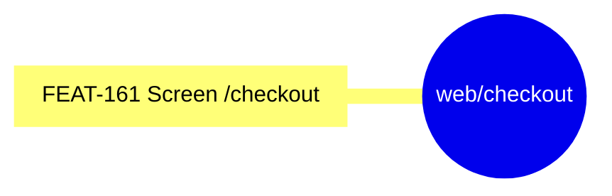

# web/checkout (MOD-166)

Generated by `docs/mindmap/tools/catalog.py` from `master/MASTER_PROJECT_GRAPH.json` at commit `9b3032f`. Do not edit by hand. Back to the [feature catalog](../FEATURE_CATALOG.md).

**Application:** apps/web (MOD-002). **Purpose:** Routed screens under /checkout in apps/web/src/App.tsx.

**Nodes by level:** MODULE 1, MAJOR 1. **Status:** IMPLEMENTED 2. **Verification:** UNKNOWN 1, VERIFIED 1.

**Known gaps:** FEAT-161 no API call found in this screen file.

## Module map (to minor features)

## FEAT-161 Screen /checkout

CheckoutPage at route /checkout (public); 0 buttons, 0 forms, 0 inputs; calls 0 endpoint(s).

| ID       | Level | Parent  | Name             | Description                                                                                                                              | Status      | Verification | Evidence                | Related                                         |
| -------- | ----- | ------- | ---------------- | ---------------------------------------------------------------------------------------------------------------------------------------- | ----------- | ------------ | ----------------------- | ----------------------------------------------- |
| FEAT-161 | MAJOR | MOD-166 | Screen /checkout | CheckoutPage at route /checkout (public); 0 buttons, 0 forms, 0 inputs; calls 0 endpoint(s). Gaps: no API call found in this screen file | IMPLEMENTED | VERIFIED     | apps/web/src/App.tsx:58 | SCR-004, TEST-162, TEST-177, TEST-194, TEST-220 |
