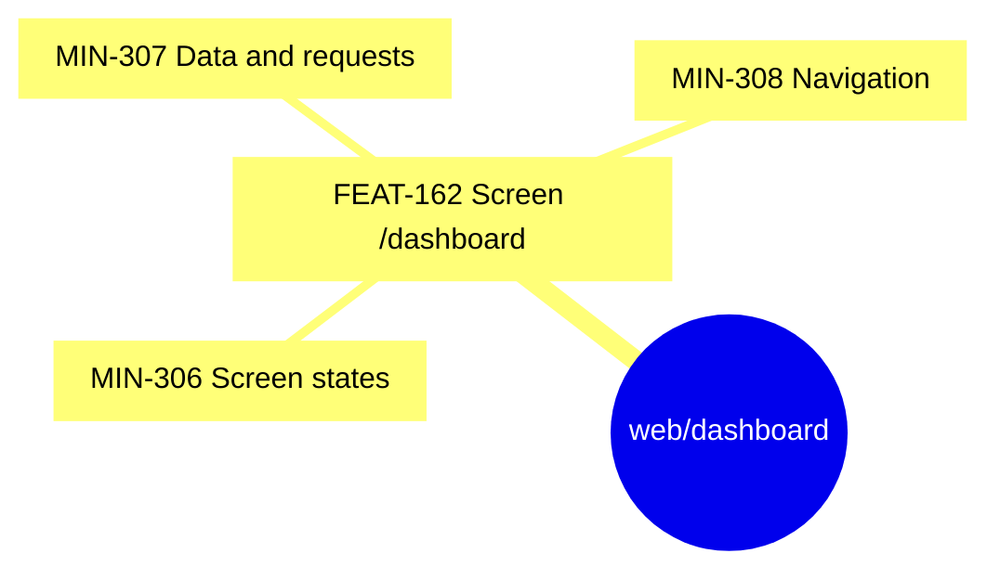
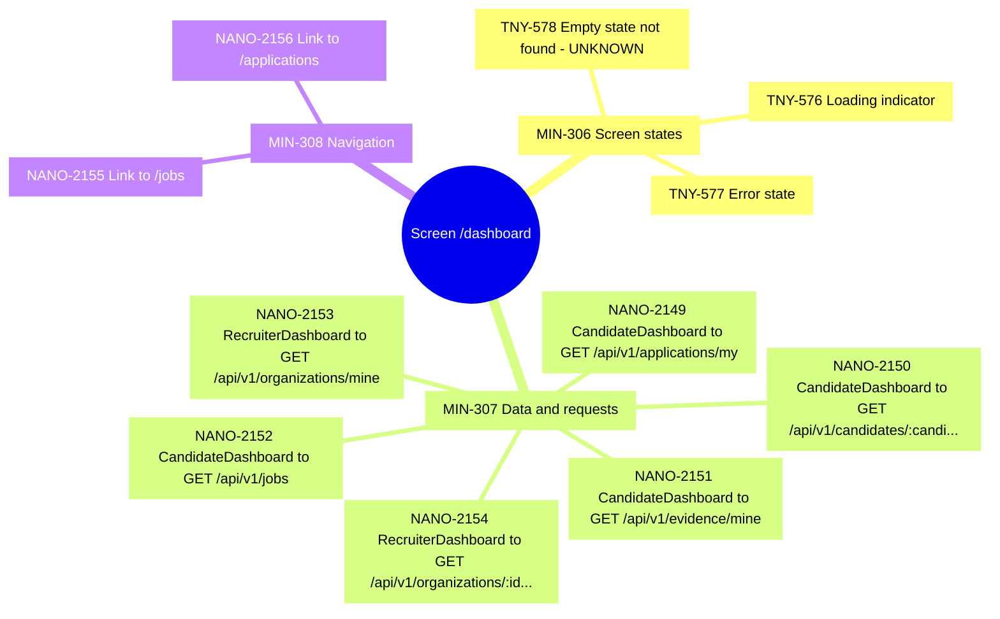

# web/dashboard (MOD-167)

Generated by `docs/mindmap/tools/catalog.py` from `master/MASTER_PROJECT_GRAPH.json` at commit `9b3032f`. Do not edit by hand. Back to the [feature catalog](../FEATURE_CATALOG.md).

**Application:** apps/web (MOD-002). **Purpose:** Routed screens under /dashboard in apps/web/src/App.tsx.

**Nodes by level:** MODULE 1, MAJOR 1, MINOR 3, TINY 3, NANO 8. **Status:** IMPLEMENTED 15, UNKNOWN 1. **Verification:** PATH_LEVEL 5, UNKNOWN 10, VERIFIED 1.

## Module map (to minor features)

## FEAT-162 Screen /dashboard

DashboardPage at route /dashboard (signed-in only); 0 buttons, 0 forms, 0 inputs; calls 6 endpoint(s).

| ID        | Level | Parent   | Name                                                                   | Description                                                                                                                                                                            | Status      | Verification | Evidence                                 | Related                                                       |
| --------- | ----- | -------- | ---------------------------------------------------------------------- | -------------------------------------------------------------------------------------------------------------------------------------------------------------------------------------- | ----------- | ------------ | ---------------------------------------- | ------------------------------------------------------------- |
| FEAT-162  | MAJOR | MOD-167  | Screen /dashboard                                                      | DashboardPage at route /dashboard (signed-in only); 0 buttons, 0 forms, 0 inputs; calls 6 endpoint(s).                                                                                 | IMPLEMENTED | VERIFIED     | apps/web/src/App.tsx:67                  | SCR-011, TEST-162, TEST-164, TEST-178, TEST-184, TEST-192 ... |
| MIN-306   | MINOR | FEAT-162 | Screen states                                                          | Loading, empty and error presentation found in the screen source; not found: Empty state.                                                                                              | IMPLEMENTED | PATH_LEVEL   | apps/web/src/pages/DashboardPage.tsx     |                                                               |
| TNY-576   | TINY  | MIN-306  | Loading indicator                                                      | Loading indicator rendered by DashboardPage (detected in source).                                                                                                                      | IMPLEMENTED | PATH_LEVEL   | apps/web/src/pages/DashboardPage.tsx     |                                                               |
| TNY-577   | TINY  | MIN-306  | Error state                                                            | Error state rendered by DashboardPage (detected in source).                                                                                                                            | IMPLEMENTED | PATH_LEVEL   | apps/web/src/pages/DashboardPage.tsx     |                                                               |
| TNY-578   | TINY  | MIN-306  | Empty state (not found)                                                | No empty state pattern was detected in apps/web/src/pages/DashboardPage.tsx although the screen calls the API. May be handled by a shared component; confirm before treating as a gap. | UNKNOWN     | UNKNOWN      | apps/web/src/pages/DashboardPage.tsx     |                                                               |
| MIN-307   | MINOR | FEAT-162 | Data and requests                                                      | API endpoints this screen calls (6).                                                                                                                                                   | IMPLEMENTED | PATH_LEVEL   | apps/web/src/pages/DashboardPage.tsx     |                                                               |
| NANO-2149 | NANO  | MIN-307  | CandidateDashboard -> GET /api/v1/applications/my                      | CandidateDashboard() at apps/web/src/pages/DashboardPage.tsx:128 sends GET /api/v1/applications/my.                                                                                    | IMPLEMENTED | UNKNOWN      | apps/web/src/pages/DashboardPage.tsx:128 | API-048                                                       |
| NANO-2150 | NANO  | MIN-307  | CandidateDashboard -> GET /api/v1/candidates/:candidateId/work-history | CandidateDashboard() at apps/web/src/pages/DashboardPage.tsx:130 sends GET /api/v1/candidates/:candidateId/work-history.                                                               | IMPLEMENTED | UNKNOWN      | apps/web/src/pages/DashboardPage.tsx:130 | API-276                                                       |
| NANO-2151 | NANO  | MIN-307  | CandidateDashboard -> GET /api/v1/evidence/mine                        | CandidateDashboard() at apps/web/src/pages/DashboardPage.tsx:132 sends GET /api/v1/evidence/mine.                                                                                      | IMPLEMENTED | UNKNOWN      | apps/web/src/pages/DashboardPage.tsx:132 | API-016                                                       |
| NANO-2152 | NANO  | MIN-307  | CandidateDashboard -> GET /api/v1/jobs                                 | CandidateDashboard() at apps/web/src/pages/DashboardPage.tsx:133 sends GET /api/v1/jobs.                                                                                               | IMPLEMENTED | UNKNOWN      | apps/web/src/pages/DashboardPage.tsx:133 | API-032                                                       |
| NANO-2153 | NANO  | MIN-307  | RecruiterDashboard -> GET /api/v1/organizations/mine                   | RecruiterDashboard() at apps/web/src/pages/DashboardPage.tsx:306 sends GET /api/v1/organizations/mine.                                                                                 | IMPLEMENTED | UNKNOWN      | apps/web/src/pages/DashboardPage.tsx:306 | API-027                                                       |
| NANO-2154 | NANO  | MIN-307  | RecruiterDashboard -> GET /api/v1/organizations/:id/jobs               | RecruiterDashboard() at apps/web/src/pages/DashboardPage.tsx:312 sends GET /api/v1/organizations/:id/jobs.                                                                             | IMPLEMENTED | UNKNOWN      | apps/web/src/pages/DashboardPage.tsx:312 | API-028                                                       |
| MIN-308   | MINOR | FEAT-162 | Navigation                                                             | Links from this screen to 2 other screen(s).                                                                                                                                           | IMPLEMENTED | PATH_LEVEL   | apps/web/src/pages/DashboardPage.tsx     |                                                               |
| NANO-2155 | NANO  | MIN-308  | Link to /jobs                                                          | Navigates to /jobs (JobsPage).                                                                                                                                                         | IMPLEMENTED | UNKNOWN      | apps/web/src/pages/DashboardPage.tsx     | SCR-007                                                       |
| NANO-2156 | NANO  | MIN-308  | Link to /applications                                                  | Navigates to /applications (ApplicationsPage).                                                                                                                                         | IMPLEMENTED | UNKNOWN      | apps/web/src/pages/DashboardPage.tsx     | SCR-012                                                       |
