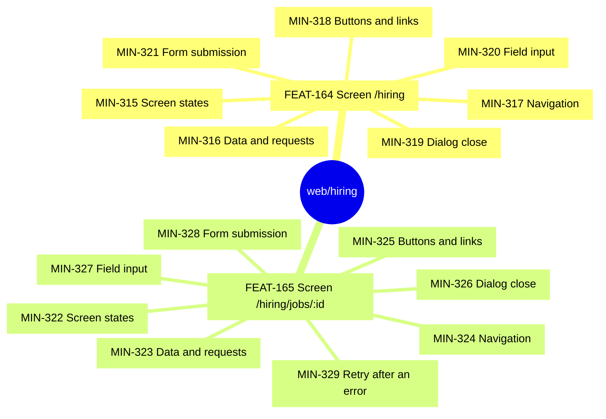
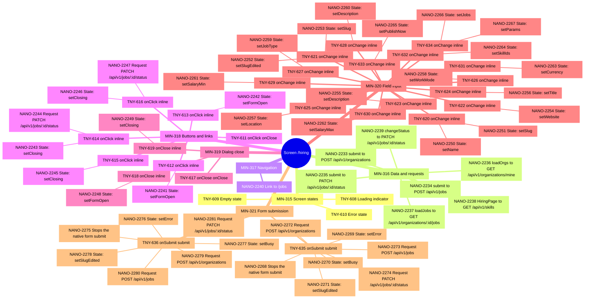
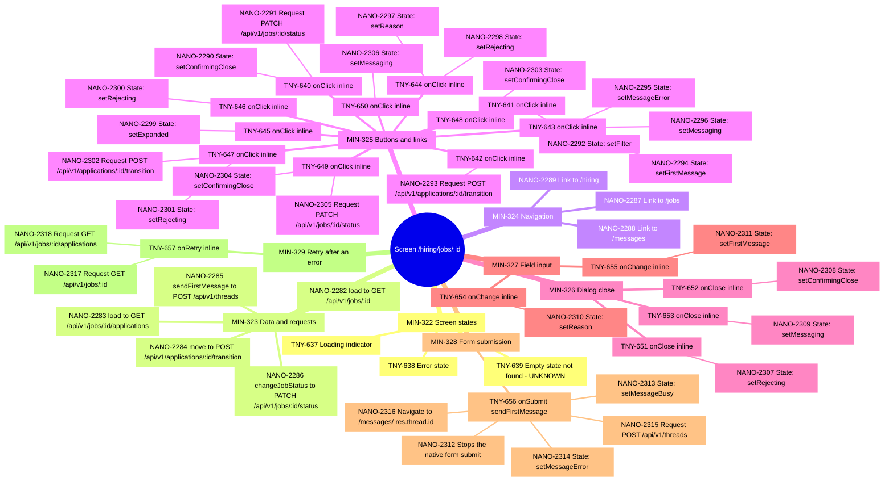

# web/hiring (MOD-169)

Generated by `docs/mindmap/tools/catalog.py` from `master/MASTER_PROJECT_GRAPH.json` at commit `9b3032f`. Do not edit by hand. Back to the [feature catalog](../FEATURE_CATALOG.md).

**Application:** apps/web (MOD-002). **Purpose:** Routed screens under /hiring in apps/web/src/App.tsx.

**Nodes by level:** MODULE 1, MAJOR 2, MINOR 15, TINY 50, NANO 86. **Status:** IMPLEMENTED 153, UNKNOWN 1. **Verification:** PATH_LEVEL 64, UNKNOWN 88, VERIFIED 2.

## Module map (to minor features)

## FEAT-164 Screen /hiring

HiringPage at route /hiring (signed-in only); 8 buttons, 2 forms, 9 inputs; calls 6 endpoint(s).

| ID        | Level | Parent   | Name                                           | Description                                                                                                                                                                                        | Status      | Verification | Evidence                              | Related                                         |
| --------- | ----- | -------- | ---------------------------------------------- | -------------------------------------------------------------------------------------------------------------------------------------------------------------------------------------------------- | ----------- | ------------ | ------------------------------------- | ----------------------------------------------- |
| FEAT-164  | MAJOR | MOD-169  | Screen /hiring                                 | HiringPage at route /hiring (signed-in only); 8 buttons, 2 forms, 9 inputs; calls 6 endpoint(s).                                                                                                   | IMPLEMENTED | VERIFIED     | apps/web/src/App.tsx:81               | SCR-025, TEST-178, TEST-192, TEST-197, TEST-204 |
| MIN-315   | MINOR | FEAT-164 | Screen states                                  | Loading, empty and error presentation found in the screen source.                                                                                                                                  | IMPLEMENTED | PATH_LEVEL   | apps/web/src/pages/HiringPage.tsx     |                                                 |
| TNY-608   | TINY  | MIN-315  | Loading indicator                              | Loading indicator rendered by HiringPage (detected in source).                                                                                                                                     | IMPLEMENTED | PATH_LEVEL   | apps/web/src/pages/HiringPage.tsx     |                                                 |
| TNY-609   | TINY  | MIN-315  | Empty state                                    | Empty state rendered by HiringPage (detected in source).                                                                                                                                           | IMPLEMENTED | PATH_LEVEL   | apps/web/src/pages/HiringPage.tsx     |                                                 |
| TNY-610   | TINY  | MIN-315  | Error state                                    | Error state rendered by HiringPage (detected in source).                                                                                                                                           | IMPLEMENTED | PATH_LEVEL   | apps/web/src/pages/HiringPage.tsx     |                                                 |
| MIN-316   | MINOR | FEAT-164 | Data and requests                              | API endpoints this screen calls (6).                                                                                                                                                               | IMPLEMENTED | PATH_LEVEL   | apps/web/src/pages/HiringPage.tsx     |                                                 |
| NANO-2233 | NANO  | MIN-316  | submit -> POST /api/v1/organizations           | submit() at apps/web/src/pages/HiringPage.tsx:86 sends POST /api/v1/organizations.                                                                                                                 | IMPLEMENTED | UNKNOWN      | apps/web/src/pages/HiringPage.tsx:86  | API-026                                         |
| NANO-2234 | NANO  | MIN-316  | submit -> POST /api/v1/jobs                    | submit() at apps/web/src/pages/HiringPage.tsx:218 sends POST /api/v1/jobs.                                                                                                                         | IMPLEMENTED | UNKNOWN      | apps/web/src/pages/HiringPage.tsx:218 | API-031                                         |
| NANO-2235 | NANO  | MIN-316  | submit -> PATCH /api/v1/jobs/:id/status        | submit() at apps/web/src/pages/HiringPage.tsx:237 sends PATCH /api/v1/jobs/:id/status.                                                                                                             | IMPLEMENTED | UNKNOWN      | apps/web/src/pages/HiringPage.tsx:237 | API-034                                         |
| NANO-2236 | NANO  | MIN-316  | loadOrgs -> GET /api/v1/organizations/mine     | loadOrgs() at apps/web/src/pages/HiringPage.tsx:428 sends GET /api/v1/organizations/mine.                                                                                                          | IMPLEMENTED | UNKNOWN      | apps/web/src/pages/HiringPage.tsx:428 | API-027                                         |
| NANO-2237 | NANO  | MIN-316  | loadJobs -> GET /api/v1/organizations/:id/jobs | loadJobs() at apps/web/src/pages/HiringPage.tsx:439 sends GET /api/v1/organizations/:id/jobs.                                                                                                      | IMPLEMENTED | UNKNOWN      | apps/web/src/pages/HiringPage.tsx:439 | API-028                                         |
| NANO-2238 | NANO  | MIN-316  | HiringPage -> GET /api/v1/skills               | HiringPage() at apps/web/src/pages/HiringPage.tsx:448 sends GET /api/v1/skills.                                                                                                                    | IMPLEMENTED | UNKNOWN      | apps/web/src/pages/HiringPage.tsx:448 | API-022                                         |
| NANO-2239 | NANO  | MIN-316  | changeStatus -> PATCH /api/v1/jobs/:id/status  | changeStatus() at apps/web/src/pages/HiringPage.tsx:462 sends PATCH /api/v1/jobs/:id/status.                                                                                                       | IMPLEMENTED | UNKNOWN      | apps/web/src/pages/HiringPage.tsx:462 | API-034                                         |
| MIN-317   | MINOR | FEAT-164 | Navigation                                     | Links from this screen to 1 other screen(s).                                                                                                                                                       | IMPLEMENTED | PATH_LEVEL   | apps/web/src/pages/HiringPage.tsx     |                                                 |
| NANO-2240 | NANO  | MIN-317  | Link to /jobs                                  | Navigates to /jobs (JobsPage).                                                                                                                                                                     | IMPLEMENTED | UNKNOWN      | apps/web/src/pages/HiringPage.tsx     | SCR-007                                         |
| MIN-318   | MINOR | FEAT-164 | Buttons and links                              | 6 'buttons and links' binding(s) in apps/web/src/pages/HiringPage.tsx.                                                                                                                             | IMPLEMENTED | PATH_LEVEL   | apps/web/src/pages/HiringPage.tsx:399 |                                                 |
| TNY-611   | TINY  | MIN-318  | onClick onClose                                | onClick at apps/web/src/pages/HiringPage.tsx:399 runs onClose.                                                                                                                                     | IMPLEMENTED | PATH_LEVEL   | apps/web/src/pages/HiringPage.tsx:399 | INT-133                                         |
| TNY-612   | TINY  | MIN-318  | onClick inline                                 | onClick at apps/web/src/pages/HiringPage.tsx:501 runs inline: () => setFormOpen(true); changes state setFormOpen.                                                                                  | IMPLEMENTED | PATH_LEVEL   | apps/web/src/pages/HiringPage.tsx:501 | INT-134                                         |
| NANO-2241 | NANO  | TNY-612  | State: setFormOpen                             | Updates component state through setFormOpen.                                                                                                                                                       | IMPLEMENTED | UNKNOWN      | apps/web/src/pages/HiringPage.tsx:501 |                                                 |
| TNY-613   | TINY  | MIN-318  | onClick inline                                 | onClick at apps/web/src/pages/HiringPage.tsx:543 runs inline: () => setFormOpen(true); changes state setFormOpen.                                                                                  | IMPLEMENTED | PATH_LEVEL   | apps/web/src/pages/HiringPage.tsx:543 | INT-136                                         |
| NANO-2242 | NANO  | TNY-613  | State: setFormOpen                             | Updates component state through setFormOpen.                                                                                                                                                       | IMPLEMENTED | UNKNOWN      | apps/web/src/pages/HiringPage.tsx:543 |                                                 |
| TNY-614   | TINY  | MIN-318  | onClick inline                                 | onClick at apps/web/src/pages/HiringPage.tsx:607 runs inline: () => a.to === 'closed' ? setClosing(job) : void c; changes state setClosing; calls PATCH /api/v1/jobs/:id/status.                   | IMPLEMENTED | PATH_LEVEL   | apps/web/src/pages/HiringPage.tsx:607 | INT-137                                         |
| NANO-2243 | NANO  | TNY-614  | State: setClosing                              | Updates component state through setClosing.                                                                                                                                                        | IMPLEMENTED | UNKNOWN      | apps/web/src/pages/HiringPage.tsx:607 |                                                 |
| NANO-2244 | NANO  | TNY-614  | Request PATCH /api/v1/jobs/:id/status          | Sends PATCH /api/v1/jobs/:id/status through apiFetch/apiJson (apps/web/src/lib/api.ts).                                                                                                            | IMPLEMENTED | UNKNOWN      | apps/web/src/pages/HiringPage.tsx:607 | API-034                                         |
| TNY-615   | TINY  | MIN-318  | onClick inline                                 | onClick at apps/web/src/pages/HiringPage.tsx:659 runs inline: () => setClosing(null); changes state setClosing.                                                                                    | IMPLEMENTED | PATH_LEVEL   | apps/web/src/pages/HiringPage.tsx:659 | INT-140                                         |
| NANO-2245 | NANO  | TNY-615  | State: setClosing                              | Updates component state through setClosing.                                                                                                                                                        | IMPLEMENTED | UNKNOWN      | apps/web/src/pages/HiringPage.tsx:659 |                                                 |
| TNY-616   | TINY  | MIN-318  | onClick inline                                 | onClick at apps/web/src/pages/HiringPage.tsx:666 runs inline: async () => { if (closing && (await changeStatus(c; changes state setClosing; calls PATCH /api/v1/jobs/:id/status.                   | IMPLEMENTED | PATH_LEVEL   | apps/web/src/pages/HiringPage.tsx:666 | INT-141                                         |
| NANO-2246 | NANO  | TNY-616  | State: setClosing                              | Updates component state through setClosing.                                                                                                                                                        | IMPLEMENTED | UNKNOWN      | apps/web/src/pages/HiringPage.tsx:666 |                                                 |
| NANO-2247 | NANO  | TNY-616  | Request PATCH /api/v1/jobs/:id/status          | Sends PATCH /api/v1/jobs/:id/status through apiFetch/apiJson (apps/web/src/lib/api.ts).                                                                                                            | IMPLEMENTED | UNKNOWN      | apps/web/src/pages/HiringPage.tsx:666 | API-034                                         |
| MIN-319   | MINOR | FEAT-164 | Dialog close                                   | 3 'dialog close' binding(s) in apps/web/src/pages/HiringPage.tsx.                                                                                                                                  | IMPLEMENTED | PATH_LEVEL   | apps/web/src/pages/HiringPage.tsx:258 |                                                 |
| TNY-617   | TINY  | MIN-319  | onClose onClose                                | onClose at apps/web/src/pages/HiringPage.tsx:258 runs onClose.                                                                                                                                     | IMPLEMENTED | PATH_LEVEL   | apps/web/src/pages/HiringPage.tsx:258 | INT-121                                         |
| TNY-618   | TINY  | MIN-319  | onClose inline                                 | onClose at apps/web/src/pages/HiringPage.tsx:638 runs inline: () => setFormOpen(false); changes state setFormOpen.                                                                                 | IMPLEMENTED | PATH_LEVEL   | apps/web/src/pages/HiringPage.tsx:638 | INT-138                                         |
| NANO-2248 | NANO  | TNY-618  | State: setFormOpen                             | Updates component state through setFormOpen.                                                                                                                                                       | IMPLEMENTED | UNKNOWN      | apps/web/src/pages/HiringPage.tsx:638 |                                                 |
| TNY-619   | TINY  | MIN-319  | onClose inline                                 | onClose at apps/web/src/pages/HiringPage.tsx:645 runs inline: () => setClosing(null); changes state setClosing.                                                                                    | IMPLEMENTED | PATH_LEVEL   | apps/web/src/pages/HiringPage.tsx:645 | INT-139                                         |
| NANO-2249 | NANO  | TNY-619  | State: setClosing                              | Updates component state through setClosing.                                                                                                                                                        | IMPLEMENTED | UNKNOWN      | apps/web/src/pages/HiringPage.tsx:645 |                                                 |
| MIN-320   | MINOR | FEAT-164 | Field input                                    | 15 'field input' binding(s) in apps/web/src/pages/HiringPage.tsx.                                                                                                                                  | IMPLEMENTED | PATH_LEVEL   | apps/web/src/pages/HiringPage.tsx:126 |                                                 |
| TNY-620   | TINY  | MIN-320  | onChange inline                                | onChange at apps/web/src/pages/HiringPage.tsx:126 runs inline: (e) => { setName(e.target.value); if (!slugEdited); changes state setName, setSlug.                                                 | IMPLEMENTED | PATH_LEVEL   | apps/web/src/pages/HiringPage.tsx:126 | INT-117                                         |
| NANO-2250 | NANO  | TNY-620  | State: setName                                 | Updates component state through setName.                                                                                                                                                           | IMPLEMENTED | UNKNOWN      | apps/web/src/pages/HiringPage.tsx:126 |                                                 |
| NANO-2251 | NANO  | TNY-620  | State: setSlug                                 | Updates component state through setSlug.                                                                                                                                                           | IMPLEMENTED | UNKNOWN      | apps/web/src/pages/HiringPage.tsx:126 |                                                 |
| TNY-621   | TINY  | MIN-320  | onChange inline                                | onChange at apps/web/src/pages/HiringPage.tsx:137 runs inline: (e) => { setSlugEdited(true); setSlug(slugify(e.ta; changes state setSlugEdited, setSlug.                                           | IMPLEMENTED | PATH_LEVEL   | apps/web/src/pages/HiringPage.tsx:137 | INT-118                                         |
| NANO-2252 | NANO  | TNY-621  | State: setSlugEdited                           | Updates component state through setSlugEdited.                                                                                                                                                     | IMPLEMENTED | UNKNOWN      | apps/web/src/pages/HiringPage.tsx:137 |                                                 |
| NANO-2253 | NANO  | TNY-621  | State: setSlug                                 | Updates component state through setSlug.                                                                                                                                                           | IMPLEMENTED | UNKNOWN      | apps/web/src/pages/HiringPage.tsx:137 |                                                 |
| TNY-622   | TINY  | MIN-320  | onChange inline                                | onChange at apps/web/src/pages/HiringPage.tsx:149 runs inline: (e) => setWebsite(e.target.value); changes state setWebsite.                                                                        | IMPLEMENTED | PATH_LEVEL   | apps/web/src/pages/HiringPage.tsx:149 | INT-119                                         |
| NANO-2254 | NANO  | TNY-622  | State: setWebsite                              | Updates component state through setWebsite.                                                                                                                                                        | IMPLEMENTED | UNKNOWN      | apps/web/src/pages/HiringPage.tsx:149 |                                                 |
| TNY-623   | TINY  | MIN-320  | onChange inline                                | onChange at apps/web/src/pages/HiringPage.tsx:156 runs inline: (e) => setDescription(e.target.value); changes state setDescription.                                                                | IMPLEMENTED | PATH_LEVEL   | apps/web/src/pages/HiringPage.tsx:156 | INT-120                                         |
| NANO-2255 | NANO  | TNY-623  | State: setDescription                          | Updates component state through setDescription.                                                                                                                                                    | IMPLEMENTED | UNKNOWN      | apps/web/src/pages/HiringPage.tsx:156 |                                                 |
| TNY-624   | TINY  | MIN-320  | onChange inline                                | onChange at apps/web/src/pages/HiringPage.tsx:270 runs inline: (e) => setTitle(e.target.value); changes state setTitle.                                                                            | IMPLEMENTED | PATH_LEVEL   | apps/web/src/pages/HiringPage.tsx:270 | INT-123                                         |
| NANO-2256 | NANO  | TNY-624  | State: setTitle                                | Updates component state through setTitle.                                                                                                                                                          | IMPLEMENTED | UNKNOWN      | apps/web/src/pages/HiringPage.tsx:270 |                                                 |
| TNY-625   | TINY  | MIN-320  | onChange inline                                | onChange at apps/web/src/pages/HiringPage.tsx:279 runs inline: (e) => setLocation(e.target.value); changes state setLocation.                                                                      | IMPLEMENTED | PATH_LEVEL   | apps/web/src/pages/HiringPage.tsx:279 | INT-124                                         |
| NANO-2257 | NANO  | TNY-625  | State: setLocation                             | Updates component state through setLocation.                                                                                                                                                       | IMPLEMENTED | UNKNOWN      | apps/web/src/pages/HiringPage.tsx:279 |                                                 |
| TNY-626   | TINY  | MIN-320  | onChange inline                                | onChange at apps/web/src/pages/HiringPage.tsx:293 runs inline: (e) => setWorkMode(e.target.value); changes state setWorkMode.                                                                      | IMPLEMENTED | PATH_LEVEL   | apps/web/src/pages/HiringPage.tsx:293 | INT-125                                         |
| NANO-2258 | NANO  | TNY-626  | State: setWorkMode                             | Updates component state through setWorkMode.                                                                                                                                                       | IMPLEMENTED | UNKNOWN      | apps/web/src/pages/HiringPage.tsx:293 |                                                 |
| TNY-627   | TINY  | MIN-320  | onChange inline                                | onChange at apps/web/src/pages/HiringPage.tsx:300 runs inline: (e) => setJobType(e.target.value); changes state setJobType.                                                                        | IMPLEMENTED | PATH_LEVEL   | apps/web/src/pages/HiringPage.tsx:300 | INT-126                                         |
| NANO-2259 | NANO  | TNY-627  | State: setJobType                              | Updates component state through setJobType.                                                                                                                                                        | IMPLEMENTED | UNKNOWN      | apps/web/src/pages/HiringPage.tsx:300 |                                                 |
| TNY-628   | TINY  | MIN-320  | onChange inline                                | onChange at apps/web/src/pages/HiringPage.tsx:312 runs inline: (e) => setDescription(e.target.value); changes state setDescription.                                                                | IMPLEMENTED | PATH_LEVEL   | apps/web/src/pages/HiringPage.tsx:312 | INT-127                                         |
| NANO-2260 | NANO  | TNY-628  | State: setDescription                          | Updates component state through setDescription.                                                                                                                                                    | IMPLEMENTED | UNKNOWN      | apps/web/src/pages/HiringPage.tsx:312 |                                                 |
| TNY-629   | TINY  | MIN-320  | onChange inline                                | onChange at apps/web/src/pages/HiringPage.tsx:333 runs inline: (e) => setSalaryMin(e.target.value); changes state setSalaryMin.                                                                    | IMPLEMENTED | PATH_LEVEL   | apps/web/src/pages/HiringPage.tsx:333 | INT-128                                         |
| NANO-2261 | NANO  | TNY-629  | State: setSalaryMin                            | Updates component state through setSalaryMin.                                                                                                                                                      | IMPLEMENTED | UNKNOWN      | apps/web/src/pages/HiringPage.tsx:333 |                                                 |
| TNY-630   | TINY  | MIN-320  | onChange inline                                | onChange at apps/web/src/pages/HiringPage.tsx:342 runs inline: (e) => setSalaryMax(e.target.value); changes state setSalaryMax.                                                                    | IMPLEMENTED | PATH_LEVEL   | apps/web/src/pages/HiringPage.tsx:342 | INT-129                                         |
| NANO-2262 | NANO  | TNY-630  | State: setSalaryMax                            | Updates component state through setSalaryMax.                                                                                                                                                      | IMPLEMENTED | UNKNOWN      | apps/web/src/pages/HiringPage.tsx:342 |                                                 |
| TNY-631   | TINY  | MIN-320  | onChange inline                                | onChange at apps/web/src/pages/HiringPage.tsx:348 runs inline: (e) => setCurrency(e.target.value); changes state setCurrency.                                                                      | IMPLEMENTED | PATH_LEVEL   | apps/web/src/pages/HiringPage.tsx:348 | INT-130                                         |
| NANO-2263 | NANO  | TNY-631  | State: setCurrency                             | Updates component state through setCurrency.                                                                                                                                                       | IMPLEMENTED | UNKNOWN      | apps/web/src/pages/HiringPage.tsx:348 |                                                 |
| TNY-632   | TINY  | MIN-320  | onChange inline                                | onChange at apps/web/src/pages/HiringPage.tsx:367 runs inline: (e) => setSkillIds((current) => e.target.checked ?; changes state setSkillIds.                                                      | IMPLEMENTED | PATH_LEVEL   | apps/web/src/pages/HiringPage.tsx:367 | INT-131                                         |
| NANO-2264 | NANO  | TNY-632  | State: setSkillIds                             | Updates component state through setSkillIds.                                                                                                                                                       | IMPLEMENTED | UNKNOWN      | apps/web/src/pages/HiringPage.tsx:367 |                                                 |
| TNY-633   | TINY  | MIN-320  | onChange inline                                | onChange at apps/web/src/pages/HiringPage.tsx:393 runs inline: (e) => setPublishNow(e.target.checked); changes state setPublishNow.                                                                | IMPLEMENTED | PATH_LEVEL   | apps/web/src/pages/HiringPage.tsx:393 | INT-132                                         |
| NANO-2265 | NANO  | TNY-633  | State: setPublishNow                           | Updates component state through setPublishNow.                                                                                                                                                     | IMPLEMENTED | UNKNOWN      | apps/web/src/pages/HiringPage.tsx:393 |                                                 |
| TNY-634   | TINY  | MIN-320  | onChange inline                                | onChange at apps/web/src/pages/HiringPage.tsx:513 runs inline: (e) => { setJobs(null); setParams({ org: e.target.; changes state setJobs, setParams.                                               | IMPLEMENTED | PATH_LEVEL   | apps/web/src/pages/HiringPage.tsx:513 | INT-135                                         |
| NANO-2266 | NANO  | TNY-634  | State: setJobs                                 | Updates component state through setJobs.                                                                                                                                                           | IMPLEMENTED | UNKNOWN      | apps/web/src/pages/HiringPage.tsx:513 |                                                 |
| NANO-2267 | NANO  | TNY-634  | State: setParams                               | Updates component state through setParams.                                                                                                                                                         | IMPLEMENTED | UNKNOWN      | apps/web/src/pages/HiringPage.tsx:513 |                                                 |
| MIN-321   | MINOR | FEAT-164 | Form submission                                | 2 'form submission' binding(s) in apps/web/src/pages/HiringPage.tsx.                                                                                                                               | IMPLEMENTED | PATH_LEVEL   | apps/web/src/pages/HiringPage.tsx:120 |                                                 |
| TNY-635   | TINY  | MIN-321  | onSubmit submit                                | onSubmit at apps/web/src/pages/HiringPage.tsx:120 runs submit; changes state setError, setBusy, setSlugEdited; calls POST /api/v1/organizations, POST /api/v1/jobs, PATCH /api/v1/jobs/:id/status. | IMPLEMENTED | PATH_LEVEL   | apps/web/src/pages/HiringPage.tsx:120 | INT-116                                         |
| NANO-2268 | NANO  | TNY-635  | Stops the native form submit                   | Calls event.preventDefault() so the page does not reload.                                                                                                                                          | IMPLEMENTED | UNKNOWN      | apps/web/src/pages/HiringPage.tsx:75  |                                                 |
| NANO-2269 | NANO  | TNY-635  | State: setError                                | Updates component state through setError.                                                                                                                                                          | IMPLEMENTED | UNKNOWN      | apps/web/src/pages/HiringPage.tsx:75  |                                                 |
| NANO-2270 | NANO  | TNY-635  | State: setBusy                                 | Updates component state through setBusy.                                                                                                                                                           | IMPLEMENTED | UNKNOWN      | apps/web/src/pages/HiringPage.tsx:75  |                                                 |
| NANO-2271 | NANO  | TNY-635  | State: setSlugEdited                           | Updates component state through setSlugEdited.                                                                                                                                                     | IMPLEMENTED | UNKNOWN      | apps/web/src/pages/HiringPage.tsx:75  |                                                 |
| NANO-2272 | NANO  | TNY-635  | Request POST /api/v1/organizations             | Sends POST /api/v1/organizations through apiFetch/apiJson (apps/web/src/lib/api.ts).                                                                                                               | IMPLEMENTED | UNKNOWN      | apps/web/src/pages/HiringPage.tsx:75  | API-026                                         |
| NANO-2273 | NANO  | TNY-635  | Request POST /api/v1/jobs                      | Sends POST /api/v1/jobs through apiFetch/apiJson (apps/web/src/lib/api.ts).                                                                                                                        | IMPLEMENTED | UNKNOWN      | apps/web/src/pages/HiringPage.tsx:75  | API-031                                         |
| NANO-2274 | NANO  | TNY-635  | Request PATCH /api/v1/jobs/:id/status          | Sends PATCH /api/v1/jobs/:id/status through apiFetch/apiJson (apps/web/src/lib/api.ts).                                                                                                            | IMPLEMENTED | UNKNOWN      | apps/web/src/pages/HiringPage.tsx:75  | API-034                                         |
| TNY-636   | TINY  | MIN-321  | onSubmit submit                                | onSubmit at apps/web/src/pages/HiringPage.tsx:264 runs submit; changes state setError, setBusy, setSlugEdited; calls POST /api/v1/organizations, POST /api/v1/jobs, PATCH /api/v1/jobs/:id/status. | IMPLEMENTED | PATH_LEVEL   | apps/web/src/pages/HiringPage.tsx:264 | INT-122                                         |
| NANO-2275 | NANO  | TNY-636  | Stops the native form submit                   | Calls event.preventDefault() so the page does not reload.                                                                                                                                          | IMPLEMENTED | UNKNOWN      | apps/web/src/pages/HiringPage.tsx:75  |                                                 |
| NANO-2276 | NANO  | TNY-636  | State: setError                                | Updates component state through setError.                                                                                                                                                          | IMPLEMENTED | UNKNOWN      | apps/web/src/pages/HiringPage.tsx:75  |                                                 |
| NANO-2277 | NANO  | TNY-636  | State: setBusy                                 | Updates component state through setBusy.                                                                                                                                                           | IMPLEMENTED | UNKNOWN      | apps/web/src/pages/HiringPage.tsx:75  |                                                 |
| NANO-2278 | NANO  | TNY-636  | State: setSlugEdited                           | Updates component state through setSlugEdited.                                                                                                                                                     | IMPLEMENTED | UNKNOWN      | apps/web/src/pages/HiringPage.tsx:75  |                                                 |
| NANO-2279 | NANO  | TNY-636  | Request POST /api/v1/organizations             | Sends POST /api/v1/organizations through apiFetch/apiJson (apps/web/src/lib/api.ts).                                                                                                               | IMPLEMENTED | UNKNOWN      | apps/web/src/pages/HiringPage.tsx:75  | API-026                                         |
| NANO-2280 | NANO  | TNY-636  | Request POST /api/v1/jobs                      | Sends POST /api/v1/jobs through apiFetch/apiJson (apps/web/src/lib/api.ts).                                                                                                                        | IMPLEMENTED | UNKNOWN      | apps/web/src/pages/HiringPage.tsx:75  | API-031                                         |
| NANO-2281 | NANO  | TNY-636  | Request PATCH /api/v1/jobs/:id/status          | Sends PATCH /api/v1/jobs/:id/status through apiFetch/apiJson (apps/web/src/lib/api.ts).                                                                                                            | IMPLEMENTED | UNKNOWN      | apps/web/src/pages/HiringPage.tsx:75  | API-034                                         |

## FEAT-165 Screen /hiring/jobs/:id

HiringJobPage at route /hiring/jobs/:id (signed-in only); 12 buttons, 1 forms, 0 inputs; calls 5 endpoint(s).

| ID        | Level | Parent   | Name                                             | Description                                                                                                                                                                                      | Status      | Verification | Evidence                                 | Related                     |
| --------- | ----- | -------- | ------------------------------------------------ | ------------------------------------------------------------------------------------------------------------------------------------------------------------------------------------------------ | ----------- | ------------ | ---------------------------------------- | --------------------------- |
| FEAT-165  | MAJOR | MOD-169  | Screen /hiring/jobs/:id                          | HiringJobPage at route /hiring/jobs/:id (signed-in only); 12 buttons, 1 forms, 0 inputs; calls 5 endpoint(s).                                                                                    | IMPLEMENTED | VERIFIED     | apps/web/src/App.tsx:82                  | SCR-026, TEST-192, TEST-204 |
| MIN-322   | MINOR | FEAT-165 | Screen states                                    | Loading, empty and error presentation found in the screen source; not found: Empty state.                                                                                                        | IMPLEMENTED | PATH_LEVEL   | apps/web/src/pages/HiringJobPage.tsx     |                             |
| TNY-637   | TINY  | MIN-322  | Loading indicator                                | Loading indicator rendered by HiringJobPage (detected in source).                                                                                                                                | IMPLEMENTED | PATH_LEVEL   | apps/web/src/pages/HiringJobPage.tsx     |                             |
| TNY-638   | TINY  | MIN-322  | Error state                                      | Error state rendered by HiringJobPage (detected in source).                                                                                                                                      | IMPLEMENTED | PATH_LEVEL   | apps/web/src/pages/HiringJobPage.tsx     |                             |
| TNY-639   | TINY  | MIN-322  | Empty state (not found)                          | No empty state pattern was detected in apps/web/src/pages/HiringJobPage.tsx although the screen calls the API. May be handled by a shared component; confirm before treating as a gap.           | UNKNOWN     | UNKNOWN      | apps/web/src/pages/HiringJobPage.tsx     |                             |
| MIN-323   | MINOR | FEAT-165 | Data and requests                                | API endpoints this screen calls (5).                                                                                                                                                             | IMPLEMENTED | PATH_LEVEL   | apps/web/src/pages/HiringJobPage.tsx     |                             |
| NANO-2282 | NANO  | MIN-323  | load -> GET /api/v1/jobs/:id                     | load() at apps/web/src/pages/HiringJobPage.tsx:76 sends GET /api/v1/jobs/:id.                                                                                                                    | IMPLEMENTED | UNKNOWN      | apps/web/src/pages/HiringJobPage.tsx:76  | API-033                     |
| NANO-2283 | NANO  | MIN-323  | load -> GET /api/v1/jobs/:id/applications        | load() at apps/web/src/pages/HiringJobPage.tsx:78 sends GET /api/v1/jobs/:id/applications.                                                                                                       | IMPLEMENTED | UNKNOWN      | apps/web/src/pages/HiringJobPage.tsx:78  | API-050                     |
| NANO-2284 | NANO  | MIN-323  | move -> POST /api/v1/applications/:id/transition | move() at apps/web/src/pages/HiringJobPage.tsx:102 sends POST /api/v1/applications/:id/transition.                                                                                               | IMPLEMENTED | UNKNOWN      | apps/web/src/pages/HiringJobPage.tsx:102 | API-051                     |
| NANO-2285 | NANO  | MIN-323  | sendFirstMessage -> POST /api/v1/threads         | sendFirstMessage() at apps/web/src/pages/HiringJobPage.tsx:131 sends POST /api/v1/threads.                                                                                                       | IMPLEMENTED | UNKNOWN      | apps/web/src/pages/HiringJobPage.tsx:131 | API-113                     |
| NANO-2286 | NANO  | MIN-323  | changeJobStatus -> PATCH /api/v1/jobs/:id/status | changeJobStatus() at apps/web/src/pages/HiringJobPage.tsx:152 sends PATCH /api/v1/jobs/:id/status.                                                                                               | IMPLEMENTED | UNKNOWN      | apps/web/src/pages/HiringJobPage.tsx:152 | API-034                     |
| MIN-324   | MINOR | FEAT-165 | Navigation                                       | Links from this screen to 3 other screen(s).                                                                                                                                                     | IMPLEMENTED | PATH_LEVEL   | apps/web/src/pages/HiringJobPage.tsx     |                             |
| NANO-2287 | NANO  | MIN-324  | Link to /jobs                                    | Navigates to /jobs (JobsPage).                                                                                                                                                                   | IMPLEMENTED | UNKNOWN      | apps/web/src/pages/HiringJobPage.tsx     | SCR-007                     |
| NANO-2288 | NANO  | MIN-324  | Link to /messages                                | Navigates to /messages (MessagesPage).                                                                                                                                                           | IMPLEMENTED | UNKNOWN      | apps/web/src/pages/HiringJobPage.tsx     | SCR-023                     |
| NANO-2289 | NANO  | MIN-324  | Link to /hiring                                  | Navigates to /hiring (HiringPage).                                                                                                                                                               | IMPLEMENTED | UNKNOWN      | apps/web/src/pages/HiringJobPage.tsx     | SCR-025                     |
| MIN-325   | MINOR | FEAT-165 | Buttons and links                                | 11 'buttons and links' binding(s) in apps/web/src/pages/HiringJobPage.tsx.                                                                                                                       | IMPLEMENTED | PATH_LEVEL   | apps/web/src/pages/HiringJobPage.tsx:212 |                             |
| TNY-640   | TINY  | MIN-325  | onClick inline                                   | onClick at apps/web/src/pages/HiringJobPage.tsx:212 runs inline: () => a.to === 'closed' ? setConfirmingClose(true); changes state setConfirmingClose; calls PATCH /api/v1/jobs/:id/status.      | IMPLEMENTED | PATH_LEVEL   | apps/web/src/pages/HiringJobPage.tsx:212 | INT-099                     |
| NANO-2290 | NANO  | TNY-640  | State: setConfirmingClose                        | Updates component state through setConfirmingClose.                                                                                                                                              | IMPLEMENTED | UNKNOWN      | apps/web/src/pages/HiringJobPage.tsx:212 |                             |
| NANO-2291 | NANO  | TNY-640  | Request PATCH /api/v1/jobs/:id/status            | Sends PATCH /api/v1/jobs/:id/status through apiFetch/apiJson (apps/web/src/lib/api.ts).                                                                                                          | IMPLEMENTED | UNKNOWN      | apps/web/src/pages/HiringJobPage.tsx:212 | API-034                     |
| TNY-641   | TINY  | MIN-325  | onClick inline                                   | onClick at apps/web/src/pages/HiringJobPage.tsx:243 runs inline: () => setFilter(f.key); changes state setFilter.                                                                                | IMPLEMENTED | PATH_LEVEL   | apps/web/src/pages/HiringJobPage.tsx:243 | INT-100                     |
| NANO-2292 | NANO  | TNY-641  | State: setFilter                                 | Updates component state through setFilter.                                                                                                                                                       | IMPLEMENTED | UNKNOWN      | apps/web/src/pages/HiringJobPage.tsx:243 |                             |
| TNY-642   | TINY  | MIN-325  | onClick inline                                   | onClick at apps/web/src/pages/HiringJobPage.tsx:354 runs inline: () => void move(applicant, stage.to); calls POST /api/v1/applications/:id/transition.                                           | IMPLEMENTED | PATH_LEVEL   | apps/web/src/pages/HiringJobPage.tsx:354 | INT-101                     |
| NANO-2293 | NANO  | TNY-642  | Request POST /api/v1/applications/:id/transition | Sends POST /api/v1/applications/:id/transition through apiFetch/apiJson (apps/web/src/lib/api.ts).                                                                                               | IMPLEMENTED | UNKNOWN      | apps/web/src/pages/HiringJobPage.tsx:354 | API-051                     |
| TNY-643   | TINY  | MIN-325  | onClick inline                                   | onClick at apps/web/src/pages/HiringJobPage.tsx:363 runs inline: () => { setFirstMessage(''); setMessageError(null); changes state setFirstMessage, setMessageError, setMessaging.               | IMPLEMENTED | PATH_LEVEL   | apps/web/src/pages/HiringJobPage.tsx:363 | INT-102                     |
| NANO-2294 | NANO  | TNY-643  | State: setFirstMessage                           | Updates component state through setFirstMessage.                                                                                                                                                 | IMPLEMENTED | UNKNOWN      | apps/web/src/pages/HiringJobPage.tsx:363 |                             |
| NANO-2295 | NANO  | TNY-643  | State: setMessageError                           | Updates component state through setMessageError.                                                                                                                                                 | IMPLEMENTED | UNKNOWN      | apps/web/src/pages/HiringJobPage.tsx:363 |                             |
| NANO-2296 | NANO  | TNY-643  | State: setMessaging                              | Updates component state through setMessaging.                                                                                                                                                    | IMPLEMENTED | UNKNOWN      | apps/web/src/pages/HiringJobPage.tsx:363 |                             |
| TNY-644   | TINY  | MIN-325  | onClick inline                                   | onClick at apps/web/src/pages/HiringJobPage.tsx:378 runs inline: () => { setReason(''); setRejecting(applicant); }; changes state setReason, setRejecting.                                       | IMPLEMENTED | PATH_LEVEL   | apps/web/src/pages/HiringJobPage.tsx:378 | INT-103                     |
| NANO-2297 | NANO  | TNY-644  | State: setReason                                 | Updates component state through setReason.                                                                                                                                                       | IMPLEMENTED | UNKNOWN      | apps/web/src/pages/HiringJobPage.tsx:378 |                             |
| NANO-2298 | NANO  | TNY-644  | State: setRejecting                              | Updates component state through setRejecting.                                                                                                                                                    | IMPLEMENTED | UNKNOWN      | apps/web/src/pages/HiringJobPage.tsx:378 |                             |
| TNY-645   | TINY  | MIN-325  | onClick inline                                   | onClick at apps/web/src/pages/HiringJobPage.tsx:394 runs inline: () => setExpanded(isOpen ? null : applicant.id); changes state setExpanded.                                                     | IMPLEMENTED | PATH_LEVEL   | apps/web/src/pages/HiringJobPage.tsx:394 | INT-104                     |
| NANO-2299 | NANO  | TNY-645  | State: setExpanded                               | Updates component state through setExpanded.                                                                                                                                                     | IMPLEMENTED | UNKNOWN      | apps/web/src/pages/HiringJobPage.tsx:394 |                             |
| TNY-646   | TINY  | MIN-325  | onClick inline                                   | onClick at apps/web/src/pages/HiringJobPage.tsx:475 runs inline: () => setRejecting(null); changes state setRejecting.                                                                           | IMPLEMENTED | PATH_LEVEL   | apps/web/src/pages/HiringJobPage.tsx:475 | INT-107                     |
| NANO-2300 | NANO  | TNY-646  | State: setRejecting                              | Updates component state through setRejecting.                                                                                                                                                    | IMPLEMENTED | UNKNOWN      | apps/web/src/pages/HiringJobPage.tsx:475 |                             |
| TNY-647   | TINY  | MIN-325  | onClick inline                                   | onClick at apps/web/src/pages/HiringJobPage.tsx:481 runs inline: async () => { if (!rejecting) return; const ok = a; changes state setRejecting; calls POST /api/v1/applications/:id/transition. | IMPLEMENTED | PATH_LEVEL   | apps/web/src/pages/HiringJobPage.tsx:481 | INT-108                     |
| NANO-2301 | NANO  | TNY-647  | State: setRejecting                              | Updates component state through setRejecting.                                                                                                                                                    | IMPLEMENTED | UNKNOWN      | apps/web/src/pages/HiringJobPage.tsx:481 |                             |
| NANO-2302 | NANO  | TNY-647  | Request POST /api/v1/applications/:id/transition | Sends POST /api/v1/applications/:id/transition through apiFetch/apiJson (apps/web/src/lib/api.ts).                                                                                               | IMPLEMENTED | UNKNOWN      | apps/web/src/pages/HiringJobPage.tsx:481 | API-051                     |
| TNY-648   | TINY  | MIN-325  | onClick inline                                   | onClick at apps/web/src/pages/HiringJobPage.tsx:508 runs inline: () => setConfirmingClose(false); changes state setConfirmingClose.                                                              | IMPLEMENTED | PATH_LEVEL   | apps/web/src/pages/HiringJobPage.tsx:508 | INT-110                     |
| NANO-2303 | NANO  | TNY-648  | State: setConfirmingClose                        | Updates component state through setConfirmingClose.                                                                                                                                              | IMPLEMENTED | UNKNOWN      | apps/web/src/pages/HiringJobPage.tsx:508 |                             |
| TNY-649   | TINY  | MIN-325  | onClick inline                                   | onClick at apps/web/src/pages/HiringJobPage.tsx:515 runs inline: async () => { if (await changeJobStatus('closed')); changes state setConfirmingClose; calls PATCH /api/v1/jobs/:id/status.      | IMPLEMENTED | PATH_LEVEL   | apps/web/src/pages/HiringJobPage.tsx:515 | INT-111                     |
| NANO-2304 | NANO  | TNY-649  | State: setConfirmingClose                        | Updates component state through setConfirmingClose.                                                                                                                                              | IMPLEMENTED | UNKNOWN      | apps/web/src/pages/HiringJobPage.tsx:515 |                             |
| NANO-2305 | NANO  | TNY-649  | Request PATCH /api/v1/jobs/:id/status            | Sends PATCH /api/v1/jobs/:id/status through apiFetch/apiJson (apps/web/src/lib/api.ts).                                                                                                          | IMPLEMENTED | UNKNOWN      | apps/web/src/pages/HiringJobPage.tsx:515 | API-034                     |
| TNY-650   | TINY  | MIN-325  | onClick inline                                   | onClick at apps/web/src/pages/HiringJobPage.tsx:555 runs inline: () => setMessaging(null); changes state setMessaging.                                                                           | IMPLEMENTED | PATH_LEVEL   | apps/web/src/pages/HiringJobPage.tsx:555 | INT-115                     |
| NANO-2306 | NANO  | TNY-650  | State: setMessaging                              | Updates component state through setMessaging.                                                                                                                                                    | IMPLEMENTED | UNKNOWN      | apps/web/src/pages/HiringJobPage.tsx:555 |                             |
| MIN-326   | MINOR | FEAT-165 | Dialog close                                     | 3 'dialog close' binding(s) in apps/web/src/pages/HiringJobPage.tsx.                                                                                                                             | IMPLEMENTED | PATH_LEVEL   | apps/web/src/pages/HiringJobPage.tsx:456 |                             |
| TNY-651   | TINY  | MIN-326  | onClose inline                                   | onClose at apps/web/src/pages/HiringJobPage.tsx:456 runs inline: () => setRejecting(null); changes state setRejecting.                                                                           | IMPLEMENTED | PATH_LEVEL   | apps/web/src/pages/HiringJobPage.tsx:456 | INT-105                     |
| NANO-2307 | NANO  | TNY-651  | State: setRejecting                              | Updates component state through setRejecting.                                                                                                                                                    | IMPLEMENTED | UNKNOWN      | apps/web/src/pages/HiringJobPage.tsx:456 |                             |
| TNY-652   | TINY  | MIN-326  | onClose inline                                   | onClose at apps/web/src/pages/HiringJobPage.tsx:494 runs inline: () => setConfirmingClose(false); changes state setConfirmingClose.                                                              | IMPLEMENTED | PATH_LEVEL   | apps/web/src/pages/HiringJobPage.tsx:494 | INT-109                     |
| NANO-2308 | NANO  | TNY-652  | State: setConfirmingClose                        | Updates component state through setConfirmingClose.                                                                                                                                              | IMPLEMENTED | UNKNOWN      | apps/web/src/pages/HiringJobPage.tsx:494 |                             |
| TNY-653   | TINY  | MIN-326  | onClose inline                                   | onClose at apps/web/src/pages/HiringJobPage.tsx:526 runs inline: () => setMessaging(null); changes state setMessaging.                                                                           | IMPLEMENTED | PATH_LEVEL   | apps/web/src/pages/HiringJobPage.tsx:526 | INT-112                     |
| NANO-2309 | NANO  | TNY-653  | State: setMessaging                              | Updates component state through setMessaging.                                                                                                                                                    | IMPLEMENTED | UNKNOWN      | apps/web/src/pages/HiringJobPage.tsx:526 |                             |
| MIN-327   | MINOR | FEAT-165 | Field input                                      | 2 'field input' binding(s) in apps/web/src/pages/HiringJobPage.tsx.                                                                                                                              | IMPLEMENTED | PATH_LEVEL   | apps/web/src/pages/HiringJobPage.tsx:472 |                             |
| TNY-654   | TINY  | MIN-327  | onChange inline                                  | onChange at apps/web/src/pages/HiringJobPage.tsx:472 runs inline: (e) => setReason(e.target.value); changes state setReason.                                                                     | IMPLEMENTED | PATH_LEVEL   | apps/web/src/pages/HiringJobPage.tsx:472 | INT-106                     |
| NANO-2310 | NANO  | TNY-654  | State: setReason                                 | Updates component state through setReason.                                                                                                                                                       | IMPLEMENTED | UNKNOWN      | apps/web/src/pages/HiringJobPage.tsx:472 |                             |
| TNY-655   | TINY  | MIN-327  | onChange inline                                  | onChange at apps/web/src/pages/HiringJobPage.tsx:547 runs inline: (e) => setFirstMessage(e.target.value); changes state setFirstMessage.                                                         | IMPLEMENTED | PATH_LEVEL   | apps/web/src/pages/HiringJobPage.tsx:547 | INT-114                     |
| NANO-2311 | NANO  | TNY-655  | State: setFirstMessage                           | Updates component state through setFirstMessage.                                                                                                                                                 | IMPLEMENTED | UNKNOWN      | apps/web/src/pages/HiringJobPage.tsx:547 |                             |
| MIN-328   | MINOR | FEAT-165 | Form submission                                  | 1 'form submission' binding(s) in apps/web/src/pages/HiringJobPage.tsx.                                                                                                                          | IMPLEMENTED | PATH_LEVEL   | apps/web/src/pages/HiringJobPage.tsx:531 |                             |
| TNY-656   | TINY  | MIN-328  | onSubmit sendFirstMessage                        | onSubmit at apps/web/src/pages/HiringJobPage.tsx:531 runs sendFirstMessage; changes state setMessageBusy, setMessageError; calls POST /api/v1/threads; navigates to /messages/${res.thread.id}.  | IMPLEMENTED | PATH_LEVEL   | apps/web/src/pages/HiringJobPage.tsx:531 | INT-113                     |
| NANO-2312 | NANO  | TNY-656  | Stops the native form submit                     | Calls event.preventDefault() so the page does not reload.                                                                                                                                        | IMPLEMENTED | UNKNOWN      | apps/web/src/pages/HiringJobPage.tsx:124 |                             |
| NANO-2313 | NANO  | TNY-656  | State: setMessageBusy                            | Updates component state through setMessageBusy.                                                                                                                                                  | IMPLEMENTED | UNKNOWN      | apps/web/src/pages/HiringJobPage.tsx:124 |                             |
| NANO-2314 | NANO  | TNY-656  | State: setMessageError                           | Updates component state through setMessageError.                                                                                                                                                 | IMPLEMENTED | UNKNOWN      | apps/web/src/pages/HiringJobPage.tsx:124 |                             |
| NANO-2315 | NANO  | TNY-656  | Request POST /api/v1/threads                     | Sends POST /api/v1/threads through apiFetch/apiJson (apps/web/src/lib/api.ts).                                                                                                                   | IMPLEMENTED | UNKNOWN      | apps/web/src/pages/HiringJobPage.tsx:124 | API-113                     |
| NANO-2316 | NANO  | TNY-656  | Navigate to /messages/${res.thread.id}           | Calls navigate(/messages/${res.thread.id}).                                                                                                                                                      | IMPLEMENTED | UNKNOWN      | apps/web/src/pages/HiringJobPage.tsx:124 |                             |
| MIN-329   | MINOR | FEAT-165 | Retry after an error                             | 1 'retry after an error' binding(s) in apps/web/src/pages/HiringJobPage.tsx.                                                                                                                     | IMPLEMENTED | PATH_LEVEL   | apps/web/src/pages/HiringJobPage.tsx:173 |                             |
| TNY-657   | TINY  | MIN-329  | onRetry inline                                   | onRetry at apps/web/src/pages/HiringJobPage.tsx:173 runs inline: () => void load(); calls GET /api/v1/jobs/:id, GET /api/v1/jobs/:id/applications.                                               | IMPLEMENTED | PATH_LEVEL   | apps/web/src/pages/HiringJobPage.tsx:173 | INT-098                     |
| NANO-2317 | NANO  | TNY-657  | Request GET /api/v1/jobs/:id                     | Sends GET /api/v1/jobs/:id through apiFetch/apiJson (apps/web/src/lib/api.ts).                                                                                                                   | IMPLEMENTED | UNKNOWN      | apps/web/src/pages/HiringJobPage.tsx:173 | API-033                     |
| NANO-2318 | NANO  | TNY-657  | Request GET /api/v1/jobs/:id/applications        | Sends GET /api/v1/jobs/:id/applications through apiFetch/apiJson (apps/web/src/lib/api.ts).                                                                                                      | IMPLEMENTED | UNKNOWN      | apps/web/src/pages/HiringJobPage.tsx:173 | API-050                     |
