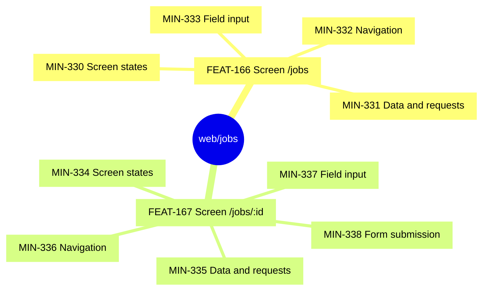
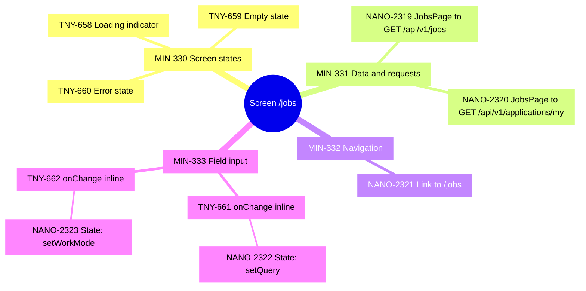
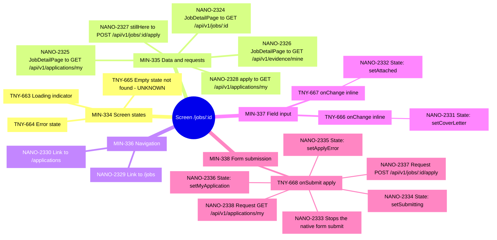

# web/jobs (MOD-170)

Generated by `docs/mindmap/tools/catalog.py` from `master/MASTER_PROJECT_GRAPH.json` at commit `9b3032f`. Do not edit by hand. Back to the [feature catalog](../FEATURE_CATALOG.md).

**Application:** apps/web (MOD-002). **Purpose:** Routed screens under /jobs in apps/web/src/App.tsx.

**Nodes by level:** MODULE 1, MAJOR 2, MINOR 9, TINY 11, NANO 20. **Status:** IMPLEMENTED 42, UNKNOWN 1. **Verification:** PATH_LEVEL 19, UNKNOWN 22, VERIFIED 2.

## Module map (to minor features)

## FEAT-166 Screen /jobs

JobsPage at route /jobs (public); 0 buttons, 0 forms, 1 inputs; calls 2 endpoint(s).

| ID        | Level | Parent   | Name                                    | Description                                                                                                                 | Status      | Verification | Evidence                            | Related                                                       |
| --------- | ----- | -------- | --------------------------------------- | --------------------------------------------------------------------------------------------------------------------------- | ----------- | ------------ | ----------------------------------- | ------------------------------------------------------------- |
| FEAT-166  | MAJOR | MOD-170  | Screen /jobs                            | JobsPage at route /jobs (public); 0 buttons, 0 forms, 1 inputs; calls 2 endpoint(s).                                        | IMPLEMENTED | VERIFIED     | apps/web/src/App.tsx:62             | SCR-007, TEST-162, TEST-167, TEST-178, TEST-194, TEST-195 ... |
| MIN-330   | MINOR | FEAT-166 | Screen states                           | Loading, empty and error presentation found in the screen source.                                                           | IMPLEMENTED | PATH_LEVEL   | apps/web/src/pages/JobsPage.tsx     |                                                               |
| TNY-658   | TINY  | MIN-330  | Loading indicator                       | Loading indicator rendered by JobsPage (detected in source).                                                                | IMPLEMENTED | PATH_LEVEL   | apps/web/src/pages/JobsPage.tsx     |                                                               |
| TNY-659   | TINY  | MIN-330  | Empty state                             | Empty state rendered by JobsPage (detected in source).                                                                      | IMPLEMENTED | PATH_LEVEL   | apps/web/src/pages/JobsPage.tsx     |                                                               |
| TNY-660   | TINY  | MIN-330  | Error state                             | Error state rendered by JobsPage (detected in source).                                                                      | IMPLEMENTED | PATH_LEVEL   | apps/web/src/pages/JobsPage.tsx     |                                                               |
| MIN-331   | MINOR | FEAT-166 | Data and requests                       | API endpoints this screen calls (2).                                                                                        | IMPLEMENTED | PATH_LEVEL   | apps/web/src/pages/JobsPage.tsx     |                                                               |
| NANO-2319 | NANO  | MIN-331  | JobsPage -> GET /api/v1/jobs            | JobsPage() at apps/web/src/pages/JobsPage.tsx:38 sends GET /api/v1/jobs.                                                    | IMPLEMENTED | UNKNOWN      | apps/web/src/pages/JobsPage.tsx:38  | API-032                                                       |
| NANO-2320 | NANO  | MIN-331  | JobsPage -> GET /api/v1/applications/my | JobsPage() at apps/web/src/pages/JobsPage.tsx:50 sends GET /api/v1/applications/my.                                         | IMPLEMENTED | UNKNOWN      | apps/web/src/pages/JobsPage.tsx:50  | API-048                                                       |
| MIN-332   | MINOR | FEAT-166 | Navigation                              | Links from this screen to 1 other screen(s).                                                                                | IMPLEMENTED | PATH_LEVEL   | apps/web/src/pages/JobsPage.tsx     |                                                               |
| NANO-2321 | NANO  | MIN-332  | Link to /jobs                           | Navigates to /jobs (JobsPage).                                                                                              | IMPLEMENTED | UNKNOWN      | apps/web/src/pages/JobsPage.tsx     | SCR-007                                                       |
| MIN-333   | MINOR | FEAT-166 | Field input                             | 2 'field input' binding(s) in apps/web/src/pages/JobsPage.tsx.                                                              | IMPLEMENTED | PATH_LEVEL   | apps/web/src/pages/JobsPage.tsx:108 |                                                               |
| TNY-661   | TINY  | MIN-333  | onChange inline                         | onChange at apps/web/src/pages/JobsPage.tsx:108 runs inline: (e) => setQuery(e.target.value); changes state setQuery.       | IMPLEMENTED | PATH_LEVEL   | apps/web/src/pages/JobsPage.tsx:108 | INT-145                                                       |
| NANO-2322 | NANO  | TNY-661  | State: setQuery                         | Updates component state through setQuery.                                                                                   | IMPLEMENTED | UNKNOWN      | apps/web/src/pages/JobsPage.tsx:108 |                                                               |
| TNY-662   | TINY  | MIN-333  | onChange inline                         | onChange at apps/web/src/pages/JobsPage.tsx:115 runs inline: (e) => setWorkMode(e.target.value); changes state setWorkMode. | IMPLEMENTED | PATH_LEVEL   | apps/web/src/pages/JobsPage.tsx:115 | INT-146                                                       |
| NANO-2323 | NANO  | TNY-662  | State: setWorkMode                      | Updates component state through setWorkMode.                                                                                | IMPLEMENTED | UNKNOWN      | apps/web/src/pages/JobsPage.tsx:115 |                                                               |

## FEAT-167 Screen /jobs/:id

JobDetailPage at route /jobs/:id (public); 1 buttons, 1 forms, 1 inputs; calls 4 endpoint(s).

| ID        | Level | Parent   | Name                                         | Description                                                                                                                                                                                    | Status      | Verification | Evidence                                 | Related                     |
| --------- | ----- | -------- | -------------------------------------------- | ---------------------------------------------------------------------------------------------------------------------------------------------------------------------------------------------- | ----------- | ------------ | ---------------------------------------- | --------------------------- |
| FEAT-167  | MAJOR | MOD-170  | Screen /jobs/:id                             | JobDetailPage at route /jobs/:id (public); 1 buttons, 1 forms, 1 inputs; calls 4 endpoint(s).                                                                                                  | IMPLEMENTED | VERIFIED     | apps/web/src/App.tsx:63                  | SCR-008, TEST-194, TEST-220 |
| MIN-334   | MINOR | FEAT-167 | Screen states                                | Loading, empty and error presentation found in the screen source; not found: Empty state.                                                                                                      | IMPLEMENTED | PATH_LEVEL   | apps/web/src/pages/JobDetailPage.tsx     |                             |
| TNY-663   | TINY  | MIN-334  | Loading indicator                            | Loading indicator rendered by JobDetailPage (detected in source).                                                                                                                              | IMPLEMENTED | PATH_LEVEL   | apps/web/src/pages/JobDetailPage.tsx     |                             |
| TNY-664   | TINY  | MIN-334  | Error state                                  | Error state rendered by JobDetailPage (detected in source).                                                                                                                                    | IMPLEMENTED | PATH_LEVEL   | apps/web/src/pages/JobDetailPage.tsx     |                             |
| TNY-665   | TINY  | MIN-334  | Empty state (not found)                      | No empty state pattern was detected in apps/web/src/pages/JobDetailPage.tsx although the screen calls the API. May be handled by a shared component; confirm before treating as a gap.         | UNKNOWN     | UNKNOWN      | apps/web/src/pages/JobDetailPage.tsx     |                             |
| MIN-335   | MINOR | FEAT-167 | Data and requests                            | API endpoints this screen calls (4).                                                                                                                                                           | IMPLEMENTED | PATH_LEVEL   | apps/web/src/pages/JobDetailPage.tsx     |                             |
| NANO-2324 | NANO  | MIN-335  | JobDetailPage -> GET /api/v1/jobs/:id        | JobDetailPage() at apps/web/src/pages/JobDetailPage.tsx:60 sends GET /api/v1/jobs/:id.                                                                                                         | IMPLEMENTED | UNKNOWN      | apps/web/src/pages/JobDetailPage.tsx:60  | API-033                     |
| NANO-2325 | NANO  | MIN-335  | JobDetailPage -> GET /api/v1/applications/my | JobDetailPage() at apps/web/src/pages/JobDetailPage.tsx:80 sends GET /api/v1/applications/my.                                                                                                  | IMPLEMENTED | UNKNOWN      | apps/web/src/pages/JobDetailPage.tsx:80  | API-048                     |
| NANO-2326 | NANO  | MIN-335  | JobDetailPage -> GET /api/v1/evidence/mine   | JobDetailPage() at apps/web/src/pages/JobDetailPage.tsx:86 sends GET /api/v1/evidence/mine.                                                                                                    | IMPLEMENTED | UNKNOWN      | apps/web/src/pages/JobDetailPage.tsx:86  | API-016                     |
| NANO-2327 | NANO  | MIN-335  | stillHere -> POST /api/v1/jobs/:id/apply     | stillHere() at apps/web/src/pages/JobDetailPage.tsx:105 sends POST /api/v1/jobs/:id/apply.                                                                                                     | IMPLEMENTED | UNKNOWN      | apps/web/src/pages/JobDetailPage.tsx:105 | API-047                     |
| NANO-2328 | NANO  | MIN-335  | apply -> GET /api/v1/applications/my         | apply() at apps/web/src/pages/JobDetailPage.tsx:118 sends GET /api/v1/applications/my.                                                                                                         | IMPLEMENTED | UNKNOWN      | apps/web/src/pages/JobDetailPage.tsx:118 | API-048                     |
| MIN-336   | MINOR | FEAT-167 | Navigation                                   | Links from this screen to 2 other screen(s).                                                                                                                                                   | IMPLEMENTED | PATH_LEVEL   | apps/web/src/pages/JobDetailPage.tsx     |                             |
| NANO-2329 | NANO  | MIN-336  | Link to /jobs                                | Navigates to /jobs (JobsPage).                                                                                                                                                                 | IMPLEMENTED | UNKNOWN      | apps/web/src/pages/JobDetailPage.tsx     | SCR-007                     |
| NANO-2330 | NANO  | MIN-336  | Link to /applications                        | Navigates to /applications (ApplicationsPage).                                                                                                                                                 | IMPLEMENTED | UNKNOWN      | apps/web/src/pages/JobDetailPage.tsx     | SCR-012                     |
| MIN-337   | MINOR | FEAT-167 | Field input                                  | 2 'field input' binding(s) in apps/web/src/pages/JobDetailPage.tsx.                                                                                                                            | IMPLEMENTED | PATH_LEVEL   | apps/web/src/pages/JobDetailPage.tsx:342 |                             |
| TNY-666   | TINY  | MIN-337  | onChange inline                              | onChange at apps/web/src/pages/JobDetailPage.tsx:342 runs inline: (e) => setCoverLetter(e.target.value); changes state setCoverLetter.                                                         | IMPLEMENTED | PATH_LEVEL   | apps/web/src/pages/JobDetailPage.tsx:342 | INT-143                     |
| NANO-2331 | NANO  | TNY-666  | State: setCoverLetter                        | Updates component state through setCoverLetter.                                                                                                                                                | IMPLEMENTED | UNKNOWN      | apps/web/src/pages/JobDetailPage.tsx:342 |                             |
| TNY-667   | TINY  | MIN-337  | onChange inline                              | onChange at apps/web/src/pages/JobDetailPage.tsx:366 runs inline: (e) => setAttached((current) => e.target.checked ?; changes state setAttached.                                               | IMPLEMENTED | PATH_LEVEL   | apps/web/src/pages/JobDetailPage.tsx:366 | INT-144                     |
| NANO-2332 | NANO  | TNY-667  | State: setAttached                           | Updates component state through setAttached.                                                                                                                                                   | IMPLEMENTED | UNKNOWN      | apps/web/src/pages/JobDetailPage.tsx:366 |                             |
| MIN-338   | MINOR | FEAT-167 | Form submission                              | 1 'form submission' binding(s) in apps/web/src/pages/JobDetailPage.tsx.                                                                                                                        | IMPLEMENTED | PATH_LEVEL   | apps/web/src/pages/JobDetailPage.tsx:323 |                             |
| TNY-668   | TINY  | MIN-338  | onSubmit apply                               | onSubmit at apps/web/src/pages/JobDetailPage.tsx:323 runs apply; changes state setSubmitting, setApplyError, setMyApplication; calls POST /api/v1/jobs/:id/apply, GET /api/v1/applications/my. | IMPLEMENTED | PATH_LEVEL   | apps/web/src/pages/JobDetailPage.tsx:323 | INT-142                     |
| NANO-2333 | NANO  | TNY-668  | Stops the native form submit                 | Calls event.preventDefault() so the page does not reload.                                                                                                                                      | IMPLEMENTED | UNKNOWN      | apps/web/src/pages/JobDetailPage.tsx:94  |                             |
| NANO-2334 | NANO  | TNY-668  | State: setSubmitting                         | Updates component state through setSubmitting.                                                                                                                                                 | IMPLEMENTED | UNKNOWN      | apps/web/src/pages/JobDetailPage.tsx:94  |                             |
| NANO-2335 | NANO  | TNY-668  | State: setApplyError                         | Updates component state through setApplyError.                                                                                                                                                 | IMPLEMENTED | UNKNOWN      | apps/web/src/pages/JobDetailPage.tsx:94  |                             |
| NANO-2336 | NANO  | TNY-668  | State: setMyApplication                      | Updates component state through setMyApplication.                                                                                                                                              | IMPLEMENTED | UNKNOWN      | apps/web/src/pages/JobDetailPage.tsx:94  |                             |
| NANO-2337 | NANO  | TNY-668  | Request POST /api/v1/jobs/:id/apply          | Sends POST /api/v1/jobs/:id/apply through apiFetch/apiJson (apps/web/src/lib/api.ts).                                                                                                          | IMPLEMENTED | UNKNOWN      | apps/web/src/pages/JobDetailPage.tsx:94  | API-047                     |
| NANO-2338 | NANO  | TNY-668  | Request GET /api/v1/applications/my          | Sends GET /api/v1/applications/my through apiFetch/apiJson (apps/web/src/lib/api.ts).                                                                                                          | IMPLEMENTED | UNKNOWN      | apps/web/src/pages/JobDetailPage.tsx:94  | API-048                     |
