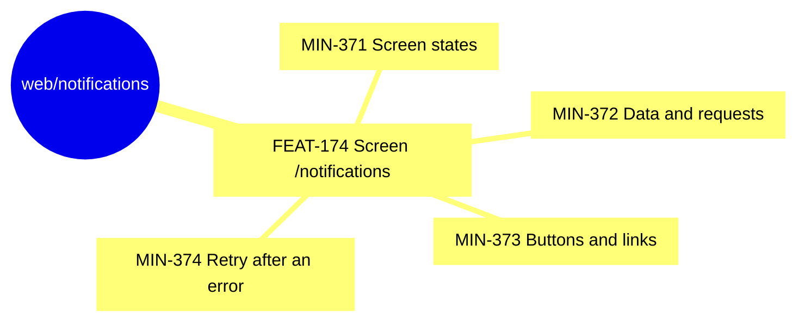
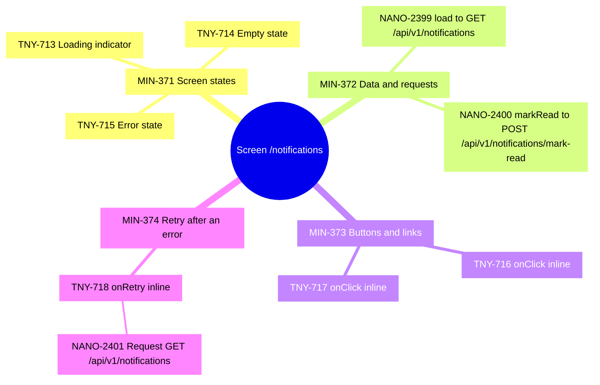

# web/notifications (MOD-175)

Generated by `docs/mindmap/tools/catalog.py` from `master/MASTER_PROJECT_GRAPH.json` at commit `9b3032f`. Do not edit by hand. Back to the [feature catalog](../FEATURE_CATALOG.md).

**Application:** apps/web (MOD-002). **Purpose:** Routed screens under /notifications in apps/web/src/App.tsx.

**Nodes by level:** MODULE 1, MAJOR 1, MINOR 4, TINY 6, NANO 3. **Status:** IMPLEMENTED 15. **Verification:** PATH_LEVEL 10, UNKNOWN 4, VERIFIED 1.

## Module map (to minor features)

## FEAT-174 Screen /notifications

NotificationsPage at route /notifications (signed-in only); 1 buttons, 0 forms, 0 inputs; calls 2 endpoint(s).

| ID        | Level | Parent   | Name                                             | Description                                                                                                             | Status      | Verification | Evidence                                     | Related           |
| --------- | ----- | -------- | ------------------------------------------------ | ----------------------------------------------------------------------------------------------------------------------- | ----------- | ------------ | -------------------------------------------- | ----------------- |
| FEAT-174  | MAJOR | MOD-175  | Screen /notifications                            | NotificationsPage at route /notifications (signed-in only); 1 buttons, 0 forms, 0 inputs; calls 2 endpoint(s).          | IMPLEMENTED | VERIFIED     | apps/web/src/App.tsx:78                      | SCR-022, TEST-197 |
| MIN-371   | MINOR | FEAT-174 | Screen states                                    | Loading, empty and error presentation found in the screen source.                                                       | IMPLEMENTED | PATH_LEVEL   | apps/web/src/pages/NotificationsPage.tsx     |                   |
| TNY-713   | TINY  | MIN-371  | Loading indicator                                | Loading indicator rendered by NotificationsPage (detected in source).                                                   | IMPLEMENTED | PATH_LEVEL   | apps/web/src/pages/NotificationsPage.tsx     |                   |
| TNY-714   | TINY  | MIN-371  | Empty state                                      | Empty state rendered by NotificationsPage (detected in source).                                                         | IMPLEMENTED | PATH_LEVEL   | apps/web/src/pages/NotificationsPage.tsx     |                   |
| TNY-715   | TINY  | MIN-371  | Error state                                      | Error state rendered by NotificationsPage (detected in source).                                                         | IMPLEMENTED | PATH_LEVEL   | apps/web/src/pages/NotificationsPage.tsx     |                   |
| MIN-372   | MINOR | FEAT-174 | Data and requests                                | API endpoints this screen calls (2).                                                                                    | IMPLEMENTED | PATH_LEVEL   | apps/web/src/pages/NotificationsPage.tsx     |                   |
| NANO-2399 | NANO  | MIN-372  | load -> GET /api/v1/notifications                | load() at apps/web/src/pages/NotificationsPage.tsx:26 sends GET /api/v1/notifications.                                  | IMPLEMENTED | UNKNOWN      | apps/web/src/pages/NotificationsPage.tsx:26  | API-117           |
| NANO-2400 | NANO  | MIN-372  | markRead -> POST /api/v1/notifications/mark-read | markRead() at apps/web/src/pages/NotificationsPage.tsx:39 sends POST /api/v1/notifications/mark-read.                   | IMPLEMENTED | UNKNOWN      | apps/web/src/pages/NotificationsPage.tsx:39  | API-119           |
| MIN-373   | MINOR | FEAT-174 | Buttons and links                                | 2 'buttons and links' binding(s) in apps/web/src/pages/NotificationsPage.tsx.                                           | IMPLEMENTED | PATH_LEVEL   | apps/web/src/pages/NotificationsPage.tsx:87  |                   |
| TNY-716   | TINY  | MIN-373  | onClick inline                                   | onClick at apps/web/src/pages/NotificationsPage.tsx:87 runs inline: () => void markAll().                               | IMPLEMENTED | PATH_LEVEL   | apps/web/src/pages/NotificationsPage.tsx:87  | INT-165           |
| TNY-717   | TINY  | MIN-373  | onClick inline                                   | onClick at apps/web/src/pages/NotificationsPage.tsx:155 runs inline: () => open(n).                                     | IMPLEMENTED | PATH_LEVEL   | apps/web/src/pages/NotificationsPage.tsx:155 | INT-167           |
| MIN-374   | MINOR | FEAT-174 | Retry after an error                             | 1 'retry after an error' binding(s) in apps/web/src/pages/NotificationsPage.tsx.                                        | IMPLEMENTED | PATH_LEVEL   | apps/web/src/pages/NotificationsPage.tsx:97  |                   |
| TNY-718   | TINY  | MIN-374  | onRetry inline                                   | onRetry at apps/web/src/pages/NotificationsPage.tsx:97 runs inline: () => void load(); calls GET /api/v1/notifications. | IMPLEMENTED | PATH_LEVEL   | apps/web/src/pages/NotificationsPage.tsx:97  | INT-166           |
| NANO-2401 | NANO  | TNY-718  | Request GET /api/v1/notifications                | Sends GET /api/v1/notifications through apiFetch/apiJson (apps/web/src/lib/api.ts).                                     | IMPLEMENTED | UNKNOWN      | apps/web/src/pages/NotificationsPage.tsx:97  | API-117           |
