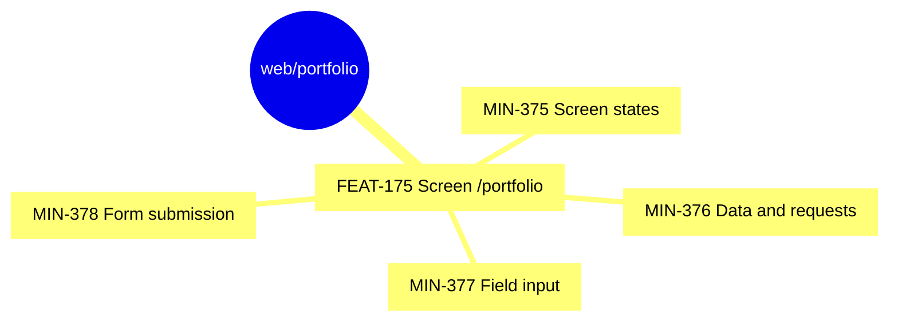
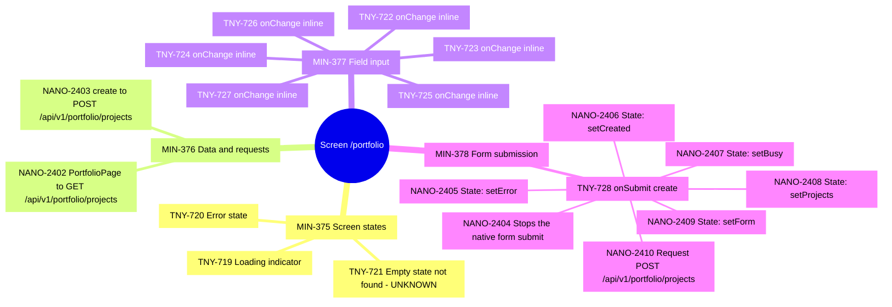

# web/portfolio (MOD-176)

Generated by `docs/mindmap/tools/catalog.py` from `master/MASTER_PROJECT_GRAPH.json` at commit `9b3032f`. Do not edit by hand. Back to the [feature catalog](../FEATURE_CATALOG.md).

**Application:** apps/web (MOD-002). **Purpose:** Routed screens under /portfolio in apps/web/src/App.tsx.

**Nodes by level:** MODULE 1, MAJOR 1, MINOR 4, TINY 10, NANO 9. **Status:** IMPLEMENTED 24, UNKNOWN 1. **Verification:** PATH_LEVEL 13, UNKNOWN 11, VERIFIED 1.

## Module map (to minor features)

## FEAT-175 Screen /portfolio

PortfolioPage at route /portfolio (signed-in only); 1 buttons, 1 forms, 4 inputs; calls 2 endpoint(s).

| ID        | Level | Parent   | Name                                            | Description                                                                                                                                                                            | Status      | Verification | Evidence                                 | Related           |
| --------- | ----- | -------- | ----------------------------------------------- | -------------------------------------------------------------------------------------------------------------------------------------------------------------------------------------- | ----------- | ------------ | ---------------------------------------- | ----------------- |
| FEAT-175  | MAJOR | MOD-176  | Screen /portfolio                               | PortfolioPage at route /portfolio (signed-in only); 1 buttons, 1 forms, 4 inputs; calls 2 endpoint(s).                                                                                 | IMPLEMENTED | VERIFIED     | apps/web/src/App.tsx:72                  | SCR-016, TEST-200 |
| MIN-375   | MINOR | FEAT-175 | Screen states                                   | Loading, empty and error presentation found in the screen source; not found: Empty state.                                                                                              | IMPLEMENTED | PATH_LEVEL   | apps/web/src/pages/PortfolioPage.tsx     |                   |
| TNY-719   | TINY  | MIN-375  | Loading indicator                               | Loading indicator rendered by PortfolioPage (detected in source).                                                                                                                      | IMPLEMENTED | PATH_LEVEL   | apps/web/src/pages/PortfolioPage.tsx     |                   |
| TNY-720   | TINY  | MIN-375  | Error state                                     | Error state rendered by PortfolioPage (detected in source).                                                                                                                            | IMPLEMENTED | PATH_LEVEL   | apps/web/src/pages/PortfolioPage.tsx     |                   |
| TNY-721   | TINY  | MIN-375  | Empty state (not found)                         | No empty state pattern was detected in apps/web/src/pages/PortfolioPage.tsx although the screen calls the API. May be handled by a shared component; confirm before treating as a gap. | UNKNOWN     | UNKNOWN      | apps/web/src/pages/PortfolioPage.tsx     |                   |
| MIN-376   | MINOR | FEAT-175 | Data and requests                               | API endpoints this screen calls (2).                                                                                                                                                   | IMPLEMENTED | PATH_LEVEL   | apps/web/src/pages/PortfolioPage.tsx     |                   |
| NANO-2402 | NANO  | MIN-376  | PortfolioPage -> GET /api/v1/portfolio/projects | PortfolioPage() at apps/web/src/pages/PortfolioPage.tsx:58 sends GET /api/v1/portfolio/projects.                                                                                       | IMPLEMENTED | UNKNOWN      | apps/web/src/pages/PortfolioPage.tsx:58  | API-202           |
| NANO-2403 | NANO  | MIN-376  | create -> POST /api/v1/portfolio/projects       | create() at apps/web/src/pages/PortfolioPage.tsx:93 sends POST /api/v1/portfolio/projects.                                                                                             | IMPLEMENTED | UNKNOWN      | apps/web/src/pages/PortfolioPage.tsx:93  | API-201           |
| MIN-377   | MINOR | FEAT-175 | Field input                                     | 6 'field input' binding(s) in apps/web/src/pages/PortfolioPage.tsx.                                                                                                                    | IMPLEMENTED | PATH_LEVEL   | apps/web/src/pages/PortfolioPage.tsx:140 |                   |
| TNY-722   | TINY  | MIN-377  | onChange inline                                 | onChange at apps/web/src/pages/PortfolioPage.tsx:140 runs inline: (e) => set('title', e.target.value).                                                                                 | IMPLEMENTED | PATH_LEVEL   | apps/web/src/pages/PortfolioPage.tsx:140 | INT-169           |
| TNY-723   | TINY  | MIN-377  | onChange inline                                 | onChange at apps/web/src/pages/PortfolioPage.tsx:150 runs inline: (e) => set('description', e.target.value).                                                                           | IMPLEMENTED | PATH_LEVEL   | apps/web/src/pages/PortfolioPage.tsx:150 | INT-170           |
| TNY-724   | TINY  | MIN-377  | onChange inline                                 | onChange at apps/web/src/pages/PortfolioPage.tsx:158 runs inline: (e) => set('projectUrl', e.target.value).                                                                            | IMPLEMENTED | PATH_LEVEL   | apps/web/src/pages/PortfolioPage.tsx:158 | INT-171           |
| TNY-725   | TINY  | MIN-377  | onChange inline                                 | onChange at apps/web/src/pages/PortfolioPage.tsx:166 runs inline: (e) => set('repoUrl', e.target.value).                                                                               | IMPLEMENTED | PATH_LEVEL   | apps/web/src/pages/PortfolioPage.tsx:166 | INT-172           |
| TNY-726   | TINY  | MIN-377  | onChange inline                                 | onChange at apps/web/src/pages/PortfolioPage.tsx:173 runs inline: (e) => set('visibility', e.target.value as Visibil.                                                                  | IMPLEMENTED | PATH_LEVEL   | apps/web/src/pages/PortfolioPage.tsx:173 | INT-173           |
| TNY-727   | TINY  | MIN-377  | onChange inline                                 | onChange at apps/web/src/pages/PortfolioPage.tsx:185 runs inline: (e) => set('featured', e.target.checked).                                                                            | IMPLEMENTED | PATH_LEVEL   | apps/web/src/pages/PortfolioPage.tsx:185 | INT-174           |
| MIN-378   | MINOR | FEAT-175 | Form submission                                 | 1 'form submission' binding(s) in apps/web/src/pages/PortfolioPage.tsx.                                                                                                                | IMPLEMENTED | PATH_LEVEL   | apps/web/src/pages/PortfolioPage.tsx:134 |                   |
| TNY-728   | TINY  | MIN-378  | onSubmit create                                 | onSubmit at apps/web/src/pages/PortfolioPage.tsx:134 runs create; changes state setError, setCreated, setBusy, setProjects, setForm; calls POST /api/v1/portfolio/projects.            | IMPLEMENTED | PATH_LEVEL   | apps/web/src/pages/PortfolioPage.tsx:134 | INT-168           |
| NANO-2404 | NANO  | TNY-728  | Stops the native form submit                    | Calls event.preventDefault() so the page does not reload.                                                                                                                              | IMPLEMENTED | UNKNOWN      | apps/web/src/pages/PortfolioPage.tsx:75  |                   |
| NANO-2405 | NANO  | TNY-728  | State: setError                                 | Updates component state through setError.                                                                                                                                              | IMPLEMENTED | UNKNOWN      | apps/web/src/pages/PortfolioPage.tsx:75  |                   |
| NANO-2406 | NANO  | TNY-728  | State: setCreated                               | Updates component state through setCreated.                                                                                                                                            | IMPLEMENTED | UNKNOWN      | apps/web/src/pages/PortfolioPage.tsx:75  |                   |
| NANO-2407 | NANO  | TNY-728  | State: setBusy                                  | Updates component state through setBusy.                                                                                                                                               | IMPLEMENTED | UNKNOWN      | apps/web/src/pages/PortfolioPage.tsx:75  |                   |
| NANO-2408 | NANO  | TNY-728  | State: setProjects                              | Updates component state through setProjects.                                                                                                                                           | IMPLEMENTED | UNKNOWN      | apps/web/src/pages/PortfolioPage.tsx:75  |                   |
| NANO-2409 | NANO  | TNY-728  | State: setForm                                  | Updates component state through setForm.                                                                                                                                               | IMPLEMENTED | UNKNOWN      | apps/web/src/pages/PortfolioPage.tsx:75  |                   |
| NANO-2410 | NANO  | TNY-728  | Request POST /api/v1/portfolio/projects         | Sends POST /api/v1/portfolio/projects through apiFetch/apiJson (apps/web/src/lib/api.ts).                                                                                              | IMPLEMENTED | UNKNOWN      | apps/web/src/pages/PortfolioPage.tsx:75  | API-201           |
