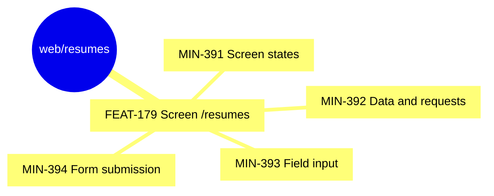
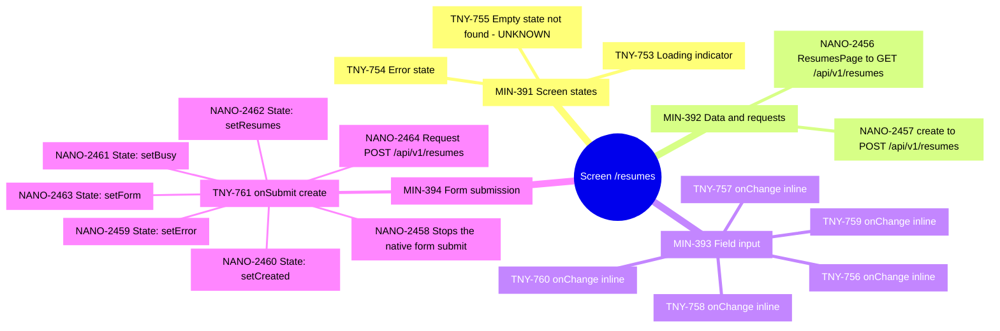

# web/resumes (MOD-180)

Generated by `docs/mindmap/tools/catalog.py` from `master/MASTER_PROJECT_GRAPH.json` at commit `9b3032f`. Do not edit by hand. Back to the [feature catalog](../FEATURE_CATALOG.md).

**Application:** apps/web (MOD-002). **Purpose:** Routed screens under /resumes in apps/web/src/App.tsx.

**Nodes by level:** MODULE 1, MAJOR 1, MINOR 4, TINY 9, NANO 9. **Status:** IMPLEMENTED 23, UNKNOWN 1. **Verification:** PATH_LEVEL 12, UNKNOWN 11, VERIFIED 1.

## Module map (to minor features)

## FEAT-179 Screen /resumes

ResumesPage at route /resumes (signed-in only); 1 buttons, 1 forms, 3 inputs; calls 2 endpoint(s).

| ID        | Level | Parent   | Name                               | Description                                                                                                                                                                          | Status      | Verification | Evidence                               | Related           |
| --------- | ----- | -------- | ---------------------------------- | ------------------------------------------------------------------------------------------------------------------------------------------------------------------------------------ | ----------- | ------------ | -------------------------------------- | ----------------- |
| FEAT-179  | MAJOR | MOD-180  | Screen /resumes                    | ResumesPage at route /resumes (signed-in only); 1 buttons, 1 forms, 3 inputs; calls 2 endpoint(s).                                                                                   | IMPLEMENTED | VERIFIED     | apps/web/src/App.tsx:73                | SCR-017, TEST-200 |
| MIN-391   | MINOR | FEAT-179 | Screen states                      | Loading, empty and error presentation found in the screen source; not found: Empty state.                                                                                            | IMPLEMENTED | PATH_LEVEL   | apps/web/src/pages/ResumesPage.tsx     |                   |
| TNY-753   | TINY  | MIN-391  | Loading indicator                  | Loading indicator rendered by ResumesPage (detected in source).                                                                                                                      | IMPLEMENTED | PATH_LEVEL   | apps/web/src/pages/ResumesPage.tsx     |                   |
| TNY-754   | TINY  | MIN-391  | Error state                        | Error state rendered by ResumesPage (detected in source).                                                                                                                            | IMPLEMENTED | PATH_LEVEL   | apps/web/src/pages/ResumesPage.tsx     |                   |
| TNY-755   | TINY  | MIN-391  | Empty state (not found)            | No empty state pattern was detected in apps/web/src/pages/ResumesPage.tsx although the screen calls the API. May be handled by a shared component; confirm before treating as a gap. | UNKNOWN     | UNKNOWN      | apps/web/src/pages/ResumesPage.tsx     |                   |
| MIN-392   | MINOR | FEAT-179 | Data and requests                  | API endpoints this screen calls (2).                                                                                                                                                 | IMPLEMENTED | PATH_LEVEL   | apps/web/src/pages/ResumesPage.tsx     |                   |
| NANO-2456 | NANO  | MIN-392  | ResumesPage -> GET /api/v1/resumes | ResumesPage() at apps/web/src/pages/ResumesPage.tsx:53 sends GET /api/v1/resumes.                                                                                                    | IMPLEMENTED | UNKNOWN      | apps/web/src/pages/ResumesPage.tsx:53  | API-128           |
| NANO-2457 | NANO  | MIN-392  | create -> POST /api/v1/resumes     | create() at apps/web/src/pages/ResumesPage.tsx:84 sends POST /api/v1/resumes.                                                                                                        | IMPLEMENTED | UNKNOWN      | apps/web/src/pages/ResumesPage.tsx:84  | API-127           |
| MIN-393   | MINOR | FEAT-179 | Field input                        | 5 'field input' binding(s) in apps/web/src/pages/ResumesPage.tsx.                                                                                                                    | IMPLEMENTED | PATH_LEVEL   | apps/web/src/pages/ResumesPage.tsx:132 |                   |
| TNY-756   | TINY  | MIN-393  | onChange inline                    | onChange at apps/web/src/pages/ResumesPage.tsx:132 runs inline: (e) => set('title', e.target.value).                                                                                 | IMPLEMENTED | PATH_LEVEL   | apps/web/src/pages/ResumesPage.tsx:132 | INT-194           |
| TNY-757   | TINY  | MIN-393  | onChange inline                    | onChange at apps/web/src/pages/ResumesPage.tsx:139 runs inline: (e) => set('template', e.target.value as Template).                                                                  | IMPLEMENTED | PATH_LEVEL   | apps/web/src/pages/ResumesPage.tsx:139 | INT-195           |
| TNY-758   | TINY  | MIN-393  | onChange inline                    | onChange at apps/web/src/pages/ResumesPage.tsx:148 runs inline: (e) => set('headline', e.target.value).                                                                              | IMPLEMENTED | PATH_LEVEL   | apps/web/src/pages/ResumesPage.tsx:148 | INT-196           |
| TNY-759   | TINY  | MIN-393  | onChange inline                    | onChange at apps/web/src/pages/ResumesPage.tsx:157 runs inline: (e) => set('summary', e.target.value).                                                                               | IMPLEMENTED | PATH_LEVEL   | apps/web/src/pages/ResumesPage.tsx:157 | INT-197           |
| TNY-760   | TINY  | MIN-393  | onChange inline                    | onChange at apps/web/src/pages/ResumesPage.tsx:165 runs inline: (e) => set('contactEmail', e.target.value).                                                                          | IMPLEMENTED | PATH_LEVEL   | apps/web/src/pages/ResumesPage.tsx:165 | INT-198           |
| MIN-394   | MINOR | FEAT-179 | Form submission                    | 1 'form submission' binding(s) in apps/web/src/pages/ResumesPage.tsx.                                                                                                                | IMPLEMENTED | PATH_LEVEL   | apps/web/src/pages/ResumesPage.tsx:126 |                   |
| TNY-761   | TINY  | MIN-394  | onSubmit create                    | onSubmit at apps/web/src/pages/ResumesPage.tsx:126 runs create; changes state setError, setCreated, setBusy, setResumes, setForm; calls POST /api/v1/resumes.                        | IMPLEMENTED | PATH_LEVEL   | apps/web/src/pages/ResumesPage.tsx:126 | INT-193           |
| NANO-2458 | NANO  | TNY-761  | Stops the native form submit       | Calls event.preventDefault() so the page does not reload.                                                                                                                            | IMPLEMENTED | UNKNOWN      | apps/web/src/pages/ResumesPage.tsx:70  |                   |
| NANO-2459 | NANO  | TNY-761  | State: setError                    | Updates component state through setError.                                                                                                                                            | IMPLEMENTED | UNKNOWN      | apps/web/src/pages/ResumesPage.tsx:70  |                   |
| NANO-2460 | NANO  | TNY-761  | State: setCreated                  | Updates component state through setCreated.                                                                                                                                          | IMPLEMENTED | UNKNOWN      | apps/web/src/pages/ResumesPage.tsx:70  |                   |
| NANO-2461 | NANO  | TNY-761  | State: setBusy                     | Updates component state through setBusy.                                                                                                                                             | IMPLEMENTED | UNKNOWN      | apps/web/src/pages/ResumesPage.tsx:70  |                   |
| NANO-2462 | NANO  | TNY-761  | State: setResumes                  | Updates component state through setResumes.                                                                                                                                          | IMPLEMENTED | UNKNOWN      | apps/web/src/pages/ResumesPage.tsx:70  |                   |
| NANO-2463 | NANO  | TNY-761  | State: setForm                     | Updates component state through setForm.                                                                                                                                             | IMPLEMENTED | UNKNOWN      | apps/web/src/pages/ResumesPage.tsx:70  |                   |
| NANO-2464 | NANO  | TNY-761  | Request POST /api/v1/resumes       | Sends POST /api/v1/resumes through apiFetch/apiJson (apps/web/src/lib/api.ts).                                                                                                       | IMPLEMENTED | UNKNOWN      | apps/web/src/pages/ResumesPage.tsx:70  | API-127           |
