# web/shared-components (MOD-185)

Generated by `docs/mindmap/tools/catalog.py` from `master/MASTER_PROJECT_GRAPH.json` at commit `9b3032f`. Do not edit by hand. Back to the [feature catalog](../FEATURE_CATALOG.md).

**Application:** apps/web (MOD-002). **Purpose:** Shared components and app-level listeners that carry their own interactions.

**Nodes by level:** MODULE 1, MAJOR 13, MINOR 24, TINY 42, NANO 50. **Status:** IMPLEMENTED 128, PARTIALLY_IMPLEMENTED 1, UNKNOWN 1. **Verification:** UNKNOWN 130.

## Module map (to minor features)

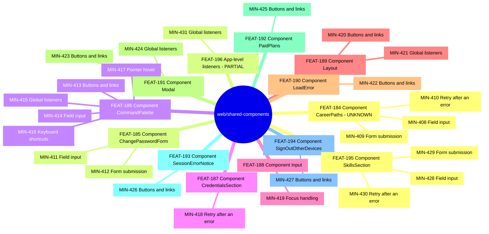

## FEAT-184 Component CareerPaths

3 interaction(s) defined in apps/web/src/components/CareerPaths.tsx; no importing file found (possible dead code).

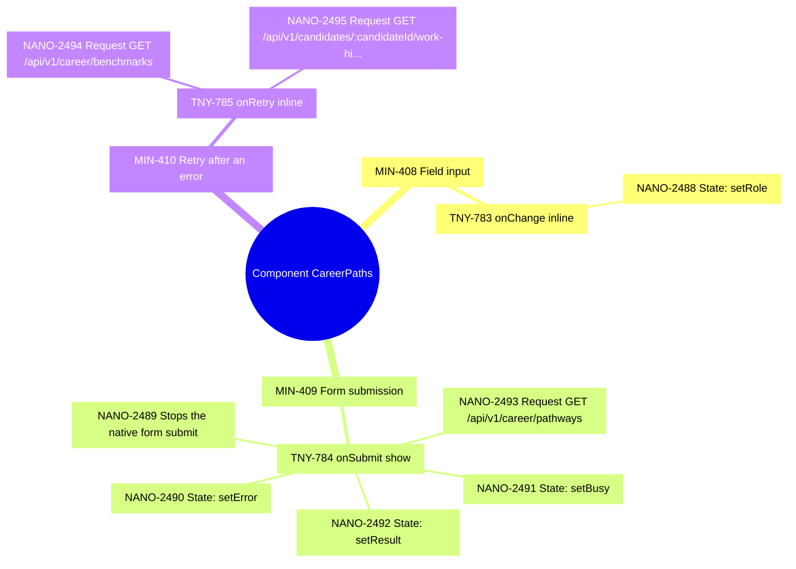

| ID        | Level | Parent   | Name                                                     | Description                                                                                                                                                                  | Status      | Verification | Evidence                                    | Related  |
| --------- | ----- | -------- | -------------------------------------------------------- | ---------------------------------------------------------------------------------------------------------------------------------------------------------------------------- | ----------- | ------------ | ------------------------------------------- | -------- |
| FEAT-184  | MAJOR | MOD-185  | Component CareerPaths                                    | 3 interaction(s) defined in apps/web/src/components/CareerPaths.tsx; no importing file found (possible dead code).                                                           | UNKNOWN     | UNKNOWN      | apps/web/src/components/CareerPaths.tsx:28  | COMP-001 |
| MIN-408   | MINOR | FEAT-184 | Field input                                              | 1 'field input' binding(s) in apps/web/src/components/CareerPaths.tsx.                                                                                                       | IMPLEMENTED | UNKNOWN      | apps/web/src/components/CareerPaths.tsx:100 |          |
| TNY-783   | TINY  | MIN-408  | onChange inline                                          | onChange at apps/web/src/components/CareerPaths.tsx:100 runs inline: (e) => setRole(e.target.value); changes state setRole.                                                  | IMPLEMENTED | UNKNOWN      | apps/web/src/components/CareerPaths.tsx:100 | INT-003  |
| NANO-2488 | NANO  | TNY-783  | State: setRole                                           | Updates component state through setRole.                                                                                                                                     | IMPLEMENTED | UNKNOWN      | apps/web/src/components/CareerPaths.tsx:100 |          |
| MIN-409   | MINOR | FEAT-184 | Form submission                                          | 1 'form submission' binding(s) in apps/web/src/components/CareerPaths.tsx.                                                                                                   | IMPLEMENTED | UNKNOWN      | apps/web/src/components/CareerPaths.tsx:94  |          |
| TNY-784   | TINY  | MIN-409  | onSubmit show                                            | onSubmit at apps/web/src/components/CareerPaths.tsx:94 runs show; changes state setError, setBusy, setResult; calls GET /api/v1/career/pathways.                             | IMPLEMENTED | UNKNOWN      | apps/web/src/components/CareerPaths.tsx:94  | INT-002  |
| NANO-2489 | NANO  | TNY-784  | Stops the native form submit                             | Calls event.preventDefault() so the page does not reload.                                                                                                                    | IMPLEMENTED | UNKNOWN      | apps/web/src/components/CareerPaths.tsx:65  |          |
| NANO-2490 | NANO  | TNY-784  | State: setError                                          | Updates component state through setError.                                                                                                                                    | IMPLEMENTED | UNKNOWN      | apps/web/src/components/CareerPaths.tsx:65  |          |
| NANO-2491 | NANO  | TNY-784  | State: setBusy                                           | Updates component state through setBusy.                                                                                                                                     | IMPLEMENTED | UNKNOWN      | apps/web/src/components/CareerPaths.tsx:65  |          |
| NANO-2492 | NANO  | TNY-784  | State: setResult                                         | Updates component state through setResult.                                                                                                                                   | IMPLEMENTED | UNKNOWN      | apps/web/src/components/CareerPaths.tsx:65  |          |
| NANO-2493 | NANO  | TNY-784  | Request GET /api/v1/career/pathways                      | Sends GET /api/v1/career/pathways through apiFetch/apiJson (apps/web/src/lib/api.ts).                                                                                        | IMPLEMENTED | UNKNOWN      | apps/web/src/components/CareerPaths.tsx:65  | API-166  |
| MIN-410   | MINOR | FEAT-184 | Retry after an error                                     | 1 'retry after an error' binding(s) in apps/web/src/components/CareerPaths.tsx.                                                                                              | IMPLEMENTED | UNKNOWN      | apps/web/src/components/CareerPaths.tsx:93  |          |
| TNY-785   | TINY  | MIN-410  | onRetry inline                                           | onRetry at apps/web/src/components/CareerPaths.tsx:93 runs inline: () => void load(); calls GET /api/v1/career/benchmarks, GET /api/v1/candidates/:candidateId/work-history. | IMPLEMENTED | UNKNOWN      | apps/web/src/components/CareerPaths.tsx:93  | INT-001  |
| NANO-2494 | NANO  | TNY-785  | Request GET /api/v1/career/benchmarks                    | Sends GET /api/v1/career/benchmarks through apiFetch/apiJson (apps/web/src/lib/api.ts).                                                                                      | IMPLEMENTED | UNKNOWN      | apps/web/src/components/CareerPaths.tsx:93  | API-164  |
| NANO-2495 | NANO  | TNY-785  | Request GET /api/v1/candidates/:candidateId/work-history | Sends GET /api/v1/candidates/:candidateId/work-history through apiFetch/apiJson (apps/web/src/lib/api.ts).                                                                   | IMPLEMENTED | UNKNOWN      | apps/web/src/components/CareerPaths.tsx:93  | API-276  |

## FEAT-185 Component ChangePasswordForm

4 interaction(s) defined in apps/web/src/components/ChangePasswordForm.tsx.

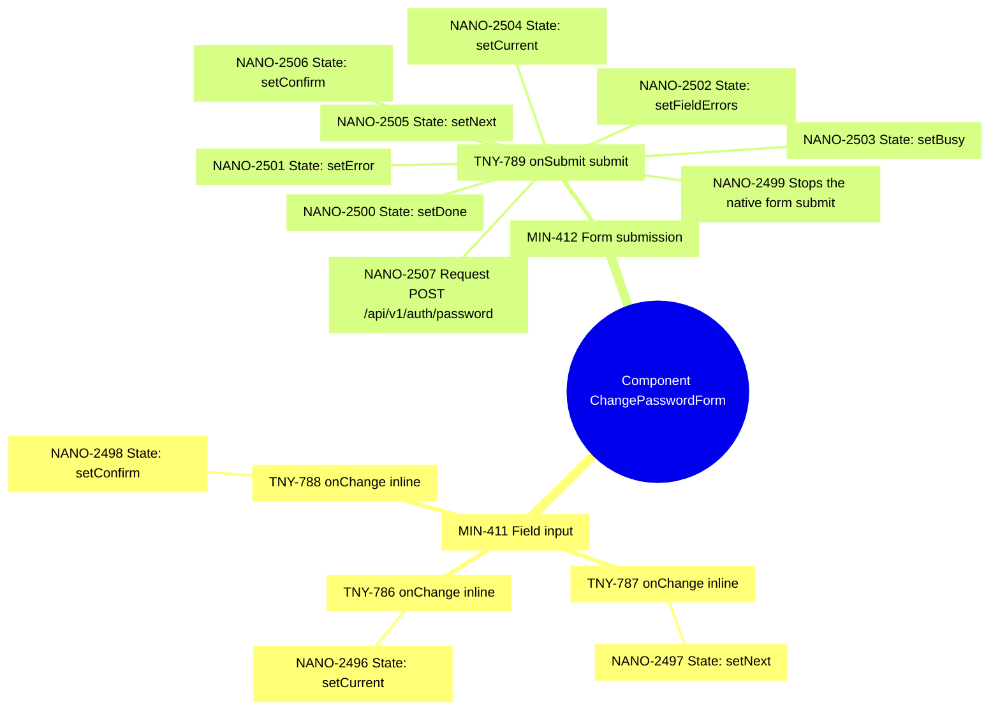

| ID        | Level | Parent   | Name                               | Description                                                                                                                                                                                             | Status      | Verification | Evidence                                           | Related  |
| --------- | ----- | -------- | ---------------------------------- | ------------------------------------------------------------------------------------------------------------------------------------------------------------------------------------------------------- | ----------- | ------------ | -------------------------------------------------- | -------- |
| FEAT-185  | MAJOR | MOD-185  | Component ChangePasswordForm       | 4 interaction(s) defined in apps/web/src/components/ChangePasswordForm.tsx.                                                                                                                             | IMPLEMENTED | UNKNOWN      | apps/web/src/components/ChangePasswordForm.tsx:11  | COMP-002 |
| MIN-411   | MINOR | FEAT-185 | Field input                        | 3 'field input' binding(s) in apps/web/src/components/ChangePasswordForm.tsx.                                                                                                                           | IMPLEMENTED | UNKNOWN      | apps/web/src/components/ChangePasswordForm.tsx:80  |          |
| TNY-786   | TINY  | MIN-411  | onChange inline                    | onChange at apps/web/src/components/ChangePasswordForm.tsx:80 runs inline: (e) => setCurrent(e.target.value); changes state setCurrent.                                                                 | IMPLEMENTED | UNKNOWN      | apps/web/src/components/ChangePasswordForm.tsx:80  | INT-005  |
| NANO-2496 | NANO  | TNY-786  | State: setCurrent                  | Updates component state through setCurrent.                                                                                                                                                             | IMPLEMENTED | UNKNOWN      | apps/web/src/components/ChangePasswordForm.tsx:80  |          |
| TNY-787   | TINY  | MIN-411  | onChange inline                    | onChange at apps/web/src/components/ChangePasswordForm.tsx:91 runs inline: (e) => setNext(e.target.value); changes state setNext.                                                                       | IMPLEMENTED | UNKNOWN      | apps/web/src/components/ChangePasswordForm.tsx:91  | INT-006  |
| NANO-2497 | NANO  | TNY-787  | State: setNext                     | Updates component state through setNext.                                                                                                                                                                | IMPLEMENTED | UNKNOWN      | apps/web/src/components/ChangePasswordForm.tsx:91  |          |
| TNY-788   | TINY  | MIN-411  | onChange inline                    | onChange at apps/web/src/components/ChangePasswordForm.tsx:101 runs inline: (e) => setConfirm(e.target.value); changes state setConfirm.                                                                | IMPLEMENTED | UNKNOWN      | apps/web/src/components/ChangePasswordForm.tsx:101 | INT-007  |
| NANO-2498 | NANO  | TNY-788  | State: setConfirm                  | Updates component state through setConfirm.                                                                                                                                                             | IMPLEMENTED | UNKNOWN      | apps/web/src/components/ChangePasswordForm.tsx:101 |          |
| MIN-412   | MINOR | FEAT-185 | Form submission                    | 1 'form submission' binding(s) in apps/web/src/components/ChangePasswordForm.tsx.                                                                                                                       | IMPLEMENTED | UNKNOWN      | apps/web/src/components/ChangePasswordForm.tsx:63  |          |
| TNY-789   | TINY  | MIN-412  | onSubmit submit                    | onSubmit at apps/web/src/components/ChangePasswordForm.tsx:63 runs submit; changes state setDone, setError, setFieldErrors, setBusy, setCurrent, setNext, setConfirm; calls POST /api/v1/auth/password. | IMPLEMENTED | UNKNOWN      | apps/web/src/components/ChangePasswordForm.tsx:63  | INT-004  |
| NANO-2499 | NANO  | TNY-789  | Stops the native form submit       | Calls event.preventDefault() so the page does not reload.                                                                                                                                               | IMPLEMENTED | UNKNOWN      | apps/web/src/components/ChangePasswordForm.tsx:24  |          |
| NANO-2500 | NANO  | TNY-789  | State: setDone                     | Updates component state through setDone.                                                                                                                                                                | IMPLEMENTED | UNKNOWN      | apps/web/src/components/ChangePasswordForm.tsx:24  |          |
| NANO-2501 | NANO  | TNY-789  | State: setError                    | Updates component state through setError.                                                                                                                                                               | IMPLEMENTED | UNKNOWN      | apps/web/src/components/ChangePasswordForm.tsx:24  |          |
| NANO-2502 | NANO  | TNY-789  | State: setFieldErrors              | Updates component state through setFieldErrors.                                                                                                                                                         | IMPLEMENTED | UNKNOWN      | apps/web/src/components/ChangePasswordForm.tsx:24  |          |
| NANO-2503 | NANO  | TNY-789  | State: setBusy                     | Updates component state through setBusy.                                                                                                                                                                | IMPLEMENTED | UNKNOWN      | apps/web/src/components/ChangePasswordForm.tsx:24  |          |
| NANO-2504 | NANO  | TNY-789  | State: setCurrent                  | Updates component state through setCurrent.                                                                                                                                                             | IMPLEMENTED | UNKNOWN      | apps/web/src/components/ChangePasswordForm.tsx:24  |          |
| NANO-2505 | NANO  | TNY-789  | State: setNext                     | Updates component state through setNext.                                                                                                                                                                | IMPLEMENTED | UNKNOWN      | apps/web/src/components/ChangePasswordForm.tsx:24  |          |
| NANO-2506 | NANO  | TNY-789  | State: setConfirm                  | Updates component state through setConfirm.                                                                                                                                                             | IMPLEMENTED | UNKNOWN      | apps/web/src/components/ChangePasswordForm.tsx:24  |          |
| NANO-2507 | NANO  | TNY-789  | Request POST /api/v1/auth/password | Sends POST /api/v1/auth/password through apiFetch/apiJson (apps/web/src/lib/api.ts).                                                                                                                    | IMPLEMENTED | UNKNOWN      | apps/web/src/components/ChangePasswordForm.tsx:24  | API-007  |

## FEAT-186 Component CommandPalette

6 interaction(s) defined in apps/web/src/components/CommandPalette.tsx.

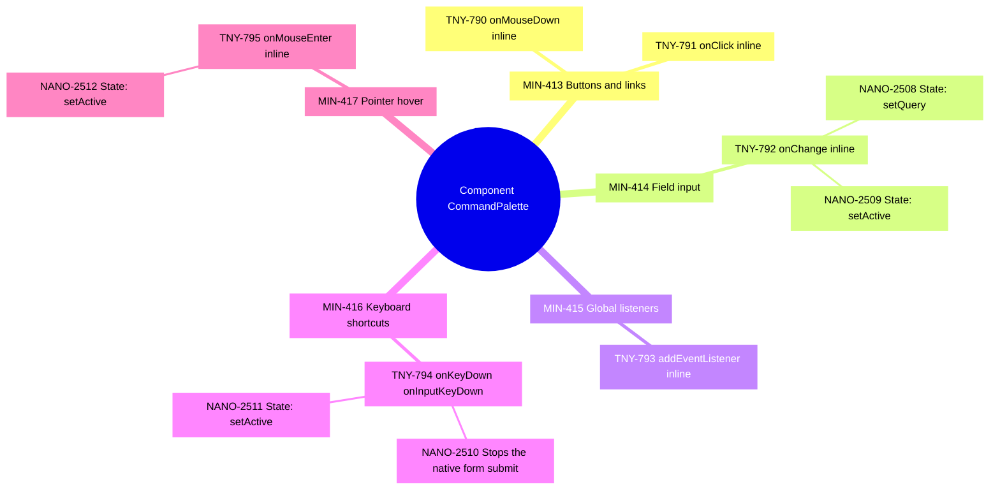

| ID        | Level | Parent   | Name                         | Description                                                                                                                                                    | Status      | Verification | Evidence                                       | Related  |
| --------- | ----- | -------- | ---------------------------- | -------------------------------------------------------------------------------------------------------------------------------------------------------------- | ----------- | ------------ | ---------------------------------------------- | -------- |
| FEAT-186  | MAJOR | MOD-185  | Component CommandPalette     | 6 interaction(s) defined in apps/web/src/components/CommandPalette.tsx.                                                                                        | IMPLEMENTED | UNKNOWN      | apps/web/src/components/CommandPalette.tsx:19  | COMP-003 |
| MIN-413   | MINOR | FEAT-186 | Buttons and links            | 2 'buttons and links' binding(s) in apps/web/src/components/CommandPalette.tsx.                                                                                | IMPLEMENTED | UNKNOWN      | apps/web/src/components/CommandPalette.tsx:91  |          |
| TNY-790   | TINY  | MIN-413  | onMouseDown inline           | onMouseDown at apps/web/src/components/CommandPalette.tsx:91 runs inline: (e) => { if (e.target === e.currentTarget) close().                                  | IMPLEMENTED | UNKNOWN      | apps/web/src/components/CommandPalette.tsx:91  | INT-009  |
| TNY-791   | TINY  | MIN-413  | onClick inline               | onClick at apps/web/src/components/CommandPalette.tsx:171 runs inline: () => choose(item).                                                                     | IMPLEMENTED | UNKNOWN      | apps/web/src/components/CommandPalette.tsx:171 | INT-013  |
| MIN-414   | MINOR | FEAT-186 | Field input                  | 1 'field input' binding(s) in apps/web/src/components/CommandPalette.tsx.                                                                                      | IMPLEMENTED | UNKNOWN      | apps/web/src/components/CommandPalette.tsx:128 |          |
| TNY-792   | TINY  | MIN-414  | onChange inline              | onChange at apps/web/src/components/CommandPalette.tsx:128 runs inline: (e) => { setQuery(e.target.value); setActive(0); }; changes state setQuery, setActive. | IMPLEMENTED | UNKNOWN      | apps/web/src/components/CommandPalette.tsx:128 | INT-010  |
| NANO-2508 | NANO  | TNY-792  | State: setQuery              | Updates component state through setQuery.                                                                                                                      | IMPLEMENTED | UNKNOWN      | apps/web/src/components/CommandPalette.tsx:128 |          |
| NANO-2509 | NANO  | TNY-792  | State: setActive             | Updates component state through setActive.                                                                                                                     | IMPLEMENTED | UNKNOWN      | apps/web/src/components/CommandPalette.tsx:128 |          |
| MIN-415   | MINOR | FEAT-186 | Global listeners             | 1 'global listeners' binding(s) in apps/web/src/components/CommandPalette.tsx.                                                                                 | IMPLEMENTED | UNKNOWN      | apps/web/src/components/CommandPalette.tsx:45  |          |
| TNY-793   | TINY  | MIN-415  | addEventListener inline      | addEventListener at apps/web/src/components/CommandPalette.tsx:45 runs inline: .                                                                               | IMPLEMENTED | UNKNOWN      | apps/web/src/components/CommandPalette.tsx:45  | INT-008  |
| MIN-416   | MINOR | FEAT-186 | Keyboard shortcuts           | 1 'keyboard shortcuts' binding(s) in apps/web/src/components/CommandPalette.tsx.                                                                               | IMPLEMENTED | UNKNOWN      | apps/web/src/components/CommandPalette.tsx:132 |          |
| TNY-794   | TINY  | MIN-416  | onKeyDown onInputKeyDown     | onKeyDown at apps/web/src/components/CommandPalette.tsx:132 runs onInputKeyDown; changes state setActive.                                                      | IMPLEMENTED | UNKNOWN      | apps/web/src/components/CommandPalette.tsx:132 | INT-011  |
| NANO-2510 | NANO  | TNY-794  | Stops the native form submit | Calls event.preventDefault() so the page does not reload.                                                                                                      | IMPLEMENTED | UNKNOWN      | apps/web/src/components/CommandPalette.tsx:70  |          |
| NANO-2511 | NANO  | TNY-794  | State: setActive             | Updates component state through setActive.                                                                                                                     | IMPLEMENTED | UNKNOWN      | apps/web/src/components/CommandPalette.tsx:70  |          |
| MIN-417   | MINOR | FEAT-186 | Pointer hover                | 1 'pointer hover' binding(s) in apps/web/src/components/CommandPalette.tsx.                                                                                    | IMPLEMENTED | UNKNOWN      | apps/web/src/components/CommandPalette.tsx:170 |          |
| TNY-795   | TINY  | MIN-417  | onMouseEnter inline          | onMouseEnter at apps/web/src/components/CommandPalette.tsx:170 runs inline: () => setActive(index); changes state setActive.                                   | IMPLEMENTED | UNKNOWN      | apps/web/src/components/CommandPalette.tsx:170 | INT-012  |
| NANO-2512 | NANO  | TNY-795  | State: setActive             | Updates component state through setActive.                                                                                                                     | IMPLEMENTED | UNKNOWN      | apps/web/src/components/CommandPalette.tsx:170 |          |

## FEAT-187 Component CredentialsSection

1 interaction(s) defined in apps/web/src/components/CredentialsSection.tsx.

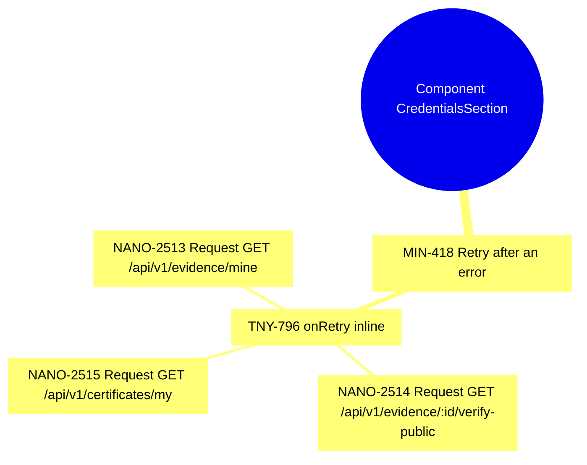

| ID        | Level | Parent   | Name                                           | Description                                                                                                                                                                                         | Status      | Verification | Evidence                                           | Related  |
| --------- | ----- | -------- | ---------------------------------------------- | --------------------------------------------------------------------------------------------------------------------------------------------------------------------------------------------------- | ----------- | ------------ | -------------------------------------------------- | -------- |
| FEAT-187  | MAJOR | MOD-185  | Component CredentialsSection                   | 1 interaction(s) defined in apps/web/src/components/CredentialsSection.tsx.                                                                                                                         | IMPLEMENTED | UNKNOWN      | apps/web/src/components/CredentialsSection.tsx:44  | COMP-004 |
| MIN-418   | MINOR | FEAT-187 | Retry after an error                           | 1 'retry after an error' binding(s) in apps/web/src/components/CredentialsSection.tsx.                                                                                                              | IMPLEMENTED | UNKNOWN      | apps/web/src/components/CredentialsSection.tsx:105 |          |
| TNY-796   | TINY  | MIN-418  | onRetry inline                                 | onRetry at apps/web/src/components/CredentialsSection.tsx:105 runs inline: () => void load(); calls GET /api/v1/evidence/mine, GET /api/v1/evidence/:id/verify-public, GET /api/v1/certificates/my. | IMPLEMENTED | UNKNOWN      | apps/web/src/components/CredentialsSection.tsx:105 | INT-014  |
| NANO-2513 | NANO  | TNY-796  | Request GET /api/v1/evidence/mine              | Sends GET /api/v1/evidence/mine through apiFetch/apiJson (apps/web/src/lib/api.ts).                                                                                                                 | IMPLEMENTED | UNKNOWN      | apps/web/src/components/CredentialsSection.tsx:105 | API-016  |
| NANO-2514 | NANO  | TNY-796  | Request GET /api/v1/evidence/:id/verify-public | Sends GET /api/v1/evidence/:id/verify-public through apiFetch/apiJson (apps/web/src/lib/api.ts).                                                                                                    | IMPLEMENTED | UNKNOWN      | apps/web/src/components/CredentialsSection.tsx:105 | API-021  |
| NANO-2515 | NANO  | TNY-796  | Request GET /api/v1/certificates/my            | Sends GET /api/v1/certificates/my through apiFetch/apiJson (apps/web/src/lib/api.ts).                                                                                                               | IMPLEMENTED | UNKNOWN      | apps/web/src/components/CredentialsSection.tsx:105 | API-110  |

## FEAT-188 Component Input

2 interaction(s) defined in apps/web/src/components/ui/Input.tsx.

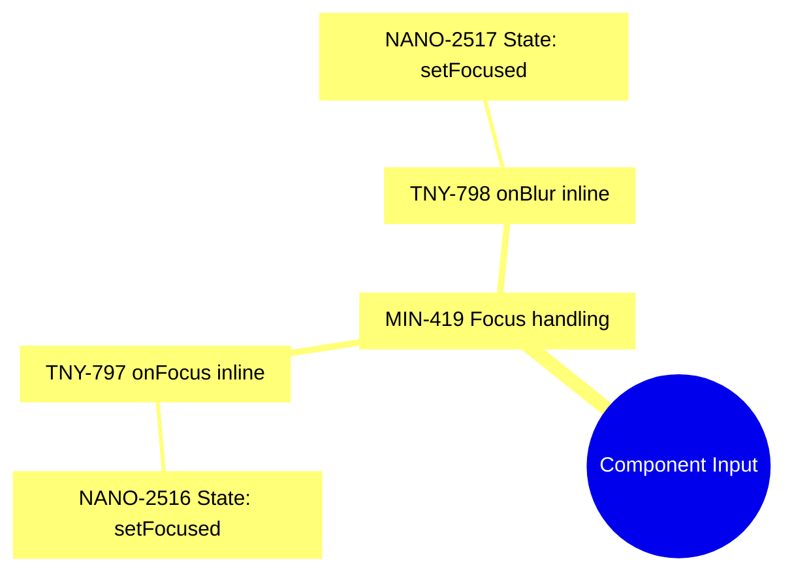

| ID        | Level | Parent   | Name              | Description                                                                                                                           | Status      | Verification | Evidence                                | Related  |
| --------- | ----- | -------- | ----------------- | ------------------------------------------------------------------------------------------------------------------------------------- | ----------- | ------------ | --------------------------------------- | -------- |
| FEAT-188  | MAJOR | MOD-185  | Component Input   | 2 interaction(s) defined in apps/web/src/components/ui/Input.tsx.                                                                     | IMPLEMENTED | UNKNOWN      | apps/web/src/components/ui/Input.tsx:16 | COMP-037 |
| MIN-419   | MINOR | FEAT-188 | Focus handling    | 2 'focus handling' binding(s) in apps/web/src/components/ui/Input.tsx.                                                                | IMPLEMENTED | UNKNOWN      | apps/web/src/components/ui/Input.tsx:76 |          |
| TNY-797   | TINY  | MIN-419  | onFocus inline    | onFocus at apps/web/src/components/ui/Input.tsx:76 runs inline: (e) => { setFocused(true); onFocus?.(e); }; changes state setFocused. | IMPLEMENTED | UNKNOWN      | apps/web/src/components/ui/Input.tsx:76 | INT-033  |
| NANO-2516 | NANO  | TNY-797  | State: setFocused | Updates component state through setFocused.                                                                                           | IMPLEMENTED | UNKNOWN      | apps/web/src/components/ui/Input.tsx:76 |          |
| TNY-798   | TINY  | MIN-419  | onBlur inline     | onBlur at apps/web/src/components/ui/Input.tsx:80 runs inline: (e) => { setFocused(false); onBlur?.(e); }; changes state setFocused.  | IMPLEMENTED | UNKNOWN      | apps/web/src/components/ui/Input.tsx:80 | INT-034  |
| NANO-2517 | NANO  | TNY-798  | State: setFocused | Updates component state through setFocused.                                                                                           | IMPLEMENTED | UNKNOWN      | apps/web/src/components/ui/Input.tsx:80 |          |

## FEAT-189 Component Layout

10 interaction(s) defined in apps/web/src/components/Layout.tsx.

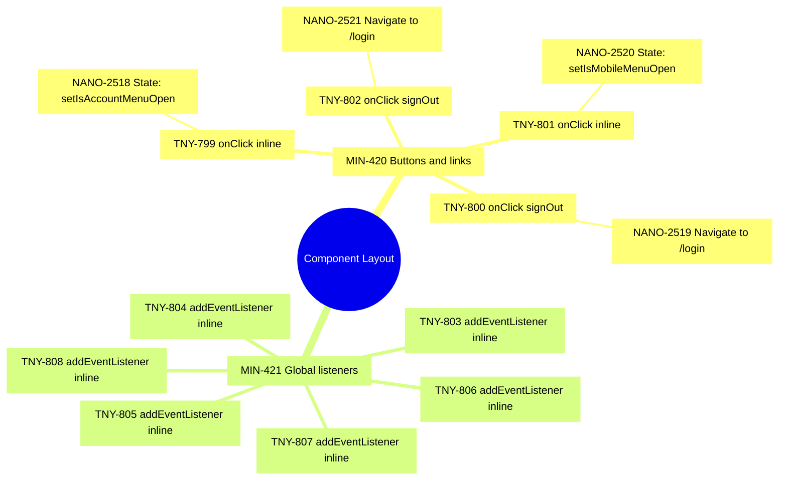

| ID        | Level | Parent   | Name                        | Description                                                                                                                                     | Status      | Verification | Evidence                               | Related  |
| --------- | ----- | -------- | --------------------------- | ----------------------------------------------------------------------------------------------------------------------------------------------- | ----------- | ------------ | -------------------------------------- | -------- |
| FEAT-189  | MAJOR | MOD-185  | Component Layout            | 10 interaction(s) defined in apps/web/src/components/Layout.tsx.                                                                                | IMPLEMENTED | UNKNOWN      | apps/web/src/components/Layout.tsx:81  | COMP-011 |
| MIN-420   | MINOR | FEAT-189 | Buttons and links           | 4 'buttons and links' binding(s) in apps/web/src/components/Layout.tsx.                                                                         | IMPLEMENTED | UNKNOWN      | apps/web/src/components/Layout.tsx:324 |          |
| TNY-799   | TINY  | MIN-420  | onClick inline              | onClick at apps/web/src/components/Layout.tsx:324 runs inline: () => setIsAccountMenuOpen((open) => !open); changes state setIsAccountMenuOpen. | IMPLEMENTED | UNKNOWN      | apps/web/src/components/Layout.tsx:324 | INT-021  |
| NANO-2518 | NANO  | TNY-799  | State: setIsAccountMenuOpen | Updates component state through setIsAccountMenuOpen.                                                                                           | IMPLEMENTED | UNKNOWN      | apps/web/src/components/Layout.tsx:324 |          |
| TNY-800   | TINY  | MIN-420  | onClick signOut             | onClick at apps/web/src/components/Layout.tsx:370 runs signOut; navigates to /login.                                                            | IMPLEMENTED | UNKNOWN      | apps/web/src/components/Layout.tsx:370 | INT-022  |
| NANO-2519 | NANO  | TNY-800  | Navigate to /login          | Calls navigate(/login).                                                                                                                         | IMPLEMENTED | UNKNOWN      | apps/web/src/components/Layout.tsx:209 |          |
| TNY-801   | TINY  | MIN-420  | onClick inline              | onClick at apps/web/src/components/Layout.tsx:394 runs inline: () => setIsMobileMenuOpen((open) => !open); changes state setIsMobileMenuOpen.   | IMPLEMENTED | UNKNOWN      | apps/web/src/components/Layout.tsx:394 | INT-023  |
| NANO-2520 | NANO  | TNY-801  | State: setIsMobileMenuOpen  | Updates component state through setIsMobileMenuOpen.                                                                                            | IMPLEMENTED | UNKNOWN      | apps/web/src/components/Layout.tsx:394 |          |
| TNY-802   | TINY  | MIN-420  | onClick signOut             | onClick at apps/web/src/components/Layout.tsx:449 runs signOut; navigates to /login.                                                            | IMPLEMENTED | UNKNOWN      | apps/web/src/components/Layout.tsx:449 | INT-024  |
| NANO-2521 | NANO  | TNY-802  | Navigate to /login          | Calls navigate(/login).                                                                                                                         | IMPLEMENTED | UNKNOWN      | apps/web/src/components/Layout.tsx:209 |          |
| MIN-421   | MINOR | FEAT-189 | Global listeners            | 6 'global listeners' binding(s) in apps/web/src/components/Layout.tsx.                                                                          | IMPLEMENTED | UNKNOWN      | apps/web/src/components/Layout.tsx:130 |          |
| TNY-803   | TINY  | MIN-421  | addEventListener inline     | addEventListener at apps/web/src/components/Layout.tsx:130 runs inline: .                                                                       | IMPLEMENTED | UNKNOWN      | apps/web/src/components/Layout.tsx:130 | INT-015  |
| TNY-804   | TINY  | MIN-421  | addEventListener inline     | addEventListener at apps/web/src/components/Layout.tsx:131 runs inline: .                                                                       | IMPLEMENTED | UNKNOWN      | apps/web/src/components/Layout.tsx:131 | INT-016  |
| TNY-805   | TINY  | MIN-421  | addEventListener inline     | addEventListener at apps/web/src/components/Layout.tsx:148 runs inline: .                                                                       | IMPLEMENTED | UNKNOWN      | apps/web/src/components/Layout.tsx:148 | INT-017  |
| TNY-806   | TINY  | MIN-421  | addEventListener inline     | addEventListener at apps/web/src/components/Layout.tsx:149 runs inline: .                                                                       | IMPLEMENTED | UNKNOWN      | apps/web/src/components/Layout.tsx:149 | INT-018  |
| TNY-807   | TINY  | MIN-421  | addEventListener inline     | addEventListener at apps/web/src/components/Layout.tsx:195 runs inline: .                                                                       | IMPLEMENTED | UNKNOWN      | apps/web/src/components/Layout.tsx:195 | INT-019  |
| TNY-808   | TINY  | MIN-421  | addEventListener inline     | addEventListener at apps/web/src/components/Layout.tsx:205 runs inline: .                                                                       | IMPLEMENTED | UNKNOWN      | apps/web/src/components/Layout.tsx:205 | INT-020  |

## FEAT-190 Component LoadError

1 interaction(s) defined in apps/web/src/components/ui/LoadError.tsx.

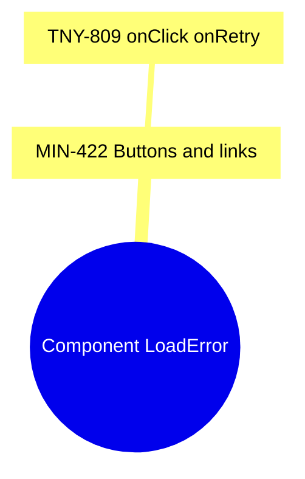

| ID       | Level | Parent   | Name                | Description                                                                   | Status      | Verification | Evidence                                    | Related  |
| -------- | ----- | -------- | ------------------- | ----------------------------------------------------------------------------- | ----------- | ------------ | ------------------------------------------- | -------- |
| FEAT-190 | MAJOR | MOD-185  | Component LoadError | 1 interaction(s) defined in apps/web/src/components/ui/LoadError.tsx.         | IMPLEMENTED | UNKNOWN      | apps/web/src/components/ui/LoadError.tsx:15 | COMP-038 |
| MIN-422  | MINOR | FEAT-190 | Buttons and links   | 1 'buttons and links' binding(s) in apps/web/src/components/ui/LoadError.tsx. | IMPLEMENTED | UNKNOWN      | apps/web/src/components/ui/LoadError.tsx:23 |          |
| TNY-809  | TINY  | MIN-422  | onClick onRetry     | onClick at apps/web/src/components/ui/LoadError.tsx:23 runs onRetry.          | IMPLEMENTED | UNKNOWN      | apps/web/src/components/ui/LoadError.tsx:23 | INT-035  |

## FEAT-191 Component Modal

3 interaction(s) defined in apps/web/src/components/ui/Modal.tsx.

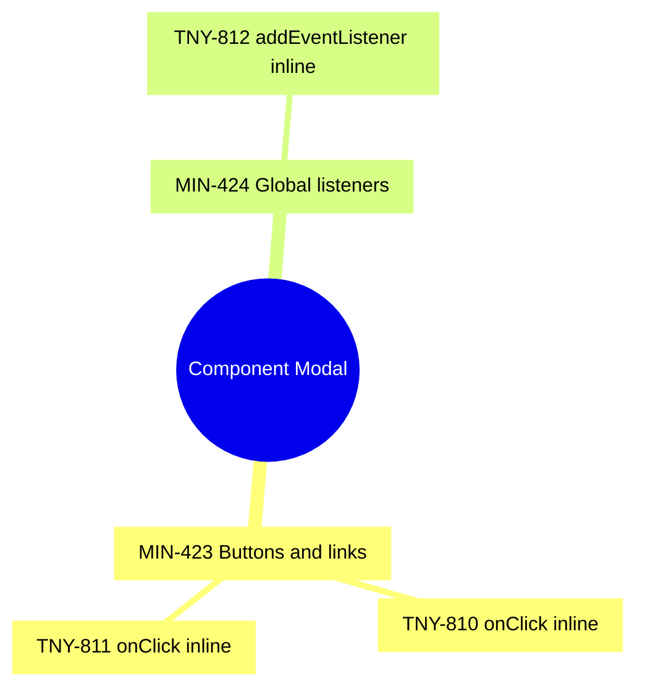

| ID       | Level | Parent   | Name                    | Description                                                                                                          | Status      | Verification | Evidence                                 | Related  |
| -------- | ----- | -------- | ----------------------- | -------------------------------------------------------------------------------------------------------------------- | ----------- | ------------ | ---------------------------------------- | -------- |
| FEAT-191 | MAJOR | MOD-185  | Component Modal         | 3 interaction(s) defined in apps/web/src/components/ui/Modal.tsx.                                                    | IMPLEMENTED | UNKNOWN      | apps/web/src/components/ui/Modal.tsx:31  | COMP-039 |
| MIN-423  | MINOR | FEAT-191 | Buttons and links       | 2 'buttons and links' binding(s) in apps/web/src/components/ui/Modal.tsx.                                            | IMPLEMENTED | UNKNOWN      | apps/web/src/components/ui/Modal.tsx:113 |          |
| TNY-810  | TINY  | MIN-423  | onClick inline          | onClick at apps/web/src/components/ui/Modal.tsx:113 runs inline: (e) => { if (e.target === e.currentTarget && !busy. | IMPLEMENTED | UNKNOWN      | apps/web/src/components/ui/Modal.tsx:113 | INT-037  |
| TNY-811  | TINY  | MIN-423  | onClick inline          | onClick at apps/web/src/components/ui/Modal.tsx:175 runs inline: () => { if (!busy) onClose(); }.                    | IMPLEMENTED | UNKNOWN      | apps/web/src/components/ui/Modal.tsx:175 | INT-038  |
| MIN-424  | MINOR | FEAT-191 | Global listeners        | 1 'global listeners' binding(s) in apps/web/src/components/ui/Modal.tsx.                                             | IMPLEMENTED | UNKNOWN      | apps/web/src/components/ui/Modal.tsx:75  |          |
| TNY-812  | TINY  | MIN-424  | addEventListener inline | addEventListener at apps/web/src/components/ui/Modal.tsx:75 runs inline: .                                           | IMPLEMENTED | UNKNOWN      | apps/web/src/components/ui/Modal.tsx:75  | INT-036  |

## FEAT-192 Component PaidPlans

3 interaction(s) defined in apps/web/src/components/PaidPlans.tsx.

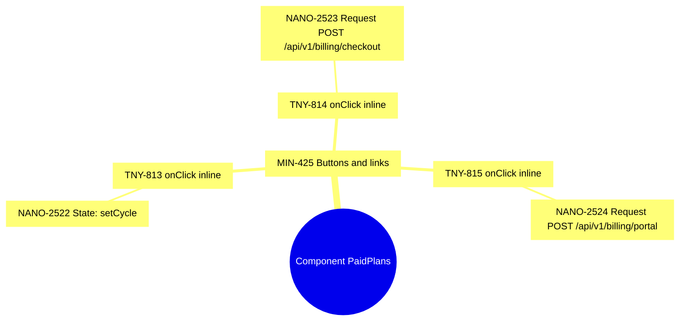

| ID        | Level | Parent   | Name                                  | Description                                                                                                                                                | Status      | Verification | Evidence                                  | Related  |
| --------- | ----- | -------- | ------------------------------------- | ---------------------------------------------------------------------------------------------------------------------------------------------------------- | ----------- | ------------ | ----------------------------------------- | -------- |
| FEAT-192  | MAJOR | MOD-185  | Component PaidPlans                   | 3 interaction(s) defined in apps/web/src/components/PaidPlans.tsx.                                                                                         | IMPLEMENTED | UNKNOWN      | apps/web/src/components/PaidPlans.tsx:44  | COMP-012 |
| MIN-425   | MINOR | FEAT-192 | Buttons and links                     | 3 'buttons and links' binding(s) in apps/web/src/components/PaidPlans.tsx.                                                                                 | IMPLEMENTED | UNKNOWN      | apps/web/src/components/PaidPlans.tsx:161 |          |
| TNY-813   | TINY  | MIN-425  | onClick inline                        | onClick at apps/web/src/components/PaidPlans.tsx:161 runs inline: () => setCycle(c); changes state setCycle.                                               | IMPLEMENTED | UNKNOWN      | apps/web/src/components/PaidPlans.tsx:161 | INT-025  |
| NANO-2522 | NANO  | TNY-813  | State: setCycle                       | Updates component state through setCycle.                                                                                                                  | IMPLEMENTED | UNKNOWN      | apps/web/src/components/PaidPlans.tsx:161 |          |
| TNY-814   | TINY  | MIN-425  | onClick inline                        | onClick at apps/web/src/components/PaidPlans.tsx:254 runs inline: () => go( '/api/v1/billing/checkout', { planTier: ; calls POST /api/v1/billing/checkout. | IMPLEMENTED | UNKNOWN      | apps/web/src/components/PaidPlans.tsx:254 | INT-026  |
| NANO-2523 | NANO  | TNY-814  | Request POST /api/v1/billing/checkout | Sends POST /api/v1/billing/checkout through apiFetch/apiJson (apps/web/src/lib/api.ts).                                                                    | IMPLEMENTED | UNKNOWN      | apps/web/src/components/PaidPlans.tsx:254 | API-280  |
| TNY-815   | TINY  | MIN-425  | onClick inline                        | onClick at apps/web/src/components/PaidPlans.tsx:338 runs inline: () => go('/api/v1/billing/portal', {}, 'portal'); calls POST /api/v1/billing/portal.     | IMPLEMENTED | UNKNOWN      | apps/web/src/components/PaidPlans.tsx:338 | INT-027  |
| NANO-2524 | NANO  | TNY-815  | Request POST /api/v1/billing/portal   | Sends POST /api/v1/billing/portal through apiFetch/apiJson (apps/web/src/lib/api.ts).                                                                      | IMPLEMENTED | UNKNOWN      | apps/web/src/components/PaidPlans.tsx:338 | API-281  |

## FEAT-193 Component SessionErrorNotice

1 interaction(s) defined in apps/web/src/components/SessionErrorNotice.tsx.

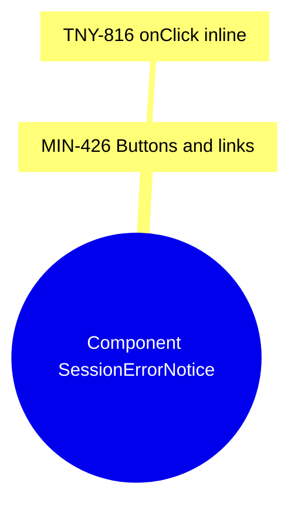

| ID       | Level | Parent   | Name                         | Description                                                                                   | Status      | Verification | Evidence                                          | Related  |
| -------- | ----- | -------- | ---------------------------- | --------------------------------------------------------------------------------------------- | ----------- | ------------ | ------------------------------------------------- | -------- |
| FEAT-193 | MAJOR | MOD-185  | Component SessionErrorNotice | 1 interaction(s) defined in apps/web/src/components/SessionErrorNotice.tsx.                   | IMPLEMENTED | UNKNOWN      | apps/web/src/components/SessionErrorNotice.tsx:11 | COMP-013 |
| MIN-426  | MINOR | FEAT-193 | Buttons and links            | 1 'buttons and links' binding(s) in apps/web/src/components/SessionErrorNotice.tsx.           | IMPLEMENTED | UNKNOWN      | apps/web/src/components/SessionErrorNotice.tsx:31 |          |
| TNY-816  | TINY  | MIN-426  | onClick inline               | onClick at apps/web/src/components/SessionErrorNotice.tsx:31 runs inline: () => void retry(). | IMPLEMENTED | UNKNOWN      | apps/web/src/components/SessionErrorNotice.tsx:31 | INT-028  |

## FEAT-194 Component SignOutOtherDevices

1 interaction(s) defined in apps/web/src/components/SignOutOtherDevices.tsx.

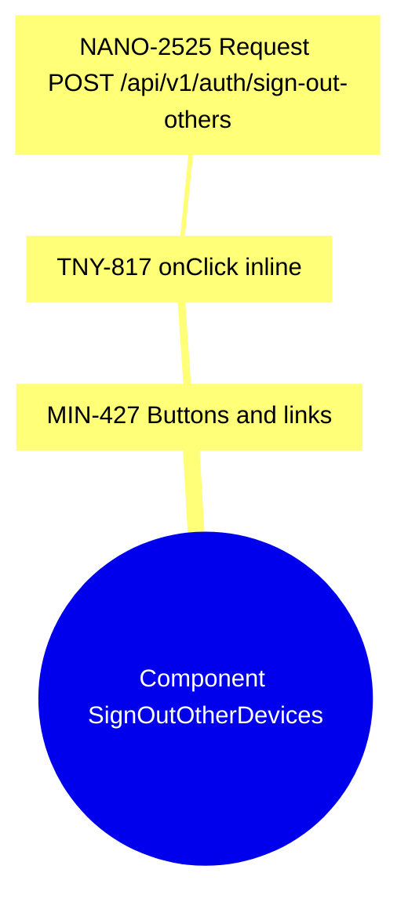

| ID        | Level | Parent   | Name                                      | Description                                                                                                                           | Status      | Verification | Evidence                                           | Related  |
| --------- | ----- | -------- | ----------------------------------------- | ------------------------------------------------------------------------------------------------------------------------------------- | ----------- | ------------ | -------------------------------------------------- | -------- |
| FEAT-194  | MAJOR | MOD-185  | Component SignOutOtherDevices             | 1 interaction(s) defined in apps/web/src/components/SignOutOtherDevices.tsx.                                                          | IMPLEMENTED | UNKNOWN      | apps/web/src/components/SignOutOtherDevices.tsx:12 | COMP-014 |
| MIN-427   | MINOR | FEAT-194 | Buttons and links                         | 1 'buttons and links' binding(s) in apps/web/src/components/SignOutOtherDevices.tsx.                                                  | IMPLEMENTED | UNKNOWN      | apps/web/src/components/SignOutOtherDevices.tsx:59 |          |
| TNY-817   | TINY  | MIN-427  | onClick inline                            | onClick at apps/web/src/components/SignOutOtherDevices.tsx:59 runs inline: () => void run(); calls POST /api/v1/auth/sign-out-others. | IMPLEMENTED | UNKNOWN      | apps/web/src/components/SignOutOtherDevices.tsx:59 | INT-029  |
| NANO-2525 | NANO  | TNY-817  | Request POST /api/v1/auth/sign-out-others | Sends POST /api/v1/auth/sign-out-others through apiFetch/apiJson (apps/web/src/lib/api.ts).                                           | IMPLEMENTED | UNKNOWN      | apps/web/src/components/SignOutOtherDevices.tsx:59 | API-009  |

## FEAT-195 Component SkillsSection

3 interaction(s) defined in apps/web/src/components/SkillsSection.tsx.

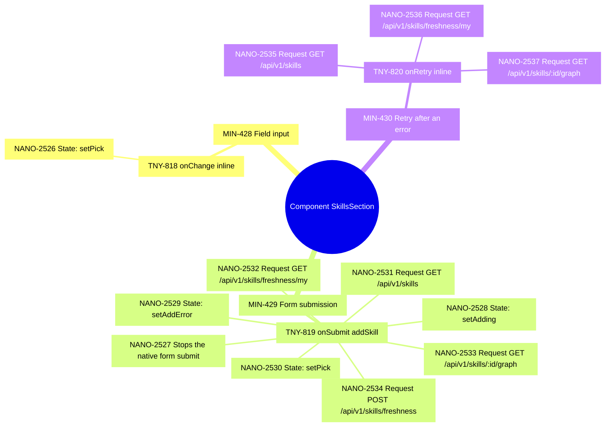

| ID        | Level | Parent   | Name                                    | Description                                                                                                                                                                                                                                     | Status      | Verification | Evidence                                      | Related  |
| --------- | ----- | -------- | --------------------------------------- | ----------------------------------------------------------------------------------------------------------------------------------------------------------------------------------------------------------------------------------------------- | ----------- | ------------ | --------------------------------------------- | -------- |
| FEAT-195  | MAJOR | MOD-185  | Component SkillsSection                 | 3 interaction(s) defined in apps/web/src/components/SkillsSection.tsx.                                                                                                                                                                          | IMPLEMENTED | UNKNOWN      | apps/web/src/components/SkillsSection.tsx:44  | COMP-015 |
| MIN-428   | MINOR | FEAT-195 | Field input                             | 1 'field input' binding(s) in apps/web/src/components/SkillsSection.tsx.                                                                                                                                                                        | IMPLEMENTED | UNKNOWN      | apps/web/src/components/SkillsSection.tsx:207 |          |
| TNY-818   | TINY  | MIN-428  | onChange inline                         | onChange at apps/web/src/components/SkillsSection.tsx:207 runs inline: (e) => setPick(e.target.value); changes state setPick.                                                                                                                   | IMPLEMENTED | UNKNOWN      | apps/web/src/components/SkillsSection.tsx:207 | INT-032  |
| NANO-2526 | NANO  | TNY-818  | State: setPick                          | Updates component state through setPick.                                                                                                                                                                                                        | IMPLEMENTED | UNKNOWN      | apps/web/src/components/SkillsSection.tsx:207 |          |
| MIN-429   | MINOR | FEAT-195 | Form submission                         | 1 'form submission' binding(s) in apps/web/src/components/SkillsSection.tsx.                                                                                                                                                                    | IMPLEMENTED | UNKNOWN      | apps/web/src/components/SkillsSection.tsx:194 |          |
| TNY-819   | TINY  | MIN-429  | onSubmit addSkill                       | onSubmit at apps/web/src/components/SkillsSection.tsx:194 runs addSkill; changes state setAdding, setAddError, setPick; calls GET /api/v1/skills, GET /api/v1/skills/freshness/my, GET /api/v1/skills/:id/graph, POST /api/v1/skills/freshness. | IMPLEMENTED | UNKNOWN      | apps/web/src/components/SkillsSection.tsx:194 | INT-031  |
| NANO-2527 | NANO  | TNY-819  | Stops the native form submit            | Calls event.preventDefault() so the page does not reload.                                                                                                                                                                                       | IMPLEMENTED | UNKNOWN      | apps/web/src/components/SkillsSection.tsx:93  |          |
| NANO-2528 | NANO  | TNY-819  | State: setAdding                        | Updates component state through setAdding.                                                                                                                                                                                                      | IMPLEMENTED | UNKNOWN      | apps/web/src/components/SkillsSection.tsx:93  |          |
| NANO-2529 | NANO  | TNY-819  | State: setAddError                      | Updates component state through setAddError.                                                                                                                                                                                                    | IMPLEMENTED | UNKNOWN      | apps/web/src/components/SkillsSection.tsx:93  |          |
| NANO-2530 | NANO  | TNY-819  | State: setPick                          | Updates component state through setPick.                                                                                                                                                                                                        | IMPLEMENTED | UNKNOWN      | apps/web/src/components/SkillsSection.tsx:93  |          |
| NANO-2531 | NANO  | TNY-819  | Request GET /api/v1/skills              | Sends GET /api/v1/skills through apiFetch/apiJson (apps/web/src/lib/api.ts).                                                                                                                                                                    | IMPLEMENTED | UNKNOWN      | apps/web/src/components/SkillsSection.tsx:93  | API-022  |
| NANO-2532 | NANO  | TNY-819  | Request GET /api/v1/skills/freshness/my | Sends GET /api/v1/skills/freshness/my through apiFetch/apiJson (apps/web/src/lib/api.ts).                                                                                                                                                       | IMPLEMENTED | UNKNOWN      | apps/web/src/components/SkillsSection.tsx:93  | API-059  |
| NANO-2533 | NANO  | TNY-819  | Request GET /api/v1/skills/:id/graph    | Sends GET /api/v1/skills/:id/graph through apiFetch/apiJson (apps/web/src/lib/api.ts).                                                                                                                                                          | IMPLEMENTED | UNKNOWN      | apps/web/src/components/SkillsSection.tsx:93  | API-025  |
| NANO-2534 | NANO  | TNY-819  | Request POST /api/v1/skills/freshness   | Sends POST /api/v1/skills/freshness through apiFetch/apiJson (apps/web/src/lib/api.ts).                                                                                                                                                         | IMPLEMENTED | UNKNOWN      | apps/web/src/components/SkillsSection.tsx:93  | API-058  |
| MIN-430   | MINOR | FEAT-195 | Retry after an error                    | 1 'retry after an error' binding(s) in apps/web/src/components/SkillsSection.tsx.                                                                                                                                                               | IMPLEMENTED | UNKNOWN      | apps/web/src/components/SkillsSection.tsx:134 |          |
| TNY-820   | TINY  | MIN-430  | onRetry inline                          | onRetry at apps/web/src/components/SkillsSection.tsx:134 runs inline: () => void load(); calls GET /api/v1/skills, GET /api/v1/skills/freshness/my, GET /api/v1/skills/:id/graph.                                                               | IMPLEMENTED | UNKNOWN      | apps/web/src/components/SkillsSection.tsx:134 | INT-030  |
| NANO-2535 | NANO  | TNY-820  | Request GET /api/v1/skills              | Sends GET /api/v1/skills through apiFetch/apiJson (apps/web/src/lib/api.ts).                                                                                                                                                                    | IMPLEMENTED | UNKNOWN      | apps/web/src/components/SkillsSection.tsx:134 | API-022  |
| NANO-2536 | NANO  | TNY-820  | Request GET /api/v1/skills/freshness/my | Sends GET /api/v1/skills/freshness/my through apiFetch/apiJson (apps/web/src/lib/api.ts).                                                                                                                                                       | IMPLEMENTED | UNKNOWN      | apps/web/src/components/SkillsSection.tsx:134 | API-059  |
| NANO-2537 | NANO  | TNY-820  | Request GET /api/v1/skills/:id/graph    | Sends GET /api/v1/skills/:id/graph through apiFetch/apiJson (apps/web/src/lib/api.ts).                                                                                                                                                          | IMPLEMENTED | UNKNOWN      | apps/web/src/components/SkillsSection.tsx:134 | API-025  |

## FEAT-196 App-level listeners

4 interaction(s) defined in apps/web.

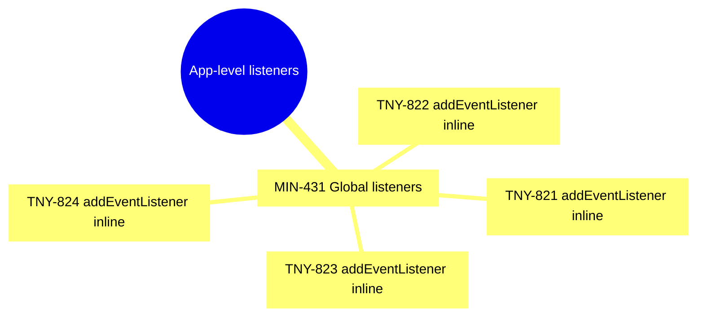

| ID       | Level | Parent   | Name                    | Description                                                                | Status                | Verification | Evidence                                | Related |
| -------- | ----- | -------- | ----------------------- | -------------------------------------------------------------------------- | --------------------- | ------------ | --------------------------------------- | ------- |
| FEAT-196 | MAJOR | MOD-185  | App-level listeners     | 4 interaction(s) defined in apps/web.                                      | PARTIALLY_IMPLEMENTED | UNKNOWN      | apps/web                                | MOD-002 |
| MIN-431  | MINOR | FEAT-196 | Global listeners        | 4 'global listeners' binding(s) in apps/web.                               | IMPLEMENTED           | UNKNOWN      | apps/web:43                             |         |
| TNY-821  | TINY  | MIN-431  | addEventListener inline | addEventListener at apps/web/src/pwa.ts:43 runs inline: .                  | IMPLEMENTED           | UNKNOWN      | apps/web/src/pwa.ts:43                  | INT-211 |
| TNY-822  | TINY  | MIN-431  | addEventListener inline | addEventListener at apps/web/src/lib/SessionContext.tsx:99 runs inline: .  | IMPLEMENTED           | UNKNOWN      | apps/web/src/lib/SessionContext.tsx:99  | INT-039 |
| TNY-823  | TINY  | MIN-431  | addEventListener inline | addEventListener at apps/web/src/lib/SessionContext.tsx:100 runs inline: . | IMPLEMENTED           | UNKNOWN      | apps/web/src/lib/SessionContext.tsx:100 | INT-040 |
| TNY-824  | TINY  | MIN-431  | addEventListener inline | addEventListener at apps/web/src/lib/SessionContext.tsx:103 runs inline: . | IMPLEMENTED           | UNKNOWN      | apps/web/src/lib/SessionContext.tsx:103 | INT-041 |
