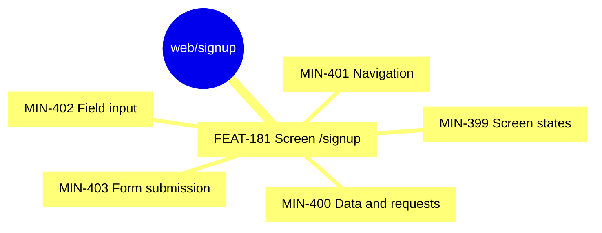
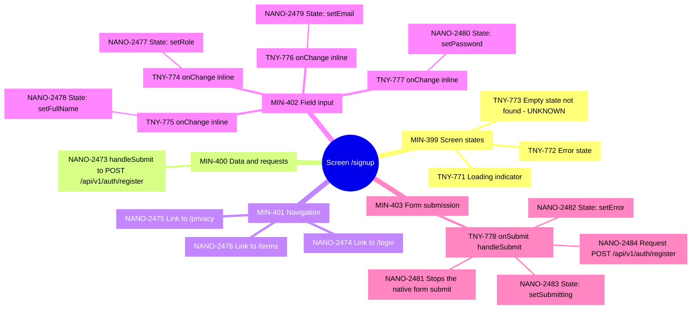

# web/signup (MOD-182)

Generated by `docs/mindmap/tools/catalog.py` from `master/MASTER_PROJECT_GRAPH.json` at commit `9b3032f`. Do not edit by hand. Back to the [feature catalog](../FEATURE_CATALOG.md).

**Application:** apps/web (MOD-002). **Purpose:** Routed screens under /signup in apps/web/src/App.tsx.

**Nodes by level:** MODULE 1, MAJOR 1, MINOR 5, TINY 8, NANO 12. **Status:** IMPLEMENTED 26, UNKNOWN 1. **Verification:** PATH_LEVEL 12, UNKNOWN 14, VERIFIED 1.

## Module map (to minor features)

## FEAT-181 Screen /signup

SignUpPage at route /signup (public); 1 buttons, 1 forms, 4 inputs; calls 1 endpoint(s).

| ID        | Level | Parent   | Name                                       | Description                                                                                                                                                                         | Status      | Verification | Evidence                              | Related                     |
| --------- | ----- | -------- | ------------------------------------------ | ----------------------------------------------------------------------------------------------------------------------------------------------------------------------------------- | ----------- | ------------ | ------------------------------------- | --------------------------- |
| FEAT-181  | MAJOR | MOD-182  | Screen /signup                             | SignUpPage at route /signup (public); 1 buttons, 1 forms, 4 inputs; calls 1 endpoint(s).                                                                                            | IMPLEMENTED | VERIFIED     | apps/web/src/App.tsx:57               | SCR-003, TEST-182, TEST-184 |
| MIN-399   | MINOR | FEAT-181 | Screen states                              | Loading, empty and error presentation found in the screen source; not found: Empty state.                                                                                           | IMPLEMENTED | PATH_LEVEL   | apps/web/src/pages/SignUpPage.tsx     |                             |
| TNY-771   | TINY  | MIN-399  | Loading indicator                          | Loading indicator rendered by SignUpPage (detected in source).                                                                                                                      | IMPLEMENTED | PATH_LEVEL   | apps/web/src/pages/SignUpPage.tsx     |                             |
| TNY-772   | TINY  | MIN-399  | Error state                                | Error state rendered by SignUpPage (detected in source).                                                                                                                            | IMPLEMENTED | PATH_LEVEL   | apps/web/src/pages/SignUpPage.tsx     |                             |
| TNY-773   | TINY  | MIN-399  | Empty state (not found)                    | No empty state pattern was detected in apps/web/src/pages/SignUpPage.tsx although the screen calls the API. May be handled by a shared component; confirm before treating as a gap. | UNKNOWN     | UNKNOWN      | apps/web/src/pages/SignUpPage.tsx     |                             |
| MIN-400   | MINOR | FEAT-181 | Data and requests                          | API endpoints this screen calls (1).                                                                                                                                                | IMPLEMENTED | PATH_LEVEL   | apps/web/src/pages/SignUpPage.tsx     |                             |
| NANO-2473 | NANO  | MIN-400  | handleSubmit -> POST /api/v1/auth/register | handleSubmit() at apps/web/src/pages/SignUpPage.tsx:66 sends POST /api/v1/auth/register.                                                                                            | IMPLEMENTED | UNKNOWN      | apps/web/src/pages/SignUpPage.tsx:66  | API-005                     |
| MIN-401   | MINOR | FEAT-181 | Navigation                                 | Links from this screen to 3 other screen(s).                                                                                                                                        | IMPLEMENTED | PATH_LEVEL   | apps/web/src/pages/SignUpPage.tsx     |                             |
| NANO-2474 | NANO  | MIN-401  | Link to /login                             | Navigates to /login (LoginPage).                                                                                                                                                    | IMPLEMENTED | UNKNOWN      | apps/web/src/pages/SignUpPage.tsx     | SCR-002                     |
| NANO-2475 | NANO  | MIN-401  | Link to /privacy                           | Navigates to /privacy (PrivacyPage).                                                                                                                                                | IMPLEMENTED | UNKNOWN      | apps/web/src/pages/SignUpPage.tsx     | SCR-005                     |
| NANO-2476 | NANO  | MIN-401  | Link to /terms                             | Navigates to /terms (TermsPage).                                                                                                                                                    | IMPLEMENTED | UNKNOWN      | apps/web/src/pages/SignUpPage.tsx     | SCR-006                     |
| MIN-402   | MINOR | FEAT-181 | Field input                                | 4 'field input' binding(s) in apps/web/src/pages/SignUpPage.tsx.                                                                                                                    | IMPLEMENTED | PATH_LEVEL   | apps/web/src/pages/SignUpPage.tsx:148 |                             |
| TNY-774   | TINY  | MIN-402  | onChange inline                            | onChange at apps/web/src/pages/SignUpPage.tsx:148 runs inline: () => setRole(choice.value); changes state setRole.                                                                  | IMPLEMENTED | PATH_LEVEL   | apps/web/src/pages/SignUpPage.tsx:148 | INT-206                     |
| NANO-2477 | NANO  | TNY-774  | State: setRole                             | Updates component state through setRole.                                                                                                                                            | IMPLEMENTED | UNKNOWN      | apps/web/src/pages/SignUpPage.tsx:148 |                             |
| TNY-775   | TINY  | MIN-402  | onChange inline                            | onChange at apps/web/src/pages/SignUpPage.tsx:174 runs inline: (e) => setFullName(e.target.value); changes state setFullName.                                                       | IMPLEMENTED | PATH_LEVEL   | apps/web/src/pages/SignUpPage.tsx:174 | INT-207                     |
| NANO-2478 | NANO  | TNY-775  | State: setFullName                         | Updates component state through setFullName.                                                                                                                                        | IMPLEMENTED | UNKNOWN      | apps/web/src/pages/SignUpPage.tsx:174 |                             |
| TNY-776   | TINY  | MIN-402  | onChange inline                            | onChange at apps/web/src/pages/SignUpPage.tsx:185 runs inline: (e) => setEmail(e.target.value); changes state setEmail.                                                             | IMPLEMENTED | PATH_LEVEL   | apps/web/src/pages/SignUpPage.tsx:185 | INT-208                     |
| NANO-2479 | NANO  | TNY-776  | State: setEmail                            | Updates component state through setEmail.                                                                                                                                           | IMPLEMENTED | UNKNOWN      | apps/web/src/pages/SignUpPage.tsx:185 |                             |
| TNY-777   | TINY  | MIN-402  | onChange inline                            | onChange at apps/web/src/pages/SignUpPage.tsx:197 runs inline: (e) => setPassword(e.target.value); changes state setPassword.                                                       | IMPLEMENTED | PATH_LEVEL   | apps/web/src/pages/SignUpPage.tsx:197 | INT-209                     |
| NANO-2480 | NANO  | TNY-777  | State: setPassword                         | Updates component state through setPassword.                                                                                                                                        | IMPLEMENTED | UNKNOWN      | apps/web/src/pages/SignUpPage.tsx:197 |                             |
| MIN-403   | MINOR | FEAT-181 | Form submission                            | 1 'form submission' binding(s) in apps/web/src/pages/SignUpPage.tsx.                                                                                                                | IMPLEMENTED | PATH_LEVEL   | apps/web/src/pages/SignUpPage.tsx:109 |                             |
| TNY-778   | TINY  | MIN-403  | onSubmit handleSubmit                      | onSubmit at apps/web/src/pages/SignUpPage.tsx:109 runs handleSubmit; changes state setError, setSubmitting; calls POST /api/v1/auth/register.                                       | IMPLEMENTED | PATH_LEVEL   | apps/web/src/pages/SignUpPage.tsx:109 | INT-205                     |
| NANO-2481 | NANO  | TNY-778  | Stops the native form submit               | Calls event.preventDefault() so the page does not reload.                                                                                                                           | IMPLEMENTED | UNKNOWN      | apps/web/src/pages/SignUpPage.tsx:43  |                             |
| NANO-2482 | NANO  | TNY-778  | State: setError                            | Updates component state through setError.                                                                                                                                           | IMPLEMENTED | UNKNOWN      | apps/web/src/pages/SignUpPage.tsx:43  |                             |
| NANO-2483 | NANO  | TNY-778  | State: setSubmitting                       | Updates component state through setSubmitting.                                                                                                                                      | IMPLEMENTED | UNKNOWN      | apps/web/src/pages/SignUpPage.tsx:43  |                             |
| NANO-2484 | NANO  | TNY-778  | Request POST /api/v1/auth/register         | Sends POST /api/v1/auth/register through apiFetch/apiJson (apps/web/src/lib/api.ts).                                                                                                | IMPLEMENTED | UNKNOWN      | apps/web/src/pages/SignUpPage.tsx:43  | API-005                     |
