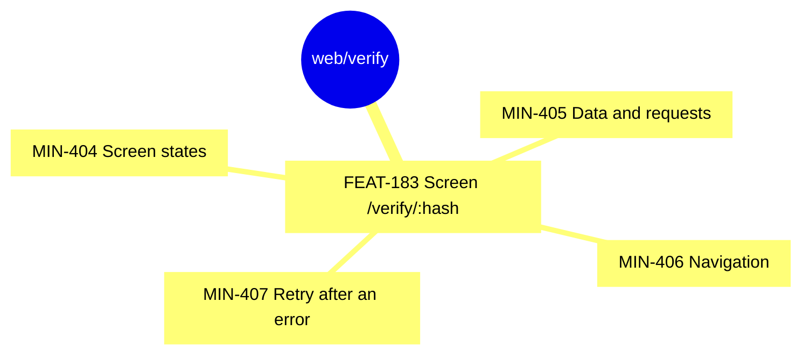
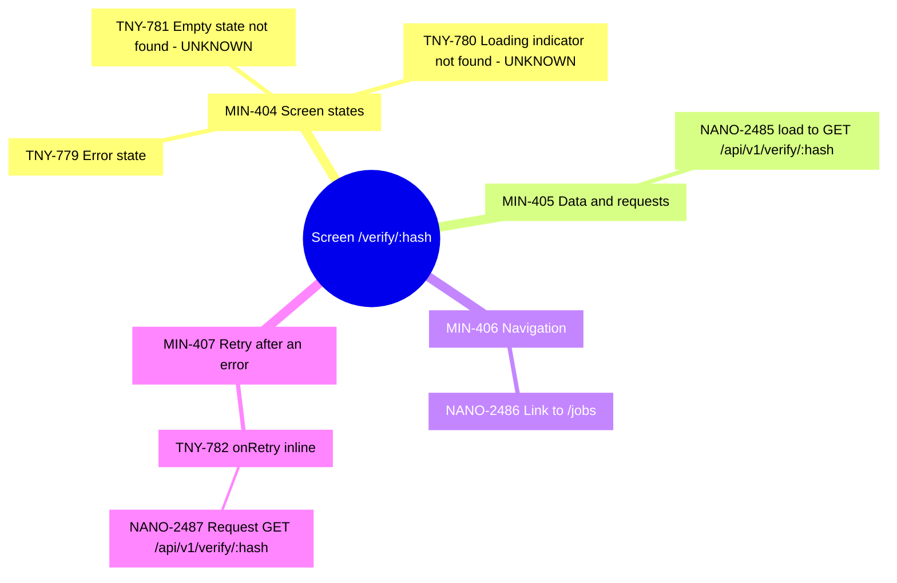

# web/verify (MOD-184)

Generated by `docs/mindmap/tools/catalog.py` from `master/MASTER_PROJECT_GRAPH.json` at commit `9b3032f`. Do not edit by hand. Back to the [feature catalog](../FEATURE_CATALOG.md).

**Application:** apps/web (MOD-002). **Purpose:** Routed screens under /verify in apps/web/src/App.tsx.

**Nodes by level:** MODULE 1, MAJOR 1, MINOR 4, TINY 4, NANO 3. **Status:** IMPLEMENTED 11, UNKNOWN 2. **Verification:** PATH_LEVEL 6, UNKNOWN 6, VERIFIED 1.

## Module map (to minor features)

## FEAT-183 Screen /verify/:hash

VerifyPage at route /verify/:hash (public); 0 buttons, 0 forms, 0 inputs; calls 1 endpoint(s).

| ID        | Level | Parent   | Name                             | Description                                                                                                                                                                               | Status      | Verification | Evidence                              | Related           |
| --------- | ----- | -------- | -------------------------------- | ----------------------------------------------------------------------------------------------------------------------------------------------------------------------------------------- | ----------- | ------------ | ------------------------------------- | ----------------- |
| FEAT-183  | MAJOR | MOD-184  | Screen /verify/:hash             | VerifyPage at route /verify/:hash (public); 0 buttons, 0 forms, 0 inputs; calls 1 endpoint(s).                                                                                            | IMPLEMENTED | VERIFIED     | apps/web/src/App.tsx:66               | SCR-010, TEST-179 |
| MIN-404   | MINOR | FEAT-183 | Screen states                    | Loading, empty and error presentation found in the screen source; not found: Loading indicator, Empty state.                                                                              | IMPLEMENTED | PATH_LEVEL   | apps/web/src/pages/VerifyPage.tsx     |                   |
| TNY-779   | TINY  | MIN-404  | Error state                      | Error state rendered by VerifyPage (detected in source).                                                                                                                                  | IMPLEMENTED | PATH_LEVEL   | apps/web/src/pages/VerifyPage.tsx     |                   |
| TNY-780   | TINY  | MIN-404  | Loading indicator (not found)    | No loading indicator pattern was detected in apps/web/src/pages/VerifyPage.tsx although the screen calls the API. May be handled by a shared component; confirm before treating as a gap. | UNKNOWN     | UNKNOWN      | apps/web/src/pages/VerifyPage.tsx     |                   |
| TNY-781   | TINY  | MIN-404  | Empty state (not found)          | No empty state pattern was detected in apps/web/src/pages/VerifyPage.tsx although the screen calls the API. May be handled by a shared component; confirm before treating as a gap.       | UNKNOWN     | UNKNOWN      | apps/web/src/pages/VerifyPage.tsx     |                   |
| MIN-405   | MINOR | FEAT-183 | Data and requests                | API endpoints this screen calls (1).                                                                                                                                                      | IMPLEMENTED | PATH_LEVEL   | apps/web/src/pages/VerifyPage.tsx     |                   |
| NANO-2485 | NANO  | MIN-405  | load -> GET /api/v1/verify/:hash | load() at apps/web/src/pages/VerifyPage.tsx:63 sends GET /api/v1/verify/:hash.                                                                                                            | IMPLEMENTED | UNKNOWN      | apps/web/src/pages/VerifyPage.tsx:63  | API-108           |
| MIN-406   | MINOR | FEAT-183 | Navigation                       | Links from this screen to 1 other screen(s).                                                                                                                                              | IMPLEMENTED | PATH_LEVEL   | apps/web/src/pages/VerifyPage.tsx     |                   |
| NANO-2486 | NANO  | MIN-406  | Link to /jobs                    | Navigates to /jobs (JobsPage).                                                                                                                                                            | IMPLEMENTED | UNKNOWN      | apps/web/src/pages/VerifyPage.tsx     | SCR-007           |
| MIN-407   | MINOR | FEAT-183 | Retry after an error             | 1 'retry after an error' binding(s) in apps/web/src/pages/VerifyPage.tsx.                                                                                                                 | IMPLEMENTED | PATH_LEVEL   | apps/web/src/pages/VerifyPage.tsx:101 |                   |
| TNY-782   | TINY  | MIN-407  | onRetry inline                   | onRetry at apps/web/src/pages/VerifyPage.tsx:101 runs inline: () => void load(); calls GET /api/v1/verify/:hash.                                                                          | IMPLEMENTED | PATH_LEVEL   | apps/web/src/pages/VerifyPage.tsx:101 | INT-210           |
| NANO-2487 | NANO  | TNY-782  | Request GET /api/v1/verify/:hash | Sends GET /api/v1/verify/:hash through apiFetch/apiJson (apps/web/src/lib/api.ts).                                                                                                        | IMPLEMENTED | UNKNOWN      | apps/web/src/pages/VerifyPage.tsx:101 | API-108           |
