# apps/web modules

Generated by `docs/mindmap/tools/catalog.py` from `master/MASTER_PROJECT_GRAPH.json` at commit `eb166ea`. Do not edit by hand. Back to the [feature catalog](../FEATURE_CATALOG.md).

| Module                                                 | ID      |
| ------------------------------------------------------ | ------- |
| [web/landing](#weblanding-mod-160)                     | MOD-160 |
| [web/*](#web-mod-161)                                  | MOD-161 |
| [web/admin](#webadmin-mod-162)                         | MOD-162 |
| [web/applications](#webapplications-mod-163)           | MOD-163 |
| [web/assessments](#webassessments-mod-164)             | MOD-164 |
| [web/career](#webcareer-mod-165)                       | MOD-165 |
| [web/checkout](#webcheckout-mod-166)                   | MOD-166 |
| [web/dashboard](#webdashboard-mod-167)                 | MOD-167 |
| [web/evidence](#webevidence-mod-168)                   | MOD-168 |
| [web/hiring](#webhiring-mod-169)                       | MOD-169 |
| [web/jobs](#webjobs-mod-170)                           | MOD-170 |
| [web/learning](#weblearning-mod-171)                   | MOD-171 |
| [web/login](#weblogin-mod-172)                         | MOD-172 |
| [web/messages](#webmessages-mod-173)                   | MOD-173 |
| [web/network](#webnetwork-mod-174)                     | MOD-174 |
| [web/notifications](#webnotifications-mod-175)         | MOD-175 |
| [web/portfolio](#webportfolio-mod-176)                 | MOD-176 |
| [web/privacy](#webprivacy-mod-177)                     | MOD-177 |
| [web/profile](#webprofile-mod-178)                     | MOD-178 |
| [web/reference](#webreference-mod-179)                 | MOD-179 |
| [web/resumes](#webresumes-mod-180)                     | MOD-180 |
| [web/settings](#websettings-mod-181)                   | MOD-181 |
| [web/signup](#websignup-mod-182)                       | MOD-182 |
| [web/terms](#webterms-mod-183)                         | MOD-183 |
| [web/verify](#webverify-mod-184)                       | MOD-184 |
| [web/shared-components](#webshared-components-mod-185) | MOD-185 |

## web/landing (MOD-160)

**Application:** apps/web (MOD-002). **Purpose:** Routed screens under / in apps/web/src/App.tsx.

**Nodes by level:** MODULE 1, MAJOR 1, MINOR 1, NANO 1. **Status:** IMPLEMENTED 4. **Verification:** PATH_LEVEL 1, UNKNOWN 2, VERIFIED 1.

**Known gaps:** FEAT-155 no API call found in this screen file.

### Module map (to minor features)

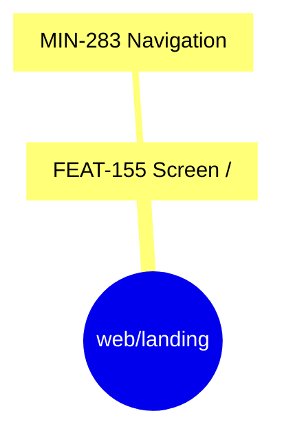

### FEAT-155 Screen /

LandingPage at route / (public); 0 buttons, 0 forms, 0 inputs; calls 0 endpoint(s).

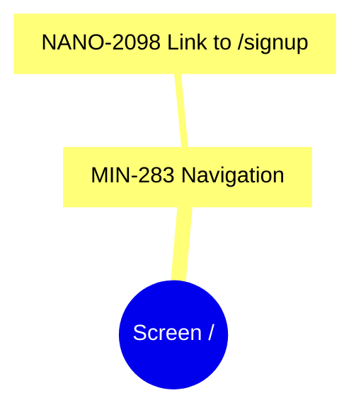

| ID        | Level | Parent   | Name            | Description                                                                                                                     | Status      | Verification | Evidence                           | Related                                                   |
| --------- | ----- | -------- | --------------- | ------------------------------------------------------------------------------------------------------------------------------- | ----------- | ------------ | ---------------------------------- | --------------------------------------------------------- |
| FEAT-155  | MAJOR | MOD-160  | Screen /        | LandingPage at route / (public); 0 buttons, 0 forms, 0 inputs; calls 0 endpoint(s). Gaps: no API call found in this screen file | IMPLEMENTED | VERIFIED     | apps/web/src/App.tsx:55            | SCR-001, TEST-162, TEST-194, TEST-195, TEST-199, TEST-220 |
| MIN-283   | MINOR | FEAT-155 | Navigation      | Links from this screen to 1 other screen(s).                                                                                    | IMPLEMENTED | PATH_LEVEL   | apps/web/src/pages/LandingPage.tsx |                                                           |
| NANO-2098 | NANO  | MIN-283  | Link to /signup | Navigates to /signup (SignUpPage).                                                                                              | IMPLEMENTED | UNKNOWN      | apps/web/src/pages/LandingPage.tsx | SCR-003                                                   |

## web/* (MOD-161)

**Application:** apps/web (MOD-002). **Purpose:** Routed screens under /* in apps/web/src/App.tsx.

**Nodes by level:** MODULE 1, MAJOR 1. **Status:** IMPLEMENTED 2. **Verification:** UNKNOWN 2.

**Known gaps:** FEAT-156 no API call found in this screen file.

### Module map (to minor features)


### FEAT-156 Screen /*

NotFoundPage at route /* (public); 0 buttons, 0 forms, 0 inputs; calls 0 endpoint(s).

| ID       | Level | Parent  | Name      | Description                                                                                                                       | Status      | Verification | Evidence                | Related |
| -------- | ----- | ------- | --------- | --------------------------------------------------------------------------------------------------------------------------------- | ----------- | ------------ | ----------------------- | ------- |
| FEAT-156 | MAJOR | MOD-161 | Screen /* | NotFoundPage at route /* (public); 0 buttons, 0 forms, 0 inputs; calls 0 endpoint(s). Gaps: no API call found in this screen file | IMPLEMENTED | UNKNOWN      | apps/web/src/App.tsx:86 | SCR-029 |

## web/admin (MOD-162)

**Application:** apps/web (MOD-002). **Purpose:** Routed screens under /admin in apps/web/src/App.tsx.

**Nodes by level:** MODULE 1, MAJOR 1, MINOR 4, TINY 10, NANO 12. **Status:** IMPLEMENTED 28. **Verification:** PATH_LEVEL 14, UNKNOWN 13, VERIFIED 1.

### Module map (to minor features)

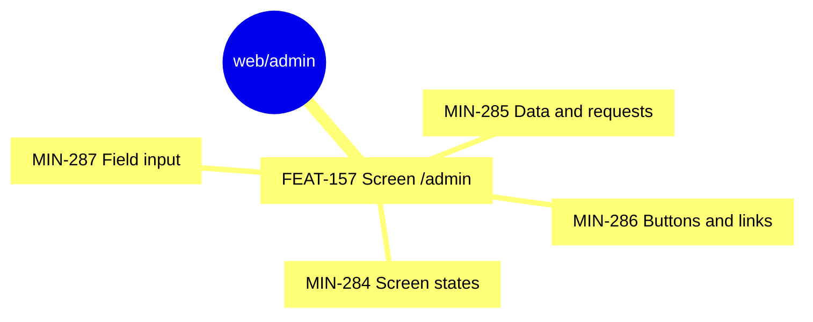

### FEAT-157 Screen /admin

AdminPage at route /admin (signed-in only); 3 buttons, 0 forms, 3 inputs; calls 5 endpoint(s).

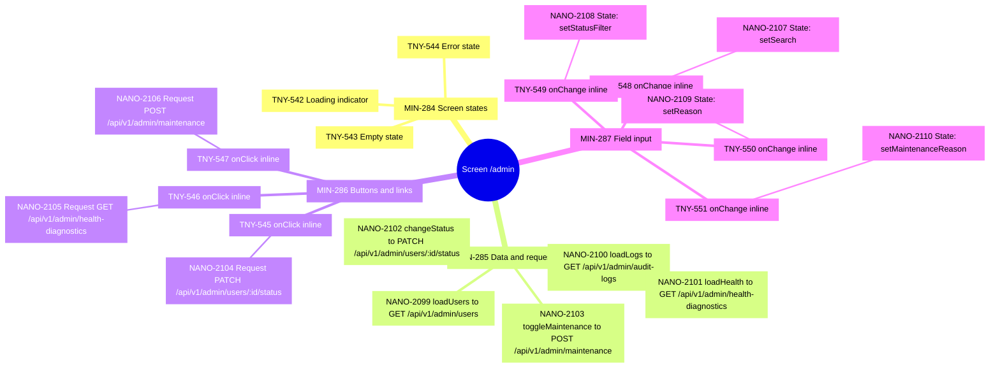

| ID        | Level | Parent   | Name                                                 | Description                                                                                                                                            | Status      | Verification | Evidence                             | Related           |
| --------- | ----- | -------- | ---------------------------------------------------- | ------------------------------------------------------------------------------------------------------------------------------------------------------ | ----------- | ------------ | ------------------------------------ | ----------------- |
| FEAT-157  | MAJOR | MOD-162  | Screen /admin                                        | AdminPage at route /admin (signed-in only); 3 buttons, 0 forms, 3 inputs; calls 5 endpoint(s).                                                         | IMPLEMENTED | VERIFIED     | apps/web/src/App.tsx:84              | SCR-028, TEST-184 |
| MIN-284   | MINOR | FEAT-157 | Screen states                                        | Loading, empty and error presentation found in the screen source.                                                                                      | IMPLEMENTED | PATH_LEVEL   | apps/web/src/pages/AdminPage.tsx     |                   |
| TNY-542   | TINY  | MIN-284  | Loading indicator                                    | Loading indicator rendered by AdminPage (detected in source).                                                                                          | IMPLEMENTED | PATH_LEVEL   | apps/web/src/pages/AdminPage.tsx     |                   |
| TNY-543   | TINY  | MIN-284  | Empty state                                          | Empty state rendered by AdminPage (detected in source).                                                                                                | IMPLEMENTED | PATH_LEVEL   | apps/web/src/pages/AdminPage.tsx     |                   |
| TNY-544   | TINY  | MIN-284  | Error state                                          | Error state rendered by AdminPage (detected in source).                                                                                                | IMPLEMENTED | PATH_LEVEL   | apps/web/src/pages/AdminPage.tsx     |                   |
| MIN-285   | MINOR | FEAT-157 | Data and requests                                    | API endpoints this screen calls (5).                                                                                                                   | IMPLEMENTED | PATH_LEVEL   | apps/web/src/pages/AdminPage.tsx     |                   |
| NANO-2099 | NANO  | MIN-285  | loadUsers -> GET /api/v1/admin/users                 | loadUsers() at apps/web/src/pages/AdminPage.tsx:98 sends GET /api/v1/admin/users.                                                                      | IMPLEMENTED | UNKNOWN      | apps/web/src/pages/AdminPage.tsx:98  | API-229           |
| NANO-2100 | NANO  | MIN-285  | loadLogs -> GET /api/v1/admin/audit-logs             | loadLogs() at apps/web/src/pages/AdminPage.tsx:108 sends GET /api/v1/admin/audit-logs.                                                                 | IMPLEMENTED | UNKNOWN      | apps/web/src/pages/AdminPage.tsx:108 | API-234           |
| NANO-2101 | NANO  | MIN-285  | loadHealth -> GET /api/v1/admin/health-diagnostics   | loadHealth() at apps/web/src/pages/AdminPage.tsx:118 sends GET /api/v1/admin/health-diagnostics.                                                       | IMPLEMENTED | UNKNOWN      | apps/web/src/pages/AdminPage.tsx:118 | API-235           |
| NANO-2102 | NANO  | MIN-285  | changeStatus -> PATCH /api/v1/admin/users/:id/status | changeStatus() at apps/web/src/pages/AdminPage.tsx:144 sends PATCH /api/v1/admin/users/:id/status.                                                     | IMPLEMENTED | UNKNOWN      | apps/web/src/pages/AdminPage.tsx:144 | API-230           |
| NANO-2103 | NANO  | MIN-285  | toggleMaintenance -> POST /api/v1/admin/maintenance  | toggleMaintenance() at apps/web/src/pages/AdminPage.tsx:160 sends POST /api/v1/admin/maintenance.                                                      | IMPLEMENTED | UNKNOWN      | apps/web/src/pages/AdminPage.tsx:160 | API-236           |
| MIN-286   | MINOR | FEAT-157 | Buttons and links                                    | 3 'buttons and links' binding(s) in apps/web/src/pages/AdminPage.tsx.                                                                                  | IMPLEMENTED | PATH_LEVEL   | apps/web/src/pages/AdminPage.tsx:278 |                   |
| TNY-545   | TINY  | MIN-286  | onClick inline                                       | onClick at apps/web/src/pages/AdminPage.tsx:278 runs inline: () => void changeStatus(user, action.to); calls PATCH /api/v1/admin/users/:id/status.     | IMPLEMENTED | PATH_LEVEL   | apps/web/src/pages/AdminPage.tsx:278 | INT-045           |
| NANO-2104 | NANO  | TNY-545  | Request PATCH /api/v1/admin/users/:id/status         | Sends PATCH /api/v1/admin/users/:id/status through apiFetch/apiJson (apps/web/src/lib/api.ts).                                                         | IMPLEMENTED | UNKNOWN      | apps/web/src/pages/AdminPage.tsx:278 | API-230           |
| TNY-546   | TINY  | MIN-286  | onClick inline                                       | onClick at apps/web/src/pages/AdminPage.tsx:328 runs inline: () => void loadHealth(); calls GET /api/v1/admin/health-diagnostics.                      | IMPLEMENTED | PATH_LEVEL   | apps/web/src/pages/AdminPage.tsx:328 | INT-046           |
| NANO-2105 | NANO  | TNY-546  | Request GET /api/v1/admin/health-diagnostics         | Sends GET /api/v1/admin/health-diagnostics through apiFetch/apiJson (apps/web/src/lib/api.ts).                                                         | IMPLEMENTED | UNKNOWN      | apps/web/src/pages/AdminPage.tsx:328 | API-235           |
| TNY-547   | TINY  | MIN-286  | onClick inline                                       | onClick at apps/web/src/pages/AdminPage.tsx:333 runs inline: () => void toggleMaintenance(!(diag?.inMaintenance; calls POST /api/v1/admin/maintenance. | IMPLEMENTED | PATH_LEVEL   | apps/web/src/pages/AdminPage.tsx:333 | INT-047           |
| NANO-2106 | NANO  | TNY-547  | Request POST /api/v1/admin/maintenance               | Sends POST /api/v1/admin/maintenance through apiFetch/apiJson (apps/web/src/lib/api.ts).                                                               | IMPLEMENTED | UNKNOWN      | apps/web/src/pages/AdminPage.tsx:333 | API-236           |
| MIN-287   | MINOR | FEAT-157 | Field input                                          | 4 'field input' binding(s) in apps/web/src/pages/AdminPage.tsx.                                                                                        | IMPLEMENTED | PATH_LEVEL   | apps/web/src/pages/AdminPage.tsx:205 |                   |
| TNY-548   | TINY  | MIN-287  | onChange inline                                      | onChange at apps/web/src/pages/AdminPage.tsx:205 runs inline: (e) => setSearch(e.target.value); changes state setSearch.                               | IMPLEMENTED | PATH_LEVEL   | apps/web/src/pages/AdminPage.tsx:205 | INT-042           |
| NANO-2107 | NANO  | TNY-548  | State: setSearch                                     | Updates component state through setSearch.                                                                                                             | IMPLEMENTED | UNKNOWN      | apps/web/src/pages/AdminPage.tsx:205 |                   |
| TNY-549   | TINY  | MIN-287  | onChange inline                                      | onChange at apps/web/src/pages/AdminPage.tsx:213 runs inline: (e) => setStatusFilter(e.target.value); changes state setStatusFilter.                   | IMPLEMENTED | PATH_LEVEL   | apps/web/src/pages/AdminPage.tsx:213 | INT-043           |
| NANO-2108 | NANO  | TNY-549  | State: setStatusFilter                               | Updates component state through setStatusFilter.                                                                                                       | IMPLEMENTED | UNKNOWN      | apps/web/src/pages/AdminPage.tsx:213 |                   |
| TNY-550   | TINY  | MIN-287  | onChange inline                                      | onChange at apps/web/src/pages/AdminPage.tsx:218 runs inline: (e) => setReason(e.target.value); changes state setReason.                               | IMPLEMENTED | PATH_LEVEL   | apps/web/src/pages/AdminPage.tsx:218 | INT-044           |
| NANO-2109 | NANO  | TNY-550  | State: setReason                                     | Updates component state through setReason.                                                                                                             | IMPLEMENTED | UNKNOWN      | apps/web/src/pages/AdminPage.tsx:218 |                   |
| TNY-551   | TINY  | MIN-287  | onChange inline                                      | onChange at apps/web/src/pages/AdminPage.tsx:341 runs inline: (e) => setMaintenanceReason(e.target.value); changes state setMaintenanceReason.         | IMPLEMENTED | PATH_LEVEL   | apps/web/src/pages/AdminPage.tsx:341 | INT-048           |
| NANO-2110 | NANO  | TNY-551  | State: setMaintenanceReason                          | Updates component state through setMaintenanceReason.                                                                                                  | IMPLEMENTED | UNKNOWN      | apps/web/src/pages/AdminPage.tsx:341 |                   |

## web/applications (MOD-163)

**Application:** apps/web (MOD-002). **Purpose:** Routed screens under /applications in apps/web/src/App.tsx.

**Nodes by level:** MODULE 1, MAJOR 1, MINOR 6, TINY 8, NANO 9. **Status:** IMPLEMENTED 25. **Verification:** PATH_LEVEL 14, UNKNOWN 10, VERIFIED 1.

### Module map (to minor features)

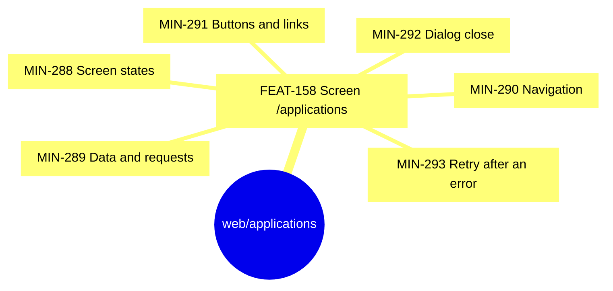

### FEAT-158 Screen /applications

ApplicationsPage at route /applications (signed-in only); 3 buttons, 0 forms, 0 inputs; calls 2 endpoint(s).

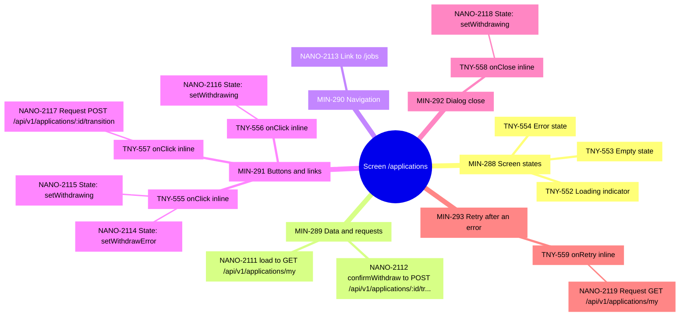

| ID        | Level | Parent   | Name                                                        | Description                                                                                                                                                             | Status      | Verification | Evidence                                    | Related                     |
| --------- | ----- | -------- | ----------------------------------------------------------- | ----------------------------------------------------------------------------------------------------------------------------------------------------------------------- | ----------- | ------------ | ------------------------------------------- | --------------------------- |
| FEAT-158  | MAJOR | MOD-163  | Screen /applications                                        | ApplicationsPage at route /applications (signed-in only); 3 buttons, 0 forms, 0 inputs; calls 2 endpoint(s).                                                            | IMPLEMENTED | VERIFIED     | apps/web/src/App.tsx:68                     | SCR-012, TEST-178, TEST-220 |
| MIN-288   | MINOR | FEAT-158 | Screen states                                               | Loading, empty and error presentation found in the screen source.                                                                                                       | IMPLEMENTED | PATH_LEVEL   | apps/web/src/pages/ApplicationsPage.tsx     |                             |
| TNY-552   | TINY  | MIN-288  | Loading indicator                                           | Loading indicator rendered by ApplicationsPage (detected in source).                                                                                                    | IMPLEMENTED | PATH_LEVEL   | apps/web/src/pages/ApplicationsPage.tsx     |                             |
| TNY-553   | TINY  | MIN-288  | Empty state                                                 | Empty state rendered by ApplicationsPage (detected in source).                                                                                                          | IMPLEMENTED | PATH_LEVEL   | apps/web/src/pages/ApplicationsPage.tsx     |                             |
| TNY-554   | TINY  | MIN-288  | Error state                                                 | Error state rendered by ApplicationsPage (detected in source).                                                                                                          | IMPLEMENTED | PATH_LEVEL   | apps/web/src/pages/ApplicationsPage.tsx     |                             |
| MIN-289   | MINOR | FEAT-158 | Data and requests                                           | API endpoints this screen calls (2).                                                                                                                                    | IMPLEMENTED | PATH_LEVEL   | apps/web/src/pages/ApplicationsPage.tsx     |                             |
| NANO-2111 | NANO  | MIN-289  | load -> GET /api/v1/applications/my                         | load() at apps/web/src/pages/ApplicationsPage.tsx:42 sends GET /api/v1/applications/my.                                                                                 | IMPLEMENTED | UNKNOWN      | apps/web/src/pages/ApplicationsPage.tsx:42  | API-048                     |
| NANO-2112 | NANO  | MIN-289  | confirmWithdraw -> POST /api/v1/applications/:id/transition | confirmWithdraw() at apps/web/src/pages/ApplicationsPage.tsx:59 sends POST /api/v1/applications/:id/transition.                                                         | IMPLEMENTED | UNKNOWN      | apps/web/src/pages/ApplicationsPage.tsx:59  | API-051                     |
| MIN-290   | MINOR | FEAT-158 | Navigation                                                  | Links from this screen to 1 other screen(s).                                                                                                                            | IMPLEMENTED | PATH_LEVEL   | apps/web/src/pages/ApplicationsPage.tsx     |                             |
| NANO-2113 | NANO  | MIN-290  | Link to /jobs                                               | Navigates to /jobs (JobsPage).                                                                                                                                          | IMPLEMENTED | UNKNOWN      | apps/web/src/pages/ApplicationsPage.tsx     | SCR-007                     |
| MIN-291   | MINOR | FEAT-158 | Buttons and links                                           | 3 'buttons and links' binding(s) in apps/web/src/pages/ApplicationsPage.tsx.                                                                                            | IMPLEMENTED | PATH_LEVEL   | apps/web/src/pages/ApplicationsPage.tsx:132 |                             |
| TNY-555   | TINY  | MIN-291  | onClick inline                                              | onClick at apps/web/src/pages/ApplicationsPage.tsx:132 runs inline: () => { setWithdrawError(null); setWithdrawing(app; changes state setWithdrawError, setWithdrawing. | IMPLEMENTED | PATH_LEVEL   | apps/web/src/pages/ApplicationsPage.tsx:132 | INT-049                     |
| NANO-2114 | NANO  | TNY-555  | State: setWithdrawError                                     | Updates component state through setWithdrawError.                                                                                                                       | IMPLEMENTED | UNKNOWN      | apps/web/src/pages/ApplicationsPage.tsx:132 |                             |
| NANO-2115 | NANO  | TNY-555  | State: setWithdrawing                                       | Updates component state through setWithdrawing.                                                                                                                         | IMPLEMENTED | UNKNOWN      | apps/web/src/pages/ApplicationsPage.tsx:132 |                             |
| TNY-556   | TINY  | MIN-291  | onClick inline                                              | onClick at apps/web/src/pages/ApplicationsPage.tsx:209 runs inline: () => setWithdrawing(null); changes state setWithdrawing.                                           | IMPLEMENTED | PATH_LEVEL   | apps/web/src/pages/ApplicationsPage.tsx:209 | INT-052                     |
| NANO-2116 | NANO  | TNY-556  | State: setWithdrawing                                       | Updates component state through setWithdrawing.                                                                                                                         | IMPLEMENTED | UNKNOWN      | apps/web/src/pages/ApplicationsPage.tsx:209 |                             |
| TNY-557   | TINY  | MIN-291  | onClick inline                                              | onClick at apps/web/src/pages/ApplicationsPage.tsx:214 runs inline: () => void confirmWithdraw(); calls POST /api/v1/applications/:id/transition.                       | IMPLEMENTED | PATH_LEVEL   | apps/web/src/pages/ApplicationsPage.tsx:214 | INT-053                     |
| NANO-2117 | NANO  | TNY-557  | Request POST /api/v1/applications/:id/transition            | Sends POST /api/v1/applications/:id/transition through apiFetch/apiJson (apps/web/src/lib/api.ts).                                                                      | IMPLEMENTED | UNKNOWN      | apps/web/src/pages/ApplicationsPage.tsx:214 | API-051                     |
| MIN-292   | MINOR | FEAT-158 | Dialog close                                                | 1 'dialog close' binding(s) in apps/web/src/pages/ApplicationsPage.tsx.                                                                                                 | IMPLEMENTED | PATH_LEVEL   | apps/web/src/pages/ApplicationsPage.tsx:194 |                             |
| TNY-558   | TINY  | MIN-292  | onClose inline                                              | onClose at apps/web/src/pages/ApplicationsPage.tsx:194 runs inline: () => setWithdrawing(null); changes state setWithdrawing.                                           | IMPLEMENTED | PATH_LEVEL   | apps/web/src/pages/ApplicationsPage.tsx:194 | INT-051                     |
| NANO-2118 | NANO  | TNY-558  | State: setWithdrawing                                       | Updates component state through setWithdrawing.                                                                                                                         | IMPLEMENTED | UNKNOWN      | apps/web/src/pages/ApplicationsPage.tsx:194 |                             |
| MIN-293   | MINOR | FEAT-158 | Retry after an error                                        | 1 'retry after an error' binding(s) in apps/web/src/pages/ApplicationsPage.tsx.                                                                                         | IMPLEMENTED | PATH_LEVEL   | apps/web/src/pages/ApplicationsPage.tsx:162 |                             |
| TNY-559   | TINY  | MIN-293  | onRetry inline                                              | onRetry at apps/web/src/pages/ApplicationsPage.tsx:162 runs inline: () => void load(); calls GET /api/v1/applications/my.                                               | IMPLEMENTED | PATH_LEVEL   | apps/web/src/pages/ApplicationsPage.tsx:162 | INT-050                     |
| NANO-2119 | NANO  | TNY-559  | Request GET /api/v1/applications/my                         | Sends GET /api/v1/applications/my through apiFetch/apiJson (apps/web/src/lib/api.ts).                                                                                   | IMPLEMENTED | UNKNOWN      | apps/web/src/pages/ApplicationsPage.tsx:162 | API-048                     |

## web/assessments (MOD-164)

**Application:** apps/web (MOD-002). **Purpose:** Routed screens under /assessments in apps/web/src/App.tsx.

**Nodes by level:** MODULE 1, MAJOR 1, MINOR 6, TINY 9, NANO 14. **Status:** IMPLEMENTED 30, UNKNOWN 1. **Verification:** PATH_LEVEL 14, UNKNOWN 16, VERIFIED 1.

### Module map (to minor features)

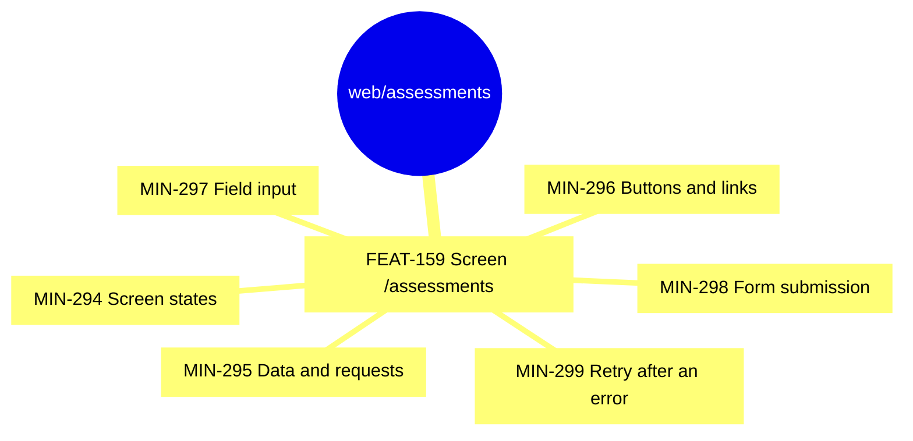

### FEAT-159 Screen /assessments

AssessmentsPage at route /assessments (signed-in only); 3 buttons, 1 forms, 0 inputs; calls 3 endpoint(s).

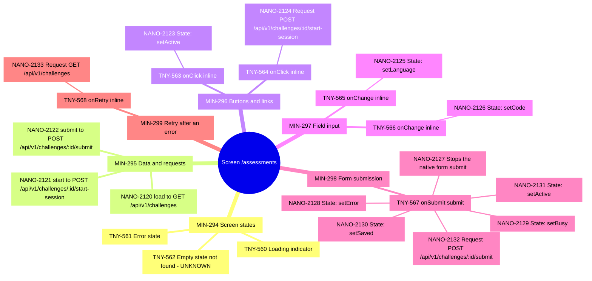

| ID        | Level | Parent   | Name                                               | Description                                                                                                                                                                              | Status      | Verification | Evidence                                   | Related                               |
| --------- | ----- | -------- | -------------------------------------------------- | ---------------------------------------------------------------------------------------------------------------------------------------------------------------------------------------- | ----------- | ------------ | ------------------------------------------ | ------------------------------------- |
| FEAT-159  | MAJOR | MOD-164  | Screen /assessments                                | AssessmentsPage at route /assessments (signed-in only); 3 buttons, 1 forms, 0 inputs; calls 3 endpoint(s).                                                                               | IMPLEMENTED | VERIFIED     | apps/web/src/App.tsx:83                    | SCR-027, TEST-162, TEST-176, TEST-220 |
| MIN-294   | MINOR | FEAT-159 | Screen states                                      | Loading, empty and error presentation found in the screen source; not found: Empty state.                                                                                                | IMPLEMENTED | PATH_LEVEL   | apps/web/src/pages/AssessmentsPage.tsx     |                                       |
| TNY-560   | TINY  | MIN-294  | Loading indicator                                  | Loading indicator rendered by AssessmentsPage (detected in source).                                                                                                                      | IMPLEMENTED | PATH_LEVEL   | apps/web/src/pages/AssessmentsPage.tsx     |                                       |
| TNY-561   | TINY  | MIN-294  | Error state                                        | Error state rendered by AssessmentsPage (detected in source).                                                                                                                            | IMPLEMENTED | PATH_LEVEL   | apps/web/src/pages/AssessmentsPage.tsx     |                                       |
| TNY-562   | TINY  | MIN-294  | Empty state (not found)                            | No empty state pattern was detected in apps/web/src/pages/AssessmentsPage.tsx although the screen calls the API. May be handled by a shared component; confirm before treating as a gap. | UNKNOWN     | UNKNOWN      | apps/web/src/pages/AssessmentsPage.tsx     |                                       |
| MIN-295   | MINOR | FEAT-159 | Data and requests                                  | API endpoints this screen calls (3).                                                                                                                                                     | IMPLEMENTED | PATH_LEVEL   | apps/web/src/pages/AssessmentsPage.tsx     |                                       |
| NANO-2120 | NANO  | MIN-295  | load -> GET /api/v1/challenges                     | load() at apps/web/src/pages/AssessmentsPage.tsx:74 sends GET /api/v1/challenges.                                                                                                        | IMPLEMENTED | UNKNOWN      | apps/web/src/pages/AssessmentsPage.tsx:74  | API-091                               |
| NANO-2121 | NANO  | MIN-295  | start -> POST /api/v1/challenges/:id/start-session | start() at apps/web/src/pages/AssessmentsPage.tsx:92 sends POST /api/v1/challenges/:id/start-session.                                                                                    | IMPLEMENTED | UNKNOWN      | apps/web/src/pages/AssessmentsPage.tsx:92  | API-094                               |
| NANO-2122 | NANO  | MIN-295  | submit -> POST /api/v1/challenges/:id/submit       | submit() at apps/web/src/pages/AssessmentsPage.tsx:115 sends POST /api/v1/challenges/:id/submit.                                                                                         | IMPLEMENTED | UNKNOWN      | apps/web/src/pages/AssessmentsPage.tsx:115 | API-095                               |
| MIN-296   | MINOR | FEAT-159 | Buttons and links                                  | 2 'buttons and links' binding(s) in apps/web/src/pages/AssessmentsPage.tsx.                                                                                                              | IMPLEMENTED | PATH_LEVEL   | apps/web/src/pages/AssessmentsPage.tsx:201 |                                       |
| TNY-563   | TINY  | MIN-296  | onClick inline                                     | onClick at apps/web/src/pages/AssessmentsPage.tsx:201 runs inline: () => setActive(null); changes state setActive.                                                                       | IMPLEMENTED | PATH_LEVEL   | apps/web/src/pages/AssessmentsPage.tsx:201 | INT-057                               |
| NANO-2123 | NANO  | TNY-563  | State: setActive                                   | Updates component state through setActive.                                                                                                                                               | IMPLEMENTED | UNKNOWN      | apps/web/src/pages/AssessmentsPage.tsx:201 |                                       |
| TNY-564   | TINY  | MIN-296  | onClick inline                                     | onClick at apps/web/src/pages/AssessmentsPage.tsx:237 runs inline: () => void start(c); calls POST /api/v1/challenges/:id/start-session.                                                 | IMPLEMENTED | PATH_LEVEL   | apps/web/src/pages/AssessmentsPage.tsx:237 | INT-059                               |
| NANO-2124 | NANO  | TNY-564  | Request POST /api/v1/challenges/:id/start-session  | Sends POST /api/v1/challenges/:id/start-session through apiFetch/apiJson (apps/web/src/lib/api.ts).                                                                                      | IMPLEMENTED | UNKNOWN      | apps/web/src/pages/AssessmentsPage.tsx:237 | API-094                               |
| MIN-297   | MINOR | FEAT-159 | Field input                                        | 2 'field input' binding(s) in apps/web/src/pages/AssessmentsPage.tsx.                                                                                                                    | IMPLEMENTED | PATH_LEVEL   | apps/web/src/pages/AssessmentsPage.tsx:181 |                                       |
| TNY-565   | TINY  | MIN-297  | onChange inline                                    | onChange at apps/web/src/pages/AssessmentsPage.tsx:181 runs inline: (e) => setLanguage(e.target.value); changes state setLanguage.                                                       | IMPLEMENTED | PATH_LEVEL   | apps/web/src/pages/AssessmentsPage.tsx:181 | INT-055                               |
| NANO-2125 | NANO  | TNY-565  | State: setLanguage                                 | Updates component state through setLanguage.                                                                                                                                             | IMPLEMENTED | UNKNOWN      | apps/web/src/pages/AssessmentsPage.tsx:181 |                                       |
| TNY-566   | TINY  | MIN-297  | onChange inline                                    | onChange at apps/web/src/pages/AssessmentsPage.tsx:188 runs inline: (e) => setCode(e.target.value); changes state setCode.                                                               | IMPLEMENTED | PATH_LEVEL   | apps/web/src/pages/AssessmentsPage.tsx:188 | INT-056                               |
| NANO-2126 | NANO  | TNY-566  | State: setCode                                     | Updates component state through setCode.                                                                                                                                                 | IMPLEMENTED | UNKNOWN      | apps/web/src/pages/AssessmentsPage.tsx:188 |                                       |
| MIN-298   | MINOR | FEAT-159 | Form submission                                    | 1 'form submission' binding(s) in apps/web/src/pages/AssessmentsPage.tsx.                                                                                                                | IMPLEMENTED | PATH_LEVEL   | apps/web/src/pages/AssessmentsPage.tsx:175 |                                       |
| TNY-567   | TINY  | MIN-298  | onSubmit submit                                    | onSubmit at apps/web/src/pages/AssessmentsPage.tsx:175 runs submit; changes state setError, setBusy, setSaved, setActive; calls POST /api/v1/challenges/:id/submit.                      | IMPLEMENTED | PATH_LEVEL   | apps/web/src/pages/AssessmentsPage.tsx:175 | INT-054                               |
| NANO-2127 | NANO  | TNY-567  | Stops the native form submit                       | Calls event.preventDefault() so the page does not reload.                                                                                                                                | IMPLEMENTED | UNKNOWN      | apps/web/src/pages/AssessmentsPage.tsx:104 |                                       |
| NANO-2128 | NANO  | TNY-567  | State: setError                                    | Updates component state through setError.                                                                                                                                                | IMPLEMENTED | UNKNOWN      | apps/web/src/pages/AssessmentsPage.tsx:104 |                                       |
| NANO-2129 | NANO  | TNY-567  | State: setBusy                                     | Updates component state through setBusy.                                                                                                                                                 | IMPLEMENTED | UNKNOWN      | apps/web/src/pages/AssessmentsPage.tsx:104 |                                       |
| NANO-2130 | NANO  | TNY-567  | State: setSaved                                    | Updates component state through setSaved.                                                                                                                                                | IMPLEMENTED | UNKNOWN      | apps/web/src/pages/AssessmentsPage.tsx:104 |                                       |
| NANO-2131 | NANO  | TNY-567  | State: setActive                                   | Updates component state through setActive.                                                                                                                                               | IMPLEMENTED | UNKNOWN      | apps/web/src/pages/AssessmentsPage.tsx:104 |                                       |
| NANO-2132 | NANO  | TNY-567  | Request POST /api/v1/challenges/:id/submit         | Sends POST /api/v1/challenges/:id/submit through apiFetch/apiJson (apps/web/src/lib/api.ts).                                                                                             | IMPLEMENTED | UNKNOWN      | apps/web/src/pages/AssessmentsPage.tsx:104 | API-095                               |
| MIN-299   | MINOR | FEAT-159 | Retry after an error                               | 1 'retry after an error' binding(s) in apps/web/src/pages/AssessmentsPage.tsx.                                                                                                           | IMPLEMENTED | PATH_LEVEL   | apps/web/src/pages/AssessmentsPage.tsx:210 |                                       |
| TNY-568   | TINY  | MIN-299  | onRetry inline                                     | onRetry at apps/web/src/pages/AssessmentsPage.tsx:210 runs inline: () => void load(); calls GET /api/v1/challenges.                                                                      | IMPLEMENTED | PATH_LEVEL   | apps/web/src/pages/AssessmentsPage.tsx:210 | INT-058                               |
| NANO-2133 | NANO  | TNY-568  | Request GET /api/v1/challenges                     | Sends GET /api/v1/challenges through apiFetch/apiJson (apps/web/src/lib/api.ts).                                                                                                         | IMPLEMENTED | UNKNOWN      | apps/web/src/pages/AssessmentsPage.tsx:210 | API-091                               |

## web/career (MOD-165)

**Application:** apps/web (MOD-002). **Purpose:** Routed screens under /career in apps/web/src/App.tsx.

**Nodes by level:** MODULE 1, MAJOR 1, MINOR 6, TINY 7, NANO 15. **Status:** IMPLEMENTED 29, UNKNOWN 1. **Verification:** PATH_LEVEL 12, UNKNOWN 17, VERIFIED 1.

### Module map (to minor features)

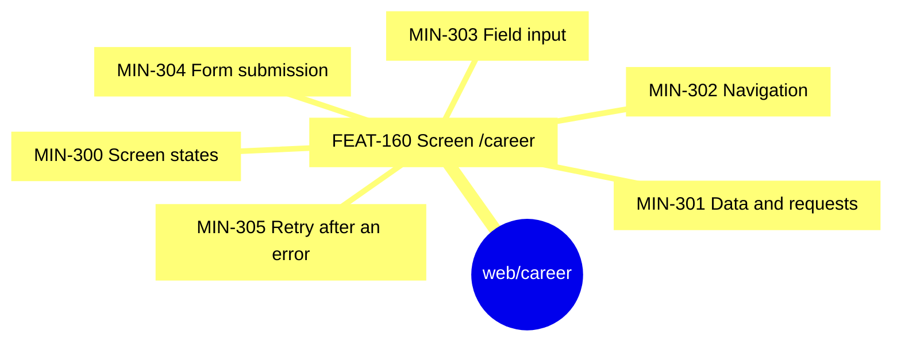

### FEAT-160 Screen /career

CareerPage at route /career (signed-in only); 1 buttons, 1 forms, 0 inputs; calls 4 endpoint(s).

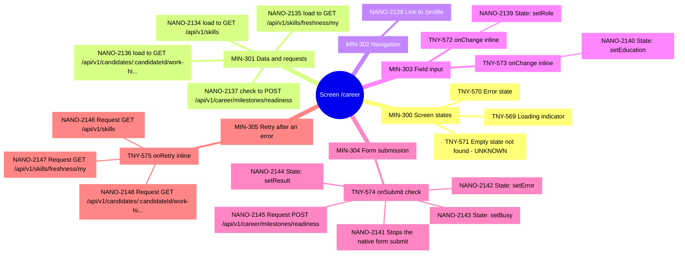

| ID        | Level | Parent   | Name                                                     | Description                                                                                                                                                                                   | Status      | Verification | Evidence                              | Related           |
| --------- | ----- | -------- | -------------------------------------------------------- | --------------------------------------------------------------------------------------------------------------------------------------------------------------------------------------------- | ----------- | ------------ | ------------------------------------- | ----------------- |
| FEAT-160  | MAJOR | MOD-165  | Screen /career                                           | CareerPage at route /career (signed-in only); 1 buttons, 1 forms, 0 inputs; calls 4 endpoint(s).                                                                                              | IMPLEMENTED | VERIFIED     | apps/web/src/App.tsx:77               | SCR-021, TEST-173 |
| MIN-300   | MINOR | FEAT-160 | Screen states                                            | Loading, empty and error presentation found in the screen source; not found: Empty state.                                                                                                     | IMPLEMENTED | PATH_LEVEL   | apps/web/src/pages/CareerPage.tsx     |                   |
| TNY-569   | TINY  | MIN-300  | Loading indicator                                        | Loading indicator rendered by CareerPage (detected in source).                                                                                                                                | IMPLEMENTED | PATH_LEVEL   | apps/web/src/pages/CareerPage.tsx     |                   |
| TNY-570   | TINY  | MIN-300  | Error state                                              | Error state rendered by CareerPage (detected in source).                                                                                                                                      | IMPLEMENTED | PATH_LEVEL   | apps/web/src/pages/CareerPage.tsx     |                   |
| TNY-571   | TINY  | MIN-300  | Empty state (not found)                                  | No empty state pattern was detected in apps/web/src/pages/CareerPage.tsx although the screen calls the API. May be handled by a shared component; confirm before treating as a gap.           | UNKNOWN     | UNKNOWN      | apps/web/src/pages/CareerPage.tsx     |                   |
| MIN-301   | MINOR | FEAT-160 | Data and requests                                        | API endpoints this screen calls (4).                                                                                                                                                          | IMPLEMENTED | PATH_LEVEL   | apps/web/src/pages/CareerPage.tsx     |                   |
| NANO-2134 | NANO  | MIN-301  | load -> GET /api/v1/skills                               | load() at apps/web/src/pages/CareerPage.tsx:79 sends GET /api/v1/skills.                                                                                                                      | IMPLEMENTED | UNKNOWN      | apps/web/src/pages/CareerPage.tsx:79  | API-022           |
| NANO-2135 | NANO  | MIN-301  | load -> GET /api/v1/skills/freshness/my                  | load() at apps/web/src/pages/CareerPage.tsx:80 sends GET /api/v1/skills/freshness/my.                                                                                                         | IMPLEMENTED | UNKNOWN      | apps/web/src/pages/CareerPage.tsx:80  | API-059           |
| NANO-2136 | NANO  | MIN-301  | load -> GET /api/v1/candidates/:candidateId/work-history | load() at apps/web/src/pages/CareerPage.tsx:81 sends GET /api/v1/candidates/:candidateId/work-history.                                                                                        | IMPLEMENTED | UNKNOWN      | apps/web/src/pages/CareerPage.tsx:81  | API-276           |
| NANO-2137 | NANO  | MIN-301  | check -> POST /api/v1/career/milestones/readiness        | check() at apps/web/src/pages/CareerPage.tsx:107 sends POST /api/v1/career/milestones/readiness.                                                                                              | IMPLEMENTED | UNKNOWN      | apps/web/src/pages/CareerPage.tsx:107 | API-167           |
| MIN-302   | MINOR | FEAT-160 | Navigation                                               | Links from this screen to 1 other screen(s).                                                                                                                                                  | IMPLEMENTED | PATH_LEVEL   | apps/web/src/pages/CareerPage.tsx     |                   |
| NANO-2138 | NANO  | MIN-302  | Link to /profile                                         | Navigates to /profile (ProfilePage).                                                                                                                                                          | IMPLEMENTED | UNKNOWN      | apps/web/src/pages/CareerPage.tsx     | SCR-014           |
| MIN-303   | MINOR | FEAT-160 | Field input                                              | 2 'field input' binding(s) in apps/web/src/pages/CareerPage.tsx.                                                                                                                              | IMPLEMENTED | PATH_LEVEL   | apps/web/src/pages/CareerPage.tsx:162 |                   |
| TNY-572   | TINY  | MIN-303  | onChange inline                                          | onChange at apps/web/src/pages/CareerPage.tsx:162 runs inline: (e) => setRole(e.target.value); changes state setRole.                                                                         | IMPLEMENTED | PATH_LEVEL   | apps/web/src/pages/CareerPage.tsx:162 | INT-062           |
| NANO-2139 | NANO  | TNY-572  | State: setRole                                           | Updates component state through setRole.                                                                                                                                                      | IMPLEMENTED | UNKNOWN      | apps/web/src/pages/CareerPage.tsx:162 |                   |
| TNY-573   | TINY  | MIN-303  | onChange inline                                          | onChange at apps/web/src/pages/CareerPage.tsx:170 runs inline: (e) => setEducation(e.target.value); changes state setEducation.                                                               | IMPLEMENTED | PATH_LEVEL   | apps/web/src/pages/CareerPage.tsx:170 | INT-063           |
| NANO-2140 | NANO  | TNY-573  | State: setEducation                                      | Updates component state through setEducation.                                                                                                                                                 | IMPLEMENTED | UNKNOWN      | apps/web/src/pages/CareerPage.tsx:170 |                   |
| MIN-304   | MINOR | FEAT-160 | Form submission                                          | 1 'form submission' binding(s) in apps/web/src/pages/CareerPage.tsx.                                                                                                                          | IMPLEMENTED | PATH_LEVEL   | apps/web/src/pages/CareerPage.tsx:156 |                   |
| TNY-574   | TINY  | MIN-304  | onSubmit check                                           | onSubmit at apps/web/src/pages/CareerPage.tsx:156 runs check; changes state setError, setBusy, setResult; calls POST /api/v1/career/milestones/readiness.                                     | IMPLEMENTED | PATH_LEVEL   | apps/web/src/pages/CareerPage.tsx:156 | INT-061           |
| NANO-2141 | NANO  | TNY-574  | Stops the native form submit                             | Calls event.preventDefault() so the page does not reload.                                                                                                                                     | IMPLEMENTED | UNKNOWN      | apps/web/src/pages/CareerPage.tsx:96  |                   |
| NANO-2142 | NANO  | TNY-574  | State: setError                                          | Updates component state through setError.                                                                                                                                                     | IMPLEMENTED | UNKNOWN      | apps/web/src/pages/CareerPage.tsx:96  |                   |
| NANO-2143 | NANO  | TNY-574  | State: setBusy                                           | Updates component state through setBusy.                                                                                                                                                      | IMPLEMENTED | UNKNOWN      | apps/web/src/pages/CareerPage.tsx:96  |                   |
| NANO-2144 | NANO  | TNY-574  | State: setResult                                         | Updates component state through setResult.                                                                                                                                                    | IMPLEMENTED | UNKNOWN      | apps/web/src/pages/CareerPage.tsx:96  |                   |
| NANO-2145 | NANO  | TNY-574  | Request POST /api/v1/career/milestones/readiness         | Sends POST /api/v1/career/milestones/readiness through apiFetch/apiJson (apps/web/src/lib/api.ts).                                                                                            | IMPLEMENTED | UNKNOWN      | apps/web/src/pages/CareerPage.tsx:96  | API-167           |
| MIN-305   | MINOR | FEAT-160 | Retry after an error                                     | 1 'retry after an error' binding(s) in apps/web/src/pages/CareerPage.tsx.                                                                                                                     | IMPLEMENTED | PATH_LEVEL   | apps/web/src/pages/CareerPage.tsx:136 |                   |
| TNY-575   | TINY  | MIN-305  | onRetry inline                                           | onRetry at apps/web/src/pages/CareerPage.tsx:136 runs inline: () => void load(); calls GET /api/v1/skills, GET /api/v1/skills/freshness/my, GET /api/v1/candidates/:candidateId/work-history. | IMPLEMENTED | PATH_LEVEL   | apps/web/src/pages/CareerPage.tsx:136 | INT-060           |
| NANO-2146 | NANO  | TNY-575  | Request GET /api/v1/skills                               | Sends GET /api/v1/skills through apiFetch/apiJson (apps/web/src/lib/api.ts).                                                                                                                  | IMPLEMENTED | UNKNOWN      | apps/web/src/pages/CareerPage.tsx:136 | API-022           |
| NANO-2147 | NANO  | TNY-575  | Request GET /api/v1/skills/freshness/my                  | Sends GET /api/v1/skills/freshness/my through apiFetch/apiJson (apps/web/src/lib/api.ts).                                                                                                     | IMPLEMENTED | UNKNOWN      | apps/web/src/pages/CareerPage.tsx:136 | API-059           |
| NANO-2148 | NANO  | TNY-575  | Request GET /api/v1/candidates/:candidateId/work-history | Sends GET /api/v1/candidates/:candidateId/work-history through apiFetch/apiJson (apps/web/src/lib/api.ts).                                                                                    | IMPLEMENTED | UNKNOWN      | apps/web/src/pages/CareerPage.tsx:136 | API-276           |

## web/checkout (MOD-166)

**Application:** apps/web (MOD-002). **Purpose:** Routed screens under /checkout in apps/web/src/App.tsx.

**Nodes by level:** MODULE 1, MAJOR 1. **Status:** IMPLEMENTED 2. **Verification:** UNKNOWN 1, VERIFIED 1.

**Known gaps:** FEAT-161 no API call found in this screen file.

### Module map (to minor features)


### FEAT-161 Screen /checkout

CheckoutPage at route /checkout (public); 0 buttons, 0 forms, 0 inputs; calls 0 endpoint(s).

| ID       | Level | Parent  | Name             | Description                                                                                                                              | Status      | Verification | Evidence                | Related                                         |
| -------- | ----- | ------- | ---------------- | ---------------------------------------------------------------------------------------------------------------------------------------- | ----------- | ------------ | ----------------------- | ----------------------------------------------- |
| FEAT-161 | MAJOR | MOD-166 | Screen /checkout | CheckoutPage at route /checkout (public); 0 buttons, 0 forms, 0 inputs; calls 0 endpoint(s). Gaps: no API call found in this screen file | IMPLEMENTED | VERIFIED     | apps/web/src/App.tsx:58 | SCR-004, TEST-162, TEST-177, TEST-194, TEST-220 |

## web/dashboard (MOD-167)

**Application:** apps/web (MOD-002). **Purpose:** Routed screens under /dashboard in apps/web/src/App.tsx.

**Nodes by level:** MODULE 1, MAJOR 1, MINOR 3, TINY 3, NANO 8. **Status:** IMPLEMENTED 15, UNKNOWN 1. **Verification:** PATH_LEVEL 5, UNKNOWN 10, VERIFIED 1.

### Module map (to minor features)

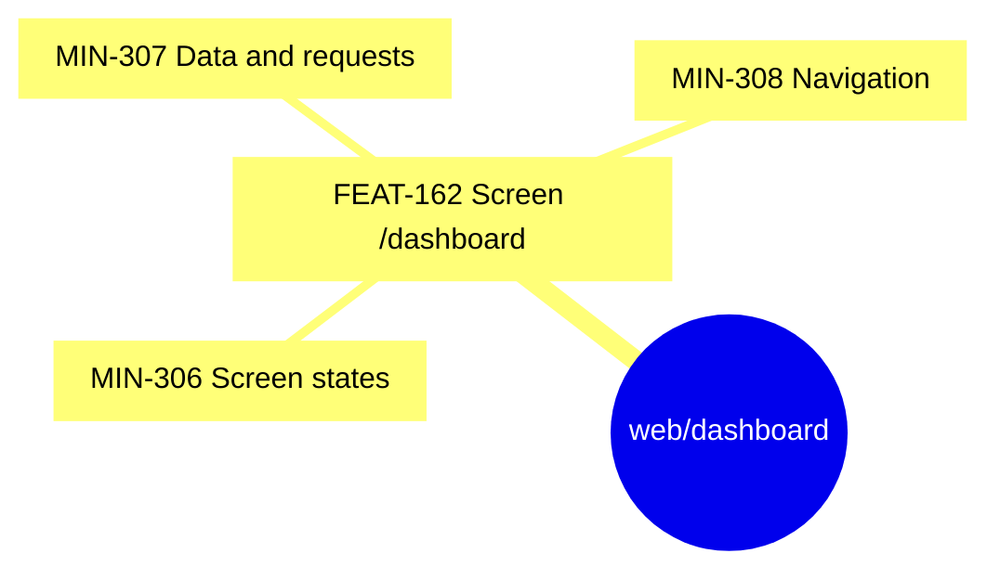

### FEAT-162 Screen /dashboard

DashboardPage at route /dashboard (signed-in only); 0 buttons, 0 forms, 0 inputs; calls 6 endpoint(s).

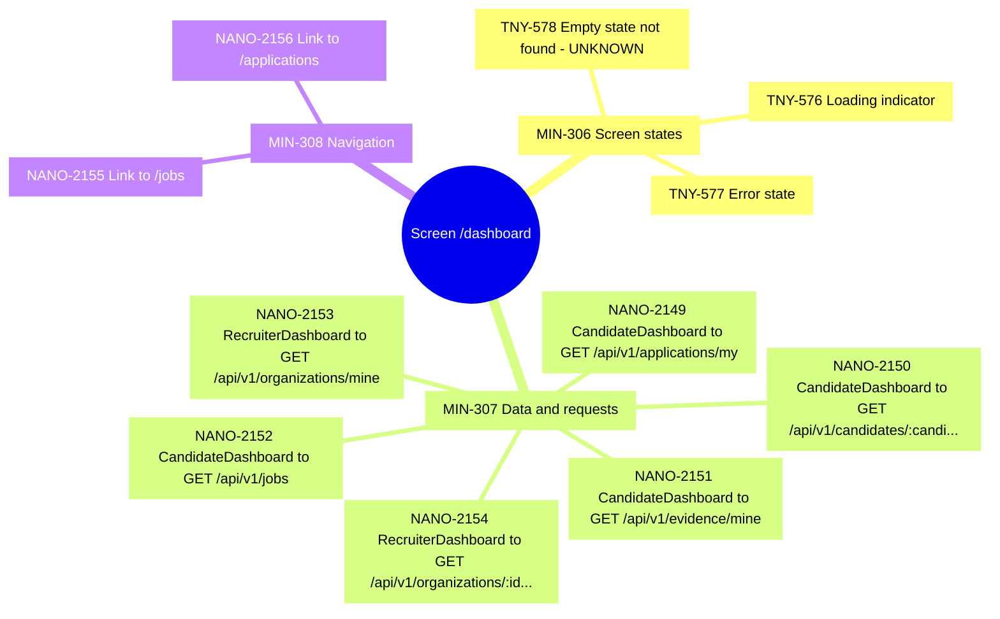

| ID        | Level | Parent   | Name                                                                   | Description                                                                                                                                                                            | Status      | Verification | Evidence                                 | Related                                                       |
| --------- | ----- | -------- | ---------------------------------------------------------------------- | -------------------------------------------------------------------------------------------------------------------------------------------------------------------------------------- | ----------- | ------------ | ---------------------------------------- | ------------------------------------------------------------- |
| FEAT-162  | MAJOR | MOD-167  | Screen /dashboard                                                      | DashboardPage at route /dashboard (signed-in only); 0 buttons, 0 forms, 0 inputs; calls 6 endpoint(s).                                                                                 | IMPLEMENTED | VERIFIED     | apps/web/src/App.tsx:67                  | SCR-011, TEST-162, TEST-164, TEST-178, TEST-184, TEST-192 ... |
| MIN-306   | MINOR | FEAT-162 | Screen states                                                          | Loading, empty and error presentation found in the screen source; not found: Empty state.                                                                                              | IMPLEMENTED | PATH_LEVEL   | apps/web/src/pages/DashboardPage.tsx     |                                                               |
| TNY-576   | TINY  | MIN-306  | Loading indicator                                                      | Loading indicator rendered by DashboardPage (detected in source).                                                                                                                      | IMPLEMENTED | PATH_LEVEL   | apps/web/src/pages/DashboardPage.tsx     |                                                               |
| TNY-577   | TINY  | MIN-306  | Error state                                                            | Error state rendered by DashboardPage (detected in source).                                                                                                                            | IMPLEMENTED | PATH_LEVEL   | apps/web/src/pages/DashboardPage.tsx     |                                                               |
| TNY-578   | TINY  | MIN-306  | Empty state (not found)                                                | No empty state pattern was detected in apps/web/src/pages/DashboardPage.tsx although the screen calls the API. May be handled by a shared component; confirm before treating as a gap. | UNKNOWN     | UNKNOWN      | apps/web/src/pages/DashboardPage.tsx     |                                                               |
| MIN-307   | MINOR | FEAT-162 | Data and requests                                                      | API endpoints this screen calls (6).                                                                                                                                                   | IMPLEMENTED | PATH_LEVEL   | apps/web/src/pages/DashboardPage.tsx     |                                                               |
| NANO-2149 | NANO  | MIN-307  | CandidateDashboard -> GET /api/v1/applications/my                      | CandidateDashboard() at apps/web/src/pages/DashboardPage.tsx:128 sends GET /api/v1/applications/my.                                                                                    | IMPLEMENTED | UNKNOWN      | apps/web/src/pages/DashboardPage.tsx:128 | API-048                                                       |
| NANO-2150 | NANO  | MIN-307  | CandidateDashboard -> GET /api/v1/candidates/:candidateId/work-history | CandidateDashboard() at apps/web/src/pages/DashboardPage.tsx:130 sends GET /api/v1/candidates/:candidateId/work-history.                                                               | IMPLEMENTED | UNKNOWN      | apps/web/src/pages/DashboardPage.tsx:130 | API-276                                                       |
| NANO-2151 | NANO  | MIN-307  | CandidateDashboard -> GET /api/v1/evidence/mine                        | CandidateDashboard() at apps/web/src/pages/DashboardPage.tsx:132 sends GET /api/v1/evidence/mine.                                                                                      | IMPLEMENTED | UNKNOWN      | apps/web/src/pages/DashboardPage.tsx:132 | API-016                                                       |
| NANO-2152 | NANO  | MIN-307  | CandidateDashboard -> GET /api/v1/jobs                                 | CandidateDashboard() at apps/web/src/pages/DashboardPage.tsx:133 sends GET /api/v1/jobs.                                                                                               | IMPLEMENTED | UNKNOWN      | apps/web/src/pages/DashboardPage.tsx:133 | API-032                                                       |
| NANO-2153 | NANO  | MIN-307  | RecruiterDashboard -> GET /api/v1/organizations/mine                   | RecruiterDashboard() at apps/web/src/pages/DashboardPage.tsx:306 sends GET /api/v1/organizations/mine.                                                                                 | IMPLEMENTED | UNKNOWN      | apps/web/src/pages/DashboardPage.tsx:306 | API-027                                                       |
| NANO-2154 | NANO  | MIN-307  | RecruiterDashboard -> GET /api/v1/organizations/:id/jobs               | RecruiterDashboard() at apps/web/src/pages/DashboardPage.tsx:312 sends GET /api/v1/organizations/:id/jobs.                                                                             | IMPLEMENTED | UNKNOWN      | apps/web/src/pages/DashboardPage.tsx:312 | API-028                                                       |
| MIN-308   | MINOR | FEAT-162 | Navigation                                                             | Links from this screen to 2 other screen(s).                                                                                                                                           | IMPLEMENTED | PATH_LEVEL   | apps/web/src/pages/DashboardPage.tsx     |                                                               |
| NANO-2155 | NANO  | MIN-308  | Link to /jobs                                                          | Navigates to /jobs (JobsPage).                                                                                                                                                         | IMPLEMENTED | UNKNOWN      | apps/web/src/pages/DashboardPage.tsx     | SCR-007                                                       |
| NANO-2156 | NANO  | MIN-308  | Link to /applications                                                  | Navigates to /applications (ApplicationsPage).                                                                                                                                         | IMPLEMENTED | UNKNOWN      | apps/web/src/pages/DashboardPage.tsx     | SCR-012                                                       |

## web/evidence (MOD-168)

**Application:** apps/web (MOD-002). **Purpose:** Routed screens under /evidence in apps/web/src/App.tsx.

**Nodes by level:** MODULE 1, MAJOR 1, MINOR 6, TINY 29, NANO 76. **Status:** IMPLEMENTED 112, UNKNOWN 1. **Verification:** PATH_LEVEL 34, UNKNOWN 78, VERIFIED 1.

### Module map (to minor features)

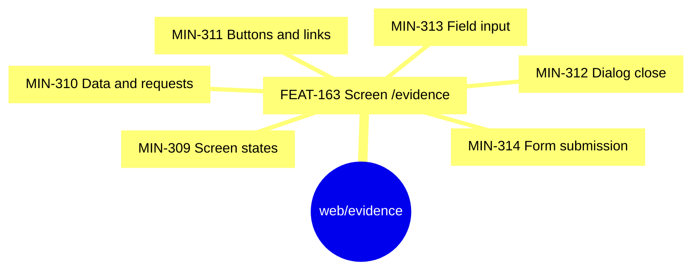

### FEAT-163 Screen /evidence

EvidencePage at route /evidence (signed-in only); 12 buttons, 4 forms, 10 inputs; calls 5 endpoint(s).

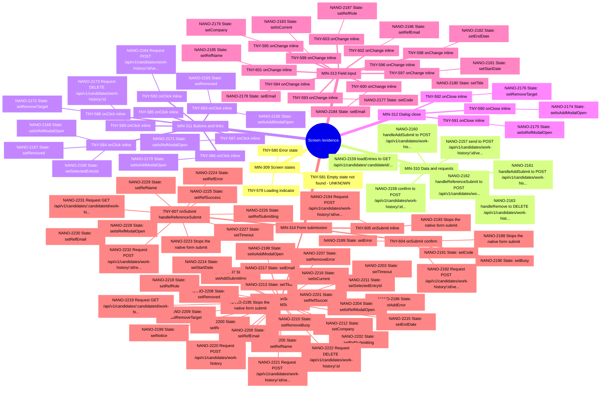

| ID        | Level | Parent   | Name                                                                                 | Description                                                                                                                                                                                                                                                                                                                                                                                                      | Status      | Verification | Evidence                                | Related                                                       |
| --------- | ----- | -------- | ------------------------------------------------------------------------------------ | ---------------------------------------------------------------------------------------------------------------------------------------------------------------------------------------------------------------------------------------------------------------------------------------------------------------------------------------------------------------------------------------------------------------- | ----------- | ------------ | --------------------------------------- | ------------------------------------------------------------- |
| FEAT-163  | MAJOR | MOD-168  | Screen /evidence                                                                     | EvidencePage at route /evidence (signed-in only); 12 buttons, 4 forms, 10 inputs; calls 5 endpoint(s).                                                                                                                                                                                                                                                                                                           | IMPLEMENTED | VERIFIED     | apps/web/src/App.tsx:69                 | SCR-013, TEST-162, TEST-178, TEST-194, TEST-195, TEST-220 ... |
| MIN-309   | MINOR | FEAT-163 | Screen states                                                                        | Loading, empty and error presentation found in the screen source; not found: Empty state.                                                                                                                                                                                                                                                                                                                        | IMPLEMENTED | PATH_LEVEL   | apps/web/src/pages/EvidencePage.tsx     |                                                               |
| TNY-579   | TINY  | MIN-309  | Loading indicator                                                                    | Loading indicator rendered by EvidencePage (detected in source).                                                                                                                                                                                                                                                                                                                                                 | IMPLEMENTED | PATH_LEVEL   | apps/web/src/pages/EvidencePage.tsx     |                                                               |
| TNY-580   | TINY  | MIN-309  | Error state                                                                          | Error state rendered by EvidencePage (detected in source).                                                                                                                                                                                                                                                                                                                                                       | IMPLEMENTED | PATH_LEVEL   | apps/web/src/pages/EvidencePage.tsx     |                                                               |
| TNY-581   | TINY  | MIN-309  | Empty state (not found)                                                              | No empty state pattern was detected in apps/web/src/pages/EvidencePage.tsx although the screen calls the API. May be handled by a shared component; confirm before treating as a gap.                                                                                                                                                                                                                            | UNKNOWN     | UNKNOWN      | apps/web/src/pages/EvidencePage.tsx     |                                                               |
| MIN-310   | MINOR | FEAT-163 | Data and requests                                                                    | API endpoints this screen calls (5).                                                                                                                                                                                                                                                                                                                                                                             | IMPLEMENTED | PATH_LEVEL   | apps/web/src/pages/EvidencePage.tsx     |                                                               |
| NANO-2157 | NANO  | MIN-310  | send -> POST /api/v1/candidates/work-history/:id/verify-email                        | send() at apps/web/src/pages/EvidencePage.tsx:128 sends POST /api/v1/candidates/work-history/:id/verify-email.                                                                                                                                                                                                                                                                                                   | IMPLEMENTED | UNKNOWN      | apps/web/src/pages/EvidencePage.tsx:128 | API-272                                                       |
| NANO-2158 | NANO  | MIN-310  | confirm -> POST /api/v1/candidates/work-history/:id/verify-email                     | confirm() at apps/web/src/pages/EvidencePage.tsx:147 sends POST /api/v1/candidates/work-history/:id/verify-email.                                                                                                                                                                                                                                                                                                | IMPLEMENTED | UNKNOWN      | apps/web/src/pages/EvidencePage.tsx:147 | API-272                                                       |
| NANO-2159 | NANO  | MIN-310  | loadEntries -> GET /api/v1/candidates/:candidateId/work-history                      | loadEntries() at apps/web/src/pages/EvidencePage.tsx:345 sends GET /api/v1/candidates/:candidateId/work-history.                                                                                                                                                                                                                                                                                                 | IMPLEMENTED | UNKNOWN      | apps/web/src/pages/EvidencePage.tsx:345 | API-276                                                       |
| NANO-2160 | NANO  | MIN-310  | handleAddSubmit -> POST /api/v1/candidates/work-history                              | handleAddSubmit() at apps/web/src/pages/EvidencePage.tsx:402 sends POST /api/v1/candidates/work-history.                                                                                                                                                                                                                                                                                                         | IMPLEMENTED | UNKNOWN      | apps/web/src/pages/EvidencePage.tsx:402 | API-271                                                       |
| NANO-2161 | NANO  | MIN-310  | handleAddSubmit -> POST /api/v1/candidates/work-history/:id/verify-email             | handleAddSubmit() at apps/web/src/pages/EvidencePage.tsx:414 sends POST /api/v1/candidates/work-history/:id/verify-email.                                                                                                                                                                                                                                                                                        | IMPLEMENTED | UNKNOWN      | apps/web/src/pages/EvidencePage.tsx:414 | API-272                                                       |
| NANO-2162 | NANO  | MIN-310  | handleReferenceSubmit -> POST /api/v1/candidates/work-history/:id/references/request | handleReferenceSubmit() at apps/web/src/pages/EvidencePage.tsx:466 sends POST /api/v1/candidates/work-history/:id/references/request.                                                                                                                                                                                                                                                                            | IMPLEMENTED | UNKNOWN      | apps/web/src/pages/EvidencePage.tsx:466 | API-273                                                       |
| NANO-2163 | NANO  | MIN-310  | handleRemove -> DELETE /api/v1/candidates/work-history/:id                           | handleRemove() at apps/web/src/pages/EvidencePage.tsx:509 sends DELETE /api/v1/candidates/work-history/:id.                                                                                                                                                                                                                                                                                                      | IMPLEMENTED | UNKNOWN      | apps/web/src/pages/EvidencePage.tsx:509 | API-278                                                       |
| MIN-311   | MINOR | FEAT-163 | Buttons and links                                                                    | 8 'buttons and links' binding(s) in apps/web/src/pages/EvidencePage.tsx.                                                                                                                                                                                                                                                                                                                                         | IMPLEMENTED | PATH_LEVEL   | apps/web/src/pages/EvidencePage.tsx:204 |                                                               |
| TNY-582   | TINY  | MIN-311  | onClick inline                                                                       | onClick at apps/web/src/pages/EvidencePage.tsx:204 runs inline: () => void send(pending.email); calls POST /api/v1/candidates/work-history/:id/verify-email.                                                                                                                                                                                                                                                     | IMPLEMENTED | PATH_LEVEL   | apps/web/src/pages/EvidencePage.tsx:204 | INT-074                                                       |
| NANO-2164 | NANO  | TNY-582  | Request POST /api/v1/candidates/work-history/:id/verify-email                        | Sends POST /api/v1/candidates/work-history/:id/verify-email through apiFetch/apiJson (apps/web/src/lib/api.ts).                                                                                                                                                                                                                                                                                                  | IMPLEMENTED | UNKNOWN      | apps/web/src/pages/EvidencePage.tsx:204 | API-272                                                       |
| TNY-583   | TINY  | MIN-311  | onClick inline                                                                       | onClick at apps/web/src/pages/EvidencePage.tsx:535 runs inline: () => { setRemoved(null); setIsAddModalOpen(true);; changes state setRemoved, setIsAddModalOpen.                                                                                                                                                                                                                                                 | IMPLEMENTED | PATH_LEVEL   | apps/web/src/pages/EvidencePage.tsx:535 | INT-077                                                       |
| NANO-2165 | NANO  | TNY-583  | State: setRemoved                                                                    | Updates component state through setRemoved.                                                                                                                                                                                                                                                                                                                                                                      | IMPLEMENTED | UNKNOWN      | apps/web/src/pages/EvidencePage.tsx:535 |                                                               |
| NANO-2166 | NANO  | TNY-583  | State: setIsAddModalOpen                                                             | Updates component state through setIsAddModalOpen.                                                                                                                                                                                                                                                                                                                                                               | IMPLEMENTED | UNKNOWN      | apps/web/src/pages/EvidencePage.tsx:535 |                                                               |
| TNY-584   | TINY  | MIN-311  | onClick inline                                                                       | onClick at apps/web/src/pages/EvidencePage.tsx:683 runs inline: () => { setRemoved(null); setSelectedEntryId(item.; changes state setRemoved, setSelectedEntryId, setIsRefModalOpen.                                                                                                                                                                                                                             | IMPLEMENTED | PATH_LEVEL   | apps/web/src/pages/EvidencePage.tsx:683 | INT-078                                                       |
| NANO-2167 | NANO  | TNY-584  | State: setRemoved                                                                    | Updates component state through setRemoved.                                                                                                                                                                                                                                                                                                                                                                      | IMPLEMENTED | UNKNOWN      | apps/web/src/pages/EvidencePage.tsx:683 |                                                               |
| NANO-2168 | NANO  | TNY-584  | State: setSelectedEntryId                                                            | Updates component state through setSelectedEntryId.                                                                                                                                                                                                                                                                                                                                                              | IMPLEMENTED | UNKNOWN      | apps/web/src/pages/EvidencePage.tsx:683 |                                                               |
| NANO-2169 | NANO  | TNY-584  | State: setIsRefModalOpen                                                             | Updates component state through setIsRefModalOpen.                                                                                                                                                                                                                                                                                                                                                               | IMPLEMENTED | UNKNOWN      | apps/web/src/pages/EvidencePage.tsx:683 |                                                               |
| TNY-585   | TINY  | MIN-311  | onClick inline                                                                       | onClick at apps/web/src/pages/EvidencePage.tsx:747 runs inline: () => openRemove(item).                                                                                                                                                                                                                                                                                                                          | IMPLEMENTED | PATH_LEVEL   | apps/web/src/pages/EvidencePage.tsx:747 | INT-079                                                       |
| TNY-586   | TINY  | MIN-311  | onClick inline                                                                       | onClick at apps/web/src/pages/EvidencePage.tsx:847 runs inline: () => setIsAddModalOpen(false); changes state setIsAddModalOpen.                                                                                                                                                                                                                                                                                 | IMPLEMENTED | PATH_LEVEL   | apps/web/src/pages/EvidencePage.tsx:847 | INT-088                                                       |
| NANO-2170 | NANO  | TNY-586  | State: setIsAddModalOpen                                                             | Updates component state through setIsAddModalOpen.                                                                                                                                                                                                                                                                                                                                                               | IMPLEMENTED | UNKNOWN      | apps/web/src/pages/EvidencePage.tsx:847 |                                                               |
| TNY-587   | TINY  | MIN-311  | onClick inline                                                                       | onClick at apps/web/src/pages/EvidencePage.tsx:907 runs inline: () => setIsRefModalOpen(false); changes state setIsRefModalOpen.                                                                                                                                                                                                                                                                                 | IMPLEMENTED | PATH_LEVEL   | apps/web/src/pages/EvidencePage.tsx:907 | INT-094                                                       |
| NANO-2171 | NANO  | TNY-587  | State: setIsRefModalOpen                                                             | Updates component state through setIsRefModalOpen.                                                                                                                                                                                                                                                                                                                                                               | IMPLEMENTED | UNKNOWN      | apps/web/src/pages/EvidencePage.tsx:907 |                                                               |
| TNY-588   | TINY  | MIN-311  | onClick inline                                                                       | onClick at apps/web/src/pages/EvidencePage.tsx:966 runs inline: () => setRemoveTarget(null); changes state setRemoveTarget.                                                                                                                                                                                                                                                                                      | IMPLEMENTED | PATH_LEVEL   | apps/web/src/pages/EvidencePage.tsx:966 | INT-096                                                       |
| NANO-2172 | NANO  | TNY-588  | State: setRemoveTarget                                                               | Updates component state through setRemoveTarget.                                                                                                                                                                                                                                                                                                                                                                 | IMPLEMENTED | UNKNOWN      | apps/web/src/pages/EvidencePage.tsx:966 |                                                               |
| TNY-589   | TINY  | MIN-311  | onClick inline                                                                       | onClick at apps/web/src/pages/EvidencePage.tsx:974 runs inline: () => void handleRemove(); calls DELETE /api/v1/candidates/work-history/:id.                                                                                                                                                                                                                                                                     | IMPLEMENTED | PATH_LEVEL   | apps/web/src/pages/EvidencePage.tsx:974 | INT-097                                                       |
| NANO-2173 | NANO  | TNY-589  | Request DELETE /api/v1/candidates/work-history/:id                                   | Sends DELETE /api/v1/candidates/work-history/:id through apiFetch/apiJson (apps/web/src/lib/api.ts).                                                                                                                                                                                                                                                                                                             | IMPLEMENTED | UNKNOWN      | apps/web/src/pages/EvidencePage.tsx:974 | API-278                                                       |
| MIN-312   | MINOR | FEAT-163 | Dialog close                                                                         | 3 'dialog close' binding(s) in apps/web/src/pages/EvidencePage.tsx.                                                                                                                                                                                                                                                                                                                                              | IMPLEMENTED | PATH_LEVEL   | apps/web/src/pages/EvidencePage.tsx:760 |                                                               |
| TNY-590   | TINY  | MIN-312  | onClose inline                                                                       | onClose at apps/web/src/pages/EvidencePage.tsx:760 runs inline: () => setIsAddModalOpen(false); changes state setIsAddModalOpen.                                                                                                                                                                                                                                                                                 | IMPLEMENTED | PATH_LEVEL   | apps/web/src/pages/EvidencePage.tsx:760 | INT-080                                                       |
| NANO-2174 | NANO  | TNY-590  | State: setIsAddModalOpen                                                             | Updates component state through setIsAddModalOpen.                                                                                                                                                                                                                                                                                                                                                               | IMPLEMENTED | UNKNOWN      | apps/web/src/pages/EvidencePage.tsx:760 |                                                               |
| TNY-591   | TINY  | MIN-312  | onClose inline                                                                       | onClose at apps/web/src/pages/EvidencePage.tsx:860 runs inline: () => setIsRefModalOpen(false); changes state setIsRefModalOpen.                                                                                                                                                                                                                                                                                 | IMPLEMENTED | PATH_LEVEL   | apps/web/src/pages/EvidencePage.tsx:860 | INT-089                                                       |
| NANO-2175 | NANO  | TNY-591  | State: setIsRefModalOpen                                                             | Updates component state through setIsRefModalOpen.                                                                                                                                                                                                                                                                                                                                                               | IMPLEMENTED | UNKNOWN      | apps/web/src/pages/EvidencePage.tsx:860 |                                                               |
| TNY-592   | TINY  | MIN-312  | onClose inline                                                                       | onClose at apps/web/src/pages/EvidencePage.tsx:920 runs inline: () => setRemoveTarget(null); changes state setRemoveTarget.                                                                                                                                                                                                                                                                                      | IMPLEMENTED | PATH_LEVEL   | apps/web/src/pages/EvidencePage.tsx:920 | INT-095                                                       |
| NANO-2176 | NANO  | TNY-592  | State: setRemoveTarget                                                               | Updates component state through setRemoveTarget.                                                                                                                                                                                                                                                                                                                                                                 | IMPLEMENTED | UNKNOWN      | apps/web/src/pages/EvidencePage.tsx:920 |                                                               |
| MIN-313   | MINOR | FEAT-163 | Field input                                                                          | 11 'field input' binding(s) in apps/web/src/pages/EvidencePage.tsx.                                                                                                                                                                                                                                                                                                                                              | IMPLEMENTED | PATH_LEVEL   | apps/web/src/pages/EvidencePage.tsx:187 |                                                               |
| TNY-593   | TINY  | MIN-313  | onChange inline                                                                      | onChange at apps/web/src/pages/EvidencePage.tsx:187 runs inline: (e) => setCode(e.target.value); changes state setCode.                                                                                                                                                                                                                                                                                          | IMPLEMENTED | PATH_LEVEL   | apps/web/src/pages/EvidencePage.tsx:187 | INT-073                                                       |
| NANO-2177 | NANO  | TNY-593  | State: setCode                                                                       | Updates component state through setCode.                                                                                                                                                                                                                                                                                                                                                                         | IMPLEMENTED | UNKNOWN      | apps/web/src/pages/EvidencePage.tsx:187 |                                                               |
| TNY-594   | TINY  | MIN-313  | onChange inline                                                                      | onChange at apps/web/src/pages/EvidencePage.tsx:238 runs inline: (e) => setEmail(e.target.value); changes state setEmail.                                                                                                                                                                                                                                                                                        | IMPLEMENTED | PATH_LEVEL   | apps/web/src/pages/EvidencePage.tsx:238 | INT-076                                                       |
| NANO-2178 | NANO  | TNY-594  | State: setEmail                                                                      | Updates component state through setEmail.                                                                                                                                                                                                                                                                                                                                                                        | IMPLEMENTED | UNKNOWN      | apps/web/src/pages/EvidencePage.tsx:238 |                                                               |
| TNY-595   | TINY  | MIN-313  | onChange inline                                                                      | onChange at apps/web/src/pages/EvidencePage.tsx:777 runs inline: (e) => setCompany(e.target.value); changes state setCompany.                                                                                                                                                                                                                                                                                    | IMPLEMENTED | PATH_LEVEL   | apps/web/src/pages/EvidencePage.tsx:777 | INT-082                                                       |
| NANO-2179 | NANO  | TNY-595  | State: setCompany                                                                    | Updates component state through setCompany.                                                                                                                                                                                                                                                                                                                                                                      | IMPLEMENTED | UNKNOWN      | apps/web/src/pages/EvidencePage.tsx:777 |                                                               |
| TNY-596   | TINY  | MIN-313  | onChange inline                                                                      | onChange at apps/web/src/pages/EvidencePage.tsx:786 runs inline: (e) => setTitle(e.target.value); changes state setTitle.                                                                                                                                                                                                                                                                                        | IMPLEMENTED | PATH_LEVEL   | apps/web/src/pages/EvidencePage.tsx:786 | INT-083                                                       |
| NANO-2180 | NANO  | TNY-596  | State: setTitle                                                                      | Updates component state through setTitle.                                                                                                                                                                                                                                                                                                                                                                        | IMPLEMENTED | UNKNOWN      | apps/web/src/pages/EvidencePage.tsx:786 |                                                               |
| TNY-597   | TINY  | MIN-313  | onChange inline                                                                      | onChange at apps/web/src/pages/EvidencePage.tsx:802 runs inline: (e) => setStartDate(e.target.value); changes state setStartDate.                                                                                                                                                                                                                                                                                | IMPLEMENTED | PATH_LEVEL   | apps/web/src/pages/EvidencePage.tsx:802 | INT-084                                                       |
| NANO-2181 | NANO  | TNY-597  | State: setStartDate                                                                  | Updates component state through setStartDate.                                                                                                                                                                                                                                                                                                                                                                    | IMPLEMENTED | UNKNOWN      | apps/web/src/pages/EvidencePage.tsx:802 |                                                               |
| TNY-598   | TINY  | MIN-313  | onChange inline                                                                      | onChange at apps/web/src/pages/EvidencePage.tsx:811 runs inline: (e) => setEndDate(e.target.value); changes state setEndDate.                                                                                                                                                                                                                                                                                    | IMPLEMENTED | PATH_LEVEL   | apps/web/src/pages/EvidencePage.tsx:811 | INT-085                                                       |
| NANO-2182 | NANO  | TNY-598  | State: setEndDate                                                                    | Updates component state through setEndDate.                                                                                                                                                                                                                                                                                                                                                                      | IMPLEMENTED | UNKNOWN      | apps/web/src/pages/EvidencePage.tsx:811 |                                                               |
| TNY-599   | TINY  | MIN-313  | onChange inline                                                                      | onChange at apps/web/src/pages/EvidencePage.tsx:827 runs inline: (e) => setIsCurrent(e.target.checked); changes state setIsCurrent.                                                                                                                                                                                                                                                                              | IMPLEMENTED | PATH_LEVEL   | apps/web/src/pages/EvidencePage.tsx:827 | INT-086                                                       |
| NANO-2183 | NANO  | TNY-599  | State: setIsCurrent                                                                  | Updates component state through setIsCurrent.                                                                                                                                                                                                                                                                                                                                                                    | IMPLEMENTED | UNKNOWN      | apps/web/src/pages/EvidencePage.tsx:827 |                                                               |
| TNY-600   | TINY  | MIN-313  | onChange inline                                                                      | onChange at apps/web/src/pages/EvidencePage.tsx:839 runs inline: (e) => setEmail(e.target.value); changes state setEmail.                                                                                                                                                                                                                                                                                        | IMPLEMENTED | PATH_LEVEL   | apps/web/src/pages/EvidencePage.tsx:839 | INT-087                                                       |
| NANO-2184 | NANO  | TNY-600  | State: setEmail                                                                      | Updates component state through setEmail.                                                                                                                                                                                                                                                                                                                                                                        | IMPLEMENTED | UNKNOWN      | apps/web/src/pages/EvidencePage.tsx:839 |                                                               |
| TNY-601   | TINY  | MIN-313  | onChange inline                                                                      | onChange at apps/web/src/pages/EvidencePage.tsx:881 runs inline: (e) => setRefName(e.target.value); changes state setRefName.                                                                                                                                                                                                                                                                                    | IMPLEMENTED | PATH_LEVEL   | apps/web/src/pages/EvidencePage.tsx:881 | INT-091                                                       |
| NANO-2185 | NANO  | TNY-601  | State: setRefName                                                                    | Updates component state through setRefName.                                                                                                                                                                                                                                                                                                                                                                      | IMPLEMENTED | UNKNOWN      | apps/web/src/pages/EvidencePage.tsx:881 |                                                               |
| TNY-602   | TINY  | MIN-313  | onChange inline                                                                      | onChange at apps/web/src/pages/EvidencePage.tsx:891 runs inline: (e) => setRefEmail(e.target.value); changes state setRefEmail.                                                                                                                                                                                                                                                                                  | IMPLEMENTED | PATH_LEVEL   | apps/web/src/pages/EvidencePage.tsx:891 | INT-092                                                       |
| NANO-2186 | NANO  | TNY-602  | State: setRefEmail                                                                   | Updates component state through setRefEmail.                                                                                                                                                                                                                                                                                                                                                                     | IMPLEMENTED | UNKNOWN      | apps/web/src/pages/EvidencePage.tsx:891 |                                                               |
| TNY-603   | TINY  | MIN-313  | onChange inline                                                                      | onChange at apps/web/src/pages/EvidencePage.tsx:898 runs inline: (e) => setRefRole(e.target.value); changes state setRefRole.                                                                                                                                                                                                                                                                                    | IMPLEMENTED | PATH_LEVEL   | apps/web/src/pages/EvidencePage.tsx:898 | INT-093                                                       |
| NANO-2187 | NANO  | TNY-603  | State: setRefRole                                                                    | Updates component state through setRefRole.                                                                                                                                                                                                                                                                                                                                                                      | IMPLEMENTED | UNKNOWN      | apps/web/src/pages/EvidencePage.tsx:898 |                                                               |
| MIN-314   | MINOR | FEAT-163 | Form submission                                                                      | 4 'form submission' binding(s) in apps/web/src/pages/EvidencePage.tsx.                                                                                                                                                                                                                                                                                                                                           | IMPLEMENTED | PATH_LEVEL   | apps/web/src/pages/EvidencePage.tsx:168 |                                                               |
| TNY-604   | TINY  | MIN-314  | onSubmit confirm                                                                     | onSubmit at apps/web/src/pages/EvidencePage.tsx:168 runs confirm; changes state setError, setBusy, setCode; calls POST /api/v1/candidates/work-history/:id/verify-email.                                                                                                                                                                                                                                         | IMPLEMENTED | PATH_LEVEL   | apps/web/src/pages/EvidencePage.tsx:168 | INT-072                                                       |
| NANO-2188 | NANO  | TNY-604  | Stops the native form submit                                                         | Calls event.preventDefault() so the page does not reload.                                                                                                                                                                                                                                                                                                                                                        | IMPLEMENTED | UNKNOWN      | apps/web/src/pages/EvidencePage.tsx:141 |                                                               |
| NANO-2189 | NANO  | TNY-604  | State: setError                                                                      | Updates component state through setError.                                                                                                                                                                                                                                                                                                                                                                        | IMPLEMENTED | UNKNOWN      | apps/web/src/pages/EvidencePage.tsx:141 |                                                               |
| NANO-2190 | NANO  | TNY-604  | State: setBusy                                                                       | Updates component state through setBusy.                                                                                                                                                                                                                                                                                                                                                                         | IMPLEMENTED | UNKNOWN      | apps/web/src/pages/EvidencePage.tsx:141 |                                                               |
| NANO-2191 | NANO  | TNY-604  | State: setCode                                                                       | Updates component state through setCode.                                                                                                                                                                                                                                                                                                                                                                         | IMPLEMENTED | UNKNOWN      | apps/web/src/pages/EvidencePage.tsx:141 |                                                               |
| NANO-2192 | NANO  | TNY-604  | Request POST /api/v1/candidates/work-history/:id/verify-email                        | Sends POST /api/v1/candidates/work-history/:id/verify-email through apiFetch/apiJson (apps/web/src/lib/api.ts).                                                                                                                                                                                                                                                                                                  | IMPLEMENTED | UNKNOWN      | apps/web/src/pages/EvidencePage.tsx:141 | API-272                                                       |
| TNY-605   | TINY  | MIN-314  | onSubmit inline                                                                      | onSubmit at apps/web/src/pages/EvidencePage.tsx:221 runs inline: (e) => { e.preventDefault(); void send(email.trim(; calls POST /api/v1/candidates/work-history/:id/verify-email.                                                                                                                                                                                                                                | IMPLEMENTED | PATH_LEVEL   | apps/web/src/pages/EvidencePage.tsx:221 | INT-075                                                       |
| NANO-2193 | NANO  | TNY-605  | Stops the native form submit                                                         | Calls event.preventDefault() so the page does not reload.                                                                                                                                                                                                                                                                                                                                                        | IMPLEMENTED | UNKNOWN      | apps/web/src/pages/EvidencePage.tsx:221 |                                                               |
| NANO-2194 | NANO  | TNY-605  | Request POST /api/v1/candidates/work-history/:id/verify-email                        | Sends POST /api/v1/candidates/work-history/:id/verify-email through apiFetch/apiJson (apps/web/src/lib/api.ts).                                                                                                                                                                                                                                                                                                  | IMPLEMENTED | UNKNOWN      | apps/web/src/pages/EvidencePage.tsx:221 | API-272                                                       |
| TNY-606   | TINY  | MIN-314  | onSubmit handleAddSubmit                                                             | onSubmit at apps/web/src/pages/EvidencePage.tsx:770 runs handleAddSubmit; changes state setAddError, setAddSubmitting, setIsAddModalOpen, setNotice, setRefError, setRefSuccess, setRefSubmitting, setTimeout, setIsRefModalOpen, setRefName, setRefEmail, setRemoveError, setRemoved, setRemoveTarget, setRemoveBusy, setSelectedEntryId, setCompany, setTitle, setStartDate, setEndDate, setIsCurrent, setEmai | IMPLEMENTED | PATH_LEVEL   | apps/web/src/pages/EvidencePage.tsx:770 | INT-081                                                       |
| NANO-2195 | NANO  | TNY-606  | Stops the native form submit                                                         | Calls event.preventDefault() so the page does not reload.                                                                                                                                                                                                                                                                                                                                                        | IMPLEMENTED | UNKNOWN      | apps/web/src/pages/EvidencePage.tsx:370 |                                                               |
| NANO-2196 | NANO  | TNY-606  | State: setAddError                                                                   | Updates component state through setAddError.                                                                                                                                                                                                                                                                                                                                                                     | IMPLEMENTED | UNKNOWN      | apps/web/src/pages/EvidencePage.tsx:370 |                                                               |
| NANO-2197 | NANO  | TNY-606  | State: setAddSubmitting                                                              | Updates component state through setAddSubmitting.                                                                                                                                                                                                                                                                                                                                                                | IMPLEMENTED | UNKNOWN      | apps/web/src/pages/EvidencePage.tsx:370 |                                                               |
| NANO-2198 | NANO  | TNY-606  | State: setIsAddModalOpen                                                             | Updates component state through setIsAddModalOpen.                                                                                                                                                                                                                                                                                                                                                               | IMPLEMENTED | UNKNOWN      | apps/web/src/pages/EvidencePage.tsx:370 |                                                               |
| NANO-2199 | NANO  | TNY-606  | State: setNotice                                                                     | Updates component state through setNotice.                                                                                                                                                                                                                                                                                                                                                                       | IMPLEMENTED | UNKNOWN      | apps/web/src/pages/EvidencePage.tsx:370 |                                                               |
| NANO-2200 | NANO  | TNY-606  | State: setRefError                                                                   | Updates component state through setRefError.                                                                                                                                                                                                                                                                                                                                                                     | IMPLEMENTED | UNKNOWN      | apps/web/src/pages/EvidencePage.tsx:370 |                                                               |
| NANO-2201 | NANO  | TNY-606  | State: setRefSuccess                                                                 | Updates component state through setRefSuccess.                                                                                                                                                                                                                                                                                                                                                                   | IMPLEMENTED | UNKNOWN      | apps/web/src/pages/EvidencePage.tsx:370 |                                                               |
| NANO-2202 | NANO  | TNY-606  | State: setRefSubmitting                                                              | Updates component state through setRefSubmitting.                                                                                                                                                                                                                                                                                                                                                                | IMPLEMENTED | UNKNOWN      | apps/web/src/pages/EvidencePage.tsx:370 |                                                               |
| NANO-2203 | NANO  | TNY-606  | State: setTimeout                                                                    | Updates component state through setTimeout.                                                                                                                                                                                                                                                                                                                                                                      | IMPLEMENTED | UNKNOWN      | apps/web/src/pages/EvidencePage.tsx:370 |                                                               |
| NANO-2204 | NANO  | TNY-606  | State: setIsRefModalOpen                                                             | Updates component state through setIsRefModalOpen.                                                                                                                                                                                                                                                                                                                                                               | IMPLEMENTED | UNKNOWN      | apps/web/src/pages/EvidencePage.tsx:370 |                                                               |
| NANO-2205 | NANO  | TNY-606  | State: setRefName                                                                    | Updates component state through setRefName.                                                                                                                                                                                                                                                                                                                                                                      | IMPLEMENTED | UNKNOWN      | apps/web/src/pages/EvidencePage.tsx:370 |                                                               |
| NANO-2206 | NANO  | TNY-606  | State: setRefEmail                                                                   | Updates component state through setRefEmail.                                                                                                                                                                                                                                                                                                                                                                     | IMPLEMENTED | UNKNOWN      | apps/web/src/pages/EvidencePage.tsx:370 |                                                               |
| NANO-2207 | NANO  | TNY-606  | State: setRemoveError                                                                | Updates component state through setRemoveError.                                                                                                                                                                                                                                                                                                                                                                  | IMPLEMENTED | UNKNOWN      | apps/web/src/pages/EvidencePage.tsx:370 |                                                               |
| NANO-2208 | NANO  | TNY-606  | State: setRemoved                                                                    | Updates component state through setRemoved.                                                                                                                                                                                                                                                                                                                                                                      | IMPLEMENTED | UNKNOWN      | apps/web/src/pages/EvidencePage.tsx:370 |                                                               |
| NANO-2209 | NANO  | TNY-606  | State: setRemoveTarget                                                               | Updates component state through setRemoveTarget.                                                                                                                                                                                                                                                                                                                                                                 | IMPLEMENTED | UNKNOWN      | apps/web/src/pages/EvidencePage.tsx:370 |                                                               |
| NANO-2210 | NANO  | TNY-606  | State: setRemoveBusy                                                                 | Updates component state through setRemoveBusy.                                                                                                                                                                                                                                                                                                                                                                   | IMPLEMENTED | UNKNOWN      | apps/web/src/pages/EvidencePage.tsx:370 |                                                               |
| NANO-2211 | NANO  | TNY-606  | State: setSelectedEntryId                                                            | Updates component state through setSelectedEntryId.                                                                                                                                                                                                                                                                                                                                                              | IMPLEMENTED | UNKNOWN      | apps/web/src/pages/EvidencePage.tsx:370 |                                                               |
| NANO-2212 | NANO  | TNY-606  | State: setCompany                                                                    | Updates component state through setCompany.                                                                                                                                                                                                                                                                                                                                                                      | IMPLEMENTED | UNKNOWN      | apps/web/src/pages/EvidencePage.tsx:370 |                                                               |
| NANO-2213 | NANO  | TNY-606  | State: setTitle                                                                      | Updates component state through setTitle.                                                                                                                                                                                                                                                                                                                                                                        | IMPLEMENTED | UNKNOWN      | apps/web/src/pages/EvidencePage.tsx:370 |                                                               |
| NANO-2214 | NANO  | TNY-606  | State: setStartDate                                                                  | Updates component state through setStartDate.                                                                                                                                                                                                                                                                                                                                                                    | IMPLEMENTED | UNKNOWN      | apps/web/src/pages/EvidencePage.tsx:370 |                                                               |
| NANO-2215 | NANO  | TNY-606  | State: setEndDate                                                                    | Updates component state through setEndDate.                                                                                                                                                                                                                                                                                                                                                                      | IMPLEMENTED | UNKNOWN      | apps/web/src/pages/EvidencePage.tsx:370 |                                                               |
| NANO-2216 | NANO  | TNY-606  | State: setIsCurrent                                                                  | Updates component state through setIsCurrent.                                                                                                                                                                                                                                                                                                                                                                    | IMPLEMENTED | UNKNOWN      | apps/web/src/pages/EvidencePage.tsx:370 |                                                               |
| NANO-2217 | NANO  | TNY-606  | State: setEmail                                                                      | Updates component state through setEmail.                                                                                                                                                                                                                                                                                                                                                                        | IMPLEMENTED | UNKNOWN      | apps/web/src/pages/EvidencePage.tsx:370 |                                                               |
| NANO-2218 | NANO  | TNY-606  | State: setRefRole                                                                    | Updates component state through setRefRole.                                                                                                                                                                                                                                                                                                                                                                      | IMPLEMENTED | UNKNOWN      | apps/web/src/pages/EvidencePage.tsx:370 |                                                               |
| NANO-2219 | NANO  | TNY-606  | Request GET /api/v1/candidates/:candidateId/work-history                             | Sends GET /api/v1/candidates/:candidateId/work-history through apiFetch/apiJson (apps/web/src/lib/api.ts).                                                                                                                                                                                                                                                                                                       | IMPLEMENTED | UNKNOWN      | apps/web/src/pages/EvidencePage.tsx:370 | API-276                                                       |
| NANO-2220 | NANO  | TNY-606  | Request POST /api/v1/candidates/work-history                                         | Sends POST /api/v1/candidates/work-history through apiFetch/apiJson (apps/web/src/lib/api.ts).                                                                                                                                                                                                                                                                                                                   | IMPLEMENTED | UNKNOWN      | apps/web/src/pages/EvidencePage.tsx:370 | API-271                                                       |
| NANO-2221 | NANO  | TNY-606  | Request POST /api/v1/candidates/work-history/:id/verify-email                        | Sends POST /api/v1/candidates/work-history/:id/verify-email through apiFetch/apiJson (apps/web/src/lib/api.ts).                                                                                                                                                                                                                                                                                                  | IMPLEMENTED | UNKNOWN      | apps/web/src/pages/EvidencePage.tsx:370 | API-272                                                       |
| NANO-2222 | NANO  | TNY-606  | Request DELETE /api/v1/candidates/work-history/:id                                   | Sends DELETE /api/v1/candidates/work-history/:id through apiFetch/apiJson (apps/web/src/lib/api.ts).                                                                                                                                                                                                                                                                                                             | IMPLEMENTED | UNKNOWN      | apps/web/src/pages/EvidencePage.tsx:370 | API-278                                                       |
| TNY-607   | TINY  | MIN-314  | onSubmit handleReferenceSubmit                                                       | onSubmit at apps/web/src/pages/EvidencePage.tsx:875 runs handleReferenceSubmit; changes state setRefError, setRefSuccess, setRefSubmitting, setTimeout, setIsRefModalOpen, setRefName, setRefEmail; calls GET /api/v1/candidates/:candidateId/work-history, POST /api/v1/candidates/work-history/:id/references/request.                                                                                         | IMPLEMENTED | PATH_LEVEL   | apps/web/src/pages/EvidencePage.tsx:875 | INT-090                                                       |
| NANO-2223 | NANO  | TNY-607  | Stops the native form submit                                                         | Calls event.preventDefault() so the page does not reload.                                                                                                                                                                                                                                                                                                                                                        | IMPLEMENTED | UNKNOWN      | apps/web/src/pages/EvidencePage.tsx:436 |                                                               |
| NANO-2224 | NANO  | TNY-607  | State: setRefError                                                                   | Updates component state through setRefError.                                                                                                                                                                                                                                                                                                                                                                     | IMPLEMENTED | UNKNOWN      | apps/web/src/pages/EvidencePage.tsx:436 |                                                               |
| NANO-2225 | NANO  | TNY-607  | State: setRefSuccess                                                                 | Updates component state through setRefSuccess.                                                                                                                                                                                                                                                                                                                                                                   | IMPLEMENTED | UNKNOWN      | apps/web/src/pages/EvidencePage.tsx:436 |                                                               |
| NANO-2226 | NANO  | TNY-607  | State: setRefSubmitting                                                              | Updates component state through setRefSubmitting.                                                                                                                                                                                                                                                                                                                                                                | IMPLEMENTED | UNKNOWN      | apps/web/src/pages/EvidencePage.tsx:436 |                                                               |
| NANO-2227 | NANO  | TNY-607  | State: setTimeout                                                                    | Updates component state through setTimeout.                                                                                                                                                                                                                                                                                                                                                                      | IMPLEMENTED | UNKNOWN      | apps/web/src/pages/EvidencePage.tsx:436 |                                                               |
| NANO-2228 | NANO  | TNY-607  | State: setIsRefModalOpen                                                             | Updates component state through setIsRefModalOpen.                                                                                                                                                                                                                                                                                                                                                               | IMPLEMENTED | UNKNOWN      | apps/web/src/pages/EvidencePage.tsx:436 |                                                               |
| NANO-2229 | NANO  | TNY-607  | State: setRefName                                                                    | Updates component state through setRefName.                                                                                                                                                                                                                                                                                                                                                                      | IMPLEMENTED | UNKNOWN      | apps/web/src/pages/EvidencePage.tsx:436 |                                                               |
| NANO-2230 | NANO  | TNY-607  | State: setRefEmail                                                                   | Updates component state through setRefEmail.                                                                                                                                                                                                                                                                                                                                                                     | IMPLEMENTED | UNKNOWN      | apps/web/src/pages/EvidencePage.tsx:436 |                                                               |
| NANO-2231 | NANO  | TNY-607  | Request GET /api/v1/candidates/:candidateId/work-history                             | Sends GET /api/v1/candidates/:candidateId/work-history through apiFetch/apiJson (apps/web/src/lib/api.ts).                                                                                                                                                                                                                                                                                                       | IMPLEMENTED | UNKNOWN      | apps/web/src/pages/EvidencePage.tsx:436 | API-276                                                       |
| NANO-2232 | NANO  | TNY-607  | Request POST /api/v1/candidates/work-history/:id/references/request                  | Sends POST /api/v1/candidates/work-history/:id/references/request through apiFetch/apiJson (apps/web/src/lib/api.ts).                                                                                                                                                                                                                                                                                            | IMPLEMENTED | UNKNOWN      | apps/web/src/pages/EvidencePage.tsx:436 | API-273                                                       |

## web/hiring (MOD-169)

**Application:** apps/web (MOD-002). **Purpose:** Routed screens under /hiring in apps/web/src/App.tsx.

**Nodes by level:** MODULE 1, MAJOR 2, MINOR 15, TINY 50, NANO 86. **Status:** IMPLEMENTED 153, UNKNOWN 1. **Verification:** PATH_LEVEL 64, UNKNOWN 88, VERIFIED 2.

### Module map (to minor features)

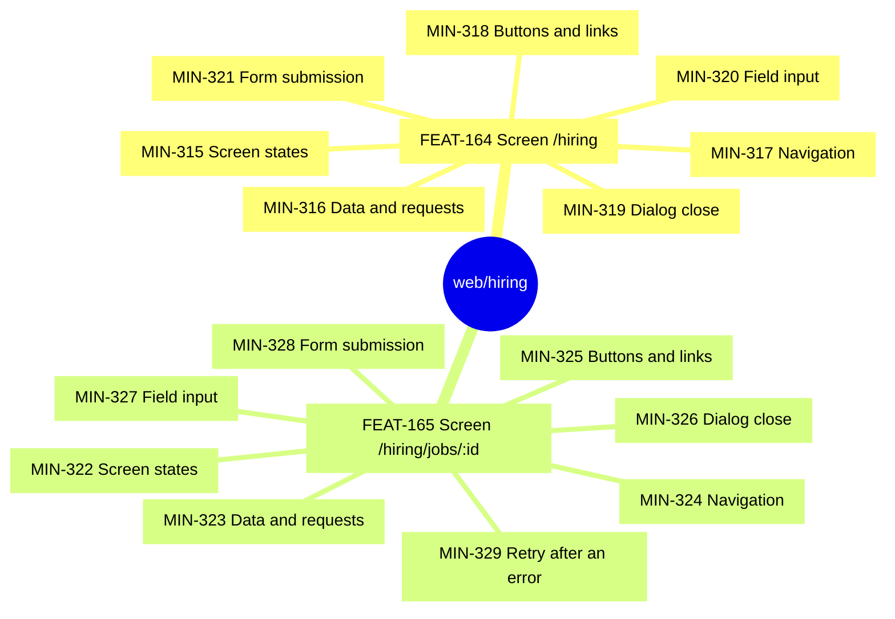

### FEAT-164 Screen /hiring

HiringPage at route /hiring (signed-in only); 8 buttons, 2 forms, 9 inputs; calls 6 endpoint(s).

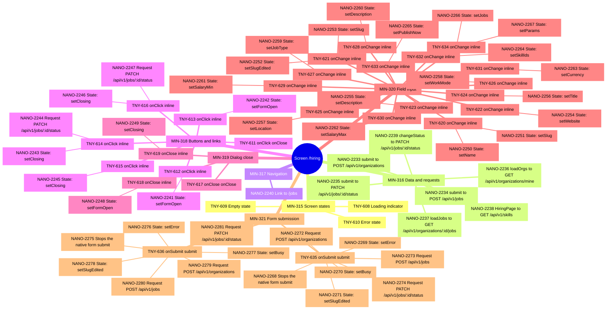

| ID        | Level | Parent   | Name                                           | Description                                                                                                                                                                                        | Status      | Verification | Evidence                              | Related                                         |
| --------- | ----- | -------- | ---------------------------------------------- | -------------------------------------------------------------------------------------------------------------------------------------------------------------------------------------------------- | ----------- | ------------ | ------------------------------------- | ----------------------------------------------- |
| FEAT-164  | MAJOR | MOD-169  | Screen /hiring                                 | HiringPage at route /hiring (signed-in only); 8 buttons, 2 forms, 9 inputs; calls 6 endpoint(s).                                                                                                   | IMPLEMENTED | VERIFIED     | apps/web/src/App.tsx:81               | SCR-025, TEST-178, TEST-192, TEST-197, TEST-204 |
| MIN-315   | MINOR | FEAT-164 | Screen states                                  | Loading, empty and error presentation found in the screen source.                                                                                                                                  | IMPLEMENTED | PATH_LEVEL   | apps/web/src/pages/HiringPage.tsx     |                                                 |
| TNY-608   | TINY  | MIN-315  | Loading indicator                              | Loading indicator rendered by HiringPage (detected in source).                                                                                                                                     | IMPLEMENTED | PATH_LEVEL   | apps/web/src/pages/HiringPage.tsx     |                                                 |
| TNY-609   | TINY  | MIN-315  | Empty state                                    | Empty state rendered by HiringPage (detected in source).                                                                                                                                           | IMPLEMENTED | PATH_LEVEL   | apps/web/src/pages/HiringPage.tsx     |                                                 |
| TNY-610   | TINY  | MIN-315  | Error state                                    | Error state rendered by HiringPage (detected in source).                                                                                                                                           | IMPLEMENTED | PATH_LEVEL   | apps/web/src/pages/HiringPage.tsx     |                                                 |
| MIN-316   | MINOR | FEAT-164 | Data and requests                              | API endpoints this screen calls (6).                                                                                                                                                               | IMPLEMENTED | PATH_LEVEL   | apps/web/src/pages/HiringPage.tsx     |                                                 |
| NANO-2233 | NANO  | MIN-316  | submit -> POST /api/v1/organizations           | submit() at apps/web/src/pages/HiringPage.tsx:86 sends POST /api/v1/organizations.                                                                                                                 | IMPLEMENTED | UNKNOWN      | apps/web/src/pages/HiringPage.tsx:86  | API-026                                         |
| NANO-2234 | NANO  | MIN-316  | submit -> POST /api/v1/jobs                    | submit() at apps/web/src/pages/HiringPage.tsx:218 sends POST /api/v1/jobs.                                                                                                                         | IMPLEMENTED | UNKNOWN      | apps/web/src/pages/HiringPage.tsx:218 | API-031                                         |
| NANO-2235 | NANO  | MIN-316  | submit -> PATCH /api/v1/jobs/:id/status        | submit() at apps/web/src/pages/HiringPage.tsx:237 sends PATCH /api/v1/jobs/:id/status.                                                                                                             | IMPLEMENTED | UNKNOWN      | apps/web/src/pages/HiringPage.tsx:237 | API-034                                         |
| NANO-2236 | NANO  | MIN-316  | loadOrgs -> GET /api/v1/organizations/mine     | loadOrgs() at apps/web/src/pages/HiringPage.tsx:428 sends GET /api/v1/organizations/mine.                                                                                                          | IMPLEMENTED | UNKNOWN      | apps/web/src/pages/HiringPage.tsx:428 | API-027                                         |
| NANO-2237 | NANO  | MIN-316  | loadJobs -> GET /api/v1/organizations/:id/jobs | loadJobs() at apps/web/src/pages/HiringPage.tsx:439 sends GET /api/v1/organizations/:id/jobs.                                                                                                      | IMPLEMENTED | UNKNOWN      | apps/web/src/pages/HiringPage.tsx:439 | API-028                                         |
| NANO-2238 | NANO  | MIN-316  | HiringPage -> GET /api/v1/skills               | HiringPage() at apps/web/src/pages/HiringPage.tsx:448 sends GET /api/v1/skills.                                                                                                                    | IMPLEMENTED | UNKNOWN      | apps/web/src/pages/HiringPage.tsx:448 | API-022                                         |
| NANO-2239 | NANO  | MIN-316  | changeStatus -> PATCH /api/v1/jobs/:id/status  | changeStatus() at apps/web/src/pages/HiringPage.tsx:462 sends PATCH /api/v1/jobs/:id/status.                                                                                                       | IMPLEMENTED | UNKNOWN      | apps/web/src/pages/HiringPage.tsx:462 | API-034                                         |
| MIN-317   | MINOR | FEAT-164 | Navigation                                     | Links from this screen to 1 other screen(s).                                                                                                                                                       | IMPLEMENTED | PATH_LEVEL   | apps/web/src/pages/HiringPage.tsx     |                                                 |
| NANO-2240 | NANO  | MIN-317  | Link to /jobs                                  | Navigates to /jobs (JobsPage).                                                                                                                                                                     | IMPLEMENTED | UNKNOWN      | apps/web/src/pages/HiringPage.tsx     | SCR-007                                         |
| MIN-318   | MINOR | FEAT-164 | Buttons and links                              | 6 'buttons and links' binding(s) in apps/web/src/pages/HiringPage.tsx.                                                                                                                             | IMPLEMENTED | PATH_LEVEL   | apps/web/src/pages/HiringPage.tsx:399 |                                                 |
| TNY-611   | TINY  | MIN-318  | onClick onClose                                | onClick at apps/web/src/pages/HiringPage.tsx:399 runs onClose.                                                                                                                                     | IMPLEMENTED | PATH_LEVEL   | apps/web/src/pages/HiringPage.tsx:399 | INT-133                                         |
| TNY-612   | TINY  | MIN-318  | onClick inline                                 | onClick at apps/web/src/pages/HiringPage.tsx:501 runs inline: () => setFormOpen(true); changes state setFormOpen.                                                                                  | IMPLEMENTED | PATH_LEVEL   | apps/web/src/pages/HiringPage.tsx:501 | INT-134                                         |
| NANO-2241 | NANO  | TNY-612  | State: setFormOpen                             | Updates component state through setFormOpen.                                                                                                                                                       | IMPLEMENTED | UNKNOWN      | apps/web/src/pages/HiringPage.tsx:501 |                                                 |
| TNY-613   | TINY  | MIN-318  | onClick inline                                 | onClick at apps/web/src/pages/HiringPage.tsx:543 runs inline: () => setFormOpen(true); changes state setFormOpen.                                                                                  | IMPLEMENTED | PATH_LEVEL   | apps/web/src/pages/HiringPage.tsx:543 | INT-136                                         |
| NANO-2242 | NANO  | TNY-613  | State: setFormOpen                             | Updates component state through setFormOpen.                                                                                                                                                       | IMPLEMENTED | UNKNOWN      | apps/web/src/pages/HiringPage.tsx:543 |                                                 |
| TNY-614   | TINY  | MIN-318  | onClick inline                                 | onClick at apps/web/src/pages/HiringPage.tsx:607 runs inline: () => a.to === 'closed' ? setClosing(job) : void c; changes state setClosing; calls PATCH /api/v1/jobs/:id/status.                   | IMPLEMENTED | PATH_LEVEL   | apps/web/src/pages/HiringPage.tsx:607 | INT-137                                         |
| NANO-2243 | NANO  | TNY-614  | State: setClosing                              | Updates component state through setClosing.                                                                                                                                                        | IMPLEMENTED | UNKNOWN      | apps/web/src/pages/HiringPage.tsx:607 |                                                 |
| NANO-2244 | NANO  | TNY-614  | Request PATCH /api/v1/jobs/:id/status          | Sends PATCH /api/v1/jobs/:id/status through apiFetch/apiJson (apps/web/src/lib/api.ts).                                                                                                            | IMPLEMENTED | UNKNOWN      | apps/web/src/pages/HiringPage.tsx:607 | API-034                                         |
| TNY-615   | TINY  | MIN-318  | onClick inline                                 | onClick at apps/web/src/pages/HiringPage.tsx:659 runs inline: () => setClosing(null); changes state setClosing.                                                                                    | IMPLEMENTED | PATH_LEVEL   | apps/web/src/pages/HiringPage.tsx:659 | INT-140                                         |
| NANO-2245 | NANO  | TNY-615  | State: setClosing                              | Updates component state through setClosing.                                                                                                                                                        | IMPLEMENTED | UNKNOWN      | apps/web/src/pages/HiringPage.tsx:659 |                                                 |
| TNY-616   | TINY  | MIN-318  | onClick inline                                 | onClick at apps/web/src/pages/HiringPage.tsx:666 runs inline: async () => { if (closing && (await changeStatus(c; changes state setClosing; calls PATCH /api/v1/jobs/:id/status.                   | IMPLEMENTED | PATH_LEVEL   | apps/web/src/pages/HiringPage.tsx:666 | INT-141                                         |
| NANO-2246 | NANO  | TNY-616  | State: setClosing                              | Updates component state through setClosing.                                                                                                                                                        | IMPLEMENTED | UNKNOWN      | apps/web/src/pages/HiringPage.tsx:666 |                                                 |
| NANO-2247 | NANO  | TNY-616  | Request PATCH /api/v1/jobs/:id/status          | Sends PATCH /api/v1/jobs/:id/status through apiFetch/apiJson (apps/web/src/lib/api.ts).                                                                                                            | IMPLEMENTED | UNKNOWN      | apps/web/src/pages/HiringPage.tsx:666 | API-034                                         |
| MIN-319   | MINOR | FEAT-164 | Dialog close                                   | 3 'dialog close' binding(s) in apps/web/src/pages/HiringPage.tsx.                                                                                                                                  | IMPLEMENTED | PATH_LEVEL   | apps/web/src/pages/HiringPage.tsx:258 |                                                 |
| TNY-617   | TINY  | MIN-319  | onClose onClose                                | onClose at apps/web/src/pages/HiringPage.tsx:258 runs onClose.                                                                                                                                     | IMPLEMENTED | PATH_LEVEL   | apps/web/src/pages/HiringPage.tsx:258 | INT-121                                         |
| TNY-618   | TINY  | MIN-319  | onClose inline                                 | onClose at apps/web/src/pages/HiringPage.tsx:638 runs inline: () => setFormOpen(false); changes state setFormOpen.                                                                                 | IMPLEMENTED | PATH_LEVEL   | apps/web/src/pages/HiringPage.tsx:638 | INT-138                                         |
| NANO-2248 | NANO  | TNY-618  | State: setFormOpen                             | Updates component state through setFormOpen.                                                                                                                                                       | IMPLEMENTED | UNKNOWN      | apps/web/src/pages/HiringPage.tsx:638 |                                                 |
| TNY-619   | TINY  | MIN-319  | onClose inline                                 | onClose at apps/web/src/pages/HiringPage.tsx:645 runs inline: () => setClosing(null); changes state setClosing.                                                                                    | IMPLEMENTED | PATH_LEVEL   | apps/web/src/pages/HiringPage.tsx:645 | INT-139                                         |
| NANO-2249 | NANO  | TNY-619  | State: setClosing                              | Updates component state through setClosing.                                                                                                                                                        | IMPLEMENTED | UNKNOWN      | apps/web/src/pages/HiringPage.tsx:645 |                                                 |
| MIN-320   | MINOR | FEAT-164 | Field input                                    | 15 'field input' binding(s) in apps/web/src/pages/HiringPage.tsx.                                                                                                                                  | IMPLEMENTED | PATH_LEVEL   | apps/web/src/pages/HiringPage.tsx:126 |                                                 |
| TNY-620   | TINY  | MIN-320  | onChange inline                                | onChange at apps/web/src/pages/HiringPage.tsx:126 runs inline: (e) => { setName(e.target.value); if (!slugEdited); changes state setName, setSlug.                                                 | IMPLEMENTED | PATH_LEVEL   | apps/web/src/pages/HiringPage.tsx:126 | INT-117                                         |
| NANO-2250 | NANO  | TNY-620  | State: setName                                 | Updates component state through setName.                                                                                                                                                           | IMPLEMENTED | UNKNOWN      | apps/web/src/pages/HiringPage.tsx:126 |                                                 |
| NANO-2251 | NANO  | TNY-620  | State: setSlug                                 | Updates component state through setSlug.                                                                                                                                                           | IMPLEMENTED | UNKNOWN      | apps/web/src/pages/HiringPage.tsx:126 |                                                 |
| TNY-621   | TINY  | MIN-320  | onChange inline                                | onChange at apps/web/src/pages/HiringPage.tsx:137 runs inline: (e) => { setSlugEdited(true); setSlug(slugify(e.ta; changes state setSlugEdited, setSlug.                                           | IMPLEMENTED | PATH_LEVEL   | apps/web/src/pages/HiringPage.tsx:137 | INT-118                                         |
| NANO-2252 | NANO  | TNY-621  | State: setSlugEdited                           | Updates component state through setSlugEdited.                                                                                                                                                     | IMPLEMENTED | UNKNOWN      | apps/web/src/pages/HiringPage.tsx:137 |                                                 |
| NANO-2253 | NANO  | TNY-621  | State: setSlug                                 | Updates component state through setSlug.                                                                                                                                                           | IMPLEMENTED | UNKNOWN      | apps/web/src/pages/HiringPage.tsx:137 |                                                 |
| TNY-622   | TINY  | MIN-320  | onChange inline                                | onChange at apps/web/src/pages/HiringPage.tsx:149 runs inline: (e) => setWebsite(e.target.value); changes state setWebsite.                                                                        | IMPLEMENTED | PATH_LEVEL   | apps/web/src/pages/HiringPage.tsx:149 | INT-119                                         |
| NANO-2254 | NANO  | TNY-622  | State: setWebsite                              | Updates component state through setWebsite.                                                                                                                                                        | IMPLEMENTED | UNKNOWN      | apps/web/src/pages/HiringPage.tsx:149 |                                                 |
| TNY-623   | TINY  | MIN-320  | onChange inline                                | onChange at apps/web/src/pages/HiringPage.tsx:156 runs inline: (e) => setDescription(e.target.value); changes state setDescription.                                                                | IMPLEMENTED | PATH_LEVEL   | apps/web/src/pages/HiringPage.tsx:156 | INT-120                                         |
| NANO-2255 | NANO  | TNY-623  | State: setDescription                          | Updates component state through setDescription.                                                                                                                                                    | IMPLEMENTED | UNKNOWN      | apps/web/src/pages/HiringPage.tsx:156 |                                                 |
| TNY-624   | TINY  | MIN-320  | onChange inline                                | onChange at apps/web/src/pages/HiringPage.tsx:270 runs inline: (e) => setTitle(e.target.value); changes state setTitle.                                                                            | IMPLEMENTED | PATH_LEVEL   | apps/web/src/pages/HiringPage.tsx:270 | INT-123                                         |
| NANO-2256 | NANO  | TNY-624  | State: setTitle                                | Updates component state through setTitle.                                                                                                                                                          | IMPLEMENTED | UNKNOWN      | apps/web/src/pages/HiringPage.tsx:270 |                                                 |
| TNY-625   | TINY  | MIN-320  | onChange inline                                | onChange at apps/web/src/pages/HiringPage.tsx:279 runs inline: (e) => setLocation(e.target.value); changes state setLocation.                                                                      | IMPLEMENTED | PATH_LEVEL   | apps/web/src/pages/HiringPage.tsx:279 | INT-124                                         |
| NANO-2257 | NANO  | TNY-625  | State: setLocation                             | Updates component state through setLocation.                                                                                                                                                       | IMPLEMENTED | UNKNOWN      | apps/web/src/pages/HiringPage.tsx:279 |                                                 |
| TNY-626   | TINY  | MIN-320  | onChange inline                                | onChange at apps/web/src/pages/HiringPage.tsx:293 runs inline: (e) => setWorkMode(e.target.value); changes state setWorkMode.                                                                      | IMPLEMENTED | PATH_LEVEL   | apps/web/src/pages/HiringPage.tsx:293 | INT-125                                         |
| NANO-2258 | NANO  | TNY-626  | State: setWorkMode                             | Updates component state through setWorkMode.                                                                                                                                                       | IMPLEMENTED | UNKNOWN      | apps/web/src/pages/HiringPage.tsx:293 |                                                 |
| TNY-627   | TINY  | MIN-320  | onChange inline                                | onChange at apps/web/src/pages/HiringPage.tsx:300 runs inline: (e) => setJobType(e.target.value); changes state setJobType.                                                                        | IMPLEMENTED | PATH_LEVEL   | apps/web/src/pages/HiringPage.tsx:300 | INT-126                                         |
| NANO-2259 | NANO  | TNY-627  | State: setJobType                              | Updates component state through setJobType.                                                                                                                                                        | IMPLEMENTED | UNKNOWN      | apps/web/src/pages/HiringPage.tsx:300 |                                                 |
| TNY-628   | TINY  | MIN-320  | onChange inline                                | onChange at apps/web/src/pages/HiringPage.tsx:312 runs inline: (e) => setDescription(e.target.value); changes state setDescription.                                                                | IMPLEMENTED | PATH_LEVEL   | apps/web/src/pages/HiringPage.tsx:312 | INT-127                                         |
| NANO-2260 | NANO  | TNY-628  | State: setDescription                          | Updates component state through setDescription.                                                                                                                                                    | IMPLEMENTED | UNKNOWN      | apps/web/src/pages/HiringPage.tsx:312 |                                                 |
| TNY-629   | TINY  | MIN-320  | onChange inline                                | onChange at apps/web/src/pages/HiringPage.tsx:333 runs inline: (e) => setSalaryMin(e.target.value); changes state setSalaryMin.                                                                    | IMPLEMENTED | PATH_LEVEL   | apps/web/src/pages/HiringPage.tsx:333 | INT-128                                         |
| NANO-2261 | NANO  | TNY-629  | State: setSalaryMin                            | Updates component state through setSalaryMin.                                                                                                                                                      | IMPLEMENTED | UNKNOWN      | apps/web/src/pages/HiringPage.tsx:333 |                                                 |
| TNY-630   | TINY  | MIN-320  | onChange inline                                | onChange at apps/web/src/pages/HiringPage.tsx:342 runs inline: (e) => setSalaryMax(e.target.value); changes state setSalaryMax.                                                                    | IMPLEMENTED | PATH_LEVEL   | apps/web/src/pages/HiringPage.tsx:342 | INT-129                                         |
| NANO-2262 | NANO  | TNY-630  | State: setSalaryMax                            | Updates component state through setSalaryMax.                                                                                                                                                      | IMPLEMENTED | UNKNOWN      | apps/web/src/pages/HiringPage.tsx:342 |                                                 |
| TNY-631   | TINY  | MIN-320  | onChange inline                                | onChange at apps/web/src/pages/HiringPage.tsx:348 runs inline: (e) => setCurrency(e.target.value); changes state setCurrency.                                                                      | IMPLEMENTED | PATH_LEVEL   | apps/web/src/pages/HiringPage.tsx:348 | INT-130                                         |
| NANO-2263 | NANO  | TNY-631  | State: setCurrency                             | Updates component state through setCurrency.                                                                                                                                                       | IMPLEMENTED | UNKNOWN      | apps/web/src/pages/HiringPage.tsx:348 |                                                 |
| TNY-632   | TINY  | MIN-320  | onChange inline                                | onChange at apps/web/src/pages/HiringPage.tsx:367 runs inline: (e) => setSkillIds((current) => e.target.checked ?; changes state setSkillIds.                                                      | IMPLEMENTED | PATH_LEVEL   | apps/web/src/pages/HiringPage.tsx:367 | INT-131                                         |
| NANO-2264 | NANO  | TNY-632  | State: setSkillIds                             | Updates component state through setSkillIds.                                                                                                                                                       | IMPLEMENTED | UNKNOWN      | apps/web/src/pages/HiringPage.tsx:367 |                                                 |
| TNY-633   | TINY  | MIN-320  | onChange inline                                | onChange at apps/web/src/pages/HiringPage.tsx:393 runs inline: (e) => setPublishNow(e.target.checked); changes state setPublishNow.                                                                | IMPLEMENTED | PATH_LEVEL   | apps/web/src/pages/HiringPage.tsx:393 | INT-132                                         |
| NANO-2265 | NANO  | TNY-633  | State: setPublishNow                           | Updates component state through setPublishNow.                                                                                                                                                     | IMPLEMENTED | UNKNOWN      | apps/web/src/pages/HiringPage.tsx:393 |                                                 |
| TNY-634   | TINY  | MIN-320  | onChange inline                                | onChange at apps/web/src/pages/HiringPage.tsx:513 runs inline: (e) => { setJobs(null); setParams({ org: e.target.; changes state setJobs, setParams.                                               | IMPLEMENTED | PATH_LEVEL   | apps/web/src/pages/HiringPage.tsx:513 | INT-135                                         |
| NANO-2266 | NANO  | TNY-634  | State: setJobs                                 | Updates component state through setJobs.                                                                                                                                                           | IMPLEMENTED | UNKNOWN      | apps/web/src/pages/HiringPage.tsx:513 |                                                 |
| NANO-2267 | NANO  | TNY-634  | State: setParams                               | Updates component state through setParams.                                                                                                                                                         | IMPLEMENTED | UNKNOWN      | apps/web/src/pages/HiringPage.tsx:513 |                                                 |
| MIN-321   | MINOR | FEAT-164 | Form submission                                | 2 'form submission' binding(s) in apps/web/src/pages/HiringPage.tsx.                                                                                                                               | IMPLEMENTED | PATH_LEVEL   | apps/web/src/pages/HiringPage.tsx:120 |                                                 |
| TNY-635   | TINY  | MIN-321  | onSubmit submit                                | onSubmit at apps/web/src/pages/HiringPage.tsx:120 runs submit; changes state setError, setBusy, setSlugEdited; calls POST /api/v1/organizations, POST /api/v1/jobs, PATCH /api/v1/jobs/:id/status. | IMPLEMENTED | PATH_LEVEL   | apps/web/src/pages/HiringPage.tsx:120 | INT-116                                         |
| NANO-2268 | NANO  | TNY-635  | Stops the native form submit                   | Calls event.preventDefault() so the page does not reload.                                                                                                                                          | IMPLEMENTED | UNKNOWN      | apps/web/src/pages/HiringPage.tsx:75  |                                                 |
| NANO-2269 | NANO  | TNY-635  | State: setError                                | Updates component state through setError.                                                                                                                                                          | IMPLEMENTED | UNKNOWN      | apps/web/src/pages/HiringPage.tsx:75  |                                                 |
| NANO-2270 | NANO  | TNY-635  | State: setBusy                                 | Updates component state through setBusy.                                                                                                                                                           | IMPLEMENTED | UNKNOWN      | apps/web/src/pages/HiringPage.tsx:75  |                                                 |
| NANO-2271 | NANO  | TNY-635  | State: setSlugEdited                           | Updates component state through setSlugEdited.                                                                                                                                                     | IMPLEMENTED | UNKNOWN      | apps/web/src/pages/HiringPage.tsx:75  |                                                 |
| NANO-2272 | NANO  | TNY-635  | Request POST /api/v1/organizations             | Sends POST /api/v1/organizations through apiFetch/apiJson (apps/web/src/lib/api.ts).                                                                                                               | IMPLEMENTED | UNKNOWN      | apps/web/src/pages/HiringPage.tsx:75  | API-026                                         |
| NANO-2273 | NANO  | TNY-635  | Request POST /api/v1/jobs                      | Sends POST /api/v1/jobs through apiFetch/apiJson (apps/web/src/lib/api.ts).                                                                                                                        | IMPLEMENTED | UNKNOWN      | apps/web/src/pages/HiringPage.tsx:75  | API-031                                         |
| NANO-2274 | NANO  | TNY-635  | Request PATCH /api/v1/jobs/:id/status          | Sends PATCH /api/v1/jobs/:id/status through apiFetch/apiJson (apps/web/src/lib/api.ts).                                                                                                            | IMPLEMENTED | UNKNOWN      | apps/web/src/pages/HiringPage.tsx:75  | API-034                                         |
| TNY-636   | TINY  | MIN-321  | onSubmit submit                                | onSubmit at apps/web/src/pages/HiringPage.tsx:264 runs submit; changes state setError, setBusy, setSlugEdited; calls POST /api/v1/organizations, POST /api/v1/jobs, PATCH /api/v1/jobs/:id/status. | IMPLEMENTED | PATH_LEVEL   | apps/web/src/pages/HiringPage.tsx:264 | INT-122                                         |
| NANO-2275 | NANO  | TNY-636  | Stops the native form submit                   | Calls event.preventDefault() so the page does not reload.                                                                                                                                          | IMPLEMENTED | UNKNOWN      | apps/web/src/pages/HiringPage.tsx:75  |                                                 |
| NANO-2276 | NANO  | TNY-636  | State: setError                                | Updates component state through setError.                                                                                                                                                          | IMPLEMENTED | UNKNOWN      | apps/web/src/pages/HiringPage.tsx:75  |                                                 |
| NANO-2277 | NANO  | TNY-636  | State: setBusy                                 | Updates component state through setBusy.                                                                                                                                                           | IMPLEMENTED | UNKNOWN      | apps/web/src/pages/HiringPage.tsx:75  |                                                 |
| NANO-2278 | NANO  | TNY-636  | State: setSlugEdited                           | Updates component state through setSlugEdited.                                                                                                                                                     | IMPLEMENTED | UNKNOWN      | apps/web/src/pages/HiringPage.tsx:75  |                                                 |
| NANO-2279 | NANO  | TNY-636  | Request POST /api/v1/organizations             | Sends POST /api/v1/organizations through apiFetch/apiJson (apps/web/src/lib/api.ts).                                                                                                               | IMPLEMENTED | UNKNOWN      | apps/web/src/pages/HiringPage.tsx:75  | API-026                                         |
| NANO-2280 | NANO  | TNY-636  | Request POST /api/v1/jobs                      | Sends POST /api/v1/jobs through apiFetch/apiJson (apps/web/src/lib/api.ts).                                                                                                                        | IMPLEMENTED | UNKNOWN      | apps/web/src/pages/HiringPage.tsx:75  | API-031                                         |
| NANO-2281 | NANO  | TNY-636  | Request PATCH /api/v1/jobs/:id/status          | Sends PATCH /api/v1/jobs/:id/status through apiFetch/apiJson (apps/web/src/lib/api.ts).                                                                                                            | IMPLEMENTED | UNKNOWN      | apps/web/src/pages/HiringPage.tsx:75  | API-034                                         |

### FEAT-165 Screen /hiring/jobs/:id

HiringJobPage at route /hiring/jobs/:id (signed-in only); 12 buttons, 1 forms, 0 inputs; calls 5 endpoint(s).

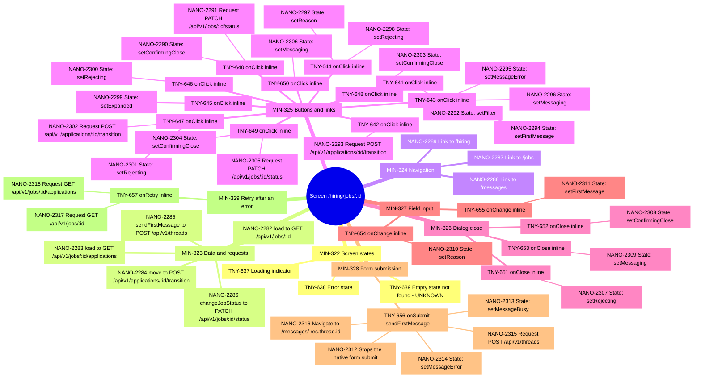

| ID        | Level | Parent   | Name                                             | Description                                                                                                                                                                                      | Status      | Verification | Evidence                                 | Related                     |
| --------- | ----- | -------- | ------------------------------------------------ | ------------------------------------------------------------------------------------------------------------------------------------------------------------------------------------------------ | ----------- | ------------ | ---------------------------------------- | --------------------------- |
| FEAT-165  | MAJOR | MOD-169  | Screen /hiring/jobs/:id                          | HiringJobPage at route /hiring/jobs/:id (signed-in only); 12 buttons, 1 forms, 0 inputs; calls 5 endpoint(s).                                                                                    | IMPLEMENTED | VERIFIED     | apps/web/src/App.tsx:82                  | SCR-026, TEST-192, TEST-204 |
| MIN-322   | MINOR | FEAT-165 | Screen states                                    | Loading, empty and error presentation found in the screen source; not found: Empty state.                                                                                                        | IMPLEMENTED | PATH_LEVEL   | apps/web/src/pages/HiringJobPage.tsx     |                             |
| TNY-637   | TINY  | MIN-322  | Loading indicator                                | Loading indicator rendered by HiringJobPage (detected in source).                                                                                                                                | IMPLEMENTED | PATH_LEVEL   | apps/web/src/pages/HiringJobPage.tsx     |                             |
| TNY-638   | TINY  | MIN-322  | Error state                                      | Error state rendered by HiringJobPage (detected in source).                                                                                                                                      | IMPLEMENTED | PATH_LEVEL   | apps/web/src/pages/HiringJobPage.tsx     |                             |
| TNY-639   | TINY  | MIN-322  | Empty state (not found)                          | No empty state pattern was detected in apps/web/src/pages/HiringJobPage.tsx although the screen calls the API. May be handled by a shared component; confirm before treating as a gap.           | UNKNOWN     | UNKNOWN      | apps/web/src/pages/HiringJobPage.tsx     |                             |
| MIN-323   | MINOR | FEAT-165 | Data and requests                                | API endpoints this screen calls (5).                                                                                                                                                             | IMPLEMENTED | PATH_LEVEL   | apps/web/src/pages/HiringJobPage.tsx     |                             |
| NANO-2282 | NANO  | MIN-323  | load -> GET /api/v1/jobs/:id                     | load() at apps/web/src/pages/HiringJobPage.tsx:76 sends GET /api/v1/jobs/:id.                                                                                                                    | IMPLEMENTED | UNKNOWN      | apps/web/src/pages/HiringJobPage.tsx:76  | API-033                     |
| NANO-2283 | NANO  | MIN-323  | load -> GET /api/v1/jobs/:id/applications        | load() at apps/web/src/pages/HiringJobPage.tsx:78 sends GET /api/v1/jobs/:id/applications.                                                                                                       | IMPLEMENTED | UNKNOWN      | apps/web/src/pages/HiringJobPage.tsx:78  | API-050                     |
| NANO-2284 | NANO  | MIN-323  | move -> POST /api/v1/applications/:id/transition | move() at apps/web/src/pages/HiringJobPage.tsx:102 sends POST /api/v1/applications/:id/transition.                                                                                               | IMPLEMENTED | UNKNOWN      | apps/web/src/pages/HiringJobPage.tsx:102 | API-051                     |
| NANO-2285 | NANO  | MIN-323  | sendFirstMessage -> POST /api/v1/threads         | sendFirstMessage() at apps/web/src/pages/HiringJobPage.tsx:131 sends POST /api/v1/threads.                                                                                                       | IMPLEMENTED | UNKNOWN      | apps/web/src/pages/HiringJobPage.tsx:131 | API-113                     |
| NANO-2286 | NANO  | MIN-323  | changeJobStatus -> PATCH /api/v1/jobs/:id/status | changeJobStatus() at apps/web/src/pages/HiringJobPage.tsx:152 sends PATCH /api/v1/jobs/:id/status.                                                                                               | IMPLEMENTED | UNKNOWN      | apps/web/src/pages/HiringJobPage.tsx:152 | API-034                     |
| MIN-324   | MINOR | FEAT-165 | Navigation                                       | Links from this screen to 3 other screen(s).                                                                                                                                                     | IMPLEMENTED | PATH_LEVEL   | apps/web/src/pages/HiringJobPage.tsx     |                             |
| NANO-2287 | NANO  | MIN-324  | Link to /jobs                                    | Navigates to /jobs (JobsPage).                                                                                                                                                                   | IMPLEMENTED | UNKNOWN      | apps/web/src/pages/HiringJobPage.tsx     | SCR-007                     |
| NANO-2288 | NANO  | MIN-324  | Link to /messages                                | Navigates to /messages (MessagesPage).                                                                                                                                                           | IMPLEMENTED | UNKNOWN      | apps/web/src/pages/HiringJobPage.tsx     | SCR-023                     |
| NANO-2289 | NANO  | MIN-324  | Link to /hiring                                  | Navigates to /hiring (HiringPage).                                                                                                                                                               | IMPLEMENTED | UNKNOWN      | apps/web/src/pages/HiringJobPage.tsx     | SCR-025                     |
| MIN-325   | MINOR | FEAT-165 | Buttons and links                                | 11 'buttons and links' binding(s) in apps/web/src/pages/HiringJobPage.tsx.                                                                                                                       | IMPLEMENTED | PATH_LEVEL   | apps/web/src/pages/HiringJobPage.tsx:212 |                             |
| TNY-640   | TINY  | MIN-325  | onClick inline                                   | onClick at apps/web/src/pages/HiringJobPage.tsx:212 runs inline: () => a.to === 'closed' ? setConfirmingClose(true); changes state setConfirmingClose; calls PATCH /api/v1/jobs/:id/status.      | IMPLEMENTED | PATH_LEVEL   | apps/web/src/pages/HiringJobPage.tsx:212 | INT-099                     |
| NANO-2290 | NANO  | TNY-640  | State: setConfirmingClose                        | Updates component state through setConfirmingClose.                                                                                                                                              | IMPLEMENTED | UNKNOWN      | apps/web/src/pages/HiringJobPage.tsx:212 |                             |
| NANO-2291 | NANO  | TNY-640  | Request PATCH /api/v1/jobs/:id/status            | Sends PATCH /api/v1/jobs/:id/status through apiFetch/apiJson (apps/web/src/lib/api.ts).                                                                                                          | IMPLEMENTED | UNKNOWN      | apps/web/src/pages/HiringJobPage.tsx:212 | API-034                     |
| TNY-641   | TINY  | MIN-325  | onClick inline                                   | onClick at apps/web/src/pages/HiringJobPage.tsx:243 runs inline: () => setFilter(f.key); changes state setFilter.                                                                                | IMPLEMENTED | PATH_LEVEL   | apps/web/src/pages/HiringJobPage.tsx:243 | INT-100                     |
| NANO-2292 | NANO  | TNY-641  | State: setFilter                                 | Updates component state through setFilter.                                                                                                                                                       | IMPLEMENTED | UNKNOWN      | apps/web/src/pages/HiringJobPage.tsx:243 |                             |
| TNY-642   | TINY  | MIN-325  | onClick inline                                   | onClick at apps/web/src/pages/HiringJobPage.tsx:354 runs inline: () => void move(applicant, stage.to); calls POST /api/v1/applications/:id/transition.                                           | IMPLEMENTED | PATH_LEVEL   | apps/web/src/pages/HiringJobPage.tsx:354 | INT-101                     |
| NANO-2293 | NANO  | TNY-642  | Request POST /api/v1/applications/:id/transition | Sends POST /api/v1/applications/:id/transition through apiFetch/apiJson (apps/web/src/lib/api.ts).                                                                                               | IMPLEMENTED | UNKNOWN      | apps/web/src/pages/HiringJobPage.tsx:354 | API-051                     |
| TNY-643   | TINY  | MIN-325  | onClick inline                                   | onClick at apps/web/src/pages/HiringJobPage.tsx:363 runs inline: () => { setFirstMessage(''); setMessageError(null); changes state setFirstMessage, setMessageError, setMessaging.               | IMPLEMENTED | PATH_LEVEL   | apps/web/src/pages/HiringJobPage.tsx:363 | INT-102                     |
| NANO-2294 | NANO  | TNY-643  | State: setFirstMessage                           | Updates component state through setFirstMessage.                                                                                                                                                 | IMPLEMENTED | UNKNOWN      | apps/web/src/pages/HiringJobPage.tsx:363 |                             |
| NANO-2295 | NANO  | TNY-643  | State: setMessageError                           | Updates component state through setMessageError.                                                                                                                                                 | IMPLEMENTED | UNKNOWN      | apps/web/src/pages/HiringJobPage.tsx:363 |                             |
| NANO-2296 | NANO  | TNY-643  | State: setMessaging                              | Updates component state through setMessaging.                                                                                                                                                    | IMPLEMENTED | UNKNOWN      | apps/web/src/pages/HiringJobPage.tsx:363 |                             |
| TNY-644   | TINY  | MIN-325  | onClick inline                                   | onClick at apps/web/src/pages/HiringJobPage.tsx:378 runs inline: () => { setReason(''); setRejecting(applicant); }; changes state setReason, setRejecting.                                       | IMPLEMENTED | PATH_LEVEL   | apps/web/src/pages/HiringJobPage.tsx:378 | INT-103                     |
| NANO-2297 | NANO  | TNY-644  | State: setReason                                 | Updates component state through setReason.                                                                                                                                                       | IMPLEMENTED | UNKNOWN      | apps/web/src/pages/HiringJobPage.tsx:378 |                             |
| NANO-2298 | NANO  | TNY-644  | State: setRejecting                              | Updates component state through setRejecting.                                                                                                                                                    | IMPLEMENTED | UNKNOWN      | apps/web/src/pages/HiringJobPage.tsx:378 |                             |
| TNY-645   | TINY  | MIN-325  | onClick inline                                   | onClick at apps/web/src/pages/HiringJobPage.tsx:394 runs inline: () => setExpanded(isOpen ? null : applicant.id); changes state setExpanded.                                                     | IMPLEMENTED | PATH_LEVEL   | apps/web/src/pages/HiringJobPage.tsx:394 | INT-104                     |
| NANO-2299 | NANO  | TNY-645  | State: setExpanded                               | Updates component state through setExpanded.                                                                                                                                                     | IMPLEMENTED | UNKNOWN      | apps/web/src/pages/HiringJobPage.tsx:394 |                             |
| TNY-646   | TINY  | MIN-325  | onClick inline                                   | onClick at apps/web/src/pages/HiringJobPage.tsx:475 runs inline: () => setRejecting(null); changes state setRejecting.                                                                           | IMPLEMENTED | PATH_LEVEL   | apps/web/src/pages/HiringJobPage.tsx:475 | INT-107                     |
| NANO-2300 | NANO  | TNY-646  | State: setRejecting                              | Updates component state through setRejecting.                                                                                                                                                    | IMPLEMENTED | UNKNOWN      | apps/web/src/pages/HiringJobPage.tsx:475 |                             |
| TNY-647   | TINY  | MIN-325  | onClick inline                                   | onClick at apps/web/src/pages/HiringJobPage.tsx:481 runs inline: async () => { if (!rejecting) return; const ok = a; changes state setRejecting; calls POST /api/v1/applications/:id/transition. | IMPLEMENTED | PATH_LEVEL   | apps/web/src/pages/HiringJobPage.tsx:481 | INT-108                     |
| NANO-2301 | NANO  | TNY-647  | State: setRejecting                              | Updates component state through setRejecting.                                                                                                                                                    | IMPLEMENTED | UNKNOWN      | apps/web/src/pages/HiringJobPage.tsx:481 |                             |
| NANO-2302 | NANO  | TNY-647  | Request POST /api/v1/applications/:id/transition | Sends POST /api/v1/applications/:id/transition through apiFetch/apiJson (apps/web/src/lib/api.ts).                                                                                               | IMPLEMENTED | UNKNOWN      | apps/web/src/pages/HiringJobPage.tsx:481 | API-051                     |
| TNY-648   | TINY  | MIN-325  | onClick inline                                   | onClick at apps/web/src/pages/HiringJobPage.tsx:508 runs inline: () => setConfirmingClose(false); changes state setConfirmingClose.                                                              | IMPLEMENTED | PATH_LEVEL   | apps/web/src/pages/HiringJobPage.tsx:508 | INT-110                     |
| NANO-2303 | NANO  | TNY-648  | State: setConfirmingClose                        | Updates component state through setConfirmingClose.                                                                                                                                              | IMPLEMENTED | UNKNOWN      | apps/web/src/pages/HiringJobPage.tsx:508 |                             |
| TNY-649   | TINY  | MIN-325  | onClick inline                                   | onClick at apps/web/src/pages/HiringJobPage.tsx:515 runs inline: async () => { if (await changeJobStatus('closed')); changes state setConfirmingClose; calls PATCH /api/v1/jobs/:id/status.      | IMPLEMENTED | PATH_LEVEL   | apps/web/src/pages/HiringJobPage.tsx:515 | INT-111                     |
| NANO-2304 | NANO  | TNY-649  | State: setConfirmingClose                        | Updates component state through setConfirmingClose.                                                                                                                                              | IMPLEMENTED | UNKNOWN      | apps/web/src/pages/HiringJobPage.tsx:515 |                             |
| NANO-2305 | NANO  | TNY-649  | Request PATCH /api/v1/jobs/:id/status            | Sends PATCH /api/v1/jobs/:id/status through apiFetch/apiJson (apps/web/src/lib/api.ts).                                                                                                          | IMPLEMENTED | UNKNOWN      | apps/web/src/pages/HiringJobPage.tsx:515 | API-034                     |
| TNY-650   | TINY  | MIN-325  | onClick inline                                   | onClick at apps/web/src/pages/HiringJobPage.tsx:555 runs inline: () => setMessaging(null); changes state setMessaging.                                                                           | IMPLEMENTED | PATH_LEVEL   | apps/web/src/pages/HiringJobPage.tsx:555 | INT-115                     |
| NANO-2306 | NANO  | TNY-650  | State: setMessaging                              | Updates component state through setMessaging.                                                                                                                                                    | IMPLEMENTED | UNKNOWN      | apps/web/src/pages/HiringJobPage.tsx:555 |                             |
| MIN-326   | MINOR | FEAT-165 | Dialog close                                     | 3 'dialog close' binding(s) in apps/web/src/pages/HiringJobPage.tsx.                                                                                                                             | IMPLEMENTED | PATH_LEVEL   | apps/web/src/pages/HiringJobPage.tsx:456 |                             |
| TNY-651   | TINY  | MIN-326  | onClose inline                                   | onClose at apps/web/src/pages/HiringJobPage.tsx:456 runs inline: () => setRejecting(null); changes state setRejecting.                                                                           | IMPLEMENTED | PATH_LEVEL   | apps/web/src/pages/HiringJobPage.tsx:456 | INT-105                     |
| NANO-2307 | NANO  | TNY-651  | State: setRejecting                              | Updates component state through setRejecting.                                                                                                                                                    | IMPLEMENTED | UNKNOWN      | apps/web/src/pages/HiringJobPage.tsx:456 |                             |
| TNY-652   | TINY  | MIN-326  | onClose inline                                   | onClose at apps/web/src/pages/HiringJobPage.tsx:494 runs inline: () => setConfirmingClose(false); changes state setConfirmingClose.                                                              | IMPLEMENTED | PATH_LEVEL   | apps/web/src/pages/HiringJobPage.tsx:494 | INT-109                     |
| NANO-2308 | NANO  | TNY-652  | State: setConfirmingClose                        | Updates component state through setConfirmingClose.                                                                                                                                              | IMPLEMENTED | UNKNOWN      | apps/web/src/pages/HiringJobPage.tsx:494 |                             |
| TNY-653   | TINY  | MIN-326  | onClose inline                                   | onClose at apps/web/src/pages/HiringJobPage.tsx:526 runs inline: () => setMessaging(null); changes state setMessaging.                                                                           | IMPLEMENTED | PATH_LEVEL   | apps/web/src/pages/HiringJobPage.tsx:526 | INT-112                     |
| NANO-2309 | NANO  | TNY-653  | State: setMessaging                              | Updates component state through setMessaging.                                                                                                                                                    | IMPLEMENTED | UNKNOWN      | apps/web/src/pages/HiringJobPage.tsx:526 |                             |
| MIN-327   | MINOR | FEAT-165 | Field input                                      | 2 'field input' binding(s) in apps/web/src/pages/HiringJobPage.tsx.                                                                                                                              | IMPLEMENTED | PATH_LEVEL   | apps/web/src/pages/HiringJobPage.tsx:472 |                             |
| TNY-654   | TINY  | MIN-327  | onChange inline                                  | onChange at apps/web/src/pages/HiringJobPage.tsx:472 runs inline: (e) => setReason(e.target.value); changes state setReason.                                                                     | IMPLEMENTED | PATH_LEVEL   | apps/web/src/pages/HiringJobPage.tsx:472 | INT-106                     |
| NANO-2310 | NANO  | TNY-654  | State: setReason                                 | Updates component state through setReason.                                                                                                                                                       | IMPLEMENTED | UNKNOWN      | apps/web/src/pages/HiringJobPage.tsx:472 |                             |
| TNY-655   | TINY  | MIN-327  | onChange inline                                  | onChange at apps/web/src/pages/HiringJobPage.tsx:547 runs inline: (e) => setFirstMessage(e.target.value); changes state setFirstMessage.                                                         | IMPLEMENTED | PATH_LEVEL   | apps/web/src/pages/HiringJobPage.tsx:547 | INT-114                     |
| NANO-2311 | NANO  | TNY-655  | State: setFirstMessage                           | Updates component state through setFirstMessage.                                                                                                                                                 | IMPLEMENTED | UNKNOWN      | apps/web/src/pages/HiringJobPage.tsx:547 |                             |
| MIN-328   | MINOR | FEAT-165 | Form submission                                  | 1 'form submission' binding(s) in apps/web/src/pages/HiringJobPage.tsx.                                                                                                                          | IMPLEMENTED | PATH_LEVEL   | apps/web/src/pages/HiringJobPage.tsx:531 |                             |
| TNY-656   | TINY  | MIN-328  | onSubmit sendFirstMessage                        | onSubmit at apps/web/src/pages/HiringJobPage.tsx:531 runs sendFirstMessage; changes state setMessageBusy, setMessageError; calls POST /api/v1/threads; navigates to /messages/${res.thread.id}.  | IMPLEMENTED | PATH_LEVEL   | apps/web/src/pages/HiringJobPage.tsx:531 | INT-113                     |
| NANO-2312 | NANO  | TNY-656  | Stops the native form submit                     | Calls event.preventDefault() so the page does not reload.                                                                                                                                        | IMPLEMENTED | UNKNOWN      | apps/web/src/pages/HiringJobPage.tsx:124 |                             |
| NANO-2313 | NANO  | TNY-656  | State: setMessageBusy                            | Updates component state through setMessageBusy.                                                                                                                                                  | IMPLEMENTED | UNKNOWN      | apps/web/src/pages/HiringJobPage.tsx:124 |                             |
| NANO-2314 | NANO  | TNY-656  | State: setMessageError                           | Updates component state through setMessageError.                                                                                                                                                 | IMPLEMENTED | UNKNOWN      | apps/web/src/pages/HiringJobPage.tsx:124 |                             |
| NANO-2315 | NANO  | TNY-656  | Request POST /api/v1/threads                     | Sends POST /api/v1/threads through apiFetch/apiJson (apps/web/src/lib/api.ts).                                                                                                                   | IMPLEMENTED | UNKNOWN      | apps/web/src/pages/HiringJobPage.tsx:124 | API-113                     |
| NANO-2316 | NANO  | TNY-656  | Navigate to /messages/${res.thread.id}           | Calls navigate(/messages/${res.thread.id}).                                                                                                                                                      | IMPLEMENTED | UNKNOWN      | apps/web/src/pages/HiringJobPage.tsx:124 |                             |
| MIN-329   | MINOR | FEAT-165 | Retry after an error                             | 1 'retry after an error' binding(s) in apps/web/src/pages/HiringJobPage.tsx.                                                                                                                     | IMPLEMENTED | PATH_LEVEL   | apps/web/src/pages/HiringJobPage.tsx:173 |                             |
| TNY-657   | TINY  | MIN-329  | onRetry inline                                   | onRetry at apps/web/src/pages/HiringJobPage.tsx:173 runs inline: () => void load(); calls GET /api/v1/jobs/:id, GET /api/v1/jobs/:id/applications.                                               | IMPLEMENTED | PATH_LEVEL   | apps/web/src/pages/HiringJobPage.tsx:173 | INT-098                     |
| NANO-2317 | NANO  | TNY-657  | Request GET /api/v1/jobs/:id                     | Sends GET /api/v1/jobs/:id through apiFetch/apiJson (apps/web/src/lib/api.ts).                                                                                                                   | IMPLEMENTED | UNKNOWN      | apps/web/src/pages/HiringJobPage.tsx:173 | API-033                     |
| NANO-2318 | NANO  | TNY-657  | Request GET /api/v1/jobs/:id/applications        | Sends GET /api/v1/jobs/:id/applications through apiFetch/apiJson (apps/web/src/lib/api.ts).                                                                                                      | IMPLEMENTED | UNKNOWN      | apps/web/src/pages/HiringJobPage.tsx:173 | API-050                     |

## web/jobs (MOD-170)

**Application:** apps/web (MOD-002). **Purpose:** Routed screens under /jobs in apps/web/src/App.tsx.

**Nodes by level:** MODULE 1, MAJOR 2, MINOR 9, TINY 11, NANO 20. **Status:** IMPLEMENTED 42, UNKNOWN 1. **Verification:** PATH_LEVEL 19, UNKNOWN 22, VERIFIED 2.

### Module map (to minor features)

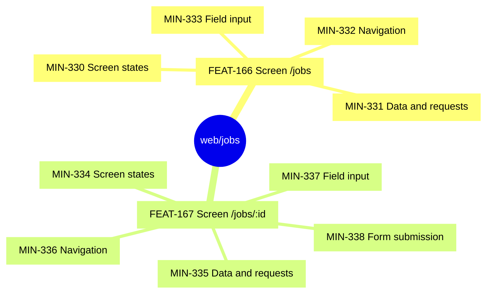

### FEAT-166 Screen /jobs

JobsPage at route /jobs (public); 0 buttons, 0 forms, 1 inputs; calls 2 endpoint(s).

```mermaid
mindmap
  root((Screen /jobs))
    MIN_330[MIN-330 Screen states]
      TNY_658[TNY-658 Loading indicator]
      TNY_659[TNY-659 Empty state]
      TNY_660[TNY-660 Error state]
    MIN_331[MIN-331 Data and requests]
      NANO_2319[NANO-2319 JobsPage to GET /api/v1/jobs]
      NANO_2320[NANO-2320 JobsPage to GET /api/v1/applications/my]
    MIN_332[MIN-332 Navigation]
      NANO_2321[NANO-2321 Link to /jobs]
    MIN_333[MIN-333 Field input]
      TNY_661[TNY-661 onChange inline]
        NANO_2322[NANO-2322 State: setQuery]
      TNY_662[TNY-662 onChange inline]
        NANO_2323[NANO-2323 State: setWorkMode]
```

| ID        | Level | Parent   | Name                                    | Description                                                                                                                 | Status      | Verification | Evidence                            | Related                                                       |
| --------- | ----- | -------- | --------------------------------------- | --------------------------------------------------------------------------------------------------------------------------- | ----------- | ------------ | ----------------------------------- | ------------------------------------------------------------- |
| FEAT-166  | MAJOR | MOD-170  | Screen /jobs                            | JobsPage at route /jobs (public); 0 buttons, 0 forms, 1 inputs; calls 2 endpoint(s).                                        | IMPLEMENTED | VERIFIED     | apps/web/src/App.tsx:62             | SCR-007, TEST-162, TEST-167, TEST-178, TEST-194, TEST-195 ... |
| MIN-330   | MINOR | FEAT-166 | Screen states                           | Loading, empty and error presentation found in the screen source.                                                           | IMPLEMENTED | PATH_LEVEL   | apps/web/src/pages/JobsPage.tsx     |                                                               |
| TNY-658   | TINY  | MIN-330  | Loading indicator                       | Loading indicator rendered by JobsPage (detected in source).                                                                | IMPLEMENTED | PATH_LEVEL   | apps/web/src/pages/JobsPage.tsx     |                                                               |
| TNY-659   | TINY  | MIN-330  | Empty state                             | Empty state rendered by JobsPage (detected in source).                                                                      | IMPLEMENTED | PATH_LEVEL   | apps/web/src/pages/JobsPage.tsx     |                                                               |
| TNY-660   | TINY  | MIN-330  | Error state                             | Error state rendered by JobsPage (detected in source).                                                                      | IMPLEMENTED | PATH_LEVEL   | apps/web/src/pages/JobsPage.tsx     |                                                               |
| MIN-331   | MINOR | FEAT-166 | Data and requests                       | API endpoints this screen calls (2).                                                                                        | IMPLEMENTED | PATH_LEVEL   | apps/web/src/pages/JobsPage.tsx     |                                                               |
| NANO-2319 | NANO  | MIN-331  | JobsPage -> GET /api/v1/jobs            | JobsPage() at apps/web/src/pages/JobsPage.tsx:38 sends GET /api/v1/jobs.                                                    | IMPLEMENTED | UNKNOWN      | apps/web/src/pages/JobsPage.tsx:38  | API-032                                                       |
| NANO-2320 | NANO  | MIN-331  | JobsPage -> GET /api/v1/applications/my | JobsPage() at apps/web/src/pages/JobsPage.tsx:50 sends GET /api/v1/applications/my.                                         | IMPLEMENTED | UNKNOWN      | apps/web/src/pages/JobsPage.tsx:50  | API-048                                                       |
| MIN-332   | MINOR | FEAT-166 | Navigation                              | Links from this screen to 1 other screen(s).                                                                                | IMPLEMENTED | PATH_LEVEL   | apps/web/src/pages/JobsPage.tsx     |                                                               |
| NANO-2321 | NANO  | MIN-332  | Link to /jobs                           | Navigates to /jobs (JobsPage).                                                                                              | IMPLEMENTED | UNKNOWN      | apps/web/src/pages/JobsPage.tsx     | SCR-007                                                       |
| MIN-333   | MINOR | FEAT-166 | Field input                             | 2 'field input' binding(s) in apps/web/src/pages/JobsPage.tsx.                                                              | IMPLEMENTED | PATH_LEVEL   | apps/web/src/pages/JobsPage.tsx:108 |                                                               |
| TNY-661   | TINY  | MIN-333  | onChange inline                         | onChange at apps/web/src/pages/JobsPage.tsx:108 runs inline: (e) => setQuery(e.target.value); changes state setQuery.       | IMPLEMENTED | PATH_LEVEL   | apps/web/src/pages/JobsPage.tsx:108 | INT-145                                                       |
| NANO-2322 | NANO  | TNY-661  | State: setQuery                         | Updates component state through setQuery.                                                                                   | IMPLEMENTED | UNKNOWN      | apps/web/src/pages/JobsPage.tsx:108 |                                                               |
| TNY-662   | TINY  | MIN-333  | onChange inline                         | onChange at apps/web/src/pages/JobsPage.tsx:115 runs inline: (e) => setWorkMode(e.target.value); changes state setWorkMode. | IMPLEMENTED | PATH_LEVEL   | apps/web/src/pages/JobsPage.tsx:115 | INT-146                                                       |
| NANO-2323 | NANO  | TNY-662  | State: setWorkMode                      | Updates component state through setWorkMode.                                                                                | IMPLEMENTED | UNKNOWN      | apps/web/src/pages/JobsPage.tsx:115 |                                                               |

### FEAT-167 Screen /jobs/:id

JobDetailPage at route /jobs/:id (public); 1 buttons, 1 forms, 1 inputs; calls 4 endpoint(s).

```mermaid
mindmap
  root((Screen /jobs/:id))
    MIN_334[MIN-334 Screen states]
      TNY_663[TNY-663 Loading indicator]
      TNY_664[TNY-664 Error state]
      TNY_665[TNY-665 Empty state not found - UNKNOWN]
    MIN_335[MIN-335 Data and requests]
      NANO_2324[NANO-2324 JobDetailPage to GET /api/v1/jobs/:id]
      NANO_2325[NANO-2325 JobDetailPage to GET /api/v1/applications/my]
      NANO_2326[NANO-2326 JobDetailPage to GET /api/v1/evidence/mine]
      NANO_2327[NANO-2327 stillHere to POST /api/v1/jobs/:id/apply]
      NANO_2328[NANO-2328 apply to GET /api/v1/applications/my]
    MIN_336[MIN-336 Navigation]
      NANO_2329[NANO-2329 Link to /jobs]
      NANO_2330[NANO-2330 Link to /applications]
    MIN_337[MIN-337 Field input]
      TNY_666[TNY-666 onChange inline]
        NANO_2331[NANO-2331 State: setCoverLetter]
      TNY_667[TNY-667 onChange inline]
        NANO_2332[NANO-2332 State: setAttached]
    MIN_338[MIN-338 Form submission]
      TNY_668[TNY-668 onSubmit apply]
        NANO_2333[NANO-2333 Stops the native form submit]
        NANO_2334[NANO-2334 State: setSubmitting]
        NANO_2335[NANO-2335 State: setApplyError]
        NANO_2336[NANO-2336 State: setMyApplication]
        NANO_2337[NANO-2337 Request POST /api/v1/jobs/:id/apply]
        NANO_2338[NANO-2338 Request GET /api/v1/applications/my]
```

| ID        | Level | Parent   | Name                                         | Description                                                                                                                                                                                    | Status      | Verification | Evidence                                 | Related                     |
| --------- | ----- | -------- | -------------------------------------------- | ---------------------------------------------------------------------------------------------------------------------------------------------------------------------------------------------- | ----------- | ------------ | ---------------------------------------- | --------------------------- |
| FEAT-167  | MAJOR | MOD-170  | Screen /jobs/:id                             | JobDetailPage at route /jobs/:id (public); 1 buttons, 1 forms, 1 inputs; calls 4 endpoint(s).                                                                                                  | IMPLEMENTED | VERIFIED     | apps/web/src/App.tsx:63                  | SCR-008, TEST-194, TEST-220 |
| MIN-334   | MINOR | FEAT-167 | Screen states                                | Loading, empty and error presentation found in the screen source; not found: Empty state.                                                                                                      | IMPLEMENTED | PATH_LEVEL   | apps/web/src/pages/JobDetailPage.tsx     |                             |
| TNY-663   | TINY  | MIN-334  | Loading indicator                            | Loading indicator rendered by JobDetailPage (detected in source).                                                                                                                              | IMPLEMENTED | PATH_LEVEL   | apps/web/src/pages/JobDetailPage.tsx     |                             |
| TNY-664   | TINY  | MIN-334  | Error state                                  | Error state rendered by JobDetailPage (detected in source).                                                                                                                                    | IMPLEMENTED | PATH_LEVEL   | apps/web/src/pages/JobDetailPage.tsx     |                             |
| TNY-665   | TINY  | MIN-334  | Empty state (not found)                      | No empty state pattern was detected in apps/web/src/pages/JobDetailPage.tsx although the screen calls the API. May be handled by a shared component; confirm before treating as a gap.         | UNKNOWN     | UNKNOWN      | apps/web/src/pages/JobDetailPage.tsx     |                             |
| MIN-335   | MINOR | FEAT-167 | Data and requests                            | API endpoints this screen calls (4).                                                                                                                                                           | IMPLEMENTED | PATH_LEVEL   | apps/web/src/pages/JobDetailPage.tsx     |                             |
| NANO-2324 | NANO  | MIN-335  | JobDetailPage -> GET /api/v1/jobs/:id        | JobDetailPage() at apps/web/src/pages/JobDetailPage.tsx:60 sends GET /api/v1/jobs/:id.                                                                                                         | IMPLEMENTED | UNKNOWN      | apps/web/src/pages/JobDetailPage.tsx:60  | API-033                     |
| NANO-2325 | NANO  | MIN-335  | JobDetailPage -> GET /api/v1/applications/my | JobDetailPage() at apps/web/src/pages/JobDetailPage.tsx:80 sends GET /api/v1/applications/my.                                                                                                  | IMPLEMENTED | UNKNOWN      | apps/web/src/pages/JobDetailPage.tsx:80  | API-048                     |
| NANO-2326 | NANO  | MIN-335  | JobDetailPage -> GET /api/v1/evidence/mine   | JobDetailPage() at apps/web/src/pages/JobDetailPage.tsx:86 sends GET /api/v1/evidence/mine.                                                                                                    | IMPLEMENTED | UNKNOWN      | apps/web/src/pages/JobDetailPage.tsx:86  | API-016                     |
| NANO-2327 | NANO  | MIN-335  | stillHere -> POST /api/v1/jobs/:id/apply     | stillHere() at apps/web/src/pages/JobDetailPage.tsx:105 sends POST /api/v1/jobs/:id/apply.                                                                                                     | IMPLEMENTED | UNKNOWN      | apps/web/src/pages/JobDetailPage.tsx:105 | API-047                     |
| NANO-2328 | NANO  | MIN-335  | apply -> GET /api/v1/applications/my         | apply() at apps/web/src/pages/JobDetailPage.tsx:118 sends GET /api/v1/applications/my.                                                                                                         | IMPLEMENTED | UNKNOWN      | apps/web/src/pages/JobDetailPage.tsx:118 | API-048                     |
| MIN-336   | MINOR | FEAT-167 | Navigation                                   | Links from this screen to 2 other screen(s).                                                                                                                                                   | IMPLEMENTED | PATH_LEVEL   | apps/web/src/pages/JobDetailPage.tsx     |                             |
| NANO-2329 | NANO  | MIN-336  | Link to /jobs                                | Navigates to /jobs (JobsPage).                                                                                                                                                                 | IMPLEMENTED | UNKNOWN      | apps/web/src/pages/JobDetailPage.tsx     | SCR-007                     |
| NANO-2330 | NANO  | MIN-336  | Link to /applications                        | Navigates to /applications (ApplicationsPage).                                                                                                                                                 | IMPLEMENTED | UNKNOWN      | apps/web/src/pages/JobDetailPage.tsx     | SCR-012                     |
| MIN-337   | MINOR | FEAT-167 | Field input                                  | 2 'field input' binding(s) in apps/web/src/pages/JobDetailPage.tsx.                                                                                                                            | IMPLEMENTED | PATH_LEVEL   | apps/web/src/pages/JobDetailPage.tsx:342 |                             |
| TNY-666   | TINY  | MIN-337  | onChange inline                              | onChange at apps/web/src/pages/JobDetailPage.tsx:342 runs inline: (e) => setCoverLetter(e.target.value); changes state setCoverLetter.                                                         | IMPLEMENTED | PATH_LEVEL   | apps/web/src/pages/JobDetailPage.tsx:342 | INT-143                     |
| NANO-2331 | NANO  | TNY-666  | State: setCoverLetter                        | Updates component state through setCoverLetter.                                                                                                                                                | IMPLEMENTED | UNKNOWN      | apps/web/src/pages/JobDetailPage.tsx:342 |                             |
| TNY-667   | TINY  | MIN-337  | onChange inline                              | onChange at apps/web/src/pages/JobDetailPage.tsx:366 runs inline: (e) => setAttached((current) => e.target.checked ?; changes state setAttached.                                               | IMPLEMENTED | PATH_LEVEL   | apps/web/src/pages/JobDetailPage.tsx:366 | INT-144                     |
| NANO-2332 | NANO  | TNY-667  | State: setAttached                           | Updates component state through setAttached.                                                                                                                                                   | IMPLEMENTED | UNKNOWN      | apps/web/src/pages/JobDetailPage.tsx:366 |                             |
| MIN-338   | MINOR | FEAT-167 | Form submission                              | 1 'form submission' binding(s) in apps/web/src/pages/JobDetailPage.tsx.                                                                                                                        | IMPLEMENTED | PATH_LEVEL   | apps/web/src/pages/JobDetailPage.tsx:323 |                             |
| TNY-668   | TINY  | MIN-338  | onSubmit apply                               | onSubmit at apps/web/src/pages/JobDetailPage.tsx:323 runs apply; changes state setSubmitting, setApplyError, setMyApplication; calls POST /api/v1/jobs/:id/apply, GET /api/v1/applications/my. | IMPLEMENTED | PATH_LEVEL   | apps/web/src/pages/JobDetailPage.tsx:323 | INT-142                     |
| NANO-2333 | NANO  | TNY-668  | Stops the native form submit                 | Calls event.preventDefault() so the page does not reload.                                                                                                                                      | IMPLEMENTED | UNKNOWN      | apps/web/src/pages/JobDetailPage.tsx:94  |                             |
| NANO-2334 | NANO  | TNY-668  | State: setSubmitting                         | Updates component state through setSubmitting.                                                                                                                                                 | IMPLEMENTED | UNKNOWN      | apps/web/src/pages/JobDetailPage.tsx:94  |                             |
| NANO-2335 | NANO  | TNY-668  | State: setApplyError                         | Updates component state through setApplyError.                                                                                                                                                 | IMPLEMENTED | UNKNOWN      | apps/web/src/pages/JobDetailPage.tsx:94  |                             |
| NANO-2336 | NANO  | TNY-668  | State: setMyApplication                      | Updates component state through setMyApplication.                                                                                                                                              | IMPLEMENTED | UNKNOWN      | apps/web/src/pages/JobDetailPage.tsx:94  |                             |
| NANO-2337 | NANO  | TNY-668  | Request POST /api/v1/jobs/:id/apply          | Sends POST /api/v1/jobs/:id/apply through apiFetch/apiJson (apps/web/src/lib/api.ts).                                                                                                          | IMPLEMENTED | UNKNOWN      | apps/web/src/pages/JobDetailPage.tsx:94  | API-047                     |
| NANO-2338 | NANO  | TNY-668  | Request GET /api/v1/applications/my          | Sends GET /api/v1/applications/my through apiFetch/apiJson (apps/web/src/lib/api.ts).                                                                                                          | IMPLEMENTED | UNKNOWN      | apps/web/src/pages/JobDetailPage.tsx:94  | API-048                     |

## web/learning (MOD-171)

**Application:** apps/web (MOD-002). **Purpose:** Routed screens under /learning in apps/web/src/App.tsx.

**Nodes by level:** MODULE 1, MAJOR 2, MINOR 9, TINY 13, NANO 16. **Status:** IMPLEMENTED 39, UNKNOWN 2. **Verification:** PATH_LEVEL 20, UNKNOWN 19, VERIFIED 2.

### Module map (to minor features)

```mermaid
mindmap
  root((web/learning))
    FEAT_168[FEAT-168 Screen /learning]
      MIN_339[MIN-339 Screen states]
      MIN_340[MIN-340 Data and requests]
      MIN_341[MIN-341 Buttons and links]
      MIN_342[MIN-342 Field input]
    FEAT_169[FEAT-169 Screen /learning/:id]
      MIN_343[MIN-343 Screen states]
      MIN_344[MIN-344 Data and requests]
      MIN_345[MIN-345 Navigation]
      MIN_346[MIN-346 Buttons and links]
      MIN_347[MIN-347 Retry after an error]
```

### FEAT-168 Screen /learning

LearningPage at route /learning (signed-in only); 1 buttons, 0 forms, 1 inputs; calls 2 endpoint(s).

```mermaid
mindmap
  root((Screen /learning))
    MIN_339[MIN-339 Screen states]
      TNY_669[TNY-669 Loading indicator]
      TNY_670[TNY-670 Error state]
      TNY_671[TNY-671 Empty state not found - UNKNOWN]
    MIN_340[MIN-340 Data and requests]
      NANO_2339[NANO-2339 LearningPage to GET /api/v1/courses]
      NANO_2340[NANO-2340 enroll to POST /api/v1/courses/:id/enroll]
    MIN_341[MIN-341 Buttons and links]
      TNY_672[TNY-672 onClick inline]
        NANO_2341[NANO-2341 Request POST /api/v1/courses/:id/enroll]
    MIN_342[MIN-342 Field input]
      TNY_673[TNY-673 onChange inline]
        NANO_2342[NANO-2342 State: setSearch]
      TNY_674[TNY-674 onChange inline]
        NANO_2343[NANO-2343 State: setLevel]
```

| ID        | Level | Parent   | Name                                      | Description                                                                                                                                                                           | Status      | Verification | Evidence                                | Related                     |
| --------- | ----- | -------- | ----------------------------------------- | ------------------------------------------------------------------------------------------------------------------------------------------------------------------------------------- | ----------- | ------------ | --------------------------------------- | --------------------------- |
| FEAT-168  | MAJOR | MOD-171  | Screen /learning                          | LearningPage at route /learning (signed-in only); 1 buttons, 0 forms, 1 inputs; calls 2 endpoint(s).                                                                                  | IMPLEMENTED | VERIFIED     | apps/web/src/App.tsx:75                 | SCR-019, TEST-189, TEST-190 |
| MIN-339   | MINOR | FEAT-168 | Screen states                             | Loading, empty and error presentation found in the screen source; not found: Empty state.                                                                                             | IMPLEMENTED | PATH_LEVEL   | apps/web/src/pages/LearningPage.tsx     |                             |
| TNY-669   | TINY  | MIN-339  | Loading indicator                         | Loading indicator rendered by LearningPage (detected in source).                                                                                                                      | IMPLEMENTED | PATH_LEVEL   | apps/web/src/pages/LearningPage.tsx     |                             |
| TNY-670   | TINY  | MIN-339  | Error state                               | Error state rendered by LearningPage (detected in source).                                                                                                                            | IMPLEMENTED | PATH_LEVEL   | apps/web/src/pages/LearningPage.tsx     |                             |
| TNY-671   | TINY  | MIN-339  | Empty state (not found)                   | No empty state pattern was detected in apps/web/src/pages/LearningPage.tsx although the screen calls the API. May be handled by a shared component; confirm before treating as a gap. | UNKNOWN     | UNKNOWN      | apps/web/src/pages/LearningPage.tsx     |                             |
| MIN-340   | MINOR | FEAT-168 | Data and requests                         | API endpoints this screen calls (2).                                                                                                                                                  | IMPLEMENTED | PATH_LEVEL   | apps/web/src/pages/LearningPage.tsx     |                             |
| NANO-2339 | NANO  | MIN-340  | LearningPage -> GET /api/v1/courses       | LearningPage() at apps/web/src/pages/LearningPage.tsx:54 sends GET /api/v1/courses.                                                                                                   | IMPLEMENTED | UNKNOWN      | apps/web/src/pages/LearningPage.tsx:54  | API-098                     |
| NANO-2340 | NANO  | MIN-340  | enroll -> POST /api/v1/courses/:id/enroll | enroll() at apps/web/src/pages/LearningPage.tsx:72 sends POST /api/v1/courses/:id/enroll.                                                                                             | IMPLEMENTED | UNKNOWN      | apps/web/src/pages/LearningPage.tsx:72  | API-104                     |
| MIN-341   | MINOR | FEAT-168 | Buttons and links                         | 1 'buttons and links' binding(s) in apps/web/src/pages/LearningPage.tsx.                                                                                                              | IMPLEMENTED | PATH_LEVEL   | apps/web/src/pages/LearningPage.tsx:167 |                             |
| TNY-672   | TINY  | MIN-341  | onClick inline                            | onClick at apps/web/src/pages/LearningPage.tsx:167 runs inline: () => void enroll(course); calls POST /api/v1/courses/:id/enroll.                                                     | IMPLEMENTED | PATH_LEVEL   | apps/web/src/pages/LearningPage.tsx:167 | INT-149                     |
| NANO-2341 | NANO  | TNY-672  | Request POST /api/v1/courses/:id/enroll   | Sends POST /api/v1/courses/:id/enroll through apiFetch/apiJson (apps/web/src/lib/api.ts).                                                                                             | IMPLEMENTED | UNKNOWN      | apps/web/src/pages/LearningPage.tsx:167 | API-104                     |
| MIN-342   | MINOR | FEAT-168 | Field input                               | 2 'field input' binding(s) in apps/web/src/pages/LearningPage.tsx.                                                                                                                    | IMPLEMENTED | PATH_LEVEL   | apps/web/src/pages/LearningPage.tsx:96  |                             |
| TNY-673   | TINY  | MIN-342  | onChange inline                           | onChange at apps/web/src/pages/LearningPage.tsx:96 runs inline: (e) => setSearch(e.target.value); changes state setSearch.                                                            | IMPLEMENTED | PATH_LEVEL   | apps/web/src/pages/LearningPage.tsx:96  | INT-147                     |
| NANO-2342 | NANO  | TNY-673  | State: setSearch                          | Updates component state through setSearch.                                                                                                                                            | IMPLEMENTED | UNKNOWN      | apps/web/src/pages/LearningPage.tsx:96  |                             |
| TNY-674   | TINY  | MIN-342  | onChange inline                           | onChange at apps/web/src/pages/LearningPage.tsx:103 runs inline: (e) => setLevel(e.target.value); changes state setLevel.                                                             | IMPLEMENTED | PATH_LEVEL   | apps/web/src/pages/LearningPage.tsx:103 | INT-148                     |
| NANO-2343 | NANO  | TNY-674  | State: setLevel                           | Updates component state through setLevel.                                                                                                                                             | IMPLEMENTED | UNKNOWN      | apps/web/src/pages/LearningPage.tsx:103 |                             |

### FEAT-169 Screen /learning/:id

CoursePage at route /learning/:id (signed-in only); 3 buttons, 0 forms, 0 inputs; calls 4 endpoint(s).

```mermaid
mindmap
  root((Screen /learning/:id))
    MIN_343[MIN-343 Screen states]
      TNY_675[TNY-675 Loading indicator]
      TNY_676[TNY-676 Error state]
      TNY_677[TNY-677 Empty state not found - UNKNOWN]
    MIN_344[MIN-344 Data and requests]
      NANO_2344[NANO-2344 load to GET /api/v1/courses/:id]
      NANO_2345[NANO-2345 load to GET /api/v1/courses/:id/progress]
      NANO_2346[NANO-2346 refreshProgress to GET /api/v1/courses/:id/progress]
      NANO_2347[NANO-2347 enroll to POST /api/v1/courses/:id/enroll]
      NANO_2348[NANO-2348 complete to POST /api/v1/lessons/:id/complete]
    MIN_345[MIN-345 Navigation]
      NANO_2349[NANO-2349 Link to /learning]
    MIN_346[MIN-346 Buttons and links]
      TNY_678[TNY-678 onClick inline]
        NANO_2350[NANO-2350 Request POST /api/v1/courses/:id/enroll]
      TNY_679[TNY-679 onClick inline]
        NANO_2351[NANO-2351 State: setSelectedId]
      TNY_680[TNY-680 onClick inline]
        NANO_2352[NANO-2352 Request POST /api/v1/lessons/:id/complete]
    MIN_347[MIN-347 Retry after an error]
      TNY_681[TNY-681 onRetry inline]
        NANO_2353[NANO-2353 Request GET /api/v1/courses/:id]
        NANO_2354[NANO-2354 Request GET /api/v1/courses/:id/progress]
```

| ID        | Level | Parent   | Name                                                | Description                                                                                                                                                                         | Status      | Verification | Evidence                              | Related           |
| --------- | ----- | -------- | --------------------------------------------------- | ----------------------------------------------------------------------------------------------------------------------------------------------------------------------------------- | ----------- | ------------ | ------------------------------------- | ----------------- |
| FEAT-169  | MAJOR | MOD-171  | Screen /learning/:id                                | CoursePage at route /learning/:id (signed-in only); 3 buttons, 0 forms, 0 inputs; calls 4 endpoint(s).                                                                              | IMPLEMENTED | VERIFIED     | apps/web/src/App.tsx:76               | SCR-020, TEST-190 |
| MIN-343   | MINOR | FEAT-169 | Screen states                                       | Loading, empty and error presentation found in the screen source; not found: Empty state.                                                                                           | IMPLEMENTED | PATH_LEVEL   | apps/web/src/pages/CoursePage.tsx     |                   |
| TNY-675   | TINY  | MIN-343  | Loading indicator                                   | Loading indicator rendered by CoursePage (detected in source).                                                                                                                      | IMPLEMENTED | PATH_LEVEL   | apps/web/src/pages/CoursePage.tsx     |                   |
| TNY-676   | TINY  | MIN-343  | Error state                                         | Error state rendered by CoursePage (detected in source).                                                                                                                            | IMPLEMENTED | PATH_LEVEL   | apps/web/src/pages/CoursePage.tsx     |                   |
| TNY-677   | TINY  | MIN-343  | Empty state (not found)                             | No empty state pattern was detected in apps/web/src/pages/CoursePage.tsx although the screen calls the API. May be handled by a shared component; confirm before treating as a gap. | UNKNOWN     | UNKNOWN      | apps/web/src/pages/CoursePage.tsx     |                   |
| MIN-344   | MINOR | FEAT-169 | Data and requests                                   | API endpoints this screen calls (4).                                                                                                                                                | IMPLEMENTED | PATH_LEVEL   | apps/web/src/pages/CoursePage.tsx     |                   |
| NANO-2344 | NANO  | MIN-344  | load -> GET /api/v1/courses/:id                     | load() at apps/web/src/pages/CoursePage.tsx:57 sends GET /api/v1/courses/:id.                                                                                                       | IMPLEMENTED | UNKNOWN      | apps/web/src/pages/CoursePage.tsx:57  | API-100           |
| NANO-2345 | NANO  | MIN-344  | load -> GET /api/v1/courses/:id/progress            | load() at apps/web/src/pages/CoursePage.tsx:58 sends GET /api/v1/courses/:id/progress.                                                                                              | IMPLEMENTED | UNKNOWN      | apps/web/src/pages/CoursePage.tsx:58  | API-105           |
| NANO-2346 | NANO  | MIN-344  | refreshProgress -> GET /api/v1/courses/:id/progress | refreshProgress() at apps/web/src/pages/CoursePage.tsx:79 sends GET /api/v1/courses/:id/progress.                                                                                   | IMPLEMENTED | UNKNOWN      | apps/web/src/pages/CoursePage.tsx:79  | API-105           |
| NANO-2347 | NANO  | MIN-344  | enroll -> POST /api/v1/courses/:id/enroll           | enroll() at apps/web/src/pages/CoursePage.tsx:89 sends POST /api/v1/courses/:id/enroll.                                                                                             | IMPLEMENTED | UNKNOWN      | apps/web/src/pages/CoursePage.tsx:89  | API-104           |
| NANO-2348 | NANO  | MIN-344  | complete -> POST /api/v1/lessons/:id/complete       | complete() at apps/web/src/pages/CoursePage.tsx:103 sends POST /api/v1/lessons/:id/complete.                                                                                        | IMPLEMENTED | UNKNOWN      | apps/web/src/pages/CoursePage.tsx:103 | API-106           |
| MIN-345   | MINOR | FEAT-169 | Navigation                                          | Links from this screen to 1 other screen(s).                                                                                                                                        | IMPLEMENTED | PATH_LEVEL   | apps/web/src/pages/CoursePage.tsx     |                   |
| NANO-2349 | NANO  | MIN-345  | Link to /learning                                   | Navigates to /learning (LearningPage).                                                                                                                                              | IMPLEMENTED | UNKNOWN      | apps/web/src/pages/CoursePage.tsx     | SCR-019           |
| MIN-346   | MINOR | FEAT-169 | Buttons and links                                   | 3 'buttons and links' binding(s) in apps/web/src/pages/CoursePage.tsx.                                                                                                              | IMPLEMENTED | PATH_LEVEL   | apps/web/src/pages/CoursePage.tsx:157 |                   |
| TNY-678   | TINY  | MIN-346  | onClick inline                                      | onClick at apps/web/src/pages/CoursePage.tsx:157 runs inline: () => void enroll(); calls POST /api/v1/courses/:id/enroll.                                                           | IMPLEMENTED | PATH_LEVEL   | apps/web/src/pages/CoursePage.tsx:157 | INT-069           |
| NANO-2350 | NANO  | TNY-678  | Request POST /api/v1/courses/:id/enroll             | Sends POST /api/v1/courses/:id/enroll through apiFetch/apiJson (apps/web/src/lib/api.ts).                                                                                           | IMPLEMENTED | UNKNOWN      | apps/web/src/pages/CoursePage.tsx:157 | API-104           |
| TNY-679   | TINY  | MIN-346  | onClick inline                                      | onClick at apps/web/src/pages/CoursePage.tsx:220 runs inline: () => setSelectedId(l.id); changes state setSelectedId.                                                               | IMPLEMENTED | PATH_LEVEL   | apps/web/src/pages/CoursePage.tsx:220 | INT-070           |
| NANO-2351 | NANO  | TNY-679  | State: setSelectedId                                | Updates component state through setSelectedId.                                                                                                                                      | IMPLEMENTED | UNKNOWN      | apps/web/src/pages/CoursePage.tsx:220 |                   |
| TNY-680   | TINY  | MIN-346  | onClick inline                                      | onClick at apps/web/src/pages/CoursePage.tsx:292 runs inline: () => void complete(selected); calls POST /api/v1/lessons/:id/complete.                                               | IMPLEMENTED | PATH_LEVEL   | apps/web/src/pages/CoursePage.tsx:292 | INT-071           |
| NANO-2352 | NANO  | TNY-680  | Request POST /api/v1/lessons/:id/complete           | Sends POST /api/v1/lessons/:id/complete through apiFetch/apiJson (apps/web/src/lib/api.ts).                                                                                         | IMPLEMENTED | UNKNOWN      | apps/web/src/pages/CoursePage.tsx:292 | API-106           |
| MIN-347   | MINOR | FEAT-169 | Retry after an error                                | 1 'retry after an error' binding(s) in apps/web/src/pages/CoursePage.tsx.                                                                                                           | IMPLEMENTED | PATH_LEVEL   | apps/web/src/pages/CoursePage.tsx:126 |                   |
| TNY-681   | TINY  | MIN-347  | onRetry inline                                      | onRetry at apps/web/src/pages/CoursePage.tsx:126 runs inline: () => void load(); calls GET /api/v1/courses/:id, GET /api/v1/courses/:id/progress.                                   | IMPLEMENTED | PATH_LEVEL   | apps/web/src/pages/CoursePage.tsx:126 | INT-068           |
| NANO-2353 | NANO  | TNY-681  | Request GET /api/v1/courses/:id                     | Sends GET /api/v1/courses/:id through apiFetch/apiJson (apps/web/src/lib/api.ts).                                                                                                   | IMPLEMENTED | UNKNOWN      | apps/web/src/pages/CoursePage.tsx:126 | API-100           |
| NANO-2354 | NANO  | TNY-681  | Request GET /api/v1/courses/:id/progress            | Sends GET /api/v1/courses/:id/progress through apiFetch/apiJson (apps/web/src/lib/api.ts).                                                                                          | IMPLEMENTED | UNKNOWN      | apps/web/src/pages/CoursePage.tsx:126 | API-105           |

## web/login (MOD-172)

**Application:** apps/web (MOD-002). **Purpose:** Routed screens under /login in apps/web/src/App.tsx.

**Nodes by level:** MODULE 1, MAJOR 1, MINOR 5, TINY 6, NANO 11. **Status:** IMPLEMENTED 23, UNKNOWN 1. **Verification:** PATH_LEVEL 10, UNKNOWN 13, VERIFIED 1.

### Module map (to minor features)

```mermaid
mindmap
  root((web/login))
    FEAT_170[FEAT-170 Screen /login]
      MIN_348[MIN-348 Screen states]
      MIN_349[MIN-349 Data and requests]
      MIN_350[MIN-350 Navigation]
      MIN_351[MIN-351 Field input]
      MIN_352[MIN-352 Form submission]
```

### FEAT-170 Screen /login

LoginPage at route /login (public); 1 buttons, 1 forms, 2 inputs; calls 1 endpoint(s).

```mermaid
mindmap
  root((Screen /login))
    MIN_348[MIN-348 Screen states]
      TNY_682[TNY-682 Loading indicator]
      TNY_683[TNY-683 Error state]
      TNY_684[TNY-684 Empty state not found - UNKNOWN]
    MIN_349[MIN-349 Data and requests]
      NANO_2355[NANO-2355 handleSubmit to POST /api/v1/auth/login]
    MIN_350[MIN-350 Navigation]
      NANO_2356[NANO-2356 Link to /signup]
    MIN_351[MIN-351 Field input]
      TNY_685[TNY-685 onChange inline]
        NANO_2357[NANO-2357 State: setEmail]
      TNY_686[TNY-686 onChange inline]
        NANO_2358[NANO-2358 State: setPassword]
    MIN_352[MIN-352 Form submission]
      TNY_687[TNY-687 onSubmit handleSubmit]
        NANO_2359[NANO-2359 Stops the native form submit]
        NANO_2360[NANO-2360 State: setError]
        NANO_2361[NANO-2361 State: setSessionEnded]
        NANO_2362[NANO-2362 State: setLoading]
        NANO_2363[NANO-2363 State: setSuccess]
        NANO_2364[NANO-2364 State: setTimeout]
        NANO_2365[NANO-2365 Request POST /api/v1/auth/login]
```

| ID        | Level | Parent   | Name                                    | Description                                                                                                                                                                        | Status      | Verification | Evidence                             | Related                                                       |
| --------- | ----- | -------- | --------------------------------------- | ---------------------------------------------------------------------------------------------------------------------------------------------------------------------------------- | ----------- | ------------ | ------------------------------------ | ------------------------------------------------------------- |
| FEAT-170  | MAJOR | MOD-172  | Screen /login                           | LoginPage at route /login (public); 1 buttons, 1 forms, 2 inputs; calls 1 endpoint(s).                                                                                             | IMPLEMENTED | VERIFIED     | apps/web/src/App.tsx:56              | SCR-002, TEST-162, TEST-173, TEST-176, TEST-179, TEST-182 ... |
| MIN-348   | MINOR | FEAT-170 | Screen states                           | Loading, empty and error presentation found in the screen source; not found: Empty state.                                                                                          | IMPLEMENTED | PATH_LEVEL   | apps/web/src/pages/LoginPage.tsx     |                                                               |
| TNY-682   | TINY  | MIN-348  | Loading indicator                       | Loading indicator rendered by LoginPage (detected in source).                                                                                                                      | IMPLEMENTED | PATH_LEVEL   | apps/web/src/pages/LoginPage.tsx     |                                                               |
| TNY-683   | TINY  | MIN-348  | Error state                             | Error state rendered by LoginPage (detected in source).                                                                                                                            | IMPLEMENTED | PATH_LEVEL   | apps/web/src/pages/LoginPage.tsx     |                                                               |
| TNY-684   | TINY  | MIN-348  | Empty state (not found)                 | No empty state pattern was detected in apps/web/src/pages/LoginPage.tsx although the screen calls the API. May be handled by a shared component; confirm before treating as a gap. | UNKNOWN     | UNKNOWN      | apps/web/src/pages/LoginPage.tsx     |                                                               |
| MIN-349   | MINOR | FEAT-170 | Data and requests                       | API endpoints this screen calls (1).                                                                                                                                               | IMPLEMENTED | PATH_LEVEL   | apps/web/src/pages/LoginPage.tsx     |                                                               |
| NANO-2355 | NANO  | MIN-349  | handleSubmit -> POST /api/v1/auth/login | handleSubmit() at apps/web/src/pages/LoginPage.tsx:62 sends POST /api/v1/auth/login.                                                                                               | IMPLEMENTED | UNKNOWN      | apps/web/src/pages/LoginPage.tsx:62  | API-006                                                       |
| MIN-350   | MINOR | FEAT-170 | Navigation                              | Links from this screen to 1 other screen(s).                                                                                                                                       | IMPLEMENTED | PATH_LEVEL   | apps/web/src/pages/LoginPage.tsx     |                                                               |
| NANO-2356 | NANO  | MIN-350  | Link to /signup                         | Navigates to /signup (SignUpPage).                                                                                                                                                 | IMPLEMENTED | UNKNOWN      | apps/web/src/pages/LoginPage.tsx     | SCR-003                                                       |
| MIN-351   | MINOR | FEAT-170 | Field input                             | 2 'field input' binding(s) in apps/web/src/pages/LoginPage.tsx.                                                                                                                    | IMPLEMENTED | PATH_LEVEL   | apps/web/src/pages/LoginPage.tsx:192 |                                                               |
| TNY-685   | TINY  | MIN-351  | onChange inline                         | onChange at apps/web/src/pages/LoginPage.tsx:192 runs inline: (e) => setEmail(e.target.value); changes state setEmail.                                                             | IMPLEMENTED | PATH_LEVEL   | apps/web/src/pages/LoginPage.tsx:192 | INT-151                                                       |
| NANO-2357 | NANO  | TNY-685  | State: setEmail                         | Updates component state through setEmail.                                                                                                                                          | IMPLEMENTED | UNKNOWN      | apps/web/src/pages/LoginPage.tsx:192 |                                                               |
| TNY-686   | TINY  | MIN-351  | onChange inline                         | onChange at apps/web/src/pages/LoginPage.tsx:235 runs inline: (e) => setPassword(e.target.value); changes state setPassword.                                                       | IMPLEMENTED | PATH_LEVEL   | apps/web/src/pages/LoginPage.tsx:235 | INT-152                                                       |
| NANO-2358 | NANO  | TNY-686  | State: setPassword                      | Updates component state through setPassword.                                                                                                                                       | IMPLEMENTED | UNKNOWN      | apps/web/src/pages/LoginPage.tsx:235 |                                                               |
| MIN-352   | MINOR | FEAT-170 | Form submission                         | 1 'form submission' binding(s) in apps/web/src/pages/LoginPage.tsx.                                                                                                                | IMPLEMENTED | PATH_LEVEL   | apps/web/src/pages/LoginPage.tsx:171 |                                                               |
| TNY-687   | TINY  | MIN-352  | onSubmit handleSubmit                   | onSubmit at apps/web/src/pages/LoginPage.tsx:171 runs handleSubmit; changes state setError, setSessionEnded, setLoading, setSuccess, setTimeout; calls POST /api/v1/auth/login.    | IMPLEMENTED | PATH_LEVEL   | apps/web/src/pages/LoginPage.tsx:171 | INT-150                                                       |
| NANO-2359 | NANO  | TNY-687  | Stops the native form submit            | Calls event.preventDefault() so the page does not reload.                                                                                                                          | IMPLEMENTED | UNKNOWN      | apps/web/src/pages/LoginPage.tsx:40  |                                                               |
| NANO-2360 | NANO  | TNY-687  | State: setError                         | Updates component state through setError.                                                                                                                                          | IMPLEMENTED | UNKNOWN      | apps/web/src/pages/LoginPage.tsx:40  |                                                               |
| NANO-2361 | NANO  | TNY-687  | State: setSessionEnded                  | Updates component state through setSessionEnded.                                                                                                                                   | IMPLEMENTED | UNKNOWN      | apps/web/src/pages/LoginPage.tsx:40  |                                                               |
| NANO-2362 | NANO  | TNY-687  | State: setLoading                       | Updates component state through setLoading.                                                                                                                                        | IMPLEMENTED | UNKNOWN      | apps/web/src/pages/LoginPage.tsx:40  |                                                               |
| NANO-2363 | NANO  | TNY-687  | State: setSuccess                       | Updates component state through setSuccess.                                                                                                                                        | IMPLEMENTED | UNKNOWN      | apps/web/src/pages/LoginPage.tsx:40  |                                                               |
| NANO-2364 | NANO  | TNY-687  | State: setTimeout                       | Updates component state through setTimeout.                                                                                                                                        | IMPLEMENTED | UNKNOWN      | apps/web/src/pages/LoginPage.tsx:40  |                                                               |
| NANO-2365 | NANO  | TNY-687  | Request POST /api/v1/auth/login         | Sends POST /api/v1/auth/login through apiFetch/apiJson (apps/web/src/lib/api.ts).                                                                                                  | IMPLEMENTED | UNKNOWN      | apps/web/src/pages/LoginPage.tsx:40  | API-006                                                       |

## web/messages (MOD-173)

**Application:** apps/web (MOD-002). **Purpose:** Routed screens under /messages in apps/web/src/App.tsx.

**Nodes by level:** MODULE 1, MAJOR 2, MINOR 12, TINY 12, NANO 14. **Status:** IMPLEMENTED 40, UNKNOWN 1. **Verification:** PATH_LEVEL 10, UNKNOWN 30, VERIFIED 1.

### Module map (to minor features)

```mermaid
mindmap
  root((web/messages))
    FEAT_171[FEAT-171 Screen /messages]
      MIN_353[MIN-353 Screen states]
      MIN_354[MIN-354 Data and requests]
      MIN_355[MIN-355 Navigation]
      MIN_356[MIN-356 Global listeners]
      MIN_357[MIN-357 Retry after an error]
    FEAT_172[FEAT-172 Screen /messages/:id]
      MIN_358[MIN-358 Screen states]
      MIN_359[MIN-359 Data and requests]
      MIN_360[MIN-360 Navigation]
      MIN_361[MIN-361 Field input]
      MIN_362[MIN-362 Form submission]
      MIN_363[MIN-363 Global listeners]
      MIN_364[MIN-364 Retry after an error]
```

### FEAT-171 Screen /messages

MessagesPage at route /messages (signed-in only); 0 buttons, 0 forms, 0 inputs; calls 1 endpoint(s).

```mermaid
mindmap
  root((Screen /messages))
    MIN_353[MIN-353 Screen states]
      TNY_688[TNY-688 Loading indicator]
      TNY_689[TNY-689 Empty state]
      TNY_690[TNY-690 Error state]
    MIN_354[MIN-354 Data and requests]
      NANO_2366[NANO-2366 load to GET /api/v1/threads]
    MIN_355[MIN-355 Navigation]
      NANO_2367[NANO-2367 Link to /messages]
    MIN_356[MIN-356 Global listeners]
      TNY_691[TNY-691 addEventListener inline]
    MIN_357[MIN-357 Retry after an error]
      TNY_692[TNY-692 onRetry inline]
        NANO_2368[NANO-2368 Request GET /api/v1/threads]
```

| ID        | Level | Parent   | Name                        | Description                                                                                                  | Status      | Verification | Evidence                               | Related           |
| --------- | ----- | -------- | --------------------------- | ------------------------------------------------------------------------------------------------------------ | ----------- | ------------ | -------------------------------------- | ----------------- |
| FEAT-171  | MAJOR | MOD-173  | Screen /messages            | MessagesPage at route /messages (signed-in only); 0 buttons, 0 forms, 0 inputs; calls 1 endpoint(s).         | IMPLEMENTED | VERIFIED     | apps/web/src/App.tsx:79                | SCR-023, TEST-192 |
| MIN-353   | MINOR | FEAT-171 | Screen states               | Loading, empty and error presentation found in the screen source.                                            | IMPLEMENTED | PATH_LEVEL   | apps/web/src/pages/MessagesPage.tsx    |                   |
| TNY-688   | TINY  | MIN-353  | Loading indicator           | Loading indicator rendered by MessagesPage (detected in source).                                             | IMPLEMENTED | PATH_LEVEL   | apps/web/src/pages/MessagesPage.tsx    |                   |
| TNY-689   | TINY  | MIN-353  | Empty state                 | Empty state rendered by MessagesPage (detected in source).                                                   | IMPLEMENTED | PATH_LEVEL   | apps/web/src/pages/MessagesPage.tsx    |                   |
| TNY-690   | TINY  | MIN-353  | Error state                 | Error state rendered by MessagesPage (detected in source).                                                   | IMPLEMENTED | PATH_LEVEL   | apps/web/src/pages/MessagesPage.tsx    |                   |
| MIN-354   | MINOR | FEAT-171 | Data and requests           | API endpoints this screen calls (1).                                                                         | IMPLEMENTED | PATH_LEVEL   | apps/web/src/pages/MessagesPage.tsx    |                   |
| NANO-2366 | NANO  | MIN-354  | load -> GET /api/v1/threads | load() at apps/web/src/pages/MessagesPage.tsx:24 sends GET /api/v1/threads.                                  | IMPLEMENTED | UNKNOWN      | apps/web/src/pages/MessagesPage.tsx:24 | API-112           |
| MIN-355   | MINOR | FEAT-171 | Navigation                  | Links from this screen to 1 other screen(s).                                                                 | IMPLEMENTED | PATH_LEVEL   | apps/web/src/pages/MessagesPage.tsx    |                   |
| NANO-2367 | NANO  | MIN-355  | Link to /messages           | Navigates to /messages (MessagesPage).                                                                       | IMPLEMENTED | UNKNOWN      | apps/web/src/pages/MessagesPage.tsx    | SCR-023           |
| MIN-356   | MINOR | FEAT-171 | Global listeners            | 1 'global listeners' binding(s) in apps/web/src/pages/MessagesPage.tsx.                                      | IMPLEMENTED | PATH_LEVEL   | apps/web/src/pages/MessagesPage.tsx:35 |                   |
| TNY-691   | TINY  | MIN-356  | addEventListener inline     | addEventListener at apps/web/src/pages/MessagesPage.tsx:35 runs inline: .                                    | IMPLEMENTED | PATH_LEVEL   | apps/web/src/pages/MessagesPage.tsx:35 | INT-153           |
| MIN-357   | MINOR | FEAT-171 | Retry after an error        | 1 'retry after an error' binding(s) in apps/web/src/pages/MessagesPage.tsx.                                  | IMPLEMENTED | PATH_LEVEL   | apps/web/src/pages/MessagesPage.tsx:51 |                   |
| TNY-692   | TINY  | MIN-357  | onRetry inline              | onRetry at apps/web/src/pages/MessagesPage.tsx:51 runs inline: () => void load(); calls GET /api/v1/threads. | IMPLEMENTED | PATH_LEVEL   | apps/web/src/pages/MessagesPage.tsx:51 | INT-154           |
| NANO-2368 | NANO  | TNY-692  | Request GET /api/v1/threads | Sends GET /api/v1/threads through apiFetch/apiJson (apps/web/src/lib/api.ts).                                | IMPLEMENTED | UNKNOWN      | apps/web/src/pages/MessagesPage.tsx:51 | API-112           |

### FEAT-172 Screen /messages/:id

ConversationPage at route /messages/:id (signed-in only); 1 buttons, 1 forms, 0 inputs; calls 2 endpoint(s).

```mermaid
mindmap
  root((Screen /messages/:id))
    MIN_358[MIN-358 Screen states]
      TNY_693[TNY-693 Loading indicator]
      TNY_694[TNY-694 Error state]
      TNY_695[TNY-695 Empty state not found - UNKNOWN]
    MIN_359[MIN-359 Data and requests]
      NANO_2369[NANO-2369 load to GET /api/v1/threads/:id]
      NANO_2370[NANO-2370 send to POST /api/v1/threads/:id/messages]
    MIN_360[MIN-360 Navigation]
      NANO_2371[NANO-2371 Link to /messages]
    MIN_361[MIN-361 Field input]
      TNY_696[TNY-696 onChange inline]
        NANO_2372[NANO-2372 State: setDraft]
    MIN_362[MIN-362 Form submission]
      TNY_697[TNY-697 onSubmit send]
        NANO_2373[NANO-2373 Stops the native form submit]
        NANO_2374[NANO-2374 State: setSending]
        NANO_2375[NANO-2375 State: setSendError]
        NANO_2376[NANO-2376 State: setDraft]
        NANO_2377[NANO-2377 Request GET /api/v1/threads/:id]
        NANO_2378[NANO-2378 Request POST /api/v1/threads/:id/messages]
    MIN_363[MIN-363 Global listeners]
      TNY_698[TNY-698 addEventListener inline]
    MIN_364[MIN-364 Retry after an error]
      TNY_699[TNY-699 onRetry inline]
        NANO_2379[NANO-2379 Request GET /api/v1/threads/:id]
```

| ID        | Level | Parent   | Name                                      | Description                                                                                                                                                                               | Status      | Verification | Evidence                                    | Related |
| --------- | ----- | -------- | ----------------------------------------- | ----------------------------------------------------------------------------------------------------------------------------------------------------------------------------------------- | ----------- | ------------ | ------------------------------------------- | ------- |
| FEAT-172  | MAJOR | MOD-173  | Screen /messages/:id                      | ConversationPage at route /messages/:id (signed-in only); 1 buttons, 1 forms, 0 inputs; calls 2 endpoint(s).                                                                              | IMPLEMENTED | UNKNOWN      | apps/web/src/App.tsx:80                     | SCR-024 |
| MIN-358   | MINOR | FEAT-172 | Screen states                             | Loading, empty and error presentation found in the screen source; not found: Empty state.                                                                                                 | IMPLEMENTED | UNKNOWN      | apps/web/src/pages/ConversationPage.tsx     |         |
| TNY-693   | TINY  | MIN-358  | Loading indicator                         | Loading indicator rendered by ConversationPage (detected in source).                                                                                                                      | IMPLEMENTED | UNKNOWN      | apps/web/src/pages/ConversationPage.tsx     |         |
| TNY-694   | TINY  | MIN-358  | Error state                               | Error state rendered by ConversationPage (detected in source).                                                                                                                            | IMPLEMENTED | UNKNOWN      | apps/web/src/pages/ConversationPage.tsx     |         |
| TNY-695   | TINY  | MIN-358  | Empty state (not found)                   | No empty state pattern was detected in apps/web/src/pages/ConversationPage.tsx although the screen calls the API. May be handled by a shared component; confirm before treating as a gap. | UNKNOWN     | UNKNOWN      | apps/web/src/pages/ConversationPage.tsx     |         |
| MIN-359   | MINOR | FEAT-172 | Data and requests                         | API endpoints this screen calls (2).                                                                                                                                                      | IMPLEMENTED | UNKNOWN      | apps/web/src/pages/ConversationPage.tsx     |         |
| NANO-2369 | NANO  | MIN-359  | load -> GET /api/v1/threads/:id           | load() at apps/web/src/pages/ConversationPage.tsx:52 sends GET /api/v1/threads/:id.                                                                                                       | IMPLEMENTED | UNKNOWN      | apps/web/src/pages/ConversationPage.tsx:52  | API-114 |
| NANO-2370 | NANO  | MIN-359  | send -> POST /api/v1/threads/:id/messages | send() at apps/web/src/pages/ConversationPage.tsx:95 sends POST /api/v1/threads/:id/messages.                                                                                             | IMPLEMENTED | UNKNOWN      | apps/web/src/pages/ConversationPage.tsx:95  | API-115 |
| MIN-360   | MINOR | FEAT-172 | Navigation                                | Links from this screen to 1 other screen(s).                                                                                                                                              | IMPLEMENTED | UNKNOWN      | apps/web/src/pages/ConversationPage.tsx     |         |
| NANO-2371 | NANO  | MIN-360  | Link to /messages                         | Navigates to /messages (MessagesPage).                                                                                                                                                    | IMPLEMENTED | UNKNOWN      | apps/web/src/pages/ConversationPage.tsx     | SCR-023 |
| MIN-361   | MINOR | FEAT-172 | Field input                               | 1 'field input' binding(s) in apps/web/src/pages/ConversationPage.tsx.                                                                                                                    | IMPLEMENTED | UNKNOWN      | apps/web/src/pages/ConversationPage.tsx:219 |         |
| TNY-696   | TINY  | MIN-361  | onChange inline                           | onChange at apps/web/src/pages/ConversationPage.tsx:219 runs inline: (e) => setDraft(e.target.value); changes state setDraft.                                                             | IMPLEMENTED | UNKNOWN      | apps/web/src/pages/ConversationPage.tsx:219 | INT-067 |
| NANO-2372 | NANO  | TNY-696  | State: setDraft                           | Updates component state through setDraft.                                                                                                                                                 | IMPLEMENTED | UNKNOWN      | apps/web/src/pages/ConversationPage.tsx:219 |         |
| MIN-362   | MINOR | FEAT-172 | Form submission                           | 1 'form submission' binding(s) in apps/web/src/pages/ConversationPage.tsx.                                                                                                                | IMPLEMENTED | UNKNOWN      | apps/web/src/pages/ConversationPage.tsx:205 |         |
| TNY-697   | TINY  | MIN-362  | onSubmit send                             | onSubmit at apps/web/src/pages/ConversationPage.tsx:205 runs send; changes state setSending, setSendError, setDraft; calls GET /api/v1/threads/:id, POST /api/v1/threads/:id/messages.    | IMPLEMENTED | UNKNOWN      | apps/web/src/pages/ConversationPage.tsx:205 | INT-066 |
| NANO-2373 | NANO  | TNY-697  | Stops the native form submit              | Calls event.preventDefault() so the page does not reload.                                                                                                                                 | IMPLEMENTED | UNKNOWN      | apps/web/src/pages/ConversationPage.tsx:88  |         |
| NANO-2374 | NANO  | TNY-697  | State: setSending                         | Updates component state through setSending.                                                                                                                                               | IMPLEMENTED | UNKNOWN      | apps/web/src/pages/ConversationPage.tsx:88  |         |
| NANO-2375 | NANO  | TNY-697  | State: setSendError                       | Updates component state through setSendError.                                                                                                                                             | IMPLEMENTED | UNKNOWN      | apps/web/src/pages/ConversationPage.tsx:88  |         |
| NANO-2376 | NANO  | TNY-697  | State: setDraft                           | Updates component state through setDraft.                                                                                                                                                 | IMPLEMENTED | UNKNOWN      | apps/web/src/pages/ConversationPage.tsx:88  |         |
| NANO-2377 | NANO  | TNY-697  | Request GET /api/v1/threads/:id           | Sends GET /api/v1/threads/:id through apiFetch/apiJson (apps/web/src/lib/api.ts).                                                                                                         | IMPLEMENTED | UNKNOWN      | apps/web/src/pages/ConversationPage.tsx:88  | API-114 |
| NANO-2378 | NANO  | TNY-697  | Request POST /api/v1/threads/:id/messages | Sends POST /api/v1/threads/:id/messages through apiFetch/apiJson (apps/web/src/lib/api.ts).                                                                                               | IMPLEMENTED | UNKNOWN      | apps/web/src/pages/ConversationPage.tsx:88  | API-115 |
| MIN-363   | MINOR | FEAT-172 | Global listeners                          | 1 'global listeners' binding(s) in apps/web/src/pages/ConversationPage.tsx.                                                                                                               | IMPLEMENTED | UNKNOWN      | apps/web/src/pages/ConversationPage.tsx:70  |         |
| TNY-698   | TINY  | MIN-363  | addEventListener inline                   | addEventListener at apps/web/src/pages/ConversationPage.tsx:70 runs inline: .                                                                                                             | IMPLEMENTED | UNKNOWN      | apps/web/src/pages/ConversationPage.tsx:70  | INT-064 |
| MIN-364   | MINOR | FEAT-172 | Retry after an error                      | 1 'retry after an error' binding(s) in apps/web/src/pages/ConversationPage.tsx.                                                                                                           | IMPLEMENTED | UNKNOWN      | apps/web/src/pages/ConversationPage.tsx:132 |         |
| TNY-699   | TINY  | MIN-364  | onRetry inline                            | onRetry at apps/web/src/pages/ConversationPage.tsx:132 runs inline: () => void load(); calls GET /api/v1/threads/:id.                                                                     | IMPLEMENTED | UNKNOWN      | apps/web/src/pages/ConversationPage.tsx:132 | INT-065 |
| NANO-2379 | NANO  | TNY-699  | Request GET /api/v1/threads/:id           | Sends GET /api/v1/threads/:id through apiFetch/apiJson (apps/web/src/lib/api.ts).                                                                                                         | IMPLEMENTED | UNKNOWN      | apps/web/src/pages/ConversationPage.tsx:132 | API-114 |

## web/network (MOD-174)

**Application:** apps/web (MOD-002). **Purpose:** Routed screens under /network in apps/web/src/App.tsx.

**Nodes by level:** MODULE 1, MAJOR 1, MINOR 6, TINY 13, NANO 19. **Status:** IMPLEMENTED 39, UNKNOWN 1. **Verification:** PATH_LEVEL 18, UNKNOWN 21, VERIFIED 1.

### Module map (to minor features)

```mermaid
mindmap
  root((web/network))
    FEAT_173[FEAT-173 Screen /network]
      MIN_365[MIN-365 Screen states]
      MIN_366[MIN-366 Data and requests]
      MIN_367[MIN-367 Buttons and links]
      MIN_368[MIN-368 Field input]
      MIN_369[MIN-369 Form submission]
      MIN_370[MIN-370 Retry after an error]
```

### FEAT-173 Screen /network

NetworkPage at route /network (signed-in only); 6 buttons, 2 forms, 2 inputs; calls 4 endpoint(s).

```mermaid
mindmap
  root((Screen /network))
    MIN_365[MIN-365 Screen states]
      TNY_700[TNY-700 Loading indicator]
      TNY_701[TNY-701 Error state]
      TNY_702[TNY-702 Empty state not found - UNKNOWN]
    MIN_366[MIN-366 Data and requests]
      NANO_2380[NANO-2380 load to GET /api/v1/connections]
      NANO_2381[NANO-2381 act to POST /api/v1/connections/:id/respond]
      NANO_2382[NANO-2382 requestConnection to POST /api/v1/connections/request]
      NANO_2383[NANO-2383 search to GET /api/v1/search]
    MIN_367[MIN-367 Buttons and links]
      TNY_703[TNY-703 onClick inline]
        NANO_2384[NANO-2384 Request POST /api/v1/connections/request]
      TNY_704[TNY-704 onClick inline]
        NANO_2385[NANO-2385 Request POST /api/v1/connections/:id/respond]
      TNY_705[TNY-705 onClick inline]
        NANO_2386[NANO-2386 Request POST /api/v1/connections/:id/respond]
      TNY_706[TNY-706 onClick inline]
        NANO_2387[NANO-2387 Request POST /api/v1/connections/:id/respond]
    MIN_368[MIN-368 Field input]
      TNY_707[TNY-707 onChange inline]
        NANO_2388[NANO-2388 State: setQuery]
      TNY_708[TNY-708 onChange inline]
        NANO_2389[NANO-2389 State: setRecipientId]
      TNY_709[TNY-709 onChange inline]
        NANO_2390[NANO-2390 State: setNote]
    MIN_369[MIN-369 Form submission]
      TNY_710[TNY-710 onSubmit search]
        NANO_2391[NANO-2391 Stops the native form submit]
        NANO_2392[NANO-2392 State: setSearching]
        NANO_2393[NANO-2393 State: setActionError]
        NANO_2394[NANO-2394 State: setResults]
        NANO_2395[NANO-2395 Request GET /api/v1/search]
      TNY_711[TNY-711 onSubmit send]
        NANO_2396[NANO-2396 Stops the native form submit]
        NANO_2397[NANO-2397 Request POST /api/v1/connections/request]
    MIN_370[MIN-370 Retry after an error]
      TNY_712[TNY-712 onRetry inline]
        NANO_2398[NANO-2398 Request GET /api/v1/connections]
```

| ID        | Level | Parent   | Name                                                  | Description                                                                                                                                                                          | Status      | Verification | Evidence                               | Related           |
| --------- | ----- | -------- | ----------------------------------------------------- | ------------------------------------------------------------------------------------------------------------------------------------------------------------------------------------ | ----------- | ------------ | -------------------------------------- | ----------------- |
| FEAT-173  | MAJOR | MOD-174  | Screen /network                                       | NetworkPage at route /network (signed-in only); 6 buttons, 2 forms, 2 inputs; calls 4 endpoint(s).                                                                                   | IMPLEMENTED | VERIFIED     | apps/web/src/App.tsx:74                | SCR-018, TEST-196 |
| MIN-365   | MINOR | FEAT-173 | Screen states                                         | Loading, empty and error presentation found in the screen source; not found: Empty state.                                                                                            | IMPLEMENTED | PATH_LEVEL   | apps/web/src/pages/NetworkPage.tsx     |                   |
| TNY-700   | TINY  | MIN-365  | Loading indicator                                     | Loading indicator rendered by NetworkPage (detected in source).                                                                                                                      | IMPLEMENTED | PATH_LEVEL   | apps/web/src/pages/NetworkPage.tsx     |                   |
| TNY-701   | TINY  | MIN-365  | Error state                                           | Error state rendered by NetworkPage (detected in source).                                                                                                                            | IMPLEMENTED | PATH_LEVEL   | apps/web/src/pages/NetworkPage.tsx     |                   |
| TNY-702   | TINY  | MIN-365  | Empty state (not found)                               | No empty state pattern was detected in apps/web/src/pages/NetworkPage.tsx although the screen calls the API. May be handled by a shared component; confirm before treating as a gap. | UNKNOWN     | UNKNOWN      | apps/web/src/pages/NetworkPage.tsx     |                   |
| MIN-366   | MINOR | FEAT-173 | Data and requests                                     | API endpoints this screen calls (4).                                                                                                                                                 | IMPLEMENTED | PATH_LEVEL   | apps/web/src/pages/NetworkPage.tsx     |                   |
| NANO-2380 | NANO  | MIN-366  | load -> GET /api/v1/connections                       | load() at apps/web/src/pages/NetworkPage.tsx:79 sends GET /api/v1/connections.                                                                                                       | IMPLEMENTED | UNKNOWN      | apps/web/src/pages/NetworkPage.tsx:79  | API-135           |
| NANO-2381 | NANO  | MIN-366  | act -> POST /api/v1/connections/:id/respond           | act() at apps/web/src/pages/NetworkPage.tsx:103 sends POST /api/v1/connections/:id/respond.                                                                                          | IMPLEMENTED | UNKNOWN      | apps/web/src/pages/NetworkPage.tsx:103 | API-137           |
| NANO-2382 | NANO  | MIN-366  | requestConnection -> POST /api/v1/connections/request | requestConnection() at apps/web/src/pages/NetworkPage.tsx:124 sends POST /api/v1/connections/request.                                                                                | IMPLEMENTED | UNKNOWN      | apps/web/src/pages/NetworkPage.tsx:124 | API-134           |
| NANO-2383 | NANO  | MIN-366  | search -> GET /api/v1/search                          | search() at apps/web/src/pages/NetworkPage.tsx:155 sends GET /api/v1/search.                                                                                                         | IMPLEMENTED | UNKNOWN      | apps/web/src/pages/NetworkPage.tsx:155 | API-237           |
| MIN-367   | MINOR | FEAT-173 | Buttons and links                                     | 4 'buttons and links' binding(s) in apps/web/src/pages/NetworkPage.tsx.                                                                                                              | IMPLEMENTED | PATH_LEVEL   | apps/web/src/pages/NetworkPage.tsx:247 |                   |
| TNY-703   | TINY  | MIN-367  | onClick inline                                        | onClick at apps/web/src/pages/NetworkPage.tsx:247 runs inline: () => void requestConnection(hit.id); calls POST /api/v1/connections/request.                                         | IMPLEMENTED | PATH_LEVEL   | apps/web/src/pages/NetworkPage.tsx:247 | INT-158           |
| NANO-2384 | NANO  | TNY-703  | Request POST /api/v1/connections/request              | Sends POST /api/v1/connections/request through apiFetch/apiJson (apps/web/src/lib/api.ts).                                                                                           | IMPLEMENTED | UNKNOWN      | apps/web/src/pages/NetworkPage.tsx:247 | API-134           |
| TNY-704   | TINY  | MIN-367  | onClick inline                                        | onClick at apps/web/src/pages/NetworkPage.tsx:325 runs inline: () => void act( connection.id, 'respond', { action; calls POST /api/v1/connections/:id/respond.                       | IMPLEMENTED | PATH_LEVEL   | apps/web/src/pages/NetworkPage.tsx:325 | INT-162           |
| NANO-2385 | NANO  | TNY-704  | Request POST /api/v1/connections/:id/respond          | Sends POST /api/v1/connections/:id/respond through apiFetch/apiJson (apps/web/src/lib/api.ts).                                                                                       | IMPLEMENTED | UNKNOWN      | apps/web/src/pages/NetworkPage.tsx:325 | API-137           |
| TNY-705   | TINY  | MIN-367  | onClick inline                                        | onClick at apps/web/src/pages/NetworkPage.tsx:340 runs inline: () => void act( connection.id, 'respond', { action; calls POST /api/v1/connections/:id/respond.                       | IMPLEMENTED | PATH_LEVEL   | apps/web/src/pages/NetworkPage.tsx:340 | INT-163           |
| NANO-2386 | NANO  | TNY-705  | Request POST /api/v1/connections/:id/respond          | Sends POST /api/v1/connections/:id/respond through apiFetch/apiJson (apps/web/src/lib/api.ts).                                                                                       | IMPLEMENTED | UNKNOWN      | apps/web/src/pages/NetworkPage.tsx:340 | API-137           |
| TNY-706   | TINY  | MIN-367  | onClick inline                                        | onClick at apps/web/src/pages/NetworkPage.tsx:358 runs inline: () => void act(connection.id, 'withdraw', undefine; calls POST /api/v1/connections/:id/respond.                       | IMPLEMENTED | PATH_LEVEL   | apps/web/src/pages/NetworkPage.tsx:358 | INT-164           |
| NANO-2387 | NANO  | TNY-706  | Request POST /api/v1/connections/:id/respond          | Sends POST /api/v1/connections/:id/respond through apiFetch/apiJson (apps/web/src/lib/api.ts).                                                                                       | IMPLEMENTED | UNKNOWN      | apps/web/src/pages/NetworkPage.tsx:358 | API-137           |
| MIN-368   | MINOR | FEAT-173 | Field input                                           | 3 'field input' binding(s) in apps/web/src/pages/NetworkPage.tsx.                                                                                                                    | IMPLEMENTED | PATH_LEVEL   | apps/web/src/pages/NetworkPage.tsx:198 |                   |
| TNY-707   | TINY  | MIN-368  | onChange inline                                       | onChange at apps/web/src/pages/NetworkPage.tsx:198 runs inline: (e) => setQuery(e.target.value); changes state setQuery.                                                             | IMPLEMENTED | PATH_LEVEL   | apps/web/src/pages/NetworkPage.tsx:198 | INT-157           |
| NANO-2388 | NANO  | TNY-707  | State: setQuery                                       | Updates component state through setQuery.                                                                                                                                            | IMPLEMENTED | UNKNOWN      | apps/web/src/pages/NetworkPage.tsx:198 |                   |
| TNY-708   | TINY  | MIN-368  | onChange inline                                       | onChange at apps/web/src/pages/NetworkPage.tsx:266 runs inline: (e) => setRecipientId(e.target.value); changes state setRecipientId.                                                 | IMPLEMENTED | PATH_LEVEL   | apps/web/src/pages/NetworkPage.tsx:266 | INT-160           |
| NANO-2389 | NANO  | TNY-708  | State: setRecipientId                                 | Updates component state through setRecipientId.                                                                                                                                      | IMPLEMENTED | UNKNOWN      | apps/web/src/pages/NetworkPage.tsx:266 |                   |
| TNY-709   | TINY  | MIN-368  | onChange inline                                       | onChange at apps/web/src/pages/NetworkPage.tsx:275 runs inline: (e) => setNote(e.target.value); changes state setNote.                                                               | IMPLEMENTED | PATH_LEVEL   | apps/web/src/pages/NetworkPage.tsx:275 | INT-161           |
| NANO-2390 | NANO  | TNY-709  | State: setNote                                        | Updates component state through setNote.                                                                                                                                             | IMPLEMENTED | UNKNOWN      | apps/web/src/pages/NetworkPage.tsx:275 |                   |
| MIN-369   | MINOR | FEAT-173 | Form submission                                       | 2 'form submission' binding(s) in apps/web/src/pages/NetworkPage.tsx.                                                                                                                | IMPLEMENTED | PATH_LEVEL   | apps/web/src/pages/NetworkPage.tsx:192 |                   |
| TNY-710   | TINY  | MIN-369  | onSubmit search                                       | onSubmit at apps/web/src/pages/NetworkPage.tsx:192 runs search; changes state setSearching, setActionError, setResults; calls GET /api/v1/search.                                    | IMPLEMENTED | PATH_LEVEL   | apps/web/src/pages/NetworkPage.tsx:192 | INT-156           |
| NANO-2391 | NANO  | TNY-710  | Stops the native form submit                          | Calls event.preventDefault() so the page does not reload.                                                                                                                            | IMPLEMENTED | UNKNOWN      | apps/web/src/pages/NetworkPage.tsx:146 |                   |
| NANO-2392 | NANO  | TNY-710  | State: setSearching                                   | Updates component state through setSearching.                                                                                                                                        | IMPLEMENTED | UNKNOWN      | apps/web/src/pages/NetworkPage.tsx:146 |                   |
| NANO-2393 | NANO  | TNY-710  | State: setActionError                                 | Updates component state through setActionError.                                                                                                                                      | IMPLEMENTED | UNKNOWN      | apps/web/src/pages/NetworkPage.tsx:146 |                   |
| NANO-2394 | NANO  | TNY-710  | State: setResults                                     | Updates component state through setResults.                                                                                                                                          | IMPLEMENTED | UNKNOWN      | apps/web/src/pages/NetworkPage.tsx:146 |                   |
| NANO-2395 | NANO  | TNY-710  | Request GET /api/v1/search                            | Sends GET /api/v1/search through apiFetch/apiJson (apps/web/src/lib/api.ts).                                                                                                         | IMPLEMENTED | UNKNOWN      | apps/web/src/pages/NetworkPage.tsx:146 | API-237           |
| TNY-711   | TINY  | MIN-369  | onSubmit send                                         | onSubmit at apps/web/src/pages/NetworkPage.tsx:260 runs send; calls POST /api/v1/connections/request.                                                                                | IMPLEMENTED | PATH_LEVEL   | apps/web/src/pages/NetworkPage.tsx:260 | INT-159           |
| NANO-2396 | NANO  | TNY-711  | Stops the native form submit                          | Calls event.preventDefault() so the page does not reload.                                                                                                                            | IMPLEMENTED | UNKNOWN      | apps/web/src/pages/NetworkPage.tsx:141 |                   |
| NANO-2397 | NANO  | TNY-711  | Request POST /api/v1/connections/request              | Sends POST /api/v1/connections/request through apiFetch/apiJson (apps/web/src/lib/api.ts).                                                                                           | IMPLEMENTED | UNKNOWN      | apps/web/src/pages/NetworkPage.tsx:141 | API-134           |
| MIN-370   | MINOR | FEAT-173 | Retry after an error                                  | 1 'retry after an error' binding(s) in apps/web/src/pages/NetworkPage.tsx.                                                                                                           | IMPLEMENTED | PATH_LEVEL   | apps/web/src/pages/NetworkPage.tsx:175 |                   |
| TNY-712   | TINY  | MIN-370  | onRetry inline                                        | onRetry at apps/web/src/pages/NetworkPage.tsx:175 runs inline: () => void load(); calls GET /api/v1/connections.                                                                     | IMPLEMENTED | PATH_LEVEL   | apps/web/src/pages/NetworkPage.tsx:175 | INT-155           |
| NANO-2398 | NANO  | TNY-712  | Request GET /api/v1/connections                       | Sends GET /api/v1/connections through apiFetch/apiJson (apps/web/src/lib/api.ts).                                                                                                    | IMPLEMENTED | UNKNOWN      | apps/web/src/pages/NetworkPage.tsx:175 | API-135           |

## web/notifications (MOD-175)

**Application:** apps/web (MOD-002). **Purpose:** Routed screens under /notifications in apps/web/src/App.tsx.

**Nodes by level:** MODULE 1, MAJOR 1, MINOR 4, TINY 6, NANO 3. **Status:** IMPLEMENTED 15. **Verification:** PATH_LEVEL 10, UNKNOWN 4, VERIFIED 1.

### Module map (to minor features)

```mermaid
mindmap
  root((web/notifications))
    FEAT_174[FEAT-174 Screen /notifications]
      MIN_371[MIN-371 Screen states]
      MIN_372[MIN-372 Data and requests]
      MIN_373[MIN-373 Buttons and links]
      MIN_374[MIN-374 Retry after an error]
```

### FEAT-174 Screen /notifications

NotificationsPage at route /notifications (signed-in only); 1 buttons, 0 forms, 0 inputs; calls 2 endpoint(s).

```mermaid
mindmap
  root((Screen /notifications))
    MIN_371[MIN-371 Screen states]
      TNY_713[TNY-713 Loading indicator]
      TNY_714[TNY-714 Empty state]
      TNY_715[TNY-715 Error state]
    MIN_372[MIN-372 Data and requests]
      NANO_2399[NANO-2399 load to GET /api/v1/notifications]
      NANO_2400[NANO-2400 markRead to POST /api/v1/notifications/mark-read]
    MIN_373[MIN-373 Buttons and links]
      TNY_716[TNY-716 onClick inline]
      TNY_717[TNY-717 onClick inline]
    MIN_374[MIN-374 Retry after an error]
      TNY_718[TNY-718 onRetry inline]
        NANO_2401[NANO-2401 Request GET /api/v1/notifications]
```

| ID        | Level | Parent   | Name                                             | Description                                                                                                             | Status      | Verification | Evidence                                     | Related           |
| --------- | ----- | -------- | ------------------------------------------------ | ----------------------------------------------------------------------------------------------------------------------- | ----------- | ------------ | -------------------------------------------- | ----------------- |
| FEAT-174  | MAJOR | MOD-175  | Screen /notifications                            | NotificationsPage at route /notifications (signed-in only); 1 buttons, 0 forms, 0 inputs; calls 2 endpoint(s).          | IMPLEMENTED | VERIFIED     | apps/web/src/App.tsx:78                      | SCR-022, TEST-197 |
| MIN-371   | MINOR | FEAT-174 | Screen states                                    | Loading, empty and error presentation found in the screen source.                                                       | IMPLEMENTED | PATH_LEVEL   | apps/web/src/pages/NotificationsPage.tsx     |                   |
| TNY-713   | TINY  | MIN-371  | Loading indicator                                | Loading indicator rendered by NotificationsPage (detected in source).                                                   | IMPLEMENTED | PATH_LEVEL   | apps/web/src/pages/NotificationsPage.tsx     |                   |
| TNY-714   | TINY  | MIN-371  | Empty state                                      | Empty state rendered by NotificationsPage (detected in source).                                                         | IMPLEMENTED | PATH_LEVEL   | apps/web/src/pages/NotificationsPage.tsx     |                   |
| TNY-715   | TINY  | MIN-371  | Error state                                      | Error state rendered by NotificationsPage (detected in source).                                                         | IMPLEMENTED | PATH_LEVEL   | apps/web/src/pages/NotificationsPage.tsx     |                   |
| MIN-372   | MINOR | FEAT-174 | Data and requests                                | API endpoints this screen calls (2).                                                                                    | IMPLEMENTED | PATH_LEVEL   | apps/web/src/pages/NotificationsPage.tsx     |                   |
| NANO-2399 | NANO  | MIN-372  | load -> GET /api/v1/notifications                | load() at apps/web/src/pages/NotificationsPage.tsx:26 sends GET /api/v1/notifications.                                  | IMPLEMENTED | UNKNOWN      | apps/web/src/pages/NotificationsPage.tsx:26  | API-117           |
| NANO-2400 | NANO  | MIN-372  | markRead -> POST /api/v1/notifications/mark-read | markRead() at apps/web/src/pages/NotificationsPage.tsx:39 sends POST /api/v1/notifications/mark-read.                   | IMPLEMENTED | UNKNOWN      | apps/web/src/pages/NotificationsPage.tsx:39  | API-119           |
| MIN-373   | MINOR | FEAT-174 | Buttons and links                                | 2 'buttons and links' binding(s) in apps/web/src/pages/NotificationsPage.tsx.                                           | IMPLEMENTED | PATH_LEVEL   | apps/web/src/pages/NotificationsPage.tsx:87  |                   |
| TNY-716   | TINY  | MIN-373  | onClick inline                                   | onClick at apps/web/src/pages/NotificationsPage.tsx:87 runs inline: () => void markAll().                               | IMPLEMENTED | PATH_LEVEL   | apps/web/src/pages/NotificationsPage.tsx:87  | INT-165           |
| TNY-717   | TINY  | MIN-373  | onClick inline                                   | onClick at apps/web/src/pages/NotificationsPage.tsx:155 runs inline: () => open(n).                                     | IMPLEMENTED | PATH_LEVEL   | apps/web/src/pages/NotificationsPage.tsx:155 | INT-167           |
| MIN-374   | MINOR | FEAT-174 | Retry after an error                             | 1 'retry after an error' binding(s) in apps/web/src/pages/NotificationsPage.tsx.                                        | IMPLEMENTED | PATH_LEVEL   | apps/web/src/pages/NotificationsPage.tsx:97  |                   |
| TNY-718   | TINY  | MIN-374  | onRetry inline                                   | onRetry at apps/web/src/pages/NotificationsPage.tsx:97 runs inline: () => void load(); calls GET /api/v1/notifications. | IMPLEMENTED | PATH_LEVEL   | apps/web/src/pages/NotificationsPage.tsx:97  | INT-166           |
| NANO-2401 | NANO  | TNY-718  | Request GET /api/v1/notifications                | Sends GET /api/v1/notifications through apiFetch/apiJson (apps/web/src/lib/api.ts).                                     | IMPLEMENTED | UNKNOWN      | apps/web/src/pages/NotificationsPage.tsx:97  | API-117           |

## web/portfolio (MOD-176)

**Application:** apps/web (MOD-002). **Purpose:** Routed screens under /portfolio in apps/web/src/App.tsx.

**Nodes by level:** MODULE 1, MAJOR 1, MINOR 4, TINY 10, NANO 9. **Status:** IMPLEMENTED 24, UNKNOWN 1. **Verification:** PATH_LEVEL 13, UNKNOWN 11, VERIFIED 1.

### Module map (to minor features)

```mermaid
mindmap
  root((web/portfolio))
    FEAT_175[FEAT-175 Screen /portfolio]
      MIN_375[MIN-375 Screen states]
      MIN_376[MIN-376 Data and requests]
      MIN_377[MIN-377 Field input]
      MIN_378[MIN-378 Form submission]
```

### FEAT-175 Screen /portfolio

PortfolioPage at route /portfolio (signed-in only); 1 buttons, 1 forms, 4 inputs; calls 2 endpoint(s).

```mermaid
mindmap
  root((Screen /portfolio))
    MIN_375[MIN-375 Screen states]
      TNY_719[TNY-719 Loading indicator]
      TNY_720[TNY-720 Error state]
      TNY_721[TNY-721 Empty state not found - UNKNOWN]
    MIN_376[MIN-376 Data and requests]
      NANO_2402[NANO-2402 PortfolioPage to GET /api/v1/portfolio/projects]
      NANO_2403[NANO-2403 create to POST /api/v1/portfolio/projects]
    MIN_377[MIN-377 Field input]
      TNY_722[TNY-722 onChange inline]
      TNY_723[TNY-723 onChange inline]
      TNY_724[TNY-724 onChange inline]
      TNY_725[TNY-725 onChange inline]
      TNY_726[TNY-726 onChange inline]
      TNY_727[TNY-727 onChange inline]
    MIN_378[MIN-378 Form submission]
      TNY_728[TNY-728 onSubmit create]
        NANO_2404[NANO-2404 Stops the native form submit]
        NANO_2405[NANO-2405 State: setError]
        NANO_2406[NANO-2406 State: setCreated]
        NANO_2407[NANO-2407 State: setBusy]
        NANO_2408[NANO-2408 State: setProjects]
        NANO_2409[NANO-2409 State: setForm]
        NANO_2410[NANO-2410 Request POST /api/v1/portfolio/projects]
```

| ID        | Level | Parent   | Name                                            | Description                                                                                                                                                                            | Status      | Verification | Evidence                                 | Related           |
| --------- | ----- | -------- | ----------------------------------------------- | -------------------------------------------------------------------------------------------------------------------------------------------------------------------------------------- | ----------- | ------------ | ---------------------------------------- | ----------------- |
| FEAT-175  | MAJOR | MOD-176  | Screen /portfolio                               | PortfolioPage at route /portfolio (signed-in only); 1 buttons, 1 forms, 4 inputs; calls 2 endpoint(s).                                                                                 | IMPLEMENTED | VERIFIED     | apps/web/src/App.tsx:72                  | SCR-016, TEST-200 |
| MIN-375   | MINOR | FEAT-175 | Screen states                                   | Loading, empty and error presentation found in the screen source; not found: Empty state.                                                                                              | IMPLEMENTED | PATH_LEVEL   | apps/web/src/pages/PortfolioPage.tsx     |                   |
| TNY-719   | TINY  | MIN-375  | Loading indicator                               | Loading indicator rendered by PortfolioPage (detected in source).                                                                                                                      | IMPLEMENTED | PATH_LEVEL   | apps/web/src/pages/PortfolioPage.tsx     |                   |
| TNY-720   | TINY  | MIN-375  | Error state                                     | Error state rendered by PortfolioPage (detected in source).                                                                                                                            | IMPLEMENTED | PATH_LEVEL   | apps/web/src/pages/PortfolioPage.tsx     |                   |
| TNY-721   | TINY  | MIN-375  | Empty state (not found)                         | No empty state pattern was detected in apps/web/src/pages/PortfolioPage.tsx although the screen calls the API. May be handled by a shared component; confirm before treating as a gap. | UNKNOWN     | UNKNOWN      | apps/web/src/pages/PortfolioPage.tsx     |                   |
| MIN-376   | MINOR | FEAT-175 | Data and requests                               | API endpoints this screen calls (2).                                                                                                                                                   | IMPLEMENTED | PATH_LEVEL   | apps/web/src/pages/PortfolioPage.tsx     |                   |
| NANO-2402 | NANO  | MIN-376  | PortfolioPage -> GET /api/v1/portfolio/projects | PortfolioPage() at apps/web/src/pages/PortfolioPage.tsx:58 sends GET /api/v1/portfolio/projects.                                                                                       | IMPLEMENTED | UNKNOWN      | apps/web/src/pages/PortfolioPage.tsx:58  | API-202           |
| NANO-2403 | NANO  | MIN-376  | create -> POST /api/v1/portfolio/projects       | create() at apps/web/src/pages/PortfolioPage.tsx:93 sends POST /api/v1/portfolio/projects.                                                                                             | IMPLEMENTED | UNKNOWN      | apps/web/src/pages/PortfolioPage.tsx:93  | API-201           |
| MIN-377   | MINOR | FEAT-175 | Field input                                     | 6 'field input' binding(s) in apps/web/src/pages/PortfolioPage.tsx.                                                                                                                    | IMPLEMENTED | PATH_LEVEL   | apps/web/src/pages/PortfolioPage.tsx:140 |                   |
| TNY-722   | TINY  | MIN-377  | onChange inline                                 | onChange at apps/web/src/pages/PortfolioPage.tsx:140 runs inline: (e) => set('title', e.target.value).                                                                                 | IMPLEMENTED | PATH_LEVEL   | apps/web/src/pages/PortfolioPage.tsx:140 | INT-169           |
| TNY-723   | TINY  | MIN-377  | onChange inline                                 | onChange at apps/web/src/pages/PortfolioPage.tsx:150 runs inline: (e) => set('description', e.target.value).                                                                           | IMPLEMENTED | PATH_LEVEL   | apps/web/src/pages/PortfolioPage.tsx:150 | INT-170           |
| TNY-724   | TINY  | MIN-377  | onChange inline                                 | onChange at apps/web/src/pages/PortfolioPage.tsx:158 runs inline: (e) => set('projectUrl', e.target.value).                                                                            | IMPLEMENTED | PATH_LEVEL   | apps/web/src/pages/PortfolioPage.tsx:158 | INT-171           |
| TNY-725   | TINY  | MIN-377  | onChange inline                                 | onChange at apps/web/src/pages/PortfolioPage.tsx:166 runs inline: (e) => set('repoUrl', e.target.value).                                                                               | IMPLEMENTED | PATH_LEVEL   | apps/web/src/pages/PortfolioPage.tsx:166 | INT-172           |
| TNY-726   | TINY  | MIN-377  | onChange inline                                 | onChange at apps/web/src/pages/PortfolioPage.tsx:173 runs inline: (e) => set('visibility', e.target.value as Visibil.                                                                  | IMPLEMENTED | PATH_LEVEL   | apps/web/src/pages/PortfolioPage.tsx:173 | INT-173           |
| TNY-727   | TINY  | MIN-377  | onChange inline                                 | onChange at apps/web/src/pages/PortfolioPage.tsx:185 runs inline: (e) => set('featured', e.target.checked).                                                                            | IMPLEMENTED | PATH_LEVEL   | apps/web/src/pages/PortfolioPage.tsx:185 | INT-174           |
| MIN-378   | MINOR | FEAT-175 | Form submission                                 | 1 'form submission' binding(s) in apps/web/src/pages/PortfolioPage.tsx.                                                                                                                | IMPLEMENTED | PATH_LEVEL   | apps/web/src/pages/PortfolioPage.tsx:134 |                   |
| TNY-728   | TINY  | MIN-378  | onSubmit create                                 | onSubmit at apps/web/src/pages/PortfolioPage.tsx:134 runs create; changes state setError, setCreated, setBusy, setProjects, setForm; calls POST /api/v1/portfolio/projects.            | IMPLEMENTED | PATH_LEVEL   | apps/web/src/pages/PortfolioPage.tsx:134 | INT-168           |
| NANO-2404 | NANO  | TNY-728  | Stops the native form submit                    | Calls event.preventDefault() so the page does not reload.                                                                                                                              | IMPLEMENTED | UNKNOWN      | apps/web/src/pages/PortfolioPage.tsx:75  |                   |
| NANO-2405 | NANO  | TNY-728  | State: setError                                 | Updates component state through setError.                                                                                                                                              | IMPLEMENTED | UNKNOWN      | apps/web/src/pages/PortfolioPage.tsx:75  |                   |
| NANO-2406 | NANO  | TNY-728  | State: setCreated                               | Updates component state through setCreated.                                                                                                                                            | IMPLEMENTED | UNKNOWN      | apps/web/src/pages/PortfolioPage.tsx:75  |                   |
| NANO-2407 | NANO  | TNY-728  | State: setBusy                                  | Updates component state through setBusy.                                                                                                                                               | IMPLEMENTED | UNKNOWN      | apps/web/src/pages/PortfolioPage.tsx:75  |                   |
| NANO-2408 | NANO  | TNY-728  | State: setProjects                              | Updates component state through setProjects.                                                                                                                                           | IMPLEMENTED | UNKNOWN      | apps/web/src/pages/PortfolioPage.tsx:75  |                   |
| NANO-2409 | NANO  | TNY-728  | State: setForm                                  | Updates component state through setForm.                                                                                                                                               | IMPLEMENTED | UNKNOWN      | apps/web/src/pages/PortfolioPage.tsx:75  |                   |
| NANO-2410 | NANO  | TNY-728  | Request POST /api/v1/portfolio/projects         | Sends POST /api/v1/portfolio/projects through apiFetch/apiJson (apps/web/src/lib/api.ts).                                                                                              | IMPLEMENTED | UNKNOWN      | apps/web/src/pages/PortfolioPage.tsx:75  | API-201           |

## web/privacy (MOD-177)

**Application:** apps/web (MOD-002). **Purpose:** Routed screens under /privacy in apps/web/src/App.tsx.

**Nodes by level:** MODULE 1, MAJOR 1. **Status:** IMPLEMENTED 2. **Verification:** UNKNOWN 1, VERIFIED 1.

**Known gaps:** FEAT-176 no API call found in this screen file.

### Module map (to minor features)

```mermaid
mindmap
  root((web/privacy))
    FEAT_176[FEAT-176 Screen /privacy]
```

### FEAT-176 Screen /privacy

PrivacyPage at route /privacy (public); 0 buttons, 0 forms, 0 inputs; calls 0 endpoint(s).

| ID       | Level | Parent  | Name            | Description                                                                                                                            | Status      | Verification | Evidence                | Related                                                   |
| -------- | ----- | ------- | --------------- | -------------------------------------------------------------------------------------------------------------------------------------- | ----------- | ------------ | ----------------------- | --------------------------------------------------------- |
| FEAT-176 | MAJOR | MOD-177 | Screen /privacy | PrivacyPage at route /privacy (public); 0 buttons, 0 forms, 0 inputs; calls 0 endpoint(s). Gaps: no API call found in this screen file | IMPLEMENTED | VERIFIED     | apps/web/src/App.tsx:59 | SCR-005, TEST-162, TEST-184, TEST-199, TEST-201, TEST-220 |

## web/profile (MOD-178)

**Application:** apps/web (MOD-002). **Purpose:** Routed screens under /profile in apps/web/src/App.tsx.

**Nodes by level:** MODULE 1, MAJOR 1, MINOR 7, TINY 16, NANO 35. **Status:** IMPLEMENTED 59, UNKNOWN 1. **Verification:** PATH_LEVEL 22, UNKNOWN 37, VERIFIED 1.

### Module map (to minor features)

```mermaid
mindmap
  root((web/profile))
    FEAT_177[FEAT-177 Screen /profile]
      MIN_379[MIN-379 Screen states]
      MIN_380[MIN-380 Data and requests]
      MIN_381[MIN-381 Navigation]
      MIN_382[MIN-382 Buttons and links]
      MIN_383[MIN-383 Dialog close]
      MIN_384[MIN-384 Field input]
      MIN_385[MIN-385 Form submission]
```

### FEAT-177 Screen /profile

ProfilePage at route /profile (signed-in only); 5 buttons, 1 forms, 5 inputs; calls 3 endpoint(s).

```mermaid
mindmap
  root((Screen /profile))
    MIN_379[MIN-379 Screen states]
      TNY_729[TNY-729 Loading indicator]
      TNY_730[TNY-730 Error state]
      TNY_731[TNY-731 Empty state not found - UNKNOWN]
    MIN_380[MIN-380 Data and requests]
      NANO_2411[NANO-2411 save to PATCH /api/v1/profile/me]
      NANO_2412[NANO-2412 deleteAccount to POST /api/v1/settings/erasure/execute]
      NANO_2413[NANO-2413 exportData to POST /api/v1/settings/export]
    MIN_381[MIN-381 Navigation]
      NANO_2414[NANO-2414 Link to /]
    MIN_382[MIN-382 Buttons and links]
      TNY_732[TNY-732 onClick inline]
        NANO_2415[NANO-2415 Request POST /api/v1/settings/export]
      TNY_733[TNY-733 onClick inline]
        NANO_2416[NANO-2416 State: setDeleteOpen]
      TNY_734[TNY-734 onClick closeDelete]
        NANO_2417[NANO-2417 State: setDeleteOpen]
        NANO_2418[NANO-2418 State: setDeletePassword]
        NANO_2419[NANO-2419 State: setDeleteConfirm]
        NANO_2420[NANO-2420 State: setDeleteError]
        NANO_2421[NANO-2421 State: setDeletePasswordError]
      TNY_735[TNY-735 onClick inline]
        NANO_2422[NANO-2422 Request POST /api/v1/settings/erasure/execute]
    MIN_383[MIN-383 Dialog close]
      TNY_736[TNY-736 onClose closeDelete]
        NANO_2423[NANO-2423 State: setDeleteOpen]
        NANO_2424[NANO-2424 State: setDeletePassword]
        NANO_2425[NANO-2425 State: setDeleteConfirm]
        NANO_2426[NANO-2426 State: setDeleteError]
        NANO_2427[NANO-2427 State: setDeletePasswordError]
    MIN_384[MIN-384 Field input]
      TNY_737[TNY-737 onChange inline]
        NANO_2428[NANO-2428 State: setFullName]
        NANO_2429[NANO-2429 State: setSaved]
      TNY_738[TNY-738 onChange inline]
        NANO_2430[NANO-2430 State: setHeadline]
        NANO_2431[NANO-2431 State: setSaved]
      TNY_739[TNY-739 onChange inline]
        NANO_2432[NANO-2432 State: setLocation]
        NANO_2433[NANO-2433 State: setSaved]
      TNY_740[TNY-740 onChange inline]
        NANO_2434[NANO-2434 State: setBio]
        NANO_2435[NANO-2435 State: setSaved]
      TNY_741[TNY-741 onChange inline]
        NANO_2436[NANO-2436 State: setPrivacy]
        NANO_2437[NANO-2437 State: setSaved]
      TNY_742[TNY-742 onChange inline]
        NANO_2438[NANO-2438 State: setDeleteConfirm]
      TNY_743[TNY-743 onChange inline]
        NANO_2439[NANO-2439 State: setDeletePassword]
        NANO_2440[NANO-2440 State: setDeletePasswordError]
    MIN_385[MIN-385 Form submission]
      TNY_744[TNY-744 onSubmit save]
        NANO_2441[NANO-2441 Stops the native form submit]
        NANO_2442[NANO-2442 State: setError]
        NANO_2443[NANO-2443 State: setSaved]
        NANO_2444[NANO-2444 State: setBusy]
        NANO_2445[NANO-2445 Request PATCH /api/v1/profile/me]
```

| ID        | Level | Parent   | Name                                                   | Description                                                                                                                                                                          | Status      | Verification | Evidence                               | Related                                                   |
| --------- | ----- | -------- | ------------------------------------------------------ | ------------------------------------------------------------------------------------------------------------------------------------------------------------------------------------ | ----------- | ------------ | -------------------------------------- | --------------------------------------------------------- |
| FEAT-177  | MAJOR | MOD-178  | Screen /profile                                        | ProfilePage at route /profile (signed-in only); 5 buttons, 1 forms, 5 inputs; calls 3 endpoint(s).                                                                                   | IMPLEMENTED | VERIFIED     | apps/web/src/App.tsx:70                | SCR-014, TEST-163, TEST-164, TEST-179, TEST-210, TEST-213 |
| MIN-379   | MINOR | FEAT-177 | Screen states                                          | Loading, empty and error presentation found in the screen source; not found: Empty state.                                                                                            | IMPLEMENTED | PATH_LEVEL   | apps/web/src/pages/ProfilePage.tsx     |                                                           |
| TNY-729   | TINY  | MIN-379  | Loading indicator                                      | Loading indicator rendered by ProfilePage (detected in source).                                                                                                                      | IMPLEMENTED | PATH_LEVEL   | apps/web/src/pages/ProfilePage.tsx     |                                                           |
| TNY-730   | TINY  | MIN-379  | Error state                                            | Error state rendered by ProfilePage (detected in source).                                                                                                                            | IMPLEMENTED | PATH_LEVEL   | apps/web/src/pages/ProfilePage.tsx     |                                                           |
| TNY-731   | TINY  | MIN-379  | Empty state (not found)                                | No empty state pattern was detected in apps/web/src/pages/ProfilePage.tsx although the screen calls the API. May be handled by a shared component; confirm before treating as a gap. | UNKNOWN     | UNKNOWN      | apps/web/src/pages/ProfilePage.tsx     |                                                           |
| MIN-380   | MINOR | FEAT-177 | Data and requests                                      | API endpoints this screen calls (3).                                                                                                                                                 | IMPLEMENTED | PATH_LEVEL   | apps/web/src/pages/ProfilePage.tsx     |                                                           |
| NANO-2411 | NANO  | MIN-380  | save -> PATCH /api/v1/profile/me                       | save() at apps/web/src/pages/ProfilePage.tsx:95 sends PATCH /api/v1/profile/me.                                                                                                      | IMPLEMENTED | UNKNOWN      | apps/web/src/pages/ProfilePage.tsx:95  | API-012                                                   |
| NANO-2412 | NANO  | MIN-380  | deleteAccount -> POST /api/v1/settings/erasure/execute | deleteAccount() at apps/web/src/pages/ProfilePage.tsx:121 sends POST /api/v1/settings/erasure/execute.                                                                               | IMPLEMENTED | UNKNOWN      | apps/web/src/pages/ProfilePage.tsx:121 | API-219                                                   |
| NANO-2413 | NANO  | MIN-380  | exportData -> POST /api/v1/settings/export             | exportData() at apps/web/src/pages/ProfilePage.tsx:152 sends POST /api/v1/settings/export.                                                                                           | IMPLEMENTED | UNKNOWN      | apps/web/src/pages/ProfilePage.tsx:152 | API-214                                                   |
| MIN-381   | MINOR | FEAT-177 | Navigation                                             | Links from this screen to 1 other screen(s).                                                                                                                                         | IMPLEMENTED | PATH_LEVEL   | apps/web/src/pages/ProfilePage.tsx     |                                                           |
| NANO-2414 | NANO  | MIN-381  | Link to /                                              | Navigates to / (LandingPage).                                                                                                                                                        | IMPLEMENTED | UNKNOWN      | apps/web/src/pages/ProfilePage.tsx     | SCR-001                                                   |
| MIN-382   | MINOR | FEAT-177 | Buttons and links                                      | 4 'buttons and links' binding(s) in apps/web/src/pages/ProfilePage.tsx.                                                                                                              | IMPLEMENTED | PATH_LEVEL   | apps/web/src/pages/ProfilePage.tsx:319 |                                                           |
| TNY-732   | TINY  | MIN-382  | onClick inline                                         | onClick at apps/web/src/pages/ProfilePage.tsx:319 runs inline: () => void exportData(); calls POST /api/v1/settings/export.                                                          | IMPLEMENTED | PATH_LEVEL   | apps/web/src/pages/ProfilePage.tsx:319 | INT-181                                                   |
| NANO-2415 | NANO  | TNY-732  | Request POST /api/v1/settings/export                   | Sends POST /api/v1/settings/export through apiFetch/apiJson (apps/web/src/lib/api.ts).                                                                                               | IMPLEMENTED | UNKNOWN      | apps/web/src/pages/ProfilePage.tsx:319 | API-214                                                   |
| TNY-733   | TINY  | MIN-382  | onClick inline                                         | onClick at apps/web/src/pages/ProfilePage.tsx:331 runs inline: () => setDeleteOpen(true); changes state setDeleteOpen.                                                               | IMPLEMENTED | PATH_LEVEL   | apps/web/src/pages/ProfilePage.tsx:331 | INT-182                                                   |
| NANO-2416 | NANO  | TNY-733  | State: setDeleteOpen                                   | Updates component state through setDeleteOpen.                                                                                                                                       | IMPLEMENTED | UNKNOWN      | apps/web/src/pages/ProfilePage.tsx:331 |                                                           |
| TNY-734   | TINY  | MIN-382  | onClick closeDelete                                    | onClick at apps/web/src/pages/ProfilePage.tsx:372 runs closeDelete; changes state setDeleteOpen, setDeletePassword, setDeleteConfirm, setDeleteError, setDeletePasswordError.        | IMPLEMENTED | PATH_LEVEL   | apps/web/src/pages/ProfilePage.tsx:372 | INT-186                                                   |
| NANO-2417 | NANO  | TNY-734  | State: setDeleteOpen                                   | Updates component state through setDeleteOpen.                                                                                                                                       | IMPLEMENTED | UNKNOWN      | apps/web/src/pages/ProfilePage.tsx:106 |                                                           |
| NANO-2418 | NANO  | TNY-734  | State: setDeletePassword                               | Updates component state through setDeletePassword.                                                                                                                                   | IMPLEMENTED | UNKNOWN      | apps/web/src/pages/ProfilePage.tsx:106 |                                                           |
| NANO-2419 | NANO  | TNY-734  | State: setDeleteConfirm                                | Updates component state through setDeleteConfirm.                                                                                                                                    | IMPLEMENTED | UNKNOWN      | apps/web/src/pages/ProfilePage.tsx:106 |                                                           |
| NANO-2420 | NANO  | TNY-734  | State: setDeleteError                                  | Updates component state through setDeleteError.                                                                                                                                      | IMPLEMENTED | UNKNOWN      | apps/web/src/pages/ProfilePage.tsx:106 |                                                           |
| NANO-2421 | NANO  | TNY-734  | State: setDeletePasswordError                          | Updates component state through setDeletePasswordError.                                                                                                                              | IMPLEMENTED | UNKNOWN      | apps/web/src/pages/ProfilePage.tsx:106 |                                                           |
| TNY-735   | TINY  | MIN-382  | onClick inline                                         | onClick at apps/web/src/pages/ProfilePage.tsx:378 runs inline: () => void deleteAccount(); calls POST /api/v1/settings/erasure/execute.                                              | IMPLEMENTED | PATH_LEVEL   | apps/web/src/pages/ProfilePage.tsx:378 | INT-187                                                   |
| NANO-2422 | NANO  | TNY-735  | Request POST /api/v1/settings/erasure/execute          | Sends POST /api/v1/settings/erasure/execute through apiFetch/apiJson (apps/web/src/lib/api.ts).                                                                                      | IMPLEMENTED | UNKNOWN      | apps/web/src/pages/ProfilePage.tsx:378 | API-219                                                   |
| MIN-383   | MINOR | FEAT-177 | Dialog close                                           | 1 'dialog close' binding(s) in apps/web/src/pages/ProfilePage.tsx.                                                                                                                   | IMPLEMENTED | PATH_LEVEL   | apps/web/src/pages/ProfilePage.tsx:341 |                                                           |
| TNY-736   | TINY  | MIN-383  | onClose closeDelete                                    | onClose at apps/web/src/pages/ProfilePage.tsx:341 runs closeDelete; changes state setDeleteOpen, setDeletePassword, setDeleteConfirm, setDeleteError, setDeletePasswordError.        | IMPLEMENTED | PATH_LEVEL   | apps/web/src/pages/ProfilePage.tsx:341 | INT-183                                                   |
| NANO-2423 | NANO  | TNY-736  | State: setDeleteOpen                                   | Updates component state through setDeleteOpen.                                                                                                                                       | IMPLEMENTED | UNKNOWN      | apps/web/src/pages/ProfilePage.tsx:106 |                                                           |
| NANO-2424 | NANO  | TNY-736  | State: setDeletePassword                               | Updates component state through setDeletePassword.                                                                                                                                   | IMPLEMENTED | UNKNOWN      | apps/web/src/pages/ProfilePage.tsx:106 |                                                           |
| NANO-2425 | NANO  | TNY-736  | State: setDeleteConfirm                                | Updates component state through setDeleteConfirm.                                                                                                                                    | IMPLEMENTED | UNKNOWN      | apps/web/src/pages/ProfilePage.tsx:106 |                                                           |
| NANO-2426 | NANO  | TNY-736  | State: setDeleteError                                  | Updates component state through setDeleteError.                                                                                                                                      | IMPLEMENTED | UNKNOWN      | apps/web/src/pages/ProfilePage.tsx:106 |                                                           |
| NANO-2427 | NANO  | TNY-736  | State: setDeletePasswordError                          | Updates component state through setDeletePasswordError.                                                                                                                              | IMPLEMENTED | UNKNOWN      | apps/web/src/pages/ProfilePage.tsx:106 |                                                           |
| MIN-384   | MINOR | FEAT-177 | Field input                                            | 7 'field input' binding(s) in apps/web/src/pages/ProfilePage.tsx.                                                                                                                    | IMPLEMENTED | PATH_LEVEL   | apps/web/src/pages/ProfilePage.tsx:220 |                                                           |
| TNY-737   | TINY  | MIN-384  | onChange inline                                        | onChange at apps/web/src/pages/ProfilePage.tsx:220 runs inline: (e) => { setFullName(e.target.value); setSaved(fal; changes state setFullName, setSaved.                             | IMPLEMENTED | PATH_LEVEL   | apps/web/src/pages/ProfilePage.tsx:220 | INT-176                                                   |
| NANO-2428 | NANO  | TNY-737  | State: setFullName                                     | Updates component state through setFullName.                                                                                                                                         | IMPLEMENTED | UNKNOWN      | apps/web/src/pages/ProfilePage.tsx:220 |                                                           |
| NANO-2429 | NANO  | TNY-737  | State: setSaved                                        | Updates component state through setSaved.                                                                                                                                            | IMPLEMENTED | UNKNOWN      | apps/web/src/pages/ProfilePage.tsx:220 |                                                           |
| TNY-738   | TINY  | MIN-384  | onChange inline                                        | onChange at apps/web/src/pages/ProfilePage.tsx:233 runs inline: (e) => { setHeadline(e.target.value); setSaved(fal; changes state setHeadline, setSaved.                             | IMPLEMENTED | PATH_LEVEL   | apps/web/src/pages/ProfilePage.tsx:233 | INT-177                                                   |
| NANO-2430 | NANO  | TNY-738  | State: setHeadline                                     | Updates component state through setHeadline.                                                                                                                                         | IMPLEMENTED | UNKNOWN      | apps/web/src/pages/ProfilePage.tsx:233 |                                                           |
| NANO-2431 | NANO  | TNY-738  | State: setSaved                                        | Updates component state through setSaved.                                                                                                                                            | IMPLEMENTED | UNKNOWN      | apps/web/src/pages/ProfilePage.tsx:233 |                                                           |
| TNY-739   | TINY  | MIN-384  | onChange inline                                        | onChange at apps/web/src/pages/ProfilePage.tsx:244 runs inline: (e) => { setLocation(e.target.value); setSaved(fal; changes state setLocation, setSaved.                             | IMPLEMENTED | PATH_LEVEL   | apps/web/src/pages/ProfilePage.tsx:244 | INT-178                                                   |
| NANO-2432 | NANO  | TNY-739  | State: setLocation                                     | Updates component state through setLocation.                                                                                                                                         | IMPLEMENTED | UNKNOWN      | apps/web/src/pages/ProfilePage.tsx:244 |                                                           |
| NANO-2433 | NANO  | TNY-739  | State: setSaved                                        | Updates component state through setSaved.                                                                                                                                            | IMPLEMENTED | UNKNOWN      | apps/web/src/pages/ProfilePage.tsx:244 |                                                           |
| TNY-740   | TINY  | MIN-384  | onChange inline                                        | onChange at apps/web/src/pages/ProfilePage.tsx:256 runs inline: (e) => { setBio(e.target.value); setSaved(false); ; changes state setBio, setSaved.                                  | IMPLEMENTED | PATH_LEVEL   | apps/web/src/pages/ProfilePage.tsx:256 | INT-179                                                   |
| NANO-2434 | NANO  | TNY-740  | State: setBio                                          | Updates component state through setBio.                                                                                                                                              | IMPLEMENTED | UNKNOWN      | apps/web/src/pages/ProfilePage.tsx:256 |                                                           |
| NANO-2435 | NANO  | TNY-740  | State: setSaved                                        | Updates component state through setSaved.                                                                                                                                            | IMPLEMENTED | UNKNOWN      | apps/web/src/pages/ProfilePage.tsx:256 |                                                           |
| TNY-741   | TINY  | MIN-384  | onChange inline                                        | onChange at apps/web/src/pages/ProfilePage.tsx:266 runs inline: (e) => { setPrivacy(e.target.value as SessionProfi; changes state setPrivacy, setSaved.                              | IMPLEMENTED | PATH_LEVEL   | apps/web/src/pages/ProfilePage.tsx:266 | INT-180                                                   |
| NANO-2436 | NANO  | TNY-741  | State: setPrivacy                                      | Updates component state through setPrivacy.                                                                                                                                          | IMPLEMENTED | UNKNOWN      | apps/web/src/pages/ProfilePage.tsx:266 |                                                           |
| NANO-2437 | NANO  | TNY-741  | State: setSaved                                        | Updates component state through setSaved.                                                                                                                                            | IMPLEMENTED | UNKNOWN      | apps/web/src/pages/ProfilePage.tsx:266 |                                                           |
| TNY-742   | TINY  | MIN-384  | onChange inline                                        | onChange at apps/web/src/pages/ProfilePage.tsx:355 runs inline: (e) => setDeleteConfirm(e.target.value); changes state setDeleteConfirm.                                             | IMPLEMENTED | PATH_LEVEL   | apps/web/src/pages/ProfilePage.tsx:355 | INT-184                                                   |
| NANO-2438 | NANO  | TNY-742  | State: setDeleteConfirm                                | Updates component state through setDeleteConfirm.                                                                                                                                    | IMPLEMENTED | UNKNOWN      | apps/web/src/pages/ProfilePage.tsx:355 |                                                           |
| TNY-743   | TINY  | MIN-384  | onChange inline                                        | onChange at apps/web/src/pages/ProfilePage.tsx:365 runs inline: (e) => { setDeletePassword(e.target.value); setDel; changes state setDeletePassword, setDeletePasswordError.         | IMPLEMENTED | PATH_LEVEL   | apps/web/src/pages/ProfilePage.tsx:365 | INT-185                                                   |
| NANO-2439 | NANO  | TNY-743  | State: setDeletePassword                               | Updates component state through setDeletePassword.                                                                                                                                   | IMPLEMENTED | UNKNOWN      | apps/web/src/pages/ProfilePage.tsx:365 |                                                           |
| NANO-2440 | NANO  | TNY-743  | State: setDeletePasswordError                          | Updates component state through setDeletePasswordError.                                                                                                                              | IMPLEMENTED | UNKNOWN      | apps/web/src/pages/ProfilePage.tsx:365 |                                                           |
| MIN-385   | MINOR | FEAT-177 | Form submission                                        | 1 'form submission' binding(s) in apps/web/src/pages/ProfilePage.tsx.                                                                                                                | IMPLEMENTED | PATH_LEVEL   | apps/web/src/pages/ProfilePage.tsx:214 |                                                           |
| TNY-744   | TINY  | MIN-385  | onSubmit save                                          | onSubmit at apps/web/src/pages/ProfilePage.tsx:214 runs save; changes state setError, setSaved, setBusy; calls PATCH /api/v1/profile/me.                                             | IMPLEMENTED | PATH_LEVEL   | apps/web/src/pages/ProfilePage.tsx:214 | INT-175                                                   |
| NANO-2441 | NANO  | TNY-744  | Stops the native form submit                           | Calls event.preventDefault() so the page does not reload.                                                                                                                            | IMPLEMENTED | UNKNOWN      | apps/web/src/pages/ProfilePage.tsx:73  |                                                           |
| NANO-2442 | NANO  | TNY-744  | State: setError                                        | Updates component state through setError.                                                                                                                                            | IMPLEMENTED | UNKNOWN      | apps/web/src/pages/ProfilePage.tsx:73  |                                                           |
| NANO-2443 | NANO  | TNY-744  | State: setSaved                                        | Updates component state through setSaved.                                                                                                                                            | IMPLEMENTED | UNKNOWN      | apps/web/src/pages/ProfilePage.tsx:73  |                                                           |
| NANO-2444 | NANO  | TNY-744  | State: setBusy                                         | Updates component state through setBusy.                                                                                                                                             | IMPLEMENTED | UNKNOWN      | apps/web/src/pages/ProfilePage.tsx:73  |                                                           |
| NANO-2445 | NANO  | TNY-744  | Request PATCH /api/v1/profile/me                       | Sends PATCH /api/v1/profile/me through apiFetch/apiJson (apps/web/src/lib/api.ts).                                                                                                   | IMPLEMENTED | UNKNOWN      | apps/web/src/pages/ProfilePage.tsx:73  | API-012                                                   |

## web/reference (MOD-179)

**Application:** apps/web (MOD-002). **Purpose:** Routed screens under /reference in apps/web/src/App.tsx.

**Nodes by level:** MODULE 1, MAJOR 1, MINOR 5, TINY 8, NANO 10. **Status:** IMPLEMENTED 24, UNKNOWN 1. **Verification:** PATH_LEVEL 12, UNKNOWN 12, VERIFIED 1.

### Module map (to minor features)

```mermaid
mindmap
  root((web/reference))
    FEAT_178[FEAT-178 Screen /reference/:id]
      MIN_386[MIN-386 Screen states]
      MIN_387[MIN-387 Data and requests]
      MIN_388[MIN-388 Buttons and links]
      MIN_389[MIN-389 Field input]
      MIN_390[MIN-390 Form submission]
```

### FEAT-178 Screen /reference/:id

ReferencePage at route /reference/:id (public); 2 buttons, 1 forms, 2 inputs; calls 2 endpoint(s).

```mermaid
mindmap
  root((Screen /reference/:id))
    MIN_386[MIN-386 Screen states]
      TNY_745[TNY-745 Loading indicator]
      TNY_746[TNY-746 Error state]
      TNY_747[TNY-747 Empty state not found - UNKNOWN]
    MIN_387[MIN-387 Data and requests]
      NANO_2446[NANO-2446 ReferencePage to GET /api/v1/references/:refId]
      NANO_2447[NANO-2447 submit to POST /api/v1/candidates/work-history/refe...]
    MIN_388[MIN-388 Buttons and links]
      TNY_748[TNY-748 onClick inline]
        NANO_2448[NANO-2448 State: setAttempt]
    MIN_389[MIN-389 Field input]
      TNY_749[TNY-749 onChange inline]
      TNY_750[TNY-750 onChange inline]
        NANO_2449[NANO-2449 State: setRatings]
      TNY_751[TNY-751 onChange inline]
        NANO_2450[NANO-2450 State: setNotes]
    MIN_390[MIN-390 Form submission]
      TNY_752[TNY-752 onSubmit submit]
        NANO_2451[NANO-2451 Stops the native form submit]
        NANO_2452[NANO-2452 State: setError]
        NANO_2453[NANO-2453 State: setBusy]
        NANO_2454[NANO-2454 State: setDone]
        NANO_2455[NANO-2455 Request POST /api/v1/candidates/work-history/refere...]
```

| ID        | Level | Parent   | Name                                                                    | Description                                                                                                                                                                            | Status      | Verification | Evidence                                 | Related           |
| --------- | ----- | -------- | ----------------------------------------------------------------------- | -------------------------------------------------------------------------------------------------------------------------------------------------------------------------------------- | ----------- | ------------ | ---------------------------------------- | ----------------- |
| FEAT-178  | MAJOR | MOD-179  | Screen /reference/:id                                                   | ReferencePage at route /reference/:id (public); 2 buttons, 1 forms, 2 inputs; calls 2 endpoint(s).                                                                                     | IMPLEMENTED | VERIFIED     | apps/web/src/App.tsx:65                  | SCR-009, TEST-182 |
| MIN-386   | MINOR | FEAT-178 | Screen states                                                           | Loading, empty and error presentation found in the screen source; not found: Empty state.                                                                                              | IMPLEMENTED | PATH_LEVEL   | apps/web/src/pages/ReferencePage.tsx     |                   |
| TNY-745   | TINY  | MIN-386  | Loading indicator                                                       | Loading indicator rendered by ReferencePage (detected in source).                                                                                                                      | IMPLEMENTED | PATH_LEVEL   | apps/web/src/pages/ReferencePage.tsx     |                   |
| TNY-746   | TINY  | MIN-386  | Error state                                                             | Error state rendered by ReferencePage (detected in source).                                                                                                                            | IMPLEMENTED | PATH_LEVEL   | apps/web/src/pages/ReferencePage.tsx     |                   |
| TNY-747   | TINY  | MIN-386  | Empty state (not found)                                                 | No empty state pattern was detected in apps/web/src/pages/ReferencePage.tsx although the screen calls the API. May be handled by a shared component; confirm before treating as a gap. | UNKNOWN     | UNKNOWN      | apps/web/src/pages/ReferencePage.tsx     |                   |
| MIN-387   | MINOR | FEAT-178 | Data and requests                                                       | API endpoints this screen calls (2).                                                                                                                                                   | IMPLEMENTED | PATH_LEVEL   | apps/web/src/pages/ReferencePage.tsx     |                   |
| NANO-2446 | NANO  | MIN-387  | ReferencePage -> GET /api/v1/references/:refId                          | ReferencePage() at apps/web/src/pages/ReferencePage.tsx:72 sends GET /api/v1/references/:refId.                                                                                        | IMPLEMENTED | UNKNOWN      | apps/web/src/pages/ReferencePage.tsx:72  | API-274           |
| NANO-2447 | NANO  | MIN-387  | submit -> POST /api/v1/candidates/work-history/references/:refId/submit | submit() at apps/web/src/pages/ReferencePage.tsx:108 sends POST /api/v1/candidates/work-history/references/:refId/submit.                                                              | IMPLEMENTED | UNKNOWN      | apps/web/src/pages/ReferencePage.tsx:108 | API-275           |
| MIN-388   | MINOR | FEAT-178 | Buttons and links                                                       | 1 'buttons and links' binding(s) in apps/web/src/pages/ReferencePage.tsx.                                                                                                              | IMPLEMENTED | PATH_LEVEL   | apps/web/src/pages/ReferencePage.tsx:177 |                   |
| TNY-748   | TINY  | MIN-388  | onClick inline                                                          | onClick at apps/web/src/pages/ReferencePage.tsx:177 runs inline: () => setAttempt((n) => n + 1); changes state setAttempt.                                                             | IMPLEMENTED | PATH_LEVEL   | apps/web/src/pages/ReferencePage.tsx:177 | INT-189           |
| NANO-2448 | NANO  | TNY-748  | State: setAttempt                                                       | Updates component state through setAttempt.                                                                                                                                            | IMPLEMENTED | UNKNOWN      | apps/web/src/pages/ReferencePage.tsx:177 |                   |
| MIN-389   | MINOR | FEAT-178 | Field input                                                             | 3 'field input' binding(s) in apps/web/src/pages/ReferencePage.tsx.                                                                                                                    | IMPLEMENTED | PATH_LEVEL   | apps/web/src/pages/ReferencePage.tsx:139 |                   |
| TNY-749   | TINY  | MIN-389  | onChange inline                                                         | onChange at apps/web/src/pages/ReferencePage.tsx:139 runs inline: () => set(option).                                                                                                   | IMPLEMENTED | PATH_LEVEL   | apps/web/src/pages/ReferencePage.tsx:139 | INT-188           |
| TNY-750   | TINY  | MIN-389  | onChange inline                                                         | onChange at apps/web/src/pages/ReferencePage.tsx:240 runs inline: () => setRatings((r) => ({ ...r, [rating.key]: n }; changes state setRatings.                                        | IMPLEMENTED | PATH_LEVEL   | apps/web/src/pages/ReferencePage.tsx:240 | INT-191           |
| NANO-2449 | NANO  | TNY-750  | State: setRatings                                                       | Updates component state through setRatings.                                                                                                                                            | IMPLEMENTED | UNKNOWN      | apps/web/src/pages/ReferencePage.tsx:240 |                   |
| TNY-751   | TINY  | MIN-389  | onChange inline                                                         | onChange at apps/web/src/pages/ReferencePage.tsx:254 runs inline: (e) => setNotes(e.target.value); changes state setNotes.                                                             | IMPLEMENTED | PATH_LEVEL   | apps/web/src/pages/ReferencePage.tsx:254 | INT-192           |
| NANO-2450 | NANO  | TNY-751  | State: setNotes                                                         | Updates component state through setNotes.                                                                                                                                              | IMPLEMENTED | UNKNOWN      | apps/web/src/pages/ReferencePage.tsx:254 |                   |
| MIN-390   | MINOR | FEAT-178 | Form submission                                                         | 1 'form submission' binding(s) in apps/web/src/pages/ReferencePage.tsx.                                                                                                                | IMPLEMENTED | PATH_LEVEL   | apps/web/src/pages/ReferencePage.tsx:210 |                   |
| TNY-752   | TINY  | MIN-390  | onSubmit submit                                                         | onSubmit at apps/web/src/pages/ReferencePage.tsx:210 runs submit; changes state setError, setBusy, setDone; calls POST /api/v1/candidates/work-history/references/:refId/submit.       | IMPLEMENTED | PATH_LEVEL   | apps/web/src/pages/ReferencePage.tsx:210 | INT-190           |
| NANO-2451 | NANO  | TNY-752  | Stops the native form submit                                            | Calls event.preventDefault() so the page does not reload.                                                                                                                              | IMPLEMENTED | UNKNOWN      | apps/web/src/pages/ReferencePage.tsx:92  |                   |
| NANO-2452 | NANO  | TNY-752  | State: setError                                                         | Updates component state through setError.                                                                                                                                              | IMPLEMENTED | UNKNOWN      | apps/web/src/pages/ReferencePage.tsx:92  |                   |
| NANO-2453 | NANO  | TNY-752  | State: setBusy                                                          | Updates component state through setBusy.                                                                                                                                               | IMPLEMENTED | UNKNOWN      | apps/web/src/pages/ReferencePage.tsx:92  |                   |
| NANO-2454 | NANO  | TNY-752  | State: setDone                                                          | Updates component state through setDone.                                                                                                                                               | IMPLEMENTED | UNKNOWN      | apps/web/src/pages/ReferencePage.tsx:92  |                   |
| NANO-2455 | NANO  | TNY-752  | Request POST /api/v1/candidates/work-history/references/:refId/submit   | Sends POST /api/v1/candidates/work-history/references/:refId/submit through apiFetch/apiJson (apps/web/src/lib/api.ts).                                                                | IMPLEMENTED | UNKNOWN      | apps/web/src/pages/ReferencePage.tsx:92  | API-275           |

## web/resumes (MOD-180)

**Application:** apps/web (MOD-002). **Purpose:** Routed screens under /resumes in apps/web/src/App.tsx.

**Nodes by level:** MODULE 1, MAJOR 1, MINOR 4, TINY 9, NANO 9. **Status:** IMPLEMENTED 23, UNKNOWN 1. **Verification:** PATH_LEVEL 12, UNKNOWN 11, VERIFIED 1.

### Module map (to minor features)

```mermaid
mindmap
  root((web/resumes))
    FEAT_179[FEAT-179 Screen /resumes]
      MIN_391[MIN-391 Screen states]
      MIN_392[MIN-392 Data and requests]
      MIN_393[MIN-393 Field input]
      MIN_394[MIN-394 Form submission]
```

### FEAT-179 Screen /resumes

ResumesPage at route /resumes (signed-in only); 1 buttons, 1 forms, 3 inputs; calls 2 endpoint(s).

```mermaid
mindmap
  root((Screen /resumes))
    MIN_391[MIN-391 Screen states]
      TNY_753[TNY-753 Loading indicator]
      TNY_754[TNY-754 Error state]
      TNY_755[TNY-755 Empty state not found - UNKNOWN]
    MIN_392[MIN-392 Data and requests]
      NANO_2456[NANO-2456 ResumesPage to GET /api/v1/resumes]
      NANO_2457[NANO-2457 create to POST /api/v1/resumes]
    MIN_393[MIN-393 Field input]
      TNY_756[TNY-756 onChange inline]
      TNY_757[TNY-757 onChange inline]
      TNY_758[TNY-758 onChange inline]
      TNY_759[TNY-759 onChange inline]
      TNY_760[TNY-760 onChange inline]
    MIN_394[MIN-394 Form submission]
      TNY_761[TNY-761 onSubmit create]
        NANO_2458[NANO-2458 Stops the native form submit]
        NANO_2459[NANO-2459 State: setError]
        NANO_2460[NANO-2460 State: setCreated]
        NANO_2461[NANO-2461 State: setBusy]
        NANO_2462[NANO-2462 State: setResumes]
        NANO_2463[NANO-2463 State: setForm]
        NANO_2464[NANO-2464 Request POST /api/v1/resumes]
```

| ID        | Level | Parent   | Name                               | Description                                                                                                                                                                          | Status      | Verification | Evidence                               | Related           |
| --------- | ----- | -------- | ---------------------------------- | ------------------------------------------------------------------------------------------------------------------------------------------------------------------------------------ | ----------- | ------------ | -------------------------------------- | ----------------- |
| FEAT-179  | MAJOR | MOD-180  | Screen /resumes                    | ResumesPage at route /resumes (signed-in only); 1 buttons, 1 forms, 3 inputs; calls 2 endpoint(s).                                                                                   | IMPLEMENTED | VERIFIED     | apps/web/src/App.tsx:73                | SCR-017, TEST-200 |
| MIN-391   | MINOR | FEAT-179 | Screen states                      | Loading, empty and error presentation found in the screen source; not found: Empty state.                                                                                            | IMPLEMENTED | PATH_LEVEL   | apps/web/src/pages/ResumesPage.tsx     |                   |
| TNY-753   | TINY  | MIN-391  | Loading indicator                  | Loading indicator rendered by ResumesPage (detected in source).                                                                                                                      | IMPLEMENTED | PATH_LEVEL   | apps/web/src/pages/ResumesPage.tsx     |                   |
| TNY-754   | TINY  | MIN-391  | Error state                        | Error state rendered by ResumesPage (detected in source).                                                                                                                            | IMPLEMENTED | PATH_LEVEL   | apps/web/src/pages/ResumesPage.tsx     |                   |
| TNY-755   | TINY  | MIN-391  | Empty state (not found)            | No empty state pattern was detected in apps/web/src/pages/ResumesPage.tsx although the screen calls the API. May be handled by a shared component; confirm before treating as a gap. | UNKNOWN     | UNKNOWN      | apps/web/src/pages/ResumesPage.tsx     |                   |
| MIN-392   | MINOR | FEAT-179 | Data and requests                  | API endpoints this screen calls (2).                                                                                                                                                 | IMPLEMENTED | PATH_LEVEL   | apps/web/src/pages/ResumesPage.tsx     |                   |
| NANO-2456 | NANO  | MIN-392  | ResumesPage -> GET /api/v1/resumes | ResumesPage() at apps/web/src/pages/ResumesPage.tsx:53 sends GET /api/v1/resumes.                                                                                                    | IMPLEMENTED | UNKNOWN      | apps/web/src/pages/ResumesPage.tsx:53  | API-128           |
| NANO-2457 | NANO  | MIN-392  | create -> POST /api/v1/resumes     | create() at apps/web/src/pages/ResumesPage.tsx:84 sends POST /api/v1/resumes.                                                                                                        | IMPLEMENTED | UNKNOWN      | apps/web/src/pages/ResumesPage.tsx:84  | API-127           |
| MIN-393   | MINOR | FEAT-179 | Field input                        | 5 'field input' binding(s) in apps/web/src/pages/ResumesPage.tsx.                                                                                                                    | IMPLEMENTED | PATH_LEVEL   | apps/web/src/pages/ResumesPage.tsx:132 |                   |
| TNY-756   | TINY  | MIN-393  | onChange inline                    | onChange at apps/web/src/pages/ResumesPage.tsx:132 runs inline: (e) => set('title', e.target.value).                                                                                 | IMPLEMENTED | PATH_LEVEL   | apps/web/src/pages/ResumesPage.tsx:132 | INT-194           |
| TNY-757   | TINY  | MIN-393  | onChange inline                    | onChange at apps/web/src/pages/ResumesPage.tsx:139 runs inline: (e) => set('template', e.target.value as Template).                                                                  | IMPLEMENTED | PATH_LEVEL   | apps/web/src/pages/ResumesPage.tsx:139 | INT-195           |
| TNY-758   | TINY  | MIN-393  | onChange inline                    | onChange at apps/web/src/pages/ResumesPage.tsx:148 runs inline: (e) => set('headline', e.target.value).                                                                              | IMPLEMENTED | PATH_LEVEL   | apps/web/src/pages/ResumesPage.tsx:148 | INT-196           |
| TNY-759   | TINY  | MIN-393  | onChange inline                    | onChange at apps/web/src/pages/ResumesPage.tsx:157 runs inline: (e) => set('summary', e.target.value).                                                                               | IMPLEMENTED | PATH_LEVEL   | apps/web/src/pages/ResumesPage.tsx:157 | INT-197           |
| TNY-760   | TINY  | MIN-393  | onChange inline                    | onChange at apps/web/src/pages/ResumesPage.tsx:165 runs inline: (e) => set('contactEmail', e.target.value).                                                                          | IMPLEMENTED | PATH_LEVEL   | apps/web/src/pages/ResumesPage.tsx:165 | INT-198           |
| MIN-394   | MINOR | FEAT-179 | Form submission                    | 1 'form submission' binding(s) in apps/web/src/pages/ResumesPage.tsx.                                                                                                                | IMPLEMENTED | PATH_LEVEL   | apps/web/src/pages/ResumesPage.tsx:126 |                   |
| TNY-761   | TINY  | MIN-394  | onSubmit create                    | onSubmit at apps/web/src/pages/ResumesPage.tsx:126 runs create; changes state setError, setCreated, setBusy, setResumes, setForm; calls POST /api/v1/resumes.                        | IMPLEMENTED | PATH_LEVEL   | apps/web/src/pages/ResumesPage.tsx:126 | INT-193           |
| NANO-2458 | NANO  | TNY-761  | Stops the native form submit       | Calls event.preventDefault() so the page does not reload.                                                                                                                            | IMPLEMENTED | UNKNOWN      | apps/web/src/pages/ResumesPage.tsx:70  |                   |
| NANO-2459 | NANO  | TNY-761  | State: setError                    | Updates component state through setError.                                                                                                                                            | IMPLEMENTED | UNKNOWN      | apps/web/src/pages/ResumesPage.tsx:70  |                   |
| NANO-2460 | NANO  | TNY-761  | State: setCreated                  | Updates component state through setCreated.                                                                                                                                          | IMPLEMENTED | UNKNOWN      | apps/web/src/pages/ResumesPage.tsx:70  |                   |
| NANO-2461 | NANO  | TNY-761  | State: setBusy                     | Updates component state through setBusy.                                                                                                                                             | IMPLEMENTED | UNKNOWN      | apps/web/src/pages/ResumesPage.tsx:70  |                   |
| NANO-2462 | NANO  | TNY-761  | State: setResumes                  | Updates component state through setResumes.                                                                                                                                          | IMPLEMENTED | UNKNOWN      | apps/web/src/pages/ResumesPage.tsx:70  |                   |
| NANO-2463 | NANO  | TNY-761  | State: setForm                     | Updates component state through setForm.                                                                                                                                             | IMPLEMENTED | UNKNOWN      | apps/web/src/pages/ResumesPage.tsx:70  |                   |
| NANO-2464 | NANO  | TNY-761  | Request POST /api/v1/resumes       | Sends POST /api/v1/resumes through apiFetch/apiJson (apps/web/src/lib/api.ts).                                                                                                       | IMPLEMENTED | UNKNOWN      | apps/web/src/pages/ResumesPage.tsx:70  | API-127           |

## web/settings (MOD-181)

**Application:** apps/web (MOD-002). **Purpose:** Routed screens under /settings in apps/web/src/App.tsx.

**Nodes by level:** MODULE 1, MAJOR 1, MINOR 4, TINY 9, NANO 8. **Status:** IMPLEMENTED 22, UNKNOWN 1. **Verification:** PATH_LEVEL 12, UNKNOWN 10, VERIFIED 1.

### Module map (to minor features)

```mermaid
mindmap
  root((web/settings))
    FEAT_180[FEAT-180 Screen /settings]
      MIN_395[MIN-395 Screen states]
      MIN_396[MIN-396 Data and requests]
      MIN_397[MIN-397 Field input]
      MIN_398[MIN-398 Form submission]
```

### FEAT-180 Screen /settings

SettingsPage at route /settings (signed-in only); 1 buttons, 1 forms, 1 inputs; calls 2 endpoint(s).

```mermaid
mindmap
  root((Screen /settings))
    MIN_395[MIN-395 Screen states]
      TNY_762[TNY-762 Loading indicator]
      TNY_763[TNY-763 Error state]
      TNY_764[TNY-764 Empty state not found - UNKNOWN]
    MIN_396[MIN-396 Data and requests]
      NANO_2465[NANO-2465 SettingsPage to GET /api/v1/settings]
      NANO_2466[NANO-2466 save to PATCH /api/v1/settings]
    MIN_397[MIN-397 Field input]
      TNY_765[TNY-765 onChange inline]
      TNY_766[TNY-766 onChange inline]
      TNY_767[TNY-767 onChange inline]
      TNY_768[TNY-768 onChange inline]
      TNY_769[TNY-769 onChange inline]
    MIN_398[MIN-398 Form submission]
      TNY_770[TNY-770 onSubmit save]
        NANO_2467[NANO-2467 Stops the native form submit]
        NANO_2468[NANO-2468 State: setError]
        NANO_2469[NANO-2469 State: setSaved]
        NANO_2470[NANO-2470 State: setBusy]
        NANO_2471[NANO-2471 State: setBaseline]
        NANO_2472[NANO-2472 Request PATCH /api/v1/settings]
```

| ID        | Level | Parent   | Name                                 | Description                                                                                                                                                                           | Status      | Verification | Evidence                                | Related           |
| --------- | ----- | -------- | ------------------------------------ | ------------------------------------------------------------------------------------------------------------------------------------------------------------------------------------- | ----------- | ------------ | --------------------------------------- | ----------------- |
| FEAT-180  | MAJOR | MOD-181  | Screen /settings                     | SettingsPage at route /settings (signed-in only); 1 buttons, 1 forms, 1 inputs; calls 2 endpoint(s).                                                                                  | IMPLEMENTED | VERIFIED     | apps/web/src/App.tsx:71                 | SCR-015, TEST-210 |
| MIN-395   | MINOR | FEAT-180 | Screen states                        | Loading, empty and error presentation found in the screen source; not found: Empty state.                                                                                             | IMPLEMENTED | PATH_LEVEL   | apps/web/src/pages/SettingsPage.tsx     |                   |
| TNY-762   | TINY  | MIN-395  | Loading indicator                    | Loading indicator rendered by SettingsPage (detected in source).                                                                                                                      | IMPLEMENTED | PATH_LEVEL   | apps/web/src/pages/SettingsPage.tsx     |                   |
| TNY-763   | TINY  | MIN-395  | Error state                          | Error state rendered by SettingsPage (detected in source).                                                                                                                            | IMPLEMENTED | PATH_LEVEL   | apps/web/src/pages/SettingsPage.tsx     |                   |
| TNY-764   | TINY  | MIN-395  | Empty state (not found)              | No empty state pattern was detected in apps/web/src/pages/SettingsPage.tsx although the screen calls the API. May be handled by a shared component; confirm before treating as a gap. | UNKNOWN     | UNKNOWN      | apps/web/src/pages/SettingsPage.tsx     |                   |
| MIN-396   | MINOR | FEAT-180 | Data and requests                    | API endpoints this screen calls (2).                                                                                                                                                  | IMPLEMENTED | PATH_LEVEL   | apps/web/src/pages/SettingsPage.tsx     |                   |
| NANO-2465 | NANO  | MIN-396  | SettingsPage -> GET /api/v1/settings | SettingsPage() at apps/web/src/pages/SettingsPage.tsx:123 sends GET /api/v1/settings.                                                                                                 | IMPLEMENTED | UNKNOWN      | apps/web/src/pages/SettingsPage.tsx:123 | API-212           |
| NANO-2466 | NANO  | MIN-396  | save -> PATCH /api/v1/settings       | save() at apps/web/src/pages/SettingsPage.tsx:157 sends PATCH /api/v1/settings.                                                                                                       | IMPLEMENTED | UNKNOWN      | apps/web/src/pages/SettingsPage.tsx:157 | API-213           |
| MIN-397   | MINOR | FEAT-180 | Field input                          | 5 'field input' binding(s) in apps/web/src/pages/SettingsPage.tsx.                                                                                                                    | IMPLEMENTED | PATH_LEVEL   | apps/web/src/pages/SettingsPage.tsx:75  |                   |
| TNY-765   | TINY  | MIN-397  | onChange inline                      | onChange at apps/web/src/pages/SettingsPage.tsx:75 runs inline: (e) => onChange(e.target.checked).                                                                                    | IMPLEMENTED | PATH_LEVEL   | apps/web/src/pages/SettingsPage.tsx:75  | INT-199           |
| TNY-766   | TINY  | MIN-397  | onChange inline                      | onChange at apps/web/src/pages/SettingsPage.tsx:210 runs inline: (e) => update('profileVisibility', e.target.value .                                                                  | IMPLEMENTED | PATH_LEVEL   | apps/web/src/pages/SettingsPage.tsx:210 | INT-201           |
| TNY-767   | TINY  | MIN-397  | onChange inline                      | onChange at apps/web/src/pages/SettingsPage.tsx:218 runs inline: (checked) => update('showEmail', checked).                                                                           | IMPLEMENTED | PATH_LEVEL   | apps/web/src/pages/SettingsPage.tsx:218 | INT-202           |
| TNY-768   | TINY  | MIN-397  | onChange inline                      | onChange at apps/web/src/pages/SettingsPage.tsx:224 runs inline: (checked) => update('showActivity', checked).                                                                        | IMPLEMENTED | PATH_LEVEL   | apps/web/src/pages/SettingsPage.tsx:224 | INT-203           |
| TNY-769   | TINY  | MIN-397  | onChange inline                      | onChange at apps/web/src/pages/SettingsPage.tsx:230 runs inline: (checked) => update('allowConnectionRequests', che.                                                                  | IMPLEMENTED | PATH_LEVEL   | apps/web/src/pages/SettingsPage.tsx:230 | INT-204           |
| MIN-398   | MINOR | FEAT-180 | Form submission                      | 1 'form submission' binding(s) in apps/web/src/pages/SettingsPage.tsx.                                                                                                                | IMPLEMENTED | PATH_LEVEL   | apps/web/src/pages/SettingsPage.tsx:204 |                   |
| TNY-770   | TINY  | MIN-398  | onSubmit save                        | onSubmit at apps/web/src/pages/SettingsPage.tsx:204 runs save; changes state setError, setSaved, setBusy, setBaseline; calls PATCH /api/v1/settings.                                  | IMPLEMENTED | PATH_LEVEL   | apps/web/src/pages/SettingsPage.tsx:204 | INT-200           |
| NANO-2467 | NANO  | TNY-770  | Stops the native form submit         | Calls event.preventDefault() so the page does not reload.                                                                                                                             | IMPLEMENTED | UNKNOWN      | apps/web/src/pages/SettingsPage.tsx:142 |                   |
| NANO-2468 | NANO  | TNY-770  | State: setError                      | Updates component state through setError.                                                                                                                                             | IMPLEMENTED | UNKNOWN      | apps/web/src/pages/SettingsPage.tsx:142 |                   |
| NANO-2469 | NANO  | TNY-770  | State: setSaved                      | Updates component state through setSaved.                                                                                                                                             | IMPLEMENTED | UNKNOWN      | apps/web/src/pages/SettingsPage.tsx:142 |                   |
| NANO-2470 | NANO  | TNY-770  | State: setBusy                       | Updates component state through setBusy.                                                                                                                                              | IMPLEMENTED | UNKNOWN      | apps/web/src/pages/SettingsPage.tsx:142 |                   |
| NANO-2471 | NANO  | TNY-770  | State: setBaseline                   | Updates component state through setBaseline.                                                                                                                                          | IMPLEMENTED | UNKNOWN      | apps/web/src/pages/SettingsPage.tsx:142 |                   |
| NANO-2472 | NANO  | TNY-770  | Request PATCH /api/v1/settings       | Sends PATCH /api/v1/settings through apiFetch/apiJson (apps/web/src/lib/api.ts).                                                                                                      | IMPLEMENTED | UNKNOWN      | apps/web/src/pages/SettingsPage.tsx:142 | API-213           |

## web/signup (MOD-182)

**Application:** apps/web (MOD-002). **Purpose:** Routed screens under /signup in apps/web/src/App.tsx.

**Nodes by level:** MODULE 1, MAJOR 1, MINOR 5, TINY 8, NANO 12. **Status:** IMPLEMENTED 26, UNKNOWN 1. **Verification:** PATH_LEVEL 12, UNKNOWN 14, VERIFIED 1.

### Module map (to minor features)

```mermaid
mindmap
  root((web/signup))
    FEAT_181[FEAT-181 Screen /signup]
      MIN_399[MIN-399 Screen states]
      MIN_400[MIN-400 Data and requests]
      MIN_401[MIN-401 Navigation]
      MIN_402[MIN-402 Field input]
      MIN_403[MIN-403 Form submission]
```

### FEAT-181 Screen /signup

SignUpPage at route /signup (public); 1 buttons, 1 forms, 4 inputs; calls 1 endpoint(s).

```mermaid
mindmap
  root((Screen /signup))
    MIN_399[MIN-399 Screen states]
      TNY_771[TNY-771 Loading indicator]
      TNY_772[TNY-772 Error state]
      TNY_773[TNY-773 Empty state not found - UNKNOWN]
    MIN_400[MIN-400 Data and requests]
      NANO_2473[NANO-2473 handleSubmit to POST /api/v1/auth/register]
    MIN_401[MIN-401 Navigation]
      NANO_2474[NANO-2474 Link to /login]
      NANO_2475[NANO-2475 Link to /privacy]
      NANO_2476[NANO-2476 Link to /terms]
    MIN_402[MIN-402 Field input]
      TNY_774[TNY-774 onChange inline]
        NANO_2477[NANO-2477 State: setRole]
      TNY_775[TNY-775 onChange inline]
        NANO_2478[NANO-2478 State: setFullName]
      TNY_776[TNY-776 onChange inline]
        NANO_2479[NANO-2479 State: setEmail]
      TNY_777[TNY-777 onChange inline]
        NANO_2480[NANO-2480 State: setPassword]
    MIN_403[MIN-403 Form submission]
      TNY_778[TNY-778 onSubmit handleSubmit]
        NANO_2481[NANO-2481 Stops the native form submit]
        NANO_2482[NANO-2482 State: setError]
        NANO_2483[NANO-2483 State: setSubmitting]
        NANO_2484[NANO-2484 Request POST /api/v1/auth/register]
```

| ID        | Level | Parent   | Name                                       | Description                                                                                                                                                                         | Status      | Verification | Evidence                              | Related                     |
| --------- | ----- | -------- | ------------------------------------------ | ----------------------------------------------------------------------------------------------------------------------------------------------------------------------------------- | ----------- | ------------ | ------------------------------------- | --------------------------- |
| FEAT-181  | MAJOR | MOD-182  | Screen /signup                             | SignUpPage at route /signup (public); 1 buttons, 1 forms, 4 inputs; calls 1 endpoint(s).                                                                                            | IMPLEMENTED | VERIFIED     | apps/web/src/App.tsx:57               | SCR-003, TEST-182, TEST-184 |
| MIN-399   | MINOR | FEAT-181 | Screen states                              | Loading, empty and error presentation found in the screen source; not found: Empty state.                                                                                           | IMPLEMENTED | PATH_LEVEL   | apps/web/src/pages/SignUpPage.tsx     |                             |
| TNY-771   | TINY  | MIN-399  | Loading indicator                          | Loading indicator rendered by SignUpPage (detected in source).                                                                                                                      | IMPLEMENTED | PATH_LEVEL   | apps/web/src/pages/SignUpPage.tsx     |                             |
| TNY-772   | TINY  | MIN-399  | Error state                                | Error state rendered by SignUpPage (detected in source).                                                                                                                            | IMPLEMENTED | PATH_LEVEL   | apps/web/src/pages/SignUpPage.tsx     |                             |
| TNY-773   | TINY  | MIN-399  | Empty state (not found)                    | No empty state pattern was detected in apps/web/src/pages/SignUpPage.tsx although the screen calls the API. May be handled by a shared component; confirm before treating as a gap. | UNKNOWN     | UNKNOWN      | apps/web/src/pages/SignUpPage.tsx     |                             |
| MIN-400   | MINOR | FEAT-181 | Data and requests                          | API endpoints this screen calls (1).                                                                                                                                                | IMPLEMENTED | PATH_LEVEL   | apps/web/src/pages/SignUpPage.tsx     |                             |
| NANO-2473 | NANO  | MIN-400  | handleSubmit -> POST /api/v1/auth/register | handleSubmit() at apps/web/src/pages/SignUpPage.tsx:66 sends POST /api/v1/auth/register.                                                                                            | IMPLEMENTED | UNKNOWN      | apps/web/src/pages/SignUpPage.tsx:66  | API-005                     |
| MIN-401   | MINOR | FEAT-181 | Navigation                                 | Links from this screen to 3 other screen(s).                                                                                                                                        | IMPLEMENTED | PATH_LEVEL   | apps/web/src/pages/SignUpPage.tsx     |                             |
| NANO-2474 | NANO  | MIN-401  | Link to /login                             | Navigates to /login (LoginPage).                                                                                                                                                    | IMPLEMENTED | UNKNOWN      | apps/web/src/pages/SignUpPage.tsx     | SCR-002                     |
| NANO-2475 | NANO  | MIN-401  | Link to /privacy                           | Navigates to /privacy (PrivacyPage).                                                                                                                                                | IMPLEMENTED | UNKNOWN      | apps/web/src/pages/SignUpPage.tsx     | SCR-005                     |
| NANO-2476 | NANO  | MIN-401  | Link to /terms                             | Navigates to /terms (TermsPage).                                                                                                                                                    | IMPLEMENTED | UNKNOWN      | apps/web/src/pages/SignUpPage.tsx     | SCR-006                     |
| MIN-402   | MINOR | FEAT-181 | Field input                                | 4 'field input' binding(s) in apps/web/src/pages/SignUpPage.tsx.                                                                                                                    | IMPLEMENTED | PATH_LEVEL   | apps/web/src/pages/SignUpPage.tsx:148 |                             |
| TNY-774   | TINY  | MIN-402  | onChange inline                            | onChange at apps/web/src/pages/SignUpPage.tsx:148 runs inline: () => setRole(choice.value); changes state setRole.                                                                  | IMPLEMENTED | PATH_LEVEL   | apps/web/src/pages/SignUpPage.tsx:148 | INT-206                     |
| NANO-2477 | NANO  | TNY-774  | State: setRole                             | Updates component state through setRole.                                                                                                                                            | IMPLEMENTED | UNKNOWN      | apps/web/src/pages/SignUpPage.tsx:148 |                             |
| TNY-775   | TINY  | MIN-402  | onChange inline                            | onChange at apps/web/src/pages/SignUpPage.tsx:174 runs inline: (e) => setFullName(e.target.value); changes state setFullName.                                                       | IMPLEMENTED | PATH_LEVEL   | apps/web/src/pages/SignUpPage.tsx:174 | INT-207                     |
| NANO-2478 | NANO  | TNY-775  | State: setFullName                         | Updates component state through setFullName.                                                                                                                                        | IMPLEMENTED | UNKNOWN      | apps/web/src/pages/SignUpPage.tsx:174 |                             |
| TNY-776   | TINY  | MIN-402  | onChange inline                            | onChange at apps/web/src/pages/SignUpPage.tsx:185 runs inline: (e) => setEmail(e.target.value); changes state setEmail.                                                             | IMPLEMENTED | PATH_LEVEL   | apps/web/src/pages/SignUpPage.tsx:185 | INT-208                     |
| NANO-2479 | NANO  | TNY-776  | State: setEmail                            | Updates component state through setEmail.                                                                                                                                           | IMPLEMENTED | UNKNOWN      | apps/web/src/pages/SignUpPage.tsx:185 |                             |
| TNY-777   | TINY  | MIN-402  | onChange inline                            | onChange at apps/web/src/pages/SignUpPage.tsx:197 runs inline: (e) => setPassword(e.target.value); changes state setPassword.                                                       | IMPLEMENTED | PATH_LEVEL   | apps/web/src/pages/SignUpPage.tsx:197 | INT-209                     |
| NANO-2480 | NANO  | TNY-777  | State: setPassword                         | Updates component state through setPassword.                                                                                                                                        | IMPLEMENTED | UNKNOWN      | apps/web/src/pages/SignUpPage.tsx:197 |                             |
| MIN-403   | MINOR | FEAT-181 | Form submission                            | 1 'form submission' binding(s) in apps/web/src/pages/SignUpPage.tsx.                                                                                                                | IMPLEMENTED | PATH_LEVEL   | apps/web/src/pages/SignUpPage.tsx:109 |                             |
| TNY-778   | TINY  | MIN-403  | onSubmit handleSubmit                      | onSubmit at apps/web/src/pages/SignUpPage.tsx:109 runs handleSubmit; changes state setError, setSubmitting; calls POST /api/v1/auth/register.                                       | IMPLEMENTED | PATH_LEVEL   | apps/web/src/pages/SignUpPage.tsx:109 | INT-205                     |
| NANO-2481 | NANO  | TNY-778  | Stops the native form submit               | Calls event.preventDefault() so the page does not reload.                                                                                                                           | IMPLEMENTED | UNKNOWN      | apps/web/src/pages/SignUpPage.tsx:43  |                             |
| NANO-2482 | NANO  | TNY-778  | State: setError                            | Updates component state through setError.                                                                                                                                           | IMPLEMENTED | UNKNOWN      | apps/web/src/pages/SignUpPage.tsx:43  |                             |
| NANO-2483 | NANO  | TNY-778  | State: setSubmitting                       | Updates component state through setSubmitting.                                                                                                                                      | IMPLEMENTED | UNKNOWN      | apps/web/src/pages/SignUpPage.tsx:43  |                             |
| NANO-2484 | NANO  | TNY-778  | Request POST /api/v1/auth/register         | Sends POST /api/v1/auth/register through apiFetch/apiJson (apps/web/src/lib/api.ts).                                                                                                | IMPLEMENTED | UNKNOWN      | apps/web/src/pages/SignUpPage.tsx:43  | API-005                     |

## web/terms (MOD-183)

**Application:** apps/web (MOD-002). **Purpose:** Routed screens under /terms in apps/web/src/App.tsx.

**Nodes by level:** MODULE 1, MAJOR 1. **Status:** IMPLEMENTED 2. **Verification:** UNKNOWN 1, VERIFIED 1.

**Known gaps:** FEAT-182 no API call found in this screen file.

### Module map (to minor features)

```mermaid
mindmap
  root((web/terms))
    FEAT_182[FEAT-182 Screen /terms]
```

### FEAT-182 Screen /terms

TermsPage at route /terms (public); 0 buttons, 0 forms, 0 inputs; calls 0 endpoint(s).

| ID       | Level | Parent  | Name          | Description                                                                                                                        | Status      | Verification | Evidence                | Related                     |
| -------- | ----- | ------- | ------------- | ---------------------------------------------------------------------------------------------------------------------------------- | ----------- | ------------ | ----------------------- | --------------------------- |
| FEAT-182 | MAJOR | MOD-183 | Screen /terms | TermsPage at route /terms (public); 0 buttons, 0 forms, 0 inputs; calls 0 endpoint(s). Gaps: no API call found in this screen file | IMPLEMENTED | VERIFIED     | apps/web/src/App.tsx:60 | SCR-006, TEST-162, TEST-220 |

## web/verify (MOD-184)

**Application:** apps/web (MOD-002). **Purpose:** Routed screens under /verify in apps/web/src/App.tsx.

**Nodes by level:** MODULE 1, MAJOR 1, MINOR 4, TINY 4, NANO 3. **Status:** IMPLEMENTED 11, UNKNOWN 2. **Verification:** PATH_LEVEL 6, UNKNOWN 6, VERIFIED 1.

### Module map (to minor features)

```mermaid
mindmap
  root((web/verify))
    FEAT_183[FEAT-183 Screen /verify/:hash]
      MIN_404[MIN-404 Screen states]
      MIN_405[MIN-405 Data and requests]
      MIN_406[MIN-406 Navigation]
      MIN_407[MIN-407 Retry after an error]
```

### FEAT-183 Screen /verify/:hash

VerifyPage at route /verify/:hash (public); 0 buttons, 0 forms, 0 inputs; calls 1 endpoint(s).

```mermaid
mindmap
  root((Screen /verify/:hash))
    MIN_404[MIN-404 Screen states]
      TNY_779[TNY-779 Error state]
      TNY_780[TNY-780 Loading indicator not found - UNKNOWN]
      TNY_781[TNY-781 Empty state not found - UNKNOWN]
    MIN_405[MIN-405 Data and requests]
      NANO_2485[NANO-2485 load to GET /api/v1/verify/:hash]
    MIN_406[MIN-406 Navigation]
      NANO_2486[NANO-2486 Link to /jobs]
    MIN_407[MIN-407 Retry after an error]
      TNY_782[TNY-782 onRetry inline]
        NANO_2487[NANO-2487 Request GET /api/v1/verify/:hash]
```

| ID        | Level | Parent   | Name                             | Description                                                                                                                                                                               | Status      | Verification | Evidence                              | Related           |
| --------- | ----- | -------- | -------------------------------- | ----------------------------------------------------------------------------------------------------------------------------------------------------------------------------------------- | ----------- | ------------ | ------------------------------------- | ----------------- |
| FEAT-183  | MAJOR | MOD-184  | Screen /verify/:hash             | VerifyPage at route /verify/:hash (public); 0 buttons, 0 forms, 0 inputs; calls 1 endpoint(s).                                                                                            | IMPLEMENTED | VERIFIED     | apps/web/src/App.tsx:66               | SCR-010, TEST-179 |
| MIN-404   | MINOR | FEAT-183 | Screen states                    | Loading, empty and error presentation found in the screen source; not found: Loading indicator, Empty state.                                                                              | IMPLEMENTED | PATH_LEVEL   | apps/web/src/pages/VerifyPage.tsx     |                   |
| TNY-779   | TINY  | MIN-404  | Error state                      | Error state rendered by VerifyPage (detected in source).                                                                                                                                  | IMPLEMENTED | PATH_LEVEL   | apps/web/src/pages/VerifyPage.tsx     |                   |
| TNY-780   | TINY  | MIN-404  | Loading indicator (not found)    | No loading indicator pattern was detected in apps/web/src/pages/VerifyPage.tsx although the screen calls the API. May be handled by a shared component; confirm before treating as a gap. | UNKNOWN     | UNKNOWN      | apps/web/src/pages/VerifyPage.tsx     |                   |
| TNY-781   | TINY  | MIN-404  | Empty state (not found)          | No empty state pattern was detected in apps/web/src/pages/VerifyPage.tsx although the screen calls the API. May be handled by a shared component; confirm before treating as a gap.       | UNKNOWN     | UNKNOWN      | apps/web/src/pages/VerifyPage.tsx     |                   |
| MIN-405   | MINOR | FEAT-183 | Data and requests                | API endpoints this screen calls (1).                                                                                                                                                      | IMPLEMENTED | PATH_LEVEL   | apps/web/src/pages/VerifyPage.tsx     |                   |
| NANO-2485 | NANO  | MIN-405  | load -> GET /api/v1/verify/:hash | load() at apps/web/src/pages/VerifyPage.tsx:63 sends GET /api/v1/verify/:hash.                                                                                                            | IMPLEMENTED | UNKNOWN      | apps/web/src/pages/VerifyPage.tsx:63  | API-108           |
| MIN-406   | MINOR | FEAT-183 | Navigation                       | Links from this screen to 1 other screen(s).                                                                                                                                              | IMPLEMENTED | PATH_LEVEL   | apps/web/src/pages/VerifyPage.tsx     |                   |
| NANO-2486 | NANO  | MIN-406  | Link to /jobs                    | Navigates to /jobs (JobsPage).                                                                                                                                                            | IMPLEMENTED | UNKNOWN      | apps/web/src/pages/VerifyPage.tsx     | SCR-007           |
| MIN-407   | MINOR | FEAT-183 | Retry after an error             | 1 'retry after an error' binding(s) in apps/web/src/pages/VerifyPage.tsx.                                                                                                                 | IMPLEMENTED | PATH_LEVEL   | apps/web/src/pages/VerifyPage.tsx:101 |                   |
| TNY-782   | TINY  | MIN-407  | onRetry inline                   | onRetry at apps/web/src/pages/VerifyPage.tsx:101 runs inline: () => void load(); calls GET /api/v1/verify/:hash.                                                                          | IMPLEMENTED | PATH_LEVEL   | apps/web/src/pages/VerifyPage.tsx:101 | INT-210           |
| NANO-2487 | NANO  | TNY-782  | Request GET /api/v1/verify/:hash | Sends GET /api/v1/verify/:hash through apiFetch/apiJson (apps/web/src/lib/api.ts).                                                                                                        | IMPLEMENTED | UNKNOWN      | apps/web/src/pages/VerifyPage.tsx:101 | API-108           |

## web/shared-components (MOD-185)

**Application:** apps/web (MOD-002). **Purpose:** Shared components and app-level listeners that carry their own interactions.

**Nodes by level:** MODULE 1, MAJOR 13, MINOR 24, TINY 42, NANO 50. **Status:** IMPLEMENTED 128, PARTIALLY_IMPLEMENTED 1, UNKNOWN 1. **Verification:** UNKNOWN 130.

### Module map (to minor features)

```mermaid
mindmap
  root((web/shared-components))
    FEAT_184[FEAT-184 Component CareerPaths - UNKNOWN]
      MIN_408[MIN-408 Field input]
      MIN_409[MIN-409 Form submission]
      MIN_410[MIN-410 Retry after an error]
    FEAT_185[FEAT-185 Component ChangePasswordForm]
      MIN_411[MIN-411 Field input]
      MIN_412[MIN-412 Form submission]
    FEAT_186[FEAT-186 Component CommandPalette]
      MIN_413[MIN-413 Buttons and links]
      MIN_414[MIN-414 Field input]
      MIN_415[MIN-415 Global listeners]
      MIN_416[MIN-416 Keyboard shortcuts]
      MIN_417[MIN-417 Pointer hover]
    FEAT_187[FEAT-187 Component CredentialsSection]
      MIN_418[MIN-418 Retry after an error]
    FEAT_188[FEAT-188 Component Input]
      MIN_419[MIN-419 Focus handling]
    FEAT_189[FEAT-189 Component Layout]
      MIN_420[MIN-420 Buttons and links]
      MIN_421[MIN-421 Global listeners]
    FEAT_190[FEAT-190 Component LoadError]
      MIN_422[MIN-422 Buttons and links]
    FEAT_191[FEAT-191 Component Modal]
      MIN_423[MIN-423 Buttons and links]
      MIN_424[MIN-424 Global listeners]
    FEAT_192[FEAT-192 Component PaidPlans]
      MIN_425[MIN-425 Buttons and links]
    FEAT_193[FEAT-193 Component SessionErrorNotice]
      MIN_426[MIN-426 Buttons and links]
    FEAT_194[FEAT-194 Component SignOutOtherDevices]
      MIN_427[MIN-427 Buttons and links]
    FEAT_195[FEAT-195 Component SkillsSection]
      MIN_428[MIN-428 Field input]
      MIN_429[MIN-429 Form submission]
      MIN_430[MIN-430 Retry after an error]
    FEAT_196[FEAT-196 App-level listeners - PARTIAL]
      MIN_431[MIN-431 Global listeners]
```

### FEAT-184 Component CareerPaths

3 interaction(s) defined in apps/web/src/components/CareerPaths.tsx; no importing file found (possible dead code).

```mermaid
mindmap
  root((Component CareerPaths))
    MIN_408[MIN-408 Field input]
      TNY_783[TNY-783 onChange inline]
        NANO_2488[NANO-2488 State: setRole]
    MIN_409[MIN-409 Form submission]
      TNY_784[TNY-784 onSubmit show]
        NANO_2489[NANO-2489 Stops the native form submit]
        NANO_2490[NANO-2490 State: setError]
        NANO_2491[NANO-2491 State: setBusy]
        NANO_2492[NANO-2492 State: setResult]
        NANO_2493[NANO-2493 Request GET /api/v1/career/pathways]
    MIN_410[MIN-410 Retry after an error]
      TNY_785[TNY-785 onRetry inline]
        NANO_2494[NANO-2494 Request GET /api/v1/career/benchmarks]
        NANO_2495[NANO-2495 Request GET /api/v1/candidates/:candidateId/work-hi...]
```

| ID        | Level | Parent   | Name                                                     | Description                                                                                                                                                                  | Status      | Verification | Evidence                                    | Related  |
| --------- | ----- | -------- | -------------------------------------------------------- | ---------------------------------------------------------------------------------------------------------------------------------------------------------------------------- | ----------- | ------------ | ------------------------------------------- | -------- |
| FEAT-184  | MAJOR | MOD-185  | Component CareerPaths                                    | 3 interaction(s) defined in apps/web/src/components/CareerPaths.tsx; no importing file found (possible dead code).                                                           | UNKNOWN     | UNKNOWN      | apps/web/src/components/CareerPaths.tsx:28  | COMP-001 |
| MIN-408   | MINOR | FEAT-184 | Field input                                              | 1 'field input' binding(s) in apps/web/src/components/CareerPaths.tsx.                                                                                                       | IMPLEMENTED | UNKNOWN      | apps/web/src/components/CareerPaths.tsx:100 |          |
| TNY-783   | TINY  | MIN-408  | onChange inline                                          | onChange at apps/web/src/components/CareerPaths.tsx:100 runs inline: (e) => setRole(e.target.value); changes state setRole.                                                  | IMPLEMENTED | UNKNOWN      | apps/web/src/components/CareerPaths.tsx:100 | INT-003  |
| NANO-2488 | NANO  | TNY-783  | State: setRole                                           | Updates component state through setRole.                                                                                                                                     | IMPLEMENTED | UNKNOWN      | apps/web/src/components/CareerPaths.tsx:100 |          |
| MIN-409   | MINOR | FEAT-184 | Form submission                                          | 1 'form submission' binding(s) in apps/web/src/components/CareerPaths.tsx.                                                                                                   | IMPLEMENTED | UNKNOWN      | apps/web/src/components/CareerPaths.tsx:94  |          |
| TNY-784   | TINY  | MIN-409  | onSubmit show                                            | onSubmit at apps/web/src/components/CareerPaths.tsx:94 runs show; changes state setError, setBusy, setResult; calls GET /api/v1/career/pathways.                             | IMPLEMENTED | UNKNOWN      | apps/web/src/components/CareerPaths.tsx:94  | INT-002  |
| NANO-2489 | NANO  | TNY-784  | Stops the native form submit                             | Calls event.preventDefault() so the page does not reload.                                                                                                                    | IMPLEMENTED | UNKNOWN      | apps/web/src/components/CareerPaths.tsx:65  |          |
| NANO-2490 | NANO  | TNY-784  | State: setError                                          | Updates component state through setError.                                                                                                                                    | IMPLEMENTED | UNKNOWN      | apps/web/src/components/CareerPaths.tsx:65  |          |
| NANO-2491 | NANO  | TNY-784  | State: setBusy                                           | Updates component state through setBusy.                                                                                                                                     | IMPLEMENTED | UNKNOWN      | apps/web/src/components/CareerPaths.tsx:65  |          |
| NANO-2492 | NANO  | TNY-784  | State: setResult                                         | Updates component state through setResult.                                                                                                                                   | IMPLEMENTED | UNKNOWN      | apps/web/src/components/CareerPaths.tsx:65  |          |
| NANO-2493 | NANO  | TNY-784  | Request GET /api/v1/career/pathways                      | Sends GET /api/v1/career/pathways through apiFetch/apiJson (apps/web/src/lib/api.ts).                                                                                        | IMPLEMENTED | UNKNOWN      | apps/web/src/components/CareerPaths.tsx:65  | API-166  |
| MIN-410   | MINOR | FEAT-184 | Retry after an error                                     | 1 'retry after an error' binding(s) in apps/web/src/components/CareerPaths.tsx.                                                                                              | IMPLEMENTED | UNKNOWN      | apps/web/src/components/CareerPaths.tsx:93  |          |
| TNY-785   | TINY  | MIN-410  | onRetry inline                                           | onRetry at apps/web/src/components/CareerPaths.tsx:93 runs inline: () => void load(); calls GET /api/v1/career/benchmarks, GET /api/v1/candidates/:candidateId/work-history. | IMPLEMENTED | UNKNOWN      | apps/web/src/components/CareerPaths.tsx:93  | INT-001  |
| NANO-2494 | NANO  | TNY-785  | Request GET /api/v1/career/benchmarks                    | Sends GET /api/v1/career/benchmarks through apiFetch/apiJson (apps/web/src/lib/api.ts).                                                                                      | IMPLEMENTED | UNKNOWN      | apps/web/src/components/CareerPaths.tsx:93  | API-164  |
| NANO-2495 | NANO  | TNY-785  | Request GET /api/v1/candidates/:candidateId/work-history | Sends GET /api/v1/candidates/:candidateId/work-history through apiFetch/apiJson (apps/web/src/lib/api.ts).                                                                   | IMPLEMENTED | UNKNOWN      | apps/web/src/components/CareerPaths.tsx:93  | API-276  |

### FEAT-185 Component ChangePasswordForm

4 interaction(s) defined in apps/web/src/components/ChangePasswordForm.tsx.

```mermaid
mindmap
  root((Component ChangePasswordForm))
    MIN_411[MIN-411 Field input]
      TNY_786[TNY-786 onChange inline]
        NANO_2496[NANO-2496 State: setCurrent]
      TNY_787[TNY-787 onChange inline]
        NANO_2497[NANO-2497 State: setNext]
      TNY_788[TNY-788 onChange inline]
        NANO_2498[NANO-2498 State: setConfirm]
    MIN_412[MIN-412 Form submission]
      TNY_789[TNY-789 onSubmit submit]
        NANO_2499[NANO-2499 Stops the native form submit]
        NANO_2500[NANO-2500 State: setDone]
        NANO_2501[NANO-2501 State: setError]
        NANO_2502[NANO-2502 State: setFieldErrors]
        NANO_2503[NANO-2503 State: setBusy]
        NANO_2504[NANO-2504 State: setCurrent]
        NANO_2505[NANO-2505 State: setNext]
        NANO_2506[NANO-2506 State: setConfirm]
        NANO_2507[NANO-2507 Request POST /api/v1/auth/password]
```

| ID        | Level | Parent   | Name                               | Description                                                                                                                                                                                             | Status      | Verification | Evidence                                           | Related  |
| --------- | ----- | -------- | ---------------------------------- | ------------------------------------------------------------------------------------------------------------------------------------------------------------------------------------------------------- | ----------- | ------------ | -------------------------------------------------- | -------- |
| FEAT-185  | MAJOR | MOD-185  | Component ChangePasswordForm       | 4 interaction(s) defined in apps/web/src/components/ChangePasswordForm.tsx.                                                                                                                             | IMPLEMENTED | UNKNOWN      | apps/web/src/components/ChangePasswordForm.tsx:11  | COMP-002 |
| MIN-411   | MINOR | FEAT-185 | Field input                        | 3 'field input' binding(s) in apps/web/src/components/ChangePasswordForm.tsx.                                                                                                                           | IMPLEMENTED | UNKNOWN      | apps/web/src/components/ChangePasswordForm.tsx:80  |          |
| TNY-786   | TINY  | MIN-411  | onChange inline                    | onChange at apps/web/src/components/ChangePasswordForm.tsx:80 runs inline: (e) => setCurrent(e.target.value); changes state setCurrent.                                                                 | IMPLEMENTED | UNKNOWN      | apps/web/src/components/ChangePasswordForm.tsx:80  | INT-005  |
| NANO-2496 | NANO  | TNY-786  | State: setCurrent                  | Updates component state through setCurrent.                                                                                                                                                             | IMPLEMENTED | UNKNOWN      | apps/web/src/components/ChangePasswordForm.tsx:80  |          |
| TNY-787   | TINY  | MIN-411  | onChange inline                    | onChange at apps/web/src/components/ChangePasswordForm.tsx:91 runs inline: (e) => setNext(e.target.value); changes state setNext.                                                                       | IMPLEMENTED | UNKNOWN      | apps/web/src/components/ChangePasswordForm.tsx:91  | INT-006  |
| NANO-2497 | NANO  | TNY-787  | State: setNext                     | Updates component state through setNext.                                                                                                                                                                | IMPLEMENTED | UNKNOWN      | apps/web/src/components/ChangePasswordForm.tsx:91  |          |
| TNY-788   | TINY  | MIN-411  | onChange inline                    | onChange at apps/web/src/components/ChangePasswordForm.tsx:101 runs inline: (e) => setConfirm(e.target.value); changes state setConfirm.                                                                | IMPLEMENTED | UNKNOWN      | apps/web/src/components/ChangePasswordForm.tsx:101 | INT-007  |
| NANO-2498 | NANO  | TNY-788  | State: setConfirm                  | Updates component state through setConfirm.                                                                                                                                                             | IMPLEMENTED | UNKNOWN      | apps/web/src/components/ChangePasswordForm.tsx:101 |          |
| MIN-412   | MINOR | FEAT-185 | Form submission                    | 1 'form submission' binding(s) in apps/web/src/components/ChangePasswordForm.tsx.                                                                                                                       | IMPLEMENTED | UNKNOWN      | apps/web/src/components/ChangePasswordForm.tsx:63  |          |
| TNY-789   | TINY  | MIN-412  | onSubmit submit                    | onSubmit at apps/web/src/components/ChangePasswordForm.tsx:63 runs submit; changes state setDone, setError, setFieldErrors, setBusy, setCurrent, setNext, setConfirm; calls POST /api/v1/auth/password. | IMPLEMENTED | UNKNOWN      | apps/web/src/components/ChangePasswordForm.tsx:63  | INT-004  |
| NANO-2499 | NANO  | TNY-789  | Stops the native form submit       | Calls event.preventDefault() so the page does not reload.                                                                                                                                               | IMPLEMENTED | UNKNOWN      | apps/web/src/components/ChangePasswordForm.tsx:24  |          |
| NANO-2500 | NANO  | TNY-789  | State: setDone                     | Updates component state through setDone.                                                                                                                                                                | IMPLEMENTED | UNKNOWN      | apps/web/src/components/ChangePasswordForm.tsx:24  |          |
| NANO-2501 | NANO  | TNY-789  | State: setError                    | Updates component state through setError.                                                                                                                                                               | IMPLEMENTED | UNKNOWN      | apps/web/src/components/ChangePasswordForm.tsx:24  |          |
| NANO-2502 | NANO  | TNY-789  | State: setFieldErrors              | Updates component state through setFieldErrors.                                                                                                                                                         | IMPLEMENTED | UNKNOWN      | apps/web/src/components/ChangePasswordForm.tsx:24  |          |
| NANO-2503 | NANO  | TNY-789  | State: setBusy                     | Updates component state through setBusy.                                                                                                                                                                | IMPLEMENTED | UNKNOWN      | apps/web/src/components/ChangePasswordForm.tsx:24  |          |
| NANO-2504 | NANO  | TNY-789  | State: setCurrent                  | Updates component state through setCurrent.                                                                                                                                                             | IMPLEMENTED | UNKNOWN      | apps/web/src/components/ChangePasswordForm.tsx:24  |          |
| NANO-2505 | NANO  | TNY-789  | State: setNext                     | Updates component state through setNext.                                                                                                                                                                | IMPLEMENTED | UNKNOWN      | apps/web/src/components/ChangePasswordForm.tsx:24  |          |
| NANO-2506 | NANO  | TNY-789  | State: setConfirm                  | Updates component state through setConfirm.                                                                                                                                                             | IMPLEMENTED | UNKNOWN      | apps/web/src/components/ChangePasswordForm.tsx:24  |          |
| NANO-2507 | NANO  | TNY-789  | Request POST /api/v1/auth/password | Sends POST /api/v1/auth/password through apiFetch/apiJson (apps/web/src/lib/api.ts).                                                                                                                    | IMPLEMENTED | UNKNOWN      | apps/web/src/components/ChangePasswordForm.tsx:24  | API-007  |

### FEAT-186 Component CommandPalette

6 interaction(s) defined in apps/web/src/components/CommandPalette.tsx.

```mermaid
mindmap
  root((Component CommandPalette))
    MIN_413[MIN-413 Buttons and links]
      TNY_790[TNY-790 onMouseDown inline]
      TNY_791[TNY-791 onClick inline]
    MIN_414[MIN-414 Field input]
      TNY_792[TNY-792 onChange inline]
        NANO_2508[NANO-2508 State: setQuery]
        NANO_2509[NANO-2509 State: setActive]
    MIN_415[MIN-415 Global listeners]
      TNY_793[TNY-793 addEventListener inline]
    MIN_416[MIN-416 Keyboard shortcuts]
      TNY_794[TNY-794 onKeyDown onInputKeyDown]
        NANO_2510[NANO-2510 Stops the native form submit]
        NANO_2511[NANO-2511 State: setActive]
    MIN_417[MIN-417 Pointer hover]
      TNY_795[TNY-795 onMouseEnter inline]
        NANO_2512[NANO-2512 State: setActive]
```

| ID        | Level | Parent   | Name                         | Description                                                                                                                                                    | Status      | Verification | Evidence                                       | Related  |
| --------- | ----- | -------- | ---------------------------- | -------------------------------------------------------------------------------------------------------------------------------------------------------------- | ----------- | ------------ | ---------------------------------------------- | -------- |
| FEAT-186  | MAJOR | MOD-185  | Component CommandPalette     | 6 interaction(s) defined in apps/web/src/components/CommandPalette.tsx.                                                                                        | IMPLEMENTED | UNKNOWN      | apps/web/src/components/CommandPalette.tsx:19  | COMP-003 |
| MIN-413   | MINOR | FEAT-186 | Buttons and links            | 2 'buttons and links' binding(s) in apps/web/src/components/CommandPalette.tsx.                                                                                | IMPLEMENTED | UNKNOWN      | apps/web/src/components/CommandPalette.tsx:91  |          |
| TNY-790   | TINY  | MIN-413  | onMouseDown inline           | onMouseDown at apps/web/src/components/CommandPalette.tsx:91 runs inline: (e) => { if (e.target === e.currentTarget) close().                                  | IMPLEMENTED | UNKNOWN      | apps/web/src/components/CommandPalette.tsx:91  | INT-009  |
| TNY-791   | TINY  | MIN-413  | onClick inline               | onClick at apps/web/src/components/CommandPalette.tsx:171 runs inline: () => choose(item).                                                                     | IMPLEMENTED | UNKNOWN      | apps/web/src/components/CommandPalette.tsx:171 | INT-013  |
| MIN-414   | MINOR | FEAT-186 | Field input                  | 1 'field input' binding(s) in apps/web/src/components/CommandPalette.tsx.                                                                                      | IMPLEMENTED | UNKNOWN      | apps/web/src/components/CommandPalette.tsx:128 |          |
| TNY-792   | TINY  | MIN-414  | onChange inline              | onChange at apps/web/src/components/CommandPalette.tsx:128 runs inline: (e) => { setQuery(e.target.value); setActive(0); }; changes state setQuery, setActive. | IMPLEMENTED | UNKNOWN      | apps/web/src/components/CommandPalette.tsx:128 | INT-010  |
| NANO-2508 | NANO  | TNY-792  | State: setQuery              | Updates component state through setQuery.                                                                                                                      | IMPLEMENTED | UNKNOWN      | apps/web/src/components/CommandPalette.tsx:128 |          |
| NANO-2509 | NANO  | TNY-792  | State: setActive             | Updates component state through setActive.                                                                                                                     | IMPLEMENTED | UNKNOWN      | apps/web/src/components/CommandPalette.tsx:128 |          |
| MIN-415   | MINOR | FEAT-186 | Global listeners             | 1 'global listeners' binding(s) in apps/web/src/components/CommandPalette.tsx.                                                                                 | IMPLEMENTED | UNKNOWN      | apps/web/src/components/CommandPalette.tsx:45  |          |
| TNY-793   | TINY  | MIN-415  | addEventListener inline      | addEventListener at apps/web/src/components/CommandPalette.tsx:45 runs inline: .                                                                               | IMPLEMENTED | UNKNOWN      | apps/web/src/components/CommandPalette.tsx:45  | INT-008  |
| MIN-416   | MINOR | FEAT-186 | Keyboard shortcuts           | 1 'keyboard shortcuts' binding(s) in apps/web/src/components/CommandPalette.tsx.                                                                               | IMPLEMENTED | UNKNOWN      | apps/web/src/components/CommandPalette.tsx:132 |          |
| TNY-794   | TINY  | MIN-416  | onKeyDown onInputKeyDown     | onKeyDown at apps/web/src/components/CommandPalette.tsx:132 runs onInputKeyDown; changes state setActive.                                                      | IMPLEMENTED | UNKNOWN      | apps/web/src/components/CommandPalette.tsx:132 | INT-011  |
| NANO-2510 | NANO  | TNY-794  | Stops the native form submit | Calls event.preventDefault() so the page does not reload.                                                                                                      | IMPLEMENTED | UNKNOWN      | apps/web/src/components/CommandPalette.tsx:70  |          |
| NANO-2511 | NANO  | TNY-794  | State: setActive             | Updates component state through setActive.                                                                                                                     | IMPLEMENTED | UNKNOWN      | apps/web/src/components/CommandPalette.tsx:70  |          |
| MIN-417   | MINOR | FEAT-186 | Pointer hover                | 1 'pointer hover' binding(s) in apps/web/src/components/CommandPalette.tsx.                                                                                    | IMPLEMENTED | UNKNOWN      | apps/web/src/components/CommandPalette.tsx:170 |          |
| TNY-795   | TINY  | MIN-417  | onMouseEnter inline          | onMouseEnter at apps/web/src/components/CommandPalette.tsx:170 runs inline: () => setActive(index); changes state setActive.                                   | IMPLEMENTED | UNKNOWN      | apps/web/src/components/CommandPalette.tsx:170 | INT-012  |
| NANO-2512 | NANO  | TNY-795  | State: setActive             | Updates component state through setActive.                                                                                                                     | IMPLEMENTED | UNKNOWN      | apps/web/src/components/CommandPalette.tsx:170 |          |

### FEAT-187 Component CredentialsSection

1 interaction(s) defined in apps/web/src/components/CredentialsSection.tsx.

```mermaid
mindmap
  root((Component CredentialsSection))
    MIN_418[MIN-418 Retry after an error]
      TNY_796[TNY-796 onRetry inline]
        NANO_2513[NANO-2513 Request GET /api/v1/evidence/mine]
        NANO_2514[NANO-2514 Request GET /api/v1/evidence/:id/verify-public]
        NANO_2515[NANO-2515 Request GET /api/v1/certificates/my]
```

| ID        | Level | Parent   | Name                                           | Description                                                                                                                                                                                         | Status      | Verification | Evidence                                           | Related  |
| --------- | ----- | -------- | ---------------------------------------------- | --------------------------------------------------------------------------------------------------------------------------------------------------------------------------------------------------- | ----------- | ------------ | -------------------------------------------------- | -------- |
| FEAT-187  | MAJOR | MOD-185  | Component CredentialsSection                   | 1 interaction(s) defined in apps/web/src/components/CredentialsSection.tsx.                                                                                                                         | IMPLEMENTED | UNKNOWN      | apps/web/src/components/CredentialsSection.tsx:44  | COMP-004 |
| MIN-418   | MINOR | FEAT-187 | Retry after an error                           | 1 'retry after an error' binding(s) in apps/web/src/components/CredentialsSection.tsx.                                                                                                              | IMPLEMENTED | UNKNOWN      | apps/web/src/components/CredentialsSection.tsx:105 |          |
| TNY-796   | TINY  | MIN-418  | onRetry inline                                 | onRetry at apps/web/src/components/CredentialsSection.tsx:105 runs inline: () => void load(); calls GET /api/v1/evidence/mine, GET /api/v1/evidence/:id/verify-public, GET /api/v1/certificates/my. | IMPLEMENTED | UNKNOWN      | apps/web/src/components/CredentialsSection.tsx:105 | INT-014  |
| NANO-2513 | NANO  | TNY-796  | Request GET /api/v1/evidence/mine              | Sends GET /api/v1/evidence/mine through apiFetch/apiJson (apps/web/src/lib/api.ts).                                                                                                                 | IMPLEMENTED | UNKNOWN      | apps/web/src/components/CredentialsSection.tsx:105 | API-016  |
| NANO-2514 | NANO  | TNY-796  | Request GET /api/v1/evidence/:id/verify-public | Sends GET /api/v1/evidence/:id/verify-public through apiFetch/apiJson (apps/web/src/lib/api.ts).                                                                                                    | IMPLEMENTED | UNKNOWN      | apps/web/src/components/CredentialsSection.tsx:105 | API-021  |
| NANO-2515 | NANO  | TNY-796  | Request GET /api/v1/certificates/my            | Sends GET /api/v1/certificates/my through apiFetch/apiJson (apps/web/src/lib/api.ts).                                                                                                               | IMPLEMENTED | UNKNOWN      | apps/web/src/components/CredentialsSection.tsx:105 | API-110  |

### FEAT-188 Component Input

2 interaction(s) defined in apps/web/src/components/ui/Input.tsx.

```mermaid
mindmap
  root((Component Input))
    MIN_419[MIN-419 Focus handling]
      TNY_797[TNY-797 onFocus inline]
        NANO_2516[NANO-2516 State: setFocused]
      TNY_798[TNY-798 onBlur inline]
        NANO_2517[NANO-2517 State: setFocused]
```

| ID        | Level | Parent   | Name              | Description                                                                                                                           | Status      | Verification | Evidence                                | Related  |
| --------- | ----- | -------- | ----------------- | ------------------------------------------------------------------------------------------------------------------------------------- | ----------- | ------------ | --------------------------------------- | -------- |
| FEAT-188  | MAJOR | MOD-185  | Component Input   | 2 interaction(s) defined in apps/web/src/components/ui/Input.tsx.                                                                     | IMPLEMENTED | UNKNOWN      | apps/web/src/components/ui/Input.tsx:16 | COMP-037 |
| MIN-419   | MINOR | FEAT-188 | Focus handling    | 2 'focus handling' binding(s) in apps/web/src/components/ui/Input.tsx.                                                                | IMPLEMENTED | UNKNOWN      | apps/web/src/components/ui/Input.tsx:76 |          |
| TNY-797   | TINY  | MIN-419  | onFocus inline    | onFocus at apps/web/src/components/ui/Input.tsx:76 runs inline: (e) => { setFocused(true); onFocus?.(e); }; changes state setFocused. | IMPLEMENTED | UNKNOWN      | apps/web/src/components/ui/Input.tsx:76 | INT-033  |
| NANO-2516 | NANO  | TNY-797  | State: setFocused | Updates component state through setFocused.                                                                                           | IMPLEMENTED | UNKNOWN      | apps/web/src/components/ui/Input.tsx:76 |          |
| TNY-798   | TINY  | MIN-419  | onBlur inline     | onBlur at apps/web/src/components/ui/Input.tsx:80 runs inline: (e) => { setFocused(false); onBlur?.(e); }; changes state setFocused.  | IMPLEMENTED | UNKNOWN      | apps/web/src/components/ui/Input.tsx:80 | INT-034  |
| NANO-2517 | NANO  | TNY-798  | State: setFocused | Updates component state through setFocused.                                                                                           | IMPLEMENTED | UNKNOWN      | apps/web/src/components/ui/Input.tsx:80 |          |

### FEAT-189 Component Layout

10 interaction(s) defined in apps/web/src/components/Layout.tsx.

```mermaid
mindmap
  root((Component Layout))
    MIN_420[MIN-420 Buttons and links]
      TNY_799[TNY-799 onClick inline]
        NANO_2518[NANO-2518 State: setIsAccountMenuOpen]
      TNY_800[TNY-800 onClick signOut]
        NANO_2519[NANO-2519 Navigate to /login]
      TNY_801[TNY-801 onClick inline]
        NANO_2520[NANO-2520 State: setIsMobileMenuOpen]
      TNY_802[TNY-802 onClick signOut]
        NANO_2521[NANO-2521 Navigate to /login]
    MIN_421[MIN-421 Global listeners]
      TNY_803[TNY-803 addEventListener inline]
      TNY_804[TNY-804 addEventListener inline]
      TNY_805[TNY-805 addEventListener inline]
      TNY_806[TNY-806 addEventListener inline]
      TNY_807[TNY-807 addEventListener inline]
      TNY_808[TNY-808 addEventListener inline]
```

| ID        | Level | Parent   | Name                        | Description                                                                                                                                     | Status      | Verification | Evidence                               | Related  |
| --------- | ----- | -------- | --------------------------- | ----------------------------------------------------------------------------------------------------------------------------------------------- | ----------- | ------------ | -------------------------------------- | -------- |
| FEAT-189  | MAJOR | MOD-185  | Component Layout            | 10 interaction(s) defined in apps/web/src/components/Layout.tsx.                                                                                | IMPLEMENTED | UNKNOWN      | apps/web/src/components/Layout.tsx:81  | COMP-011 |
| MIN-420   | MINOR | FEAT-189 | Buttons and links           | 4 'buttons and links' binding(s) in apps/web/src/components/Layout.tsx.                                                                         | IMPLEMENTED | UNKNOWN      | apps/web/src/components/Layout.tsx:324 |          |
| TNY-799   | TINY  | MIN-420  | onClick inline              | onClick at apps/web/src/components/Layout.tsx:324 runs inline: () => setIsAccountMenuOpen((open) => !open); changes state setIsAccountMenuOpen. | IMPLEMENTED | UNKNOWN      | apps/web/src/components/Layout.tsx:324 | INT-021  |
| NANO-2518 | NANO  | TNY-799  | State: setIsAccountMenuOpen | Updates component state through setIsAccountMenuOpen.                                                                                           | IMPLEMENTED | UNKNOWN      | apps/web/src/components/Layout.tsx:324 |          |
| TNY-800   | TINY  | MIN-420  | onClick signOut             | onClick at apps/web/src/components/Layout.tsx:370 runs signOut; navigates to /login.                                                            | IMPLEMENTED | UNKNOWN      | apps/web/src/components/Layout.tsx:370 | INT-022  |
| NANO-2519 | NANO  | TNY-800  | Navigate to /login          | Calls navigate(/login).                                                                                                                         | IMPLEMENTED | UNKNOWN      | apps/web/src/components/Layout.tsx:209 |          |
| TNY-801   | TINY  | MIN-420  | onClick inline              | onClick at apps/web/src/components/Layout.tsx:394 runs inline: () => setIsMobileMenuOpen((open) => !open); changes state setIsMobileMenuOpen.   | IMPLEMENTED | UNKNOWN      | apps/web/src/components/Layout.tsx:394 | INT-023  |
| NANO-2520 | NANO  | TNY-801  | State: setIsMobileMenuOpen  | Updates component state through setIsMobileMenuOpen.                                                                                            | IMPLEMENTED | UNKNOWN      | apps/web/src/components/Layout.tsx:394 |          |
| TNY-802   | TINY  | MIN-420  | onClick signOut             | onClick at apps/web/src/components/Layout.tsx:449 runs signOut; navigates to /login.                                                            | IMPLEMENTED | UNKNOWN      | apps/web/src/components/Layout.tsx:449 | INT-024  |
| NANO-2521 | NANO  | TNY-802  | Navigate to /login          | Calls navigate(/login).                                                                                                                         | IMPLEMENTED | UNKNOWN      | apps/web/src/components/Layout.tsx:209 |          |
| MIN-421   | MINOR | FEAT-189 | Global listeners            | 6 'global listeners' binding(s) in apps/web/src/components/Layout.tsx.                                                                          | IMPLEMENTED | UNKNOWN      | apps/web/src/components/Layout.tsx:130 |          |
| TNY-803   | TINY  | MIN-421  | addEventListener inline     | addEventListener at apps/web/src/components/Layout.tsx:130 runs inline: .                                                                       | IMPLEMENTED | UNKNOWN      | apps/web/src/components/Layout.tsx:130 | INT-015  |
| TNY-804   | TINY  | MIN-421  | addEventListener inline     | addEventListener at apps/web/src/components/Layout.tsx:131 runs inline: .                                                                       | IMPLEMENTED | UNKNOWN      | apps/web/src/components/Layout.tsx:131 | INT-016  |
| TNY-805   | TINY  | MIN-421  | addEventListener inline     | addEventListener at apps/web/src/components/Layout.tsx:148 runs inline: .                                                                       | IMPLEMENTED | UNKNOWN      | apps/web/src/components/Layout.tsx:148 | INT-017  |
| TNY-806   | TINY  | MIN-421  | addEventListener inline     | addEventListener at apps/web/src/components/Layout.tsx:149 runs inline: .                                                                       | IMPLEMENTED | UNKNOWN      | apps/web/src/components/Layout.tsx:149 | INT-018  |
| TNY-807   | TINY  | MIN-421  | addEventListener inline     | addEventListener at apps/web/src/components/Layout.tsx:195 runs inline: .                                                                       | IMPLEMENTED | UNKNOWN      | apps/web/src/components/Layout.tsx:195 | INT-019  |
| TNY-808   | TINY  | MIN-421  | addEventListener inline     | addEventListener at apps/web/src/components/Layout.tsx:205 runs inline: .                                                                       | IMPLEMENTED | UNKNOWN      | apps/web/src/components/Layout.tsx:205 | INT-020  |

### FEAT-190 Component LoadError

1 interaction(s) defined in apps/web/src/components/ui/LoadError.tsx.

```mermaid
mindmap
  root((Component LoadError))
    MIN_422[MIN-422 Buttons and links]
      TNY_809[TNY-809 onClick onRetry]
```

| ID       | Level | Parent   | Name                | Description                                                                   | Status      | Verification | Evidence                                    | Related  |
| -------- | ----- | -------- | ------------------- | ----------------------------------------------------------------------------- | ----------- | ------------ | ------------------------------------------- | -------- |
| FEAT-190 | MAJOR | MOD-185  | Component LoadError | 1 interaction(s) defined in apps/web/src/components/ui/LoadError.tsx.         | IMPLEMENTED | UNKNOWN      | apps/web/src/components/ui/LoadError.tsx:15 | COMP-038 |
| MIN-422  | MINOR | FEAT-190 | Buttons and links   | 1 'buttons and links' binding(s) in apps/web/src/components/ui/LoadError.tsx. | IMPLEMENTED | UNKNOWN      | apps/web/src/components/ui/LoadError.tsx:23 |          |
| TNY-809  | TINY  | MIN-422  | onClick onRetry     | onClick at apps/web/src/components/ui/LoadError.tsx:23 runs onRetry.          | IMPLEMENTED | UNKNOWN      | apps/web/src/components/ui/LoadError.tsx:23 | INT-035  |

### FEAT-191 Component Modal

3 interaction(s) defined in apps/web/src/components/ui/Modal.tsx.

```mermaid
mindmap
  root((Component Modal))
    MIN_423[MIN-423 Buttons and links]
      TNY_810[TNY-810 onClick inline]
      TNY_811[TNY-811 onClick inline]
    MIN_424[MIN-424 Global listeners]
      TNY_812[TNY-812 addEventListener inline]
```

| ID       | Level | Parent   | Name                    | Description                                                                                                          | Status      | Verification | Evidence                                 | Related  |
| -------- | ----- | -------- | ----------------------- | -------------------------------------------------------------------------------------------------------------------- | ----------- | ------------ | ---------------------------------------- | -------- |
| FEAT-191 | MAJOR | MOD-185  | Component Modal         | 3 interaction(s) defined in apps/web/src/components/ui/Modal.tsx.                                                    | IMPLEMENTED | UNKNOWN      | apps/web/src/components/ui/Modal.tsx:31  | COMP-039 |
| MIN-423  | MINOR | FEAT-191 | Buttons and links       | 2 'buttons and links' binding(s) in apps/web/src/components/ui/Modal.tsx.                                            | IMPLEMENTED | UNKNOWN      | apps/web/src/components/ui/Modal.tsx:113 |          |
| TNY-810  | TINY  | MIN-423  | onClick inline          | onClick at apps/web/src/components/ui/Modal.tsx:113 runs inline: (e) => { if (e.target === e.currentTarget && !busy. | IMPLEMENTED | UNKNOWN      | apps/web/src/components/ui/Modal.tsx:113 | INT-037  |
| TNY-811  | TINY  | MIN-423  | onClick inline          | onClick at apps/web/src/components/ui/Modal.tsx:175 runs inline: () => { if (!busy) onClose(); }.                    | IMPLEMENTED | UNKNOWN      | apps/web/src/components/ui/Modal.tsx:175 | INT-038  |
| MIN-424  | MINOR | FEAT-191 | Global listeners        | 1 'global listeners' binding(s) in apps/web/src/components/ui/Modal.tsx.                                             | IMPLEMENTED | UNKNOWN      | apps/web/src/components/ui/Modal.tsx:75  |          |
| TNY-812  | TINY  | MIN-424  | addEventListener inline | addEventListener at apps/web/src/components/ui/Modal.tsx:75 runs inline: .                                           | IMPLEMENTED | UNKNOWN      | apps/web/src/components/ui/Modal.tsx:75  | INT-036  |

### FEAT-192 Component PaidPlans

3 interaction(s) defined in apps/web/src/components/PaidPlans.tsx.

```mermaid
mindmap
  root((Component PaidPlans))
    MIN_425[MIN-425 Buttons and links]
      TNY_813[TNY-813 onClick inline]
        NANO_2522[NANO-2522 State: setCycle]
      TNY_814[TNY-814 onClick inline]
        NANO_2523[NANO-2523 Request POST /api/v1/billing/checkout]
      TNY_815[TNY-815 onClick inline]
        NANO_2524[NANO-2524 Request POST /api/v1/billing/portal]
```

| ID        | Level | Parent   | Name                                  | Description                                                                                                                                                | Status      | Verification | Evidence                                  | Related  |
| --------- | ----- | -------- | ------------------------------------- | ---------------------------------------------------------------------------------------------------------------------------------------------------------- | ----------- | ------------ | ----------------------------------------- | -------- |
| FEAT-192  | MAJOR | MOD-185  | Component PaidPlans                   | 3 interaction(s) defined in apps/web/src/components/PaidPlans.tsx.                                                                                         | IMPLEMENTED | UNKNOWN      | apps/web/src/components/PaidPlans.tsx:44  | COMP-012 |
| MIN-425   | MINOR | FEAT-192 | Buttons and links                     | 3 'buttons and links' binding(s) in apps/web/src/components/PaidPlans.tsx.                                                                                 | IMPLEMENTED | UNKNOWN      | apps/web/src/components/PaidPlans.tsx:161 |          |
| TNY-813   | TINY  | MIN-425  | onClick inline                        | onClick at apps/web/src/components/PaidPlans.tsx:161 runs inline: () => setCycle(c); changes state setCycle.                                               | IMPLEMENTED | UNKNOWN      | apps/web/src/components/PaidPlans.tsx:161 | INT-025  |
| NANO-2522 | NANO  | TNY-813  | State: setCycle                       | Updates component state through setCycle.                                                                                                                  | IMPLEMENTED | UNKNOWN      | apps/web/src/components/PaidPlans.tsx:161 |          |
| TNY-814   | TINY  | MIN-425  | onClick inline                        | onClick at apps/web/src/components/PaidPlans.tsx:254 runs inline: () => go( '/api/v1/billing/checkout', { planTier: ; calls POST /api/v1/billing/checkout. | IMPLEMENTED | UNKNOWN      | apps/web/src/components/PaidPlans.tsx:254 | INT-026  |
| NANO-2523 | NANO  | TNY-814  | Request POST /api/v1/billing/checkout | Sends POST /api/v1/billing/checkout through apiFetch/apiJson (apps/web/src/lib/api.ts).                                                                    | IMPLEMENTED | UNKNOWN      | apps/web/src/components/PaidPlans.tsx:254 | API-280  |
| TNY-815   | TINY  | MIN-425  | onClick inline                        | onClick at apps/web/src/components/PaidPlans.tsx:338 runs inline: () => go('/api/v1/billing/portal', {}, 'portal'); calls POST /api/v1/billing/portal.     | IMPLEMENTED | UNKNOWN      | apps/web/src/components/PaidPlans.tsx:338 | INT-027  |
| NANO-2524 | NANO  | TNY-815  | Request POST /api/v1/billing/portal   | Sends POST /api/v1/billing/portal through apiFetch/apiJson (apps/web/src/lib/api.ts).                                                                      | IMPLEMENTED | UNKNOWN      | apps/web/src/components/PaidPlans.tsx:338 | API-281  |

### FEAT-193 Component SessionErrorNotice

1 interaction(s) defined in apps/web/src/components/SessionErrorNotice.tsx.

```mermaid
mindmap
  root((Component SessionErrorNotice))
    MIN_426[MIN-426 Buttons and links]
      TNY_816[TNY-816 onClick inline]
```

| ID       | Level | Parent   | Name                         | Description                                                                                   | Status      | Verification | Evidence                                          | Related  |
| -------- | ----- | -------- | ---------------------------- | --------------------------------------------------------------------------------------------- | ----------- | ------------ | ------------------------------------------------- | -------- |
| FEAT-193 | MAJOR | MOD-185  | Component SessionErrorNotice | 1 interaction(s) defined in apps/web/src/components/SessionErrorNotice.tsx.                   | IMPLEMENTED | UNKNOWN      | apps/web/src/components/SessionErrorNotice.tsx:11 | COMP-013 |
| MIN-426  | MINOR | FEAT-193 | Buttons and links            | 1 'buttons and links' binding(s) in apps/web/src/components/SessionErrorNotice.tsx.           | IMPLEMENTED | UNKNOWN      | apps/web/src/components/SessionErrorNotice.tsx:31 |          |
| TNY-816  | TINY  | MIN-426  | onClick inline               | onClick at apps/web/src/components/SessionErrorNotice.tsx:31 runs inline: () => void retry(). | IMPLEMENTED | UNKNOWN      | apps/web/src/components/SessionErrorNotice.tsx:31 | INT-028  |

### FEAT-194 Component SignOutOtherDevices

1 interaction(s) defined in apps/web/src/components/SignOutOtherDevices.tsx.

```mermaid
mindmap
  root((Component SignOutOtherDevices))
    MIN_427[MIN-427 Buttons and links]
      TNY_817[TNY-817 onClick inline]
        NANO_2525[NANO-2525 Request POST /api/v1/auth/sign-out-others]
```

| ID        | Level | Parent   | Name                                      | Description                                                                                                                           | Status      | Verification | Evidence                                           | Related  |
| --------- | ----- | -------- | ----------------------------------------- | ------------------------------------------------------------------------------------------------------------------------------------- | ----------- | ------------ | -------------------------------------------------- | -------- |
| FEAT-194  | MAJOR | MOD-185  | Component SignOutOtherDevices             | 1 interaction(s) defined in apps/web/src/components/SignOutOtherDevices.tsx.                                                          | IMPLEMENTED | UNKNOWN      | apps/web/src/components/SignOutOtherDevices.tsx:12 | COMP-014 |
| MIN-427   | MINOR | FEAT-194 | Buttons and links                         | 1 'buttons and links' binding(s) in apps/web/src/components/SignOutOtherDevices.tsx.                                                  | IMPLEMENTED | UNKNOWN      | apps/web/src/components/SignOutOtherDevices.tsx:59 |          |
| TNY-817   | TINY  | MIN-427  | onClick inline                            | onClick at apps/web/src/components/SignOutOtherDevices.tsx:59 runs inline: () => void run(); calls POST /api/v1/auth/sign-out-others. | IMPLEMENTED | UNKNOWN      | apps/web/src/components/SignOutOtherDevices.tsx:59 | INT-029  |
| NANO-2525 | NANO  | TNY-817  | Request POST /api/v1/auth/sign-out-others | Sends POST /api/v1/auth/sign-out-others through apiFetch/apiJson (apps/web/src/lib/api.ts).                                           | IMPLEMENTED | UNKNOWN      | apps/web/src/components/SignOutOtherDevices.tsx:59 | API-009  |

### FEAT-195 Component SkillsSection

3 interaction(s) defined in apps/web/src/components/SkillsSection.tsx.

```mermaid
mindmap
  root((Component SkillsSection))
    MIN_428[MIN-428 Field input]
      TNY_818[TNY-818 onChange inline]
        NANO_2526[NANO-2526 State: setPick]
    MIN_429[MIN-429 Form submission]
      TNY_819[TNY-819 onSubmit addSkill]
        NANO_2527[NANO-2527 Stops the native form submit]
        NANO_2528[NANO-2528 State: setAdding]
        NANO_2529[NANO-2529 State: setAddError]
        NANO_2530[NANO-2530 State: setPick]
        NANO_2531[NANO-2531 Request GET /api/v1/skills]
        NANO_2532[NANO-2532 Request GET /api/v1/skills/freshness/my]
        NANO_2533[NANO-2533 Request GET /api/v1/skills/:id/graph]
        NANO_2534[NANO-2534 Request POST /api/v1/skills/freshness]
    MIN_430[MIN-430 Retry after an error]
      TNY_820[TNY-820 onRetry inline]
        NANO_2535[NANO-2535 Request GET /api/v1/skills]
        NANO_2536[NANO-2536 Request GET /api/v1/skills/freshness/my]
        NANO_2537[NANO-2537 Request GET /api/v1/skills/:id/graph]
```

| ID        | Level | Parent   | Name                                    | Description                                                                                                                                                                                                                                     | Status      | Verification | Evidence                                      | Related  |
| --------- | ----- | -------- | --------------------------------------- | ----------------------------------------------------------------------------------------------------------------------------------------------------------------------------------------------------------------------------------------------- | ----------- | ------------ | --------------------------------------------- | -------- |
| FEAT-195  | MAJOR | MOD-185  | Component SkillsSection                 | 3 interaction(s) defined in apps/web/src/components/SkillsSection.tsx.                                                                                                                                                                          | IMPLEMENTED | UNKNOWN      | apps/web/src/components/SkillsSection.tsx:44  | COMP-015 |
| MIN-428   | MINOR | FEAT-195 | Field input                             | 1 'field input' binding(s) in apps/web/src/components/SkillsSection.tsx.                                                                                                                                                                        | IMPLEMENTED | UNKNOWN      | apps/web/src/components/SkillsSection.tsx:207 |          |
| TNY-818   | TINY  | MIN-428  | onChange inline                         | onChange at apps/web/src/components/SkillsSection.tsx:207 runs inline: (e) => setPick(e.target.value); changes state setPick.                                                                                                                   | IMPLEMENTED | UNKNOWN      | apps/web/src/components/SkillsSection.tsx:207 | INT-032  |
| NANO-2526 | NANO  | TNY-818  | State: setPick                          | Updates component state through setPick.                                                                                                                                                                                                        | IMPLEMENTED | UNKNOWN      | apps/web/src/components/SkillsSection.tsx:207 |          |
| MIN-429   | MINOR | FEAT-195 | Form submission                         | 1 'form submission' binding(s) in apps/web/src/components/SkillsSection.tsx.                                                                                                                                                                    | IMPLEMENTED | UNKNOWN      | apps/web/src/components/SkillsSection.tsx:194 |          |
| TNY-819   | TINY  | MIN-429  | onSubmit addSkill                       | onSubmit at apps/web/src/components/SkillsSection.tsx:194 runs addSkill; changes state setAdding, setAddError, setPick; calls GET /api/v1/skills, GET /api/v1/skills/freshness/my, GET /api/v1/skills/:id/graph, POST /api/v1/skills/freshness. | IMPLEMENTED | UNKNOWN      | apps/web/src/components/SkillsSection.tsx:194 | INT-031  |
| NANO-2527 | NANO  | TNY-819  | Stops the native form submit            | Calls event.preventDefault() so the page does not reload.                                                                                                                                                                                       | IMPLEMENTED | UNKNOWN      | apps/web/src/components/SkillsSection.tsx:93  |          |
| NANO-2528 | NANO  | TNY-819  | State: setAdding                        | Updates component state through setAdding.                                                                                                                                                                                                      | IMPLEMENTED | UNKNOWN      | apps/web/src/components/SkillsSection.tsx:93  |          |
| NANO-2529 | NANO  | TNY-819  | State: setAddError                      | Updates component state through setAddError.                                                                                                                                                                                                    | IMPLEMENTED | UNKNOWN      | apps/web/src/components/SkillsSection.tsx:93  |          |
| NANO-2530 | NANO  | TNY-819  | State: setPick                          | Updates component state through setPick.                                                                                                                                                                                                        | IMPLEMENTED | UNKNOWN      | apps/web/src/components/SkillsSection.tsx:93  |          |
| NANO-2531 | NANO  | TNY-819  | Request GET /api/v1/skills              | Sends GET /api/v1/skills through apiFetch/apiJson (apps/web/src/lib/api.ts).                                                                                                                                                                    | IMPLEMENTED | UNKNOWN      | apps/web/src/components/SkillsSection.tsx:93  | API-022  |
| NANO-2532 | NANO  | TNY-819  | Request GET /api/v1/skills/freshness/my | Sends GET /api/v1/skills/freshness/my through apiFetch/apiJson (apps/web/src/lib/api.ts).                                                                                                                                                       | IMPLEMENTED | UNKNOWN      | apps/web/src/components/SkillsSection.tsx:93  | API-059  |
| NANO-2533 | NANO  | TNY-819  | Request GET /api/v1/skills/:id/graph    | Sends GET /api/v1/skills/:id/graph through apiFetch/apiJson (apps/web/src/lib/api.ts).                                                                                                                                                          | IMPLEMENTED | UNKNOWN      | apps/web/src/components/SkillsSection.tsx:93  | API-025  |
| NANO-2534 | NANO  | TNY-819  | Request POST /api/v1/skills/freshness   | Sends POST /api/v1/skills/freshness through apiFetch/apiJson (apps/web/src/lib/api.ts).                                                                                                                                                         | IMPLEMENTED | UNKNOWN      | apps/web/src/components/SkillsSection.tsx:93  | API-058  |
| MIN-430   | MINOR | FEAT-195 | Retry after an error                    | 1 'retry after an error' binding(s) in apps/web/src/components/SkillsSection.tsx.                                                                                                                                                               | IMPLEMENTED | UNKNOWN      | apps/web/src/components/SkillsSection.tsx:134 |          |
| TNY-820   | TINY  | MIN-430  | onRetry inline                          | onRetry at apps/web/src/components/SkillsSection.tsx:134 runs inline: () => void load(); calls GET /api/v1/skills, GET /api/v1/skills/freshness/my, GET /api/v1/skills/:id/graph.                                                               | IMPLEMENTED | UNKNOWN      | apps/web/src/components/SkillsSection.tsx:134 | INT-030  |
| NANO-2535 | NANO  | TNY-820  | Request GET /api/v1/skills              | Sends GET /api/v1/skills through apiFetch/apiJson (apps/web/src/lib/api.ts).                                                                                                                                                                    | IMPLEMENTED | UNKNOWN      | apps/web/src/components/SkillsSection.tsx:134 | API-022  |
| NANO-2536 | NANO  | TNY-820  | Request GET /api/v1/skills/freshness/my | Sends GET /api/v1/skills/freshness/my through apiFetch/apiJson (apps/web/src/lib/api.ts).                                                                                                                                                       | IMPLEMENTED | UNKNOWN      | apps/web/src/components/SkillsSection.tsx:134 | API-059  |
| NANO-2537 | NANO  | TNY-820  | Request GET /api/v1/skills/:id/graph    | Sends GET /api/v1/skills/:id/graph through apiFetch/apiJson (apps/web/src/lib/api.ts).                                                                                                                                                          | IMPLEMENTED | UNKNOWN      | apps/web/src/components/SkillsSection.tsx:134 | API-025  |

### FEAT-196 App-level listeners

4 interaction(s) defined in apps/web.

```mermaid
mindmap
  root((App-level listeners))
    MIN_431[MIN-431 Global listeners]
      TNY_821[TNY-821 addEventListener inline]
      TNY_822[TNY-822 addEventListener inline]
      TNY_823[TNY-823 addEventListener inline]
      TNY_824[TNY-824 addEventListener inline]
```

| ID       | Level | Parent   | Name                    | Description                                                                | Status                | Verification | Evidence                                | Related |
| -------- | ----- | -------- | ----------------------- | -------------------------------------------------------------------------- | --------------------- | ------------ | --------------------------------------- | ------- |
| FEAT-196 | MAJOR | MOD-185  | App-level listeners     | 4 interaction(s) defined in apps/web.                                      | PARTIALLY_IMPLEMENTED | UNKNOWN      | apps/web                                | MOD-002 |
| MIN-431  | MINOR | FEAT-196 | Global listeners        | 4 'global listeners' binding(s) in apps/web.                               | IMPLEMENTED           | UNKNOWN      | apps/web:43                             |         |
| TNY-821  | TINY  | MIN-431  | addEventListener inline | addEventListener at apps/web/src/pwa.ts:43 runs inline: .                  | IMPLEMENTED           | UNKNOWN      | apps/web/src/pwa.ts:43                  | INT-211 |
| TNY-822  | TINY  | MIN-431  | addEventListener inline | addEventListener at apps/web/src/lib/SessionContext.tsx:99 runs inline: .  | IMPLEMENTED           | UNKNOWN      | apps/web/src/lib/SessionContext.tsx:99  | INT-039 |
| TNY-823  | TINY  | MIN-431  | addEventListener inline | addEventListener at apps/web/src/lib/SessionContext.tsx:100 runs inline: . | IMPLEMENTED           | UNKNOWN      | apps/web/src/lib/SessionContext.tsx:100 | INT-040 |
| TNY-824  | TINY  | MIN-431  | addEventListener inline | addEventListener at apps/web/src/lib/SessionContext.tsx:103 runs inline: . | IMPLEMENTED           | UNKNOWN      | apps/web/src/lib/SessionContext.tsx:103 | INT-041 |
