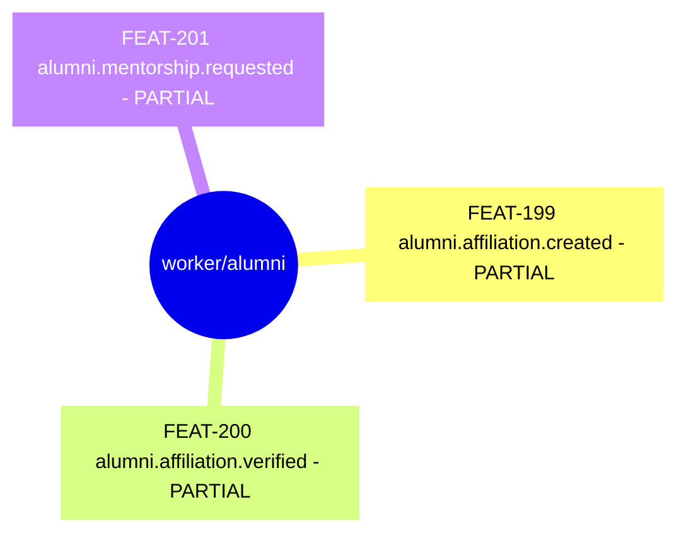
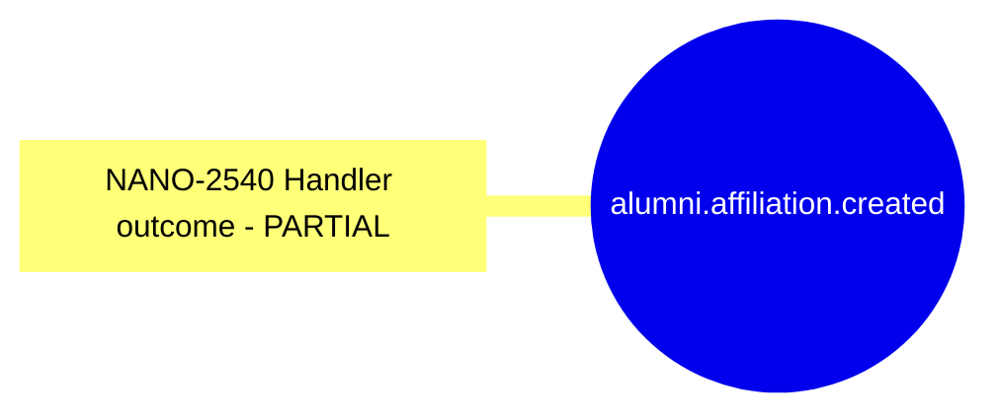
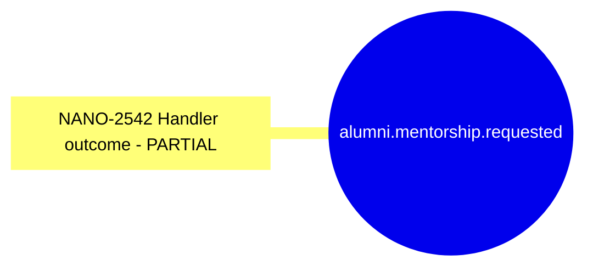

# worker/alumni (MOD-188)

Generated by `docs/mindmap/tools/catalog.py` from `master/MASTER_PROJECT_GRAPH.json` at commit `9b3032f`. Do not edit by hand. Back to the [feature catalog](../FEATURE_CATALOG.md).

**Application:** apps/worker (MOD-003). **Purpose:** Background job kinds starting with 'alumni.' claimed by apps/worker.

**Nodes by level:** MODULE 1, MAJOR 3, NANO 3. **Status:** IMPLEMENTED 1, PARTIALLY_IMPLEMENTED 6. **Verification:** UNKNOWN 7.

**Called from (web screens and components):** FEAT-104 api/alumni/affiliations, FEAT-107 api/alumni/mentorship

## Module map (to minor features)

## FEAT-199 alumni.affiliation.created

Handler: recordEvent (no-op: marks the event recorded). Enqueued by 1 endpoint(s). Completing the job means "recorded", not "delivered" (apps/worker/src/index.ts header comment).

| ID        | Level | Parent   | Name                       | Description                                                                                                                                                                        | Status                | Verification | Evidence                                   | Related |
| --------- | ----- | -------- | -------------------------- | ---------------------------------------------------------------------------------------------------------------------------------------------------------------------------------- | --------------------- | ------------ | ------------------------------------------ | ------- |
| FEAT-199  | MAJOR | MOD-188  | alumni.affiliation.created | Handler: recordEvent (no-op: marks the event recorded). Enqueued by 1 endpoint(s). Completing the job means "recorded", not "delivered" (apps/worker/src/index.ts header comment). | PARTIALLY_IMPLEMENTED | UNKNOWN      | packages/domain/src/background-jobs.ts:171 | SVC-003 |
| NANO-2540 | NANO  | FEAT-199 | Handler outcome            | recordEvent (no-op: marks the event recorded).                                                                                                                                     | PARTIALLY_IMPLEMENTED | UNKNOWN      | packages/domain/src/background-jobs.ts:171 |         |

## FEAT-200 alumni.affiliation.verified

Handler: recordEvent (no-op: marks the event recorded). Enqueued by 1 endpoint(s). Completing the job means "recorded", not "delivered" (apps/worker/src/index.ts header comment).

| ID        | Level | Parent   | Name                        | Description                                                                                                                                                                        | Status                | Verification | Evidence                                   | Related |
| --------- | ----- | -------- | --------------------------- | ---------------------------------------------------------------------------------------------------------------------------------------------------------------------------------- | --------------------- | ------------ | ------------------------------------------ | ------- |
| FEAT-200  | MAJOR | MOD-188  | alumni.affiliation.verified | Handler: recordEvent (no-op: marks the event recorded). Enqueued by 1 endpoint(s). Completing the job means "recorded", not "delivered" (apps/worker/src/index.ts header comment). | PARTIALLY_IMPLEMENTED | UNKNOWN      | packages/domain/src/background-jobs.ts:171 | SVC-004 |
| NANO-2541 | NANO  | FEAT-200 | Handler outcome             | recordEvent (no-op: marks the event recorded).                                                                                                                                     | PARTIALLY_IMPLEMENTED | UNKNOWN      | packages/domain/src/background-jobs.ts:171 |         |

## FEAT-201 alumni.mentorship.requested

Handler: recordEvent (no-op: marks the event recorded). Enqueued by 1 endpoint(s). Completing the job means "recorded", not "delivered" (apps/worker/src/index.ts header comment).

| ID        | Level | Parent   | Name                        | Description                                                                                                                                                                        | Status                | Verification | Evidence                                   | Related |
| --------- | ----- | -------- | --------------------------- | ---------------------------------------------------------------------------------------------------------------------------------------------------------------------------------- | --------------------- | ------------ | ------------------------------------------ | ------- |
| FEAT-201  | MAJOR | MOD-188  | alumni.mentorship.requested | Handler: recordEvent (no-op: marks the event recorded). Enqueued by 1 endpoint(s). Completing the job means "recorded", not "delivered" (apps/worker/src/index.ts header comment). | PARTIALLY_IMPLEMENTED | UNKNOWN      | packages/domain/src/background-jobs.ts:171 | SVC-005 |
| NANO-2542 | NANO  | FEAT-201 | Handler outcome             | recordEvent (no-op: marks the event recorded).                                                                                                                                     | PARTIALLY_IMPLEMENTED | UNKNOWN      | packages/domain/src/background-jobs.ts:171 |         |
