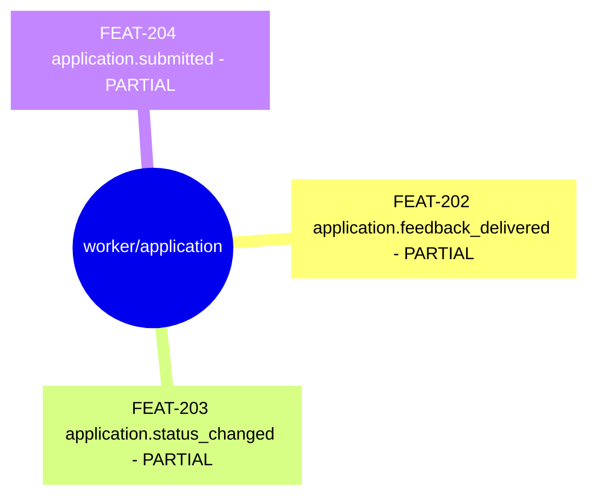
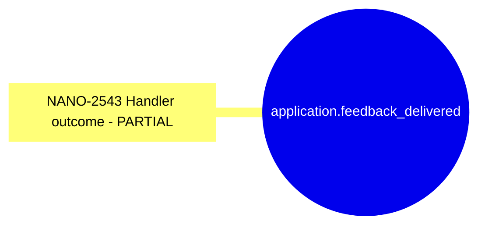
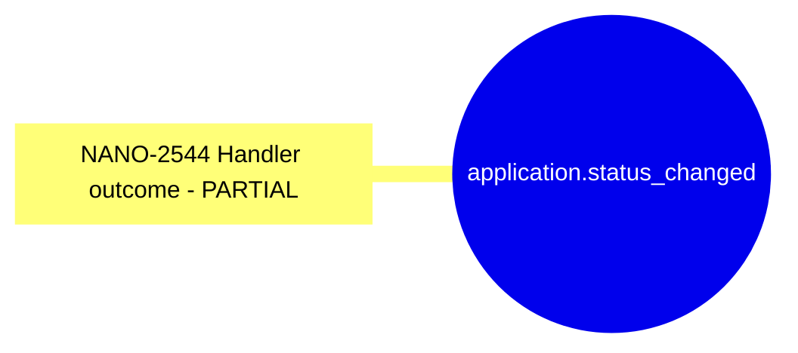
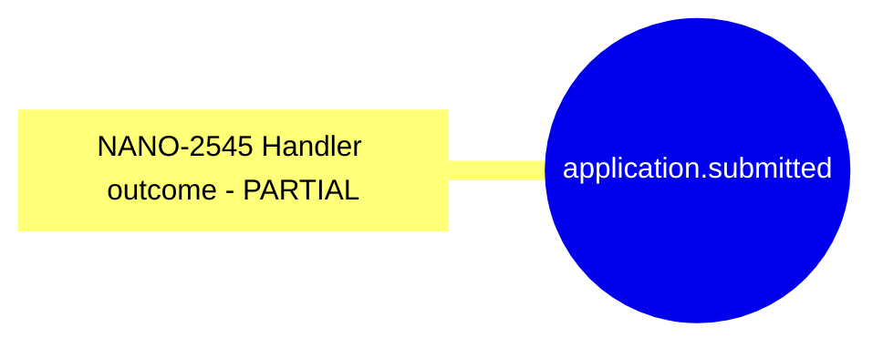

# worker/application (MOD-189)

Generated by `docs/mindmap/tools/catalog.py` from `master/MASTER_PROJECT_GRAPH.json` at commit `9b3032f`. Do not edit by hand. Back to the [feature catalog](../FEATURE_CATALOG.md).

**Application:** apps/worker (MOD-003). **Purpose:** Background job kinds starting with 'application.' claimed by apps/worker.

**Nodes by level:** MODULE 1, MAJOR 3, NANO 3. **Status:** IMPLEMENTED 1, PARTIALLY_IMPLEMENTED 6. **Verification:** UNKNOWN 7.

**Called from (web screens and components):** FEAT-034 api/jobs/apply, FEAT-038 api/applications/transition, FEAT-039 api/applications/feedback

## Module map (to minor features)

## FEAT-202 application.feedback_delivered

Handler: recordEvent (no-op: marks the event recorded). Enqueued by 1 endpoint(s). Completing the job means "recorded", not "delivered" (apps/worker/src/index.ts header comment).

| ID        | Level | Parent   | Name                           | Description                                                                                                                                                                        | Status                | Verification | Evidence                                   | Related |
| --------- | ----- | -------- | ------------------------------ | ---------------------------------------------------------------------------------------------------------------------------------------------------------------------------------- | --------------------- | ------------ | ------------------------------------------ | ------- |
| FEAT-202  | MAJOR | MOD-189  | application.feedback_delivered | Handler: recordEvent (no-op: marks the event recorded). Enqueued by 1 endpoint(s). Completing the job means "recorded", not "delivered" (apps/worker/src/index.ts header comment). | PARTIALLY_IMPLEMENTED | UNKNOWN      | packages/domain/src/background-jobs.ts:171 | SVC-006 |
| NANO-2543 | NANO  | FEAT-202 | Handler outcome                | recordEvent (no-op: marks the event recorded).                                                                                                                                     | PARTIALLY_IMPLEMENTED | UNKNOWN      | packages/domain/src/background-jobs.ts:171 |         |

## FEAT-203 application.status_changed

Handler: recordEvent (no-op: marks the event recorded). Enqueued by 1 endpoint(s). Completing the job means "recorded", not "delivered" (apps/worker/src/index.ts header comment).

| ID        | Level | Parent   | Name                       | Description                                                                                                                                                                        | Status                | Verification | Evidence                                   | Related |
| --------- | ----- | -------- | -------------------------- | ---------------------------------------------------------------------------------------------------------------------------------------------------------------------------------- | --------------------- | ------------ | ------------------------------------------ | ------- |
| FEAT-203  | MAJOR | MOD-189  | application.status_changed | Handler: recordEvent (no-op: marks the event recorded). Enqueued by 1 endpoint(s). Completing the job means "recorded", not "delivered" (apps/worker/src/index.ts header comment). | PARTIALLY_IMPLEMENTED | UNKNOWN      | packages/domain/src/background-jobs.ts:171 | SVC-007 |
| NANO-2544 | NANO  | FEAT-203 | Handler outcome            | recordEvent (no-op: marks the event recorded).                                                                                                                                     | PARTIALLY_IMPLEMENTED | UNKNOWN      | packages/domain/src/background-jobs.ts:171 |         |

## FEAT-204 application.submitted

Handler: recordEvent (no-op: marks the event recorded). Enqueued by 1 endpoint(s). Completing the job means "recorded", not "delivered" (apps/worker/src/index.ts header comment).

| ID        | Level | Parent   | Name                  | Description                                                                                                                                                                        | Status                | Verification | Evidence                                   | Related |
| --------- | ----- | -------- | --------------------- | ---------------------------------------------------------------------------------------------------------------------------------------------------------------------------------- | --------------------- | ------------ | ------------------------------------------ | ------- |
| FEAT-204  | MAJOR | MOD-189  | application.submitted | Handler: recordEvent (no-op: marks the event recorded). Enqueued by 1 endpoint(s). Completing the job means "recorded", not "delivered" (apps/worker/src/index.ts header comment). | PARTIALLY_IMPLEMENTED | UNKNOWN      | packages/domain/src/background-jobs.ts:171 | SVC-008 |
| NANO-2545 | NANO  | FEAT-204 | Handler outcome       | recordEvent (no-op: marks the event recorded).                                                                                                                                     | PARTIALLY_IMPLEMENTED | UNKNOWN      | packages/domain/src/background-jobs.ts:171 |         |
