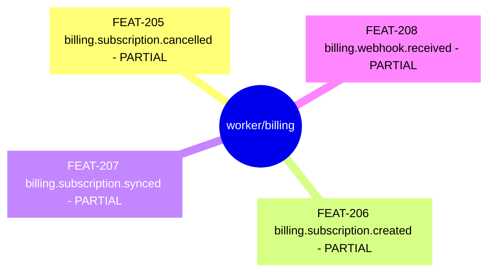
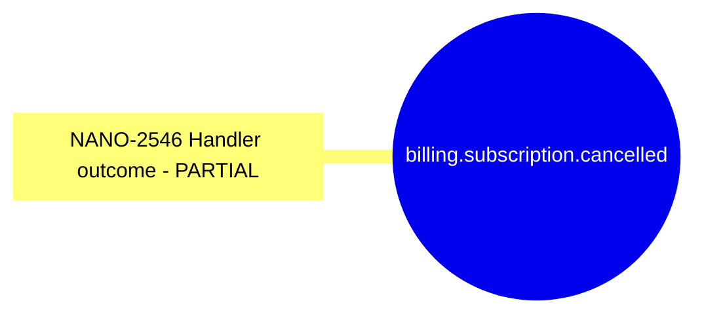
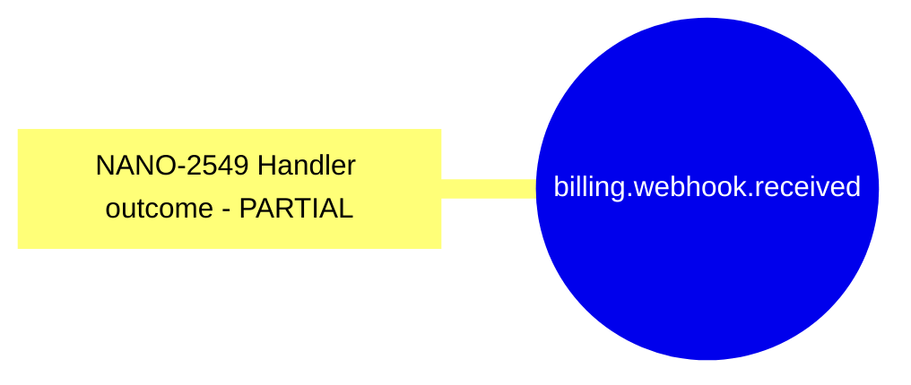

# worker/billing (MOD-190)

Generated by `docs/mindmap/tools/catalog.py` from `master/MASTER_PROJECT_GRAPH.json` at commit `9b3032f`. Do not edit by hand. Back to the [feature catalog](../FEATURE_CATALOG.md).

**Application:** apps/worker (MOD-003). **Purpose:** Background job kinds starting with 'billing.' claimed by apps/worker.

**Nodes by level:** MODULE 1, MAJOR 4, NANO 4. **Status:** IMPLEMENTED 1, PARTIALLY_IMPLEMENTED 8. **Verification:** UNKNOWN 9.

**Called from (web screens and components):** FEAT-127 api/billing/subscribe, FEAT-128 api/billing/cancel, FEAT-130 api/billing/webhook

## Module map (to minor features)

## FEAT-205 billing.subscription.cancelled

Handler: recordEvent (no-op: marks the event recorded). Enqueued by 1 endpoint(s). Completing the job means "recorded", not "delivered" (apps/worker/src/index.ts header comment).

| ID        | Level | Parent   | Name                           | Description                                                                                                                                                                        | Status                | Verification | Evidence                                   | Related |
| --------- | ----- | -------- | ------------------------------ | ---------------------------------------------------------------------------------------------------------------------------------------------------------------------------------- | --------------------- | ------------ | ------------------------------------------ | ------- |
| FEAT-205  | MAJOR | MOD-190  | billing.subscription.cancelled | Handler: recordEvent (no-op: marks the event recorded). Enqueued by 1 endpoint(s). Completing the job means "recorded", not "delivered" (apps/worker/src/index.ts header comment). | PARTIALLY_IMPLEMENTED | UNKNOWN      | packages/domain/src/background-jobs.ts:171 | SVC-009 |
| NANO-2546 | NANO  | FEAT-205 | Handler outcome                | recordEvent (no-op: marks the event recorded).                                                                                                                                     | PARTIALLY_IMPLEMENTED | UNKNOWN      | packages/domain/src/background-jobs.ts:171 |         |

## FEAT-206 billing.subscription.created

Handler: recordEvent (no-op: marks the event recorded). Enqueued by 1 endpoint(s). Completing the job means "recorded", not "delivered" (apps/worker/src/index.ts header comment).

| ID        | Level | Parent   | Name                         | Description                                                                                                                                                                        | Status                | Verification | Evidence                                   | Related |
| --------- | ----- | -------- | ---------------------------- | ---------------------------------------------------------------------------------------------------------------------------------------------------------------------------------- | --------------------- | ------------ | ------------------------------------------ | ------- |
| FEAT-206  | MAJOR | MOD-190  | billing.subscription.created | Handler: recordEvent (no-op: marks the event recorded). Enqueued by 1 endpoint(s). Completing the job means "recorded", not "delivered" (apps/worker/src/index.ts header comment). | PARTIALLY_IMPLEMENTED | UNKNOWN      | packages/domain/src/background-jobs.ts:171 | SVC-010 |
| NANO-2547 | NANO  | FEAT-206 | Handler outcome              | recordEvent (no-op: marks the event recorded).                                                                                                                                     | PARTIALLY_IMPLEMENTED | UNKNOWN      | packages/domain/src/background-jobs.ts:171 |         |

## FEAT-207 billing.subscription.synced

Handler: recordEvent (no-op: marks the event recorded). Enqueued by 0 endpoint(s). Completing the job means "recorded", not "delivered" (apps/worker/src/index.ts header comment).

| ID        | Level | Parent   | Name                        | Description                                                                                                                                                                        | Status                | Verification | Evidence                                   | Related |
| --------- | ----- | -------- | --------------------------- | ---------------------------------------------------------------------------------------------------------------------------------------------------------------------------------- | --------------------- | ------------ | ------------------------------------------ | ------- |
| FEAT-207  | MAJOR | MOD-190  | billing.subscription.synced | Handler: recordEvent (no-op: marks the event recorded). Enqueued by 0 endpoint(s). Completing the job means "recorded", not "delivered" (apps/worker/src/index.ts header comment). | PARTIALLY_IMPLEMENTED | UNKNOWN      | packages/domain/src/background-jobs.ts:171 | SVC-011 |
| NANO-2548 | NANO  | FEAT-207 | Handler outcome             | recordEvent (no-op: marks the event recorded).                                                                                                                                     | PARTIALLY_IMPLEMENTED | UNKNOWN      | packages/domain/src/background-jobs.ts:171 |         |

## FEAT-208 billing.webhook.received

Handler: recordEvent (no-op: marks the event recorded). Enqueued by 1 endpoint(s). Completing the job means "recorded", not "delivered" (apps/worker/src/index.ts header comment).

| ID        | Level | Parent   | Name                     | Description                                                                                                                                                                        | Status                | Verification | Evidence                                   | Related |
| --------- | ----- | -------- | ------------------------ | ---------------------------------------------------------------------------------------------------------------------------------------------------------------------------------- | --------------------- | ------------ | ------------------------------------------ | ------- |
| FEAT-208  | MAJOR | MOD-190  | billing.webhook.received | Handler: recordEvent (no-op: marks the event recorded). Enqueued by 1 endpoint(s). Completing the job means "recorded", not "delivered" (apps/worker/src/index.ts header comment). | PARTIALLY_IMPLEMENTED | UNKNOWN      | packages/domain/src/background-jobs.ts:171 | SVC-012 |
| NANO-2549 | NANO  | FEAT-208 | Handler outcome          | recordEvent (no-op: marks the event recorded).                                                                                                                                     | PARTIALLY_IMPLEMENTED | UNKNOWN      | packages/domain/src/background-jobs.ts:171 |         |
