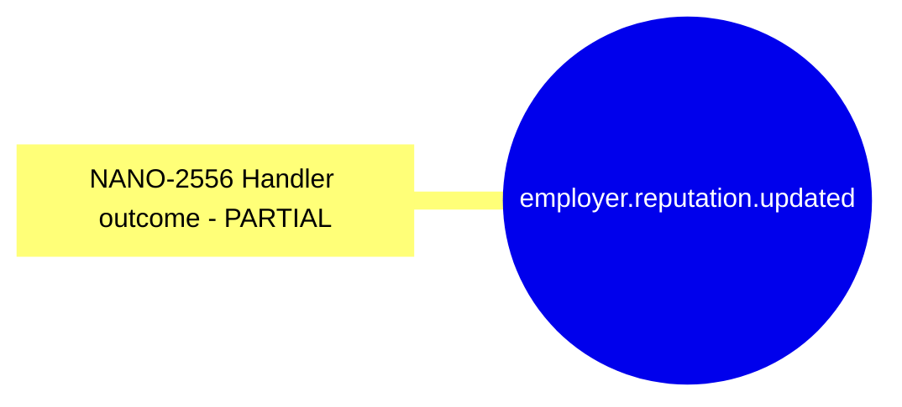

# worker/employer (MOD-193)

Generated by `docs/mindmap/tools/catalog.py` from `master/MASTER_PROJECT_GRAPH.json` at commit `9b3032f`. Do not edit by hand. Back to the [feature catalog](../FEATURE_CATALOG.md).

**Application:** apps/worker (MOD-003). **Purpose:** Background job kinds starting with 'employer.' claimed by apps/worker.

**Nodes by level:** MODULE 1, MAJOR 1, NANO 1. **Status:** IMPLEMENTED 1, PARTIALLY_IMPLEMENTED 2. **Verification:** UNKNOWN 3.

**Called from (web screens and components):** FEAT-053 api/reputation/organizations

## Module map (to minor features)

## FEAT-215 employer.reputation.updated

Handler: recordEvent (no-op: marks the event recorded). Enqueued by 1 endpoint(s). Completing the job means "recorded", not "delivered" (apps/worker/src/index.ts header comment).

| ID        | Level | Parent   | Name                        | Description                                                                                                                                                                        | Status                | Verification | Evidence                                   | Related |
| --------- | ----- | -------- | --------------------------- | ---------------------------------------------------------------------------------------------------------------------------------------------------------------------------------- | --------------------- | ------------ | ------------------------------------------ | ------- |
| FEAT-215  | MAJOR | MOD-193  | employer.reputation.updated | Handler: recordEvent (no-op: marks the event recorded). Enqueued by 1 endpoint(s). Completing the job means "recorded", not "delivered" (apps/worker/src/index.ts header comment). | PARTIALLY_IMPLEMENTED | UNKNOWN      | packages/domain/src/background-jobs.ts:171 | SVC-019 |
| NANO-2556 | NANO  | FEAT-215 | Handler outcome             | recordEvent (no-op: marks the event recorded).                                                                                                                                     | PARTIALLY_IMPLEMENTED | UNKNOWN      | packages/domain/src/background-jobs.ts:171 |         |
