# apps/worker modules

Generated by `docs/mindmap/tools/catalog.py` from `master/MASTER_PROJECT_GRAPH.json` at commit `eb166ea`. Do not edit by hand. Back to the [feature catalog](../FEATURE_CATALOG.md).

| Module                                             | ID      |
| -------------------------------------------------- | ------- |
| [worker/admin](#workeradmin-mod-186)               | MOD-186 |
| [worker/ai](#workerai-mod-187)                     | MOD-187 |
| [worker/alumni](#workeralumni-mod-188)             | MOD-188 |
| [worker/application](#workerapplication-mod-189)   | MOD-189 |
| [worker/billing](#workerbilling-mod-190)           | MOD-190 |
| [worker/career](#workercareer-mod-191)             | MOD-191 |
| [worker/connection](#workerconnection-mod-192)     | MOD-192 |
| [worker/employer](#workeremployer-mod-193)         | MOD-193 |
| [worker/evidence](#workerevidence-mod-194)         | MOD-194 |
| [worker/gamification](#workergamification-mod-195) | MOD-195 |
| [worker/gdpr](#workergdpr-mod-196)                 | MOD-196 |
| [worker/instructor](#workerinstructor-mod-197)     | MOD-197 |
| [worker/learning](#workerlearning-mod-198)         | MOD-198 |
| [worker/lms](#workerlms-mod-199)                   | MOD-199 |
| [worker/messaging](#workermessaging-mod-200)       | MOD-200 |
| [worker/moderation](#workermoderation-mod-201)     | MOD-201 |
| [worker/portfolio](#workerportfolio-mod-202)       | MOD-202 |
| [worker/reference](#workerreference-mod-203)       | MOD-203 |
| [worker/resume](#workerresume-mod-204)             | MOD-204 |
| [worker/search](#workersearch-mod-205)             | MOD-205 |
| [worker/skill](#workerskill-mod-206)               | MOD-206 |
| [worker/user](#workeruser-mod-207)                 | MOD-207 |
| [worker/work_history](#workerwork_history-mod-208) | MOD-208 |

## worker/admin (MOD-186)

**Application:** apps/worker (MOD-003). **Purpose:** Background job kinds starting with 'admin.' claimed by apps/worker.

**Nodes by level:** MODULE 1, MAJOR 1, NANO 1. **Status:** IMPLEMENTED 1, PARTIALLY_IMPLEMENTED 2. **Verification:** UNKNOWN 3.

**Called from (web screens and components):** FEAT-131 api/admin/users

### Module map (to minor features)

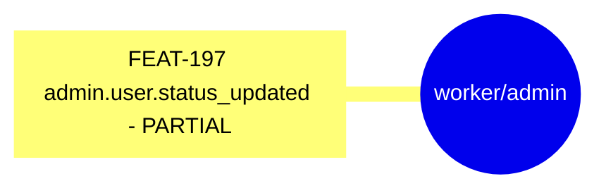

### FEAT-197 admin.user.status_updated

Handler: recordEvent (no-op: marks the event recorded). Enqueued by 1 endpoint(s). Completing the job means "recorded", not "delivered" (apps/worker/src/index.ts header comment).

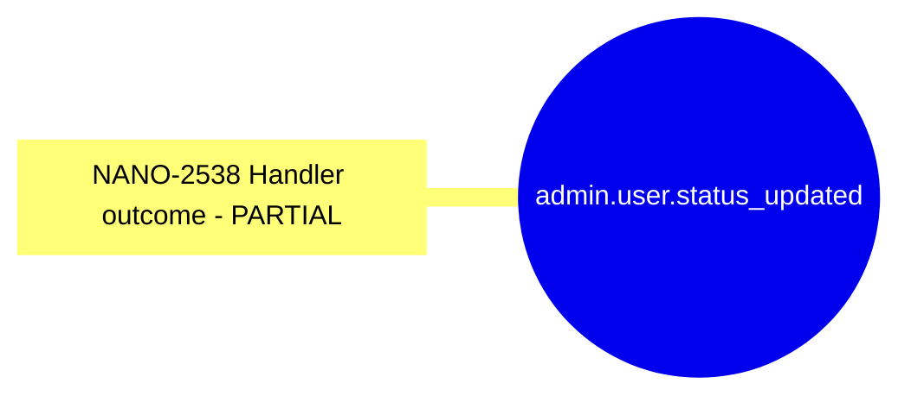

| ID        | Level | Parent   | Name                      | Description                                                                                                                                                                        | Status                | Verification | Evidence                                   | Related |
| --------- | ----- | -------- | ------------------------- | ---------------------------------------------------------------------------------------------------------------------------------------------------------------------------------- | --------------------- | ------------ | ------------------------------------------ | ------- |
| FEAT-197  | MAJOR | MOD-186  | admin.user.status_updated | Handler: recordEvent (no-op: marks the event recorded). Enqueued by 1 endpoint(s). Completing the job means "recorded", not "delivered" (apps/worker/src/index.ts header comment). | PARTIALLY_IMPLEMENTED | UNKNOWN      | packages/domain/src/background-jobs.ts:171 | SVC-001 |
| NANO-2538 | NANO  | FEAT-197 | Handler outcome           | recordEvent (no-op: marks the event recorded).                                                                                                                                     | PARTIALLY_IMPLEMENTED | UNKNOWN      | packages/domain/src/background-jobs.ts:171 |         |

## worker/ai (MOD-187)

**Application:** apps/worker (MOD-003). **Purpose:** Background job kinds starting with 'ai.' claimed by apps/worker.

**Nodes by level:** MODULE 1, MAJOR 1, NANO 1. **Status:** IMPLEMENTED 1, PARTIALLY_IMPLEMENTED 2. **Verification:** UNKNOWN 3.

**Called from (web screens and components):** FEAT-079 api/ai/career-assistant

### Module map (to minor features)

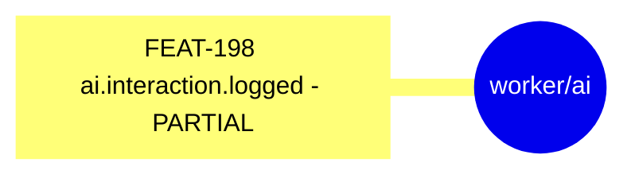

### FEAT-198 ai.interaction.logged

Handler: recordEvent (no-op: marks the event recorded). Enqueued by 1 endpoint(s). Completing the job means "recorded", not "delivered" (apps/worker/src/index.ts header comment).

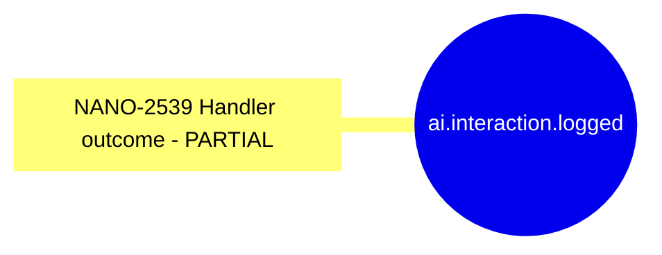

| ID        | Level | Parent   | Name                  | Description                                                                                                                                                                        | Status                | Verification | Evidence                                   | Related |
| --------- | ----- | -------- | --------------------- | ---------------------------------------------------------------------------------------------------------------------------------------------------------------------------------- | --------------------- | ------------ | ------------------------------------------ | ------- |
| FEAT-198  | MAJOR | MOD-187  | ai.interaction.logged | Handler: recordEvent (no-op: marks the event recorded). Enqueued by 1 endpoint(s). Completing the job means "recorded", not "delivered" (apps/worker/src/index.ts header comment). | PARTIALLY_IMPLEMENTED | UNKNOWN      | packages/domain/src/background-jobs.ts:171 | SVC-002 |
| NANO-2539 | NANO  | FEAT-198 | Handler outcome       | recordEvent (no-op: marks the event recorded).                                                                                                                                     | PARTIALLY_IMPLEMENTED | UNKNOWN      | packages/domain/src/background-jobs.ts:171 |         |

## worker/alumni (MOD-188)

**Application:** apps/worker (MOD-003). **Purpose:** Background job kinds starting with 'alumni.' claimed by apps/worker.

**Nodes by level:** MODULE 1, MAJOR 3, NANO 3. **Status:** IMPLEMENTED 1, PARTIALLY_IMPLEMENTED 6. **Verification:** UNKNOWN 7.

**Called from (web screens and components):** FEAT-104 api/alumni/affiliations, FEAT-107 api/alumni/mentorship

### Module map (to minor features)

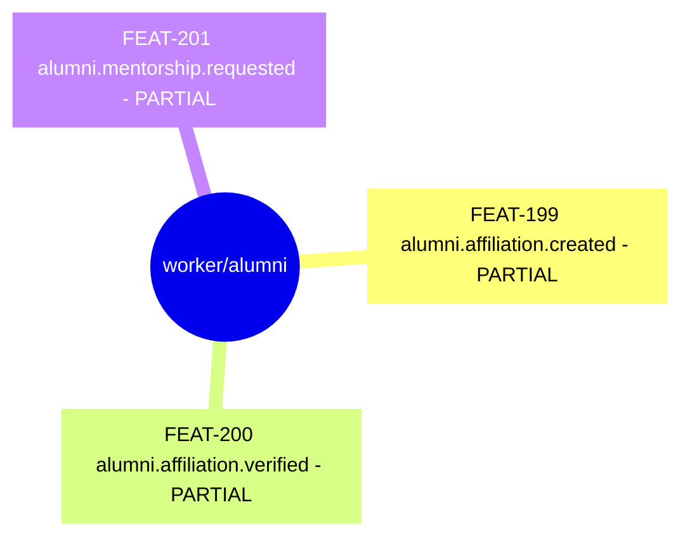

### FEAT-199 alumni.affiliation.created

Handler: recordEvent (no-op: marks the event recorded). Enqueued by 1 endpoint(s). Completing the job means "recorded", not "delivered" (apps/worker/src/index.ts header comment).

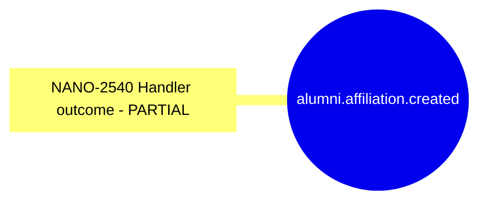

| ID        | Level | Parent   | Name                       | Description                                                                                                                                                                        | Status                | Verification | Evidence                                   | Related |
| --------- | ----- | -------- | -------------------------- | ---------------------------------------------------------------------------------------------------------------------------------------------------------------------------------- | --------------------- | ------------ | ------------------------------------------ | ------- |
| FEAT-199  | MAJOR | MOD-188  | alumni.affiliation.created | Handler: recordEvent (no-op: marks the event recorded). Enqueued by 1 endpoint(s). Completing the job means "recorded", not "delivered" (apps/worker/src/index.ts header comment). | PARTIALLY_IMPLEMENTED | UNKNOWN      | packages/domain/src/background-jobs.ts:171 | SVC-003 |
| NANO-2540 | NANO  | FEAT-199 | Handler outcome            | recordEvent (no-op: marks the event recorded).                                                                                                                                     | PARTIALLY_IMPLEMENTED | UNKNOWN      | packages/domain/src/background-jobs.ts:171 |         |

### FEAT-200 alumni.affiliation.verified

Handler: recordEvent (no-op: marks the event recorded). Enqueued by 1 endpoint(s). Completing the job means "recorded", not "delivered" (apps/worker/src/index.ts header comment).


| ID        | Level | Parent   | Name                        | Description                                                                                                                                                                        | Status                | Verification | Evidence                                   | Related |
| --------- | ----- | -------- | --------------------------- | ---------------------------------------------------------------------------------------------------------------------------------------------------------------------------------- | --------------------- | ------------ | ------------------------------------------ | ------- |
| FEAT-200  | MAJOR | MOD-188  | alumni.affiliation.verified | Handler: recordEvent (no-op: marks the event recorded). Enqueued by 1 endpoint(s). Completing the job means "recorded", not "delivered" (apps/worker/src/index.ts header comment). | PARTIALLY_IMPLEMENTED | UNKNOWN      | packages/domain/src/background-jobs.ts:171 | SVC-004 |
| NANO-2541 | NANO  | FEAT-200 | Handler outcome             | recordEvent (no-op: marks the event recorded).                                                                                                                                     | PARTIALLY_IMPLEMENTED | UNKNOWN      | packages/domain/src/background-jobs.ts:171 |         |

### FEAT-201 alumni.mentorship.requested

Handler: recordEvent (no-op: marks the event recorded). Enqueued by 1 endpoint(s). Completing the job means "recorded", not "delivered" (apps/worker/src/index.ts header comment).

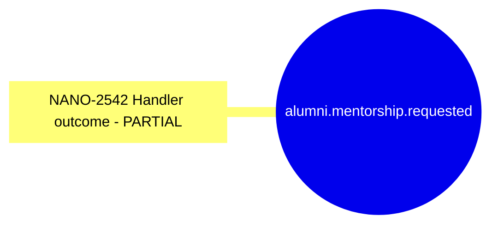

| ID        | Level | Parent   | Name                        | Description                                                                                                                                                                        | Status                | Verification | Evidence                                   | Related |
| --------- | ----- | -------- | --------------------------- | ---------------------------------------------------------------------------------------------------------------------------------------------------------------------------------- | --------------------- | ------------ | ------------------------------------------ | ------- |
| FEAT-201  | MAJOR | MOD-188  | alumni.mentorship.requested | Handler: recordEvent (no-op: marks the event recorded). Enqueued by 1 endpoint(s). Completing the job means "recorded", not "delivered" (apps/worker/src/index.ts header comment). | PARTIALLY_IMPLEMENTED | UNKNOWN      | packages/domain/src/background-jobs.ts:171 | SVC-005 |
| NANO-2542 | NANO  | FEAT-201 | Handler outcome             | recordEvent (no-op: marks the event recorded).                                                                                                                                     | PARTIALLY_IMPLEMENTED | UNKNOWN      | packages/domain/src/background-jobs.ts:171 |         |

## worker/application (MOD-189)

**Application:** apps/worker (MOD-003). **Purpose:** Background job kinds starting with 'application.' claimed by apps/worker.

**Nodes by level:** MODULE 1, MAJOR 3, NANO 3. **Status:** IMPLEMENTED 1, PARTIALLY_IMPLEMENTED 6. **Verification:** UNKNOWN 7.

**Called from (web screens and components):** FEAT-034 api/jobs/apply, FEAT-038 api/applications/transition, FEAT-039 api/applications/feedback

### Module map (to minor features)

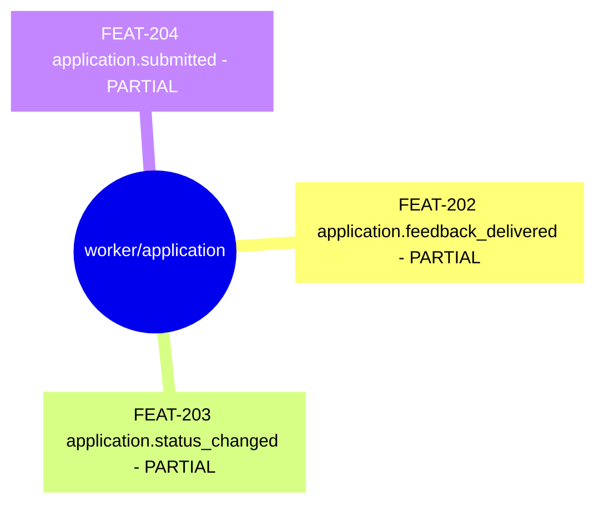

### FEAT-202 application.feedback_delivered

Handler: recordEvent (no-op: marks the event recorded). Enqueued by 1 endpoint(s). Completing the job means "recorded", not "delivered" (apps/worker/src/index.ts header comment).

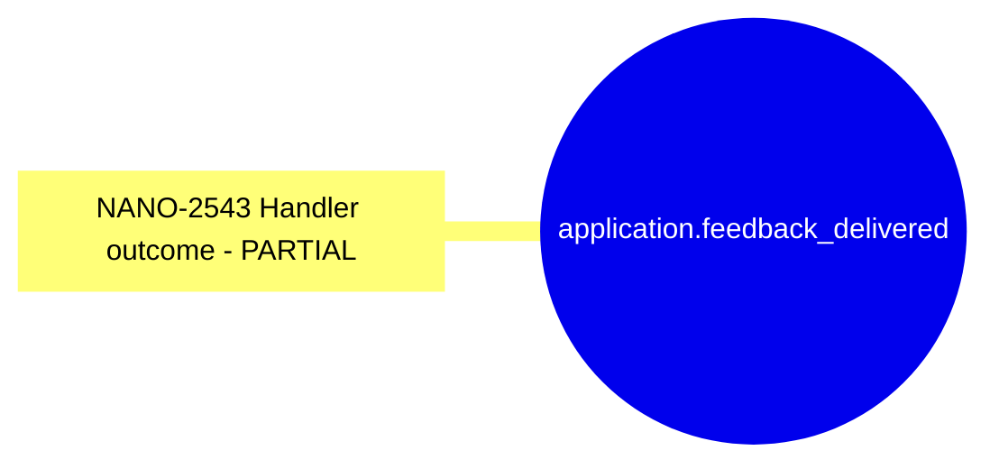

| ID        | Level | Parent   | Name                           | Description                                                                                                                                                                        | Status                | Verification | Evidence                                   | Related |
| --------- | ----- | -------- | ------------------------------ | ---------------------------------------------------------------------------------------------------------------------------------------------------------------------------------- | --------------------- | ------------ | ------------------------------------------ | ------- |
| FEAT-202  | MAJOR | MOD-189  | application.feedback_delivered | Handler: recordEvent (no-op: marks the event recorded). Enqueued by 1 endpoint(s). Completing the job means "recorded", not "delivered" (apps/worker/src/index.ts header comment). | PARTIALLY_IMPLEMENTED | UNKNOWN      | packages/domain/src/background-jobs.ts:171 | SVC-006 |
| NANO-2543 | NANO  | FEAT-202 | Handler outcome                | recordEvent (no-op: marks the event recorded).                                                                                                                                     | PARTIALLY_IMPLEMENTED | UNKNOWN      | packages/domain/src/background-jobs.ts:171 |         |

### FEAT-203 application.status_changed

Handler: recordEvent (no-op: marks the event recorded). Enqueued by 1 endpoint(s). Completing the job means "recorded", not "delivered" (apps/worker/src/index.ts header comment).


| ID        | Level | Parent   | Name                       | Description                                                                                                                                                                        | Status                | Verification | Evidence                                   | Related |
| --------- | ----- | -------- | -------------------------- | ---------------------------------------------------------------------------------------------------------------------------------------------------------------------------------- | --------------------- | ------------ | ------------------------------------------ | ------- |
| FEAT-203  | MAJOR | MOD-189  | application.status_changed | Handler: recordEvent (no-op: marks the event recorded). Enqueued by 1 endpoint(s). Completing the job means "recorded", not "delivered" (apps/worker/src/index.ts header comment). | PARTIALLY_IMPLEMENTED | UNKNOWN      | packages/domain/src/background-jobs.ts:171 | SVC-007 |
| NANO-2544 | NANO  | FEAT-203 | Handler outcome            | recordEvent (no-op: marks the event recorded).                                                                                                                                     | PARTIALLY_IMPLEMENTED | UNKNOWN      | packages/domain/src/background-jobs.ts:171 |         |

### FEAT-204 application.submitted

Handler: recordEvent (no-op: marks the event recorded). Enqueued by 1 endpoint(s). Completing the job means "recorded", not "delivered" (apps/worker/src/index.ts header comment).


| ID        | Level | Parent   | Name                  | Description                                                                                                                                                                        | Status                | Verification | Evidence                                   | Related |
| --------- | ----- | -------- | --------------------- | ---------------------------------------------------------------------------------------------------------------------------------------------------------------------------------- | --------------------- | ------------ | ------------------------------------------ | ------- |
| FEAT-204  | MAJOR | MOD-189  | application.submitted | Handler: recordEvent (no-op: marks the event recorded). Enqueued by 1 endpoint(s). Completing the job means "recorded", not "delivered" (apps/worker/src/index.ts header comment). | PARTIALLY_IMPLEMENTED | UNKNOWN      | packages/domain/src/background-jobs.ts:171 | SVC-008 |
| NANO-2545 | NANO  | FEAT-204 | Handler outcome       | recordEvent (no-op: marks the event recorded).                                                                                                                                     | PARTIALLY_IMPLEMENTED | UNKNOWN      | packages/domain/src/background-jobs.ts:171 |         |

## worker/billing (MOD-190)

**Application:** apps/worker (MOD-003). **Purpose:** Background job kinds starting with 'billing.' claimed by apps/worker.

**Nodes by level:** MODULE 1, MAJOR 4, NANO 4. **Status:** IMPLEMENTED 1, PARTIALLY_IMPLEMENTED 8. **Verification:** UNKNOWN 9.

**Called from (web screens and components):** FEAT-127 api/billing/subscribe, FEAT-128 api/billing/cancel, FEAT-130 api/billing/webhook

### Module map (to minor features)

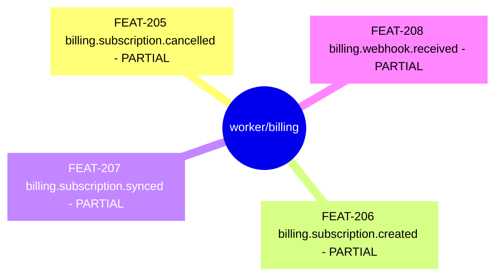

### FEAT-205 billing.subscription.cancelled

Handler: recordEvent (no-op: marks the event recorded). Enqueued by 1 endpoint(s). Completing the job means "recorded", not "delivered" (apps/worker/src/index.ts header comment).


| ID        | Level | Parent   | Name                           | Description                                                                                                                                                                        | Status                | Verification | Evidence                                   | Related |
| --------- | ----- | -------- | ------------------------------ | ---------------------------------------------------------------------------------------------------------------------------------------------------------------------------------- | --------------------- | ------------ | ------------------------------------------ | ------- |
| FEAT-205  | MAJOR | MOD-190  | billing.subscription.cancelled | Handler: recordEvent (no-op: marks the event recorded). Enqueued by 1 endpoint(s). Completing the job means "recorded", not "delivered" (apps/worker/src/index.ts header comment). | PARTIALLY_IMPLEMENTED | UNKNOWN      | packages/domain/src/background-jobs.ts:171 | SVC-009 |
| NANO-2546 | NANO  | FEAT-205 | Handler outcome                | recordEvent (no-op: marks the event recorded).                                                                                                                                     | PARTIALLY_IMPLEMENTED | UNKNOWN      | packages/domain/src/background-jobs.ts:171 |         |

### FEAT-206 billing.subscription.created

Handler: recordEvent (no-op: marks the event recorded). Enqueued by 1 endpoint(s). Completing the job means "recorded", not "delivered" (apps/worker/src/index.ts header comment).


| ID        | Level | Parent   | Name                         | Description                                                                                                                                                                        | Status                | Verification | Evidence                                   | Related |
| --------- | ----- | -------- | ---------------------------- | ---------------------------------------------------------------------------------------------------------------------------------------------------------------------------------- | --------------------- | ------------ | ------------------------------------------ | ------- |
| FEAT-206  | MAJOR | MOD-190  | billing.subscription.created | Handler: recordEvent (no-op: marks the event recorded). Enqueued by 1 endpoint(s). Completing the job means "recorded", not "delivered" (apps/worker/src/index.ts header comment). | PARTIALLY_IMPLEMENTED | UNKNOWN      | packages/domain/src/background-jobs.ts:171 | SVC-010 |
| NANO-2547 | NANO  | FEAT-206 | Handler outcome              | recordEvent (no-op: marks the event recorded).                                                                                                                                     | PARTIALLY_IMPLEMENTED | UNKNOWN      | packages/domain/src/background-jobs.ts:171 |         |

### FEAT-207 billing.subscription.synced

Handler: recordEvent (no-op: marks the event recorded). Enqueued by 0 endpoint(s). Completing the job means "recorded", not "delivered" (apps/worker/src/index.ts header comment).


| ID        | Level | Parent   | Name                        | Description                                                                                                                                                                        | Status                | Verification | Evidence                                   | Related |
| --------- | ----- | -------- | --------------------------- | ---------------------------------------------------------------------------------------------------------------------------------------------------------------------------------- | --------------------- | ------------ | ------------------------------------------ | ------- |
| FEAT-207  | MAJOR | MOD-190  | billing.subscription.synced | Handler: recordEvent (no-op: marks the event recorded). Enqueued by 0 endpoint(s). Completing the job means "recorded", not "delivered" (apps/worker/src/index.ts header comment). | PARTIALLY_IMPLEMENTED | UNKNOWN      | packages/domain/src/background-jobs.ts:171 | SVC-011 |
| NANO-2548 | NANO  | FEAT-207 | Handler outcome             | recordEvent (no-op: marks the event recorded).                                                                                                                                     | PARTIALLY_IMPLEMENTED | UNKNOWN      | packages/domain/src/background-jobs.ts:171 |         |

### FEAT-208 billing.webhook.received

Handler: recordEvent (no-op: marks the event recorded). Enqueued by 1 endpoint(s). Completing the job means "recorded", not "delivered" (apps/worker/src/index.ts header comment).


| ID        | Level | Parent   | Name                     | Description                                                                                                                                                                        | Status                | Verification | Evidence                                   | Related |
| --------- | ----- | -------- | ------------------------ | ---------------------------------------------------------------------------------------------------------------------------------------------------------------------------------- | --------------------- | ------------ | ------------------------------------------ | ------- |
| FEAT-208  | MAJOR | MOD-190  | billing.webhook.received | Handler: recordEvent (no-op: marks the event recorded). Enqueued by 1 endpoint(s). Completing the job means "recorded", not "delivered" (apps/worker/src/index.ts header comment). | PARTIALLY_IMPLEMENTED | UNKNOWN      | packages/domain/src/background-jobs.ts:171 | SVC-012 |
| NANO-2549 | NANO  | FEAT-208 | Handler outcome          | recordEvent (no-op: marks the event recorded).                                                                                                                                     | PARTIALLY_IMPLEMENTED | UNKNOWN      | packages/domain/src/background-jobs.ts:171 |         |

## worker/career (MOD-191)

**Application:** apps/worker (MOD-003). **Purpose:** Background job kinds starting with 'career.' claimed by apps/worker.

**Nodes by level:** MODULE 1, MAJOR 1, NANO 1. **Status:** IMPLEMENTED 1, PARTIALLY_IMPLEMENTED 2. **Verification:** UNKNOWN 3.

**Called from (web screens and components):** FEAT-095 api/career/transitions

### Module map (to minor features)


### FEAT-209 career.transition_recorded

Handler: recordEvent (no-op: marks the event recorded). Enqueued by 1 endpoint(s). Completing the job means "recorded", not "delivered" (apps/worker/src/index.ts header comment).

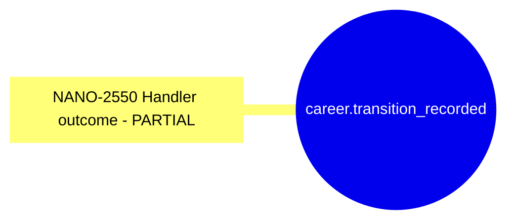

| ID        | Level | Parent   | Name                       | Description                                                                                                                                                                        | Status                | Verification | Evidence                                   | Related |
| --------- | ----- | -------- | -------------------------- | ---------------------------------------------------------------------------------------------------------------------------------------------------------------------------------- | --------------------- | ------------ | ------------------------------------------ | ------- |
| FEAT-209  | MAJOR | MOD-191  | career.transition_recorded | Handler: recordEvent (no-op: marks the event recorded). Enqueued by 1 endpoint(s). Completing the job means "recorded", not "delivered" (apps/worker/src/index.ts header comment). | PARTIALLY_IMPLEMENTED | UNKNOWN      | packages/domain/src/background-jobs.ts:171 | SVC-013 |
| NANO-2550 | NANO  | FEAT-209 | Handler outcome            | recordEvent (no-op: marks the event recorded).                                                                                                                                     | PARTIALLY_IMPLEMENTED | UNKNOWN      | packages/domain/src/background-jobs.ts:171 |         |

## worker/connection (MOD-192)

**Application:** apps/worker (MOD-003). **Purpose:** Background job kinds starting with 'connection.' claimed by apps/worker.

**Nodes by level:** MODULE 1, MAJOR 5, NANO 5. **Status:** IMPLEMENTED 1, PARTIALLY_IMPLEMENTED 10. **Verification:** UNKNOWN 11.

**Called from (web screens and components):** FEAT-084 api/connections/request, FEAT-085 api/connections, FEAT-087 api/connections/respond, FEAT-088 api/connections/withdraw

### Module map (to minor features)

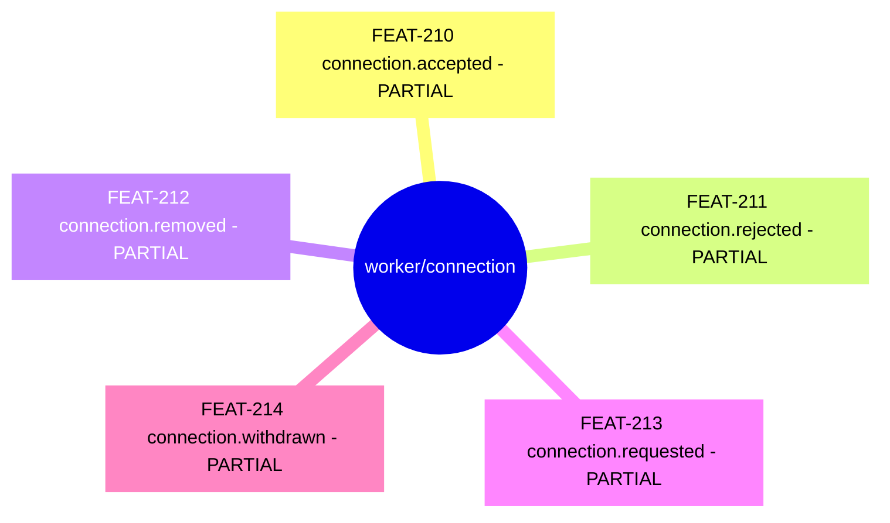

### FEAT-210 connection.accepted

Handler: recordEvent (no-op: marks the event recorded). Enqueued by 1 endpoint(s). Completing the job means "recorded", not "delivered" (apps/worker/src/index.ts header comment).

```mermaid
mindmap
  root((connection.accepted))
    NANO_2551[NANO-2551 Handler outcome - PARTIAL]
```

| ID        | Level | Parent   | Name                | Description                                                                                                                                                                        | Status                | Verification | Evidence                                   | Related |
| --------- | ----- | -------- | ------------------- | ---------------------------------------------------------------------------------------------------------------------------------------------------------------------------------- | --------------------- | ------------ | ------------------------------------------ | ------- |
| FEAT-210  | MAJOR | MOD-192  | connection.accepted | Handler: recordEvent (no-op: marks the event recorded). Enqueued by 1 endpoint(s). Completing the job means "recorded", not "delivered" (apps/worker/src/index.ts header comment). | PARTIALLY_IMPLEMENTED | UNKNOWN      | packages/domain/src/background-jobs.ts:171 | SVC-014 |
| NANO-2551 | NANO  | FEAT-210 | Handler outcome     | recordEvent (no-op: marks the event recorded).                                                                                                                                     | PARTIALLY_IMPLEMENTED | UNKNOWN      | packages/domain/src/background-jobs.ts:171 |         |

### FEAT-211 connection.rejected

Handler: recordEvent (no-op: marks the event recorded). Enqueued by 1 endpoint(s). Completing the job means "recorded", not "delivered" (apps/worker/src/index.ts header comment).

```mermaid
mindmap
  root((connection.rejected))
    NANO_2552[NANO-2552 Handler outcome - PARTIAL]
```

| ID        | Level | Parent   | Name                | Description                                                                                                                                                                        | Status                | Verification | Evidence                                   | Related |
| --------- | ----- | -------- | ------------------- | ---------------------------------------------------------------------------------------------------------------------------------------------------------------------------------- | --------------------- | ------------ | ------------------------------------------ | ------- |
| FEAT-211  | MAJOR | MOD-192  | connection.rejected | Handler: recordEvent (no-op: marks the event recorded). Enqueued by 1 endpoint(s). Completing the job means "recorded", not "delivered" (apps/worker/src/index.ts header comment). | PARTIALLY_IMPLEMENTED | UNKNOWN      | packages/domain/src/background-jobs.ts:171 | SVC-016 |
| NANO-2552 | NANO  | FEAT-211 | Handler outcome     | recordEvent (no-op: marks the event recorded).                                                                                                                                     | PARTIALLY_IMPLEMENTED | UNKNOWN      | packages/domain/src/background-jobs.ts:171 |         |

### FEAT-212 connection.removed

Handler: recordEvent (no-op: marks the event recorded). Enqueued by 1 endpoint(s). Completing the job means "recorded", not "delivered" (apps/worker/src/index.ts header comment).

```mermaid
mindmap
  root((connection.removed))
    NANO_2553[NANO-2553 Handler outcome - PARTIAL]
```

| ID        | Level | Parent   | Name               | Description                                                                                                                                                                        | Status                | Verification | Evidence                                   | Related |
| --------- | ----- | -------- | ------------------ | ---------------------------------------------------------------------------------------------------------------------------------------------------------------------------------- | --------------------- | ------------ | ------------------------------------------ | ------- |
| FEAT-212  | MAJOR | MOD-192  | connection.removed | Handler: recordEvent (no-op: marks the event recorded). Enqueued by 1 endpoint(s). Completing the job means "recorded", not "delivered" (apps/worker/src/index.ts header comment). | PARTIALLY_IMPLEMENTED | UNKNOWN      | packages/domain/src/background-jobs.ts:171 | SVC-015 |
| NANO-2553 | NANO  | FEAT-212 | Handler outcome    | recordEvent (no-op: marks the event recorded).                                                                                                                                     | PARTIALLY_IMPLEMENTED | UNKNOWN      | packages/domain/src/background-jobs.ts:171 |         |

### FEAT-213 connection.requested

Handler: recordEvent (no-op: marks the event recorded). Enqueued by 1 endpoint(s). Completing the job means "recorded", not "delivered" (apps/worker/src/index.ts header comment).

```mermaid
mindmap
  root((connection.requested))
    NANO_2554[NANO-2554 Handler outcome - PARTIAL]
```

| ID        | Level | Parent   | Name                 | Description                                                                                                                                                                        | Status                | Verification | Evidence                                   | Related |
| --------- | ----- | -------- | -------------------- | ---------------------------------------------------------------------------------------------------------------------------------------------------------------------------------- | --------------------- | ------------ | ------------------------------------------ | ------- |
| FEAT-213  | MAJOR | MOD-192  | connection.requested | Handler: recordEvent (no-op: marks the event recorded). Enqueued by 1 endpoint(s). Completing the job means "recorded", not "delivered" (apps/worker/src/index.ts header comment). | PARTIALLY_IMPLEMENTED | UNKNOWN      | packages/domain/src/background-jobs.ts:171 | SVC-017 |
| NANO-2554 | NANO  | FEAT-213 | Handler outcome      | recordEvent (no-op: marks the event recorded).                                                                                                                                     | PARTIALLY_IMPLEMENTED | UNKNOWN      | packages/domain/src/background-jobs.ts:171 |         |

### FEAT-214 connection.withdrawn

Handler: recordEvent (no-op: marks the event recorded). Enqueued by 1 endpoint(s). Completing the job means "recorded", not "delivered" (apps/worker/src/index.ts header comment).

```mermaid
mindmap
  root((connection.withdrawn))
    NANO_2555[NANO-2555 Handler outcome - PARTIAL]
```

| ID        | Level | Parent   | Name                 | Description                                                                                                                                                                        | Status                | Verification | Evidence                                   | Related |
| --------- | ----- | -------- | -------------------- | ---------------------------------------------------------------------------------------------------------------------------------------------------------------------------------- | --------------------- | ------------ | ------------------------------------------ | ------- |
| FEAT-214  | MAJOR | MOD-192  | connection.withdrawn | Handler: recordEvent (no-op: marks the event recorded). Enqueued by 1 endpoint(s). Completing the job means "recorded", not "delivered" (apps/worker/src/index.ts header comment). | PARTIALLY_IMPLEMENTED | UNKNOWN      | packages/domain/src/background-jobs.ts:171 | SVC-018 |
| NANO-2555 | NANO  | FEAT-214 | Handler outcome      | recordEvent (no-op: marks the event recorded).                                                                                                                                     | PARTIALLY_IMPLEMENTED | UNKNOWN      | packages/domain/src/background-jobs.ts:171 |         |

## worker/employer (MOD-193)

**Application:** apps/worker (MOD-003). **Purpose:** Background job kinds starting with 'employer.' claimed by apps/worker.

**Nodes by level:** MODULE 1, MAJOR 1, NANO 1. **Status:** IMPLEMENTED 1, PARTIALLY_IMPLEMENTED 2. **Verification:** UNKNOWN 3.

**Called from (web screens and components):** FEAT-053 api/reputation/organizations

### Module map (to minor features)

```mermaid
mindmap
  root((worker/employer))
    FEAT_215[FEAT-215 employer.reputation.updated - PARTIAL]
```

### FEAT-215 employer.reputation.updated

Handler: recordEvent (no-op: marks the event recorded). Enqueued by 1 endpoint(s). Completing the job means "recorded", not "delivered" (apps/worker/src/index.ts header comment).

```mermaid
mindmap
  root((employer.reputation.updated))
    NANO_2556[NANO-2556 Handler outcome - PARTIAL]
```

| ID        | Level | Parent   | Name                        | Description                                                                                                                                                                        | Status                | Verification | Evidence                                   | Related |
| --------- | ----- | -------- | --------------------------- | ---------------------------------------------------------------------------------------------------------------------------------------------------------------------------------- | --------------------- | ------------ | ------------------------------------------ | ------- |
| FEAT-215  | MAJOR | MOD-193  | employer.reputation.updated | Handler: recordEvent (no-op: marks the event recorded). Enqueued by 1 endpoint(s). Completing the job means "recorded", not "delivered" (apps/worker/src/index.ts header comment). | PARTIALLY_IMPLEMENTED | UNKNOWN      | packages/domain/src/background-jobs.ts:171 | SVC-019 |
| NANO-2556 | NANO  | FEAT-215 | Handler outcome             | recordEvent (no-op: marks the event recorded).                                                                                                                                     | PARTIALLY_IMPLEMENTED | UNKNOWN      | packages/domain/src/background-jobs.ts:171 |         |

## worker/evidence (MOD-194)

**Application:** apps/worker (MOD-003). **Purpose:** Background job kinds starting with 'evidence.' claimed by apps/worker.

**Nodes by level:** MODULE 1, MAJOR 1, NANO 1. **Status:** IMPLEMENTED 1, PARTIALLY_IMPLEMENTED 2. **Verification:** UNKNOWN 3.

**Called from (web screens and components):** FEAT-015 api/evidence/verify, FEAT-016 api/evidence/dispute, FEAT-017 api/evidence/revoke, FEAT-056 api/challenges/submit, FEAT-065 api/lessons/complete

### Module map (to minor features)

```mermaid
mindmap
  root((worker/evidence))
    FEAT_216[FEAT-216 evidence.propagate - PARTIAL]
```

### FEAT-216 evidence.propagate

Handler: recordEvent (no-op: marks the event recorded). Enqueued by 5 endpoint(s). Completing the job means "recorded", not "delivered" (apps/worker/src/index.ts header comment).

```mermaid
mindmap
  root((evidence.propagate))
    NANO_2557[NANO-2557 Handler outcome - PARTIAL]
```

| ID        | Level | Parent   | Name               | Description                                                                                                                                                                        | Status                | Verification | Evidence                                   | Related |
| --------- | ----- | -------- | ------------------ | ---------------------------------------------------------------------------------------------------------------------------------------------------------------------------------- | --------------------- | ------------ | ------------------------------------------ | ------- |
| FEAT-216  | MAJOR | MOD-194  | evidence.propagate | Handler: recordEvent (no-op: marks the event recorded). Enqueued by 5 endpoint(s). Completing the job means "recorded", not "delivered" (apps/worker/src/index.ts header comment). | PARTIALLY_IMPLEMENTED | UNKNOWN      | packages/domain/src/background-jobs.ts:171 | SVC-020 |
| NANO-2557 | NANO  | FEAT-216 | Handler outcome    | recordEvent (no-op: marks the event recorded).                                                                                                                                     | PARTIALLY_IMPLEMENTED | UNKNOWN      | packages/domain/src/background-jobs.ts:171 |         |

## worker/gamification (MOD-195)

**Application:** apps/worker (MOD-003). **Purpose:** Background job kinds starting with 'gamification.' claimed by apps/worker.

**Nodes by level:** MODULE 1, MAJOR 2, NANO 2. **Status:** IMPLEMENTED 1, PARTIALLY_IMPLEMENTED 4. **Verification:** UNKNOWN 5.

**Called from (web screens and components):** FEAT-118 api/gamification/claim-activity

### Module map (to minor features)

```mermaid
mindmap
  root((worker/gamification))
    FEAT_217[FEAT-217 gamification.badge.unlocked - PARTIAL]
    FEAT_218[FEAT-218 gamification.xp.awarded - PARTIAL]
```

### FEAT-217 gamification.badge.unlocked

Handler: recordEvent (no-op: marks the event recorded). Enqueued by 1 endpoint(s). Completing the job means "recorded", not "delivered" (apps/worker/src/index.ts header comment).

```mermaid
mindmap
  root((gamification.badge.unlocked))
    NANO_2558[NANO-2558 Handler outcome - PARTIAL]
```

| ID        | Level | Parent   | Name                        | Description                                                                                                                                                                        | Status                | Verification | Evidence                                   | Related |
| --------- | ----- | -------- | --------------------------- | ---------------------------------------------------------------------------------------------------------------------------------------------------------------------------------- | --------------------- | ------------ | ------------------------------------------ | ------- |
| FEAT-217  | MAJOR | MOD-195  | gamification.badge.unlocked | Handler: recordEvent (no-op: marks the event recorded). Enqueued by 1 endpoint(s). Completing the job means "recorded", not "delivered" (apps/worker/src/index.ts header comment). | PARTIALLY_IMPLEMENTED | UNKNOWN      | packages/domain/src/background-jobs.ts:171 | SVC-021 |
| NANO-2558 | NANO  | FEAT-217 | Handler outcome             | recordEvent (no-op: marks the event recorded).                                                                                                                                     | PARTIALLY_IMPLEMENTED | UNKNOWN      | packages/domain/src/background-jobs.ts:171 |         |

### FEAT-218 gamification.xp.awarded

Handler: recordEvent (no-op: marks the event recorded). Enqueued by 1 endpoint(s). Completing the job means "recorded", not "delivered" (apps/worker/src/index.ts header comment).

```mermaid
mindmap
  root((gamification.xp.awarded))
    NANO_2559[NANO-2559 Handler outcome - PARTIAL]
```

| ID        | Level | Parent   | Name                    | Description                                                                                                                                                                        | Status                | Verification | Evidence                                   | Related |
| --------- | ----- | -------- | ----------------------- | ---------------------------------------------------------------------------------------------------------------------------------------------------------------------------------- | --------------------- | ------------ | ------------------------------------------ | ------- |
| FEAT-218  | MAJOR | MOD-195  | gamification.xp.awarded | Handler: recordEvent (no-op: marks the event recorded). Enqueued by 1 endpoint(s). Completing the job means "recorded", not "delivered" (apps/worker/src/index.ts header comment). | PARTIALLY_IMPLEMENTED | UNKNOWN      | packages/domain/src/background-jobs.ts:171 | SVC-022 |
| NANO-2559 | NANO  | FEAT-218 | Handler outcome         | recordEvent (no-op: marks the event recorded).                                                                                                                                     | PARTIALLY_IMPLEMENTED | UNKNOWN      | packages/domain/src/background-jobs.ts:171 |         |

## worker/gdpr (MOD-196)

**Application:** apps/worker (MOD-003). **Purpose:** Background job kinds starting with 'gdpr.' claimed by apps/worker.

**Nodes by level:** MODULE 1, MAJOR 4, NANO 4. **Status:** IMPLEMENTED 1, PARTIALLY_IMPLEMENTED 8. **Verification:** UNKNOWN 9.

**Called from (web screens and components):** FEAT-120 api/settings/export, FEAT-121 api/settings/erasure

### Module map (to minor features)

```mermaid
mindmap
  root((worker/gdpr))
    FEAT_219[FEAT-219 gdpr.data.exported - PARTIAL]
    FEAT_220[FEAT-220 gdpr.erasure.cancelled - PARTIAL]
    FEAT_221[FEAT-221 gdpr.erasure.completed - PARTIAL]
    FEAT_222[FEAT-222 gdpr.erasure.requested - PARTIAL]
```

### FEAT-219 gdpr.data.exported

Handler: recordEvent (no-op: marks the event recorded). Enqueued by 1 endpoint(s). Completing the job means "recorded", not "delivered" (apps/worker/src/index.ts header comment).

```mermaid
mindmap
  root((gdpr.data.exported))
    NANO_2560[NANO-2560 Handler outcome - PARTIAL]
```

| ID        | Level | Parent   | Name               | Description                                                                                                                                                                        | Status                | Verification | Evidence                                   | Related |
| --------- | ----- | -------- | ------------------ | ---------------------------------------------------------------------------------------------------------------------------------------------------------------------------------- | --------------------- | ------------ | ------------------------------------------ | ------- |
| FEAT-219  | MAJOR | MOD-196  | gdpr.data.exported | Handler: recordEvent (no-op: marks the event recorded). Enqueued by 1 endpoint(s). Completing the job means "recorded", not "delivered" (apps/worker/src/index.ts header comment). | PARTIALLY_IMPLEMENTED | UNKNOWN      | packages/domain/src/background-jobs.ts:171 | SVC-023 |
| NANO-2560 | NANO  | FEAT-219 | Handler outcome    | recordEvent (no-op: marks the event recorded).                                                                                                                                     | PARTIALLY_IMPLEMENTED | UNKNOWN      | packages/domain/src/background-jobs.ts:171 |         |

### FEAT-220 gdpr.erasure.cancelled

Handler: recordEvent (no-op: marks the event recorded). Enqueued by 1 endpoint(s). Completing the job means "recorded", not "delivered" (apps/worker/src/index.ts header comment).

```mermaid
mindmap
  root((gdpr.erasure.cancelled))
    NANO_2561[NANO-2561 Handler outcome - PARTIAL]
```

| ID        | Level | Parent   | Name                   | Description                                                                                                                                                                        | Status                | Verification | Evidence                                   | Related |
| --------- | ----- | -------- | ---------------------- | ---------------------------------------------------------------------------------------------------------------------------------------------------------------------------------- | --------------------- | ------------ | ------------------------------------------ | ------- |
| FEAT-220  | MAJOR | MOD-196  | gdpr.erasure.cancelled | Handler: recordEvent (no-op: marks the event recorded). Enqueued by 1 endpoint(s). Completing the job means "recorded", not "delivered" (apps/worker/src/index.ts header comment). | PARTIALLY_IMPLEMENTED | UNKNOWN      | packages/domain/src/background-jobs.ts:171 | SVC-024 |
| NANO-2561 | NANO  | FEAT-220 | Handler outcome        | recordEvent (no-op: marks the event recorded).                                                                                                                                     | PARTIALLY_IMPLEMENTED | UNKNOWN      | packages/domain/src/background-jobs.ts:171 |         |

### FEAT-221 gdpr.erasure.completed

Handler: recordEvent (no-op: marks the event recorded). Enqueued by 1 endpoint(s). Completing the job means "recorded", not "delivered" (apps/worker/src/index.ts header comment).

```mermaid
mindmap
  root((gdpr.erasure.completed))
    NANO_2562[NANO-2562 Handler outcome - PARTIAL]
```

| ID        | Level | Parent   | Name                   | Description                                                                                                                                                                        | Status                | Verification | Evidence                                   | Related |
| --------- | ----- | -------- | ---------------------- | ---------------------------------------------------------------------------------------------------------------------------------------------------------------------------------- | --------------------- | ------------ | ------------------------------------------ | ------- |
| FEAT-221  | MAJOR | MOD-196  | gdpr.erasure.completed | Handler: recordEvent (no-op: marks the event recorded). Enqueued by 1 endpoint(s). Completing the job means "recorded", not "delivered" (apps/worker/src/index.ts header comment). | PARTIALLY_IMPLEMENTED | UNKNOWN      | packages/domain/src/background-jobs.ts:171 | SVC-025 |
| NANO-2562 | NANO  | FEAT-221 | Handler outcome        | recordEvent (no-op: marks the event recorded).                                                                                                                                     | PARTIALLY_IMPLEMENTED | UNKNOWN      | packages/domain/src/background-jobs.ts:171 |         |

### FEAT-222 gdpr.erasure.requested

Handler: recordEvent (no-op: marks the event recorded). Enqueued by 1 endpoint(s). Completing the job means "recorded", not "delivered" (apps/worker/src/index.ts header comment).

```mermaid
mindmap
  root((gdpr.erasure.requested))
    NANO_2563[NANO-2563 Handler outcome - PARTIAL]
```

| ID        | Level | Parent   | Name                   | Description                                                                                                                                                                        | Status                | Verification | Evidence                                   | Related |
| --------- | ----- | -------- | ---------------------- | ---------------------------------------------------------------------------------------------------------------------------------------------------------------------------------- | --------------------- | ------------ | ------------------------------------------ | ------- |
| FEAT-222  | MAJOR | MOD-196  | gdpr.erasure.requested | Handler: recordEvent (no-op: marks the event recorded). Enqueued by 1 endpoint(s). Completing the job means "recorded", not "delivered" (apps/worker/src/index.ts header comment). | PARTIALLY_IMPLEMENTED | UNKNOWN      | packages/domain/src/background-jobs.ts:171 | SVC-026 |
| NANO-2563 | NANO  | FEAT-222 | Handler outcome        | recordEvent (no-op: marks the event recorded).                                                                                                                                     | PARTIALLY_IMPLEMENTED | UNKNOWN      | packages/domain/src/background-jobs.ts:171 |         |

## worker/instructor (MOD-197)

**Application:** apps/worker (MOD-003). **Purpose:** Background job kinds starting with 'instructor.' claimed by apps/worker.

**Nodes by level:** MODULE 1, MAJOR 1, NANO 1. **Status:** IMPLEMENTED 1, PARTIALLY_IMPLEMENTED 2. **Verification:** UNKNOWN 3.

**Called from (web screens and components):** FEAT-052 api/reputation/instructors

### Module map (to minor features)

```mermaid
mindmap
  root((worker/instructor))
    FEAT_223[FEAT-223 instructor.reputation.updated - PARTIAL]
```

### FEAT-223 instructor.reputation.updated

Handler: recordEvent (no-op: marks the event recorded). Enqueued by 1 endpoint(s). Completing the job means "recorded", not "delivered" (apps/worker/src/index.ts header comment).

```mermaid
mindmap
  root((instructor.reputation.updated))
    NANO_2564[NANO-2564 Handler outcome - PARTIAL]
```

| ID        | Level | Parent   | Name                          | Description                                                                                                                                                                        | Status                | Verification | Evidence                                   | Related |
| --------- | ----- | -------- | ----------------------------- | ---------------------------------------------------------------------------------------------------------------------------------------------------------------------------------- | --------------------- | ------------ | ------------------------------------------ | ------- |
| FEAT-223  | MAJOR | MOD-197  | instructor.reputation.updated | Handler: recordEvent (no-op: marks the event recorded). Enqueued by 1 endpoint(s). Completing the job means "recorded", not "delivered" (apps/worker/src/index.ts header comment). | PARTIALLY_IMPLEMENTED | UNKNOWN      | packages/domain/src/background-jobs.ts:171 | SVC-027 |
| NANO-2564 | NANO  | FEAT-223 | Handler outcome               | recordEvent (no-op: marks the event recorded).                                                                                                                                     | PARTIALLY_IMPLEMENTED | UNKNOWN      | packages/domain/src/background-jobs.ts:171 |         |

## worker/learning (MOD-198)

**Application:** apps/worker (MOD-003). **Purpose:** Background job kinds starting with 'learning.' claimed by apps/worker.

**Nodes by level:** MODULE 1, MAJOR 1, NANO 1. **Status:** IMPLEMENTED 1, PARTIALLY_IMPLEMENTED 2. **Verification:** UNKNOWN 3.

**Called from (web screens and components):** FEAT-100 api/learning/impact

### Module map (to minor features)

```mermaid
mindmap
  root((worker/learning))
    FEAT_224[FEAT-224 learning.outcome_recorded - PARTIAL]
```

### FEAT-224 learning.outcome_recorded

Handler: recordEvent (no-op: marks the event recorded). Enqueued by 1 endpoint(s). Completing the job means "recorded", not "delivered" (apps/worker/src/index.ts header comment).

```mermaid
mindmap
  root((learning.outcome_recorded))
    NANO_2565[NANO-2565 Handler outcome - PARTIAL]
```

| ID        | Level | Parent   | Name                      | Description                                                                                                                                                                        | Status                | Verification | Evidence                                   | Related |
| --------- | ----- | -------- | ------------------------- | ---------------------------------------------------------------------------------------------------------------------------------------------------------------------------------- | --------------------- | ------------ | ------------------------------------------ | ------- |
| FEAT-224  | MAJOR | MOD-198  | learning.outcome_recorded | Handler: recordEvent (no-op: marks the event recorded). Enqueued by 1 endpoint(s). Completing the job means "recorded", not "delivered" (apps/worker/src/index.ts header comment). | PARTIALLY_IMPLEMENTED | UNKNOWN      | packages/domain/src/background-jobs.ts:171 | SVC-028 |
| NANO-2565 | NANO  | FEAT-224 | Handler outcome           | recordEvent (no-op: marks the event recorded).                                                                                                                                     | PARTIALLY_IMPLEMENTED | UNKNOWN      | packages/domain/src/background-jobs.ts:171 |         |

## worker/lms (MOD-199)

**Application:** apps/worker (MOD-003). **Purpose:** Background job kinds starting with 'lms.' claimed by apps/worker.

**Nodes by level:** MODULE 1, MAJOR 1, NANO 1. **Status:** IMPLEMENTED 1, PARTIALLY_IMPLEMENTED 2. **Verification:** UNKNOWN 3.

**Called from (web screens and components):** FEAT-065 api/lessons/complete

### Module map (to minor features)

```mermaid
mindmap
  root((worker/lms))
    FEAT_225[FEAT-225 lms.course.completed - PARTIAL]
```

### FEAT-225 lms.course.completed

Handler: recordEvent (no-op: marks the event recorded). Enqueued by 1 endpoint(s). Completing the job means "recorded", not "delivered" (apps/worker/src/index.ts header comment).

```mermaid
mindmap
  root((lms.course.completed))
    NANO_2566[NANO-2566 Handler outcome - PARTIAL]
```

| ID        | Level | Parent   | Name                 | Description                                                                                                                                                                        | Status                | Verification | Evidence                                   | Related |
| --------- | ----- | -------- | -------------------- | ---------------------------------------------------------------------------------------------------------------------------------------------------------------------------------- | --------------------- | ------------ | ------------------------------------------ | ------- |
| FEAT-225  | MAJOR | MOD-199  | lms.course.completed | Handler: recordEvent (no-op: marks the event recorded). Enqueued by 1 endpoint(s). Completing the job means "recorded", not "delivered" (apps/worker/src/index.ts header comment). | PARTIALLY_IMPLEMENTED | UNKNOWN      | packages/domain/src/background-jobs.ts:171 | SVC-029 |
| NANO-2566 | NANO  | FEAT-225 | Handler outcome      | recordEvent (no-op: marks the event recorded).                                                                                                                                     | PARTIALLY_IMPLEMENTED | UNKNOWN      | packages/domain/src/background-jobs.ts:171 |         |

## worker/messaging (MOD-200)

**Application:** apps/worker (MOD-003). **Purpose:** Background job kinds starting with 'messaging.' claimed by apps/worker.

**Nodes by level:** MODULE 1, MAJOR 1, NANO 1. **Status:** IMPLEMENTED 1, PARTIALLY_IMPLEMENTED 2. **Verification:** UNKNOWN 3.

**Called from (web screens and components):** FEAT-071 api/threads, FEAT-072 api/threads/messages

### Module map (to minor features)

```mermaid
mindmap
  root((worker/messaging))
    FEAT_226[FEAT-226 messaging.message.sent - PARTIAL]
```

### FEAT-226 messaging.message.sent

Handler: recordEvent (no-op: marks the event recorded). Enqueued by 2 endpoint(s). Completing the job means "recorded", not "delivered" (apps/worker/src/index.ts header comment).

```mermaid
mindmap
  root((messaging.message.sent))
    NANO_2567[NANO-2567 Handler outcome - PARTIAL]
```

| ID        | Level | Parent   | Name                   | Description                                                                                                                                                                        | Status                | Verification | Evidence                                   | Related |
| --------- | ----- | -------- | ---------------------- | ---------------------------------------------------------------------------------------------------------------------------------------------------------------------------------- | --------------------- | ------------ | ------------------------------------------ | ------- |
| FEAT-226  | MAJOR | MOD-200  | messaging.message.sent | Handler: recordEvent (no-op: marks the event recorded). Enqueued by 2 endpoint(s). Completing the job means "recorded", not "delivered" (apps/worker/src/index.ts header comment). | PARTIALLY_IMPLEMENTED | UNKNOWN      | packages/domain/src/background-jobs.ts:171 | SVC-030 |
| NANO-2567 | NANO  | FEAT-226 | Handler outcome        | recordEvent (no-op: marks the event recorded).                                                                                                                                     | PARTIALLY_IMPLEMENTED | UNKNOWN      | packages/domain/src/background-jobs.ts:171 |         |

## worker/moderation (MOD-201)

**Application:** apps/worker (MOD-003). **Purpose:** Background job kinds starting with 'moderation.' claimed by apps/worker.

**Nodes by level:** MODULE 1, MAJOR 4, NANO 4. **Status:** IMPLEMENTED 1, PARTIALLY_IMPLEMENTED 8. **Verification:** UNKNOWN 9.

**Called from (web screens and components):** FEAT-141 api/moderation/reports, FEAT-142 api/moderation/appeals

### Module map (to minor features)

```mermaid
mindmap
  root((worker/moderation))
    FEAT_227[FEAT-227 moderation.appeal_reviewed - PARTIAL]
    FEAT_228[FEAT-228 moderation.appeal_submitted - PARTIAL]
    FEAT_229[FEAT-229 moderation.report_created - PARTIAL]
    FEAT_230[FEAT-230 moderation.report_resolved - PARTIAL]
```

### FEAT-227 moderation.appeal_reviewed

Handler: recordEvent (no-op: marks the event recorded). Enqueued by 1 endpoint(s). Completing the job means "recorded", not "delivered" (apps/worker/src/index.ts header comment).

```mermaid
mindmap
  root((moderation.appeal_reviewed))
    NANO_2568[NANO-2568 Handler outcome - PARTIAL]
```

| ID        | Level | Parent   | Name                       | Description                                                                                                                                                                        | Status                | Verification | Evidence                                   | Related |
| --------- | ----- | -------- | -------------------------- | ---------------------------------------------------------------------------------------------------------------------------------------------------------------------------------- | --------------------- | ------------ | ------------------------------------------ | ------- |
| FEAT-227  | MAJOR | MOD-201  | moderation.appeal_reviewed | Handler: recordEvent (no-op: marks the event recorded). Enqueued by 1 endpoint(s). Completing the job means "recorded", not "delivered" (apps/worker/src/index.ts header comment). | PARTIALLY_IMPLEMENTED | UNKNOWN      | packages/domain/src/background-jobs.ts:171 | SVC-031 |
| NANO-2568 | NANO  | FEAT-227 | Handler outcome            | recordEvent (no-op: marks the event recorded).                                                                                                                                     | PARTIALLY_IMPLEMENTED | UNKNOWN      | packages/domain/src/background-jobs.ts:171 |         |

### FEAT-228 moderation.appeal_submitted

Handler: recordEvent (no-op: marks the event recorded). Enqueued by 1 endpoint(s). Completing the job means "recorded", not "delivered" (apps/worker/src/index.ts header comment).

```mermaid
mindmap
  root((moderation.appeal_submitted))
    NANO_2569[NANO-2569 Handler outcome - PARTIAL]
```

| ID        | Level | Parent   | Name                        | Description                                                                                                                                                                        | Status                | Verification | Evidence                                   | Related |
| --------- | ----- | -------- | --------------------------- | ---------------------------------------------------------------------------------------------------------------------------------------------------------------------------------- | --------------------- | ------------ | ------------------------------------------ | ------- |
| FEAT-228  | MAJOR | MOD-201  | moderation.appeal_submitted | Handler: recordEvent (no-op: marks the event recorded). Enqueued by 1 endpoint(s). Completing the job means "recorded", not "delivered" (apps/worker/src/index.ts header comment). | PARTIALLY_IMPLEMENTED | UNKNOWN      | packages/domain/src/background-jobs.ts:171 | SVC-032 |
| NANO-2569 | NANO  | FEAT-228 | Handler outcome             | recordEvent (no-op: marks the event recorded).                                                                                                                                     | PARTIALLY_IMPLEMENTED | UNKNOWN      | packages/domain/src/background-jobs.ts:171 |         |

### FEAT-229 moderation.report_created

Handler: recordEvent (no-op: marks the event recorded). Enqueued by 1 endpoint(s). Completing the job means "recorded", not "delivered" (apps/worker/src/index.ts header comment).

```mermaid
mindmap
  root((moderation.report_created))
    NANO_2570[NANO-2570 Handler outcome - PARTIAL]
```

| ID        | Level | Parent   | Name                      | Description                                                                                                                                                                        | Status                | Verification | Evidence                                   | Related |
| --------- | ----- | -------- | ------------------------- | ---------------------------------------------------------------------------------------------------------------------------------------------------------------------------------- | --------------------- | ------------ | ------------------------------------------ | ------- |
| FEAT-229  | MAJOR | MOD-201  | moderation.report_created | Handler: recordEvent (no-op: marks the event recorded). Enqueued by 1 endpoint(s). Completing the job means "recorded", not "delivered" (apps/worker/src/index.ts header comment). | PARTIALLY_IMPLEMENTED | UNKNOWN      | packages/domain/src/background-jobs.ts:171 | SVC-033 |
| NANO-2570 | NANO  | FEAT-229 | Handler outcome           | recordEvent (no-op: marks the event recorded).                                                                                                                                     | PARTIALLY_IMPLEMENTED | UNKNOWN      | packages/domain/src/background-jobs.ts:171 |         |

### FEAT-230 moderation.report_resolved

Handler: recordEvent (no-op: marks the event recorded). Enqueued by 1 endpoint(s). Completing the job means "recorded", not "delivered" (apps/worker/src/index.ts header comment).

```mermaid
mindmap
  root((moderation.report_resolved))
    NANO_2571[NANO-2571 Handler outcome - PARTIAL]
```

| ID        | Level | Parent   | Name                       | Description                                                                                                                                                                        | Status                | Verification | Evidence                                   | Related |
| --------- | ----- | -------- | -------------------------- | ---------------------------------------------------------------------------------------------------------------------------------------------------------------------------------- | --------------------- | ------------ | ------------------------------------------ | ------- |
| FEAT-230  | MAJOR | MOD-201  | moderation.report_resolved | Handler: recordEvent (no-op: marks the event recorded). Enqueued by 1 endpoint(s). Completing the job means "recorded", not "delivered" (apps/worker/src/index.ts header comment). | PARTIALLY_IMPLEMENTED | UNKNOWN      | packages/domain/src/background-jobs.ts:171 | SVC-034 |
| NANO-2571 | NANO  | FEAT-230 | Handler outcome            | recordEvent (no-op: marks the event recorded).                                                                                                                                     | PARTIALLY_IMPLEMENTED | UNKNOWN      | packages/domain/src/background-jobs.ts:171 |         |

## worker/portfolio (MOD-202)

**Application:** apps/worker (MOD-003). **Purpose:** Background job kinds starting with 'portfolio.' claimed by apps/worker.

**Nodes by level:** MODULE 1, MAJOR 3, NANO 3. **Status:** IMPLEMENTED 1, PARTIALLY_IMPLEMENTED 6. **Verification:** UNKNOWN 7.

**Called from (web screens and components):** FEAT-112 api/portfolio/projects

### Module map (to minor features)

```mermaid
mindmap
  root((worker/portfolio))
    FEAT_231[FEAT-231 portfolio.project.created - PARTIAL]
    FEAT_232[FEAT-232 portfolio.project.removed - PARTIAL]
    FEAT_233[FEAT-233 portfolio.project.updated - PARTIAL]
```

### FEAT-231 portfolio.project.created

Handler: recordEvent (no-op: marks the event recorded). Enqueued by 1 endpoint(s). Completing the job means "recorded", not "delivered" (apps/worker/src/index.ts header comment).

```mermaid
mindmap
  root((portfolio.project.created))
    NANO_2572[NANO-2572 Handler outcome - PARTIAL]
```

| ID        | Level | Parent   | Name                      | Description                                                                                                                                                                        | Status                | Verification | Evidence                                   | Related |
| --------- | ----- | -------- | ------------------------- | ---------------------------------------------------------------------------------------------------------------------------------------------------------------------------------- | --------------------- | ------------ | ------------------------------------------ | ------- |
| FEAT-231  | MAJOR | MOD-202  | portfolio.project.created | Handler: recordEvent (no-op: marks the event recorded). Enqueued by 1 endpoint(s). Completing the job means "recorded", not "delivered" (apps/worker/src/index.ts header comment). | PARTIALLY_IMPLEMENTED | UNKNOWN      | packages/domain/src/background-jobs.ts:171 | SVC-035 |
| NANO-2572 | NANO  | FEAT-231 | Handler outcome           | recordEvent (no-op: marks the event recorded).                                                                                                                                     | PARTIALLY_IMPLEMENTED | UNKNOWN      | packages/domain/src/background-jobs.ts:171 |         |

### FEAT-232 portfolio.project.removed

Handler: recordEvent (no-op: marks the event recorded). Enqueued by 1 endpoint(s). Completing the job means "recorded", not "delivered" (apps/worker/src/index.ts header comment).

```mermaid
mindmap
  root((portfolio.project.removed))
    NANO_2573[NANO-2573 Handler outcome - PARTIAL]
```

| ID        | Level | Parent   | Name                      | Description                                                                                                                                                                        | Status                | Verification | Evidence                                   | Related |
| --------- | ----- | -------- | ------------------------- | ---------------------------------------------------------------------------------------------------------------------------------------------------------------------------------- | --------------------- | ------------ | ------------------------------------------ | ------- |
| FEAT-232  | MAJOR | MOD-202  | portfolio.project.removed | Handler: recordEvent (no-op: marks the event recorded). Enqueued by 1 endpoint(s). Completing the job means "recorded", not "delivered" (apps/worker/src/index.ts header comment). | PARTIALLY_IMPLEMENTED | UNKNOWN      | packages/domain/src/background-jobs.ts:171 | SVC-036 |
| NANO-2573 | NANO  | FEAT-232 | Handler outcome           | recordEvent (no-op: marks the event recorded).                                                                                                                                     | PARTIALLY_IMPLEMENTED | UNKNOWN      | packages/domain/src/background-jobs.ts:171 |         |

### FEAT-233 portfolio.project.updated

Handler: recordEvent (no-op: marks the event recorded). Enqueued by 1 endpoint(s). Completing the job means "recorded", not "delivered" (apps/worker/src/index.ts header comment).

```mermaid
mindmap
  root((portfolio.project.updated))
    NANO_2574[NANO-2574 Handler outcome - PARTIAL]
```

| ID        | Level | Parent   | Name                      | Description                                                                                                                                                                        | Status                | Verification | Evidence                                   | Related |
| --------- | ----- | -------- | ------------------------- | ---------------------------------------------------------------------------------------------------------------------------------------------------------------------------------- | --------------------- | ------------ | ------------------------------------------ | ------- |
| FEAT-233  | MAJOR | MOD-202  | portfolio.project.updated | Handler: recordEvent (no-op: marks the event recorded). Enqueued by 1 endpoint(s). Completing the job means "recorded", not "delivered" (apps/worker/src/index.ts header comment). | PARTIALLY_IMPLEMENTED | UNKNOWN      | packages/domain/src/background-jobs.ts:171 | SVC-037 |
| NANO-2574 | NANO  | FEAT-233 | Handler outcome           | recordEvent (no-op: marks the event recorded).                                                                                                                                     | PARTIALLY_IMPLEMENTED | UNKNOWN      | packages/domain/src/background-jobs.ts:171 |         |

## worker/reference (MOD-203)

**Application:** apps/worker (MOD-003). **Purpose:** Background job kinds starting with 'reference.' claimed by apps/worker.

**Nodes by level:** MODULE 1, MAJOR 1, NANO 1. **Status:** IMPLEMENTED 3. **Verification:** UNKNOWN 3.

### Module map (to minor features)

```mermaid
mindmap
  root((worker/reference))
    FEAT_234[FEAT-234 reference.requested]
```

### FEAT-234 reference.requested

Handler: email delivery. Enqueued by 0 endpoint(s).

```mermaid
mindmap
  root((reference.requested))
    NANO_2575[NANO-2575 Handler outcome]
```

| ID        | Level | Parent   | Name                | Description                                         | Status      | Verification | Evidence                                   | Related |
| --------- | ----- | -------- | ------------------- | --------------------------------------------------- | ----------- | ------------ | ------------------------------------------ | ------- |
| FEAT-234  | MAJOR | MOD-203  | reference.requested | Handler: email delivery. Enqueued by 0 endpoint(s). | IMPLEMENTED | UNKNOWN      | packages/domain/src/background-jobs.ts:171 | SVC-038 |
| NANO-2575 | NANO  | FEAT-234 | Handler outcome     | email delivery.                                     | IMPLEMENTED | UNKNOWN      | packages/domain/src/background-jobs.ts:171 |         |

## worker/resume (MOD-204)

**Application:** apps/worker (MOD-003). **Purpose:** Background job kinds starting with 'resume.' claimed by apps/worker.

**Nodes by level:** MODULE 1, MAJOR 1, NANO 1. **Status:** IMPLEMENTED 1, PARTIALLY_IMPLEMENTED 2. **Verification:** UNKNOWN 3.

**Called from (web screens and components):** FEAT-082 api/resumes/export

### Module map (to minor features)

```mermaid
mindmap
  root((worker/resume))
    FEAT_235[FEAT-235 resume.exported - PARTIAL]
```

### FEAT-235 resume.exported

Handler: recordEvent (no-op: marks the event recorded). Enqueued by 1 endpoint(s). Completing the job means "recorded", not "delivered" (apps/worker/src/index.ts header comment).

```mermaid
mindmap
  root((resume.exported))
    NANO_2576[NANO-2576 Handler outcome - PARTIAL]
```

| ID        | Level | Parent   | Name            | Description                                                                                                                                                                        | Status                | Verification | Evidence                                   | Related |
| --------- | ----- | -------- | --------------- | ---------------------------------------------------------------------------------------------------------------------------------------------------------------------------------- | --------------------- | ------------ | ------------------------------------------ | ------- |
| FEAT-235  | MAJOR | MOD-204  | resume.exported | Handler: recordEvent (no-op: marks the event recorded). Enqueued by 1 endpoint(s). Completing the job means "recorded", not "delivered" (apps/worker/src/index.ts header comment). | PARTIALLY_IMPLEMENTED | UNKNOWN      | packages/domain/src/background-jobs.ts:171 | SVC-039 |
| NANO-2576 | NANO  | FEAT-235 | Handler outcome | recordEvent (no-op: marks the event recorded).                                                                                                                                     | PARTIALLY_IMPLEMENTED | UNKNOWN      | packages/domain/src/background-jobs.ts:171 |         |

## worker/search (MOD-205)

**Application:** apps/worker (MOD-003). **Purpose:** Background job kinds starting with 'search.' claimed by apps/worker.

**Nodes by level:** MODULE 1, MAJOR 1, NANO 1. **Status:** IMPLEMENTED 1, PARTIALLY_IMPLEMENTED 2. **Verification:** UNKNOWN 3.

**Called from (web screens and components):** FEAT-136 api/search

### Module map (to minor features)

```mermaid
mindmap
  root((worker/search))
    FEAT_236[FEAT-236 search.queried - PARTIAL]
```

### FEAT-236 search.queried

Handler: recordEvent (no-op: marks the event recorded). Enqueued by 1 endpoint(s). Completing the job means "recorded", not "delivered" (apps/worker/src/index.ts header comment).

```mermaid
mindmap
  root((search.queried))
    NANO_2577[NANO-2577 Handler outcome - PARTIAL]
```

| ID        | Level | Parent   | Name            | Description                                                                                                                                                                        | Status                | Verification | Evidence                                   | Related |
| --------- | ----- | -------- | --------------- | ---------------------------------------------------------------------------------------------------------------------------------------------------------------------------------- | --------------------- | ------------ | ------------------------------------------ | ------- |
| FEAT-236  | MAJOR | MOD-205  | search.queried  | Handler: recordEvent (no-op: marks the event recorded). Enqueued by 1 endpoint(s). Completing the job means "recorded", not "delivered" (apps/worker/src/index.ts header comment). | PARTIALLY_IMPLEMENTED | UNKNOWN      | packages/domain/src/background-jobs.ts:171 | SVC-040 |
| NANO-2577 | NANO  | FEAT-236 | Handler outcome | recordEvent (no-op: marks the event recorded).                                                                                                                                     | PARTIALLY_IMPLEMENTED | UNKNOWN      | packages/domain/src/background-jobs.ts:171 |         |

## worker/skill (MOD-206)

**Application:** apps/worker (MOD-003). **Purpose:** Background job kinds starting with 'skill.' claimed by apps/worker.

**Nodes by level:** MODULE 1, MAJOR 3, NANO 3. **Status:** IMPLEMENTED 1, PARTIALLY_IMPLEMENTED 6. **Verification:** UNKNOWN 7.

**Called from (web screens and components):** FEAT-092 api/skills/endorsements, FEAT-093 api/skills/forecast, FEAT-094 api/skills/market-signals

### Module map (to minor features)

```mermaid
mindmap
  root((worker/skill))
    FEAT_237[FEAT-237 skill.endorsed - PARTIAL]
    FEAT_238[FEAT-238 skill.forecast_generated - PARTIAL]
    FEAT_239[FEAT-239 skill.market_signal_recorded - PARTIAL]
```

### FEAT-237 skill.endorsed

Handler: recordEvent (no-op: marks the event recorded). Enqueued by 1 endpoint(s). Completing the job means "recorded", not "delivered" (apps/worker/src/index.ts header comment).

```mermaid
mindmap
  root((skill.endorsed))
    NANO_2578[NANO-2578 Handler outcome - PARTIAL]
```

| ID        | Level | Parent   | Name            | Description                                                                                                                                                                        | Status                | Verification | Evidence                                   | Related |
| --------- | ----- | -------- | --------------- | ---------------------------------------------------------------------------------------------------------------------------------------------------------------------------------- | --------------------- | ------------ | ------------------------------------------ | ------- |
| FEAT-237  | MAJOR | MOD-206  | skill.endorsed  | Handler: recordEvent (no-op: marks the event recorded). Enqueued by 1 endpoint(s). Completing the job means "recorded", not "delivered" (apps/worker/src/index.ts header comment). | PARTIALLY_IMPLEMENTED | UNKNOWN      | packages/domain/src/background-jobs.ts:171 | SVC-041 |
| NANO-2578 | NANO  | FEAT-237 | Handler outcome | recordEvent (no-op: marks the event recorded).                                                                                                                                     | PARTIALLY_IMPLEMENTED | UNKNOWN      | packages/domain/src/background-jobs.ts:171 |         |

### FEAT-238 skill.forecast_generated

Handler: recordEvent (no-op: marks the event recorded). Enqueued by 1 endpoint(s). Completing the job means "recorded", not "delivered" (apps/worker/src/index.ts header comment).

```mermaid
mindmap
  root((skill.forecast_generated))
    NANO_2579[NANO-2579 Handler outcome - PARTIAL]
```

| ID        | Level | Parent   | Name                     | Description                                                                                                                                                                        | Status                | Verification | Evidence                                   | Related |
| --------- | ----- | -------- | ------------------------ | ---------------------------------------------------------------------------------------------------------------------------------------------------------------------------------- | --------------------- | ------------ | ------------------------------------------ | ------- |
| FEAT-238  | MAJOR | MOD-206  | skill.forecast_generated | Handler: recordEvent (no-op: marks the event recorded). Enqueued by 1 endpoint(s). Completing the job means "recorded", not "delivered" (apps/worker/src/index.ts header comment). | PARTIALLY_IMPLEMENTED | UNKNOWN      | packages/domain/src/background-jobs.ts:171 | SVC-042 |
| NANO-2579 | NANO  | FEAT-238 | Handler outcome          | recordEvent (no-op: marks the event recorded).                                                                                                                                     | PARTIALLY_IMPLEMENTED | UNKNOWN      | packages/domain/src/background-jobs.ts:171 |         |

### FEAT-239 skill.market_signal_recorded

Handler: recordEvent (no-op: marks the event recorded). Enqueued by 1 endpoint(s). Completing the job means "recorded", not "delivered" (apps/worker/src/index.ts header comment).

```mermaid
mindmap
  root((skill.market_signal_recorded))
    NANO_2580[NANO-2580 Handler outcome - PARTIAL]
```

| ID        | Level | Parent   | Name                         | Description                                                                                                                                                                        | Status                | Verification | Evidence                                   | Related |
| --------- | ----- | -------- | ---------------------------- | ---------------------------------------------------------------------------------------------------------------------------------------------------------------------------------- | --------------------- | ------------ | ------------------------------------------ | ------- |
| FEAT-239  | MAJOR | MOD-206  | skill.market_signal_recorded | Handler: recordEvent (no-op: marks the event recorded). Enqueued by 1 endpoint(s). Completing the job means "recorded", not "delivered" (apps/worker/src/index.ts header comment). | PARTIALLY_IMPLEMENTED | UNKNOWN      | packages/domain/src/background-jobs.ts:171 | SVC-043 |
| NANO-2580 | NANO  | FEAT-239 | Handler outcome              | recordEvent (no-op: marks the event recorded).                                                                                                                                     | PARTIALLY_IMPLEMENTED | UNKNOWN      | packages/domain/src/background-jobs.ts:171 |         |

## worker/user (MOD-207)

**Application:** apps/worker (MOD-003). **Purpose:** Background job kinds starting with 'user.' claimed by apps/worker.

**Nodes by level:** MODULE 1, MAJOR 1, NANO 1. **Status:** IMPLEMENTED 1, PARTIALLY_IMPLEMENTED 2. **Verification:** UNKNOWN 3.

**Called from (web screens and components):** FEAT-119 api/settings

### Module map (to minor features)

```mermaid
mindmap
  root((worker/user))
    FEAT_240[FEAT-240 user.settings.updated - PARTIAL]
```

### FEAT-240 user.settings.updated

Handler: recordEvent (no-op: marks the event recorded). Enqueued by 1 endpoint(s). Completing the job means "recorded", not "delivered" (apps/worker/src/index.ts header comment).

```mermaid
mindmap
  root((user.settings.updated))
    NANO_2581[NANO-2581 Handler outcome - PARTIAL]
```

| ID        | Level | Parent   | Name                  | Description                                                                                                                                                                        | Status                | Verification | Evidence                                   | Related |
| --------- | ----- | -------- | --------------------- | ---------------------------------------------------------------------------------------------------------------------------------------------------------------------------------- | --------------------- | ------------ | ------------------------------------------ | ------- |
| FEAT-240  | MAJOR | MOD-207  | user.settings.updated | Handler: recordEvent (no-op: marks the event recorded). Enqueued by 1 endpoint(s). Completing the job means "recorded", not "delivered" (apps/worker/src/index.ts header comment). | PARTIALLY_IMPLEMENTED | UNKNOWN      | packages/domain/src/background-jobs.ts:171 | SVC-044 |
| NANO-2581 | NANO  | FEAT-240 | Handler outcome       | recordEvent (no-op: marks the event recorded).                                                                                                                                     | PARTIALLY_IMPLEMENTED | UNKNOWN      | packages/domain/src/background-jobs.ts:171 |         |

## worker/work_history (MOD-208)

**Application:** apps/worker (MOD-003). **Purpose:** Background job kinds starting with 'work_history.' claimed by apps/worker.

**Nodes by level:** MODULE 1, MAJOR 1, NANO 1. **Status:** IMPLEMENTED 3. **Verification:** UNKNOWN 3.

### Module map (to minor features)

```mermaid
mindmap
  root((worker/work_history))
    FEAT_241[FEAT-241 work_history.email_verification_requested]
```

### FEAT-241 work_history.email_verification_requested

Handler: email delivery. Enqueued by 0 endpoint(s).

```mermaid
mindmap
  root((work_history.email_verification_requested))
    NANO_2582[NANO-2582 Handler outcome]
```

| ID        | Level | Parent   | Name                                      | Description                                         | Status      | Verification | Evidence                                   | Related |
| --------- | ----- | -------- | ----------------------------------------- | --------------------------------------------------- | ----------- | ------------ | ------------------------------------------ | ------- |
| FEAT-241  | MAJOR | MOD-208  | work_history.email_verification_requested | Handler: email delivery. Enqueued by 0 endpoint(s). | IMPLEMENTED | UNKNOWN      | packages/domain/src/background-jobs.ts:171 | SVC-045 |
| NANO-2582 | NANO  | FEAT-241 | Handler outcome                           | email delivery.                                     | IMPLEMENTED | UNKNOWN      | packages/domain/src/background-jobs.ts:171 |         |
