# TalentSphere — Product Transformation Plan

> **Status.** Proposed plan, written 2026-11-26 against `main` at `cc2b806`. It is the decision and sequencing layer on top of the documents that already exist: it audits what the code does, challenges earlier decisions with evidence, picks among open options, and orders the work. It does **not** restate the feature specifications, rules, metrics or registers that already have an owner; it links to them.
>
> **Authority.** Code and [`ARCHITECTURE.md`](../ARCHITECTURE.md) say what exists. [`SSOT.md`](../SSOT.md) stays the intent of record. This plan proposes changes to that intent; a proposal becomes intent only when the owner ratifies it (see [§16](#16-decisions-this-plan-records-and-what-needs-the-owner)). Work items live in the [implementation tracker](../governance/IMPLEMENTATION_TRACKER.md) (rows T-021 to T-033).
>
> **Labels used throughout.**
>
> | Label | Meaning |
> | --- | --- |
> | **EXISTS** | In the code on `main`, with the evidence named. Durability is stated separately: `durable` (PostgreSQL) or `ephemeral` (process memory, lost on restart). |
> | **PARTIAL** | In the code but incomplete, simulated, or without a web screen. The gap is named. |
> | **PROPOSED** | Not built. A recommendation of this plan. |
> | **NEEDS OWNER** | Proposed, but it touches an approved business rule, payments, a production deploy, a destructive migration, new infrastructure (INVARIANT-011) or a protected build file, so the owner must approve it first. |
> | **PARKED** | Exists or is specified, and this plan recommends switching it off or not building it now, with the reason. |
>
> Nothing in this plan is **IMPLEMENTED**: this pull request changes documentation only.

## Contents

1. [Executive summary](#1-executive-summary)
2. [Current-state audit and gap analysis](#2-current-state-audit-and-gap-analysis)
3. [Vision and positioning](#3-vision-and-positioning)
4. [Module and feature hierarchy](#4-module-and-feature-hierarchy)
5. [Personas and end-to-end journeys](#5-personas-and-end-to-end-journeys)
6. [Feature-level user flows and application flows](#6-feature-level-user-flows-and-application-flows)
7. [System-wide data flows and module dependencies](#7-system-wide-data-flows-and-module-dependencies)
8. [Unified product architecture](#8-unified-product-architecture)
9. [Database and API recommendations](#9-database-and-api-recommendations)
10. [Data import, migration and integrations](#10-data-import-migration-and-integrations)
11. [AI functionality and automation](#11-ai-functionality-and-automation)
12. [UX redesign strategy and design system](#12-ux-redesign-strategy-and-design-system)
13. [Security, privacy, scalability and performance](#13-security-privacy-scalability-and-performance)
14. [Monetization and business model](#14-monetization-and-business-model)
15. [Roadmap, priorities and dependencies](#15-roadmap-priorities-and-dependencies)
16. [Decisions this plan records, and what needs the owner](#16-decisions-this-plan-records-and-what-needs-the-owner)
17. [Testing, deployment and production readiness](#17-testing-deployment-and-production-readiness)
18. [How this plan relates to the other documents](#18-how-this-plan-relates-to-the-other-documents)

---

## 1. Executive summary

**The finding.** TalentSphere does not lack vision or specification. It has three overlapping descriptions of the intended product ([`SSOT.md`](../SSOT.md), 173 features; [`blueprint/`](../blueprint/README.md), 30 modules and 1,144 features; [`archive/target-blueprint/`](../archive/target-blueprint/README.md)). What it lacks is a working product that a real candidate and a real employer can use end to end. Measured at `9b3032f`:

- 98 of 282 API endpoints are durable; **184 keep their state in process memory** and lose it on restart ([gap map §2](../mindmap/quality/IMPLEMENTATION_GAPS.md)).
- **206 of 282 endpoints have no screen** that calls them. The web app has 29 screens; the blueprint specifies 930.
- 74 of 112 database tables have no code that reads or writes them.
- The things that would make the product trustworthy are simulated or missing: code submissions are never executed (`packages/domain/src/assessment.ts`, `executed: false`); interviews are simulated and refused in staging and production; AI is a local heuristic (`ai-gateway.ts`, `executionMode: 'local_heuristic'`); there is no file upload, no password reset, no email delivery in production, no sign-in with another provider, no import of any kind.
- What is solid: identity and sessions, profiles, evidence with a verification ladder, verified work history with referee links, jobs, applications with a guarded state machine, organizations, connections, job alerts, notifications, Stripe billing behind a flag, the durable worker, and **1,572 unit and integration tests, 71 PostgreSQL tests and 265 Playwright tests, all passing**.

**The recommendation.** Do not rewrite, and do not try to build the 1,144-feature blueprint breadth-first. Build one connected loop that works for real, then widen it. Concretely:

1. **Positioning:** a career record that proves itself. The product is the person's **verified skill and work graph**; every module either adds evidence to it or uses it. LinkedIn, Naukri, HackerRank, Udemy, Coursera and Internshala each own one slice of a career and keep the data inside their slice; TalentSphere's reason to exist is the connection between slices, and it should not chase feature parity with any of them ([§3](#3-vision-and-positioning)).
2. **Wedge:** early-career technical talent (students, freshers, career switchers) and the teams that hire them. Evidence matters most where track record is thin, and this is where HackerRank, Internshala and Naukri already show demand. Widen to experienced professionals, institutions and instructors after the loop works ([TPD-02](#16-decisions-this-plan-records-and-what-needs-the-owner)).
3. **One integration spine:** a single **skill-signal ledger**. Every module (challenge, course, project, work history, import, interview, referee) writes typed, provenance-tagged signals; one projector computes the skill profile; matching, gap analysis and recommendations read only the profile. This is the mechanism that makes "skills from a coding challenge update the profile and the job matches" true instead of aspirational ([§7](#7-system-wide-data-flows-and-module-dependencies)).
4. **Import first, not last:** a user-reviewed import pipeline (resume file, LinkedIn data export, JSON Resume, CSV, GitHub with OAuth, credential links that can be verified through open standards) is the fastest way to a populated, useful profile, and it is a cold-start fix for the whole marketplace ([§10](#10-data-import-migration-and-integrations)).
5. **Honesty before breadth:** close the four launch blockers already filed (issues #44 to #47), finish the durable modules in flight, and switch off or label everything that is still ephemeral or simulated, so no user meets a feature that forgets their data.
6. **Park** what conflicts with the product's own rules or adds no user value yet: candidate-level behavioral scoring and segmentation (conflicts with SSOT Amendment E), the 15-endpoint reputation engine and gamification XP (no screen, popularity-style signals), and a generic social feed (an SSOT non-goal) ([§4.3](#43-what-to-park-and-why)).

The first implementation slices are listed in [§15.3](#153-first-implementation-slices). Each is one small pull request with an acceptance test.

---

## 2. Current-state audit and gap analysis

Sources: the generated [feature catalog](../mindmap/catalog/FEATURE_CATALOG.md) and [gap map](../mindmap/quality/IMPLEMENTATION_GAPS.md) (both at `9b3032f`), [`ARCHITECTURE.md`](../ARCHITECTURE.md), [`apps/api/src/durability.ts`](../../apps/api/src/durability.ts), the [route authorization review](../system-model/06-route-authorization.md), and direct reading of the files named. Nothing is called implemented from documentation.

### 2.1 What exists, by brief module

| Brief module | State | Evidence | Gap that matters to a user |
| --- | --- | --- | --- |
| Professional identity and profile | **EXISTS, durable** | `/api/v1/auth/*`, `/api/v1/profile/*` in `DURABLE_ROUTES`; `ProfilePage.tsx` | No photo or file upload; no import; no public profile URL designed for sharing |
| Resume and portfolio | **PARTIAL, ephemeral** | `resumes` (7 ephemeral endpoints), `portfolio` (6); `ResumesPage.tsx`, `PortfolioPage.tsx`. Durable resumes built but not merged (T-007) | Resumes and projects vanish on restart; no PDF export file; no parsing |
| Networking and community | **PARTIAL** | Connections durable (PR #93, migration 00057); warm intros, referrals, alumni ephemeral with no screen | No posts, groups, or community spaces; referrals unreachable from the web |
| Jobs, internships, recruitment | **EXISTS, durable core** | Jobs, applications, saved jobs, alerts, drafts durable; `JobsPage`, `ApplicationsPage`, `HiringPage`, `HiringJobPage` jobs carry an optional experience level and the jobs screen filters by work mode, type and experience (TS-09); no employer public page; no interview scheduling a user can see |
| Learning management | **PARTIAL, ephemeral** | `courses`, `modules`, `lessons` (ephemeral); `LearningPage`, `CoursePage` | No content authoring screen, no media, no payments for courses; course completion can mint authority-verified evidence without the final assessment (ARCHITECTURE §20) |
| Coding practice and assessments | **PARTIAL, simulated** | `challenges` (5 ephemeral); `AssessmentsPage`; `assessment.ts` stores `executed: false` | **No code runner.** A submission proves nothing; the evidence it creates is correctly marked unverified |
| Skill verification and credentials | **EXISTS, durable core** | Evidence ladder and verify/dispute/revoke durable; certificates and revocation (00021, 00055) partly ephemeral; `VerificationSeal.tsx` | No import or verification of external credentials (Coursera, Credly, Open Badges) |
| AI career assistant | **PARTIAL, heuristic** | `ai-gateway.ts` local heuristic; `/api/v1/ai/*` (6 ephemeral) with **no web caller** | No model, no screen; the assistant-query path skips the free quota (ARCHITECTURE §20, R-4) |
| Mentorship | **PARTIAL, ephemeral** | `alumni/mentorship/*` only | No mentor profiles, booking or sessions |
| Projects and collaboration | **PARTIAL, ephemeral** | Portfolio projects only | No team projects, no repository link evidence |
| Employer ecosystem | **PARTIAL** | Organizations durable; membership-role checks inconsistent (ARCHITECTURE R-2, U-3); job templates and talent pools ephemeral with no screen | No company page, team roles, or recruiter seats |
| Events, hackathons, competitions | **Not built** | No routes | Blueprint `EVT` is an expansion module |
| Messaging and notifications | **EXISTS** | Threads and notifications durable (00044); `MessagesPage`, `ConversationPage`, `NotificationsPage`; email worker with Brevo adapter (opt-in) | No live email (issue #44), no push, no realtime transport |
| Career analytics and insights | **PARTIAL, ephemeral** | `career`, `skills/forecast`, `learning/impact`, `salaries` ephemeral, no screens; `CareerPage` uses career paths | Insights are computed from in-memory seed data, not a user's history |
| Subscription and payments | **EXISTS, disabled by default** | Stripe Checkout, Portal and signed webhook, durable (00052); `CheckoutPage` | Live acceptance unverified; launch policy open (issue #50) |
| Administration and moderation | **PARTIAL** | Admin audit and feature flags durable (00050, 00051); moderation (10 endpoints) ephemeral, no screen | Reports and appeals are lost on restart |
| Data import, export, migration | **PARTIAL** | Data export and erasure requests durable; **no import of any kind** | Every new user starts from an empty profile |
| Gamification and reputation | **PARTIAL, ephemeral** | `reputation` (15), `gamification` (5), `xp` (1), `activity` (5), all ephemeral, none with a screen | See [§4.3](#43-what-to-park-and-why) |

### 2.2 Architecture and engineering findings

| ID | Finding | Evidence | Consequence | Recommendation |
| --- | --- | --- | --- | --- |
| A-01 | One 13,887-line `server.ts` closure holds most routes | `wc -l apps/api/src/server.ts` | Hard to review, own or test per module; every change touches one file | Split into per-module Fastify plugins with no behavior change (TS-12, **NEEDS OWNER**: big refactor per `CLAUDE.md`) |
| A-02 | Core reads come from in-memory Maps hydrated at boot (ADR-015) | ARCHITECTURE §6, §13 | One API writer only; boot time grows with data; stale reads after external SQL | New modules read from SQL through dedicated stores (the pattern of `job-alert-store.ts`, `connection-store.ts`); move core reads to SQL before running a second API instance (TPD-05) |
| A-03 | 184 ephemeral endpoints are live and return `x-talentsphere-durability: ephemeral` | `durability.ts` | A user can create data that disappears | Per module: make durable, or put behind a feature flag that is off in deployed environments (TS-03) |
| A-04 | Session token in `localStorage`, no refresh flow | ARCHITECTURE §12 | Any XSS reads the token | IMPLEMENTED 2026-11-27: httpOnly `SameSite=Lax` cookie with CSRF header and Origin check ([ADR-019](../engineering/DECISIONS.md#adr-019--browser-session-in-an-httponly-cookie-with-csrf-defence-password-reset-by-email-issue-49-plan-ts-10)) |
| A-05 | A handler timeout does not abort the handler. (Correction 2026-11-26: completion and failure **are** already fenced by the attempts counter and batches fit inside one lease, `apps/worker/src/claim.ts` and `tests/pg/job-claim-fencing.test.ts`; the earlier ARCHITECTURE §18 text was stale.) | ARCHITECTURE §18 | A long-running handler that ignores its bound (imports, parsing, AI) can run twice | Give long-running job kinds an abort signal and their own time bound when they are added (part of TS-08 and TS-11) |
| A-06 | No file storage or malware scanning | No upload route in `server.ts` | Blocks resumes, imports, photos, course media | Object storage behind an adapter plus scanning (TS-06): API IMPLEMENTED (ADR-020); bucket and `clamd` are owner steps |
| A-07 | Search is in-process over Maps | ARCHITECTURE §3 | Does not survive a second instance or large data | PostgreSQL full-text search and `pg_trgm`, as SSOT Amendment A.4 already intends |
| A-08 | No generated API description | ARCHITECTURE §14 | Clients and partners guess shapes | Generate OpenAPI from the Zod contracts (**NEEDS OWNER**: new dependency in `package.json`) |
| A-09 | Organization actions accept any membership | ARCHITECTURE R-2, U-3; route review CF-31 to CF-45 | A member can act like an admin | Fixed by TS-04: one role policy in `packages/domain/src/org-roles.ts` (ADR-032) |
| A-10 | Web copy of job and application transition rules | T-008 | Two definitions of one rule (breaks INVARIANT-002) | Import from `packages/domain` (pending approval in T-008) |
| A-11 | SSOT Amendment A.3 names Supabase Queues; the code uses a PostgreSQL `background_jobs` table with `FOR UPDATE SKIP LOCKED` | `apps/worker/src/claim.ts`, migration 00042 | Intent and code disagree | Keep the as-built queue (tested, no new vendor); owner updates SSOT A.3 (TPD-06) |

### 2.3 Product and business-logic findings

| ID | Finding | Evidence | Recommendation |
| --- | --- | --- | --- |
| P-01 | Specification breadth far exceeds delivery: 1,144 blueprint features versus 98 durable endpoints and 29 screens | Blueprint README "At a glance"; gap map | Freeze new modules until the core loop passes its exit scenario ([§15](#15-roadmap-priorities-and-dependencies)) |
| P-02 | (Correction 2026-11-26: completion evidence already starts `unverified`, commit `bbeb331`; the ARCHITECTURE §20 text was stale.) The certificate named a "Verified Credential Authority"; it is now a completion record (ADR-023, built) | `packages/domain/src/evidence.ts` `courseCompletionEvidence`, `lms.ts` | Decided in ADR-023: completion is a completion record; only a graded assessment can raise the rung |
| P-03 | Candidate-level behavioral scoring, talent segmentation and transition probability exist as recruiter endpoints | `behavioral-talent-discovery.ts` (`compositeBehavioralScore`), `talent-segmentation.ts`, `career/transition-probability` | They appear to conflict with SSOT Amendment E (no candidate-level predictive hiring capability without a governance review). Park behind an off flag (TPD-04) |
| P-04 | Reputation engine and XP score people on activity counts | `reputation-engine.ts`, `gamification.ts`, `activity-contributions.ts` | SSOT principle 11 says "evidence over popularity". Park; reuse only the parts that read verified evidence |
| P-05 | Insights (salary, forecast, learning impact) run on seed data in memory | Ephemeral, no screens | Do not show insights until they are computed from real, k-suppressed data (C-8 decides k) |
| P-06 | Free recruiters can post unlimited jobs | [`PRICING.md`](../PRICING.md) | Part of the launch policy decision (issue #50) |
| P-07 | Jobs carry `jobType` including `internship`, but have no experience band and the jobs screen cannot filter by type | `packages/contracts/src/index.ts` (`jobType` enum), `JobsPage.tsx` (`WORK_MODE_FILTERS` only) | Fixed by TS-09: optional `experienceLevel` (fresher, junior, mid, senior) on jobs, and job-type and experience filters on the jobs screen |

### 2.4 Against the reference platforms

| Platform | What it does well | Where users are let down | What TalentSphere should do instead |
| --- | --- | --- | --- |
| LinkedIn | Identity, network, reach of posts and jobs | Skills and endorsements are self-claimed and unweighted; profile data is hard to take elsewhere; feed optimizes engagement | Graded evidence on every skill; full export; a feed of proof, not of posts ([TPD-07](#16-decisions-this-plan-records-and-what-needs-the-owner)) |
| HackerRank | Real code execution, trusted test environment for employers | Results stay in employer tests or a separate profile; practice is disconnected from jobs and learning | Executed challenges write skill signals that change job matches and learning suggestions |
| Naukri | Job volume and recruiter search in India | Resume-centric, keyword matching, low feedback to candidates | Matches explained from evidence; candidate notified at every terminal state (blueprint metric `hir.candidate_notified_on_close`) |
| Udemy | Huge course catalog, low price | Certificates prove attendance, not ability | Course outcomes feed the graph only as strongly as their assessment proves |
| Coursera | University-backed programs, graded assessments | Credential lives on Coursera; little link to hiring | Import and verify the credential; connect it to jobs that ask for the skill |
| Internshala | Internships and training for students | Shallow profiles; little proof of what was done in the internship | Internship outcomes become referee-verified work history |

**Capabilities none of them offer well, and that this plan builds toward:** one evidence ladder across learning, practice, work and hiring; a consented, revocable application snapshot instead of a resume attachment (blueprint `EVD`); referee verification without an account (already **EXISTS**); explanation and uncertainty on every match; and a portable record the person can export and take away.

---

## 3. Vision and positioning

### 3.1 Vision (PROPOSED wording; intent unchanged)

**TalentSphere is the career record you own and that proves itself.** You bring your history in once, you prove what you can do, and every course, challenge, project and job you take on makes that record stronger and your next step clearer.

This keeps the SSOT objective ("the durable product asset is the evidence-backed career graph", SSOT §1.2) and the canonical loop (SSOT Amendment B) unchanged. It narrows the "super app" ambition to one promise users can test: *my record is complete, true and useful.*

### 3.2 Positioning statement

For **students, freshers and career switchers in technology** who cannot yet show a long track record, TalentSphere is the **career platform where skills are proven, not claimed**. Unlike LinkedIn (claims and reach), HackerRank (tests without a career), course platforms (certificates without jobs) or job boards (resumes without proof), TalentSphere connects learning, practice, proof and hiring in one record that employers can trust and the user can take with them.

### 3.3 What "super app" means here, and what it does not

| It means | It does not mean |
| --- | --- |
| One identity, one skill graph and one consent ledger used by every module | Copying every feature of six platforms |
| A module earns a place by writing to or reading from the graph | A module for every noun (ads, generic marketplace, payroll) — SSOT §4.2 non-goals stand |
| One navigation built around the person's next step | Separate apps behind one login |
| Data the user brings in and takes out freely | Locking data in to keep users |

### 3.4 Product principles added by this plan

The 12 SSOT principles (SSOT §3.1) stand. This plan adds three operating rules for prioritizing:

1. **Real or hidden.** A feature either keeps its data and does what its label says, or it is not shown. (Turns SSOT §H into a delivery rule.)
2. **Every module writes to the graph or reads from it.** A proposed module that does neither is out of scope.
3. **Value without compulsion.** Re-engagement comes from useful next steps and outcomes (a new match, a referee answered, a gap closed), never from streaks, artificial scarcity or notification volume. Digests are opt-in.

### 3.5 Success measures

Definitions already exist in [blueprint 01 §9](../blueprint/01_PRODUCT.md#9-success-metrics-framework) and are not repeated. This plan **recommends** (`OD-PRD-01` stays the owner's call) `ns.evidence_backed_conversations` as the north star for the first phases, because it measures both sides of the market and the core promise at once, and `ns.career_progress_verified` once enough outcomes exist. Guardrails in blueprint §9.3 apply unchanged.

---

## 4. Module and feature hierarchy

The full feature-level specification is in the [30 blueprint modules](../blueprint/02_MODULES/) (features `FR-`, rules, state machines, screens, entities, events). The code-derived hierarchy down to nano level is the [feature catalog](../mindmap/catalog/FEATURE_CATALOG.md). This section does not copy either; it assigns every module a place and a phase, and adds the modules neither has.

### 4.1 Module map

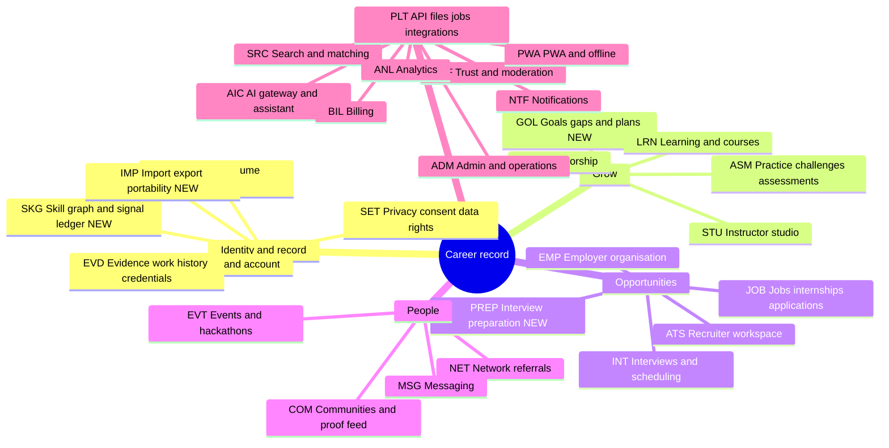

### 4.2 Module register (place, state, phase)

Phases are defined in [§15](#15-roadmap-priorities-and-dependencies). "Blueprint" links to the full specification.

| Code | Module | Brief area | State today | Phase | Why this phase |
| --- | --- | --- | --- | --- | --- |
| IDN | Identity, authentication, account | Identity | **EXISTS, durable** (no reset, no OAuth) | P0 to P1 | Password reset needs email (P0); GitHub and Google sign-in in P1 for import |
| SET | Settings, privacy, consent, data rights | Admin, privacy | **EXISTS, durable** (export, erasure) | P0 | Consent ledger must exist before imports and AI |
| PRF | Profile, resume, portfolio | Profile, resume | **PARTIAL, ephemeral** | P0 to P1 | First screen every user sees; durable resumes in flight (T-007) |
| EVD | Evidence, work history, credentials | Verification | **EXISTS, durable** | P1 | Becomes the source of signals |
| SKG | **Skill graph and signal ledger** (new; owns the taxonomy, resolves blueprint `OD-ARC-07`) | Verification, analytics | **PARTIAL** (skills taxonomy durable; ledger built for evidence, TS-07) | P1 | The integration spine ([§7.2](#72-the-skill-signal-ledger)) |
| IMP | **Import, export, portability** (new; consolidates blueprint `FR-PRF-019`, `FR-PRF-024`, `FR-PRF-025` and `PLT` import tooling) | Import | Export **EXISTS**; import not built | P1 | Fastest path to a useful profile; marketplace cold start |
| GOL | **Goals, gaps and plans** (new; the Goal and Gap steps of the canonical loop, today spread across `MKT` and `AIC`) | Analytics, AI | **PARTIAL** (`CareerPage` career paths) | P1 | Without a goal, recommendations have nothing to aim at |
| ASM | Practice, challenges, assessments | Coding practice | **PARTIAL, simulated** | P2 | Needs the isolated code runner (issue #49) |
| LRN | Learning and courses | LMS, courses | **PARTIAL, ephemeral** | P2 | First-party free catalog linked to gaps; durability first |
| JOB | Jobs, internships, applications | Jobs | **EXISTS, durable** | P1 | Add experience band and filters; evidence snapshot on apply |
| PREP | **Interview preparation** (new; joins applications to practice: question banks per role, mock interviews, feedback) | Jobs, coding | Not built | P2 | Connects "applied" to "ready", a brief requirement |
| ATS | Recruiter workspace | Employer | **EXISTS** (single pipeline) | P1 to P2 | Explained matches in P1; seats and scorecards in P2 |
| EMP | Employer organisation, teams, brand | Employer | **PARTIAL** (role checks inconsistent) | P2 | Fix membership roles (A-09) first |
| INT | Interviews and scheduling | Jobs | **PARTIAL, simulated** | P2 | Manual scheduling first; execution after the runner |
| MSG | Messaging | Messaging | **EXISTS, durable** | P1 | Application threads first; realtime later |
| NTF | Notifications | Notifications | **EXISTS** (no live email) | P0 | Email delivery is issue #44 |
| NET | Network, referrals | Networking | **PARTIAL** (connections durable) | P2 | Referrals become useful once jobs and graph are real |
| COM | **Communities and proof feed** (new code; replaces a generic LinkedIn-style feed) | Networking, social | Not built | P3 | See TPD-07 |
| MEN | Mentorship | Mentorship | **PARTIAL, ephemeral** (alumni mentorship) | P3 | Gated by blueprint `OD-PRD-02` |
| EVT | Events, hackathons, challenges | Events | Not built | P3 | Reuses ASM runner and COM; gated by `OD-EVT-01` |
| STU | Instructor studio | Courses | Not built | P3 | Needs files, media and payouts |
| INS | Institutions, managed learning | Courses | Not built | P3 | Needs cohorts, minors policy (`OD-PRD-11`) |
| AIC | AI gateway and assistant | AI | **PARTIAL, heuristic** | P1 (gateway) to P2 | See [§11](#11-ai-functionality-and-automation) |
| SRC | Search and matching | Jobs, AI | **PARTIAL** (in-process) | P1 | Matching must read the skill profile |
| BIL | Billing, plans | Payments | **EXISTS, disabled** | P2 | Launch policy is issue #50 (**NEEDS OWNER**) |
| TSF | Trust, safety, moderation | Moderation | **PARTIAL, ephemeral** | P1 | User content (imports, messages) needs reports and appeals that persist |
| ADM | Admin console, support | Admin | **PARTIAL** | P1 | Moderation and import support views |
| ANL | Analytics | Analytics | **PARTIAL, ephemeral** | P1 | Consented product analytics to measure the north star |
| PLT | API, files, jobs, integrations | Integrations | **PARTIAL** (fenced worker, Stripe, email) | P0 to P1 | Files are the prerequisite |
| PWA | PWA, offline, mobile | Mobile | **PARTIAL** (manifest; service worker in flight, T-009) | P0 | App shell cache, install prompt |
| BGV | Verification and background checks | Verification | **EXISTS** (referee, work email) | P1 | Third-party checks gated (`OD-PRD-19`) |
| MKT | Market intelligence, career pathing | Analytics | **PARTIAL, seed data** | P3 | Only with real, k-suppressed data |
| REP | Gamification, reputation | Engagement | **PARTIAL, ephemeral** | **PARKED** | See §4.3 |
| GIG | Freelance and project work | Projects | Not built | Later | Money-flow compliance; `OD-PRD-03` |
| ENT | Enterprise talent, internal mobility | Employer | Not built | Later | Needs SSO, SCIM, `OD-PRD-20` |

### 4.3 What to park, and why

| Item | Evidence | Reason | What happens |
| --- | --- | --- | --- |
| Behavioral talent discovery, talent segmentation, transition probability | `behavioral-talent-discovery.ts`, `talent-segmentation.ts`; 8 recruiter and career endpoints, ephemeral, no screen | Candidate-level predictive scoring for hiring; SSOT Amendment E excludes it from GA without a governance, fairness and legal review | Feature flag off in deployed environments (TPD-04). Code stays; tests stay |
| Reputation engine, XP, activity scores, leaderboard | 26 ephemeral endpoints, no screen | Counts activity, not proof (SSOT principle 11); leaderboards add comparison pressure without user value | Parked. Badges for completed, verified outcomes can return inside SKG |
| Insights from seed data (salary benchmarks, skill forecasts, learning impact) | Ephemeral, no screen | Shows numbers not computed from real data | Hidden until computed from real data with `min_cohort_k` (C-8) |
| Generic social feed (posts, likes, reach) | Not built | SSOT §4.2 non-goal ("social-media clone"); engagement-ranked feeds conflict with "value without compulsion" | Replaced by the proof feed in COM ([TPD-07](#16-decisions-this-plan-records-and-what-needs-the-owner)) |

### 4.4 Feature hierarchy of the new modules

The blueprint has no specification for SKG, IMP (as one module), GOL, PREP and COM. Their hierarchy to sub-feature level is below; micro and nano features will be specified in the slice that builds each one (and then appear in the generated catalog).

**SKG — Skill graph and signal ledger**

- SKG-1 Taxonomy: canonical skills (exists: `skills` table and routes), aliases and synonyms, relationships (exists, ephemeral), import mapping table for external names.
- SKG-2 Signal ledger: write a signal (source module, source record id, skill, level reached, evidence rung, issuer class, observed time, expiry); supersede and revoke a signal (append-only, SSOT Amendment F); idempotency on (source, source record, skill).
- SKG-3 Profile projector: recompute a person's skill profile from live signals; confidence from rung and recency (reuse `skill-decay.ts` as the recency rule); explanation ("why we think you know SQL": list of signals).
- SKG-4 User control: hide a skill, dispute a signal, choose which skills appear publicly (consent scope).
- SKG-5 Consumers: matching (SRC), gap analysis (GOL), recommendations (AIC), application snapshot (EVD).

**IMP — Import, export, portability**

- IMP-1 Sources: resume file (PDF, DOCX), LinkedIn data export ZIP, JSON Resume, TalentSphere CSV templates, GitHub (OAuth), credential links (Open Badges, verifiable credentials, issuer verification URLs). Detail in [§10](#10-data-import-migration-and-integrations).
- IMP-2 Pipeline: upload and scan, parse to a common intermediate model, normalize (dates, company and school names, skills), deduplicate against the profile, build a review diff.
- IMP-3 Review: per-item accept, edit, skip; confidence chips; "already on your profile"; nothing written before confirm (blueprint `BR-PRF-016`).
- IMP-4 Commit: write accepted items as claims with provenance `imported:<source>`; emit skill signals at the claimed rung; record the batch for undo.
- IMP-5 Undo and audit: undo a batch within a window; raw-file deletion schedule; per-batch audit.
- IMP-6 Export: existing data export (exists) extended with JSON Resume and a machine-readable evidence bundle.

**GOL — Goals, gaps and plans**

- GOL-1 Goal: target role (from the taxonomy of roles), target date, location and work-mode preferences, private by default.
- GOL-2 Gap: required skills for the role (from job postings and role templates) compared with the skill profile; shows strong, weak, missing and unproven.
- GOL-3 Plan: ordered steps (course, challenge, project, referee request, application) with the signal each step would produce; user edits freely.
- GOL-4 Progress: plan steps complete when their signal lands, not when a box is ticked.
- GOL-5 Review: an opt-in weekly or monthly progress summary.

**PREP — Interview preparation**

- PREP-1 For a saved job or application: the skills the job asks for, the user's evidence on each, the gaps.
- PREP-2 Practice set: challenges and question banks tagged to those skills (reuses ASM).
- PREP-3 Mock interview: timed practice with structured self-review; AI feedback only with consent and quota ([§11](#11-ai-functionality-and-automation)); never shared with employers unless the user adds it as evidence.
- PREP-4 After an outcome: rejection feedback (exists as `application-feedback`, ephemeral) feeds new plan steps.

**COM — Communities and proof feed**

- COM-1 Proof feed: a chronological feed of verified events from people you follow and communities you join (skill proven, project shipped, credential earned, hackathon result). The user opts in per event type; nothing posts without consent.
- COM-2 Communities: skill and role-based groups with questions, answers and resources; moderated through TSF.
- COM-3 Posts: text posts allowed inside communities; no global engagement ranking; reverse chronological by default.

---

## 5. Personas and end-to-end journeys

Full persona definitions and the 78 blueprint journeys (`JRN-`) are in [blueprint 01 §03](../blueprint/01_PRODUCT.md#03--personas-and-roles) and [§05](../blueprint/01_PRODUCT.md#05--user-journeys); the legacy journeys J-01 to J-28 are in [`experience/JOURNEY_REGISTRY.md`](../experience/JOURNEY_REGISTRY.md); journeys proven by e2e tests are in [`mindmap/catalog/JOURNEY_GRAPHS.md`](../mindmap/catalog/JOURNEY_GRAPHS.md). This section gives each persona's primary job, what supports it today, and the phase that completes it.

### 5.1 Persona register

| Persona | Primary job to be done | Supported today | Missing for the journey | Phase |
| --- | --- | --- | --- | --- |
| Student | Find out what to learn for a first job; get an internship | Profile, evidence, jobs (internship type exists), applications | Internship filter, goals and gaps, executed practice | P1 to P2 |
| Fresher | Stand out without experience; get interviews | Same | Import, verified projects (GitHub), explained matches, interview prep | P1 to P2 |
| Career switcher | Show transferable skills; close a gap fast | Same | Gap analysis, learning tied to signals | P1 to P2 |
| Experienced professional | Keep a true record; be found for the right roles; grow | Verified work history with referees | Import from LinkedIn export, recruiter discovery under consent | P1 to P2 |
| Job seeker (active) | Apply efficiently and hear back | Applications state machine, notifications, drafts | Evidence snapshot on apply, candidate notice on every close | P1 |
| Employee (not looking) | Grow in role; keep skills current | Evidence and skills | Plans, learning, skill recency | P2 |
| Recruiter | Find and assess candidates on evidence | Hiring pages, pipeline | Explained matches, consent-gated search, scorecards | P1 to P2 |
| Hiring manager | Decide with trustworthy signals | Pipeline view | Scorecards, executed assessment results | P2 |
| Employer admin | Manage team, brand and plan | Organizations, billing (disabled) | Role-checked membership, company page, seats | P2 |
| Educator, instructor | Teach and issue credible outcomes | Course read paths | Studio, graded assessments, payouts | P3 |
| Institution admin | Run cohorts; show employability | Not supported | INS module | P3 |
| Mentor | Help others; build reputation from outcomes | Alumni mentorship (ephemeral) | MEN module | P3 |
| Moderator, platform admin | Keep the platform safe | Admin audit, flags | Durable moderation, import support | P1 |

### 5.2 The master journey

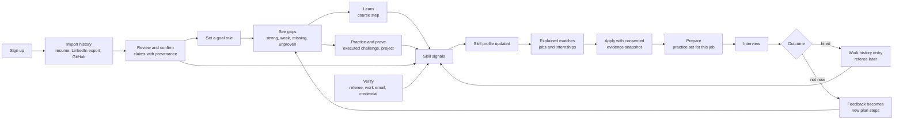

Every arrow into "Skill signals" is a module writing to the ledger; every arrow out of "Skill profile" is a module reading from it. This diagram is the acceptance shape of the P1 and P2 exit scenarios in [§15](#15-roadmap-priorities-and-dependencies).

### 5.3 Recruiter journey

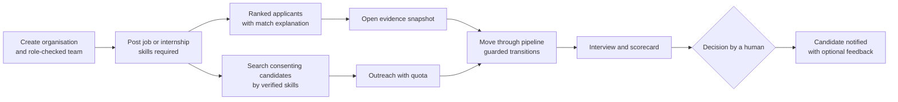

---

## 6. Feature-level user flows and application flows

Existing flows (authentication, jobs and applications, verified work history, Stripe billing, boot and background jobs, web navigation) are drawn in [`system-model/02-flows.md`](../system-model/02-flows.md) (F1 to F7) and are not repeated. The flows below are the new ones this plan introduces.

### 6.1 Import with review (user flow)

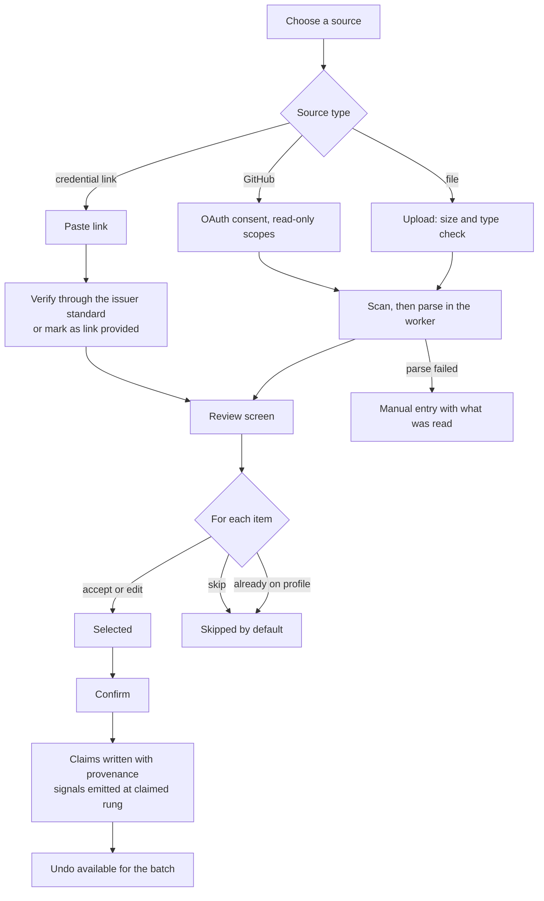

### 6.2 Import (application flow)

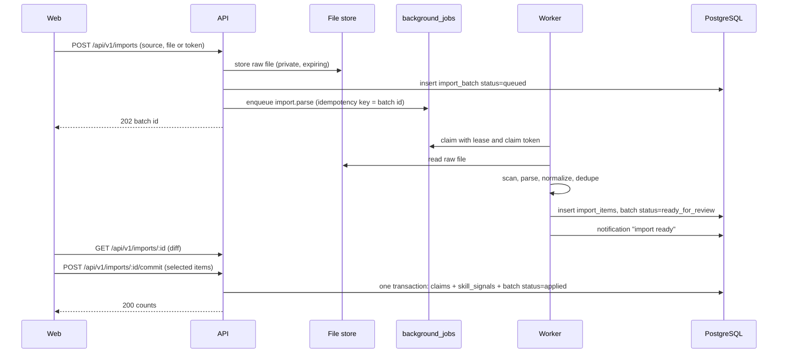

### 6.3 Prove a skill with an executed challenge

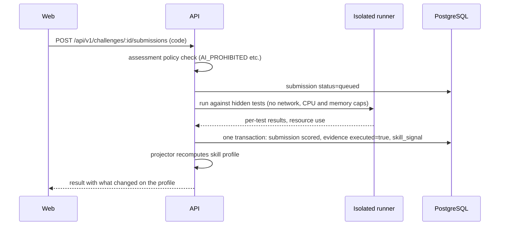

Today the first and last steps exist and the runner does not, so the evidence is stored as `executed: false` — the honest behaviour this flow keeps until the runner exists.

### 6.4 Apply with an evidence snapshot and preparation

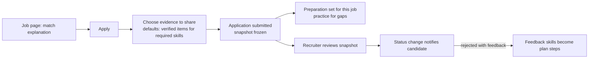

### 6.5 Goal to plan

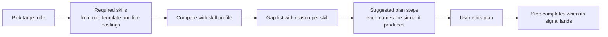

---

## 7. System-wide data flows and module dependencies

Existing code-derived data flows are in [`mindmap/catalog/DATA_FLOW_GRAPHS.md`](../mindmap/catalog/DATA_FLOW_GRAPHS.md) and the API dependency graph in [`API_DEPENDENCY_GRAPH.md`](../mindmap/catalog/API_DEPENDENCY_GRAPH.md).

### 7.1 Target data flow

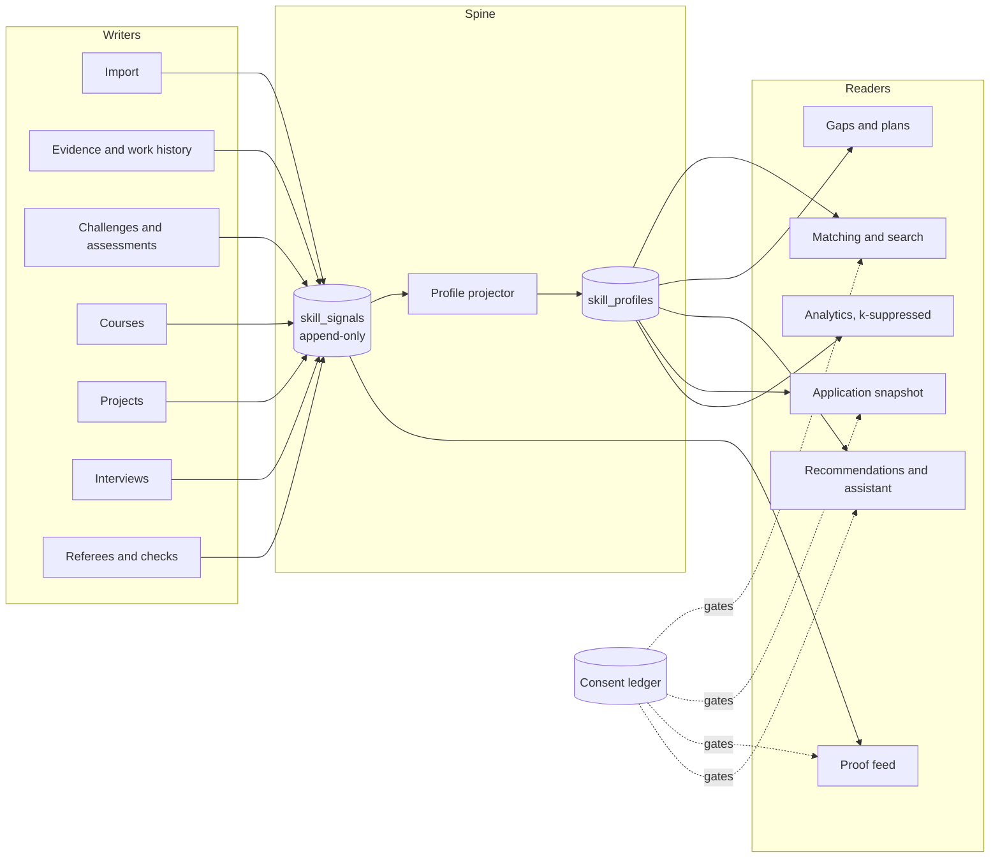

### 7.2 The skill-signal ledger

**Problem it solves.** Today skills are attached to evidence records and read directly by each feature (`skills.ts`, `evidence.ts`, matching in `search.ts`). Each new module would have to learn every other module's records to know what a person can do. That coupling is what turns a super app into separate apps.

**Design (PROPOSED).**

| Element | Rule |
| --- | --- |
| Signal | `(subject, skill, level, rung, issuer_class, source_module, source_ref, observed_at, expires_at, status)` |
| Rungs | Reuse the evidence ladder already in `packages/domain/src/evidence.ts` (claimed, artifact-backed, peer-attested, authority-verified) |
| Writes | Only through one domain function `recordSkillSignal` in `packages/domain`, called inside the writer's own transaction; idempotent on `(source_module, source_ref, skill)` |
| Changes | Never updated in place: a correction supersedes; a revoked evidence item revokes its signals (SSOT Amendment F) |
| Profile | Derived, recomputable from signals at any time; never edited directly |
| Reads | Matching, gaps, recommendations and snapshots read `skill_profiles` only, never another module's tables |
| AI | AI output can suggest; it never writes a signal above `claimed` (SSOT Amendment C) |

**Acceptance.** (1) Given a passing executed challenge tagged SQL, the user's SQL confidence rises and a SQL-requiring job's match explanation names the challenge, within one request cycle. (2) Revoking the evidence removes its effect on the profile and the match. (3) Recomputing all profiles from signals gives the same result as the incremental projector.

**Built (TS-07, 2026-11-27).** The ledger exists with evidence as its first and only source:

- `skill_signals` (migration 00060) and `packages/domain/src/skill-signals.ts` (`deriveEvidenceSignals`, `recordSkillSignals`, `projectSkillProfile`).
- Every evidence write emits its signals inside `persist()`, in the same transaction as the evidence: create, verify, dispute, revoke, course completion and erasure. A change retires the old rows (`superseded`, or `revoked` when the evidence stops counting) and inserts the new set.
- At boot the API fills in signals for any evidence that has none, so existing evidence needed no data migration.
- `GET /api/v1/skills/profile/me` returns the profile with the evidence each skill rests on.

Where it differs from the design above, on purpose:

- Rungs are the evidence verification levels (`unverified`, `peer_reviewed`, `institution_verified`, `authority_verified`), not a new ladder.
- There is no numeric confidence, `level`, `issuer_class` or `expires_at` yet; nothing reads them.
- The profile is computed on read from live signals, so case (3) holds by construction and `skill_profiles` is deferred until a reader needs it stored.
- Signals are written in the writer's transaction, so no outbox is needed for them.

Case (2) is tested for the profile (`tests/integration/skill-profile.test.ts`, `tests/pg/skill-signals.test.ts`). The match half of cases (1) and (2) is TS-13, and executed challenges do not exist yet.

### 7.3 Module dependencies (build order)

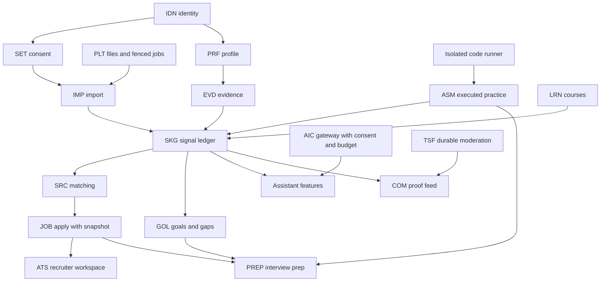

---

## 8. Unified product architecture

### 8.1 Evaluation of the current stack

| Choice | Keep? | Evidence and reasoning |
| --- | --- | --- |
| React 19, TypeScript, Vite, PWA | **Keep** | Works, tested by 265 e2e tests; a PWA reaches mobile users in India without app-store friction |
| Fastify modular monolith | **Keep**, split the file (A-01) | One team, one deployable is right at this size; split into services only on measured need (ADR-001) |
| Pure domain package | **Keep** | The strongest part of the codebase; the skill ledger goes here |
| PostgreSQL | **Keep** | Covers relational data, queue, full-text search, `pg_trgm`, `jsonb` for import items, and `pgvector` later if semantic matching proves its worth |
| In-memory Map read model (ADR-015) | **Change gradually** | Blocks a second API instance; new modules read SQL directly; core reads move next (TPD-05) |
| Self-issued HMAC sessions | **Keep the issuer, move the token** | Changing identity provider has no user value now; moving the token to an httpOnly cookie closes the XSS risk (TS-10) |
| PostgreSQL job queue | **Keep** (see A-11) | Already durable, tested and fenced by attempts |
| Local heuristic AI | **Replace behind the existing gateway** | `ai-gateway.ts` already models `executionMode: 'cloud_provider'`; add a provider adapter under consent and budget (**NEEDS OWNER**, ADR-007, INVARIANT-007) |
| Stripe | **Keep, disabled** until issue #50 | Payment changes need the owner |
| Oracle Always Free hosting | **Keep for staging** | Prove deploy and restore there (T-004) before choosing production hosting |

### 8.2 Target architecture

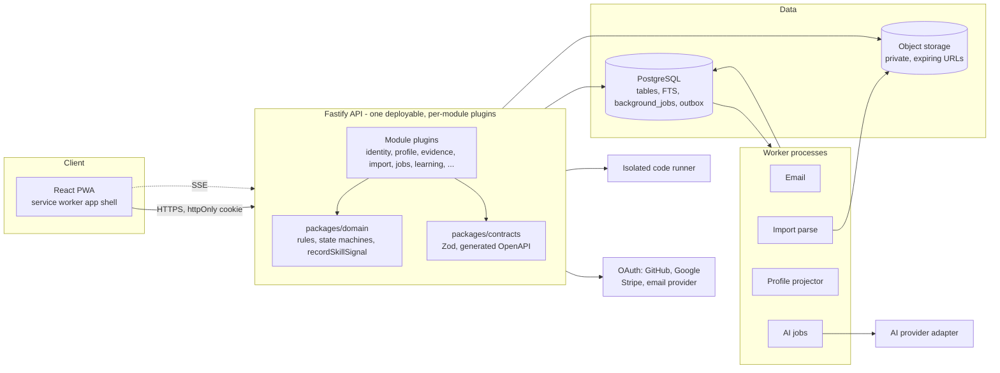

### 8.3 Architecture decisions by area

| Area | Recommendation | Status |
| --- | --- | --- |
| Module boundaries | One Fastify plugin per module, owning its routes, store and contracts section; modules talk only through domain functions and the signal ledger, never another module's tables | PROPOSED (TS-12, **NEEDS OWNER**) |
| Frontend | Keep React Router; group screens into the five spaces of [§12](#12-ux-redesign-strategy-and-design-system); keep the `apiJson` helper (no new state library needed at this size) | PROPOSED |
| Mobile | PWA with service worker (T-009) and install prompt; native wrapper only after `OD-PRD-36` | PROPOSED |
| Data ownership | Each table has one owning module; cross-module reads go through the owning module's domain function or the skill profile | PROPOSED |
| API | Versioned `/api/v1`; cursor pagination and `Idempotency-Key` on every create from P1 onward; OpenAPI generated from Zod | PROPOSED (OpenAPI **NEEDS OWNER**) |
| Authentication | httpOnly cookie; password reset by email; GitHub and Google OIDC sign-in linked to an existing account by verified email | Cookie and password reset IMPLEMENTED ([ADR-019](../engineering/DECISIONS.md#adr-019--browser-session-in-an-httponly-cookie-with-csrf-defence-password-reset-by-email-issue-49-plan-ts-10)); OIDC PROPOSED |
| Authorization | Keep per-handler checks; add an organization-role policy in `packages/domain` (A-09); test cross-tenant access in the PostgreSQL suite | IMPLEMENTED (TS-04, ADR-032) |
| AI orchestration | One gateway: consent check, `AI_PROHIBITED` check, quota, budget, prompt templates in code, output marked as suggestion; non-AI fallback always | PROPOSED (**NEEDS OWNER**) |
| Search and recommendation | PostgreSQL FTS plus `pg_trgm` for jobs, people and courses; matching = explained score from the skill profile; embeddings only after a measured relevance gap | PROPOSED |
| Events | Transactional outbox rows written in the same transaction as the change; worker delivers to handlers (projector, notifications, feed) | PROPOSED (extends `background_jobs`) |
| Caching | HTTP caching for public pages and the course catalog; service worker for the app shell; no distributed cache until measured (SSOT A.6) | PROPOSED |
| Files and media | Object storage adapter; private by default; signed expiring URLs; scan before parse; raw import files deleted on schedule | PROPOSED (**NEEDS OWNER**: new infrastructure) |
| Real-time | Server-sent events for notifications and message arrival; persistence stays authoritative (SSOT A.5) | PROPOSED |
| Observability | Keep Pino and request ids; add metrics for queue depth, job age, import success, runner latency; error tracking service | PROPOSED (vendor **NEEDS OWNER**) |
| Backup and recovery | Nightly logical backup plus point-in-time recovery on the production database; quarterly restore drill with recorded time ([`deploy/oracle/RECOVERY.md`](../../deploy/oracle/RECOVERY.md)) | PLANNED (T-004) |

---

## 9. Database and API recommendations

The current schema (61 migrations, 115 tables) is documented in [`engineering/DATABASE.md`](../engineering/DATABASE.md) and the endpoints in [`engineering/API_CONTRACTS.md`](../engineering/API_CONTRACTS.md). The blueprint's intended entities are in [`blueprint/09_REGISTERS/DATA_ENTITY_REGISTER.md`](../blueprint/09_REGISTERS/DATA_ENTITY_REGISTER.md).

### 9.1 Principles

1. **Additive migrations only**; no drops or renames without an owner-approved migration plan.
2. **One owning module per table.** The 74 tables with no code consumer are not dropped: each is either adopted by the module that makes it durable or listed for a later, approved cleanup.
3. **Use the tables that already exist** before adding new ones: `resumes`, `portfolio_projects`, `courses`, `lessons`, `challenge_submissions`, `moderation_reports` already have schemas from migrations 00004 to 00017.
4. Every table holding user data has row-level security policies and a PostgreSQL test (the `00047` hardening pattern), even though the API connection bypasses RLS today.
5. Every user-data table is covered by export and erasure.

### 9.2 New entities (PROPOSED)

| Entity | Owner | Key columns | Notes |
| --- | --- | --- | --- |
| `skill_signals` | SKG | id, subject_id, skill_id, level, rung, issuer_class, source_module, source_ref, observed_at, expires_at, status, superseded_by | Unique (source_module, source_ref, skill_id) where status = live. Built in 00060 without level, issuer_class, expires_at and superseded_by (retired rows carry `retired_at`) |
| `skill_profiles` | SKG | subject_id, skill_id, confidence, strongest_rung, last_signal_at, visibility | Derived; rebuildable |
| `skill_aliases` | SKG | alias, skill_id, source | Maps imported names ("ReactJS", "React.js") to canonical skills |
| `files` | PLT | id, owner_id, purpose, storage_key, size, mime, scan_status, expires_at | No file bytes in PostgreSQL |
| `import_batches` | IMP | id, owner_id, source, status, file_id, created_at, applied_at, undo_until | Status follows blueprint `SM-PRF-03` |
| `import_items` | IMP | id, batch_id, kind, payload jsonb, confidence, match_ref, decision | Kind: position, education, skill, certification, project, language |
| `external_accounts` | IDN | id, user_id, provider, provider_user_id, scopes, token_ref, linked_at, revoked_at | Tokens encrypted; only reference stored in this table |
| `career_goals` | GOL | id, user_id, target_role_id, target_date, preferences jsonb, visibility | Private by default |
| `plan_steps` | GOL | id, goal_id, kind, ref, expected_skill_id, status, completed_by_signal | Completion only through a signal |
| `role_templates` | GOL | id, title, skill requirements jsonb, source | Seeded, then refined from live postings |
| `outbox_events` | PLT | id, topic, payload, created_at, delivered_at | Not needed for TS-07: signals are written in the writer's own transaction. Decide when a slice first needs cross-module events |
| `consents` | SET | user_id, scope, granted_at, revoked_at, version | One ledger for all modules (blueprint `SET`) |

### 9.3 New and changed endpoints (PROPOSED)

| Method and path | Purpose | Module |
| --- | --- | --- |
| `POST /api/v1/files` | Create an upload (returns an upload target); scan job queued | PLT |
| `POST /api/v1/imports` | Start an import batch from a file, a connected account or a link | IMP |
| `GET /api/v1/imports/:id` | Batch status and review diff | IMP |
| `POST /api/v1/imports/:id/commit` | Commit selected items (idempotent) | IMP |
| `POST /api/v1/imports/:id/undo` | Undo a committed batch inside the window | IMP |
| `GET /api/v1/skills/profile/me` | My skill profile with explanation per skill | SKG |
| `POST /api/v1/skills/signals/:id/dispute` | Dispute a signal | SKG |
| `GET/POST/PATCH /api/v1/goals` | Goals and plan steps | GOL |
| `GET /api/v1/goals/:id/gaps` | Gap analysis against the profile | GOL |
| `GET /api/v1/jobs/:id/match` | Match explanation for the signed-in user | SRC |
| `GET /api/v1/jobs/:id/prep` | Preparation set for a job | PREP |
| `POST /api/v1/auth/password-reset/request` and `/confirm` | Password reset by email (IMPLEMENTED, ADR-019) | IDN |
| `GET /api/v1/auth/oauth/:provider/start` and `/callback` | GitHub and Google sign-in or account linking | IDN |
| `GET /api/v1/events` (SSE) | Notification and message stream | NTF |

Conventions for all new endpoints: Zod schema in `packages/contracts`, errors through the global envelope (INVARIANT-004), record-level authorization (INVARIANT-014), cursor pagination for lists, `Idempotency-Key` for creates, listed in `DURABLE_ROUTES` from the first commit.

---

## 10. Data import, migration and integrations

### 10.1 Rules (all sources)

These extend blueprint rules `BR-PRF-016` (nothing written before the user confirms) and `BR-PRF-032` (no scraping, no logging in to other sites as the user); they are not restated there.

1. **Authorized paths only:** a file the user exported themselves, an official API the user authorized with OAuth, or an open verification standard the issuer publishes. Never scraping, never storing another site's password, never automated browsing of a logged-in session.
2. **Show before write:** every import ends in a review screen; the user can edit, skip or accept each item.
3. **Claims, not truth:** imported items are claims with provenance `imported:<source>`. Only an issuer verification or a TalentSphere verification raises the rung.
4. **Deduplicate:** positions match on normalized company, title and start month; education on institution, degree and start year; skills on canonical id after alias mapping; credentials on issuer and credential id. Matches default to "skip".
5. **Minimize:** read only the files and fields the import needs; ignore the rest of an archive; delete raw files on a schedule (blueprint `BR-PRF-017`).
6. **No third-party personal data by default:** contacts and connections lists in exports are ignored (they hold other people's data, who did not consent). A later "find people you know who are already here" feature needs its own consent design and counsel review.
7. **Undo:** a committed batch can be undone inside a window.
8. **Honesty about verification:** a credential link that could not be checked shows "link provided", not "verified".

### 10.2 Per-platform strategy

Third-party capabilities below reflect public developer documentation as known on 2026-11-26. **Re-check each provider's current terms and API access before building its adapter**; the build slice for each source includes that check as its first acceptance step.

| Platform | Authorized path | What can come in | Verification possible | Phase |
| --- | --- | --- | --- | --- |
| Any (resume) | Upload PDF or DOCX | Positions, education, skills, certifications, projects, links | None (claims) | P1 |
| LinkedIn | Member's own data export (Settings, "Get a copy of your data", ZIP of CSV files); "Sign In with LinkedIn" (OpenID Connect) for name, email and photo only. Full profile APIs are restricted to approved partners; an EU member data portability API exists for eligible members and apps | Profile, positions, education, skills, certifications, languages, projects from the CSV files; contacts ignored (rule 6) | None from the export | P1 (export); sign-in P2 |
| GitHub | OAuth app or GitHub App, read-only scopes, official REST and GraphQL APIs | Public (and, if granted, private) repositories, languages, contribution history, README text | Ownership of the account (OAuth); repository facts are API-backed, so projects can be artifact-backed | P1 |
| HackerRank | No public candidate profile API known; certificates have public certificate pages | Certificate name and link the user pastes; resume or manual entry for the rest | "Link provided" unless HackerRank offers a verification method the terms permit | P2 |
| Coursera | No general learner API for individuals; shareable certificate verification links; organization APIs for enterprise customers | Course and certificate entries the user pastes or that appear in their resume or LinkedIn export | Through issuer verification link only where terms permit; otherwise "link provided" | P2 |
| Udemy | No public learner API for individuals; certificate links; business APIs for organizations | Same as Coursera | Same | P2 |
| Naukri | No public candidate API known | Upload the resume downloaded from Naukri | None | P1 (via resume) |
| Internshala | No public API known; certificate verification pages for its trainings | Resume upload; internship entries; certificate links | "Link provided" by default | P1 (via resume); links P2 |
| Credly and other Open Badges issuers | Open Badges 2.0 and 3.0 assertions (JSON-LD, hosted or signed); W3C Verifiable Credentials | Badge name, issuer, date, skills, criteria | **Yes**, cryptographic or hosted verification per the standard | P2 |
| JSON Resume, Europass | File upload of the open format | Everything the format holds | None | P1 |
| TalentSphere CSV templates | Download template, fill, upload | Positions, education, skills, certifications (one CSV per kind) | None | P1 |
| Job application history | Only from the user's own export where a platform offers one; otherwise manual | Company, role, date, outcome (private tracker) | None | P3 |

### 10.3 Intermediate model

All parsers produce the same model so normalization, deduplication and review are written once:

| Kind | Fields |
| --- | --- |
| identity | name, headline, location, links |
| position | company, title, employment type, start, end, description, skills mentioned |
| education | institution, degree, field, start, end, grade |
| skill | name as written, source text, canonical id (after mapping), confidence |
| certification | name, issuer, issued, expires, credential id, verification url, verification result |
| project | name, url, description, repository facts (GitHub), skills |
| language | name, proficiency |

### 10.4 Acceptance criteria for import (P1 exit)

1. A user uploads a two-page PDF resume and reaches the review screen with positions, education and skills populated; nothing is on the profile until confirm.
2. Re-importing the same file proposes no duplicates (all items default to skip).
3. A LinkedIn export ZIP with `Connections.csv` imports profile data and stores no connection rows.
4. A 600-file or over-limit ZIP is rejected with a clear message and nothing imported (blueprint `FR-PRF-019` case 2).
5. Undo removes every item and signal from the batch.
6. GitHub import lists repositories; selected ones become projects with language skills as artifact-backed signals.
7. Each committed item shows its source on the profile.
8. Raw files are gone after the retention window (PostgreSQL test with a controlled clock).

### 10.5 Outbound integrations and export

Existing data export (`POST /api/v1/settings/export`, called from `ProfilePage.tsx`; the export request record is durable) extends to JSON Resume and an evidence bundle, so users can leave with their record. Calendar, ATS, HRIS and LTI integrations remain as specified in blueprint `PLT` and are phase P3 or later.

---

## 11. AI functionality and automation

### 11.1 Rules (from SSOT Amendment C and invariants, restated only as checks)

Consent before any model call; `AI_PROHIBITED` assessments block every AI entry point server-side (INVARIANT-008); free users never cause paid inference without an approved cost policy (INVARIANT-007); AI output never becomes verified evidence; a non-AI fallback exists for every feature; no candidate-level automated hiring decision (Amendment E).

### 11.2 Opportunities, ordered by value and risk

| # | Feature | User value | Signal written | Fallback without AI | Risk | Phase |
| --- | --- | --- | --- | --- | --- | --- |
| 1 | Resume parsing assist (structure free text into the intermediate model) | Saves the most typing of any feature | None until the user confirms; then claims | Rule-based parser, manual entry | Low (user reviews every item) | P1 |
| 2 | Skill extraction and alias mapping from imported text | Correct skills on day one | Claims only | Alias table and exact match | Low | P1 |
| 3 | Gap explanation in plain language | Makes the gap list actionable | None | Template text | Low | P2 |
| 4 | Plan suggestions from the gap | Faster planning | None (user adds steps) | Rule: one course and one challenge per missing skill | Low | P2 |
| 5 | Mock interview feedback | Practice with feedback at any hour | None unless the user adds it as a self-assessment | Rubric checklist | Medium (quality) | P2 |
| 6 | Job description quality check for recruiters (bias wording, missing skills) | Better postings | None | Word lists | Low | P2 |
| 7 | Match explanation wording | Clearer reasons | None (score comes from rules) | Template | Low | P2 |
| 8 | Assistant chat grounded in the user's own record | Questions about one's own career | None | Help pages | Medium (cost, wrong answers) | P3 |
| — | Candidate ranking or automated rejection | — | — | — | **Excluded** (Amendment E) | Never without a governance review |

### 11.3 Architecture

The existing `ai-gateway.ts` becomes the only path to a model: consent check, policy check (`AI_PROHIBITED`), quota and budget (`AI_QUOTA_LIMITS`), prompt template id and version, provider adapter, output tagged as suggestion, usage meter (the `ai_usage_meters` table already exists in migration 00008). Provider choice, funding and limits are **NEEDS OWNER** (`OD-PRD-21`, ADR-007). The assistant-query path that skips the quota today (ARCHITECTURE R-4) must route through the gateway before any provider is switched on.

### 11.4 Automation that does not need AI

Job alerts (durable), referee reminders, expiring-credential reminders, plan-step completion from signals, candidate notice on every terminal application state, import-ready notification, weekly opt-in progress summary. These run as worker job kinds with idempotency keys.

---

## 12. UX redesign strategy and design system

The design system is [`experience/UI_UX_DESIGN_SYSTEM.md`](../experience/UI_UX_DESIGN_SYSTEM.md) (tokens in `packages/ui/src/tokens.ts`, primitives in `apps/web/src/components/ui`, WCAG 2.2 AA). The blueprint's full experience specification is [`blueprint/03_EXPERIENCE.md`](../blueprint/03_EXPERIENCE.md). Keep both; this section sets the direction.

### 12.1 Information architecture: five spaces

Today the navigation lists modules (Jobs, Learning, Assessments, Evidence, Portfolio, Resumes, Network, Career...). Users think in goals, so group the 29 screens into five spaces for candidates and one workspace for employers:

| Space | Holds | Today's screens |
| --- | --- | --- |
| **Home** | Next best steps, what changed on my record, opt-in summary | `DashboardPage` |
| **My record** | Profile, skills with explanations, evidence, work history, projects, resumes, import and export | `ProfilePage`, `EvidencePage`, `PortfolioPage`, `ResumesPage`, `VerifyPage`, `ReferencePage` |
| **Grow** | Goal, gaps, plan, courses, practice | `CareerPage`, `LearningPage`, `CoursePage`, `AssessmentsPage` |
| **Opportunities** | Matches, jobs and internships, applications, preparation | `JobsPage`, `JobDetailPage`, `ApplicationsPage` |
| **People** | Connections, messages, communities (later) | `NetworkPage`, `MessagesPage`, `ConversationPage` |
| Hiring workspace | Jobs, pipeline, candidate snapshots, team | `HiringPage`, `HiringJobPage` |

### 12.2 Key UX patterns

1. **Onboarding is import:** sign up, then "Bring in your history" with the sources of §10.2, then review; a person reaches a populated record in one session.
2. **Every skill shows why:** a chip with the rung and a tap-through list of signals.
3. **Every match shows why and what is missing.**
4. **One honest state language:** verified, link provided, claimed, not yet executed. Reuse `VerificationSeal` and `StatusPill`.
5. **Loading, empty and error states on every screen that calls the API** (19 missing today, tracker baseline).
6. **Mobile first:** the wedge uses phones; every flow passes at 360 px width.
7. **No dark patterns:** no fake urgency, no pre-ticked sharing, unsubscribe in one tap.

### 12.3 Design system work

Keep one token source and one primitive set (ARCHITECTURE R-3). Add primitives the new flows need: file drop zone, review-diff row (accept, edit, skip), skill chip with rung, match explanation panel, stepper. Each lands with its first user and is verified in the browser with Reticle, as `CLAUDE.md` requires.

---

## 13. Security, privacy, scalability and performance

Owners: [`quality/SECURITY.md`](../quality/SECURITY.md), [`blueprint/05_SECURITY_PRIVACY.md`](../blueprint/05_SECURITY_PRIVACY.md), [`quality/OPERATIONS.md`](../quality/OPERATIONS.md). This section lists only what the transformation adds or makes urgent.

### 13.1 Security

| Item | Why now | Status |
| --- | --- | --- |
| Session token to httpOnly cookie plus CSRF | Imports and OAuth raise the value of an account | IMPLEMENTED (ADR-019) |
| Password reset by email | No account recovery exists | Depends on issue #44 |
| OAuth state and PKCE, token encryption, scope minimization | New provider sign-in | PROPOSED |
| File pipeline: type sniffing, size and count limits, malware scan, parse in the worker only, no macros, zip-bomb limits | Untrusted uploads | PROPOSED |
| Code runner isolation: no network, CPU, memory and time caps, read-only filesystem, separate host or sandbox | Untrusted code | **NEEDS OWNER** (issue #49) |
| Organization-role policy | Employer seats | IMPLEMENTED (A-09, ADR-032) |
| Server-side request forgery guard for any link verification fetch | Credential links | PROPOSED |
| Prompt-injection handling: imported text is data, never instructions, in AI prompts | AI over user files | PROPOSED |

### 13.2 Privacy

- One consent ledger (`consents`) with scopes per purpose: profile visibility, recruiter discovery, application snapshot, AI processing, product analytics, proof feed.
- Imports minimize data and ignore third-party contacts (rule 10.1.6).
- India's Digital Personal Data Protection Act and the GDPR shape notices, consent, erasure and breach duties; mapping to actual controls needs counsel before compliance is claimed (SSOT Amendment G; issue #45).
- Cohort suppression for any aggregate uses `min_cohort_k`: 10 distinct people ([ADR-028](../engineering/DECISIONS.md#adr-028--one-small-cell-threshold-min_cohort_k--10-distinct-people-conflict-c-8)).

### 13.3 Scalability and performance

| Step | Trigger | Action |
| --- | --- | --- |
| 1 | Now | Service worker app shell; HTTP caching of public pages; indexes for every new list query |
| 2 | Before a second API instance | Core reads from SQL (TPD-05); single-writer lease removed only after that |
| 3 | Import and AI volume | Separate worker processes per job family; abort signals for long handlers |
| 4 | Search latency above budget | Materialized search documents; then a dedicated engine only with evidence |
| 5 | Read load | Read replica for search and analytics |

Budgets (PROPOSED, to measure against): API p95 under 300 ms for reads and 800 ms for writes; import parse under 30 s for a two-page resume; first contentful paint under 2.5 s on a mid-range phone over 4G; code runner result under 10 s.

---

## 14. Monetization and business model

The options, payers and guardrails are already specified in [blueprint 01 §10](../blueprint/01_PRODUCT.md#10-business-model-options-decision-gated) and the coded plans in [`PRICING.md`](../PRICING.md). This plan recommends an order; it changes no price, plan or entitlement (payment changes need the owner).

| Order | Stream | Why this order | Guardrail |
| --- | --- | --- | --- |
| 1 | **Candidates free** for the whole core loop (import, record, verification, practice, applications) | The record only has value if it is complete; charging candidates first would empty the marketplace | Core loop always free (blueprint `BR-XCT-027`) |
| 2 | **Employer subscriptions**: job and internship slots, consent-gated verified search, outreach quota, seats | Employers pay for time saved and trust gained; aligns revenue with evidence quality | Never pay-to-rank |
| 3 | **Institution licences**: cohorts, placement analytics (k-suppressed) | Institutions need employability proof; graduates keep their identity | Learner owns identity after graduation |
| 4 | **Candidate Pro**: higher AI quotas, more mock interviews, advanced analytics | Covers AI cost for heavy users | No credibility, rank or visibility for money |
| 5 | **Course and mentoring marketplace fees** | Needs payouts, tax and refunds | Seller-of-record decision `OD-PRD-04` |

Excluded: advertising network, selling personal data, pay-to-apply, paid "verified" badges (blueprint §10). The launch choice between free-only and paid plans is issue #50 (**NEEDS OWNER**).

---

## 15. Roadmap, priorities and dependencies

Phases have exit scenarios instead of dates. They replace nothing in the blueprint's R0 to R6 tier plan; they are the as-built path to it: P0 and P1 together deliver what blueprint R0 and R1 describe, starting from the code that exists rather than from new foundations.

### 15.1 Phases

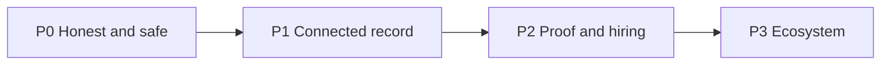

| Phase | Goal | Contents | Exit scenario (observable) | Gating decisions |
| --- | --- | --- | --- | --- |
| **P0 Honest and safe** | No user meets a feature that loses data or pretends | Issues #44 to #47; T-007 resumes; T-009 service worker; ephemeral modules flagged off or made durable (TS-03); park list (TPD-04, done in PR #101); file storage (TS-06) | In a staging deploy, a user registers, resets a password by email, edits profile and resume, applies to a job, restarts the API, and finds everything intact; no deployed response carries `x-talentsphere-durability: ephemeral` on a visible screen; a restore drill is recorded | Email provider (#44), privacy text (#45), ADR-015 (#46), staging (#47), file storage vendor |
| **P1 Connected record** | A new user reaches a populated, explained record and real matches in one session | Skill-signal ledger and projector; import (resume, LinkedIn export, JSON Resume, CSV, GitHub); goals and gaps; explained matching from the profile; experience band and internship filters; evidence snapshot on apply; durable moderation | A fresher imports a resume and GitHub, confirms, sets a goal, sees gaps, and gets internship matches whose explanations name their own evidence; applying shares only the chosen items | `OD-PRD-01` north star, `OD-PRD-09` pilot scope, OAuth security change, AI provider for parse assist (optional) |
| **P2 Proof and hiring** | Proof is executed or verified, and employers hire on it | Isolated code runner; executed challenges; course final assessments; credential verification (Open Badges, VC); interview preparation; recruiter seats, scorecards, consent-gated search; billing policy | A candidate passes an executed challenge, their match rises with a named reason, a recruiter in a multi-member organization finds them through consent-gated search, interviews and records a decision, and the candidate is notified | Issue #49 runner, issue #50 billing, organization roles, AI funding (`OD-PRD-21`) |
| **P3 Ecosystem** | The record grows from people, programs and content | Communities and proof feed; mentorship; events and hackathons on the runner; instructor studio; institutions; market insights on real data | Each admitted module writes completed outcomes as signals | `OD-PRD-02` per module, `OD-PRD-04`, `OD-PRD-07`, `OD-PRD-11`, C-8 |

### 15.2 Priorities (what happens first and why)

1. **P0 before anything new.** Every later feature depends on email, files, durable storage and honest labels; and an ephemeral feature in front of a user costs trust that new features cannot buy back.
2. **Ledger before features that read skills.** Matching, gaps, preparation and the feed all read the profile; building them first would recreate the coupling.
3. **Import before AI.** Import produces data AI needs; rule-based parsing works without a provider decision.
4. **Runner before assessments are marketed.** Until code runs, practice stays labelled "not executed".

### 15.3 First implementation slices

Each slice is one small pull request with tests, record-level authorization and a Reticle verdict for anything visible. Rows are added to the [tracker](../governance/IMPLEMENTATION_TRACKER.md).

| Slice | What | Depends on | Acceptance | Tracker | Status |
| --- | --- | --- | --- | --- | --- |
| TS-01 | Merge durable resumes (T-007) and the service worker (T-009) already built | — | Existing tests plus restart test | T-007, T-009 | IN_PROGRESS elsewhere |
| TS-02 | Park list: one feature flag per parked module, off by default in deployed environments, screens hidden | Feature flags (durable, 00051) | Flagged routes return 404 in staging config; tests updated, not deleted | T-022 | IMPLEMENTED (PR #101) |
| TS-03 | Durability sweep for visible ephemeral modules: portfolio, moderation, courses and lessons progress, challenge submissions — one PR each, using the existing tables | — | Restart test per module; routes added to `DURABLE_ROUTES` | T-010 | PLANNED |
| TS-04 | Organization-role policy in `packages/domain` and route checks | — | Cross-role tests in the PostgreSQL suite | T-023 | IMPLEMENTED ([ADR-032](../engineering/DECISIONS.md#adr-032--organization-roles-decide-what-a-member-may-do-cf-14-cf-45-plan-ts-04)) |
| TS-05 | Worker claim fencing (completion checks the claim token) | — | Already in place: fenced by the attempts counter (`tests/pg/job-claim-fencing.test.ts`) | T-024 | EXISTS (found 2026-11-26; no work needed) |
| TS-06 | File service: storage adapter (local disk in development), scan hook, `files` table, `POST /api/v1/files` | Vendor choice | Upload limits and type tests; files private; expiry job | T-025 | IMPLEMENTED for the API (ADR-020); expiry job and the `clamd` container remain |
| TS-07 | Skill-signal ledger: table, `recordSkillSignal`, projector, `GET /skills/profile/me`; evidence writes emit signals | — | The three acceptance cases in §7.2 | T-026 | IMPLEMENTED for evidence (migration 00060; see §7.2 for what differs) |
| TS-08 | Import v1: JSON Resume and CSV templates, review screen, commit and undo | TS-06, TS-07 | §10.4 cases 2, 5, 7 | T-027 | PROPOSED |
| TS-09 | Experience band on jobs; job-type and band filters on the jobs screen | — | Contract and e2e tests | T-028 | IMPLEMENTED (migration 00061; `tests/e2e/job-filters.spec.ts`) |
| TS-10 | Session cookie and password reset | Issue #44 | Token not readable by page script; reset e2e | T-029 | IMPLEMENTED (ADR-019; reset emails reach people once live email is set up) |
| TS-11 | Import v2: resume PDF and DOCX parser, LinkedIn export ZIP, GitHub OAuth | TS-08, TS-10 | §10.4 cases 1, 3, 4, 6, 8 | T-030 | PROPOSED |
| TS-12 | Split `server.ts` into module plugins, no behavior change | — | All suites pass unchanged | T-031 | **NEEDS OWNER** |
| TS-13 | Goals, gaps and explained matching from the profile | TS-07 | §6.5 flow e2e; explanation names signals | T-032 | PROPOSED |
| TS-14 | Isolated code runner and executed challenges | Issue #49 | §6.3 flow; sandbox escape tests | T-013 | **NEEDS OWNER** |

The slices that need no owner input can start now in this order: TS-07, TS-04, TS-09, TS-03, then TS-08 once TS-06 is approved (TS-02 shipped in PR #101; TS-05 turned out to exist already).

---

## 16. Decisions this plan records, and what needs the owner

The owner gave product-owner authority for reversible product decisions. These are recorded here with their reasoning; each can be reversed by editing this table and the tracker. Approved business rules, payments, production deploys, destructive migrations, new infrastructure and build files are not decided here.

| ID | Decision | Reasoning | Reversible? | Status |
| --- | --- | --- | --- | --- |
| TPD-01 | Evolve the existing monolith; do not rewrite and do not build the blueprint breadth-first | All suites pass; the durable core loop works; blueprint R0 assumes new foundations that would discard tested code without user benefit | Yes | Decided (product owner) |
| TPD-02 | Wedge: early-career technical talent and the teams that hire them | Evidence matters most with thin track records; demand shown by internship and coding-test platforms; smallest market where the full loop can be proven | Yes | Decided, to be validated by user research (`OD-PRD-25`) |
| TPD-03 | Real or hidden: no visible screen may depend on an ephemeral endpoint in deployed environments | SSOT Amendment H; trust | Yes | Decided |
| TPD-04 | Park behavioral scoring, segmentation, transition probability, reputation engine, XP and seed-data insights behind off flags | Amendment E, principle 11, no screens, ephemeral | Yes (flags) | Decided; code kept |
| TPD-05 | New modules read from SQL; core reads move to SQL before a second API instance | ADR-015's own revisit note; avoids growing the boot-hydrated model | Yes | Decided for new modules; core move follows ADR-015 ratification (#46) |
| TPD-06 | Keep the PostgreSQL job queue rather than Supabase Queues | Works and is tested; no new vendor | Yes | Decided; SSOT A.3 text change needs the owner |
| TPD-07 | No generic engagement-ranked feed; build a consented proof feed and communities later | SSOT §4.2 non-goal; value without compulsion | Yes | Decided |
| TPD-08 | Import only through user exports, official OAuth APIs and open verification standards; ignore contacts | Terms of service, privacy, SSOT §3.3 | Yes | Decided |
| TPD-09 | One skill-signal ledger is the only way modules share what a person can do | Decoupling; makes the brief's cross-module examples true | Yes | Decided |
| TPD-10 | Candidates free for the core loop; employers pay first | Marketplace balance; blueprint `BR-XCT-027` | Yes | Recommended; prices and launch policy stay with the owner (#50) |

**Decided on 2026-11-26 under the owner's delegated authority.** Each item has a full record (options, pros and cons, decision, and the steps only the owner can run) in [`engineering/DECISIONS.md`](../engineering/DECISIONS.md#owner-delegated-decisions-2026-11-26):

| Item | Decision | Record |
| --- | --- | --- |
| Email provider and live delivery (#44) | Brevo through the existing adapter | ADR-018 |
| Privacy and deletion policy (#45) | 14-day cancel window, erasure within 30 days; legal text stays a labelled draft until counsel signs off | ADR-024 |
| ADR-015 ratification (#46) | Ratified; core reads move to SQL before a second replica | ADR-017 |
| Staging deploy and restore proof (#47) | Oracle staging, one replica, nightly backups, monthly restore drill | ADR-025 |
| Beta durability scope (#48) | Only modules with a screen | ADR-026 |
| Code runner and trust rules (#49) | Self-hosted Judge0 CE on an isolated host; PR #43 endorsement rule ratified | ADR-021 |
| Launch billing policy (#50) | Free-only launch | ADR-027 |
| `min_cohort_k` (C-8) | 10 distinct people | ADR-028 |
| Rule text drift (C-22) | SSOT wording | ADR-029 |
| Course completion rung (P-02) | Completion stays unverified; certificate is a completion record | ADR-023 |
| Session cookie and password reset (TS-10) | httpOnly cookie with CSRF header; reset by hashed single-use email token | ADR-019 |
| File storage and scanning (TS-06) | S3-compatible adapter (Oracle Object Storage), ClamAV | ADR-020 |
| `server.ts` split (TS-12) | One module per PR, no behaviour change | ADR-022 |

**Still open:** the AI provider, funding and quotas (`OD-PRD-21`, ADR-007), which matter only once an AI feature is built (P1 or later); the OpenAPI generator dependency (A-08); and ratifying this plan's vision wording and wedge into `SSOT.md` (T-021).

---

## 17. Testing, deployment and production readiness

The test strategy is owned by [`quality/TESTING.md`](../quality/TESTING.md) and operations by [`quality/OPERATIONS.md`](../quality/OPERATIONS.md); the blueprint's QA strategy is [`blueprint/06_QUALITY_AND_PERFORMANCE.md`](../blueprint/06_QUALITY_AND_PERFORMANCE.md).

### 17.1 What each slice must add

| Layer | Required |
| --- | --- |
| Domain | Unit tests for every new rule and state machine, including failure branches asserted by error code (T-011 shows only 6 of 368 are today) |
| API | Integration tests for success, validation failure, wrong owner, wrong organization role, and idempotent retry |
| PostgreSQL | Restart durability test; RLS policy test; migration in the contiguous sequence (INVARIANT-009) |
| Web | Playwright journey for the user-visible path; loading, empty and error states |
| Browser verification | A Reticle verdict from `reticle_act_and_wait` or `reticle_assert` for every visible change (`CLAUDE.md`) |
| Import | A fixture corpus: resumes in several layouts and languages, real-shaped LinkedIn export ZIPs (synthetic data), malformed and hostile files (zip bomb, macro document, oversized) |
| Runner | Sandbox escape, resource exhaustion and network-access tests |
| AI | Evaluation set per prompt template with expected structure; fallback test with the provider down; `AI_PROHIBITED` test per entry point |

The honesty and migration tests (`persistence-honesty`, `database-migrations`) are never weakened.

### 17.2 Deployment path

1. **Staging** on the existing Oracle assets ([`deploy/oracle/README.md`](../../deploy/oracle/README.md)): deploy, run migrations, single-writer check, worker liveness, restore drill (issue #47).
2. **Pilot**: invited users and one or two employers under the P1 exit scenario; consented product analytics measure the north star.
3. **Production**: only after the readiness gates below; any production step needs the owner.

### 17.3 Readiness gates

| Gate | Evidence required |
| --- | --- |
| Data integrity | Restart and kill-the-worker tests green; no visible ephemeral screen |
| Security | Route authorization review findings closed for visible routes; token not script-readable; dependency audit clean |
| Privacy | Policy published (#45); export and erasure verified end to end; consent ledger in use |
| Reliability | Restore drill recorded with time to restore; alerts on queue age and error rate |
| Accessibility | Keyboard and screen-reader pass on P1 journeys; WCAG 2.2 AA checks in the browser (ADR-016) |
| Performance | Budgets in §13.3 measured on staging |
| Operations | Runbook for import failures, runner incidents, email bounces; support contact working |

---

## 18. How this plan relates to the other documents

| Document | Relationship |
| --- | --- |
| [`SSOT.md`](../SSOT.md) | Intent of record; unchanged. This plan proposes wording (vision, wedge) and one text change (A.3) for the owner to ratify (T-021) |
| [`ARCHITECTURE.md`](../ARCHITECTURE.md) | As-built; unchanged. When a slice ships, it updates ARCHITECTURE in the same PR |
| [`blueprint/`](../blueprint/README.md) | Full intended specification; unchanged and still unratified. This plan chooses an order through it, adds five modules it lacks (SKG, IMP, GOL, PREP, COM), and parks parts of REP |
| [`mindmap/`](../mindmap/README.md) | Generated as-built hierarchy; regenerated after code changes. The audit numbers in §2 come from it |
| [`governance/IMPLEMENTATION_TRACKER.md`](../governance/IMPLEMENTATION_TRACKER.md) | Holds the work items (T-021 to T-033) and their state. This plan holds the reasoning |
| [`PRICING.md`](../PRICING.md) | Unchanged; §14 only recommends an order |
| [`archive/target-blueprint/`](../archive/target-blueprint/README.md) | Unchanged history |

When a slice ships, update in the same pull request: the tracker row, the module's status in §4.2, `ARCHITECTURE.md` if a boundary moved, and regenerate the mind map.
