# Feature Catalog

The complete feature hierarchy of TalentSphere, generated from source by `project-mindmap/tools/catalog.py` at commit `9b3032f` (test results measured at `9b3032f`). Every row below is a node in the one canonical dataset, [`master/MASTER_PROJECT_GRAPH.json`](../master/MASTER_PROJECT_GRAPH.json); every view in this folder is generated from it. Do not edit by hand: change the code or the docs and regenerate.

## Levels

| Level       | What it is in this codebase                                                                                 | ID prefix  | Count |
| ----------- | ----------------------------------------------------------------------------------------------------------- | ---------- | ----- |
| PROJECT     | The whole repository                                                                                        | PROJ-      | 1     |
| APPLICATION | apps/api, apps/web, apps/worker; documented-only scope                                                      | MOD-, APP- | 4     |
| MODULE      | API module (first path segment under /api/v1), web route group, worker job family, registry category        | MOD-       | 137   |
| MAJOR       | API resource group, screen, shared component with interactions, job kind, registry feature                  | FEAT-, F-  | 414   |
| MINOR       | One endpoint capability; one screen concern (states, data, navigation, an event kind)                       | MIN-       | 431   |
| SUB         | Endpoint stage: access control, request validation, business rules, persistence, background work, responses | SUB-       | 1208  |
| SMALL       | One schema, domain call, table written, job dispatched, success or failure set                              | SML-       | 1006  |
| TINY        | One schema field, one screen state, one UI event binding                                                    | TNY-       | 824   |
| NANO        | One constraint, role, guard, error branch, status code, state setter, API request or navigation target      | NANO-      | 2582  |

A level is used only where the source shows something at that level, so some branches go from SUB straight to NANO (an access rule has no small or tiny parts). Actions, screens, components, rules, APIs, tables, tests and journeys stay technical nodes; feature nodes point to them with `IMPLEMENTED_BY`, `TRIGGERS`, `TESTED_BY` and `EXERCISES` edges.

## Verification

| Value      | Meaning                                                                                                                                     | Nodes |
| ---------- | ------------------------------------------------------------------------------------------------------------------------------------------- | ----- |
| VERIFIED   | A passing executed test contains this behaviour's own marker (error or validation message), or for an endpoint/screen, a linked test passed | 590   |
| PATH_LEVEL | Only the parent endpoint or screen has a passing linked test; the branch itself was not matched to an assertion                             | 4826  |
| NOT_RUN    | A test mentions it but no execution result exists for that file                                                                             | 0     |
| FAILING    | The matching test file has failures                                                                                                         | 0     |
| UNKNOWN    | No test evidence found                                                                                                                      | 815   |

Statuses are implementation statuses from source (IMPLEMENTED, PARTIALLY_IMPLEMENTED, NOT_IMPLEMENTED, BROKEN, DEPRECATED, UNKNOWN). Test results come from `quality/EXECUTION_RESULTS.json` (commit `9b3032f`); a test added after that commit counts as NOT_RUN or UNKNOWN.

## Map (to module level)

```mermaid
mindmap
  root((TalentSphere))
    MOD_001[MOD-001 apps/api - PARTIAL]
      MOD_086[MOD-086 api/activity]
      MOD_091[MOD-091 api/admin]
      MOD_069[MOD-069 api/ai - PARTIAL]
      MOD_085[MOD-085 api/alumni]
      MOD_094[MOD-094 api/analytics]
      MOD_063[MOD-063 api/applications]
      MOD_055[MOD-055 api/auth]
      MOD_090[MOD-090 api/billing - PARTIAL]
      MOD_065[MOD-065 api/candidates]
      MOD_082[MOD-082 api/career]
      MOD_074[MOD-074 api/certificates]
      MOD_068[MOD-068 api/challenges]
      MOD_079[MOD-079 api/connections]
      MOD_071[MOD-071 api/courses]
      MOD_057[MOD-057 api/evidence]
      MOD_054[MOD-054 api/feature-flags]
      MOD_064[MOD-064 api/feedback]
      MOD_088[MOD-088 api/gamification - PARTIAL]
      MOD_052[MOD-052 api/health]
      MOD_096[MOD-096 api/internal]
      MOD_066[MOD-066 api/interviews]
      MOD_061[MOD-061 api/job-templates]
      MOD_060[MOD-060 api/jobs]
      MOD_083[MOD-083 api/learning]
      MOD_073[MOD-073 api/lessons]
      MOD_093[MOD-093 api/moderation]
      MOD_072[MOD-072 api/modules]
      MOD_080[MOD-080 api/networking]
      MOD_077[MOD-077 api/notifications]
      MOD_059[MOD-059 api/organizations]
      MOD_087[MOD-087 api/portfolio - PARTIAL]
      MOD_056[MOD-056 api/profile]
      MOD_053[MOD-053 api/ready]
      MOD_084[MOD-084 api/recruiter]
      MOD_095[MOD-095 api/references]
      MOD_081[MOD-081 api/referrals]
      MOD_067[MOD-067 api/reputation - PARTIAL]
      MOD_078[MOD-078 api/resumes - PARTIAL]
      MOD_062[MOD-062 api/salaries - PARTIAL]
      MOD_092[MOD-092 api/search]
      MOD_089[MOD-089 api/settings]
      MOD_058[MOD-058 api/skills - PARTIAL]
      MOD_076[MOD-076 api/threads]
      MOD_075[MOD-075 api/verify]
      MOD_070[MOD-070 api/xp]
    MOD_002[MOD-002 apps/web - PARTIAL]
      MOD_160[MOD-160 web/landing]
      MOD_161[MOD-161 web/]
      MOD_162[MOD-162 web/admin]
      MOD_163[MOD-163 web/applications]
      MOD_164[MOD-164 web/assessments]
      MOD_165[MOD-165 web/career]
      MOD_166[MOD-166 web/checkout]
      MOD_167[MOD-167 web/dashboard]
      MOD_168[MOD-168 web/evidence]
      MOD_169[MOD-169 web/hiring]
      MOD_170[MOD-170 web/jobs]
      MOD_171[MOD-171 web/learning]
      MOD_172[MOD-172 web/login]
      MOD_173[MOD-173 web/messages]
      MOD_174[MOD-174 web/network]
      MOD_175[MOD-175 web/notifications]
      MOD_176[MOD-176 web/portfolio]
      MOD_177[MOD-177 web/privacy]
      MOD_178[MOD-178 web/profile]
      MOD_179[MOD-179 web/reference]
      MOD_180[MOD-180 web/resumes]
      MOD_181[MOD-181 web/settings]
      MOD_182[MOD-182 web/signup]
      MOD_183[MOD-183 web/terms]
      MOD_184[MOD-184 web/verify]
      MOD_185[MOD-185 web/shared-components]
    MOD_003[MOD-003 apps/worker - PARTIAL]
      MOD_186[MOD-186 worker/admin]
      MOD_187[MOD-187 worker/ai]
      MOD_188[MOD-188 worker/alumni]
      MOD_189[MOD-189 worker/application]
      MOD_190[MOD-190 worker/billing]
      MOD_191[MOD-191 worker/career]
      MOD_192[MOD-192 worker/connection]
      MOD_193[MOD-193 worker/employer]
      MOD_194[MOD-194 worker/evidence]
      MOD_195[MOD-195 worker/gamification]
      MOD_196[MOD-196 worker/gdpr]
      MOD_197[MOD-197 worker/instructor]
      MOD_198[MOD-198 worker/learning]
      MOD_199[MOD-199 worker/lms]
      MOD_200[MOD-200 worker/messaging]
      MOD_201[MOD-201 worker/moderation]
      MOD_202[MOD-202 worker/portfolio]
      MOD_203[MOD-203 worker/reference]
      MOD_204[MOD-204 worker/resume]
      MOD_205[MOD-205 worker/search]
      MOD_206[MOD-206 worker/skill]
      MOD_207[MOD-207 worker/user]
      MOD_208[MOD-208 worker/work_history]
    APP_001[APP-001 Documented scope registry features - PARTIAL]
      MOD_209[MOD-209 documented/Identity - UNKNOWN]
      MOD_210[MOD-210 documented/Shell - UNKNOWN]
      MOD_211[MOD-211 documented/Marketplace - UNKNOWN]
      MOD_212[MOD-212 documented/Recruiting - UNKNOWN]
      MOD_213[MOD-213 documented/Learning - UNKNOWN]
      MOD_214[MOD-214 documented/Assessment - UNKNOWN]
      MOD_215[MOD-215 documented/Social - UNKNOWN]
      MOD_216[MOD-216 documented/Communication - UNKNOWN]
      MOD_217[MOD-217 documented/Gamification - UNKNOWN]
      MOD_218[MOD-218 documented/Hiring - UNKNOWN]
      MOD_219[MOD-219 documented/Analytics - UNKNOWN]
      MOD_220[MOD-220 documented/Networking - UNKNOWN]
      MOD_221[MOD-221 documented/Career - UNKNOWN]
      MOD_222[MOD-222 documented/AI - UNKNOWN]
      MOD_223[MOD-223 documented/Verification - UNKNOWN]
      MOD_224[MOD-224 documented/Candidate - UNKNOWN]
      MOD_225[MOD-225 documented/Platform - UNKNOWN]
      MOD_226[MOD-226 documented/Intelligence - UNKNOWN]
      MOD_227[MOD-227 documented/Jobs - UNKNOWN]
      MOD_228[MOD-228 documented/Careers - UNKNOWN]
      MOD_229[MOD-229 documented/Companies - UNKNOWN]
      MOD_230[MOD-230 documented/Community - UNKNOWN]
      MOD_231[MOD-231 documented/Skills - UNKNOWN]
      MOD_232[MOD-232 documented/Portfolio - UNKNOWN]
      MOD_233[MOD-233 documented/Reputation - UNKNOWN]
      MOD_234[MOD-234 documented/Personalization - UNKNOWN]
      MOD_235[MOD-235 documented/Discovery - UNKNOWN]
      MOD_236[MOD-236 documented/Monetization - UNKNOWN]
      MOD_237[MOD-237 documented/Enterprise - UNKNOWN]
      MOD_238[MOD-238 documented/Credential - UNKNOWN]
      MOD_239[MOD-239 documented/Governance - UNKNOWN]
      MOD_240[MOD-240 documented/Company - UNKNOWN]
      MOD_241[MOD-241 documented/Edge - UNKNOWN]
      MOD_242[MOD-242 documented/Telemetry - UNKNOWN]
      MOD_243[MOD-243 documented/Engagement - UNKNOWN]
      MOD_244[MOD-244 documented/Safety - UNKNOWN]
      MOD_245[MOD-245 documented/Administration - UNKNOWN]
      MOD_246[MOD-246 documented/Institutions - UNKNOWN]
      MOD_247[MOD-247 documented/OS - UNKNOWN]
      MOD_248[MOD-248 documented/Business - UNKNOWN]
      MOD_249[MOD-249 documented/Integration - UNKNOWN]
      MOD_250[MOD-250 documented/Foundation - UNKNOWN]
      MOD_251[MOD-251 documented/Profile - UNKNOWN]
```

## Modules

| Application                          | Module                                                              | ID      | Status                | Major | Minor | Sub | Small | Tiny | Nano | Verified | Unknown |
| ------------------------------------ | ------------------------------------------------------------------- | ------- | --------------------- | ----- | ----- | --- | ----- | ---- | ---- | -------- | ------- |
| apps/api                             | [api/activity](modules/api-activity.md)                             | MOD-086 | IMPLEMENTED           | 4     | 5     | 20  | 14    | 5    | 23   | 12       | 0       |
| apps/api                             | [api/admin](modules/api-admin.md)                                   | MOD-091 | IMPLEMENTED           | 5     | 8     | 38  | 33    | 10   | 37   | 23       | 1       |
| apps/api                             | [api/ai](modules/api-ai.md)                                         | MOD-069 | PARTIALLY_IMPLEMENTED | 4     | 6     | 26  | 25    | 5    | 30   | 19       | 1       |
| apps/api                             | [api/alumni](modules/api-alumni.md)                                 | MOD-085 | IMPLEMENTED           | 4     | 11    | 50  | 38    | 21   | 83   | 19       | 3       |
| apps/api                             | [api/analytics](modules/api-analytics.md)                           | MOD-094 | IMPLEMENTED           | 2     | 3     | 13  | 11    | 4    | 14   | 9        | 0       |
| apps/api                             | [api/applications](modules/api-applications.md)                     | MOD-063 | IMPLEMENTED           | 5     | 7     | 31  | 28    | 11   | 49   | 14       | 2       |
| apps/api                             | [api/auth](modules/api-auth.md)                                     | MOD-055 | IMPLEMENTED           | 6     | 6     | 25  | 33    | 8    | 34   | 20       | 1       |
| apps/api                             | [api/billing](modules/api-billing.md)                               | MOD-090 | PARTIALLY_IMPLEMENTED | 9     | 12    | 47  | 30    | 15   | 72   | 16       | 19      |
| apps/api                             | [api/candidates](modules/api-candidates.md)                         | MOD-065 | IMPLEMENTED           | 3     | 8     | 34  | 38    | 27   | 93   | 17       | 2       |
| apps/api                             | [api/career](modules/api-career.md)                                 | MOD-082 | IMPLEMENTED           | 5     | 6     | 29  | 21    | 27   | 70   | 12       | 1       |
| apps/api                             | [api/certificates](modules/api-certificates.md)                     | MOD-074 | IMPLEMENTED           | 4     | 4     | 15  | 14    | 1    | 14   | 6        | 0       |
| apps/api                             | [api/challenges](modules/api-challenges.md)                         | MOD-068 | IMPLEMENTED           | 3     | 5     | 23  | 20    | 13   | 46   | 12       | 1       |
| apps/api                             | [api/connections](modules/api-connections.md)                       | MOD-079 | IMPLEMENTED           | 5     | 6     | 28  | 22    | 3    | 21   | 11       | 5       |
| apps/api                             | [api/courses](modules/api-courses.md)                               | MOD-071 | IMPLEMENTED           | 5     | 7     | 27  | 19    | 15   | 65   | 10       | 0       |
| apps/api                             | [api/evidence](modules/api-evidence.md)                             | MOD-057 | IMPLEMENTED           | 7     | 8     | 38  | 40    | 11   | 44   | 16       | 5       |
| apps/api                             | [api/feature-flags](modules/api-feature-flags.md)                   | MOD-054 | IMPLEMENTED           | 1     | 1     | 4   | 5     | 0    | 10   | 6        | 1       |
| apps/api                             | [api/feedback](modules/api-feedback.md)                             | MOD-064 | IMPLEMENTED           | 1     | 1     | 4   | 2     | 0    | 2    | 2        | 0       |
| apps/api                             | [api/gamification](modules/api-gamification.md)                     | MOD-088 | PARTIALLY_IMPLEMENTED | 5     | 5     | 21  | 15    | 6    | 25   | 11       | 2       |
| apps/api                             | [api/health](modules/api-health.md)                                 | MOD-052 | IMPLEMENTED           | 1     | 2     | 6   | 2     | 0    | 6    | 2        | 0       |
| apps/api                             | [api/internal](modules/api-internal.md)                             | MOD-096 | IMPLEMENTED           | 1     | 1     | 3   | 1     | 0    | 2    | 1        | 0       |
| apps/api                             | [api/interviews](modules/api-interviews.md)                         | MOD-066 | IMPLEMENTED           | 2     | 13    | 55  | 45    | 39   | 149  | 24       | 0       |
| apps/api                             | [api/job-templates](modules/api-job-templates.md)                   | MOD-061 | IMPLEMENTED           | 2     | 6     | 25  | 21    | 35   | 99   | 10       | 0       |
| apps/api                             | [api/jobs](modules/api-jobs.md)                                     | MOD-060 | IMPLEMENTED           | 10    | 22    | 84  | 66    | 29   | 132  | 35       | 1       |
| apps/api                             | [api/learning](modules/api-learning.md)                             | MOD-083 | IMPLEMENTED           | 1     | 4     | 21  | 16    | 11   | 38   | 9        | 1       |
| apps/api                             | [api/lessons](modules/api-lessons.md)                               | MOD-073 | IMPLEMENTED           | 1     | 1     | 5   | 12    | 0    | 7    | 7        | 2       |
| apps/api                             | [api/moderation](modules/api-moderation.md)                         | MOD-093 | IMPLEMENTED           | 3     | 10    | 48  | 37    | 12   | 55   | 19       | 4       |
| apps/api                             | [api/modules](modules/api-modules.md)                               | MOD-072 | IMPLEMENTED           | 1     | 1     | 4   | 3     | 7    | 21   | 1        | 0       |
| apps/api                             | [api/networking](modules/api-networking.md)                         | MOD-080 | IMPLEMENTED           | 1     | 8     | 30  | 17    | 9    | 34   | 11       | 0       |
| apps/api                             | [api/notifications](modules/api-notifications.md)                   | MOD-077 | IMPLEMENTED           | 4     | 5     | 20  | 17    | 7    | 24   | 9        | 0       |
| apps/api                             | [api/organizations](modules/api-organizations.md)                   | MOD-059 | IMPLEMENTED           | 5     | 7     | 26  | 22    | 12   | 50   | 9        | 7       |
| apps/api                             | [api/portfolio](modules/api-portfolio.md)                           | MOD-087 | PARTIALLY_IMPLEMENTED | 2     | 6     | 27  | 21    | 10   | 38   | 13       | 3       |
| apps/api                             | [api/profile](modules/api-profile.md)                               | MOD-056 | IMPLEMENTED           | 2     | 3     | 12  | 14    | 5    | 21   | 7        | 1       |
| apps/api                             | [api/ready](modules/api-ready.md)                                   | MOD-053 | IMPLEMENTED           | 1     | 1     | 3   | 1     | 0    | 3    | 1        | 0       |
| apps/api                             | [api/recruiter](modules/api-recruiter.md)                           | MOD-084 | IMPLEMENTED           | 3     | 13    | 59  | 47    | 42   | 170  | 25       | 0       |
| apps/api                             | [api/references](modules/api-references.md)                         | MOD-095 | IMPLEMENTED           | 1     | 1     | 4   | 3     | 0    | 3    | 1        | 1       |
| apps/api                             | [api/referrals](modules/api-referrals.md)                           | MOD-081 | IMPLEMENTED           | 2     | 6     | 22  | 16    | 7    | 30   | 8        | 0       |
| apps/api                             | [api/reputation](modules/api-reputation.md)                         | MOD-067 | PARTIALLY_IMPLEMENTED | 7     | 15    | 68  | 56    | 38   | 129  | 35       | 2       |
| apps/api                             | [api/resumes](modules/api-resumes.md)                               | MOD-078 | PARTIALLY_IMPLEMENTED | 3     | 7     | 29  | 21    | 14   | 51   | 12       | 1       |
| apps/api                             | [api/salaries](modules/api-salaries.md)                             | MOD-062 | PARTIALLY_IMPLEMENTED | 3     | 5     | 21  | 13    | 20   | 52   | 10       | 0       |
| apps/api                             | [api/search](modules/api-search.md)                                 | MOD-092 | IMPLEMENTED           | 4     | 5     | 22  | 18    | 9    | 36   | 14       | 1       |
| apps/api                             | [api/settings](modules/api-settings.md)                             | MOD-089 | IMPLEMENTED           | 3     | 8     | 38  | 39    | 21   | 60   | 16       | 6       |
| apps/api                             | [api/skills](modules/api-skills.md)                                 | MOD-058 | PARTIALLY_IMPLEMENTED | 8     | 16    | 72  | 56    | 26   | 117  | 32       | 3       |
| apps/api                             | [api/threads](modules/api-threads.md)                               | MOD-076 | IMPLEMENTED           | 3     | 5     | 24  | 29    | 6    | 33   | 13       | 2       |
| apps/api                             | [api/verify](modules/api-verify.md)                                 | MOD-075 | IMPLEMENTED           | 1     | 1     | 4   | 4     | 0    | 3    | 3        | 0       |
| apps/api                             | [api/xp](modules/api-xp.md)                                         | MOD-070 | IMPLEMENTED           | 1     | 1     | 3   | 1     | 0    | 2    | 1        | 0       |
| apps/web                             | [web/landing](modules/web-landing.md)                               | MOD-160 | IMPLEMENTED           | 1     | 1     | 0   | 0     | 0    | 1    | 1        | 2       |
| apps/web                             | [web/*](modules/web-.md)                                            | MOD-161 | IMPLEMENTED           | 1     | 0     | 0   | 0     | 0    | 0    | 0        | 2       |
| apps/web                             | [web/admin](modules/web-admin.md)                                   | MOD-162 | IMPLEMENTED           | 1     | 4     | 0   | 0     | 10   | 12   | 1        | 13      |
| apps/web                             | [web/applications](modules/web-applications.md)                     | MOD-163 | IMPLEMENTED           | 1     | 6     | 0   | 0     | 8    | 9    | 1        | 10      |
| apps/web                             | [web/assessments](modules/web-assessments.md)                       | MOD-164 | IMPLEMENTED           | 1     | 6     | 0   | 0     | 9    | 14   | 1        | 16      |
| apps/web                             | [web/career](modules/web-career.md)                                 | MOD-165 | IMPLEMENTED           | 1     | 6     | 0   | 0     | 7    | 15   | 1        | 17      |
| apps/web                             | [web/checkout](modules/web-checkout.md)                             | MOD-166 | IMPLEMENTED           | 1     | 0     | 0   | 0     | 0    | 0    | 1        | 1       |
| apps/web                             | [web/dashboard](modules/web-dashboard.md)                           | MOD-167 | IMPLEMENTED           | 1     | 3     | 0   | 0     | 3    | 8    | 1        | 10      |
| apps/web                             | [web/evidence](modules/web-evidence.md)                             | MOD-168 | IMPLEMENTED           | 1     | 6     | 0   | 0     | 29   | 76   | 1        | 78      |
| apps/web                             | [web/hiring](modules/web-hiring.md)                                 | MOD-169 | IMPLEMENTED           | 2     | 15    | 0   | 0     | 50   | 86   | 2        | 88      |
| apps/web                             | [web/jobs](modules/web-jobs.md)                                     | MOD-170 | IMPLEMENTED           | 2     | 9     | 0   | 0     | 11   | 20   | 2        | 22      |
| apps/web                             | [web/learning](modules/web-learning.md)                             | MOD-171 | IMPLEMENTED           | 2     | 9     | 0   | 0     | 13   | 16   | 2        | 19      |
| apps/web                             | [web/login](modules/web-login.md)                                   | MOD-172 | IMPLEMENTED           | 1     | 5     | 0   | 0     | 6    | 11   | 1        | 13      |
| apps/web                             | [web/messages](modules/web-messages.md)                             | MOD-173 | IMPLEMENTED           | 2     | 12    | 0   | 0     | 12   | 14   | 1        | 30      |
| apps/web                             | [web/network](modules/web-network.md)                               | MOD-174 | IMPLEMENTED           | 1     | 6     | 0   | 0     | 13   | 19   | 1        | 21      |
| apps/web                             | [web/notifications](modules/web-notifications.md)                   | MOD-175 | IMPLEMENTED           | 1     | 4     | 0   | 0     | 6    | 3    | 1        | 4       |
| apps/web                             | [web/portfolio](modules/web-portfolio.md)                           | MOD-176 | IMPLEMENTED           | 1     | 4     | 0   | 0     | 10   | 9    | 1        | 11      |
| apps/web                             | [web/privacy](modules/web-privacy.md)                               | MOD-177 | IMPLEMENTED           | 1     | 0     | 0   | 0     | 0    | 0    | 1        | 1       |
| apps/web                             | [web/profile](modules/web-profile.md)                               | MOD-178 | IMPLEMENTED           | 1     | 7     | 0   | 0     | 16   | 35   | 1        | 37      |
| apps/web                             | [web/reference](modules/web-reference.md)                           | MOD-179 | IMPLEMENTED           | 1     | 5     | 0   | 0     | 8    | 10   | 1        | 12      |
| apps/web                             | [web/resumes](modules/web-resumes.md)                               | MOD-180 | IMPLEMENTED           | 1     | 4     | 0   | 0     | 9    | 9    | 1        | 11      |
| apps/web                             | [web/settings](modules/web-settings.md)                             | MOD-181 | IMPLEMENTED           | 1     | 4     | 0   | 0     | 9    | 8    | 1        | 10      |
| apps/web                             | [web/signup](modules/web-signup.md)                                 | MOD-182 | IMPLEMENTED           | 1     | 5     | 0   | 0     | 8    | 12   | 1        | 14      |
| apps/web                             | [web/terms](modules/web-terms.md)                                   | MOD-183 | IMPLEMENTED           | 1     | 0     | 0   | 0     | 0    | 0    | 1        | 1       |
| apps/web                             | [web/verify](modules/web-verify.md)                                 | MOD-184 | IMPLEMENTED           | 1     | 4     | 0   | 0     | 4    | 3    | 1        | 6       |
| apps/web                             | [web/shared-components](modules/web-shared-components.md)           | MOD-185 | IMPLEMENTED           | 13    | 24    | 0   | 0     | 42   | 50   | 0        | 130     |
| apps/worker                          | [worker/admin](modules/worker-admin.md)                             | MOD-186 | IMPLEMENTED           | 1     | 0     | 0   | 0     | 0    | 1    | 0        | 3       |
| apps/worker                          | [worker/ai](modules/worker-ai.md)                                   | MOD-187 | IMPLEMENTED           | 1     | 0     | 0   | 0     | 0    | 1    | 0        | 3       |
| apps/worker                          | [worker/alumni](modules/worker-alumni.md)                           | MOD-188 | IMPLEMENTED           | 3     | 0     | 0   | 0     | 0    | 3    | 0        | 7       |
| apps/worker                          | [worker/application](modules/worker-application.md)                 | MOD-189 | IMPLEMENTED           | 3     | 0     | 0   | 0     | 0    | 3    | 0        | 7       |
| apps/worker                          | [worker/billing](modules/worker-billing.md)                         | MOD-190 | IMPLEMENTED           | 4     | 0     | 0   | 0     | 0    | 4    | 0        | 9       |
| apps/worker                          | [worker/career](modules/worker-career.md)                           | MOD-191 | IMPLEMENTED           | 1     | 0     | 0   | 0     | 0    | 1    | 0        | 3       |
| apps/worker                          | [worker/connection](modules/worker-connection.md)                   | MOD-192 | IMPLEMENTED           | 5     | 0     | 0   | 0     | 0    | 5    | 0        | 11      |
| apps/worker                          | [worker/employer](modules/worker-employer.md)                       | MOD-193 | IMPLEMENTED           | 1     | 0     | 0   | 0     | 0    | 1    | 0        | 3       |
| apps/worker                          | [worker/evidence](modules/worker-evidence.md)                       | MOD-194 | IMPLEMENTED           | 1     | 0     | 0   | 0     | 0    | 1    | 0        | 3       |
| apps/worker                          | [worker/gamification](modules/worker-gamification.md)               | MOD-195 | IMPLEMENTED           | 2     | 0     | 0   | 0     | 0    | 2    | 0        | 5       |
| apps/worker                          | [worker/gdpr](modules/worker-gdpr.md)                               | MOD-196 | IMPLEMENTED           | 4     | 0     | 0   | 0     | 0    | 4    | 0        | 9       |
| apps/worker                          | [worker/instructor](modules/worker-instructor.md)                   | MOD-197 | IMPLEMENTED           | 1     | 0     | 0   | 0     | 0    | 1    | 0        | 3       |
| apps/worker                          | [worker/learning](modules/worker-learning.md)                       | MOD-198 | IMPLEMENTED           | 1     | 0     | 0   | 0     | 0    | 1    | 0        | 3       |
| apps/worker                          | [worker/lms](modules/worker-lms.md)                                 | MOD-199 | IMPLEMENTED           | 1     | 0     | 0   | 0     | 0    | 1    | 0        | 3       |
| apps/worker                          | [worker/messaging](modules/worker-messaging.md)                     | MOD-200 | IMPLEMENTED           | 1     | 0     | 0   | 0     | 0    | 1    | 0        | 3       |
| apps/worker                          | [worker/moderation](modules/worker-moderation.md)                   | MOD-201 | IMPLEMENTED           | 4     | 0     | 0   | 0     | 0    | 4    | 0        | 9       |
| apps/worker                          | [worker/portfolio](modules/worker-portfolio.md)                     | MOD-202 | IMPLEMENTED           | 3     | 0     | 0   | 0     | 0    | 3    | 0        | 7       |
| apps/worker                          | [worker/reference](modules/worker-reference.md)                     | MOD-203 | IMPLEMENTED           | 1     | 0     | 0   | 0     | 0    | 1    | 0        | 3       |
| apps/worker                          | [worker/resume](modules/worker-resume.md)                           | MOD-204 | IMPLEMENTED           | 1     | 0     | 0   | 0     | 0    | 1    | 0        | 3       |
| apps/worker                          | [worker/search](modules/worker-search.md)                           | MOD-205 | IMPLEMENTED           | 1     | 0     | 0   | 0     | 0    | 1    | 0        | 3       |
| apps/worker                          | [worker/skill](modules/worker-skill.md)                             | MOD-206 | IMPLEMENTED           | 3     | 0     | 0   | 0     | 0    | 3    | 0        | 7       |
| apps/worker                          | [worker/user](modules/worker-user.md)                               | MOD-207 | IMPLEMENTED           | 1     | 0     | 0   | 0     | 0    | 1    | 0        | 3       |
| apps/worker                          | [worker/work_history](modules/worker-work-history.md)               | MOD-208 | IMPLEMENTED           | 1     | 0     | 0   | 0     | 0    | 1    | 0        | 3       |
| Documented scope (registry features) | [documented/Identity](modules/documented-identity.md)               | MOD-209 | UNKNOWN               | 4     | 0     | 0   | 0     | 0    | 0    | 0        | 1       |
| Documented scope (registry features) | [documented/Shell](modules/documented-shell.md)                     | MOD-210 | UNKNOWN               | 5     | 0     | 0   | 0     | 0    | 0    | 0        | 1       |
| Documented scope (registry features) | [documented/Marketplace](modules/documented-marketplace.md)         | MOD-211 | UNKNOWN               | 3     | 0     | 0   | 0     | 0    | 0    | 0        | 1       |
| Documented scope (registry features) | [documented/Recruiting](modules/documented-recruiting.md)           | MOD-212 | UNKNOWN               | 9     | 0     | 0   | 0     | 0    | 0    | 0        | 1       |
| Documented scope (registry features) | [documented/Learning](modules/documented-learning.md)               | MOD-213 | UNKNOWN               | 24    | 0     | 0   | 0     | 0    | 0    | 0        | 1       |
| Documented scope (registry features) | [documented/Assessment](modules/documented-assessment.md)           | MOD-214 | UNKNOWN               | 4     | 0     | 0   | 0     | 0    | 0    | 0        | 1       |
| Documented scope (registry features) | [documented/Social](modules/documented-social.md)                   | MOD-215 | UNKNOWN               | 1     | 0     | 0   | 0     | 0    | 0    | 0        | 1       |
| Documented scope (registry features) | [documented/Communication](modules/documented-communication.md)     | MOD-216 | UNKNOWN               | 5     | 0     | 0   | 0     | 0    | 0    | 0        | 1       |
| Documented scope (registry features) | [documented/Gamification](modules/documented-gamification.md)       | MOD-217 | UNKNOWN               | 1     | 0     | 0   | 0     | 0    | 0    | 0        | 1       |
| Documented scope (registry features) | [documented/Hiring](modules/documented-hiring.md)                   | MOD-218 | UNKNOWN               | 5     | 0     | 0   | 0     | 0    | 0    | 0        | 1       |
| Documented scope (registry features) | [documented/Analytics](modules/documented-analytics.md)             | MOD-219 | UNKNOWN               | 9     | 0     | 0   | 0     | 0    | 0    | 0        | 1       |
| Documented scope (registry features) | [documented/Networking](modules/documented-networking.md)           | MOD-220 | UNKNOWN               | 9     | 0     | 0   | 0     | 0    | 0    | 0        | 1       |
| Documented scope (registry features) | [documented/Career](modules/documented-career.md)                   | MOD-221 | UNKNOWN               | 4     | 0     | 0   | 0     | 0    | 0    | 0        | 1       |
| Documented scope (registry features) | [documented/AI](modules/documented-ai.md)                           | MOD-222 | UNKNOWN               | 2     | 0     | 0   | 0     | 0    | 0    | 0        | 1       |
| Documented scope (registry features) | [documented/Verification](modules/documented-verification.md)       | MOD-223 | UNKNOWN               | 8     | 0     | 0   | 0     | 0    | 0    | 0        | 1       |
| Documented scope (registry features) | [documented/Candidate](modules/documented-candidate.md)             | MOD-224 | UNKNOWN               | 5     | 0     | 0   | 0     | 0    | 0    | 0        | 1       |
| Documented scope (registry features) | [documented/Platform](modules/documented-platform.md)               | MOD-225 | UNKNOWN               | 11    | 0     | 0   | 0     | 0    | 0    | 0        | 1       |
| Documented scope (registry features) | [documented/Intelligence](modules/documented-intelligence.md)       | MOD-226 | UNKNOWN               | 12    | 0     | 0   | 0     | 0    | 0    | 0        | 1       |
| Documented scope (registry features) | [documented/Jobs](modules/documented-jobs.md)                       | MOD-227 | UNKNOWN               | 4     | 0     | 0   | 0     | 0    | 0    | 0        | 1       |
| Documented scope (registry features) | [documented/Careers](modules/documented-careers.md)                 | MOD-228 | UNKNOWN               | 3     | 0     | 0   | 0     | 0    | 0    | 0        | 1       |
| Documented scope (registry features) | [documented/Companies](modules/documented-companies.md)             | MOD-229 | UNKNOWN               | 1     | 0     | 0   | 0     | 0    | 0    | 0        | 1       |
| Documented scope (registry features) | [documented/Community](modules/documented-community.md)             | MOD-230 | UNKNOWN               | 7     | 0     | 0   | 0     | 0    | 0    | 0        | 1       |
| Documented scope (registry features) | [documented/Skills](modules/documented-skills.md)                   | MOD-231 | UNKNOWN               | 2     | 0     | 0   | 0     | 0    | 0    | 0        | 1       |
| Documented scope (registry features) | [documented/Portfolio](modules/documented-portfolio.md)             | MOD-232 | UNKNOWN               | 1     | 0     | 0   | 0     | 0    | 0    | 0        | 1       |
| Documented scope (registry features) | [documented/Reputation](modules/documented-reputation.md)           | MOD-233 | UNKNOWN               | 3     | 0     | 0   | 0     | 0    | 0    | 0        | 1       |
| Documented scope (registry features) | [documented/Personalization](modules/documented-personalization.md) | MOD-234 | UNKNOWN               | 1     | 0     | 0   | 0     | 0    | 0    | 0        | 1       |
| Documented scope (registry features) | [documented/Discovery](modules/documented-discovery.md)             | MOD-235 | UNKNOWN               | 1     | 0     | 0   | 0     | 0    | 0    | 0        | 1       |
| Documented scope (registry features) | [documented/Monetization](modules/documented-monetization.md)       | MOD-236 | UNKNOWN               | 1     | 0     | 0   | 0     | 0    | 0    | 0        | 1       |
| Documented scope (registry features) | [documented/Enterprise](modules/documented-enterprise.md)           | MOD-237 | UNKNOWN               | 1     | 0     | 0   | 0     | 0    | 0    | 0        | 1       |
| Documented scope (registry features) | [documented/Credential](modules/documented-credential.md)           | MOD-238 | UNKNOWN               | 2     | 0     | 0   | 0     | 0    | 0    | 0        | 1       |
| Documented scope (registry features) | [documented/Governance](modules/documented-governance.md)           | MOD-239 | UNKNOWN               | 1     | 0     | 0   | 0     | 0    | 0    | 0        | 1       |
| Documented scope (registry features) | [documented/Company](modules/documented-company.md)                 | MOD-240 | UNKNOWN               | 1     | 0     | 0   | 0     | 0    | 0    | 0        | 1       |
| Documented scope (registry features) | [documented/Edge](modules/documented-edge.md)                       | MOD-241 | UNKNOWN               | 3     | 0     | 0   | 0     | 0    | 0    | 0        | 1       |
| Documented scope (registry features) | [documented/Telemetry](modules/documented-telemetry.md)             | MOD-242 | UNKNOWN               | 1     | 0     | 0   | 0     | 0    | 0    | 0        | 1       |
| Documented scope (registry features) | [documented/Engagement](modules/documented-engagement.md)           | MOD-243 | UNKNOWN               | 3     | 0     | 0   | 0     | 0    | 0    | 0        | 1       |
| Documented scope (registry features) | [documented/Safety](modules/documented-safety.md)                   | MOD-244 | UNKNOWN               | 1     | 0     | 0   | 0     | 0    | 0    | 0        | 1       |
| Documented scope (registry features) | [documented/Administration](modules/documented-administration.md)   | MOD-245 | UNKNOWN               | 2     | 0     | 0   | 0     | 0    | 0    | 0        | 1       |
| Documented scope (registry features) | [documented/Institutions](modules/documented-institutions.md)       | MOD-246 | UNKNOWN               | 6     | 0     | 0   | 0     | 0    | 0    | 0        | 1       |
| Documented scope (registry features) | [documented/OS](modules/documented-os.md)                           | MOD-247 | UNKNOWN               | 2     | 0     | 0   | 0     | 0    | 0    | 0        | 1       |
| Documented scope (registry features) | [documented/Business](modules/documented-business.md)               | MOD-248 | UNKNOWN               | 2     | 0     | 0   | 0     | 0    | 0    | 0        | 1       |
| Documented scope (registry features) | [documented/Integration](modules/documented-integration.md)         | MOD-249 | UNKNOWN               | 1     | 0     | 0   | 0     | 0    | 0    | 0        | 1       |
| Documented scope (registry features) | [documented/Foundation](modules/documented-foundation.md)           | MOD-250 | UNKNOWN               | 1     | 0     | 0   | 0     | 0    | 0    | 0        | 1       |
| Documented scope (registry features) | [documented/Profile](modules/documented-profile.md)                 | MOD-251 | UNKNOWN               | 1     | 0     | 0   | 0     | 0    | 0    | 0        | 1       |

## Documented features not found in code (105)

These registry features are kept in the hierarchy under "Documented scope" so they are not lost. No code or test file cites their ID. Some may exist under another name; [`quality/DOC_CODE_RECONCILIATION.md`](../quality/DOC_CODE_RECONCILIATION.md) compares them.

| ID    | Name                                         | Category        | Documented status      | Status                |
| ----- | -------------------------------------------- | --------------- | ---------------------- | --------------------- |
| F-100 | Peer Project Collaboration                   | Learning        | Not implemented        | NOT_IMPLEMENTED       |
| F-101 | Badge Marketplace & Recognition              | Gamification    | Partially implemented  | PARTIALLY_IMPLEMENTED |
| F-103 | Candidate Comparison & Rubric                | Recruiting      | Partially implemented  | PARTIALLY_IMPLEMENTED |
| F-104 | Pre-Hire Assessment Customization            | Hiring          | Not implemented        | NOT_IMPLEMENTED       |
| F-105 | Post-Hire Analytics & ROI Tracking           | Analytics       | Not implemented        | NOT_IMPLEMENTED       |
| F-106 | Skill Prerequisite Engine                    | Learning        | Partially implemented  | PARTIALLY_IMPLEMENTED |
| F-107 | Live Q&A with Instructors                    | Learning        | Not implemented        | NOT_IMPLEMENTED       |
| F-108 | Expert Network Matching                      | Networking      | Not implemented        | NOT_IMPLEMENTED       |
| F-109 | Salary Negotiation Guidance                  | Career          | Not implemented        | NOT_IMPLEMENTED       |
| F-111 | Industry-Specific Learning Hubs              | Learning        | Not implemented        | NOT_IMPLEMENTED       |
| F-112 | Resume Parsing & Optimization                | Candidate       | Not implemented        | NOT_IMPLEMENTED       |
| F-113 | Recruiter Outreach Analytics                 | Recruiting      | Not implemented        | NOT_IMPLEMENTED       |
| F-115 | Certification Exam Platform                  | Assessment      | Not implemented        | NOT_IMPLEMENTED       |
| F-116 | Accessibility & Inclusive Learning           | Platform        | Not implemented        | NOT_IMPLEMENTED       |
| F-117 | Mobile-First Job Application                 | Candidate       | Partially implemented  | PARTIALLY_IMPLEMENTED |
| F-118 | Emerging Skills Detection                    | Intelligence    | Partially implemented  | PARTIALLY_IMPLEMENTED |
| F-119 | Diversity & Inclusion Analytics              | Hiring          | Not implemented        | NOT_IMPLEMENTED       |
| F-120 | API & Integration Platform                   | Platform        | Not implemented        | NOT_IMPLEMENTED       |
| F-124 | Project Marketplace                          | Learning        | Not implemented        | NOT_IMPLEMENTED       |
| F-126 | Interview Prep Marketplace                   | Careers         | Not implemented        | NOT_IMPLEMENTED       |
| F-127 | Company Culture Assessment                   | Companies       | Not implemented        | NOT_IMPLEMENTED       |
| F-128 | Offer Comparison Tool                        | Careers         | Not implemented        | NOT_IMPLEMENTED       |
| F-129 | Leadership Development                       | Learning        | Not implemented        | NOT_IMPLEMENTED       |
| F-131 | Apprenticeship Matching                      | Jobs            | Not implemented        | NOT_IMPLEMENTED       |
| F-132 | Scholarship Discovery                        | Learning        | Not implemented        | NOT_IMPLEMENTED       |
| F-133 | Volunteer Matching                           | Community       | Not implemented        | NOT_IMPLEMENTED       |
| F-134 | Code Review Practice                         | Skills          | Not implemented        | NOT_IMPLEMENTED       |
| F-135 | System Design Practice                       | Skills          | Not implemented        | NOT_IMPLEMENTED       |
| F-136 | Micro-Learning                               | Learning        | Not implemented        | NOT_IMPLEMENTED       |
| F-137 | Spaced Repetition                            | Learning        | Not implemented        | NOT_IMPLEMENTED       |
| F-138 | Study Accountability Partners                | Learning        | Not implemented        | NOT_IMPLEMENTED       |
| F-139 | Local Communities & Meetups                  | Networking      | Not implemented        | NOT_IMPLEMENTED       |
| F-140 | Affinity Groups                              | Community       | Not implemented        | NOT_IMPLEMENTED       |
| F-141 | Onboarding Preparation                       | Careers         | Not implemented        | NOT_IMPLEMENTED       |
| F-143 | OSS Contribution Discovery                   | Portfolio       | Not implemented        | NOT_IMPLEMENTED       |
| F-145 | Recommendation Engine Core                   | Platform        | Not implemented        | NOT_IMPLEMENTED       |
| F-154 | Interview Prediction & Benchmarking          | Intelligence    | Not implemented        | NOT_IMPLEMENTED       |
| F-155 | Adaptive Learning System                     | Personalization | Not implemented        | NOT_IMPLEMENTED       |
| F-156 | Professional Development Plan System         | Career          | Not implemented        | NOT_IMPLEMENTED       |
| F-157 | Skills Co-Learning Path Optimizer            | Learning        | Not implemented        | NOT_IMPLEMENTED       |
| F-161 | Internal Mobility & Succession Platform      | Enterprise      | Not implemented        | NOT_IMPLEMENTED       |
| F-163 | Credential Wallet & Portability              | Credential      | Not implemented        | NOT_IMPLEMENTED       |
| F-164 | Skills Evidence Narrative & Storytelling     | Credential      | Not implemented        | NOT_IMPLEMENTED       |
| F-165 | Diversity, Equity & Inclusion Data System    | Analytics       | Not implemented        | NOT_IMPLEMENTED       |
| F-166 | Interview Performance Benchmarking           | Analytics       | Not implemented        | NOT_IMPLEMENTED       |
| F-167 | Candidate Comparison & Rubric (Enhanced)     | Hiring          | Not implemented        | NOT_IMPLEMENTED       |
| F-168 | Hiring Prediction & Success Modeling         | Analytics       | Not implemented        | NOT_IMPLEMENTED       |
| F-169 | Community Contribution Scoring & Recognition | Community       | Partially implemented  | PARTIALLY_IMPLEMENTED |
| F-170 | Expert Network (Enhanced)                    | Community       | Not implemented        | NOT_IMPLEMENTED       |
| F-171 | Employer Brand Management System             | Company         | Not implemented        | NOT_IMPLEMENTED       |
| F-172 | Advanced Compensation Intelligence           | Analytics       | Partially implemented  | PARTIALLY_IMPLEMENTED |
| F-173 | Company-to-Skills Mapping                    | Intelligence    | Not implemented        | NOT_IMPLEMENTED       |
| F-21  | Error Recovery & Resilience                  | Shell           | Partially implemented  | PARTIALLY_IMPLEMENTED |
| F-27  | Local Resume Match Preview                   | Edge            | Not implemented        | NOT_IMPLEMENTED       |
| F-28  | External Job Page Scanner                    | Edge            | Not implemented        | NOT_IMPLEMENTED       |
| F-29  | Scheduled Notification Digest                | Communication   | Partially implemented  | PARTIALLY_IMPLEMENTED |
| F-33  | Video Interview Rooms                        | Communication   | Partially implemented  | PARTIALLY_IMPLEMENTED |
| F-38  | Legacy Chat Service (DEPRECATED)             | Communication   | Deprecated or rejected | DEPRECATED            |
| F-39  | Unified Backend Stub (DEPRECATED)            | Platform        | Deprecated or rejected | DEPRECATED            |
| F-41  | Procurement & Seat Licensing                 | Institutions    | Not implemented        | NOT_IMPLEMENTED       |
| F-42  | Provider-Agnostic Media Engine               | Platform        | Not implemented        | NOT_IMPLEMENTED       |
| F-43  | B2B2C Graduation Flywheel                    | Institutions    | Not implemented        | NOT_IMPLEMENTED       |
| F-44  | AI Media Enrichment                          | Learning        | Not implemented        | NOT_IMPLEMENTED       |
| F-45  | Proctoring (Third-Party, vendor-gated OD-35) | Learning        | Partially implemented  | PARTIALLY_IMPLEMENTED |
| F-46  | Institutional Analytics                      | Institutions    | Not implemented        | NOT_IMPLEMENTED       |
| F-47  | Faculty Dashboard                            | Institutions    | Not implemented        | NOT_IMPLEMENTED       |
| F-48  | OS Shell & Workbench                         | OS              | Not implemented        | NOT_IMPLEMENTED       |
| F-49  | Automation & Agents                          | OS              | Not implemented        | NOT_IMPLEMENTED       |
| F-50  | Institutional Course Marketplace             | Institutions    | Not implemented        | NOT_IMPLEMENTED       |
| F-51  | Media Health Monitoring                      | Platform        | Not implemented        | NOT_IMPLEMENTED       |
| F-53  | Professional Social Graph & Feed             | Networking      | Not implemented        | NOT_IMPLEMENTED       |
| F-54  | Content Publishing                           | Networking      | Not implemented        | NOT_IMPLEMENTED       |
| F-55  | Groups & Communities                         | Community       | Partially implemented  | PARTIALLY_IMPLEMENTED |
| F-57  | Events & Webinars                            | Community       | Not implemented        | NOT_IMPLEMENTED       |
| F-58  | Written Recommendations                      | Networking      | Not implemented        | NOT_IMPLEMENTED       |
| F-59  | Outreach Credits (TalentMail)                | Recruiting      | Not implemented        | NOT_IMPLEMENTED       |
| F-60  | Profile Views & Privacy Controls             | Networking      | Partially implemented  | PARTIALLY_IMPLEMENTED |
| F-61  | Premium Candidate Tier (OD-34 gated)         | Business        | Partially implemented  | PARTIALLY_IMPLEMENTED |
| F-62  | Sponsored Content (NOT RECOMMENDED)          | Business        | Deprecated or rejected | DEPRECATED            |
| F-63  | Business-Development Graph (NOT RECOMMENDED) | Intelligence    | Deprecated or rejected | DEPRECATED            |
| F-64  | LinkedIn Migration Engine                    | Integration     | Not implemented        | NOT_IMPLEMENTED       |
| F-65  | LinkedIn Decoupling & Independence           | Foundation      | Not implemented        | NOT_IMPLEMENTED       |
| F-66  | Course Creation Studio                       | Learning        | Partially implemented  | PARTIALLY_IMPLEMENTED |
| F-67  | Categories, Discovery & Comparison           | Learning        | Partially implemented  | PARTIALLY_IMPLEMENTED |
| F-68  | Quizzes, Practice Tests & Final Exams        | Learning        | Partially implemented  | PARTIALLY_IMPLEMENTED |
| F-69  | Assignments & Peer Review                    | Learning        | Not implemented        | NOT_IMPLEMENTED       |
| F-70  | Learning Paths, Programs & Specializations   | Learning        | Not implemented        | NOT_IMPLEMENTED       |
| F-71  | Course Q&A, Discussions, Notes               | Learning        | Not implemented        | NOT_IMPLEMENTED       |
| F-73  | Course Commerce                              | Learning        | Not implemented        | NOT_IMPLEMENTED       |
| F-74  | Instructor Platform                          | Learning        | Partially implemented  | PARTIALLY_IMPLEMENTED |
| F-76  | Coding Contests & Live Leaderboards          | Assessment      | Not implemented        | NOT_IMPLEMENTED       |
| F-77  | Skill Certification Exams                    | Assessment      | Partially implemented  | PARTIALLY_IMPLEMENTED |
| F-78  | Practice Sets & Interview Prep               | Learning        | Not implemented        | NOT_IMPLEMENTED       |
| F-79  | Articles & Newsletters                       | Networking      | Not implemented        | NOT_IMPLEMENTED       |
| F-80  | Profile Enhancements                         | Profile         | Partially implemented  | PARTIALLY_IMPLEMENTED |
| F-81  | Identity Verification                        | Verification    | Partially implemented  | PARTIALLY_IMPLEMENTED |
| F-82  | Student Learning Analytics                   | Analytics       | Partially implemented  | PARTIALLY_IMPLEMENTED |
| F-83  | Admin Platform Expansion                     | Administration  | Partially implemented  | PARTIALLY_IMPLEMENTED |
| F-87  | Interview Experience Repository              | Candidate       | Partially implemented  | PARTIALLY_IMPLEMENTED |
| F-89  | Contribution Verification System             | Verification    | Partially implemented  | PARTIALLY_IMPLEMENTED |
| F-90  | Peer Mentorship & Advisor Network            | Community       | Partially implemented  | PARTIALLY_IMPLEMENTED |
| F-93  | Interview Video Recording & AI Feedback      | Hiring          | Partially implemented  | PARTIALLY_IMPLEMENTED |
| F-95  | Career Transition Planning                   | Career          | Partially implemented  | PARTIALLY_IMPLEMENTED |
| F-98  | Employer Equity & Compensation Intelligence  | Intelligence    | Partially implemented  | PARTIALLY_IMPLEMENTED |
| F-99  | AI Career Coach (Enhanced)                   | AI              | Partially implemented  | PARTIALLY_IMPLEMENTED |

## Other views

- [Journey graphs](JOURNEY_GRAPHS.md): every e2e journey with the screens and endpoints it exercises.
- [Data-flow graphs](DATA_FLOW_GRAPHS.md): every web request from UI to table and back.
- [API and dependency graph](API_DEPENDENCY_GRAPH.md): module to domain to table, plus cross-module triggers.
- [Database relationship graph](DATABASE_GRAPH.md): tables, foreign keys and which endpoints write them.
- [State transition graphs](STATE_GRAPHS.md): transition tables and status types.
- [Test traceability and gaps](TEST_TRACEABILITY.md): verification per module and the untested or ephemeral features.
- [Graph validation](GRAPH_VALIDATION.md): the integrity checks this run passed.
- Existing generated views: [master mind map](../master/MASTER_PROJECT_MINDMAP.md), [module graphs](../architecture/MODULE_GRAPHS.md), [API inventory](../architecture/API_ARCHITECTURE.md), [screens](../ui/SCREEN_INTERACTION_INVENTORY.md).

## Regenerating

Run the pipeline in `project-mindmap/README.md`, then `python3 -I project-mindmap/tools/catalog.py "$W"` as the last step, then Prettier on `project-mindmap/**/*.{md,json}`.
