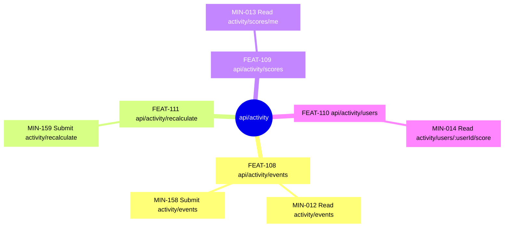
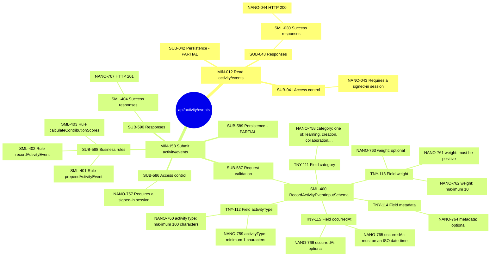
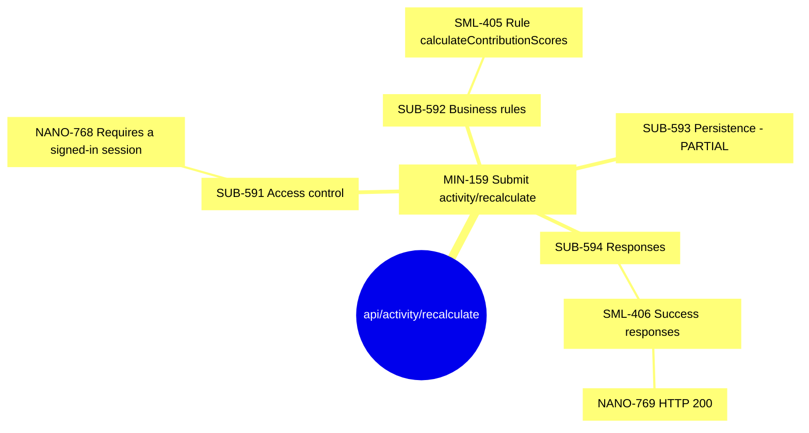
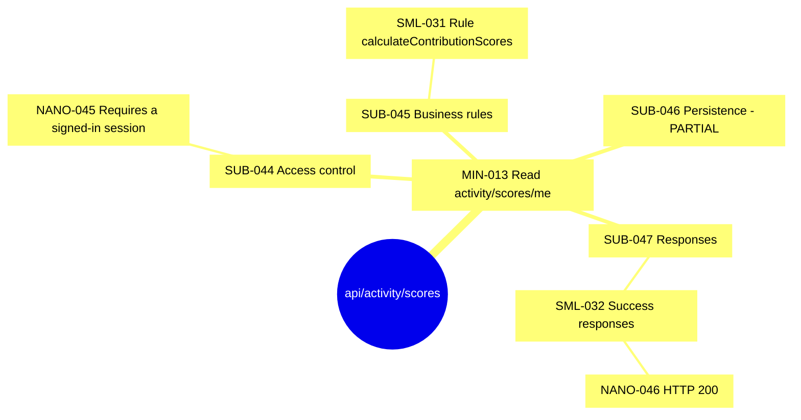
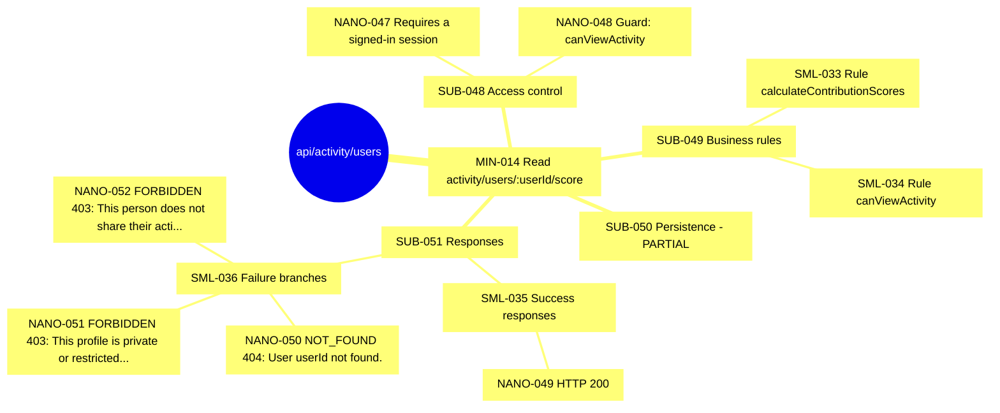

# api/activity (MOD-086)

Generated by `project-mindmap/tools/catalog.py` from `master/MASTER_PROJECT_GRAPH.json` at commit `9b3032f`. Do not edit by hand. Back to the [feature catalog](../FEATURE_CATALOG.md).

**Application:** apps/api (MOD-001). **Purpose:** API module: routes under /api/v1/activity in apps/api/src/server.ts.

**Nodes by level:** MODULE 1, MAJOR 4, MINOR 5, SUB 20, SMALL 14, TINY 5, NANO 23. **Status:** IMPLEMENTED 67, PARTIALLY_IMPLEMENTED 5. **Verification:** PATH_LEVEL 55, VERIFIED 12.

**User roles that reach it:** authenticated.

**Known gaps:** MIN-012 ephemeral: state held in process memory, lost on restart; MIN-012 no first-party web caller found; MIN-158 ephemeral: state held in process memory, lost on restart; MIN-158 no first-party web caller found; MIN-159 ephemeral: state held in process memory, lost on restart; MIN-159 no first-party web caller found; MIN-013 ephemeral: state held in process memory, lost on restart; MIN-013 no first-party web caller found; MIN-014 ephemeral: state held in process memory, lost on restart; MIN-014 no first-party web caller found.

## Module map (to minor features)

## FEAT-108 api/activity/events

api/activity/events

| ID       | Level | Parent   | Name                                                        | Description                                                                                                                                                                                                                                                                                                               | Status                | Verification | Evidence                                          | Related                     |
| -------- | ----- | -------- | ----------------------------------------------------------- | ------------------------------------------------------------------------------------------------------------------------------------------------------------------------------------------------------------------------------------------------------------------------------------------------------------------------- | --------------------- | ------------ | ------------------------------------------------- | --------------------------- |
| FEAT-108 | MAJOR | MOD-086  | api/activity/events                                         |                                                                                                                                                                                                                                                                                                                           | IMPLEMENTED           |              | apps/api/src/server.ts:9572                       |                             |
| MIN-012  | MINOR | FEAT-108 | Read activity/events                                        | GET /api/v1/activity/events for any signed-in session; ephemeral (process memory); responds 200. Gaps: ephemeral: state held in process memory, lost on restart; no first-party web caller found                                                                                                                          | IMPLEMENTED           | VERIFIED     | apps/api/src/server.ts:9603                       | API-197, TEST-082, TEST-165 |
| SUB-041  | SUB   | MIN-012  | Access control                                              | Who may call GET /api/v1/activity/events: any signed-in session.                                                                                                                                                                                                                                                          | IMPLEMENTED           | PATH_LEVEL   | apps/api/src/server.ts:9603                       |                             |
| NANO-043 | NANO  | SUB-041  | Requires a signed-in session                                | Requests without a valid session token are rejected with 401 UNAUTHENTICATED.                                                                                                                                                                                                                                             | IMPLEMENTED           | PATH_LEVEL   | apps/api/src/server.ts:9603                       | ROLE-001                    |
| SUB-042  | SUB   | MIN-012  | Persistence                                                 | Ephemeral: state lives in API process memory and is lost on restart.                                                                                                                                                                                                                                                      | PARTIALLY_IMPLEMENTED | PATH_LEVEL   | apps/api/src/server.ts:9603                       |                             |
| SUB-043  | SUB   | MIN-012  | Responses                                                   | Success 200; 0 explicit failure branch(es) besides validation and access errors.                                                                                                                                                                                                                                          | IMPLEMENTED           | PATH_LEVEL   | apps/api/src/server.ts:9603                       |                             |
| SML-030  | SMALL | SUB-043  | Success responses                                           | HTTP 200.                                                                                                                                                                                                                                                                                                                 | IMPLEMENTED           | PATH_LEVEL   | apps/api/src/server.ts:9603                       |                             |
| NANO-044 | NANO  | SML-030  | HTTP 200                                                    | Replies 200 when the operation succeeds.                                                                                                                                                                                                                                                                                  | IMPLEMENTED           | PATH_LEVEL   | apps/api/src/server.ts:9603                       |                             |
| MIN-158  | MINOR | FEAT-108 | Submit activity/events                                      | POST /api/v1/activity/events for any signed-in session; validates RecordActivityEventInputSchema; calls prependActivityEvent, recordActivityEvent, calculateContributionScores; ephemeral (process memory); responds 201. Gaps: ephemeral: state held in process memory, lost on restart; no first-party web caller found | IMPLEMENTED           | VERIFIED     | apps/api/src/server.ts:9572                       | API-196, TEST-082, TEST-165 |
| SUB-586  | SUB   | MIN-158  | Access control                                              | Who may call POST /api/v1/activity/events: any signed-in session.                                                                                                                                                                                                                                                         | IMPLEMENTED           | PATH_LEVEL   | apps/api/src/server.ts:9572                       |                             |
| NANO-757 | NANO  | SUB-586  | Requires a signed-in session                                | Requests without a valid session token are rejected with 401 UNAUTHENTICATED.                                                                                                                                                                                                                                             | IMPLEMENTED           | PATH_LEVEL   | apps/api/src/server.ts:9572                       | ROLE-001                    |
| SUB-587  | SUB   | MIN-158  | Request validation                                          | The request is parsed with RecordActivityEventInputSchema; a failure returns 400 with field details before any business logic runs.                                                                                                                                                                                       | IMPLEMENTED           | PATH_LEVEL   | apps/api/src/server.ts:9572                       |                             |
| SML-400  | SMALL | SUB-587  | RecordActivityEventInputSchema                              | RecordActivityEventInputSchema: 5 field(s)                                                                                                                                                                                                                                                                                | IMPLEMENTED           | PATH_LEVEL   | packages/contracts/src/index.ts:1310              | SCH-101                     |
| TNY-111  | TINY  | SML-400  | Field category                                              | category (enum, required): one of: learning, creation, collaboration, social                                                                                                                                                                                                                                              | IMPLEMENTED           | PATH_LEVEL   | packages/contracts/src/index.ts:1311              |                             |
| NANO-758 | NANO  | TNY-111  | category: one of: learning, creation, collaboration, social | category one of: learning, creation, collaboration, social.                                                                                                                                                                                                                                                               | IMPLEMENTED           | PATH_LEVEL   | packages/contracts/src/index.ts:1311              |                             |
| TNY-112  | TINY  | SML-400  | Field activityType                                          | activityType (string, required): minimum 1 characters; maximum 100 characters                                                                                                                                                                                                                                             | IMPLEMENTED           | PATH_LEVEL   | packages/contracts/src/index.ts:1312              |                             |
| NANO-759 | NANO  | TNY-112  | activityType: minimum 1 characters                          | activityType minimum 1 characters.                                                                                                                                                                                                                                                                                        | IMPLEMENTED           | PATH_LEVEL   | packages/contracts/src/index.ts:1312              |                             |
| NANO-760 | NANO  | TNY-112  | activityType: maximum 100 characters                        | activityType maximum 100 characters.                                                                                                                                                                                                                                                                                      | IMPLEMENTED           | PATH_LEVEL   | packages/contracts/src/index.ts:1312              |                             |
| TNY-113  | TINY  | SML-400  | Field weight                                                | weight (number, optional): must be positive; maximum 10; optional                                                                                                                                                                                                                                                         | IMPLEMENTED           | PATH_LEVEL   | packages/contracts/src/index.ts:1313              |                             |
| NANO-761 | NANO  | TNY-113  | weight: must be positive                                    | weight must be positive.                                                                                                                                                                                                                                                                                                  | IMPLEMENTED           | PATH_LEVEL   | packages/contracts/src/index.ts:1313              |                             |
| NANO-762 | NANO  | TNY-113  | weight: maximum 10                                          | weight maximum 10.                                                                                                                                                                                                                                                                                                        | IMPLEMENTED           | PATH_LEVEL   | packages/contracts/src/index.ts:1313              |                             |
| NANO-763 | NANO  | TNY-113  | weight: optional                                            | weight optional.                                                                                                                                                                                                                                                                                                          | IMPLEMENTED           | PATH_LEVEL   | packages/contracts/src/index.ts:1313              |                             |
| TNY-114  | TINY  | SML-400  | Field metadata                                              | metadata (record, optional): optional                                                                                                                                                                                                                                                                                     | IMPLEMENTED           | PATH_LEVEL   | packages/contracts/src/index.ts:1314              |                             |
| NANO-764 | NANO  | TNY-114  | metadata: optional                                          | metadata optional.                                                                                                                                                                                                                                                                                                        | IMPLEMENTED           | PATH_LEVEL   | packages/contracts/src/index.ts:1314              |                             |
| TNY-115  | TINY  | SML-400  | Field occurredAt                                            | occurredAt (string, optional): must be an ISO date-time; optional                                                                                                                                                                                                                                                         | IMPLEMENTED           | PATH_LEVEL   | packages/contracts/src/index.ts:1315              |                             |
| NANO-765 | NANO  | TNY-115  | occurredAt: must be an ISO date-time                        | occurredAt must be an ISO date-time.                                                                                                                                                                                                                                                                                      | IMPLEMENTED           | PATH_LEVEL   | packages/contracts/src/index.ts:1315              |                             |
| NANO-766 | NANO  | TNY-115  | occurredAt: optional                                        | occurredAt optional.                                                                                                                                                                                                                                                                                                      | IMPLEMENTED           | PATH_LEVEL   | packages/contracts/src/index.ts:1315              |                             |
| SUB-588  | SUB   | MIN-158  | Business rules                                              | Domain functions from packages/domain called by the handler (3).                                                                                                                                                                                                                                                          | IMPLEMENTED           | PATH_LEVEL   | apps/api/src/server.ts:9572                       |                             |
| SML-401  | SMALL | SUB-588  | Rule prependActivityEvent                                   | Calls prependActivityEvent (packages/domain/src/activity-contributions.ts). Rule status IMPLEMENTED; its own tests: VERIFIED.                                                                                                                                                                                             | IMPLEMENTED           | VERIFIED     | packages/domain/src/activity-contributions.ts:16  | RULE-001                    |
| SML-402  | SMALL | SUB-588  | Rule recordActivityEvent                                    | Calls recordActivityEvent (packages/domain/src/activity-contributions.ts). Rule status IMPLEMENTED; its own tests: VERIFIED.                                                                                                                                                                                              | IMPLEMENTED           | VERIFIED     | packages/domain/src/activity-contributions.ts:69  | RULE-003                    |
| SML-403  | SMALL | SUB-588  | Rule calculateContributionScores                            | Calls calculateContributionScores (packages/domain/src/activity-contributions.ts). Rule status IMPLEMENTED; its own tests: VERIFIED.                                                                                                                                                                                      | IMPLEMENTED           | VERIFIED     | packages/domain/src/activity-contributions.ts:112 | RULE-004                    |
| SUB-589  | SUB   | MIN-158  | Persistence                                                 | Ephemeral: state lives in API process memory and is lost on restart.                                                                                                                                                                                                                                                      | PARTIALLY_IMPLEMENTED | PATH_LEVEL   | apps/api/src/server.ts:9572                       |                             |
| SUB-590  | SUB   | MIN-158  | Responses                                                   | Success 201; 0 explicit failure branch(es) besides validation and access errors.                                                                                                                                                                                                                                          | IMPLEMENTED           | PATH_LEVEL   | apps/api/src/server.ts:9572                       |                             |
| SML-404  | SMALL | SUB-590  | Success responses                                           | HTTP 201.                                                                                                                                                                                                                                                                                                                 | IMPLEMENTED           | PATH_LEVEL   | apps/api/src/server.ts:9572                       |                             |
| NANO-767 | NANO  | SML-404  | HTTP 201                                                    | Replies 201 when the operation succeeds.                                                                                                                                                                                                                                                                                  | IMPLEMENTED           | PATH_LEVEL   | apps/api/src/server.ts:9572                       |                             |

## FEAT-111 api/activity/recalculate

api/activity/recalculate

| ID       | Level | Parent   | Name                             | Description                                                                                                                                                                                                                               | Status                | Verification | Evidence                                          | Related           |
| -------- | ----- | -------- | -------------------------------- | ----------------------------------------------------------------------------------------------------------------------------------------------------------------------------------------------------------------------------------------- | --------------------- | ------------ | ------------------------------------------------- | ----------------- |
| FEAT-111 | MAJOR | MOD-086  | api/activity/recalculate         |                                                                                                                                                                                                                                           | IMPLEMENTED           |              | apps/api/src/server.ts:9688                       |                   |
| MIN-159  | MINOR | FEAT-111 | Submit activity/recalculate      | POST /api/v1/activity/recalculate for any signed-in session; calls calculateContributionScores; ephemeral (process memory); responds 200. Gaps: ephemeral: state held in process memory, lost on restart; no first-party web caller found | IMPLEMENTED           | VERIFIED     | apps/api/src/server.ts:9688                       | API-200, TEST-082 |
| SUB-591  | SUB   | MIN-159  | Access control                   | Who may call POST /api/v1/activity/recalculate: any signed-in session.                                                                                                                                                                    | IMPLEMENTED           | PATH_LEVEL   | apps/api/src/server.ts:9688                       |                   |
| NANO-768 | NANO  | SUB-591  | Requires a signed-in session     | Requests without a valid session token are rejected with 401 UNAUTHENTICATED.                                                                                                                                                             | IMPLEMENTED           | PATH_LEVEL   | apps/api/src/server.ts:9688                       | ROLE-001          |
| SUB-592  | SUB   | MIN-159  | Business rules                   | Domain functions from packages/domain called by the handler (1).                                                                                                                                                                          | IMPLEMENTED           | PATH_LEVEL   | apps/api/src/server.ts:9688                       |                   |
| SML-405  | SMALL | SUB-592  | Rule calculateContributionScores | Calls calculateContributionScores (packages/domain/src/activity-contributions.ts). Rule status IMPLEMENTED; its own tests: VERIFIED.                                                                                                      | IMPLEMENTED           | VERIFIED     | packages/domain/src/activity-contributions.ts:112 | RULE-004          |
| SUB-593  | SUB   | MIN-159  | Persistence                      | Ephemeral: state lives in API process memory and is lost on restart.                                                                                                                                                                      | PARTIALLY_IMPLEMENTED | PATH_LEVEL   | apps/api/src/server.ts:9688                       |                   |
| SUB-594  | SUB   | MIN-159  | Responses                        | Success 200; 0 explicit failure branch(es) besides validation and access errors.                                                                                                                                                          | IMPLEMENTED           | PATH_LEVEL   | apps/api/src/server.ts:9688                       |                   |
| SML-406  | SMALL | SUB-594  | Success responses                | HTTP 200.                                                                                                                                                                                                                                 | IMPLEMENTED           | PATH_LEVEL   | apps/api/src/server.ts:9688                       |                   |
| NANO-769 | NANO  | SML-406  | HTTP 200                         | Replies 200 when the operation succeeds.                                                                                                                                                                                                  | IMPLEMENTED           | PATH_LEVEL   | apps/api/src/server.ts:9688                       |                   |

## FEAT-109 api/activity/scores

api/activity/scores

| ID       | Level | Parent   | Name                             | Description                                                                                                                                                                                                                            | Status                | Verification | Evidence                                          | Related                     |
| -------- | ----- | -------- | -------------------------------- | -------------------------------------------------------------------------------------------------------------------------------------------------------------------------------------------------------------------------------------- | --------------------- | ------------ | ------------------------------------------------- | --------------------------- |
| FEAT-109 | MAJOR | MOD-086  | api/activity/scores              |                                                                                                                                                                                                                                        | IMPLEMENTED           |              | apps/api/src/server.ts:9628                       |                             |
| MIN-013  | MINOR | FEAT-109 | Read activity/scores/me          | GET /api/v1/activity/scores/me for any signed-in session; calls calculateContributionScores; ephemeral (process memory); responds 200. Gaps: ephemeral: state held in process memory, lost on restart; no first-party web caller found | IMPLEMENTED           | VERIFIED     | apps/api/src/server.ts:9628                       | API-198, TEST-082, TEST-165 |
| SUB-044  | SUB   | MIN-013  | Access control                   | Who may call GET /api/v1/activity/scores/me: any signed-in session.                                                                                                                                                                    | IMPLEMENTED           | PATH_LEVEL   | apps/api/src/server.ts:9628                       |                             |
| NANO-045 | NANO  | SUB-044  | Requires a signed-in session     | Requests without a valid session token are rejected with 401 UNAUTHENTICATED.                                                                                                                                                          | IMPLEMENTED           | PATH_LEVEL   | apps/api/src/server.ts:9628                       | ROLE-001                    |
| SUB-045  | SUB   | MIN-013  | Business rules                   | Domain functions from packages/domain called by the handler (1).                                                                                                                                                                       | IMPLEMENTED           | PATH_LEVEL   | apps/api/src/server.ts:9628                       |                             |
| SML-031  | SMALL | SUB-045  | Rule calculateContributionScores | Calls calculateContributionScores (packages/domain/src/activity-contributions.ts). Rule status IMPLEMENTED; its own tests: VERIFIED.                                                                                                   | IMPLEMENTED           | VERIFIED     | packages/domain/src/activity-contributions.ts:112 | RULE-004                    |
| SUB-046  | SUB   | MIN-013  | Persistence                      | Ephemeral: state lives in API process memory and is lost on restart.                                                                                                                                                                   | PARTIALLY_IMPLEMENTED | PATH_LEVEL   | apps/api/src/server.ts:9628                       |                             |
| SUB-047  | SUB   | MIN-013  | Responses                        | Success 200; 0 explicit failure branch(es) besides validation and access errors.                                                                                                                                                       | IMPLEMENTED           | PATH_LEVEL   | apps/api/src/server.ts:9628                       |                             |
| SML-032  | SMALL | SUB-047  | Success responses                | HTTP 200.                                                                                                                                                                                                                              | IMPLEMENTED           | PATH_LEVEL   | apps/api/src/server.ts:9628                       |                             |
| NANO-046 | NANO  | SML-032  | HTTP 200                         | Replies 200 when the operation succeeds.                                                                                                                                                                                               | IMPLEMENTED           | PATH_LEVEL   | apps/api/src/server.ts:9628                       |                             |

## FEAT-110 api/activity/users

api/activity/users

| ID       | Level | Parent   | Name                                                                      | Description                                                                                                                                                                                                                                                                             | Status                | Verification | Evidence                                          | Related                               |
| -------- | ----- | -------- | ------------------------------------------------------------------------- | --------------------------------------------------------------------------------------------------------------------------------------------------------------------------------------------------------------------------------------------------------------------------------------- | --------------------- | ------------ | ------------------------------------------------- | ------------------------------------- |
| FEAT-110 | MAJOR | MOD-086  | api/activity/users                                                        |                                                                                                                                                                                                                                                                                         | IMPLEMENTED           |              | apps/api/src/server.ts:9637                       |                                       |
| MIN-014  | MINOR | FEAT-110 | Read activity/users/:userId/score                                         | GET /api/v1/activity/users/:userId/score for any signed-in session; calls calculateContributionScores, canViewActivity; ephemeral (process memory); responds 200; 3 failure branch(es). Gaps: ephemeral: state held in process memory, lost on restart; no first-party web caller found | IMPLEMENTED           | VERIFIED     | apps/api/src/server.ts:9637                       | API-199, TEST-082, TEST-096, TEST-165 |
| SUB-048  | SUB   | MIN-014  | Access control                                                            | Who may call GET /api/v1/activity/users/:userId/score: any signed-in session.                                                                                                                                                                                                           | IMPLEMENTED           | PATH_LEVEL   | apps/api/src/server.ts:9637                       |                                       |
| NANO-047 | NANO  | SUB-048  | Requires a signed-in session                                              | Requests without a valid session token are rejected with 401 UNAUTHENTICATED.                                                                                                                                                                                                           | IMPLEMENTED           | PATH_LEVEL   | apps/api/src/server.ts:9637                       | ROLE-001                              |
| NANO-048 | NANO  | SUB-048  | Guard: canViewActivity                                                    | Guard canViewActivity must pass before the handler runs.                                                                                                                                                                                                                                | IMPLEMENTED           | PATH_LEVEL   | apps/api/src/server.ts:9637                       |                                       |
| SUB-049  | SUB   | MIN-014  | Business rules                                                            | Domain functions from packages/domain called by the handler (2).                                                                                                                                                                                                                        | IMPLEMENTED           | PATH_LEVEL   | apps/api/src/server.ts:9637                       |                                       |
| SML-033  | SMALL | SUB-049  | Rule calculateContributionScores                                          | Calls calculateContributionScores (packages/domain/src/activity-contributions.ts). Rule status IMPLEMENTED; its own tests: VERIFIED.                                                                                                                                                    | IMPLEMENTED           | VERIFIED     | packages/domain/src/activity-contributions.ts:112 | RULE-004                              |
| SML-034  | SMALL | SUB-049  | Rule canViewActivity                                                      | Calls canViewActivity (packages/domain/src/profile.ts). Rule status IMPLEMENTED; its own tests: VERIFIED.                                                                                                                                                                               | IMPLEMENTED           | VERIFIED     | packages/domain/src/profile.ts:76                 | RULE-179                              |
| SUB-050  | SUB   | MIN-014  | Persistence                                                               | Ephemeral: state lives in API process memory and is lost on restart.                                                                                                                                                                                                                    | PARTIALLY_IMPLEMENTED | PATH_LEVEL   | apps/api/src/server.ts:9637                       |                                       |
| SUB-051  | SUB   | MIN-014  | Responses                                                                 | Success 200; 3 explicit failure branch(es) besides validation and access errors.                                                                                                                                                                                                        | IMPLEMENTED           | PATH_LEVEL   | apps/api/src/server.ts:9637                       |                                       |
| SML-035  | SMALL | SUB-051  | Success responses                                                         | HTTP 200.                                                                                                                                                                                                                                                                               | IMPLEMENTED           | PATH_LEVEL   | apps/api/src/server.ts:9637                       |                                       |
| NANO-049 | NANO  | SML-035  | HTTP 200                                                                  | Replies 200 when the operation succeeds.                                                                                                                                                                                                                                                | IMPLEMENTED           | PATH_LEVEL   | apps/api/src/server.ts:9637                       |                                       |
| SML-036  | SMALL | SUB-051  | Failure branches                                                          | 3 DomainError branch(es) in the handler, mapped to HTTP by the global error handler.                                                                                                                                                                                                    | IMPLEMENTED           | PATH_LEVEL   | apps/api/src/server.ts:9637                       |                                       |
| NANO-050 | NANO  | SML-036  | NOT_FOUND 404: User ${userId} not found.                                  | Throws DomainError(NOT_FOUND) "User ${userId} not found." -> HTTP 404.                                                                                                                                                                                                                  | IMPLEMENTED           | PATH_LEVEL   | apps/api/src/server.ts:9646                       | ERR-088                               |
| NANO-051 | NANO  | SML-036  | FORBIDDEN 403: This profile is private or restricted to authorized roles. | Throws DomainError(FORBIDDEN) "This profile is private or restricted to authorized roles." -> HTTP 403.                                                                                                                                                                                 | IMPLEMENTED           | PATH_LEVEL   | apps/api/src/server.ts:9660                       | ERR-017                               |
| NANO-052 | NANO  | SML-036  | FORBIDDEN 403: This person does not share their activity.                 | Throws DomainError(FORBIDDEN) "This person does not share their activity." -> HTTP 403.                                                                                                                                                                                                 | IMPLEMENTED           | PATH_LEVEL   | apps/api/src/server.ts:9666                       | ERR-199                               |
