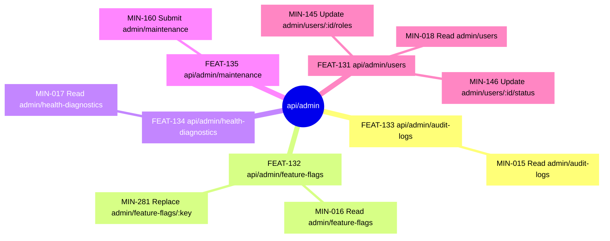
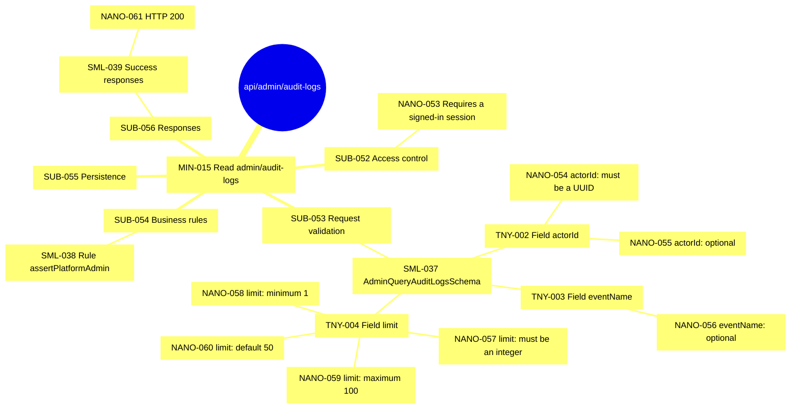
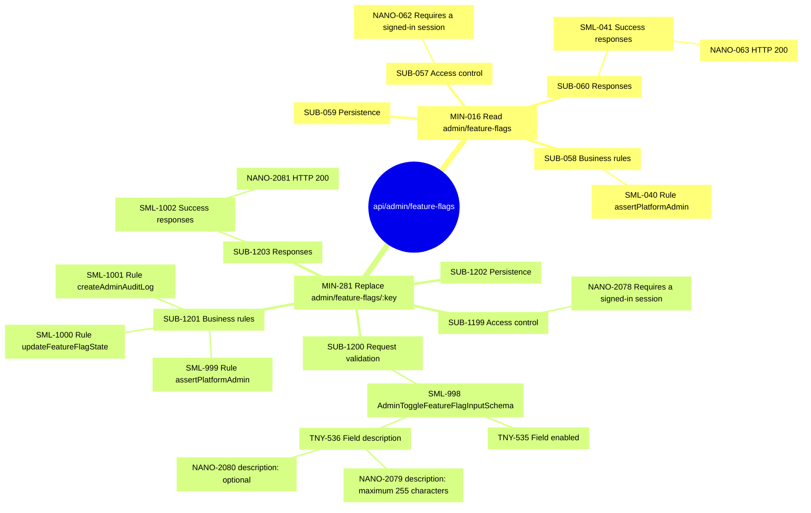
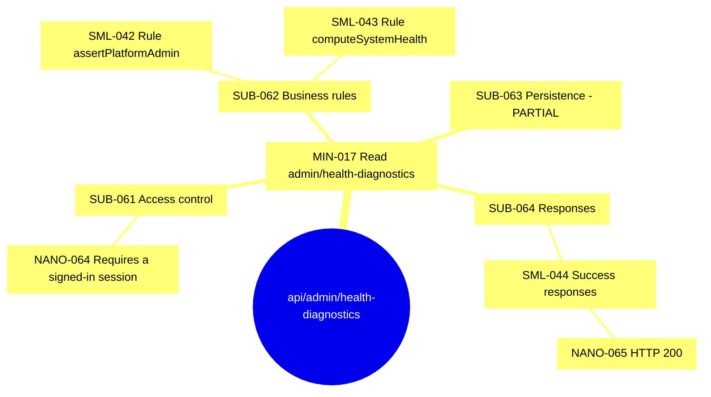
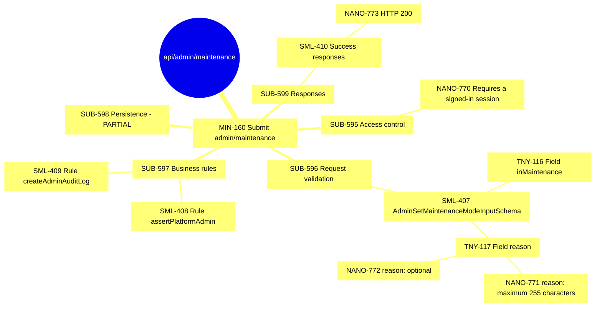
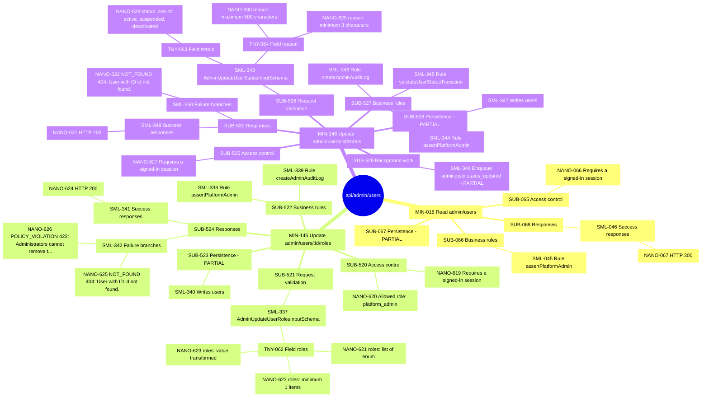

# api/admin (MOD-091)

Generated by `project-mindmap/tools/catalog.py` from `master/MASTER_PROJECT_GRAPH.json` at commit `9b3032f`. Do not edit by hand. Back to the [feature catalog](../FEATURE_CATALOG.md).

**Application:** apps/api (MOD-001). **Purpose:** API module: routes under /api/v1/admin in apps/api/src/server.ts.

**Nodes by level:** MODULE 1, MAJOR 5, MINOR 8, SUB 38, SMALL 33, TINY 10, NANO 37. **Status:** IMPLEMENTED 126, PARTIALLY_IMPLEMENTED 6. **Verification:** PATH_LEVEL 102, UNKNOWN 1, VERIFIED 23.

**User roles that reach it:** authenticated, platform_admin.

**Known gaps:** MIN-016 no first-party web caller found; MIN-281 no first-party web caller found; MIN-017 ephemeral: state held in process memory, lost on restart; MIN-160 ephemeral: state held in process memory, lost on restart; MIN-018 ephemeral: state held in process memory, lost on restart; MIN-145 ephemeral: state held in process memory, lost on restart; MIN-145 no first-party web caller found; MIN-146 ephemeral: state held in process memory, lost on restart.

**Called from (web screens and components):** FEAT-157 Screen /admin

## Module map (to minor features)

## FEAT-133 api/admin/audit-logs

api/admin/audit-logs

| ID       | Level | Parent   | Name                         | Description                                                                                                                                                                                    | Status      | Verification | Evidence                            | Related           |
| -------- | ----- | -------- | ---------------------------- | ---------------------------------------------------------------------------------------------------------------------------------------------------------------------------------------------- | ----------- | ------------ | ----------------------------------- | ----------------- |
| FEAT-133 | MAJOR | MOD-091  | api/admin/audit-logs         |                                                                                                                                                                                                | IMPLEMENTED |              | apps/api/src/server.ts:11398        |                   |
| MIN-015  | MINOR | FEAT-133 | Read admin/audit-logs        | 6. Query admin audit logs (BR-067) GET /api/v1/admin/audit-logs for any signed-in session; validates AdminQueryAuditLogsSchema; calls assertPlatformAdmin; durable (PostgreSQL); responds 200. | IMPLEMENTED | VERIFIED     | apps/api/src/server.ts:11398        | API-234, TEST-083 |
| SUB-052  | SUB   | MIN-015  | Access control               | Who may call GET /api/v1/admin/audit-logs: any signed-in session.                                                                                                                              | IMPLEMENTED | PATH_LEVEL   | apps/api/src/server.ts:11398        |                   |
| NANO-053 | NANO  | SUB-052  | Requires a signed-in session | Requests without a valid session token are rejected with 401 UNAUTHENTICATED.                                                                                                                  | IMPLEMENTED | PATH_LEVEL   | apps/api/src/server.ts:11398        | ROLE-001          |
| SUB-053  | SUB   | MIN-015  | Request validation           | The request is parsed with AdminQueryAuditLogsSchema; a failure returns 400 with field details before any business logic runs.                                                                 | IMPLEMENTED | PATH_LEVEL   | apps/api/src/server.ts:11398        |                   |
| SML-037  | SMALL | SUB-053  | AdminQueryAuditLogsSchema    | AdminQueryAuditLogsSchema: 3 field(s)                                                                                                                                                          | IMPLEMENTED | PATH_LEVEL   | packages/contracts/src/index.ts:765 | SCH-059           |
| TNY-002  | TINY  | SML-037  | Field actorId                | actorId (string, optional): must be a UUID; optional                                                                                                                                           | IMPLEMENTED | PATH_LEVEL   | packages/contracts/src/index.ts:766 |                   |
| NANO-054 | NANO  | TNY-002  | actorId: must be a UUID      | actorId must be a UUID.                                                                                                                                                                        | IMPLEMENTED | PATH_LEVEL   | packages/contracts/src/index.ts:766 |                   |
| NANO-055 | NANO  | TNY-002  | actorId: optional            | actorId optional.                                                                                                                                                                              | IMPLEMENTED | PATH_LEVEL   | packages/contracts/src/index.ts:766 |                   |
| TNY-003  | TINY  | SML-037  | Field eventName              | eventName (string, optional): optional                                                                                                                                                         | IMPLEMENTED | PATH_LEVEL   | packages/contracts/src/index.ts:767 |                   |
| NANO-056 | NANO  | TNY-003  | eventName: optional          | eventName optional.                                                                                                                                                                            | IMPLEMENTED | PATH_LEVEL   | packages/contracts/src/index.ts:767 |                   |
| TNY-004  | TINY  | SML-037  | Field limit                  | limit (number, optional): must be an integer; minimum 1; maximum 100; default 50                                                                                                               | IMPLEMENTED | PATH_LEVEL   | packages/contracts/src/index.ts:768 |                   |
| NANO-057 | NANO  | TNY-004  | limit: must be an integer    | limit must be an integer.                                                                                                                                                                      | IMPLEMENTED | PATH_LEVEL   | packages/contracts/src/index.ts:768 |                   |
| NANO-058 | NANO  | TNY-004  | limit: minimum 1             | limit minimum 1.                                                                                                                                                                               | IMPLEMENTED | PATH_LEVEL   | packages/contracts/src/index.ts:768 |                   |
| NANO-059 | NANO  | TNY-004  | limit: maximum 100           | limit maximum 100.                                                                                                                                                                             | IMPLEMENTED | PATH_LEVEL   | packages/contracts/src/index.ts:768 |                   |
| NANO-060 | NANO  | TNY-004  | limit: default 50            | limit default 50.                                                                                                                                                                              | IMPLEMENTED | PATH_LEVEL   | packages/contracts/src/index.ts:768 |                   |
| SUB-054  | SUB   | MIN-015  | Business rules               | Domain functions from packages/domain called by the handler (1).                                                                                                                               | IMPLEMENTED | PATH_LEVEL   | apps/api/src/server.ts:11398        |                   |
| SML-038  | SMALL | SUB-054  | Rule assertPlatformAdmin     | Calls assertPlatformAdmin (packages/domain/src/admin.ts). Rule status IMPLEMENTED; its own tests: VERIFIED.                                                                                    | IMPLEMENTED | VERIFIED     | packages/domain/src/admin.ts:44     | RULE-005          |
| SUB-055  | SUB   | MIN-015  | Persistence                  | Durable: writes go through the PostgreSQL store; store calls adminAudit.list.                                                                                                                  | IMPLEMENTED | PATH_LEVEL   | apps/api/src/server.ts:11398        |                   |
| SUB-056  | SUB   | MIN-015  | Responses                    | Success 200; 0 explicit failure branch(es) besides validation and access errors.                                                                                                               | IMPLEMENTED | PATH_LEVEL   | apps/api/src/server.ts:11398        |                   |
| SML-039  | SMALL | SUB-056  | Success responses            | HTTP 200.                                                                                                                                                                                      | IMPLEMENTED | PATH_LEVEL   | apps/api/src/server.ts:11398        |                   |
| NANO-061 | NANO  | SML-039  | HTTP 200                     | Replies 200 when the operation succeeds.                                                                                                                                                       | IMPLEMENTED | PATH_LEVEL   | apps/api/src/server.ts:11398        |                   |

## FEAT-132 api/admin/feature-flags

api/admin/feature-flags

| ID        | Level | Parent   | Name                                | Description                                                                                                                                                                                                                                                                                          | Status      | Verification | Evidence                            | Related                     |
| --------- | ----- | -------- | ----------------------------------- | ---------------------------------------------------------------------------------------------------------------------------------------------------------------------------------------------------------------------------------------------------------------------------------------------------- | ----------- | ------------ | ----------------------------------- | --------------------------- |
| FEAT-132  | MAJOR | MOD-091  | api/admin/feature-flags             |                                                                                                                                                                                                                                                                                                      | IMPLEMENTED |              | apps/api/src/server.ts:11344        |                             |
| MIN-016   | MINOR | FEAT-132 | Read admin/feature-flags            | 4. List feature flags (Admin) GET /api/v1/admin/feature-flags for any signed-in session; calls assertPlatformAdmin; durable (PostgreSQL); responds 200. Gaps: no first-party web caller found                                                                                                        | IMPLEMENTED | VERIFIED     | apps/api/src/server.ts:11344        | API-232, TEST-083, TEST-141 |
| SUB-057   | SUB   | MIN-016  | Access control                      | Who may call GET /api/v1/admin/feature-flags: any signed-in session.                                                                                                                                                                                                                                 | IMPLEMENTED | PATH_LEVEL   | apps/api/src/server.ts:11344        |                             |
| NANO-062  | NANO  | SUB-057  | Requires a signed-in session        | Requests without a valid session token are rejected with 401 UNAUTHENTICATED.                                                                                                                                                                                                                        | IMPLEMENTED | PATH_LEVEL   | apps/api/src/server.ts:11344        | ROLE-001                    |
| SUB-058   | SUB   | MIN-016  | Business rules                      | Domain functions from packages/domain called by the handler (1).                                                                                                                                                                                                                                     | IMPLEMENTED | PATH_LEVEL   | apps/api/src/server.ts:11344        |                             |
| SML-040   | SMALL | SUB-058  | Rule assertPlatformAdmin            | Calls assertPlatformAdmin (packages/domain/src/admin.ts). Rule status IMPLEMENTED; its own tests: VERIFIED.                                                                                                                                                                                          | IMPLEMENTED | VERIFIED     | packages/domain/src/admin.ts:44     | RULE-005                    |
| SUB-059   | SUB   | MIN-016  | Persistence                         | Durable: writes go through the PostgreSQL store; store calls featureFlags.list.                                                                                                                                                                                                                      | IMPLEMENTED | PATH_LEVEL   | apps/api/src/server.ts:11344        |                             |
| SUB-060   | SUB   | MIN-016  | Responses                           | Success 200; 0 explicit failure branch(es) besides validation and access errors.                                                                                                                                                                                                                     | IMPLEMENTED | PATH_LEVEL   | apps/api/src/server.ts:11344        |                             |
| SML-041   | SMALL | SUB-060  | Success responses                   | HTTP 200.                                                                                                                                                                                                                                                                                            | IMPLEMENTED | PATH_LEVEL   | apps/api/src/server.ts:11344        |                             |
| NANO-063  | NANO  | SML-041  | HTTP 200                            | Replies 200 when the operation succeeds.                                                                                                                                                                                                                                                             | IMPLEMENTED | PATH_LEVEL   | apps/api/src/server.ts:11344        |                             |
| MIN-281   | MINOR | FEAT-132 | Replace admin/feature-flags/:key    | 5. Update/toggle feature flag (Admin) PUT /api/v1/admin/feature-flags/:key for any signed-in session; validates AdminToggleFeatureFlagInputSchema; calls assertPlatformAdmin, updateFeatureFlagState, createAdminAuditLog; durable (PostgreSQL); responds 200. Gaps: no first-party web caller found | IMPLEMENTED | VERIFIED     | apps/api/src/server.ts:11356        | API-233, TEST-083, TEST-183 |
| SUB-1199  | SUB   | MIN-281  | Access control                      | Who may call PUT /api/v1/admin/feature-flags/:key: any signed-in session.                                                                                                                                                                                                                            | IMPLEMENTED | PATH_LEVEL   | apps/api/src/server.ts:11356        |                             |
| NANO-2078 | NANO  | SUB-1199 | Requires a signed-in session        | Requests without a valid session token are rejected with 401 UNAUTHENTICATED.                                                                                                                                                                                                                        | IMPLEMENTED | PATH_LEVEL   | apps/api/src/server.ts:11356        | ROLE-001                    |
| SUB-1200  | SUB   | MIN-281  | Request validation                  | The request is parsed with AdminToggleFeatureFlagInputSchema; a failure returns 400 with field details before any business logic runs.                                                                                                                                                               | IMPLEMENTED | PATH_LEVEL   | apps/api/src/server.ts:11356        |                             |
| SML-998   | SMALL | SUB-1200 | AdminToggleFeatureFlagInputSchema   | AdminToggleFeatureFlagInputSchema: 2 field(s)                                                                                                                                                                                                                                                        | IMPLEMENTED | PATH_LEVEL   | packages/contracts/src/index.ts:751 | SCH-057                     |
| TNY-535   | TINY  | SML-998  | Field enabled                       | enabled (boolean, required)                                                                                                                                                                                                                                                                          | IMPLEMENTED | PATH_LEVEL   | packages/contracts/src/index.ts:752 |                             |
| TNY-536   | TINY  | SML-998  | Field description                   | description (string, optional): maximum 255 characters; optional                                                                                                                                                                                                                                     | IMPLEMENTED | PATH_LEVEL   | packages/contracts/src/index.ts:753 |                             |
| NANO-2079 | NANO  | TNY-536  | description: maximum 255 characters | description maximum 255 characters.                                                                                                                                                                                                                                                                  | IMPLEMENTED | PATH_LEVEL   | packages/contracts/src/index.ts:753 |                             |
| NANO-2080 | NANO  | TNY-536  | description: optional               | description optional.                                                                                                                                                                                                                                                                                | IMPLEMENTED | PATH_LEVEL   | packages/contracts/src/index.ts:753 |                             |
| SUB-1201  | SUB   | MIN-281  | Business rules                      | Domain functions from packages/domain called by the handler (3).                                                                                                                                                                                                                                     | IMPLEMENTED | PATH_LEVEL   | apps/api/src/server.ts:11356        |                             |
| SML-999   | SMALL | SUB-1201 | Rule assertPlatformAdmin            | Calls assertPlatformAdmin (packages/domain/src/admin.ts). Rule status IMPLEMENTED; its own tests: VERIFIED.                                                                                                                                                                                          | IMPLEMENTED | VERIFIED     | packages/domain/src/admin.ts:44     | RULE-005                    |
| SML-1000  | SMALL | SUB-1201 | Rule updateFeatureFlagState         | Calls updateFeatureFlagState (packages/domain/src/admin.ts). Rule status IMPLEMENTED; its own tests: VERIFIED.                                                                                                                                                                                       | IMPLEMENTED | VERIFIED     | packages/domain/src/admin.ts:95     | RULE-008                    |
| SML-1001  | SMALL | SUB-1201 | Rule createAdminAuditLog            | Calls createAdminAuditLog (packages/domain/src/admin.ts). Rule status IMPLEMENTED; its own tests: VERIFIED.                                                                                                                                                                                          | IMPLEMENTED | VERIFIED     | packages/domain/src/admin.ts:112    | RULE-009                    |
| SUB-1202  | SUB   | MIN-281  | Persistence                         | Durable: writes go through the PostgreSQL store; store calls adminAudit.append, featureFlags.get, featureFlags.upsert.                                                                                                                                                                               | IMPLEMENTED | PATH_LEVEL   | apps/api/src/server.ts:11356        |                             |
| SUB-1203  | SUB   | MIN-281  | Responses                           | Success 200; 0 explicit failure branch(es) besides validation and access errors.                                                                                                                                                                                                                     | IMPLEMENTED | PATH_LEVEL   | apps/api/src/server.ts:11356        |                             |
| SML-1002  | SMALL | SUB-1203 | Success responses                   | HTTP 200.                                                                                                                                                                                                                                                                                            | IMPLEMENTED | PATH_LEVEL   | apps/api/src/server.ts:11356        |                             |
| NANO-2081 | NANO  | SML-1002 | HTTP 200                            | Replies 200 when the operation succeeds.                                                                                                                                                                                                                                                             | IMPLEMENTED | PATH_LEVEL   | apps/api/src/server.ts:11356        |                             |

## FEAT-134 api/admin/health-diagnostics

api/admin/health-diagnostics

| ID       | Level | Parent   | Name                          | Description                                                                                                                                                                                                                                                     | Status                | Verification | Evidence                        | Related                                                       |
| -------- | ----- | -------- | ----------------------------- | --------------------------------------------------------------------------------------------------------------------------------------------------------------------------------------------------------------------------------------------------------------- | --------------------- | ------------ | ------------------------------- | ------------------------------------------------------------- |
| FEAT-134 | MAJOR | MOD-091  | api/admin/health-diagnostics  |                                                                                                                                                                                                                                                                 | IMPLEMENTED           |              | apps/api/src/server.ts:11420    |                                                               |
| MIN-017  | MINOR | FEAT-134 | Read admin/health-diagnostics | 7. System health & diagnostics (BR-28) GET /api/v1/admin/health-diagnostics for any signed-in session; calls assertPlatformAdmin, computeSystemHealth; ephemeral (process memory); responds 200. Gaps: ephemeral: state held in process memory, lost on restart | IMPLEMENTED           | VERIFIED     | apps/api/src/server.ts:11420    | API-235, TEST-042, TEST-083, TEST-107, TEST-133, TEST-141 ... |
| SUB-061  | SUB   | MIN-017  | Access control                | Who may call GET /api/v1/admin/health-diagnostics: any signed-in session.                                                                                                                                                                                       | IMPLEMENTED           | PATH_LEVEL   | apps/api/src/server.ts:11420    |                                                               |
| NANO-064 | NANO  | SUB-061  | Requires a signed-in session  | Requests without a valid session token are rejected with 401 UNAUTHENTICATED.                                                                                                                                                                                   | IMPLEMENTED           | PATH_LEVEL   | apps/api/src/server.ts:11420    | ROLE-001                                                      |
| SUB-062  | SUB   | MIN-017  | Business rules                | Domain functions from packages/domain called by the handler (2).                                                                                                                                                                                                | IMPLEMENTED           | PATH_LEVEL   | apps/api/src/server.ts:11420    |                                                               |
| SML-042  | SMALL | SUB-062  | Rule assertPlatformAdmin      | Calls assertPlatformAdmin (packages/domain/src/admin.ts). Rule status IMPLEMENTED; its own tests: VERIFIED.                                                                                                                                                     | IMPLEMENTED           | VERIFIED     | packages/domain/src/admin.ts:44 | RULE-005                                                      |
| SML-043  | SMALL | SUB-062  | Rule computeSystemHealth      | Calls computeSystemHealth (packages/domain/src/admin.ts). Rule status IMPLEMENTED; its own tests: VERIFIED.                                                                                                                                                     | IMPLEMENTED           | VERIFIED     | packages/domain/src/admin.ts:56 | RULE-006                                                      |
| SUB-063  | SUB   | MIN-017  | Persistence                   | Ephemeral: state lives in API process memory and is lost on restart; store calls jobs.countActive.                                                                                                                                                              | PARTIALLY_IMPLEMENTED | PATH_LEVEL   | apps/api/src/server.ts:11420    |                                                               |
| SUB-064  | SUB   | MIN-017  | Responses                     | Success 200; 0 explicit failure branch(es) besides validation and access errors.                                                                                                                                                                                | IMPLEMENTED           | PATH_LEVEL   | apps/api/src/server.ts:11420    |                                                               |
| SML-044  | SMALL | SUB-064  | Success responses             | HTTP 200.                                                                                                                                                                                                                                                       | IMPLEMENTED           | PATH_LEVEL   | apps/api/src/server.ts:11420    |                                                               |
| NANO-065 | NANO  | SML-044  | HTTP 200                      | Replies 200 when the operation succeeds.                                                                                                                                                                                                                        | IMPLEMENTED           | PATH_LEVEL   | apps/api/src/server.ts:11420    |                                                               |

## FEAT-135 api/admin/maintenance

api/admin/maintenance

| ID       | Level | Parent   | Name                               | Description                                                                                                                                                                                                                                                                                 | Status                | Verification | Evidence                            | Related                     |
| -------- | ----- | -------- | ---------------------------------- | ------------------------------------------------------------------------------------------------------------------------------------------------------------------------------------------------------------------------------------------------------------------------------------------- | --------------------- | ------------ | ----------------------------------- | --------------------------- |
| FEAT-135 | MAJOR | MOD-091  | api/admin/maintenance              |                                                                                                                                                                                                                                                                                             | IMPLEMENTED           |              | apps/api/src/server.ts:11472        |                             |
| MIN-160  | MINOR | FEAT-135 | Submit admin/maintenance           | 8. Toggle maintenance mode POST /api/v1/admin/maintenance for any signed-in session; validates AdminSetMaintenanceModeInputSchema; calls assertPlatformAdmin, createAdminAuditLog; ephemeral (process memory); responds 200. Gaps: ephemeral: state held in process memory, lost on restart | IMPLEMENTED           | VERIFIED     | apps/api/src/server.ts:11472        | API-236, TEST-083, TEST-145 |
| SUB-595  | SUB   | MIN-160  | Access control                     | Who may call POST /api/v1/admin/maintenance: any signed-in session.                                                                                                                                                                                                                         | IMPLEMENTED           | PATH_LEVEL   | apps/api/src/server.ts:11472        |                             |
| NANO-770 | NANO  | SUB-595  | Requires a signed-in session       | Requests without a valid session token are rejected with 401 UNAUTHENTICATED.                                                                                                                                                                                                               | IMPLEMENTED           | PATH_LEVEL   | apps/api/src/server.ts:11472        | ROLE-001                    |
| SUB-596  | SUB   | MIN-160  | Request validation                 | The request is parsed with AdminSetMaintenanceModeInputSchema; a failure returns 400 with field details before any business logic runs.                                                                                                                                                     | IMPLEMENTED           | PATH_LEVEL   | apps/api/src/server.ts:11472        |                             |
| SML-407  | SMALL | SUB-596  | AdminSetMaintenanceModeInputSchema | AdminSetMaintenanceModeInputSchema: 2 field(s)                                                                                                                                                                                                                                              | IMPLEMENTED           | PATH_LEVEL   | packages/contracts/src/index.ts:758 | SCH-058                     |
| TNY-116  | TINY  | SML-407  | Field inMaintenance                | inMaintenance (boolean, required)                                                                                                                                                                                                                                                           | IMPLEMENTED           | PATH_LEVEL   | packages/contracts/src/index.ts:759 |                             |
| TNY-117  | TINY  | SML-407  | Field reason                       | reason (string, optional): maximum 255 characters; optional                                                                                                                                                                                                                                 | IMPLEMENTED           | PATH_LEVEL   | packages/contracts/src/index.ts:760 |                             |
| NANO-771 | NANO  | TNY-117  | reason: maximum 255 characters     | reason maximum 255 characters.                                                                                                                                                                                                                                                              | IMPLEMENTED           | PATH_LEVEL   | packages/contracts/src/index.ts:760 |                             |
| NANO-772 | NANO  | TNY-117  | reason: optional                   | reason optional.                                                                                                                                                                                                                                                                            | IMPLEMENTED           | PATH_LEVEL   | packages/contracts/src/index.ts:760 |                             |
| SUB-597  | SUB   | MIN-160  | Business rules                     | Domain functions from packages/domain called by the handler (2).                                                                                                                                                                                                                            | IMPLEMENTED           | PATH_LEVEL   | apps/api/src/server.ts:11472        |                             |
| SML-408  | SMALL | SUB-597  | Rule assertPlatformAdmin           | Calls assertPlatformAdmin (packages/domain/src/admin.ts). Rule status IMPLEMENTED; its own tests: VERIFIED.                                                                                                                                                                                 | IMPLEMENTED           | VERIFIED     | packages/domain/src/admin.ts:44     | RULE-005                    |
| SML-409  | SMALL | SUB-597  | Rule createAdminAuditLog           | Calls createAdminAuditLog (packages/domain/src/admin.ts). Rule status IMPLEMENTED; its own tests: VERIFIED.                                                                                                                                                                                 | IMPLEMENTED           | VERIFIED     | packages/domain/src/admin.ts:112    | RULE-009                    |
| SUB-598  | SUB   | MIN-160  | Persistence                        | Ephemeral: state lives in API process memory and is lost on restart; store calls adminAudit.append.                                                                                                                                                                                         | PARTIALLY_IMPLEMENTED | PATH_LEVEL   | apps/api/src/server.ts:11472        |                             |
| SUB-599  | SUB   | MIN-160  | Responses                          | Success 200; 0 explicit failure branch(es) besides validation and access errors.                                                                                                                                                                                                            | IMPLEMENTED           | PATH_LEVEL   | apps/api/src/server.ts:11472        |                             |
| SML-410  | SMALL | SUB-599  | Success responses                  | HTTP 200.                                                                                                                                                                                                                                                                                   | IMPLEMENTED           | PATH_LEVEL   | apps/api/src/server.ts:11472        |                             |
| NANO-773 | NANO  | SML-410  | HTTP 200                           | Replies 200 when the operation succeeds.                                                                                                                                                                                                                                                    | IMPLEMENTED           | PATH_LEVEL   | apps/api/src/server.ts:11472        |                             |

## FEAT-131 api/admin/users

api/admin/users

| ID       | Level | Parent   | Name                                                                                         | Description                                                                                                                                                                                                                                                                                                                                                                                            | Status                | Verification | Evidence                                     | Related                                                       |
| -------- | ----- | -------- | -------------------------------------------------------------------------------------------- | ------------------------------------------------------------------------------------------------------------------------------------------------------------------------------------------------------------------------------------------------------------------------------------------------------------------------------------------------------------------------------------------------------ | --------------------- | ------------ | -------------------------------------------- | ------------------------------------------------------------- |
| FEAT-131 | MAJOR | MOD-091  | api/admin/users                                                                              |                                                                                                                                                                                                                                                                                                                                                                                                        | IMPLEMENTED           |              | apps/api/src/server.ts:11196                 |                                                               |
| MIN-018  | MINOR | FEAT-131 | Read admin/users                                                                             | 1. List users (Admin) GET /api/v1/admin/users for any signed-in session; calls assertPlatformAdmin; ephemeral (process memory); responds 200. Gaps: ephemeral: state held in process memory, lost on restart                                                                                                                                                                                           | IMPLEMENTED           | VERIFIED     | apps/api/src/server.ts:11196                 | API-229, TEST-083, TEST-141, TEST-183, TEST-184               |
| SUB-065  | SUB   | MIN-018  | Access control                                                                               | Who may call GET /api/v1/admin/users: any signed-in session.                                                                                                                                                                                                                                                                                                                                           | IMPLEMENTED           | PATH_LEVEL   | apps/api/src/server.ts:11196                 |                                                               |
| NANO-066 | NANO  | SUB-065  | Requires a signed-in session                                                                 | Requests without a valid session token are rejected with 401 UNAUTHENTICATED.                                                                                                                                                                                                                                                                                                                          | IMPLEMENTED           | PATH_LEVEL   | apps/api/src/server.ts:11196                 | ROLE-001                                                      |
| SUB-066  | SUB   | MIN-018  | Business rules                                                                               | Domain functions from packages/domain called by the handler (1).                                                                                                                                                                                                                                                                                                                                       | IMPLEMENTED           | PATH_LEVEL   | apps/api/src/server.ts:11196                 |                                                               |
| SML-045  | SMALL | SUB-066  | Rule assertPlatformAdmin                                                                     | Calls assertPlatformAdmin (packages/domain/src/admin.ts). Rule status IMPLEMENTED; its own tests: VERIFIED.                                                                                                                                                                                                                                                                                            | IMPLEMENTED           | VERIFIED     | packages/domain/src/admin.ts:44              | RULE-005                                                      |
| SUB-067  | SUB   | MIN-018  | Persistence                                                                                  | Ephemeral: state lives in API process memory and is lost on restart.                                                                                                                                                                                                                                                                                                                                   | PARTIALLY_IMPLEMENTED | PATH_LEVEL   | apps/api/src/server.ts:11196                 |                                                               |
| SUB-068  | SUB   | MIN-018  | Responses                                                                                    | Success 200; 0 explicit failure branch(es) besides validation and access errors.                                                                                                                                                                                                                                                                                                                       | IMPLEMENTED           | PATH_LEVEL   | apps/api/src/server.ts:11196                 |                                                               |
| SML-046  | SMALL | SUB-068  | Success responses                                                                            | HTTP 200.                                                                                                                                                                                                                                                                                                                                                                                              | IMPLEMENTED           | PATH_LEVEL   | apps/api/src/server.ts:11196                 |                                                               |
| NANO-067 | NANO  | SML-046  | HTTP 200                                                                                     | Replies 200 when the operation succeeds.                                                                                                                                                                                                                                                                                                                                                               | IMPLEMENTED           | PATH_LEVEL   | apps/api/src/server.ts:11196                 |                                                               |
| MIN-145  | MINOR | FEAT-131 | Update admin/users/:id/roles                                                                 | 3. Update user roles (Admin) PATCH /api/v1/admin/users/:id/roles for roles platform_admin; validates AdminUpdateUserRolesInputSchema; calls assertPlatformAdmin, createAdminAuditLog; ephemeral (process memory); writes users; responds 200; 2 failure branch(es). Gaps: ephemeral: state held in process memory, lost on restart; no first-party web caller found                                    | IMPLEMENTED           | VERIFIED     | apps/api/src/server.ts:11289                 | API-231, TEST-083, TEST-111, TEST-114, TEST-126, TEST-142 ... |
| SUB-520  | SUB   | MIN-145  | Access control                                                                               | Who may call PATCH /api/v1/admin/users/:id/roles: roles platform_admin.                                                                                                                                                                                                                                                                                                                                | IMPLEMENTED           | PATH_LEVEL   | apps/api/src/server.ts:11289                 |                                                               |
| NANO-619 | NANO  | SUB-520  | Requires a signed-in session                                                                 | Requests without a valid session token are rejected with 401 UNAUTHENTICATED.                                                                                                                                                                                                                                                                                                                          | IMPLEMENTED           | PATH_LEVEL   | apps/api/src/server.ts:11289                 | ROLE-001                                                      |
| NANO-620 | NANO  | SUB-520  | Allowed role: platform_admin                                                                 | platform_admin is one of the roles allowed here (platform_admin); a caller holding none of them is rejected with 403.                                                                                                                                                                                                                                                                                  | IMPLEMENTED           | PATH_LEVEL   | apps/api/src/server.ts:11289                 | ROLE-008                                                      |
| SUB-521  | SUB   | MIN-145  | Request validation                                                                           | The request is parsed with AdminUpdateUserRolesInputSchema; a failure returns 400 with field details before any business logic runs.                                                                                                                                                                                                                                                                   | IMPLEMENTED           | PATH_LEVEL   | apps/api/src/server.ts:11289                 |                                                               |
| SML-337  | SMALL | SUB-521  | AdminUpdateUserRolesInputSchema                                                              | AdminUpdateUserRolesInputSchema: 1 field(s)                                                                                                                                                                                                                                                                                                                                                            | IMPLEMENTED           | PATH_LEVEL   | packages/contracts/src/index.ts:741          | SCH-056                                                       |
| TNY-062  | TINY  | SML-337  | Field roles                                                                                  | roles (array, required): list of enum; minimum 1 items; value transformed                                                                                                                                                                                                                                                                                                                              | IMPLEMENTED           | PATH_LEVEL   | packages/contracts/src/index.ts:743          |                                                               |
| NANO-621 | NANO  | TNY-062  | roles: list of enum                                                                          | roles list of enum.                                                                                                                                                                                                                                                                                                                                                                                    | IMPLEMENTED           | PATH_LEVEL   | packages/contracts/src/index.ts:743          |                                                               |
| NANO-622 | NANO  | TNY-062  | roles: minimum 1 items                                                                       | roles minimum 1 items.                                                                                                                                                                                                                                                                                                                                                                                 | IMPLEMENTED           | PATH_LEVEL   | packages/contracts/src/index.ts:743          |                                                               |
| NANO-623 | NANO  | TNY-062  | roles: value transformed                                                                     | roles value transformed.                                                                                                                                                                                                                                                                                                                                                                               | IMPLEMENTED           | PATH_LEVEL   | packages/contracts/src/index.ts:743          |                                                               |
| SUB-522  | SUB   | MIN-145  | Business rules                                                                               | Domain functions from packages/domain called by the handler (2).                                                                                                                                                                                                                                                                                                                                       | IMPLEMENTED           | PATH_LEVEL   | apps/api/src/server.ts:11289                 |                                                               |
| SML-338  | SMALL | SUB-522  | Rule assertPlatformAdmin                                                                     | Calls assertPlatformAdmin (packages/domain/src/admin.ts). Rule status IMPLEMENTED; its own tests: VERIFIED.                                                                                                                                                                                                                                                                                            | IMPLEMENTED           | VERIFIED     | packages/domain/src/admin.ts:44              | RULE-005                                                      |
| SML-339  | SMALL | SUB-522  | Rule createAdminAuditLog                                                                     | Calls createAdminAuditLog (packages/domain/src/admin.ts). Rule status IMPLEMENTED; its own tests: VERIFIED.                                                                                                                                                                                                                                                                                            | IMPLEMENTED           | VERIFIED     | packages/domain/src/admin.ts:112             | RULE-009                                                      |
| SUB-523  | SUB   | MIN-145  | Persistence                                                                                  | Ephemeral: state lives in API process memory and is lost on restart; store calls adminAudit.append.                                                                                                                                                                                                                                                                                                    | PARTIALLY_IMPLEMENTED | PATH_LEVEL   | apps/api/src/server.ts:11289                 |                                                               |
| SML-340  | SMALL | SUB-523  | Writes users                                                                                 | Writes table users (00001_core_schema.sql).                                                                                                                                                                                                                                                                                                                                                            | IMPLEMENTED           | PATH_LEVEL   | supabase/migrations/00001_core_schema.sql:96 | DB-001                                                        |
| SUB-524  | SUB   | MIN-145  | Responses                                                                                    | Success 200; 2 explicit failure branch(es) besides validation and access errors.                                                                                                                                                                                                                                                                                                                       | IMPLEMENTED           | PATH_LEVEL   | apps/api/src/server.ts:11289                 |                                                               |
| SML-341  | SMALL | SUB-524  | Success responses                                                                            | HTTP 200.                                                                                                                                                                                                                                                                                                                                                                                              | IMPLEMENTED           | PATH_LEVEL   | apps/api/src/server.ts:11289                 |                                                               |
| NANO-624 | NANO  | SML-341  | HTTP 200                                                                                     | Replies 200 when the operation succeeds.                                                                                                                                                                                                                                                                                                                                                               | IMPLEMENTED           | PATH_LEVEL   | apps/api/src/server.ts:11289                 |                                                               |
| SML-342  | SMALL | SUB-524  | Failure branches                                                                             | 2 DomainError branch(es) in the handler, mapped to HTTP by the global error handler.                                                                                                                                                                                                                                                                                                                   | IMPLEMENTED           | PATH_LEVEL   | apps/api/src/server.ts:11289                 |                                                               |
| NANO-625 | NANO  | SML-342  | NOT_FOUND 404: User with ID "${id}" not found.                                               | Throws DomainError(NOT_FOUND) "User with ID "${id}" not found." -> HTTP 404.                                                                                                                                                                                                                                                                                                                           | IMPLEMENTED           | PATH_LEVEL   | apps/api/src/server.ts:11298                 | ERR-217                                                       |
| NANO-626 | NANO  | SML-342  | POLICY_VIOLATION 422: Administrators cannot remove their own platform_admin role (governance | Throws DomainError(POLICY_VIOLATION) "Administrators cannot remove their own platform_admin role (governance lockout)." -> HTTP 422.                                                                                                                                                                                                                                                                   | IMPLEMENTED           | PATH_LEVEL   | apps/api/src/server.ts:11309                 | ERR-218                                                       |
| MIN-146  | MINOR | FEAT-131 | Update admin/users/:id/status                                                                | 2. Update user status (Admin - with anti-lockout BR-29, BR-068) PATCH /api/v1/admin/users/:id/status for any signed-in session; validates AdminUpdateUserStatusInputSchema; calls assertPlatformAdmin, validateUserStatusTransition, createAdminAuditLog; ephemeral (process memory); writes users; responds 200; 1 failure branch(es). Gaps: ephemeral: state held in process memory, lost on restart | IMPLEMENTED           | VERIFIED     | apps/api/src/server.ts:11232                 | API-230, TEST-083, TEST-142, TEST-146, TEST-183, TEST-205     |
| SUB-525  | SUB   | MIN-146  | Access control                                                                               | Who may call PATCH /api/v1/admin/users/:id/status: any signed-in session.                                                                                                                                                                                                                                                                                                                              | IMPLEMENTED           | PATH_LEVEL   | apps/api/src/server.ts:11232                 |                                                               |
| NANO-627 | NANO  | SUB-525  | Requires a signed-in session                                                                 | Requests without a valid session token are rejected with 401 UNAUTHENTICATED.                                                                                                                                                                                                                                                                                                                          | IMPLEMENTED           | PATH_LEVEL   | apps/api/src/server.ts:11232                 | ROLE-001                                                      |
| SUB-526  | SUB   | MIN-146  | Request validation                                                                           | The request is parsed with AdminUpdateUserStatusInputSchema; a failure returns 400 with field details before any business logic runs.                                                                                                                                                                                                                                                                  | IMPLEMENTED           | PATH_LEVEL   | apps/api/src/server.ts:11232                 |                                                               |
| SML-343  | SMALL | SUB-526  | AdminUpdateUserStatusInputSchema                                                             | AdminUpdateUserStatusInputSchema: 2 field(s)                                                                                                                                                                                                                                                                                                                                                           | IMPLEMENTED           | PATH_LEVEL   | packages/contracts/src/index.ts:720          | SCH-055                                                       |
| TNY-063  | TINY  | SML-343  | Field status                                                                                 | status (enum, required): one of: active, suspended, deactivated                                                                                                                                                                                                                                                                                                                                        | IMPLEMENTED           | PATH_LEVEL   | packages/contracts/src/index.ts:721          |                                                               |
| NANO-628 | NANO  | TNY-063  | status: one of: active, suspended, deactivated                                               | status one of: active, suspended, deactivated.                                                                                                                                                                                                                                                                                                                                                         | IMPLEMENTED           | PATH_LEVEL   | packages/contracts/src/index.ts:721          |                                                               |
| TNY-064  | TINY  | SML-343  | Field reason                                                                                 | reason (string, required): minimum 3 characters; maximum 500 characters                                                                                                                                                                                                                                                                                                                                | IMPLEMENTED           | PATH_LEVEL   | packages/contracts/src/index.ts:722          |                                                               |
| NANO-629 | NANO  | TNY-064  | reason: minimum 3 characters                                                                 | reason minimum 3 characters.                                                                                                                                                                                                                                                                                                                                                                           | IMPLEMENTED           | PATH_LEVEL   | packages/contracts/src/index.ts:722          |                                                               |
| NANO-630 | NANO  | TNY-064  | reason: maximum 500 characters                                                               | reason maximum 500 characters.                                                                                                                                                                                                                                                                                                                                                                         | IMPLEMENTED           | PATH_LEVEL   | packages/contracts/src/index.ts:722          |                                                               |
| SUB-527  | SUB   | MIN-146  | Business rules                                                                               | Domain functions from packages/domain called by the handler (3).                                                                                                                                                                                                                                                                                                                                       | IMPLEMENTED           | PATH_LEVEL   | apps/api/src/server.ts:11232                 |                                                               |
| SML-344  | SMALL | SUB-527  | Rule assertPlatformAdmin                                                                     | Calls assertPlatformAdmin (packages/domain/src/admin.ts). Rule status IMPLEMENTED; its own tests: VERIFIED.                                                                                                                                                                                                                                                                                            | IMPLEMENTED           | VERIFIED     | packages/domain/src/admin.ts:44              | RULE-005                                                      |
| SML-345  | SMALL | SUB-527  | Rule validateUserStatusTransition                                                            | Calls validateUserStatusTransition (packages/domain/src/admin.ts). Rule status IMPLEMENTED; its own tests: VERIFIED.                                                                                                                                                                                                                                                                                   | IMPLEMENTED           | VERIFIED     | packages/domain/src/admin.ts:74              | RULE-007                                                      |
| SML-346  | SMALL | SUB-527  | Rule createAdminAuditLog                                                                     | Calls createAdminAuditLog (packages/domain/src/admin.ts). Rule status IMPLEMENTED; its own tests: VERIFIED.                                                                                                                                                                                                                                                                                            | IMPLEMENTED           | VERIFIED     | packages/domain/src/admin.ts:112             | RULE-009                                                      |
| SUB-528  | SUB   | MIN-146  | Persistence                                                                                  | Ephemeral: state lives in API process memory and is lost on restart; store calls adminAudit.append.                                                                                                                                                                                                                                                                                                    | PARTIALLY_IMPLEMENTED | PATH_LEVEL   | apps/api/src/server.ts:11232                 |                                                               |
| SML-347  | SMALL | SUB-528  | Writes users                                                                                 | Writes table users (00001_core_schema.sql).                                                                                                                                                                                                                                                                                                                                                            | IMPLEMENTED           | PATH_LEVEL   | supabase/migrations/00001_core_schema.sql:96 | DB-001                                                        |
| SUB-529  | SUB   | MIN-146  | Background work                                                                              | Enqueues 1 background job kind(s) in background_jobs for apps/worker.                                                                                                                                                                                                                                                                                                                                  | IMPLEMENTED           | PATH_LEVEL   | apps/api/src/server.ts:11232                 |                                                               |
| SML-348  | SMALL | SUB-529  | Enqueue admin.user.status_updated                                                            | Dispatches job:admin.user.status_updated; worker handler: recordEvent (no-op: marks the event recorded).                                                                                                                                                                                                                                                                                               | PARTIALLY_IMPLEMENTED | UNKNOWN      | packages/domain/src/background-jobs.ts:171   | SVC-001                                                       |
| SUB-530  | SUB   | MIN-146  | Responses                                                                                    | Success 200; 1 explicit failure branch(es) besides validation and access errors.                                                                                                                                                                                                                                                                                                                       | IMPLEMENTED           | PATH_LEVEL   | apps/api/src/server.ts:11232                 |                                                               |
| SML-349  | SMALL | SUB-530  | Success responses                                                                            | HTTP 200.                                                                                                                                                                                                                                                                                                                                                                                              | IMPLEMENTED           | PATH_LEVEL   | apps/api/src/server.ts:11232                 |                                                               |
| NANO-631 | NANO  | SML-349  | HTTP 200                                                                                     | Replies 200 when the operation succeeds.                                                                                                                                                                                                                                                                                                                                                               | IMPLEMENTED           | PATH_LEVEL   | apps/api/src/server.ts:11232                 |                                                               |
| SML-350  | SMALL | SUB-530  | Failure branches                                                                             | 1 DomainError branch(es) in the handler, mapped to HTTP by the global error handler.                                                                                                                                                                                                                                                                                                                   | IMPLEMENTED           | PATH_LEVEL   | apps/api/src/server.ts:11232                 |                                                               |
| NANO-632 | NANO  | SML-350  | NOT_FOUND 404: User with ID "${id}" not found.                                               | Throws DomainError(NOT_FOUND) "User with ID "${id}" not found." -> HTTP 404.                                                                                                                                                                                                                                                                                                                           | IMPLEMENTED           | PATH_LEVEL   | apps/api/src/server.ts:11241                 | ERR-217                                                       |
