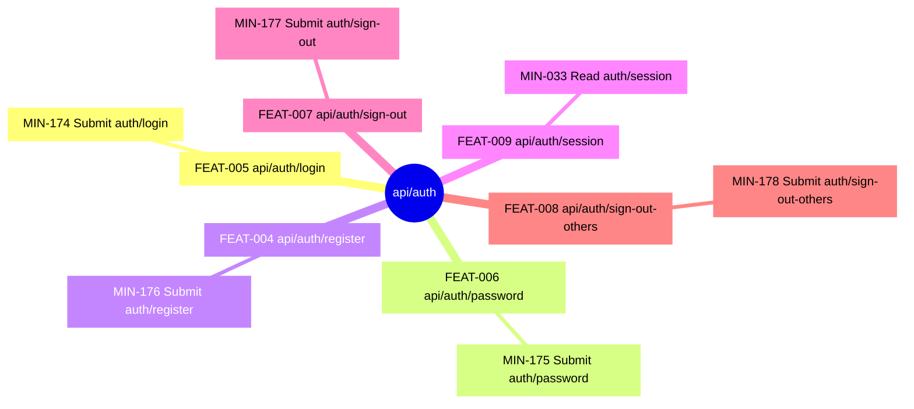
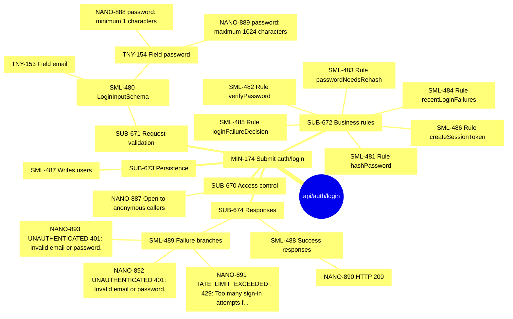
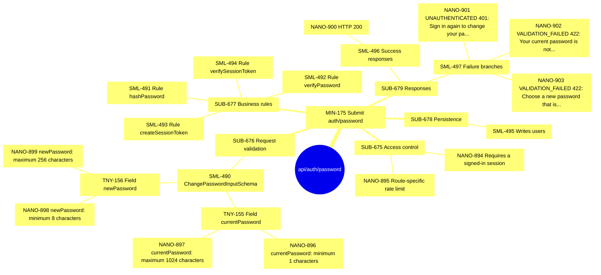
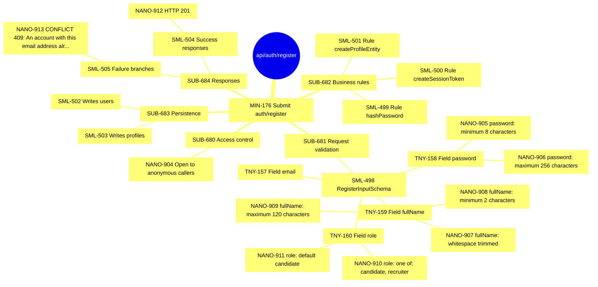
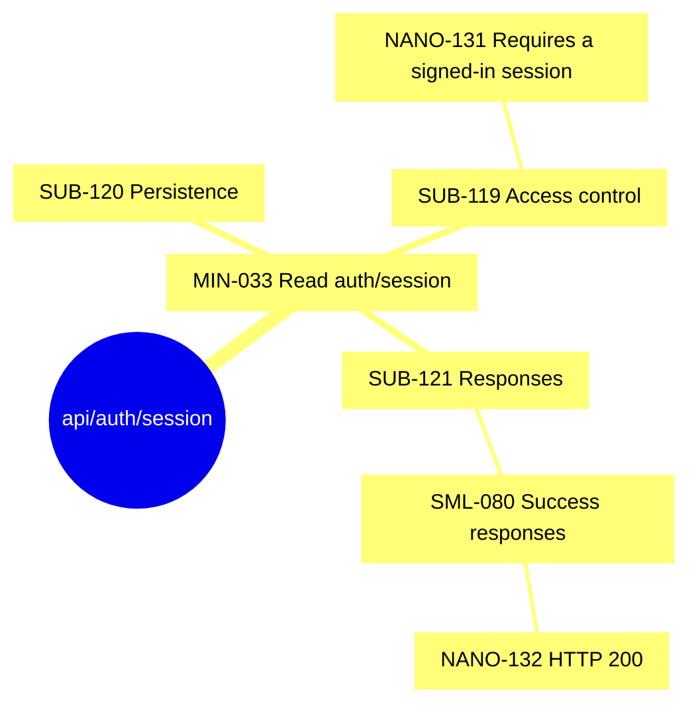
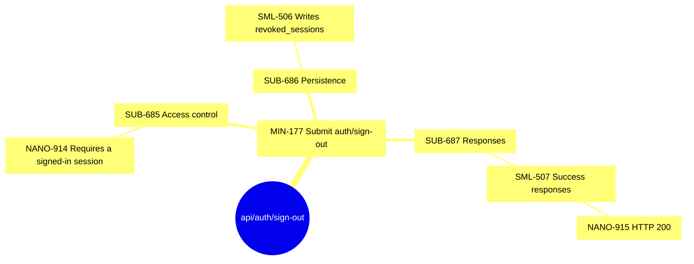
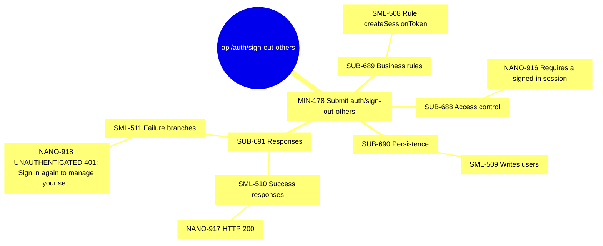

# api/auth (MOD-055)

Generated by `project-mindmap/tools/catalog.py` from `master/MASTER_PROJECT_GRAPH.json` at commit `9b3032f`. Do not edit by hand. Back to the [feature catalog](../FEATURE_CATALOG.md).

**Application:** apps/api (MOD-001). **Purpose:** API module: routes under /api/v1/auth in apps/api/src/server.ts.

**Nodes by level:** MODULE 1, MAJOR 6, MINOR 6, SUB 25, SMALL 33, TINY 8, NANO 34. **Status:** IMPLEMENTED 113. **Verification:** PATH_LEVEL 85, UNKNOWN 1, VERIFIED 20.

**User roles that reach it:** anonymous, authenticated.

**Known gaps:** MIN-033 no first-party web caller found; MIN-177 no first-party web caller found.

**Called from (web screens and components):** FEAT-170 Screen /login, FEAT-181 Screen /signup, FEAT-185 Component ChangePasswordForm, FEAT-194 Component SignOutOtherDevices

## Module map (to minor features)

## FEAT-005 api/auth/login

api/auth/login

| ID       | Level | Parent   | Name                                                                                           | Description                                                                                                                                                                                                                        | Status      | Verification | Evidence                                     | Related                                                       |
| -------- | ----- | -------- | ---------------------------------------------------------------------------------------------- | ---------------------------------------------------------------------------------------------------------------------------------------------------------------------------------------------------------------------------------- | ----------- | ------------ | -------------------------------------------- | ------------------------------------------------------------- |
| FEAT-005 | MAJOR | MOD-055  | api/auth/login                                                                                 |                                                                                                                                                                                                                                    | IMPLEMENTED |              | apps/api/src/server.ts:1102                  |                                                               |
| MIN-174  | MINOR | FEAT-005 | Submit auth/login                                                                              | POST /api/v1/auth/login for anyone (public); validates LoginInputSchema; calls hashPassword, verifyPassword, passwordNeedsRehash, recentLoginFailures ...; durable (PostgreSQL); writes users; responds 200; 3 failure branch(es). | IMPLEMENTED | VERIFIED     | apps/api/src/server.ts:1102                  | API-006, TEST-087, TEST-090, TEST-102, TEST-130, TEST-141 ... |
| SUB-670  | SUB   | MIN-174  | Access control                                                                                 | Who may call POST /api/v1/auth/login: anyone (public).                                                                                                                                                                             | IMPLEMENTED | PATH_LEVEL   | apps/api/src/server.ts:1102                  |                                                               |
| NANO-887 | NANO  | SUB-670  | Open to anonymous callers                                                                      | auth: public.                                                                                                                                                                                                                      | IMPLEMENTED | PATH_LEVEL   | apps/api/src/server.ts:1102                  | ROLE-001                                                      |
| SUB-671  | SUB   | MIN-174  | Request validation                                                                             | The request is parsed with LoginInputSchema; a failure returns 400 with field details before any business logic runs.                                                                                                              | IMPLEMENTED | PATH_LEVEL   | apps/api/src/server.ts:1102                  |                                                               |
| SML-480  | SMALL | SUB-671  | LoginInputSchema                                                                               | LoginInputSchema: 2 field(s)                                                                                                                                                                                                       | IMPLEMENTED | PATH_LEVEL   | packages/contracts/src/index.ts:113          | SCH-005                                                       |
| TNY-153  | TINY  | SML-480  | Field email                                                                                    | email (emailAddress(), required)                                                                                                                                                                                                   | IMPLEMENTED | PATH_LEVEL   | packages/contracts/src/index.ts:114          |                                                               |
| TNY-154  | TINY  | SML-480  | Field password                                                                                 | password (string, required): minimum 1 characters; maximum 1024 characters                                                                                                                                                         | IMPLEMENTED | PATH_LEVEL   | packages/contracts/src/index.ts:115          |                                                               |
| NANO-888 | NANO  | TNY-154  | password: minimum 1 characters                                                                 | password minimum 1 characters; message "Password is required".                                                                                                                                                                     | IMPLEMENTED | PATH_LEVEL   | packages/contracts/src/index.ts:115          |                                                               |
| NANO-889 | NANO  | TNY-154  | password: maximum 1024 characters                                                              | password maximum 1024 characters.                                                                                                                                                                                                  | IMPLEMENTED | PATH_LEVEL   | packages/contracts/src/index.ts:115          |                                                               |
| SUB-672  | SUB   | MIN-174  | Business rules                                                                                 | Domain functions from packages/domain called by the handler (6).                                                                                                                                                                   | IMPLEMENTED | PATH_LEVEL   | apps/api/src/server.ts:1102                  |                                                               |
| SML-481  | SMALL | SUB-672  | Rule hashPassword                                                                              | Calls hashPassword (packages/domain/src/auth.ts). Rule status IMPLEMENTED; its own tests: VERIFIED.                                                                                                                                | IMPLEMENTED | VERIFIED     | packages/domain/src/auth.ts:58               | RULE-049                                                      |
| SML-482  | SMALL | SUB-672  | Rule verifyPassword                                                                            | Calls verifyPassword (packages/domain/src/auth.ts). Rule status IMPLEMENTED; its own tests: VERIFIED.                                                                                                                              | IMPLEMENTED | VERIFIED     | packages/domain/src/auth.ts:69               | RULE-050                                                      |
| SML-483  | SMALL | SUB-672  | Rule passwordNeedsRehash                                                                       | Calls passwordNeedsRehash (packages/domain/src/auth.ts). Rule status IMPLEMENTED; its own tests: VERIFIED.                                                                                                                         | IMPLEMENTED | VERIFIED     | packages/domain/src/auth.ts:87               | RULE-051                                                      |
| SML-484  | SMALL | SUB-672  | Rule recentLoginFailures                                                                       | Calls recentLoginFailures (packages/domain/src/auth.ts). Rule status IMPLEMENTED; its own tests: VERIFIED.                                                                                                                         | IMPLEMENTED | VERIFIED     | packages/domain/src/auth.ts:102              | RULE-052                                                      |
| SML-485  | SMALL | SUB-672  | Rule loginFailureDecision                                                                      | Calls loginFailureDecision (packages/domain/src/auth.ts). Rule status IMPLEMENTED; its own tests: VERIFIED.                                                                                                                        | IMPLEMENTED | VERIFIED     | packages/domain/src/auth.ts:106              | RULE-053                                                      |
| SML-486  | SMALL | SUB-672  | Rule createSessionToken                                                                        | Calls createSessionToken (packages/domain/src/auth.ts). Rule status IMPLEMENTED; its own tests: VERIFIED.                                                                                                                          | IMPLEMENTED | VERIFIED     | packages/domain/src/auth.ts:145              | RULE-054                                                      |
| SUB-673  | SUB   | MIN-174  | Persistence                                                                                    | Durable: writes go through the PostgreSQL store.                                                                                                                                                                                   | IMPLEMENTED | PATH_LEVEL   | apps/api/src/server.ts:1102                  |                                                               |
| SML-487  | SMALL | SUB-673  | Writes users                                                                                   | Writes table users (00001_core_schema.sql).                                                                                                                                                                                        | IMPLEMENTED | PATH_LEVEL   | supabase/migrations/00001_core_schema.sql:96 | DB-001                                                        |
| SUB-674  | SUB   | MIN-174  | Responses                                                                                      | Success 200; 3 explicit failure branch(es) besides validation and access errors.                                                                                                                                                   | IMPLEMENTED | PATH_LEVEL   | apps/api/src/server.ts:1102                  |                                                               |
| SML-488  | SMALL | SUB-674  | Success responses                                                                              | HTTP 200.                                                                                                                                                                                                                          | IMPLEMENTED | PATH_LEVEL   | apps/api/src/server.ts:1102                  |                                                               |
| NANO-890 | NANO  | SML-488  | HTTP 200                                                                                       | Replies 200 when the operation succeeds.                                                                                                                                                                                           | IMPLEMENTED | PATH_LEVEL   | apps/api/src/server.ts:1102                  |                                                               |
| SML-489  | SMALL | SUB-674  | Failure branches                                                                               | 3 DomainError branch(es) in the handler, mapped to HTTP by the global error handler.                                                                                                                                               | IMPLEMENTED | PATH_LEVEL   | apps/api/src/server.ts:1102                  |                                                               |
| NANO-891 | NANO  | SML-489  | RATE_LIMIT_EXCEEDED 429: Too many sign-in attempts for this account. Wait 15 minutes, then try | Throws DomainError(RATE_LIMIT_EXCEEDED) "Too many sign-in attempts for this account. Wait 15 minutes, then try again." -> HTTP 429.                                                                                                | IMPLEMENTED | PATH_LEVEL   | apps/api/src/server.ts:1112                  | ERR-009                                                       |
| NANO-892 | NANO  | SML-489  | UNAUTHENTICATED 401: Invalid email or password.                                                | Throws DomainError(UNAUTHENTICATED) "Invalid email or password." -> HTTP 401.                                                                                                                                                      | IMPLEMENTED | PATH_LEVEL   | apps/api/src/server.ts:1124                  | ERR-010                                                       |
| NANO-893 | NANO  | SML-489  | UNAUTHENTICATED 401: Invalid email or password.                                                | Throws DomainError(UNAUTHENTICATED) "Invalid email or password." -> HTTP 401.                                                                                                                                                      | IMPLEMENTED | PATH_LEVEL   | apps/api/src/server.ts:1129                  | ERR-010                                                       |

## FEAT-006 api/auth/password

api/auth/password

| ID       | Level | Parent   | Name                                                                                 | Description                                                                                                                                                                                                                                                                                                                                                                                                      | Status      | Verification | Evidence                                     | Related                     |
| -------- | ----- | -------- | ------------------------------------------------------------------------------------ | ---------------------------------------------------------------------------------------------------------------------------------------------------------------------------------------------------------------------------------------------------------------------------------------------------------------------------------------------------------------------------------------------------------------- | ----------- | ------------ | -------------------------------------------- | --------------------------- |
| FEAT-006 | MAJOR | MOD-055  | api/auth/password                                                                    |                                                                                                                                                                                                                                                                                                                                                                                                                  | IMPLEMENTED |              | apps/api/src/server.ts:1176                  |                             |
| MIN-175  | MINOR | FEAT-006 | Submit auth/password                                                                 | Change password. Requires the current one, ends every other session (tokens issued before the change are refused by resolveSession), and returns a fresh token so this device stays signed in. Throttled like login, per account. POST /api/v1/auth/password for any signed-in session; validates ChangePasswordInputSchema; calls hashPassword, verifyPassword, createSessionToken, verifySessionToken; durable | IMPLEMENTED | VERIFIED     | apps/api/src/server.ts:1176                  | API-007, TEST-142, TEST-150 |
| SUB-675  | SUB   | MIN-175  | Access control                                                                       | Who may call POST /api/v1/auth/password: any signed-in session.                                                                                                                                                                                                                                                                                                                                                  | IMPLEMENTED | PATH_LEVEL   | apps/api/src/server.ts:1176                  |                             |
| NANO-894 | NANO  | SUB-675  | Requires a signed-in session                                                         | Requests without a valid session token are rejected with 401 UNAUTHENTICATED.                                                                                                                                                                                                                                                                                                                                    | IMPLEMENTED | PATH_LEVEL   | apps/api/src/server.ts:1176                  | ROLE-001                    |
| NANO-895 | NANO  | SUB-675  | Route-specific rate limit                                                            | This route sets its own rate-limit configuration (429 when exceeded).                                                                                                                                                                                                                                                                                                                                            | IMPLEMENTED | PATH_LEVEL   | apps/api/src/server.ts:1176                  |                             |
| SUB-676  | SUB   | MIN-175  | Request validation                                                                   | The request is parsed with ChangePasswordInputSchema; a failure returns 400 with field details before any business logic runs.                                                                                                                                                                                                                                                                                   | IMPLEMENTED | PATH_LEVEL   | apps/api/src/server.ts:1176                  |                             |
| SML-490  | SMALL | SUB-676  | ChangePasswordInputSchema                                                            | ChangePasswordInputSchema: 2 field(s)                                                                                                                                                                                                                                                                                                                                                                            | IMPLEMENTED | PATH_LEVEL   | packages/contracts/src/index.ts:120          | SCH-006                     |
| TNY-155  | TINY  | SML-490  | Field currentPassword                                                                | currentPassword (string, required): minimum 1 characters; maximum 1024 characters                                                                                                                                                                                                                                                                                                                                | IMPLEMENTED | PATH_LEVEL   | packages/contracts/src/index.ts:121          |                             |
| NANO-896 | NANO  | TNY-155  | currentPassword: minimum 1 characters                                                | currentPassword minimum 1 characters; message "Current password is required".                                                                                                                                                                                                                                                                                                                                    | IMPLEMENTED | PATH_LEVEL   | packages/contracts/src/index.ts:121          |                             |
| NANO-897 | NANO  | TNY-155  | currentPassword: maximum 1024 characters                                             | currentPassword maximum 1024 characters.                                                                                                                                                                                                                                                                                                                                                                         | IMPLEMENTED | PATH_LEVEL   | packages/contracts/src/index.ts:121          |                             |
| TNY-156  | TINY  | SML-490  | Field newPassword                                                                    | newPassword (string, required): minimum 8 characters; maximum 256 characters                                                                                                                                                                                                                                                                                                                                     | IMPLEMENTED | PATH_LEVEL   | packages/contracts/src/index.ts:122          |                             |
| NANO-898 | NANO  | TNY-156  | newPassword: minimum 8 characters                                                    | newPassword minimum 8 characters; message "Password must be at least 8 characters".                                                                                                                                                                                                                                                                                                                              | IMPLEMENTED | PATH_LEVEL   | packages/contracts/src/index.ts:122          |                             |
| NANO-899 | NANO  | TNY-156  | newPassword: maximum 256 characters                                                  | newPassword maximum 256 characters; message "Password must be at most 256 characters".                                                                                                                                                                                                                                                                                                                           | IMPLEMENTED | PATH_LEVEL   | packages/contracts/src/index.ts:122          |                             |
| SUB-677  | SUB   | MIN-175  | Business rules                                                                       | Domain functions from packages/domain called by the handler (4).                                                                                                                                                                                                                                                                                                                                                 | IMPLEMENTED | PATH_LEVEL   | apps/api/src/server.ts:1176                  |                             |
| SML-491  | SMALL | SUB-677  | Rule hashPassword                                                                    | Calls hashPassword (packages/domain/src/auth.ts). Rule status IMPLEMENTED; its own tests: VERIFIED.                                                                                                                                                                                                                                                                                                              | IMPLEMENTED | VERIFIED     | packages/domain/src/auth.ts:58               | RULE-049                    |
| SML-492  | SMALL | SUB-677  | Rule verifyPassword                                                                  | Calls verifyPassword (packages/domain/src/auth.ts). Rule status IMPLEMENTED; its own tests: VERIFIED.                                                                                                                                                                                                                                                                                                            | IMPLEMENTED | VERIFIED     | packages/domain/src/auth.ts:69               | RULE-050                    |
| SML-493  | SMALL | SUB-677  | Rule createSessionToken                                                              | Calls createSessionToken (packages/domain/src/auth.ts). Rule status IMPLEMENTED; its own tests: VERIFIED.                                                                                                                                                                                                                                                                                                        | IMPLEMENTED | VERIFIED     | packages/domain/src/auth.ts:145              | RULE-054                    |
| SML-494  | SMALL | SUB-677  | Rule verifySessionToken                                                              | Calls verifySessionToken (packages/domain/src/auth.ts). Rule status IMPLEMENTED; its own tests: UNKNOWN.                                                                                                                                                                                                                                                                                                         | IMPLEMENTED | UNKNOWN      | packages/domain/src/auth.ts:168              | RULE-055                    |
| SUB-678  | SUB   | MIN-175  | Persistence                                                                          | Durable: writes go through the PostgreSQL store.                                                                                                                                                                                                                                                                                                                                                                 | IMPLEMENTED | PATH_LEVEL   | apps/api/src/server.ts:1176                  |                             |
| SML-495  | SMALL | SUB-678  | Writes users                                                                         | Writes table users (00001_core_schema.sql).                                                                                                                                                                                                                                                                                                                                                                      | IMPLEMENTED | PATH_LEVEL   | supabase/migrations/00001_core_schema.sql:96 | DB-001                      |
| SUB-679  | SUB   | MIN-175  | Responses                                                                            | Success 200; 3 explicit failure branch(es) besides validation and access errors.                                                                                                                                                                                                                                                                                                                                 | IMPLEMENTED | PATH_LEVEL   | apps/api/src/server.ts:1176                  |                             |
| SML-496  | SMALL | SUB-679  | Success responses                                                                    | HTTP 200.                                                                                                                                                                                                                                                                                                                                                                                                        | IMPLEMENTED | PATH_LEVEL   | apps/api/src/server.ts:1176                  |                             |
| NANO-900 | NANO  | SML-496  | HTTP 200                                                                             | Replies 200 when the operation succeeds.                                                                                                                                                                                                                                                                                                                                                                         | IMPLEMENTED | PATH_LEVEL   | apps/api/src/server.ts:1176                  |                             |
| SML-497  | SMALL | SUB-679  | Failure branches                                                                     | 3 DomainError branch(es) in the handler, mapped to HTTP by the global error handler.                                                                                                                                                                                                                                                                                                                             | IMPLEMENTED | PATH_LEVEL   | apps/api/src/server.ts:1176                  |                             |
| NANO-901 | NANO  | SML-497  | UNAUTHENTICATED 401: Sign in again to change your password.                          | Throws DomainError(UNAUTHENTICATED) "Sign in again to change your password." -> HTTP 401.                                                                                                                                                                                                                                                                                                                        | IMPLEMENTED | PATH_LEVEL   | apps/api/src/server.ts:1199                  | ERR-011                     |
| NANO-902 | NANO  | SML-497  | VALIDATION_FAILED 422: Your current password is not correct.                         | Throws DomainError(VALIDATION_FAILED) "Your current password is not correct." -> HTTP 422.                                                                                                                                                                                                                                                                                                                       | IMPLEMENTED | VERIFIED     | apps/api/src/server.ts:1202                  | ERR-012, TEST-163, TEST-164 |
| NANO-903 | NANO  | SML-497  | VALIDATION_FAILED 422: Choose a new password that is different from the current one. | Throws DomainError(VALIDATION_FAILED) "Choose a new password that is different from the current one." -> HTTP 422.                                                                                                                                                                                                                                                                                               | IMPLEMENTED | PATH_LEVEL   | apps/api/src/server.ts:1207                  | ERR-013                     |

## FEAT-004 api/auth/register

api/auth/register

| ID       | Level | Parent   | Name                                                             | Description                                                                                                                                                                                                                   | Status      | Verification | Evidence                                      | Related                                                       |
| -------- | ----- | -------- | ---------------------------------------------------------------- | ----------------------------------------------------------------------------------------------------------------------------------------------------------------------------------------------------------------------------- | ----------- | ------------ | --------------------------------------------- | ------------------------------------------------------------- |
| FEAT-004 | MAJOR | MOD-055  | api/auth/register                                                |                                                                                                                                                                                                                               | IMPLEMENTED |              | apps/api/src/server.ts:1062                   |                                                               |
| MIN-176  | MINOR | FEAT-004 | Submit auth/register                                             | POST /api/v1/auth/register for anyone (public); validates RegisterInputSchema; calls hashPassword, createSessionToken, createProfileEntity; durable (PostgreSQL); writes users, profiles; responds 201; 1 failure branch(es). | IMPLEMENTED | VERIFIED     | apps/api/src/server.ts:1062                   | API-005, TEST-082, TEST-083, TEST-084, TEST-085, TEST-086 ... |
| SUB-680  | SUB   | MIN-176  | Access control                                                   | Who may call POST /api/v1/auth/register: anyone (public).                                                                                                                                                                     | IMPLEMENTED | PATH_LEVEL   | apps/api/src/server.ts:1062                   |                                                               |
| NANO-904 | NANO  | SUB-680  | Open to anonymous callers                                        | auth: public.                                                                                                                                                                                                                 | IMPLEMENTED | PATH_LEVEL   | apps/api/src/server.ts:1062                   | ROLE-001                                                      |
| SUB-681  | SUB   | MIN-176  | Request validation                                               | The request is parsed with RegisterInputSchema; a failure returns 400 with field details before any business logic runs.                                                                                                      | IMPLEMENTED | PATH_LEVEL   | apps/api/src/server.ts:1062                   |                                                               |
| SML-498  | SMALL | SUB-681  | RegisterInputSchema                                              | RegisterInputSchema: 4 field(s)                                                                                                                                                                                               | IMPLEMENTED | PATH_LEVEL   | packages/contracts/src/index.ts:97            | SCH-004                                                       |
| TNY-157  | TINY  | SML-498  | Field email                                                      | email (emailAddress(), required)                                                                                                                                                                                              | IMPLEMENTED | PATH_LEVEL   | packages/contracts/src/index.ts:98            |                                                               |
| TNY-158  | TINY  | SML-498  | Field password                                                   | password (string, required): minimum 8 characters; maximum 256 characters                                                                                                                                                     | IMPLEMENTED | PATH_LEVEL   | packages/contracts/src/index.ts:99            |                                                               |
| NANO-905 | NANO  | TNY-158  | password: minimum 8 characters                                   | password minimum 8 characters; message "Password must be at least 8 characters".                                                                                                                                              | IMPLEMENTED | PATH_LEVEL   | packages/contracts/src/index.ts:99            |                                                               |
| NANO-906 | NANO  | TNY-158  | password: maximum 256 characters                                 | password maximum 256 characters; message "Password must be at most 256 characters".                                                                                                                                           | IMPLEMENTED | PATH_LEVEL   | packages/contracts/src/index.ts:99            |                                                               |
| TNY-159  | TINY  | SML-498  | Field fullName                                                   | fullName (string, required): whitespace trimmed; minimum 2 characters; maximum 120 characters                                                                                                                                 | IMPLEMENTED | PATH_LEVEL   | packages/contracts/src/index.ts:103           |                                                               |
| NANO-907 | NANO  | TNY-159  | fullName: whitespace trimmed                                     | fullName whitespace trimmed.                                                                                                                                                                                                  | IMPLEMENTED | PATH_LEVEL   | packages/contracts/src/index.ts:103           |                                                               |
| NANO-908 | NANO  | TNY-159  | fullName: minimum 2 characters                                   | fullName minimum 2 characters; message "Full name must be at least 2 characters".                                                                                                                                             | IMPLEMENTED | PATH_LEVEL   | packages/contracts/src/index.ts:103           |                                                               |
| NANO-909 | NANO  | TNY-159  | fullName: maximum 120 characters                                 | fullName maximum 120 characters; message "Full name must be at most 120 characters".                                                                                                                                          | IMPLEMENTED | PATH_LEVEL   | packages/contracts/src/index.ts:103           |                                                               |
| TNY-160  | TINY  | SML-498  | Field role                                                       | role (enum, optional): one of: candidate, recruiter; default 'candidate'                                                                                                                                                      | IMPLEMENTED | PATH_LEVEL   | packages/contracts/src/index.ts:108           |                                                               |
| NANO-910 | NANO  | TNY-160  | role: one of: candidate, recruiter                               | role one of: candidate, recruiter.                                                                                                                                                                                            | IMPLEMENTED | PATH_LEVEL   | packages/contracts/src/index.ts:108           |                                                               |
| NANO-911 | NANO  | TNY-160  | role: default 'candidate'                                        | role default 'candidate'; message "candidate".                                                                                                                                                                                | IMPLEMENTED | PATH_LEVEL   | packages/contracts/src/index.ts:108           |                                                               |
| SUB-682  | SUB   | MIN-176  | Business rules                                                   | Domain functions from packages/domain called by the handler (3).                                                                                                                                                              | IMPLEMENTED | PATH_LEVEL   | apps/api/src/server.ts:1062                   |                                                               |
| SML-499  | SMALL | SUB-682  | Rule hashPassword                                                | Calls hashPassword (packages/domain/src/auth.ts). Rule status IMPLEMENTED; its own tests: VERIFIED.                                                                                                                           | IMPLEMENTED | VERIFIED     | packages/domain/src/auth.ts:58                | RULE-049                                                      |
| SML-500  | SMALL | SUB-682  | Rule createSessionToken                                          | Calls createSessionToken (packages/domain/src/auth.ts). Rule status IMPLEMENTED; its own tests: VERIFIED.                                                                                                                     | IMPLEMENTED | VERIFIED     | packages/domain/src/auth.ts:145               | RULE-054                                                      |
| SML-501  | SMALL | SUB-682  | Rule createProfileEntity                                         | Calls createProfileEntity (packages/domain/src/profile.ts). Rule status IMPLEMENTED; its own tests: VERIFIED.                                                                                                                 | IMPLEMENTED | VERIFIED     | packages/domain/src/profile.ts:4              | RULE-176                                                      |
| SUB-683  | SUB   | MIN-176  | Persistence                                                      | Durable: writes go through the PostgreSQL store.                                                                                                                                                                              | IMPLEMENTED | PATH_LEVEL   | apps/api/src/server.ts:1062                   |                                                               |
| SML-502  | SMALL | SUB-683  | Writes users                                                     | Writes table users (00001_core_schema.sql).                                                                                                                                                                                   | IMPLEMENTED | PATH_LEVEL   | supabase/migrations/00001_core_schema.sql:96  | DB-001                                                        |
| SML-503  | SMALL | SUB-683  | Writes profiles                                                  | Writes table profiles (00001_core_schema.sql).                                                                                                                                                                                | IMPLEMENTED | PATH_LEVEL   | supabase/migrations/00001_core_schema.sql:114 | DB-002                                                        |
| SUB-684  | SUB   | MIN-176  | Responses                                                        | Success 201; 1 explicit failure branch(es) besides validation and access errors.                                                                                                                                              | IMPLEMENTED | PATH_LEVEL   | apps/api/src/server.ts:1062                   |                                                               |
| SML-504  | SMALL | SUB-684  | Success responses                                                | HTTP 201.                                                                                                                                                                                                                     | IMPLEMENTED | PATH_LEVEL   | apps/api/src/server.ts:1062                   |                                                               |
| NANO-912 | NANO  | SML-504  | HTTP 201                                                         | Replies 201 when the operation succeeds.                                                                                                                                                                                      | IMPLEMENTED | PATH_LEVEL   | apps/api/src/server.ts:1062                   |                                                               |
| SML-505  | SMALL | SUB-684  | Failure branches                                                 | 1 DomainError branch(es) in the handler, mapped to HTTP by the global error handler.                                                                                                                                          | IMPLEMENTED | PATH_LEVEL   | apps/api/src/server.ts:1062                   |                                                               |
| NANO-913 | NANO  | SML-505  | CONFLICT 409: An account with this email address already exists. | Throws DomainError(CONFLICT) "An account with this email address already exists." -> HTTP 409.                                                                                                                                | IMPLEMENTED | PATH_LEVEL   | apps/api/src/server.ts:1069                   | ERR-008                                                       |

## FEAT-009 api/auth/session

api/auth/session

| ID       | Level | Parent   | Name                         | Description                                                                                                                                                                                                                                                                                                                 | Status      | Verification | Evidence                    | Related                                                   |
| -------- | ----- | -------- | ---------------------------- | --------------------------------------------------------------------------------------------------------------------------------------------------------------------------------------------------------------------------------------------------------------------------------------------------------------------------- | ----------- | ------------ | --------------------------- | --------------------------------------------------------- |
| FEAT-009 | MAJOR | MOD-055  | api/auth/session             |                                                                                                                                                                                                                                                                                                                             | IMPLEMENTED |              | apps/api/src/server.ts:1303 |                                                           |
| MIN-033  | MINOR | FEAT-009 | Read auth/session            | Who am I, according to the server? The web app calls this on load so its idea of the session (roles, account status, profile) comes from the API, not from whatever was left in localStorage. GET /api/v1/auth/session for any signed-in session; durable (PostgreSQL); responds 200. Gaps: no first-party web caller found | IMPLEMENTED | VERIFIED     | apps/api/src/server.ts:1303 | API-010, TEST-142, TEST-146, TEST-150, TEST-164, TEST-209 |
| SUB-119  | SUB   | MIN-033  | Access control               | Who may call GET /api/v1/auth/session: any signed-in session.                                                                                                                                                                                                                                                               | IMPLEMENTED | PATH_LEVEL   | apps/api/src/server.ts:1303 |                                                           |
| NANO-131 | NANO  | SUB-119  | Requires a signed-in session | Requests without a valid session token are rejected with 401 UNAUTHENTICATED.                                                                                                                                                                                                                                               | IMPLEMENTED | PATH_LEVEL   | apps/api/src/server.ts:1303 | ROLE-001                                                  |
| SUB-120  | SUB   | MIN-033  | Persistence                  | Durable: writes go through the PostgreSQL store.                                                                                                                                                                                                                                                                            | IMPLEMENTED | PATH_LEVEL   | apps/api/src/server.ts:1303 |                                                           |
| SUB-121  | SUB   | MIN-033  | Responses                    | Success 200; 0 explicit failure branch(es) besides validation and access errors.                                                                                                                                                                                                                                            | IMPLEMENTED | PATH_LEVEL   | apps/api/src/server.ts:1303 |                                                           |
| SML-080  | SMALL | SUB-121  | Success responses            | HTTP 200.                                                                                                                                                                                                                                                                                                                   | IMPLEMENTED | PATH_LEVEL   | apps/api/src/server.ts:1303 |                                                           |
| NANO-132 | NANO  | SML-080  | HTTP 200                     | Replies 200 when the operation succeeds.                                                                                                                                                                                                                                                                                    | IMPLEMENTED | PATH_LEVEL   | apps/api/src/server.ts:1303 |                                                           |

## FEAT-007 api/auth/sign-out

api/auth/sign-out

| ID       | Level | Parent   | Name                         | Description                                                                                                                                                                                                                                                                                                                                                                                                                                            | Status      | Verification | Evidence                                          | Related                               |
| -------- | ----- | -------- | ---------------------------- | ------------------------------------------------------------------------------------------------------------------------------------------------------------------------------------------------------------------------------------------------------------------------------------------------------------------------------------------------------------------------------------------------------------------------------------------------------ | ----------- | ------------ | ------------------------------------------------- | ------------------------------------- |
| FEAT-007 | MAJOR | MOD-055  | api/auth/sign-out            |                                                                                                                                                                                                                                                                                                                                                                                                                                                        | IMPLEMENTED |              | apps/api/src/server.ts:1249                       |                                       |
| MIN-177  | MINOR | FEAT-007 | Submit auth/sign-out         | Sign out: end THIS session on the server, not only in the browser. Before 2026-10-11 sign-out deleted the browser's copy and nothing else, so a copied token kept working for up to 24 hours. Tokens minted before session ids existed cannot be singled out; they are reported as such and end at expiry (or with a password change). POST /api/v1/auth/sign-out for any signed-in session; durable (PostgreSQL Gaps: no first-party web caller found | IMPLEMENTED | VERIFIED     | apps/api/src/server.ts:1249                       | API-008, TEST-102, TEST-146, TEST-150 |
| SUB-685  | SUB   | MIN-177  | Access control               | Who may call POST /api/v1/auth/sign-out: any signed-in session.                                                                                                                                                                                                                                                                                                                                                                                        | IMPLEMENTED | PATH_LEVEL   | apps/api/src/server.ts:1249                       |                                       |
| NANO-914 | NANO  | SUB-685  | Requires a signed-in session | Requests without a valid session token are rejected with 401 UNAUTHENTICATED.                                                                                                                                                                                                                                                                                                                                                                          | IMPLEMENTED | PATH_LEVEL   | apps/api/src/server.ts:1249                       | ROLE-001                              |
| SUB-686  | SUB   | MIN-177  | Persistence                  | Durable: writes go through the PostgreSQL store.                                                                                                                                                                                                                                                                                                                                                                                                       | IMPLEMENTED | PATH_LEVEL   | apps/api/src/server.ts:1249                       |                                       |
| SML-506  | SMALL | SUB-686  | Writes revoked_sessions      | Writes table revoked_sessions (00046_session_sign_out.sql).                                                                                                                                                                                                                                                                                                                                                                                            | IMPLEMENTED | PATH_LEVEL   | supabase/migrations/00046_session_sign_out.sql:16 | DB-109                                |
| SUB-687  | SUB   | MIN-177  | Responses                    | Success 200; 0 explicit failure branch(es) besides validation and access errors.                                                                                                                                                                                                                                                                                                                                                                       | IMPLEMENTED | PATH_LEVEL   | apps/api/src/server.ts:1249                       |                                       |
| SML-507  | SMALL | SUB-687  | Success responses            | HTTP 200.                                                                                                                                                                                                                                                                                                                                                                                                                                              | IMPLEMENTED | PATH_LEVEL   | apps/api/src/server.ts:1249                       |                                       |
| NANO-915 | NANO  | SML-507  | HTTP 200                     | Replies 200 when the operation succeeds.                                                                                                                                                                                                                                                                                                                                                                                                               | IMPLEMENTED | PATH_LEVEL   | apps/api/src/server.ts:1249                       |                                       |

## FEAT-008 api/auth/sign-out-others

api/auth/sign-out-others

| ID       | Level | Parent   | Name                                                        | Description                                                                                                                                                                                                                                                                                                                                                                                                      | Status      | Verification | Evidence                                     | Related                     |
| -------- | ----- | -------- | ----------------------------------------------------------- | ---------------------------------------------------------------------------------------------------------------------------------------------------------------------------------------------------------------------------------------------------------------------------------------------------------------------------------------------------------------------------------------------------------------- | ----------- | ------------ | -------------------------------------------- | --------------------------- |
| FEAT-008 | MAJOR | MOD-055  | api/auth/sign-out-others                                    |                                                                                                                                                                                                                                                                                                                                                                                                                  | IMPLEMENTED |              | apps/api/src/server.ts:1275                  |                             |
| MIN-178  | MINOR | FEAT-008 | Submit auth/sign-out-others                                 | Sign out of every other device, without changing the password: for a phone left behind or a shared computer someone forgot to sign out of. Same mechanism as a password change (sessions_valid_after, migration 00045): every token issued so far is refused and this device gets a fresh one minted at the cut-off. Allowed for suspended accounts, like a password change: securing an account is not somethin | IMPLEMENTED | VERIFIED     | apps/api/src/server.ts:1275                  | API-009, TEST-102, TEST-146 |
| SUB-688  | SUB   | MIN-178  | Access control                                              | Who may call POST /api/v1/auth/sign-out-others: any signed-in session.                                                                                                                                                                                                                                                                                                                                           | IMPLEMENTED | PATH_LEVEL   | apps/api/src/server.ts:1275                  |                             |
| NANO-916 | NANO  | SUB-688  | Requires a signed-in session                                | Requests without a valid session token are rejected with 401 UNAUTHENTICATED.                                                                                                                                                                                                                                                                                                                                    | IMPLEMENTED | PATH_LEVEL   | apps/api/src/server.ts:1275                  | ROLE-001                    |
| SUB-689  | SUB   | MIN-178  | Business rules                                              | Domain functions from packages/domain called by the handler (1).                                                                                                                                                                                                                                                                                                                                                 | IMPLEMENTED | PATH_LEVEL   | apps/api/src/server.ts:1275                  |                             |
| SML-508  | SMALL | SUB-689  | Rule createSessionToken                                     | Calls createSessionToken (packages/domain/src/auth.ts). Rule status IMPLEMENTED; its own tests: VERIFIED.                                                                                                                                                                                                                                                                                                        | IMPLEMENTED | VERIFIED     | packages/domain/src/auth.ts:145              | RULE-054                    |
| SUB-690  | SUB   | MIN-178  | Persistence                                                 | Durable: writes go through the PostgreSQL store.                                                                                                                                                                                                                                                                                                                                                                 | IMPLEMENTED | PATH_LEVEL   | apps/api/src/server.ts:1275                  |                             |
| SML-509  | SMALL | SUB-690  | Writes users                                                | Writes table users (00001_core_schema.sql).                                                                                                                                                                                                                                                                                                                                                                      | IMPLEMENTED | PATH_LEVEL   | supabase/migrations/00001_core_schema.sql:96 | DB-001                      |
| SUB-691  | SUB   | MIN-178  | Responses                                                   | Success 200; 1 explicit failure branch(es) besides validation and access errors.                                                                                                                                                                                                                                                                                                                                 | IMPLEMENTED | PATH_LEVEL   | apps/api/src/server.ts:1275                  |                             |
| SML-510  | SMALL | SUB-691  | Success responses                                           | HTTP 200.                                                                                                                                                                                                                                                                                                                                                                                                        | IMPLEMENTED | PATH_LEVEL   | apps/api/src/server.ts:1275                  |                             |
| NANO-917 | NANO  | SML-510  | HTTP 200                                                    | Replies 200 when the operation succeeds.                                                                                                                                                                                                                                                                                                                                                                         | IMPLEMENTED | PATH_LEVEL   | apps/api/src/server.ts:1275                  |                             |
| SML-511  | SMALL | SUB-691  | Failure branches                                            | 1 DomainError branch(es) in the handler, mapped to HTTP by the global error handler.                                                                                                                                                                                                                                                                                                                             | IMPLEMENTED | PATH_LEVEL   | apps/api/src/server.ts:1275                  |                             |
| NANO-918 | NANO  | SML-511  | UNAUTHENTICATED 401: Sign in again to manage your sessions. | Throws DomainError(UNAUTHENTICATED) "Sign in again to manage your sessions." -> HTTP 401.                                                                                                                                                                                                                                                                                                                        | IMPLEMENTED | PATH_LEVEL   | apps/api/src/server.ts:1279                  | ERR-014                     |
