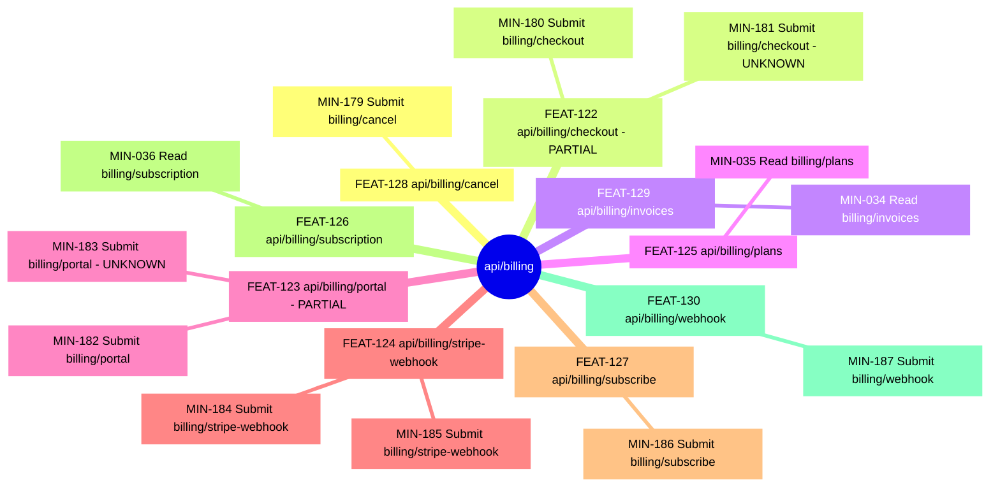
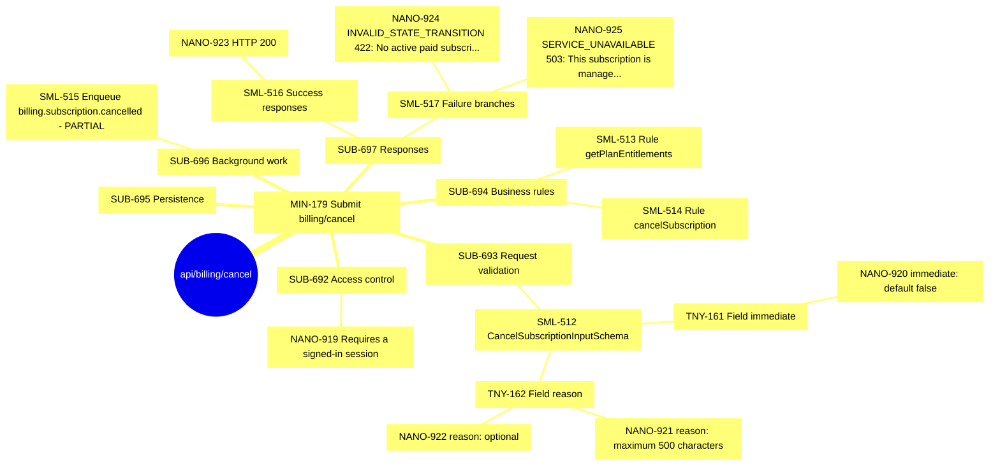
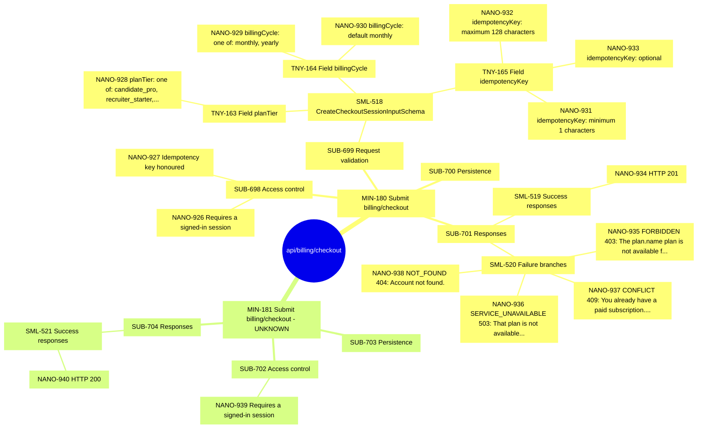
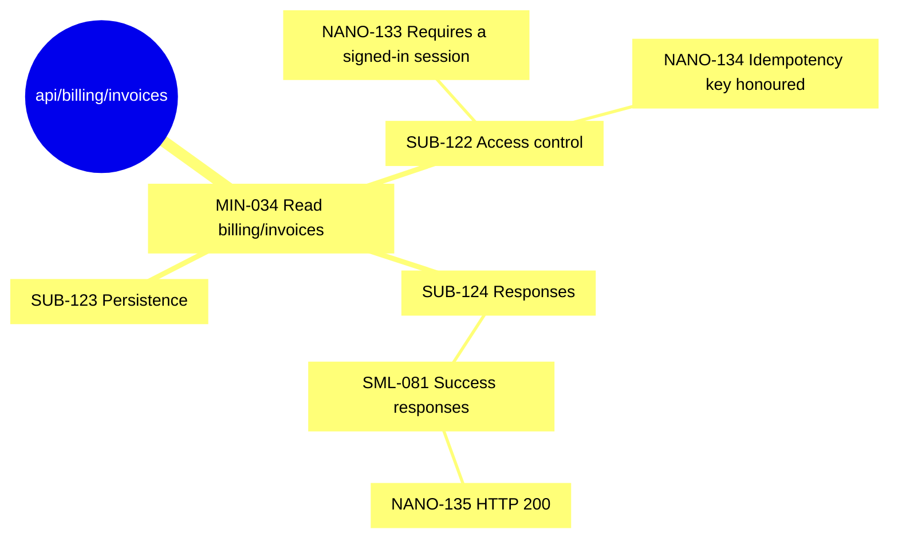
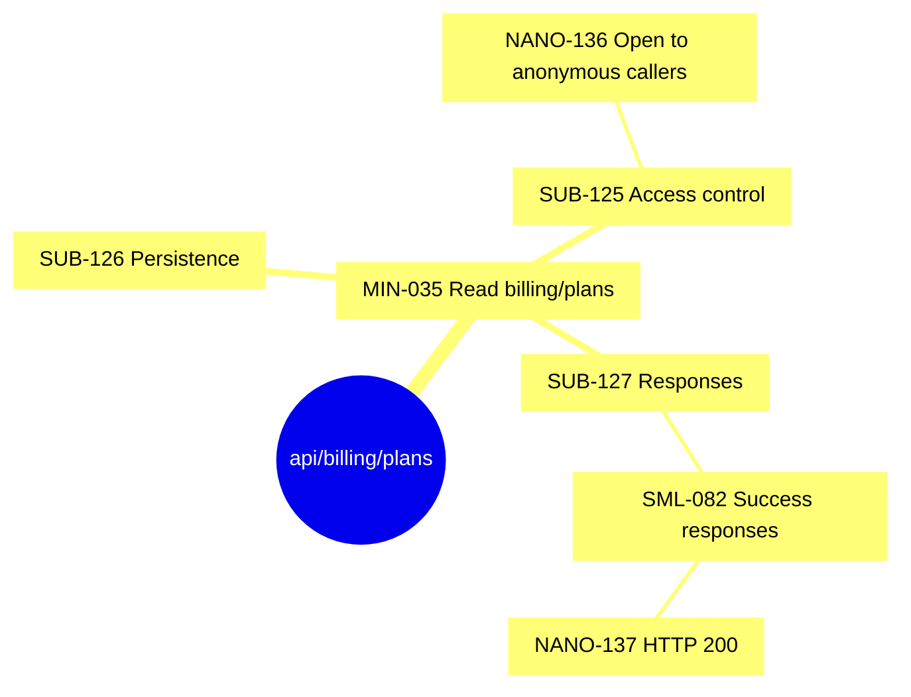
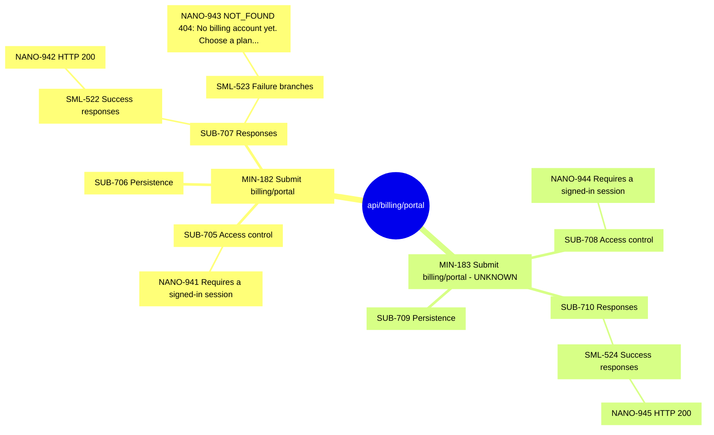
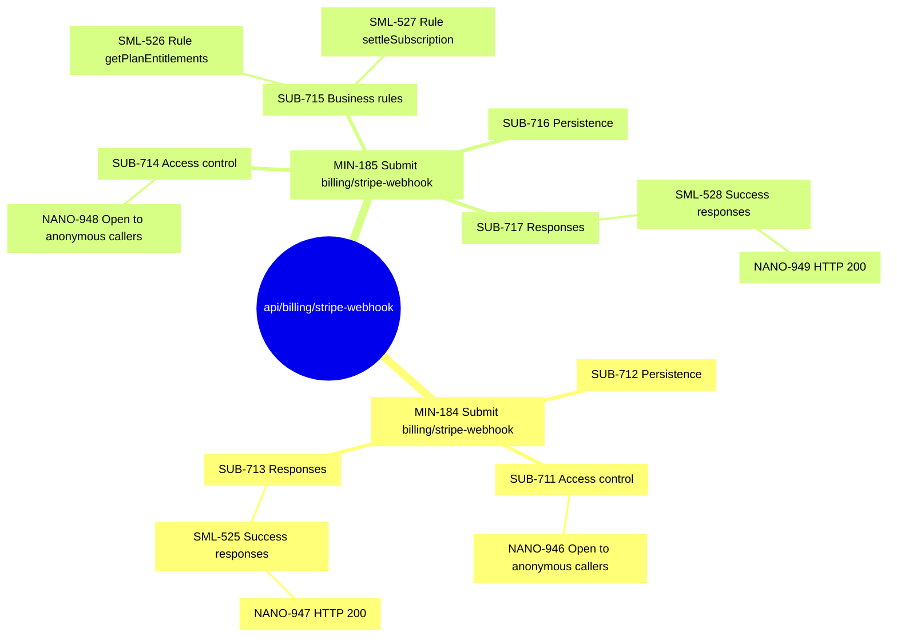
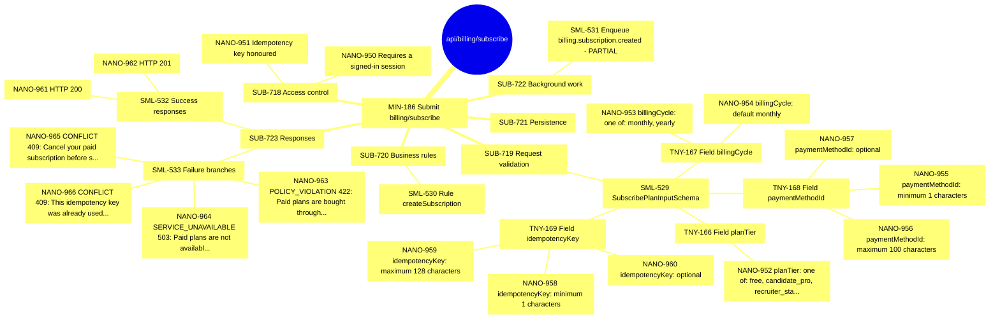
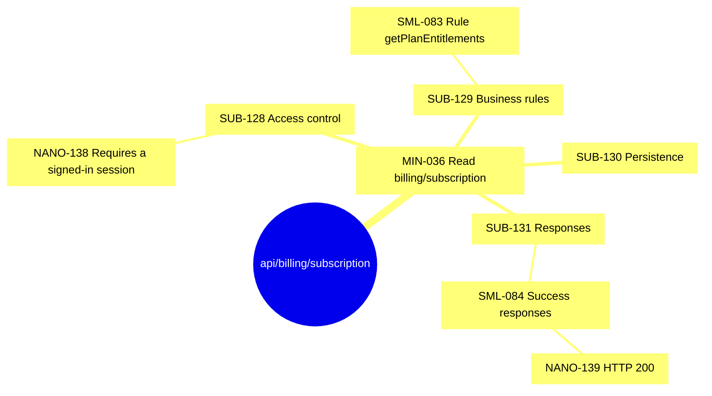
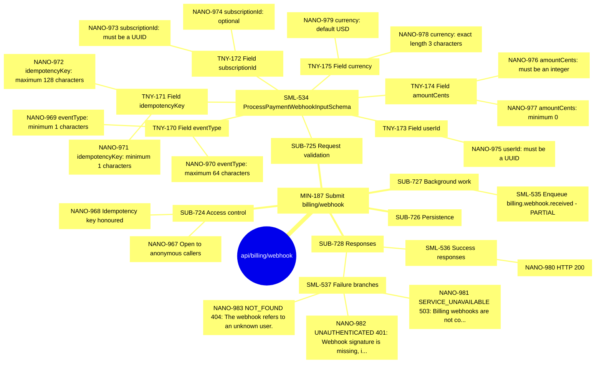

# api/billing (MOD-090)

Generated by `project-mindmap/tools/catalog.py` from `master/MASTER_PROJECT_GRAPH.json` at commit `9b3032f`. Do not edit by hand. Back to the [feature catalog](../FEATURE_CATALOG.md).

**Application:** apps/api (MOD-001). **Purpose:** API module: routes under /api/v1/billing in apps/api/src/server.ts.

**Nodes by level:** MODULE 1, MAJOR 9, MINOR 12, SUB 47, SMALL 30, TINY 15, NANO 72. **Status:** IMPLEMENTED 178, PARTIALLY_IMPLEMENTED 6, UNKNOWN 2. **Verification:** PATH_LEVEL 141, UNKNOWN 19, VERIFIED 16.

**User roles that reach it:** anonymous, authenticated.

**Known gaps:** MIN-179 no first-party web caller found; MIN-181 no first-party web caller found; MIN-034 no first-party web caller found; MIN-182 no linked test; MIN-183 no first-party web caller found; MIN-183 no linked test; MIN-184 no first-party web caller found; MIN-185 no first-party web caller found; MIN-186 no first-party web caller found; MIN-187 no first-party web caller found.

**Called from (web screens and components):** FEAT-192 Component PaidPlans

## Module map (to minor features)

## FEAT-128 api/billing/cancel

api/billing/cancel

| ID       | Level | Parent   | Name                                                                                            | Description                                                                                                                                                                                                                                                                  | Status                | Verification | Evidence                                   | Related           |
| -------- | ----- | -------- | ----------------------------------------------------------------------------------------------- | ---------------------------------------------------------------------------------------------------------------------------------------------------------------------------------------------------------------------------------------------------------------------------- | --------------------- | ------------ | ------------------------------------------ | ----------------- |
| FEAT-128 | MAJOR | MOD-090  | api/billing/cancel                                                                              |                                                                                                                                                                                                                                                                              | IMPLEMENTED           |              | apps/api/src/server.ts:11043               |                   |
| MIN-179  | MINOR | FEAT-128 | Submit billing/cancel                                                                           | 4. Cancel active subscription POST /api/v1/billing/cancel for any signed-in session; validates CancelSubscriptionInputSchema; calls getPlanEntitlements, cancelSubscription; durable (PostgreSQL); responds 200; 2 failure branch(es). Gaps: no first-party web caller found | IMPLEMENTED           | VERIFIED     | apps/api/src/server.ts:11043               | API-226, TEST-092 |
| SUB-692  | SUB   | MIN-179  | Access control                                                                                  | Who may call POST /api/v1/billing/cancel: any signed-in session.                                                                                                                                                                                                             | IMPLEMENTED           | PATH_LEVEL   | apps/api/src/server.ts:11043               |                   |
| NANO-919 | NANO  | SUB-692  | Requires a signed-in session                                                                    | Requests without a valid session token are rejected with 401 UNAUTHENTICATED.                                                                                                                                                                                                | IMPLEMENTED           | PATH_LEVEL   | apps/api/src/server.ts:11043               | ROLE-001          |
| SUB-693  | SUB   | MIN-179  | Request validation                                                                              | The request is parsed with CancelSubscriptionInputSchema; a failure returns 400 with field details before any business logic runs.                                                                                                                                           | IMPLEMENTED           | PATH_LEVEL   | apps/api/src/server.ts:11043               |                   |
| SML-512  | SMALL | SUB-693  | CancelSubscriptionInputSchema                                                                   | CancelSubscriptionInputSchema: 2 field(s)                                                                                                                                                                                                                                    | IMPLEMENTED           | PATH_LEVEL   | packages/contracts/src/index.ts:699        | SCH-053           |
| TNY-161  | TINY  | SML-512  | Field immediate                                                                                 | immediate (boolean, optional): default false                                                                                                                                                                                                                                 | IMPLEMENTED           | PATH_LEVEL   | packages/contracts/src/index.ts:700        |                   |
| NANO-920 | NANO  | TNY-161  | immediate: default false                                                                        | immediate default false.                                                                                                                                                                                                                                                     | IMPLEMENTED           | PATH_LEVEL   | packages/contracts/src/index.ts:700        |                   |
| TNY-162  | TINY  | SML-512  | Field reason                                                                                    | reason (string, optional): maximum 500 characters; optional                                                                                                                                                                                                                  | IMPLEMENTED           | PATH_LEVEL   | packages/contracts/src/index.ts:701        |                   |
| NANO-921 | NANO  | TNY-162  | reason: maximum 500 characters                                                                  | reason maximum 500 characters.                                                                                                                                                                                                                                               | IMPLEMENTED           | PATH_LEVEL   | packages/contracts/src/index.ts:701        |                   |
| NANO-922 | NANO  | TNY-162  | reason: optional                                                                                | reason optional.                                                                                                                                                                                                                                                             | IMPLEMENTED           | PATH_LEVEL   | packages/contracts/src/index.ts:701        |                   |
| SUB-694  | SUB   | MIN-179  | Business rules                                                                                  | Domain functions from packages/domain called by the handler (2).                                                                                                                                                                                                             | IMPLEMENTED           | PATH_LEVEL   | apps/api/src/server.ts:11043               |                   |
| SML-513  | SMALL | SUB-694  | Rule getPlanEntitlements                                                                        | Calls getPlanEntitlements (packages/domain/src/billing.ts). Rule status IMPLEMENTED; its own tests: VERIFIED.                                                                                                                                                                | IMPLEMENTED           | VERIFIED     | packages/domain/src/billing.ts:148         | RULE-070          |
| SML-514  | SMALL | SUB-694  | Rule cancelSubscription                                                                         | Calls cancelSubscription (packages/domain/src/billing.ts). Rule status IMPLEMENTED; its own tests: VERIFIED.                                                                                                                                                                 | IMPLEMENTED           | VERIFIED     | packages/domain/src/billing.ts:344         | RULE-075          |
| SUB-695  | SUB   | MIN-179  | Persistence                                                                                     | Durable: writes go through the PostgreSQL store; store calls billing.saveState.                                                                                                                                                                                              | IMPLEMENTED           | PATH_LEVEL   | apps/api/src/server.ts:11043               |                   |
| SUB-696  | SUB   | MIN-179  | Background work                                                                                 | Enqueues 1 background job kind(s) in background_jobs for apps/worker.                                                                                                                                                                                                        | IMPLEMENTED           | PATH_LEVEL   | apps/api/src/server.ts:11043               |                   |
| SML-515  | SMALL | SUB-696  | Enqueue billing.subscription.cancelled                                                          | Dispatches job:billing.subscription.cancelled; worker handler: recordEvent (no-op: marks the event recorded).                                                                                                                                                                | PARTIALLY_IMPLEMENTED | UNKNOWN      | packages/domain/src/background-jobs.ts:171 | SVC-009           |
| SUB-697  | SUB   | MIN-179  | Responses                                                                                       | Success 200; 2 explicit failure branch(es) besides validation and access errors.                                                                                                                                                                                             | IMPLEMENTED           | PATH_LEVEL   | apps/api/src/server.ts:11043               |                   |
| SML-516  | SMALL | SUB-697  | Success responses                                                                               | HTTP 200.                                                                                                                                                                                                                                                                    | IMPLEMENTED           | PATH_LEVEL   | apps/api/src/server.ts:11043               |                   |
| NANO-923 | NANO  | SML-516  | HTTP 200                                                                                        | Replies 200 when the operation succeeds.                                                                                                                                                                                                                                     | IMPLEMENTED           | PATH_LEVEL   | apps/api/src/server.ts:11043               |                   |
| SML-517  | SMALL | SUB-697  | Failure branches                                                                                | 2 DomainError branch(es) in the handler, mapped to HTTP by the global error handler.                                                                                                                                                                                         | IMPLEMENTED           | PATH_LEVEL   | apps/api/src/server.ts:11043               |                   |
| NANO-924 | NANO  | SML-517  | INVALID_STATE_TRANSITION 422: No active paid subscription found to cancel.                      | Throws DomainError(INVALID_STATE_TRANSITION) "No active paid subscription found to cancel." -> HTTP 422.                                                                                                                                                                     | IMPLEMENTED           | PATH_LEVEL   | apps/api/src/server.ts:11049               | ERR-212           |
| NANO-925 | NANO  | SML-517  | SERVICE_UNAVAILABLE 503: This subscription is managed by Stripe, which is not configured on thi | Throws DomainError(SERVICE_UNAVAILABLE) "This subscription is managed by Stripe, which is not configured on this server." -> HTTP 503.                                                                                                                                       | IMPLEMENTED           | PATH_LEVEL   | apps/api/src/server.ts:11059               | ERR-213           |

## FEAT-122 api/billing/checkout

api/billing/checkout

| ID       | Level | Parent   | Name                                                                                 | Description                                                                                                                                                                                                                                                       | Status                | Verification | Evidence                            | Related                     |
| -------- | ----- | -------- | ------------------------------------------------------------------------------------ | ----------------------------------------------------------------------------------------------------------------------------------------------------------------------------------------------------------------------------------------------------------------- | --------------------- | ------------ | ----------------------------------- | --------------------------- |
| FEAT-122 | MAJOR | MOD-090  | api/billing/checkout                                                                 |                                                                                                                                                                                                                                                                   | PARTIALLY_IMPLEMENTED |              | apps/api/src/server.ts:10832        |                             |
| MIN-180  | MINOR | FEAT-122 | Submit billing/checkout                                                              | Start a purchase. The client names a plan and cycle; the price comes from the server-side catalog. POST /api/v1/billing/checkout for any signed-in session; validates CreateCheckoutSessionInputSchema; durable (PostgreSQL); responds 201; 4 failure branch(es). | IMPLEMENTED           | VERIFIED     | apps/api/src/billing-stripe.ts:278  | API-280, TEST-134, TEST-149 |
| SUB-698  | SUB   | MIN-180  | Access control                                                                       | Who may call POST /api/v1/billing/checkout: any signed-in session.                                                                                                                                                                                                | IMPLEMENTED           | PATH_LEVEL   | apps/api/src/billing-stripe.ts:278  |                             |
| NANO-926 | NANO  | SUB-698  | Requires a signed-in session                                                         | Requests without a valid session token are rejected with 401 UNAUTHENTICATED.                                                                                                                                                                                     | IMPLEMENTED           | PATH_LEVEL   | apps/api/src/billing-stripe.ts:278  | ROLE-001                    |
| NANO-927 | NANO  | SUB-698  | Idempotency key honoured                                                             | A repeated request with the same Idempotency-Key returns the stored result instead of acting twice.                                                                                                                                                               | IMPLEMENTED           | PATH_LEVEL   | apps/api/src/billing-stripe.ts:278  |                             |
| SUB-699  | SUB   | MIN-180  | Request validation                                                                   | The request is parsed with CreateCheckoutSessionInputSchema; a failure returns 400 with field details before any business logic runs.                                                                                                                             | IMPLEMENTED           | PATH_LEVEL   | apps/api/src/billing-stripe.ts:278  |                             |
| SML-518  | SMALL | SUB-699  | CreateCheckoutSessionInputSchema                                                     | CreateCheckoutSessionInputSchema: 3 field(s)                                                                                                                                                                                                                      | IMPLEMENTED           | PATH_LEVEL   | packages/contracts/src/index.ts:691 | SCH-052                     |
| TNY-163  | TINY  | SML-518  | Field planTier                                                                       | planTier (enum, required): one of: candidate_pro, recruiter_starter, recruiter_enterprise                                                                                                                                                                         | IMPLEMENTED           | PATH_LEVEL   | packages/contracts/src/index.ts:692 |                             |
| NANO-928 | NANO  | TNY-163  | planTier: one of: candidate_pro, recruiter_starter, recruiter_enterprise             | planTier one of: candidate_pro, recruiter_starter, recruiter_enterprise.                                                                                                                                                                                          | IMPLEMENTED           | PATH_LEVEL   | packages/contracts/src/index.ts:692 |                             |
| TNY-164  | TINY  | SML-518  | Field billingCycle                                                                   | billingCycle (enum, optional): one of: monthly, yearly; default 'monthly'                                                                                                                                                                                         | IMPLEMENTED           | PATH_LEVEL   | packages/contracts/src/index.ts:693 |                             |
| NANO-929 | NANO  | TNY-164  | billingCycle: one of: monthly, yearly                                                | billingCycle one of: monthly, yearly.                                                                                                                                                                                                                             | IMPLEMENTED           | PATH_LEVEL   | packages/contracts/src/index.ts:693 |                             |
| NANO-930 | NANO  | TNY-164  | billingCycle: default 'monthly'                                                      | billingCycle default 'monthly'; message "monthly".                                                                                                                                                                                                                | IMPLEMENTED           | PATH_LEVEL   | packages/contracts/src/index.ts:693 |                             |
| TNY-165  | TINY  | SML-518  | Field idempotencyKey                                                                 | idempotencyKey (string, optional): minimum 1 characters; maximum 128 characters; optional                                                                                                                                                                         | IMPLEMENTED           | PATH_LEVEL   | packages/contracts/src/index.ts:694 |                             |
| NANO-931 | NANO  | TNY-165  | idempotencyKey: minimum 1 characters                                                 | idempotencyKey minimum 1 characters.                                                                                                                                                                                                                              | IMPLEMENTED           | PATH_LEVEL   | packages/contracts/src/index.ts:694 |                             |
| NANO-932 | NANO  | TNY-165  | idempotencyKey: maximum 128 characters                                               | idempotencyKey maximum 128 characters.                                                                                                                                                                                                                            | IMPLEMENTED           | PATH_LEVEL   | packages/contracts/src/index.ts:694 |                             |
| NANO-933 | NANO  | TNY-165  | idempotencyKey: optional                                                             | idempotencyKey optional.                                                                                                                                                                                                                                          | IMPLEMENTED           | PATH_LEVEL   | packages/contracts/src/index.ts:694 |                             |
| SUB-700  | SUB   | MIN-180  | Persistence                                                                          | Durable: writes go through the PostgreSQL store.                                                                                                                                                                                                                  | IMPLEMENTED           | PATH_LEVEL   | apps/api/src/billing-stripe.ts:278  |                             |
| SUB-701  | SUB   | MIN-180  | Responses                                                                            | Success 201; 4 explicit failure branch(es) besides validation and access errors.                                                                                                                                                                                  | IMPLEMENTED           | PATH_LEVEL   | apps/api/src/billing-stripe.ts:278  |                             |
| SML-519  | SMALL | SUB-701  | Success responses                                                                    | HTTP 201.                                                                                                                                                                                                                                                         | IMPLEMENTED           | PATH_LEVEL   | apps/api/src/billing-stripe.ts:278  |                             |
| NANO-934 | NANO  | SML-519  | HTTP 201                                                                             | Replies 201 when the operation succeeds.                                                                                                                                                                                                                          | IMPLEMENTED           | PATH_LEVEL   | apps/api/src/billing-stripe.ts:278  |                             |
| SML-520  | SMALL | SUB-701  | Failure branches                                                                     | 4 DomainError branch(es) in the handler, mapped to HTTP by the global error handler.                                                                                                                                                                              | IMPLEMENTED           | PATH_LEVEL   | apps/api/src/billing-stripe.ts:278  |                             |
| NANO-935 | NANO  | SML-520  | FORBIDDEN 403: The ${plan.name} plan is not available for your account type.         | Throws DomainError(FORBIDDEN) "The ${plan.name} plan is not available for your account type." -> HTTP 403.                                                                                                                                                        | IMPLEMENTED           | PATH_LEVEL   | apps/api/src/billing-stripe.ts:288  | ERR-252                     |
| NANO-936 | NANO  | SML-520  | SERVICE_UNAVAILABLE 503: That plan is not available for purchase yet.                | Throws DomainError(SERVICE_UNAVAILABLE) "That plan is not available for purchase yet." -> HTTP 503.                                                                                                                                                               | IMPLEMENTED           | PATH_LEVEL   | apps/api/src/billing-stripe.ts:295  | ERR-253                     |
| NANO-937 | NANO  | SML-520  | CONFLICT 409: You already have a paid subscription. Manage or change it from the bil | Throws DomainError(CONFLICT) "You already have a paid subscription. Manage or change it from the billing portal." -> HTTP 409.                                                                                                                                    | IMPLEMENTED           | PATH_LEVEL   | apps/api/src/billing-stripe.ts:299  | ERR-254                     |
| NANO-938 | NANO  | SML-520  | NOT_FOUND 404: Account not found.                                                    | Throws DomainError(NOT_FOUND) "Account not found." -> HTTP 404.                                                                                                                                                                                                   | IMPLEMENTED           | PATH_LEVEL   | apps/api/src/billing-stripe.ts:308  | ERR-255                     |
| MIN-181  | MINOR | FEAT-122 | Submit billing/checkout                                                              | POST /api/v1/billing/checkout for any signed-in session; durable (PostgreSQL); responds 200. Gaps: no first-party web caller found                                                                                                                                | UNKNOWN               | VERIFIED     | apps/api/src/server.ts:10832        | API-220, TEST-134, TEST-149 |
| SUB-702  | SUB   | MIN-181  | Access control                                                                       | Who may call POST /api/v1/billing/checkout [disabled-mode]: any signed-in session.                                                                                                                                                                                | IMPLEMENTED           | PATH_LEVEL   | apps/api/src/server.ts:10832        |                             |
| NANO-939 | NANO  | SUB-702  | Requires a signed-in session                                                         | Requests without a valid session token are rejected with 401 UNAUTHENTICATED.                                                                                                                                                                                     | IMPLEMENTED           | PATH_LEVEL   | apps/api/src/server.ts:10832        | ROLE-001                    |
| SUB-703  | SUB   | MIN-181  | Persistence                                                                          | Durable: writes go through the PostgreSQL store.                                                                                                                                                                                                                  | IMPLEMENTED           | PATH_LEVEL   | apps/api/src/server.ts:10832        |                             |
| SUB-704  | SUB   | MIN-181  | Responses                                                                            | Success 200; 0 explicit failure branch(es) besides validation and access errors.                                                                                                                                                                                  | IMPLEMENTED           | PATH_LEVEL   | apps/api/src/server.ts:10832        |                             |
| SML-521  | SMALL | SUB-704  | Success responses                                                                    | HTTP 200 (implicit).                                                                                                                                                                                                                                              | IMPLEMENTED           | PATH_LEVEL   | apps/api/src/server.ts:10832        |                             |
| NANO-940 | NANO  | SML-521  | HTTP 200                                                                             | Replies 200 when the operation succeeds (implicit default).                                                                                                                                                                                                       | IMPLEMENTED           | PATH_LEVEL   | apps/api/src/server.ts:10832        |                             |

## FEAT-129 api/billing/invoices

api/billing/invoices

| ID       | Level | Parent   | Name                         | Description                                                                                                                                                    | Status      | Verification | Evidence                     | Related                               |
| -------- | ----- | -------- | ---------------------------- | -------------------------------------------------------------------------------------------------------------------------------------------------------------- | ----------- | ------------ | ---------------------------- | ------------------------------------- |
| FEAT-129 | MAJOR | MOD-090  | api/billing/invoices         |                                                                                                                                                                | IMPLEMENTED |              | apps/api/src/server.ts:11092 |                                       |
| MIN-034  | MINOR | FEAT-129 | Read billing/invoices        | 5. Get user invoices history GET /api/v1/billing/invoices for any signed-in session; durable (PostgreSQL); responds 200. Gaps: no first-party web caller found | IMPLEMENTED | VERIFIED     | apps/api/src/server.ts:11092 | API-227, TEST-092, TEST-134, TEST-149 |
| SUB-122  | SUB   | MIN-034  | Access control               | Who may call GET /api/v1/billing/invoices: any signed-in session.                                                                                              | IMPLEMENTED | PATH_LEVEL   | apps/api/src/server.ts:11092 |                                       |
| NANO-133 | NANO  | SUB-122  | Requires a signed-in session | Requests without a valid session token are rejected with 401 UNAUTHENTICATED.                                                                                  | IMPLEMENTED | PATH_LEVEL   | apps/api/src/server.ts:11092 | ROLE-001                              |
| NANO-134 | NANO  | SUB-122  | Idempotency key honoured     | A repeated request with the same Idempotency-Key returns the stored result instead of acting twice.                                                            | IMPLEMENTED | PATH_LEVEL   | apps/api/src/server.ts:11092 |                                       |
| SUB-123  | SUB   | MIN-034  | Persistence                  | Durable: writes go through the PostgreSQL store; store calls billing.listInvoices.                                                                             | IMPLEMENTED | PATH_LEVEL   | apps/api/src/server.ts:11092 |                                       |
| SUB-124  | SUB   | MIN-034  | Responses                    | Success 200; 0 explicit failure branch(es) besides validation and access errors.                                                                               | IMPLEMENTED | PATH_LEVEL   | apps/api/src/server.ts:11092 |                                       |
| SML-081  | SMALL | SUB-124  | Success responses            | HTTP 200.                                                                                                                                                      | IMPLEMENTED | PATH_LEVEL   | apps/api/src/server.ts:11092 |                                       |
| NANO-135 | NANO  | SML-081  | HTTP 200                     | Replies 200 when the operation succeeds.                                                                                                                       | IMPLEMENTED | PATH_LEVEL   | apps/api/src/server.ts:11092 |                                       |

## FEAT-125 api/billing/plans

api/billing/plans

| ID       | Level | Parent   | Name                      | Description                                                                                                                         | Status      | Verification | Evidence                     | Related                                                       |
| -------- | ----- | -------- | ------------------------- | ----------------------------------------------------------------------------------------------------------------------------------- | ----------- | ------------ | ---------------------------- | ------------------------------------------------------------- |
| FEAT-125 | MAJOR | MOD-090  | api/billing/plans         |                                                                                                                                     | IMPLEMENTED |              | apps/api/src/server.ts:10889 |                                                               |
| MIN-035  | MINOR | FEAT-125 | Read billing/plans        | 1. Get available platform plans (public catalog) GET /api/v1/billing/plans for anyone (public); durable (PostgreSQL); responds 200. | IMPLEMENTED | VERIFIED     | apps/api/src/server.ts:10889 | API-223, TEST-092, TEST-134, TEST-141, TEST-145, TEST-177 ... |
| SUB-125  | SUB   | MIN-035  | Access control            | Who may call GET /api/v1/billing/plans: anyone (public).                                                                            | IMPLEMENTED | PATH_LEVEL   | apps/api/src/server.ts:10889 |                                                               |
| NANO-136 | NANO  | SUB-125  | Open to anonymous callers | auth: public.                                                                                                                       | IMPLEMENTED | PATH_LEVEL   | apps/api/src/server.ts:10889 | ROLE-001                                                      |
| SUB-126  | SUB   | MIN-035  | Persistence               | Durable: writes go through the PostgreSQL store.                                                                                    | IMPLEMENTED | PATH_LEVEL   | apps/api/src/server.ts:10889 |                                                               |
| SUB-127  | SUB   | MIN-035  | Responses                 | Success 200; 0 explicit failure branch(es) besides validation and access errors.                                                    | IMPLEMENTED | PATH_LEVEL   | apps/api/src/server.ts:10889 |                                                               |
| SML-082  | SMALL | SUB-127  | Success responses         | HTTP 200.                                                                                                                           | IMPLEMENTED | PATH_LEVEL   | apps/api/src/server.ts:10889 |                                                               |
| NANO-137 | NANO  | SML-082  | HTTP 200                  | Replies 200 when the operation succeeds.                                                                                            | IMPLEMENTED | PATH_LEVEL   | apps/api/src/server.ts:10889 |                                                               |

## FEAT-123 api/billing/portal

api/billing/portal

| ID       | Level | Parent   | Name                                                        | Description                                                                                                                                                                                               | Status                | Verification | Evidence                           | Related  |
| -------- | ----- | -------- | ----------------------------------------------------------- | --------------------------------------------------------------------------------------------------------------------------------------------------------------------------------------------------------- | --------------------- | ------------ | ---------------------------------- | -------- |
| FEAT-123 | MAJOR | MOD-090  | api/billing/portal                                          |                                                                                                                                                                                                           | PARTIALLY_IMPLEMENTED |              | apps/api/src/server.ts:10836       |          |
| MIN-182  | MINOR | FEAT-123 | Submit billing/portal                                       | Stripe-hosted self-service: update the card, view invoices, cancel. POST /api/v1/billing/portal for any signed-in session; durable (PostgreSQL); responds 200; 1 failure branch(es). Gaps: no linked test | IMPLEMENTED           | UNKNOWN      | apps/api/src/billing-stripe.ts:330 | API-281  |
| SUB-705  | SUB   | MIN-182  | Access control                                              | Who may call POST /api/v1/billing/portal: any signed-in session.                                                                                                                                          | IMPLEMENTED           | UNKNOWN      | apps/api/src/billing-stripe.ts:330 |          |
| NANO-941 | NANO  | SUB-705  | Requires a signed-in session                                | Requests without a valid session token are rejected with 401 UNAUTHENTICATED.                                                                                                                             | IMPLEMENTED           | UNKNOWN      | apps/api/src/billing-stripe.ts:330 | ROLE-001 |
| SUB-706  | SUB   | MIN-182  | Persistence                                                 | Durable: writes go through the PostgreSQL store.                                                                                                                                                          | IMPLEMENTED           | UNKNOWN      | apps/api/src/billing-stripe.ts:330 |          |
| SUB-707  | SUB   | MIN-182  | Responses                                                   | Success 200; 1 explicit failure branch(es) besides validation and access errors.                                                                                                                          | IMPLEMENTED           | UNKNOWN      | apps/api/src/billing-stripe.ts:330 |          |
| SML-522  | SMALL | SUB-707  | Success responses                                           | HTTP 200.                                                                                                                                                                                                 | IMPLEMENTED           | UNKNOWN      | apps/api/src/billing-stripe.ts:330 |          |
| NANO-942 | NANO  | SML-522  | HTTP 200                                                    | Replies 200 when the operation succeeds.                                                                                                                                                                  | IMPLEMENTED           | UNKNOWN      | apps/api/src/billing-stripe.ts:330 |          |
| SML-523  | SMALL | SUB-707  | Failure branches                                            | 1 DomainError branch(es) in the handler, mapped to HTTP by the global error handler.                                                                                                                      | IMPLEMENTED           | UNKNOWN      | apps/api/src/billing-stripe.ts:330 |          |
| NANO-943 | NANO  | SML-523  | NOT_FOUND 404: No billing account yet. Choose a plan first. | Throws DomainError(NOT_FOUND) "No billing account yet. Choose a plan first." -> HTTP 404.                                                                                                                 | IMPLEMENTED           | UNKNOWN      | apps/api/src/billing-stripe.ts:334 | ERR-256  |
| MIN-183  | MINOR | FEAT-123 | Submit billing/portal                                       | POST /api/v1/billing/portal for any signed-in session; durable (PostgreSQL); responds 200. Gaps: no first-party web caller found; no linked test                                                          | UNKNOWN               | UNKNOWN      | apps/api/src/server.ts:10836       | API-221  |
| SUB-708  | SUB   | MIN-183  | Access control                                              | Who may call POST /api/v1/billing/portal [disabled-mode]: any signed-in session.                                                                                                                          | IMPLEMENTED           | UNKNOWN      | apps/api/src/server.ts:10836       |          |
| NANO-944 | NANO  | SUB-708  | Requires a signed-in session                                | Requests without a valid session token are rejected with 401 UNAUTHENTICATED.                                                                                                                             | IMPLEMENTED           | UNKNOWN      | apps/api/src/server.ts:10836       | ROLE-001 |
| SUB-709  | SUB   | MIN-183  | Persistence                                                 | Durable: writes go through the PostgreSQL store.                                                                                                                                                          | IMPLEMENTED           | UNKNOWN      | apps/api/src/server.ts:10836       |          |
| SUB-710  | SUB   | MIN-183  | Responses                                                   | Success 200; 0 explicit failure branch(es) besides validation and access errors.                                                                                                                          | IMPLEMENTED           | UNKNOWN      | apps/api/src/server.ts:10836       |          |
| SML-524  | SMALL | SUB-710  | Success responses                                           | HTTP 200 (implicit).                                                                                                                                                                                      | IMPLEMENTED           | UNKNOWN      | apps/api/src/server.ts:10836       |          |
| NANO-945 | NANO  | SML-524  | HTTP 200                                                    | Replies 200 when the operation succeeds (implicit default).                                                                                                                                               | IMPLEMENTED           | UNKNOWN      | apps/api/src/server.ts:10836       |          |

## FEAT-124 api/billing/stripe-webhook

api/billing/stripe-webhook

| ID       | Level | Parent   | Name                          | Description                                                                                                                                                                       | Status      | Verification | Evidence                           | Related                               |
| -------- | ----- | -------- | ----------------------------- | --------------------------------------------------------------------------------------------------------------------------------------------------------------------------------- | ----------- | ------------ | ---------------------------------- | ------------------------------------- |
| FEAT-124 | MAJOR | MOD-090  | api/billing/stripe-webhook    |                                                                                                                                                                                   | IMPLEMENTED |              | apps/api/src/server.ts:10840       |                                       |
| MIN-184  | MINOR | FEAT-124 | Submit billing/stripe-webhook | POST /api/v1/billing/stripe-webhook for anyone (public); durable (PostgreSQL); responds 200. Gaps: no first-party web caller found                                                | IMPLEMENTED | VERIFIED     | apps/api/src/billing-stripe.ts:353 | API-282, TEST-134, TEST-145, TEST-149 |
| SUB-711  | SUB   | MIN-184  | Access control                | Who may call POST /api/v1/billing/stripe-webhook: anyone (public).                                                                                                                | IMPLEMENTED | PATH_LEVEL   | apps/api/src/billing-stripe.ts:353 |                                       |
| NANO-946 | NANO  | SUB-711  | Open to anonymous callers     | auth: public-signed-webhook.                                                                                                                                                      | IMPLEMENTED | PATH_LEVEL   | apps/api/src/billing-stripe.ts:353 | ROLE-001                              |
| SUB-712  | SUB   | MIN-184  | Persistence                   | Durable: writes go through the PostgreSQL store.                                                                                                                                  | IMPLEMENTED | PATH_LEVEL   | apps/api/src/billing-stripe.ts:353 |                                       |
| SUB-713  | SUB   | MIN-184  | Responses                     | Success 200; 0 explicit failure branch(es) besides validation and access errors.                                                                                                  | IMPLEMENTED | PATH_LEVEL   | apps/api/src/billing-stripe.ts:353 |                                       |
| SML-525  | SMALL | SUB-713  | Success responses             | HTTP 200.                                                                                                                                                                         | IMPLEMENTED | PATH_LEVEL   | apps/api/src/billing-stripe.ts:353 |                                       |
| NANO-947 | NANO  | SML-525  | HTTP 200                      | Replies 200 when the operation succeeds.                                                                                                                                          | IMPLEMENTED | PATH_LEVEL   | apps/api/src/billing-stripe.ts:353 |                                       |
| MIN-185  | MINOR | FEAT-124 | Submit billing/stripe-webhook | POST /api/v1/billing/stripe-webhook for anyone (public); calls getPlanEntitlements, settleSubscription; durable (PostgreSQL); responds 200. Gaps: no first-party web caller found | IMPLEMENTED | VERIFIED     | apps/api/src/server.ts:10840       | API-222, TEST-134, TEST-145, TEST-149 |
| SUB-714  | SUB   | MIN-185  | Access control                | Who may call POST /api/v1/billing/stripe-webhook [disabled-mode]: anyone (public).                                                                                                | IMPLEMENTED | PATH_LEVEL   | apps/api/src/server.ts:10840       |                                       |
| NANO-948 | NANO  | SUB-714  | Open to anonymous callers     | auth: public.                                                                                                                                                                     | IMPLEMENTED | PATH_LEVEL   | apps/api/src/server.ts:10840       | ROLE-001                              |
| SUB-715  | SUB   | MIN-185  | Business rules                | Domain functions from packages/domain called by the handler (2).                                                                                                                  | IMPLEMENTED | PATH_LEVEL   | apps/api/src/server.ts:10840       |                                       |
| SML-526  | SMALL | SUB-715  | Rule getPlanEntitlements      | Calls getPlanEntitlements (packages/domain/src/billing.ts). Rule status IMPLEMENTED; its own tests: VERIFIED.                                                                     | IMPLEMENTED | VERIFIED     | packages/domain/src/billing.ts:148 | RULE-070                              |
| SML-527  | SMALL | SUB-715  | Rule settleSubscription       | Calls settleSubscription (packages/domain/src/billing.ts). Rule status IMPLEMENTED; its own tests: VERIFIED.                                                                      | IMPLEMENTED | VERIFIED     | packages/domain/src/billing.ts:383 | RULE-076                              |
| SUB-716  | SUB   | MIN-185  | Persistence                   | Durable: writes go through the PostgreSQL store; store calls billing.eraseUser, billing.getStripeCustomerId, billing.getSubscription, billing.saveState.                          | IMPLEMENTED | PATH_LEVEL   | apps/api/src/server.ts:10840       |                                       |
| SUB-717  | SUB   | MIN-185  | Responses                     | Success 200; 0 explicit failure branch(es) besides validation and access errors.                                                                                                  | IMPLEMENTED | PATH_LEVEL   | apps/api/src/server.ts:10840       |                                       |
| SML-528  | SMALL | SUB-717  | Success responses             | HTTP 200 (implicit).                                                                                                                                                              | IMPLEMENTED | PATH_LEVEL   | apps/api/src/server.ts:10840       |                                       |
| NANO-949 | NANO  | SML-528  | HTTP 200                      | Replies 200 when the operation succeeds (implicit default).                                                                                                                       | IMPLEMENTED | PATH_LEVEL   | apps/api/src/server.ts:10840       |                                       |

## FEAT-127 api/billing/subscribe

api/billing/subscribe

| ID       | Level | Parent   | Name                                                                                           | Description                                                                                                                                                                                                                                                    | Status                | Verification | Evidence                                   | Related                               |
| -------- | ----- | -------- | ---------------------------------------------------------------------------------------------- | -------------------------------------------------------------------------------------------------------------------------------------------------------------------------------------------------------------------------------------------------------------- | --------------------- | ------------ | ------------------------------------------ | ------------------------------------- |
| FEAT-127 | MAJOR | MOD-090  | api/billing/subscribe                                                                          |                                                                                                                                                                                                                                                                | IMPLEMENTED           |              | apps/api/src/server.ts:10929               |                                       |
| MIN-186  | MINOR | FEAT-127 | Submit billing/subscribe                                                                       | 3. Subscribe or upgrade plan tier POST /api/v1/billing/subscribe for any signed-in session; validates SubscribePlanInputSchema; calls createSubscription; durable (PostgreSQL); responds 200, 201; 4 failure branch(es). Gaps: no first-party web caller found | IMPLEMENTED           | VERIFIED     | apps/api/src/server.ts:10929               | API-225, TEST-092, TEST-118, TEST-183 |
| SUB-718  | SUB   | MIN-186  | Access control                                                                                 | Who may call POST /api/v1/billing/subscribe: any signed-in session.                                                                                                                                                                                            | IMPLEMENTED           | PATH_LEVEL   | apps/api/src/server.ts:10929               |                                       |
| NANO-950 | NANO  | SUB-718  | Requires a signed-in session                                                                   | Requests without a valid session token are rejected with 401 UNAUTHENTICATED.                                                                                                                                                                                  | IMPLEMENTED           | PATH_LEVEL   | apps/api/src/server.ts:10929               | ROLE-001                              |
| NANO-951 | NANO  | SUB-718  | Idempotency key honoured                                                                       | A repeated request with the same Idempotency-Key returns the stored result instead of acting twice.                                                                                                                                                            | IMPLEMENTED           | PATH_LEVEL   | apps/api/src/server.ts:10929               |                                       |
| SUB-719  | SUB   | MIN-186  | Request validation                                                                             | The request is parsed with SubscribePlanInputSchema; a failure returns 400 with field details before any business logic runs.                                                                                                                                  | IMPLEMENTED           | PATH_LEVEL   | apps/api/src/server.ts:10929               |                                       |
| SML-529  | SMALL | SUB-719  | SubscribePlanInputSchema                                                                       | SubscribePlanInputSchema: 4 field(s)                                                                                                                                                                                                                           | IMPLEMENTED           | PATH_LEVEL   | packages/contracts/src/index.ts:677        | SCH-051                               |
| TNY-166  | TINY  | SML-529  | Field planTier                                                                                 | planTier (enum, required): one of: free, candidate_pro, recruiter_starter, recruiter_enterprise                                                                                                                                                                | IMPLEMENTED           | PATH_LEVEL   | packages/contracts/src/index.ts:678        |                                       |
| NANO-952 | NANO  | TNY-166  | planTier: one of: free, candidate_pro, recruiter_starter, recruiter_enterprise                 | planTier one of: free, candidate_pro, recruiter_starter, recruiter_enterprise.                                                                                                                                                                                 | IMPLEMENTED           | PATH_LEVEL   | packages/contracts/src/index.ts:678        |                                       |
| TNY-167  | TINY  | SML-529  | Field billingCycle                                                                             | billingCycle (enum, optional): one of: monthly, yearly; default 'monthly'                                                                                                                                                                                      | IMPLEMENTED           | PATH_LEVEL   | packages/contracts/src/index.ts:679        |                                       |
| NANO-953 | NANO  | TNY-167  | billingCycle: one of: monthly, yearly                                                          | billingCycle one of: monthly, yearly.                                                                                                                                                                                                                          | IMPLEMENTED           | PATH_LEVEL   | packages/contracts/src/index.ts:679        |                                       |
| NANO-954 | NANO  | TNY-167  | billingCycle: default 'monthly'                                                                | billingCycle default 'monthly'; message "monthly".                                                                                                                                                                                                             | IMPLEMENTED           | PATH_LEVEL   | packages/contracts/src/index.ts:679        |                                       |
| TNY-168  | TINY  | SML-529  | Field paymentMethodId                                                                          | paymentMethodId (string, optional): minimum 1 characters; maximum 100 characters; optional                                                                                                                                                                     | IMPLEMENTED           | PATH_LEVEL   | packages/contracts/src/index.ts:680        |                                       |
| NANO-955 | NANO  | TNY-168  | paymentMethodId: minimum 1 characters                                                          | paymentMethodId minimum 1 characters.                                                                                                                                                                                                                          | IMPLEMENTED           | PATH_LEVEL   | packages/contracts/src/index.ts:680        |                                       |
| NANO-956 | NANO  | TNY-168  | paymentMethodId: maximum 100 characters                                                        | paymentMethodId maximum 100 characters.                                                                                                                                                                                                                        | IMPLEMENTED           | PATH_LEVEL   | packages/contracts/src/index.ts:680        |                                       |
| NANO-957 | NANO  | TNY-168  | paymentMethodId: optional                                                                      | paymentMethodId optional.                                                                                                                                                                                                                                      | IMPLEMENTED           | PATH_LEVEL   | packages/contracts/src/index.ts:680        |                                       |
| TNY-169  | TINY  | SML-529  | Field idempotencyKey                                                                           | idempotencyKey (string, optional): minimum 1 characters; maximum 128 characters; optional                                                                                                                                                                      | IMPLEMENTED           | PATH_LEVEL   | packages/contracts/src/index.ts:681        |                                       |
| NANO-958 | NANO  | TNY-169  | idempotencyKey: minimum 1 characters                                                           | idempotencyKey minimum 1 characters.                                                                                                                                                                                                                           | IMPLEMENTED           | PATH_LEVEL   | packages/contracts/src/index.ts:681        |                                       |
| NANO-959 | NANO  | TNY-169  | idempotencyKey: maximum 128 characters                                                         | idempotencyKey maximum 128 characters.                                                                                                                                                                                                                         | IMPLEMENTED           | PATH_LEVEL   | packages/contracts/src/index.ts:681        |                                       |
| NANO-960 | NANO  | TNY-169  | idempotencyKey: optional                                                                       | idempotencyKey optional.                                                                                                                                                                                                                                       | IMPLEMENTED           | PATH_LEVEL   | packages/contracts/src/index.ts:681        |                                       |
| SUB-720  | SUB   | MIN-186  | Business rules                                                                                 | Domain functions from packages/domain called by the handler (1).                                                                                                                                                                                               | IMPLEMENTED           | PATH_LEVEL   | apps/api/src/server.ts:10929               |                                       |
| SML-530  | SMALL | SUB-720  | Rule createSubscription                                                                        | Calls createSubscription (packages/domain/src/billing.ts). Rule status IMPLEMENTED; its own tests: VERIFIED.                                                                                                                                                   | IMPLEMENTED           | VERIFIED     | packages/domain/src/billing.ts:279         | RULE-074                              |
| SUB-721  | SUB   | MIN-186  | Persistence                                                                                    | Durable: writes go through the PostgreSQL store; store calls billing.findInvoiceByIdempotencyKey, billing.getEntitlements, billing.getSubscription, billing.saveState.                                                                                         | IMPLEMENTED           | PATH_LEVEL   | apps/api/src/server.ts:10929               |                                       |
| SUB-722  | SUB   | MIN-186  | Background work                                                                                | Enqueues 1 background job kind(s) in background_jobs for apps/worker.                                                                                                                                                                                          | IMPLEMENTED           | PATH_LEVEL   | apps/api/src/server.ts:10929               |                                       |
| SML-531  | SMALL | SUB-722  | Enqueue billing.subscription.created                                                           | Dispatches job:billing.subscription.created; worker handler: recordEvent (no-op: marks the event recorded).                                                                                                                                                    | PARTIALLY_IMPLEMENTED | UNKNOWN      | packages/domain/src/background-jobs.ts:171 | SVC-010                               |
| SUB-723  | SUB   | MIN-186  | Responses                                                                                      | Success 200, 201; 4 explicit failure branch(es) besides validation and access errors.                                                                                                                                                                          | IMPLEMENTED           | PATH_LEVEL   | apps/api/src/server.ts:10929               |                                       |
| SML-532  | SMALL | SUB-723  | Success responses                                                                              | HTTP 200, 201.                                                                                                                                                                                                                                                 | IMPLEMENTED           | PATH_LEVEL   | apps/api/src/server.ts:10929               |                                       |
| NANO-961 | NANO  | SML-532  | HTTP 200                                                                                       | Replies 200 when the operation succeeds.                                                                                                                                                                                                                       | IMPLEMENTED           | PATH_LEVEL   | apps/api/src/server.ts:10929               |                                       |
| NANO-962 | NANO  | SML-532  | HTTP 201                                                                                       | Replies 201 when the operation succeeds.                                                                                                                                                                                                                       | IMPLEMENTED           | PATH_LEVEL   | apps/api/src/server.ts:10929               |                                       |
| SML-533  | SMALL | SUB-723  | Failure branches                                                                               | 4 DomainError branch(es) in the handler, mapped to HTTP by the global error handler.                                                                                                                                                                           | IMPLEMENTED           | PATH_LEVEL   | apps/api/src/server.ts:10929               |                                       |
| NANO-963 | NANO  | SML-533  | POLICY_VIOLATION 422: Paid plans are bought through Stripe Checkout: POST /api/v1/billing/ch   | Throws DomainError(POLICY_VIOLATION) "Paid plans are bought through Stripe Checkout: POST /api/v1/billing/checkout." -> HTTP 422.                                                                                                                              | IMPLEMENTED           | PATH_LEVEL   | apps/api/src/server.ts:10937               | ERR-208                               |
| NANO-964 | NANO  | SML-533  | SERVICE_UNAVAILABLE 503: Paid plans are not available yet. TalentSphere is free while payments | Throws DomainError(SERVICE_UNAVAILABLE) "Paid plans are not available yet. TalentSphere is free while payments are being set up." -> HTTP 503.                                                                                                                 | IMPLEMENTED           | PATH_LEVEL   | apps/api/src/server.ts:10946               | ERR-209                               |
| NANO-965 | NANO  | SML-533  | CONFLICT 409: Cancel your paid subscription before switching to the free plan.                 | Throws DomainError(CONFLICT) "Cancel your paid subscription before switching to the free plan." -> HTTP 409.                                                                                                                                                   | IMPLEMENTED           | PATH_LEVEL   | apps/api/src/server.ts:10963               | ERR-210                               |
| NANO-966 | NANO  | SML-533  | CONFLICT 409: This idempotency key was already used for a different plan or billing            | Throws DomainError(CONFLICT) "This idempotency key was already used for a different plan or billing cycle." -> HTTP 409.                                                                                                                                       | IMPLEMENTED           | PATH_LEVEL   | apps/api/src/server.ts:10982               | ERR-211                               |

## FEAT-126 api/billing/subscription

api/billing/subscription

| ID       | Level | Parent   | Name                         | Description                                                                                                                                                                         | Status      | Verification | Evidence                           | Related                                                       |
| -------- | ----- | -------- | ---------------------------- | ----------------------------------------------------------------------------------------------------------------------------------------------------------------------------------- | ----------- | ------------ | ---------------------------------- | ------------------------------------------------------------- |
| FEAT-126 | MAJOR | MOD-090  | api/billing/subscription     |                                                                                                                                                                                     | IMPLEMENTED |              | apps/api/src/server.ts:10899       |                                                               |
| MIN-036  | MINOR | FEAT-126 | Read billing/subscription    | 2. Get user's current subscription & active entitlements GET /api/v1/billing/subscription for any signed-in session; calls getPlanEntitlements; durable (PostgreSQL); responds 200. | IMPLEMENTED | VERIFIED     | apps/api/src/server.ts:10899       | API-224, TEST-092, TEST-134, TEST-149, TEST-150, TEST-184 ... |
| SUB-128  | SUB   | MIN-036  | Access control               | Who may call GET /api/v1/billing/subscription: any signed-in session.                                                                                                               | IMPLEMENTED | PATH_LEVEL   | apps/api/src/server.ts:10899       |                                                               |
| NANO-138 | NANO  | SUB-128  | Requires a signed-in session | Requests without a valid session token are rejected with 401 UNAUTHENTICATED.                                                                                                       | IMPLEMENTED | PATH_LEVEL   | apps/api/src/server.ts:10899       | ROLE-001                                                      |
| SUB-129  | SUB   | MIN-036  | Business rules               | Domain functions from packages/domain called by the handler (1).                                                                                                                    | IMPLEMENTED | PATH_LEVEL   | apps/api/src/server.ts:10899       |                                                               |
| SML-083  | SMALL | SUB-129  | Rule getPlanEntitlements     | Calls getPlanEntitlements (packages/domain/src/billing.ts). Rule status IMPLEMENTED; its own tests: VERIFIED.                                                                       | IMPLEMENTED | VERIFIED     | packages/domain/src/billing.ts:148 | RULE-070                                                      |
| SUB-130  | SUB   | MIN-036  | Persistence                  | Durable: writes go through the PostgreSQL store; store calls billing.getEntitlements.                                                                                               | IMPLEMENTED | PATH_LEVEL   | apps/api/src/server.ts:10899       |                                                               |
| SUB-131  | SUB   | MIN-036  | Responses                    | Success 200; 0 explicit failure branch(es) besides validation and access errors.                                                                                                    | IMPLEMENTED | PATH_LEVEL   | apps/api/src/server.ts:10899       |                                                               |
| SML-084  | SMALL | SUB-131  | Success responses            | HTTP 200.                                                                                                                                                                           | IMPLEMENTED | PATH_LEVEL   | apps/api/src/server.ts:10899       |                                                               |
| NANO-139 | NANO  | SML-084  | HTTP 200                     | Replies 200 when the operation succeeds.                                                                                                                                            | IMPLEMENTED | PATH_LEVEL   | apps/api/src/server.ts:10899       |                                                               |

## FEAT-130 api/billing/webhook

api/billing/webhook

| ID       | Level | Parent   | Name                                                                 | Description                                                                                                                                                                                   | Status                | Verification | Evidence                                   | Related                                         |
| -------- | ----- | -------- | -------------------------------------------------------------------- | --------------------------------------------------------------------------------------------------------------------------------------------------------------------------------------------- | --------------------- | ------------ | ------------------------------------------ | ----------------------------------------------- |
| FEAT-130 | MAJOR | MOD-090  | api/billing/webhook                                                  |                                                                                                                                                                                               | IMPLEMENTED           |              | apps/api/src/server.ts:11122               |                                                 |
| MIN-187  | MINOR | FEAT-130 | Submit billing/webhook                                               | POST /api/v1/billing/webhook for anyone (public); validates ProcessPaymentWebhookInputSchema; durable (PostgreSQL); responds 200; 3 failure branch(es). Gaps: no first-party web caller found | IMPLEMENTED           | VERIFIED     | apps/api/src/server.ts:11122               | API-228, TEST-092, TEST-141, TEST-145, TEST-183 |
| SUB-724  | SUB   | MIN-187  | Access control                                                       | Who may call POST /api/v1/billing/webhook: anyone (public).                                                                                                                                   | IMPLEMENTED           | PATH_LEVEL   | apps/api/src/server.ts:11122               |                                                 |
| NANO-967 | NANO  | SUB-724  | Open to anonymous callers                                            | auth: public-signed-webhook.                                                                                                                                                                  | IMPLEMENTED           | PATH_LEVEL   | apps/api/src/server.ts:11122               | ROLE-001                                        |
| NANO-968 | NANO  | SUB-724  | Idempotency key honoured                                             | A repeated request with the same Idempotency-Key returns the stored result instead of acting twice.                                                                                           | IMPLEMENTED           | PATH_LEVEL   | apps/api/src/server.ts:11122               |                                                 |
| SUB-725  | SUB   | MIN-187  | Request validation                                                   | The request is parsed with ProcessPaymentWebhookInputSchema; a failure returns 400 with field details before any business logic runs.                                                         | IMPLEMENTED           | PATH_LEVEL   | apps/api/src/server.ts:11122               |                                                 |
| SML-534  | SMALL | SUB-725  | ProcessPaymentWebhookInputSchema                                     | ProcessPaymentWebhookInputSchema: 6 field(s)                                                                                                                                                  | IMPLEMENTED           | PATH_LEVEL   | packages/contracts/src/index.ts:706        | SCH-054                                         |
| TNY-170  | TINY  | SML-534  | Field eventType                                                      | eventType (string, required): minimum 1 characters; maximum 64 characters                                                                                                                     | IMPLEMENTED           | PATH_LEVEL   | packages/contracts/src/index.ts:707        |                                                 |
| NANO-969 | NANO  | TNY-170  | eventType: minimum 1 characters                                      | eventType minimum 1 characters.                                                                                                                                                               | IMPLEMENTED           | PATH_LEVEL   | packages/contracts/src/index.ts:707        |                                                 |
| NANO-970 | NANO  | TNY-170  | eventType: maximum 64 characters                                     | eventType maximum 64 characters.                                                                                                                                                              | IMPLEMENTED           | PATH_LEVEL   | packages/contracts/src/index.ts:707        |                                                 |
| TNY-171  | TINY  | SML-534  | Field idempotencyKey                                                 | idempotencyKey (string, required): minimum 1 characters; maximum 128 characters                                                                                                               | IMPLEMENTED           | PATH_LEVEL   | packages/contracts/src/index.ts:708        |                                                 |
| NANO-971 | NANO  | TNY-171  | idempotencyKey: minimum 1 characters                                 | idempotencyKey minimum 1 characters.                                                                                                                                                          | IMPLEMENTED           | PATH_LEVEL   | packages/contracts/src/index.ts:708        |                                                 |
| NANO-972 | NANO  | TNY-171  | idempotencyKey: maximum 128 characters                               | idempotencyKey maximum 128 characters.                                                                                                                                                        | IMPLEMENTED           | PATH_LEVEL   | packages/contracts/src/index.ts:708        |                                                 |
| TNY-172  | TINY  | SML-534  | Field subscriptionId                                                 | subscriptionId (string, optional): must be a UUID; optional                                                                                                                                   | IMPLEMENTED           | PATH_LEVEL   | packages/contracts/src/index.ts:709        |                                                 |
| NANO-973 | NANO  | TNY-172  | subscriptionId: must be a UUID                                       | subscriptionId must be a UUID.                                                                                                                                                                | IMPLEMENTED           | PATH_LEVEL   | packages/contracts/src/index.ts:709        |                                                 |
| NANO-974 | NANO  | TNY-172  | subscriptionId: optional                                             | subscriptionId optional.                                                                                                                                                                      | IMPLEMENTED           | PATH_LEVEL   | packages/contracts/src/index.ts:709        |                                                 |
| TNY-173  | TINY  | SML-534  | Field userId                                                         | userId (string, required): must be a UUID                                                                                                                                                     | IMPLEMENTED           | PATH_LEVEL   | packages/contracts/src/index.ts:710        |                                                 |
| NANO-975 | NANO  | TNY-173  | userId: must be a UUID                                               | userId must be a UUID.                                                                                                                                                                        | IMPLEMENTED           | PATH_LEVEL   | packages/contracts/src/index.ts:710        |                                                 |
| TNY-174  | TINY  | SML-534  | Field amountCents                                                    | amountCents (number, required): must be an integer; minimum 0                                                                                                                                 | IMPLEMENTED           | PATH_LEVEL   | packages/contracts/src/index.ts:711        |                                                 |
| NANO-976 | NANO  | TNY-174  | amountCents: must be an integer                                      | amountCents must be an integer.                                                                                                                                                               | IMPLEMENTED           | PATH_LEVEL   | packages/contracts/src/index.ts:711        |                                                 |
| NANO-977 | NANO  | TNY-174  | amountCents: minimum 0                                               | amountCents minimum 0.                                                                                                                                                                        | IMPLEMENTED           | PATH_LEVEL   | packages/contracts/src/index.ts:711        |                                                 |
| TNY-175  | TINY  | SML-534  | Field currency                                                       | currency (string, optional): exact length 3 characters; default 'USD'                                                                                                                         | IMPLEMENTED           | PATH_LEVEL   | packages/contracts/src/index.ts:712        |                                                 |
| NANO-978 | NANO  | TNY-175  | currency: exact length 3 characters                                  | currency exact length 3 characters.                                                                                                                                                           | IMPLEMENTED           | PATH_LEVEL   | packages/contracts/src/index.ts:712        |                                                 |
| NANO-979 | NANO  | TNY-175  | currency: default 'USD'                                              | currency default 'USD'; message "USD".                                                                                                                                                        | IMPLEMENTED           | PATH_LEVEL   | packages/contracts/src/index.ts:712        |                                                 |
| SUB-726  | SUB   | MIN-187  | Persistence                                                          | Durable: writes go through the PostgreSQL store; store calls billing.applyEvent.                                                                                                              | IMPLEMENTED           | PATH_LEVEL   | apps/api/src/server.ts:11122               |                                                 |
| SUB-727  | SUB   | MIN-187  | Background work                                                      | Enqueues 1 background job kind(s) in background_jobs for apps/worker.                                                                                                                         | IMPLEMENTED           | PATH_LEVEL   | apps/api/src/server.ts:11122               |                                                 |
| SML-535  | SMALL | SUB-727  | Enqueue billing.webhook.received                                     | Dispatches job:billing.webhook.received; worker handler: recordEvent (no-op: marks the event recorded).                                                                                       | PARTIALLY_IMPLEMENTED | UNKNOWN      | packages/domain/src/background-jobs.ts:171 | SVC-012                                         |
| SUB-728  | SUB   | MIN-187  | Responses                                                            | Success 200; 3 explicit failure branch(es) besides validation and access errors.                                                                                                              | IMPLEMENTED           | PATH_LEVEL   | apps/api/src/server.ts:11122               |                                                 |
| SML-536  | SMALL | SUB-728  | Success responses                                                    | HTTP 200.                                                                                                                                                                                     | IMPLEMENTED           | PATH_LEVEL   | apps/api/src/server.ts:11122               |                                                 |
| NANO-980 | NANO  | SML-536  | HTTP 200                                                             | Replies 200 when the operation succeeds.                                                                                                                                                      | IMPLEMENTED           | PATH_LEVEL   | apps/api/src/server.ts:11122               |                                                 |
| SML-537  | SMALL | SUB-728  | Failure branches                                                     | 3 DomainError branch(es) in the handler, mapped to HTTP by the global error handler.                                                                                                          | IMPLEMENTED           | PATH_LEVEL   | apps/api/src/server.ts:11122               |                                                 |
| NANO-981 | NANO  | SML-537  | SERVICE_UNAVAILABLE 503: Billing webhooks are not configured.        | Throws DomainError(SERVICE_UNAVAILABLE) "Billing webhooks are not configured." -> HTTP 503.                                                                                                   | IMPLEMENTED           | PATH_LEVEL   | apps/api/src/server.ts:11124               | ERR-214                                         |
| NANO-982 | NANO  | SML-537  | UNAUTHENTICATED 401: Webhook signature is missing, invalid or stale. | Throws DomainError(UNAUTHENTICATED) "Webhook signature is missing, invalid or stale." -> HTTP 401.                                                                                            | IMPLEMENTED           | PATH_LEVEL   | apps/api/src/server.ts:11143               | ERR-215                                         |
| NANO-983 | NANO  | SML-537  | NOT_FOUND 404: The webhook refers to an unknown user.                | Throws DomainError(NOT_FOUND) "The webhook refers to an unknown user." -> HTTP 404.                                                                                                           | IMPLEMENTED           | PATH_LEVEL   | apps/api/src/server.ts:11151               | ERR-216                                         |
