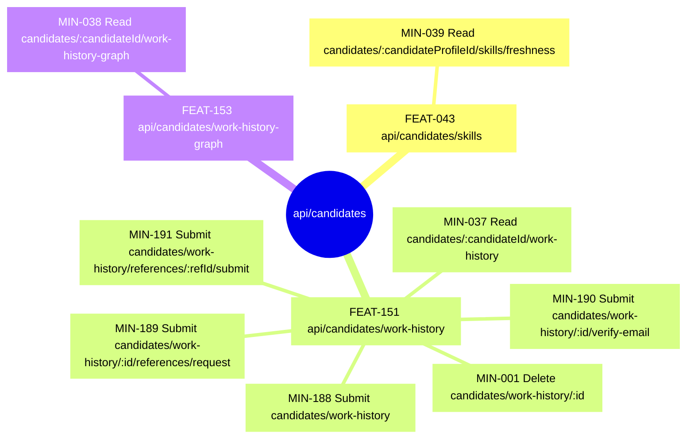
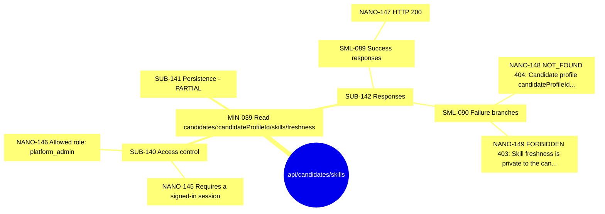
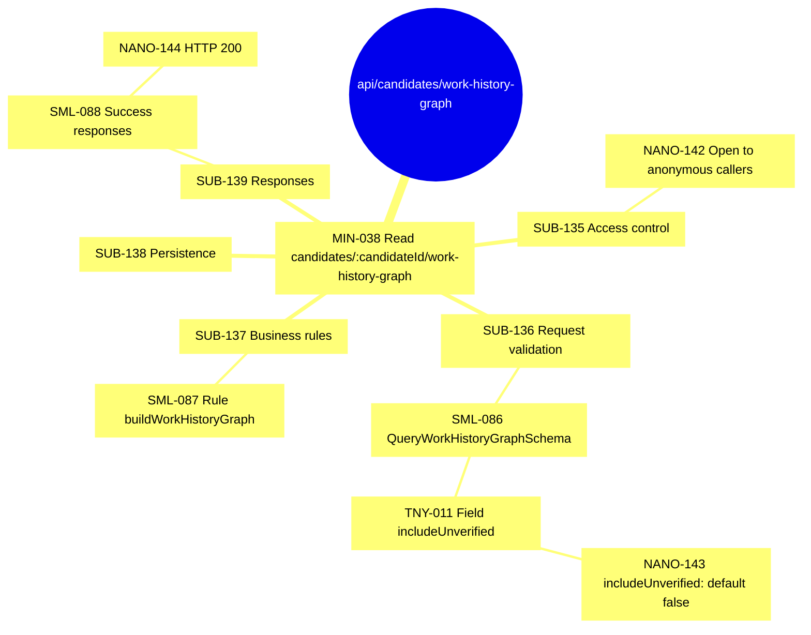

# api/candidates (MOD-065)

Generated by `project-mindmap/tools/catalog.py` from `master/MASTER_PROJECT_GRAPH.json` at commit `9b3032f`. Do not edit by hand. Back to the [feature catalog](../FEATURE_CATALOG.md).

**Application:** apps/api (MOD-001). **Purpose:** API module: routes under /api/v1/candidates in apps/api/src/server.ts.

**Nodes by level:** MODULE 1, MAJOR 3, MINOR 8, SUB 34, SMALL 38, TINY 27, NANO 93. **Status:** IMPLEMENTED 203, PARTIALLY_IMPLEMENTED 1. **Verification:** PATH_LEVEL 181, UNKNOWN 2, VERIFIED 17.

**User roles that reach it:** anonymous, authenticated, platform_admin.

**Known gaps:** MIN-039 ephemeral: state held in process memory, lost on restart; MIN-039 no first-party web caller found; MIN-038 no first-party web caller found.

**Called from (web screens and components):** FEAT-160 Screen /career, FEAT-162 Screen /dashboard, FEAT-163 Screen /evidence, FEAT-178 Screen /reference/:id, FEAT-184 Component CareerPaths

## Module map (to minor features)

## FEAT-043 api/candidates/skills

api/candidates/skills

| ID       | Level | Parent   | Name                                                                                 | Description                                                                                                                                                                                                                                           | Status                | Verification | Evidence                    | Related                     |
| -------- | ----- | -------- | ------------------------------------------------------------------------------------ | ----------------------------------------------------------------------------------------------------------------------------------------------------------------------------------------------------------------------------------------------------- | --------------------- | ------------ | --------------------------- | --------------------------- |
| FEAT-043 | MAJOR | MOD-065  | api/candidates/skills                                                                |                                                                                                                                                                                                                                                       | IMPLEMENTED           |              | apps/api/src/server.ts:3319 |                             |
| MIN-039  | MINOR | FEAT-043 | Read candidates/:candidateProfileId/skills/freshness                                 | GET /api/v1/candidates/:candidateProfileId/skills/freshness for roles platform_admin; ephemeral (process memory); responds 200; 2 failure branch(es). Gaps: ephemeral: state held in process memory, lost on restart; no first-party web caller found | IMPLEMENTED           | VERIFIED     | apps/api/src/server.ts:3319 | API-060, TEST-131, TEST-211 |
| SUB-140  | SUB   | MIN-039  | Access control                                                                       | Who may call GET /api/v1/candidates/:candidateProfileId/skills/freshness: roles platform_admin.                                                                                                                                                       | IMPLEMENTED           | PATH_LEVEL   | apps/api/src/server.ts:3319 |                             |
| NANO-145 | NANO  | SUB-140  | Requires a signed-in session                                                         | Requests without a valid session token are rejected with 401 UNAUTHENTICATED.                                                                                                                                                                         | IMPLEMENTED           | PATH_LEVEL   | apps/api/src/server.ts:3319 | ROLE-001                    |
| NANO-146 | NANO  | SUB-140  | Allowed role: platform_admin                                                         | platform_admin is one of the roles allowed here (platform_admin); a caller holding none of them is rejected with 403.                                                                                                                                 | IMPLEMENTED           | PATH_LEVEL   | apps/api/src/server.ts:3319 | ROLE-008                    |
| SUB-141  | SUB   | MIN-039  | Persistence                                                                          | Ephemeral: state lives in API process memory and is lost on restart.                                                                                                                                                                                  | PARTIALLY_IMPLEMENTED | PATH_LEVEL   | apps/api/src/server.ts:3319 |                             |
| SUB-142  | SUB   | MIN-039  | Responses                                                                            | Success 200; 2 explicit failure branch(es) besides validation and access errors.                                                                                                                                                                      | IMPLEMENTED           | PATH_LEVEL   | apps/api/src/server.ts:3319 |                             |
| SML-089  | SMALL | SUB-142  | Success responses                                                                    | HTTP 200.                                                                                                                                                                                                                                             | IMPLEMENTED           | PATH_LEVEL   | apps/api/src/server.ts:3319 |                             |
| NANO-147 | NANO  | SML-089  | HTTP 200                                                                             | Replies 200 when the operation succeeds.                                                                                                                                                                                                              | IMPLEMENTED           | PATH_LEVEL   | apps/api/src/server.ts:3319 |                             |
| SML-090  | SMALL | SUB-142  | Failure branches                                                                     | 2 DomainError branch(es) in the handler, mapped to HTTP by the global error handler.                                                                                                                                                                  | IMPLEMENTED           | PATH_LEVEL   | apps/api/src/server.ts:3319 |                             |
| NANO-148 | NANO  | SML-090  | NOT_FOUND 404: Candidate profile ${candidateProfileId} not found.                    | Throws DomainError(NOT_FOUND) "Candidate profile ${candidateProfileId} not found." -> HTTP 404.                                                                                                                                                       | IMPLEMENTED           | PATH_LEVEL   | apps/api/src/server.ts:3330 | ERR-064                     |
| NANO-149 | NANO  | SML-090  | FORBIDDEN 403: Skill freshness is private to the candidate and visible to recruiters | Throws DomainError(FORBIDDEN) "Skill freshness is private to the candidate and visible to recruiters only within application context (BR-230)." -> HTTP 403.                                                                                          | IMPLEMENTED           | PATH_LEVEL   | apps/api/src/server.ts:3345 | ERR-065                     |

## FEAT-151 api/candidates/work-history

api/candidates/work-history

```mermaid
mindmap
  root((api/candidates/work-history))
    MIN_001[MIN-001 Delete candidates/work-history/:id]
      SUB_001[SUB-001 Access control]
        NANO_001[NANO-001 Requires a signed-in session]
      SUB_002[SUB-002 Persistence]
        SML_001[SML-001 Writes verified_work_histories]
      SUB_003[SUB-003 Responses]
        SML_002[SML-002 Success responses]
          NANO_002[NANO-002 HTTP 200]
        SML_003[SML-003 Failure branches]
          NANO_003[NANO-003 NOT_FOUND 404: Work history record id not found.]
          NANO_004[NANO-004 FORBIDDEN 403: Only the person this role belongs to...]
    MIN_037[MIN-037 Read candidates/:candidateId/work-history]
      SUB_132[SUB-132 Access control]
        NANO_140[NANO-140 Open to anonymous callers]
      SUB_133[SUB-133 Persistence]
      SUB_134[SUB-134 Responses]
        SML_085[SML-085 Success responses]
          NANO_141[NANO-141 HTTP 200]
    MIN_188[MIN-188 Submit candidates/work-history]
      SUB_729[SUB-729 Access control]
        NANO_984[NANO-984 Requires a signed-in session]
      SUB_730[SUB-730 Request validation]
        SML_538[SML-538 CreateWorkHistoryInputSchema]
          TNY_176[TNY-176 Field companyName]
            NANO_985[NANO-985 companyName: minimum 1 characters]
            NANO_986[NANO-986 companyName: maximum 150 characters]
          TNY_177[TNY-177 Field companyId]
            NANO_987[NANO-987 companyId: must be a UUID]
            NANO_988[NANO-988 companyId: optional]
          TNY_178[TNY-178 Field title]
            NANO_989[NANO-989 title: minimum 1 characters]
            NANO_990[NANO-990 title: maximum 150 characters]
          TNY_179[TNY-179 Field employmentType]
            NANO_991[NANO-991 employmentType: one of: full_time, part_time, contra...]
            NANO_992[NANO-992 employmentType: default full_time]
          TNY_180[TNY-180 Field startDate]
          TNY_181[TNY-181 Field endDate]
            NANO_993[NANO-993 endDate: optional]
          TNY_182[TNY-182 Field isCurrent]
            NANO_994[NANO-994 isCurrent: default false]
          TNY_183[TNY-183 Field description]
            NANO_995[NANO-995 description: maximum 3000 characters]
            NANO_996[NANO-996 description: optional]
          TNY_184[TNY-184 Field corporateEmail]
            NANO_997[NANO-997 corporateEmail: optional]
          TNY_185[TNY-185 Field skills]
            NANO_998[NANO-998 skills: list of string]
            NANO_999[NANO-999 skills: default]
          TNY_186[TNY-186 Field clientRequestId]
            NANO_1000[NANO-1000 clientRequestId: minimum 1 characters]
            NANO_1001[NANO-1001 clientRequestId: maximum 100 characters]
            NANO_1002[NANO-1002 clientRequestId: optional]
      SUB_731[SUB-731 Business rules]
        SML_539[SML-539 Rule createWorkHistory]
      SUB_732[SUB-732 Persistence]
        SML_540[SML-540 Writes verified_work_histories]
      SUB_733[SUB-733 Responses]
        SML_541[SML-541 Success responses]
          NANO_1003[NANO-1003 HTTP 200]
          NANO_1004[NANO-1004 HTTP 201]
        SML_542[SML-542 Failure branches]
          NANO_1005[NANO-1005 VALIDATION_FAILED 422: companyId does not match a k...]
    MIN_189[MIN-189 Submit candidates/work-history/:id/references/request]
      SUB_734[SUB-734 Access control]
        NANO_1006[NANO-1006 Requires a signed-in session]
        NANO_1007[NANO-1007 Allowed role: platform_admin]
      SUB_735[SUB-735 Request validation]
        SML_543[SML-543 RequestEmploymentReferenceInputSchema]
          TNY_187[TNY-187 Field refereeName]
            NANO_1008[NANO-1008 refereeName: minimum 2 characters]
            NANO_1009[NANO-1009 refereeName: maximum 150 characters]
          TNY_188[TNY-188 Field refereeEmail]
          TNY_189[TNY-189 Field relationship]
            NANO_1010[NANO-1010 relationship: one of: manager, peer, direct_report,...]
          TNY_190[TNY-190 Field clientRequestId]
            NANO_1011[NANO-1011 clientRequestId: minimum 1 characters]
            NANO_1012[NANO-1012 clientRequestId: maximum 100 characters]
            NANO_1013[NANO-1013 clientRequestId: optional]
      SUB_736[SUB-736 Business rules]
        SML_544[SML-544 Rule assertReferenceRequestAllowed]
        SML_545[SML-545 Rule requestEmploymentReference]
      SUB_737[SUB-737 Persistence]
        SML_546[SML-546 Writes employment_references]
      SUB_738[SUB-738 Responses]
        SML_547[SML-547 Success responses]
          NANO_1014[NANO-1014 HTTP 200]
          NANO_1015[NANO-1015 HTTP 201]
        SML_548[SML-548 Failure branches]
          NANO_1016[NANO-1016 NOT_FOUND 404: Work history record id not found.]
          NANO_1017[NANO-1017 FORBIDDEN 403: Access denied to request reference f...]
          NANO_1018[NANO-1018 SERVICE_UNAVAILABLE 503: Reference invitations are...]
          NANO_1019[NANO-1019 SERVICE_UNAVAILABLE 503: Reference invitation could...]
    MIN_190[MIN-190 Submit candidates/work-history/:id/verify-email]
      SUB_739[SUB-739 Access control]
        NANO_1020[NANO-1020 Requires a signed-in session]
        NANO_1021[NANO-1021 Allowed role: platform_admin]
      SUB_740[SUB-740 Request validation]
        SML_549[SML-549 VerifyWorkHistoryEmailInputSchema]
          TNY_191[TNY-191 Field corporateEmail]
          TNY_192[TNY-192 Field verificationCode]
            NANO_1022[NANO-1022 verificationCode: minimum 4 characters]
            NANO_1023[NANO-1023 verificationCode: maximum 32 characters]
            NANO_1024[NANO-1024 verificationCode: optional]
      SUB_741[SUB-741 Business rules]
        SML_550[SML-550 Rule assertCorporateEmailEligible]
        SML_551[SML-551 Rule assertEmailCodeIssuable]
        SML_552[SML-552 Rule verifyCorporateEmail]
      SUB_742[SUB-742 Persistence]
        SML_553[SML-553 Writes verified_work_histories]
        SML_554[SML-554 Writes work_history_email_challenges]
      SUB_743[SUB-743 Responses]
        SML_555[SML-555 Success responses]
          NANO_1025[NANO-1025 HTTP 200]
          NANO_1026[NANO-1026 HTTP 202]
        SML_556[SML-556 Failure branches]
          NANO_1027[NANO-1027 NOT_FOUND 404: Work history record id not found.]
          NANO_1028[NANO-1028 FORBIDDEN 403: Access denied to verify this work hi...]
          NANO_1029[NANO-1029 SERVICE_UNAVAILABLE 503: Work-email verification is...]
          NANO_1030[NANO-1030 SERVICE_UNAVAILABLE 503: Verification email could n...]
          NANO_1031[NANO-1031 VALIDATION_FAILED 422: No verification is pending f...]
          NANO_1032[NANO-1032 VALIDATION_FAILED 422: This code has expired. Reque...]
          NANO_1033[NANO-1033 RATE_LIMIT_EXCEEDED 429: Too many incorrect codes....]
          NANO_1034[NANO-1034 VALIDATION_FAILED 422: That code is not correct.]
    MIN_191[MIN-191 Submit candidates/work-history/references/:refId/submit]
      SUB_744[SUB-744 Access control]
        NANO_1035[NANO-1035 Requires a signed-in session]
        NANO_1036[NANO-1036 Allowed role: platform_admin]
        NANO_1037[NANO-1037 Guard: canViewProfile]
      SUB_745[SUB-745 Request validation]
        SML_557[SML-557 SubmitEmploymentReferenceInputSchema]
          TNY_193[TNY-193 Field token]
            NANO_1038[NANO-1038 token: minimum 6 characters]
            NANO_1039[NANO-1039 token: optional]
          TNY_194[TNY-194 Field confirmDates]
          TNY_195[TNY-195 Field confirmTitle]
          TNY_196[TNY-196 Field technicalProficiency]
            NANO_1040[NANO-1040 technicalProficiency: must be an integer]
            NANO_1041[NANO-1041 technicalProficiency: minimum 1]
            NANO_1042[NANO-1042 technicalProficiency: maximum 5]
          TNY_197[TNY-197 Field collaborationRating]
            NANO_1043[NANO-1043 collaborationRating: must be an integer]
            NANO_1044[NANO-1044 collaborationRating: minimum 1]
            NANO_1045[NANO-1045 collaborationRating: maximum 5]
          TNY_198[TNY-198 Field deliveryReliability]
            NANO_1046[NANO-1046 deliveryReliability: must be an integer]
            NANO_1047[NANO-1047 deliveryReliability: minimum 1]
            NANO_1048[NANO-1048 deliveryReliability: maximum 5]
          TNY_199[TNY-199 Field leadershipRating]
            NANO_1049[NANO-1049 leadershipRating: must be an integer]
            NANO_1050[NANO-1050 leadershipRating: minimum 1]
            NANO_1051[NANO-1051 leadershipRating: maximum 5]
            NANO_1052[NANO-1052 leadershipRating: optional]
          TNY_200[TNY-200 Field endorsedSkills]
            NANO_1053[NANO-1053 endorsedSkills: list of string]
            NANO_1054[NANO-1054 endorsedSkills: default]
          TNY_201[TNY-201 Field summaryNotes]
            NANO_1055[NANO-1055 summaryNotes: maximum 2000 characters]
            NANO_1056[NANO-1056 summaryNotes: optional]
      SUB_746[SUB-746 Business rules]
        SML_558[SML-558 Rule canViewProfile]
        SML_559[SML-559 Rule calculateVerificationScoreAndBadge]
        SML_560[SML-560 Rule referenceLinkExpired]
        SML_561[SML-561 Rule submitEmploymentReference]
      SUB_747[SUB-747 Persistence]
        SML_562[SML-562 Writes notifications]
        SML_563[SML-563 Writes verified_work_histories]
        SML_564[SML-564 Writes employment_references]
      SUB_748[SUB-748 Responses]
        SML_565[SML-565 Success responses]
          NANO_1057[NANO-1057 HTTP 200]
        SML_566[SML-566 Failure branches]
          NANO_1058[NANO-1058 NOT_FOUND 404: Employment reference refId not found.]
          NANO_1059[NANO-1059 FORBIDDEN 403: Candidate cannot submit their own re...]
          NANO_1060[NANO-1060 UNAUTHORIZED 403: This reference can only be submit...]
          NANO_1061[NANO-1061 NOT_FOUND 404: Candidate not found.]
          NANO_1062[NANO-1062 FORBIDDEN 403: This profile is private or restricte...]
```

| ID        | Level | Parent   | Name                                                                                            | Description                                                                                                                                                                                                                                                                                                                                                                                                      | Status      | Verification | Evidence                                                      | Related                                                       |
| --------- | ----- | -------- | ----------------------------------------------------------------------------------------------- | ---------------------------------------------------------------------------------------------------------------------------------------------------------------------------------------------------------------------------------------------------------------------------------------------------------------------------------------------------------------------------------------------------------------- | ----------- | ------------ | ------------------------------------------------------------- | ------------------------------------------------------------- |
| FEAT-151  | MAJOR | MOD-065  | api/candidates/work-history                                                                     |                                                                                                                                                                                                                                                                                                                                                                                                                  | IMPLEMENTED |              | apps/api/src/server.ts:12774                                  |                                                               |
| MIN-001   | MINOR | FEAT-151 | Delete candidates/work-history/:id                                                              | 7. Remove a role from your own work history. Before this, a mistaken entry could only be removed by deleting the whole account. Its references and any open email verification go with it (FK cascade in Postgres, applyToReadModel here); a referee's link stops working. Owner only: an administrator removing someone's record is a moderation decision with its own trail, not this route. DELETE /api/v1/ca | IMPLEMENTED | VERIFIED     | apps/api/src/server.ts:13397                                  | API-278, TEST-140, TEST-160                                   |
| SUB-001   | SUB   | MIN-001  | Access control                                                                                  | Who may call DELETE /api/v1/candidates/work-history/:id: any signed-in session.                                                                                                                                                                                                                                                                                                                                  | IMPLEMENTED | PATH_LEVEL   | apps/api/src/server.ts:13397                                  |                                                               |
| NANO-001  | NANO  | SUB-001  | Requires a signed-in session                                                                    | Requests without a valid session token are rejected with 401 UNAUTHENTICATED.                                                                                                                                                                                                                                                                                                                                    | IMPLEMENTED | PATH_LEVEL   | apps/api/src/server.ts:13397                                  | ROLE-001                                                      |
| SUB-002   | SUB   | MIN-001  | Persistence                                                                                     | Durable: writes go through the PostgreSQL store; store calls jobs.cancelQueued.                                                                                                                                                                                                                                                                                                                                  | IMPLEMENTED | PATH_LEVEL   | apps/api/src/server.ts:13397                                  |                                                               |
| SML-001   | SMALL | SUB-002  | Writes verified_work_histories                                                                  | Writes table verified_work_histories (00041_verified_work_history_schema.sql).                                                                                                                                                                                                                                                                                                                                   | IMPLEMENTED | PATH_LEVEL   | supabase/migrations/00041_verified_work_history_schema.sql:5  | DB-105                                                        |
| SUB-003   | SUB   | MIN-001  | Responses                                                                                       | Success 200; 2 explicit failure branch(es) besides validation and access errors.                                                                                                                                                                                                                                                                                                                                 | IMPLEMENTED | PATH_LEVEL   | apps/api/src/server.ts:13397                                  |                                                               |
| SML-002   | SMALL | SUB-003  | Success responses                                                                               | HTTP 200.                                                                                                                                                                                                                                                                                                                                                                                                        | IMPLEMENTED | PATH_LEVEL   | apps/api/src/server.ts:13397                                  |                                                               |
| NANO-002  | NANO  | SML-002  | HTTP 200                                                                                        | Replies 200 when the operation succeeds.                                                                                                                                                                                                                                                                                                                                                                         | IMPLEMENTED | PATH_LEVEL   | apps/api/src/server.ts:13397                                  |                                                               |
| SML-003   | SMALL | SUB-003  | Failure branches                                                                                | 2 DomainError branch(es) in the handler, mapped to HTTP by the global error handler.                                                                                                                                                                                                                                                                                                                             | IMPLEMENTED | PATH_LEVEL   | apps/api/src/server.ts:13397                                  |                                                               |
| NANO-003  | NANO  | SML-003  | NOT_FOUND 404: Work history record "${id}" not found.                                           | Throws DomainError(NOT_FOUND) "Work history record "${id}" not found." -> HTTP 404.                                                                                                                                                                                                                                                                                                                              | IMPLEMENTED | PATH_LEVEL   | apps/api/src/server.ts:13404                                  | ERR-235                                                       |
| NANO-004  | NANO  | SML-003  | FORBIDDEN 403: Only the person this role belongs to can remove it.                              | Throws DomainError(FORBIDDEN) "Only the person this role belongs to can remove it." -> HTTP 403.                                                                                                                                                                                                                                                                                                                 | IMPLEMENTED | PATH_LEVEL   | apps/api/src/server.ts:13407                                  | ERR-251                                                       |
| MIN-037   | MINOR | FEAT-151 | Read candidates/:candidateId/work-history                                                       | 5. Get Candidate Work History Records (F-94) GET /api/v1/candidates/:candidateId/work-history for anyone (public); durable (PostgreSQL); responds 200.                                                                                                                                                                                                                                                           | IMPLEMENTED | VERIFIED     | apps/api/src/server.ts:13304                                  | API-276, TEST-139, TEST-140, TEST-145, TEST-151, TEST-160 ... |
| SUB-132   | SUB   | MIN-037  | Access control                                                                                  | Who may call GET /api/v1/candidates/:candidateId/work-history: anyone (public).                                                                                                                                                                                                                                                                                                                                  | IMPLEMENTED | PATH_LEVEL   | apps/api/src/server.ts:13304                                  |                                                               |
| NANO-140  | NANO  | SUB-132  | Open to anonymous callers                                                                       | auth: public.                                                                                                                                                                                                                                                                                                                                                                                                    | IMPLEMENTED | PATH_LEVEL   | apps/api/src/server.ts:13304                                  | ROLE-001                                                      |
| SUB-133   | SUB   | MIN-037  | Persistence                                                                                     | Durable: writes go through the PostgreSQL store.                                                                                                                                                                                                                                                                                                                                                                 | IMPLEMENTED | PATH_LEVEL   | apps/api/src/server.ts:13304                                  |                                                               |
| SUB-134   | SUB   | MIN-037  | Responses                                                                                       | Success 200; 0 explicit failure branch(es) besides validation and access errors.                                                                                                                                                                                                                                                                                                                                 | IMPLEMENTED | PATH_LEVEL   | apps/api/src/server.ts:13304                                  |                                                               |
| SML-085   | SMALL | SUB-134  | Success responses                                                                               | HTTP 200.                                                                                                                                                                                                                                                                                                                                                                                                        | IMPLEMENTED | PATH_LEVEL   | apps/api/src/server.ts:13304                                  |                                                               |
| NANO-141  | NANO  | SML-085  | HTTP 200                                                                                        | Replies 200 when the operation succeeds.                                                                                                                                                                                                                                                                                                                                                                         | IMPLEMENTED | PATH_LEVEL   | apps/api/src/server.ts:13304                                  |                                                               |
| MIN-188   | MINOR | FEAT-151 | Submit candidates/work-history                                                                  | 1. Add Work History Entry (F-94) POST /api/v1/candidates/work-history for any signed-in session; validates CreateWorkHistoryInputSchema; calls createWorkHistory; durable (PostgreSQL); writes verified_work_histories; responds 200, 201; 1 failure branch(es).                                                                                                                                                 | IMPLEMENTED | VERIFIED     | apps/api/src/server.ts:12774                                  | API-271, TEST-097, TEST-098, TEST-099, TEST-103, TEST-139 ... |
| SUB-729   | SUB   | MIN-188  | Access control                                                                                  | Who may call POST /api/v1/candidates/work-history: any signed-in session.                                                                                                                                                                                                                                                                                                                                        | IMPLEMENTED | PATH_LEVEL   | apps/api/src/server.ts:12774                                  |                                                               |
| NANO-984  | NANO  | SUB-729  | Requires a signed-in session                                                                    | Requests without a valid session token are rejected with 401 UNAUTHENTICATED.                                                                                                                                                                                                                                                                                                                                    | IMPLEMENTED | PATH_LEVEL   | apps/api/src/server.ts:12774                                  | ROLE-001                                                      |
| SUB-730   | SUB   | MIN-188  | Request validation                                                                              | The request is parsed with CreateWorkHistoryInputSchema; a failure returns 400 with field details before any business logic runs.                                                                                                                                                                                                                                                                                | IMPLEMENTED | PATH_LEVEL   | apps/api/src/server.ts:12774                                  |                                                               |
| SML-538   | SMALL | SUB-730  | CreateWorkHistoryInputSchema                                                                    | CreateWorkHistoryInputSchema: 11 field(s)                                                                                                                                                                                                                                                                                                                                                                        | IMPLEMENTED | PATH_LEVEL   | packages/contracts/src/index.ts:1738                          | SCH-137                                                       |
| TNY-176   | TINY  | SML-538  | Field companyName                                                                               | companyName (string, required): minimum 1 characters; maximum 150 characters                                                                                                                                                                                                                                                                                                                                     | IMPLEMENTED | PATH_LEVEL   | packages/contracts/src/index.ts:1739                          |                                                               |
| NANO-985  | NANO  | TNY-176  | companyName: minimum 1 characters                                                               | companyName minimum 1 characters; message "Company name is required".                                                                                                                                                                                                                                                                                                                                            | IMPLEMENTED | PATH_LEVEL   | packages/contracts/src/index.ts:1739                          |                                                               |
| NANO-986  | NANO  | TNY-176  | companyName: maximum 150 characters                                                             | companyName maximum 150 characters.                                                                                                                                                                                                                                                                                                                                                                              | IMPLEMENTED | PATH_LEVEL   | packages/contracts/src/index.ts:1739                          |                                                               |
| TNY-177   | TINY  | SML-538  | Field companyId                                                                                 | companyId (string, optional): must be a UUID; optional                                                                                                                                                                                                                                                                                                                                                           | IMPLEMENTED | PATH_LEVEL   | packages/contracts/src/index.ts:1740                          |                                                               |
| NANO-987  | NANO  | TNY-177  | companyId: must be a UUID                                                                       | companyId must be a UUID.                                                                                                                                                                                                                                                                                                                                                                                        | IMPLEMENTED | PATH_LEVEL   | packages/contracts/src/index.ts:1740                          |                                                               |
| NANO-988  | NANO  | TNY-177  | companyId: optional                                                                             | companyId optional.                                                                                                                                                                                                                                                                                                                                                                                              | IMPLEMENTED | PATH_LEVEL   | packages/contracts/src/index.ts:1740                          |                                                               |
| TNY-178   | TINY  | SML-538  | Field title                                                                                     | title (string, required): minimum 1 characters; maximum 150 characters                                                                                                                                                                                                                                                                                                                                           | IMPLEMENTED | PATH_LEVEL   | packages/contracts/src/index.ts:1741                          |                                                               |
| NANO-989  | NANO  | TNY-178  | title: minimum 1 characters                                                                     | title minimum 1 characters; message "Job title is required".                                                                                                                                                                                                                                                                                                                                                     | IMPLEMENTED | PATH_LEVEL   | packages/contracts/src/index.ts:1741                          |                                                               |
| NANO-990  | NANO  | TNY-178  | title: maximum 150 characters                                                                   | title maximum 150 characters.                                                                                                                                                                                                                                                                                                                                                                                    | IMPLEMENTED | PATH_LEVEL   | packages/contracts/src/index.ts:1741                          |                                                               |
| TNY-179   | TINY  | SML-538  | Field employmentType                                                                            | employmentType (enum, optional): one of: full_time, part_time, contract, internship, freelance; default 'full_time'                                                                                                                                                                                                                                                                                              | IMPLEMENTED | PATH_LEVEL   | packages/contracts/src/index.ts:1742                          |                                                               |
| NANO-991  | NANO  | TNY-179  | employmentType: one of: full_time, part_time, contract, internship, freelance                   | employmentType one of: full_time, part_time, contract, internship, freelance.                                                                                                                                                                                                                                                                                                                                    | IMPLEMENTED | PATH_LEVEL   | packages/contracts/src/index.ts:1742                          |                                                               |
| NANO-992  | NANO  | TNY-179  | employmentType: default 'full_time'                                                             | employmentType default 'full_time'; message "full_time".                                                                                                                                                                                                                                                                                                                                                         | IMPLEMENTED | PATH_LEVEL   | packages/contracts/src/index.ts:1742                          |                                                               |
| TNY-180   | TINY  | SML-538  | Field startDate                                                                                 | startDate (calendarDate(), required)                                                                                                                                                                                                                                                                                                                                                                             | IMPLEMENTED | PATH_LEVEL   | packages/contracts/src/index.ts:1745                          |                                                               |
| TNY-181   | TINY  | SML-538  | Field endDate                                                                                   | endDate (calendarDate(), optional): optional                                                                                                                                                                                                                                                                                                                                                                     | IMPLEMENTED | PATH_LEVEL   | packages/contracts/src/index.ts:1746                          |                                                               |
| NANO-993  | NANO  | TNY-181  | endDate: optional                                                                               | endDate optional.                                                                                                                                                                                                                                                                                                                                                                                                | IMPLEMENTED | PATH_LEVEL   | packages/contracts/src/index.ts:1746                          |                                                               |
| TNY-182   | TINY  | SML-538  | Field isCurrent                                                                                 | isCurrent (boolean, optional): default false                                                                                                                                                                                                                                                                                                                                                                     | IMPLEMENTED | PATH_LEVEL   | packages/contracts/src/index.ts:1747                          |                                                               |
| NANO-994  | NANO  | TNY-182  | isCurrent: default false                                                                        | isCurrent default false.                                                                                                                                                                                                                                                                                                                                                                                         | IMPLEMENTED | PATH_LEVEL   | packages/contracts/src/index.ts:1747                          |                                                               |
| TNY-183   | TINY  | SML-538  | Field description                                                                               | description (string, optional): maximum 3000 characters; optional                                                                                                                                                                                                                                                                                                                                                | IMPLEMENTED | PATH_LEVEL   | packages/contracts/src/index.ts:1748                          |                                                               |
| NANO-995  | NANO  | TNY-183  | description: maximum 3000 characters                                                            | description maximum 3000 characters.                                                                                                                                                                                                                                                                                                                                                                             | IMPLEMENTED | PATH_LEVEL   | packages/contracts/src/index.ts:1748                          |                                                               |
| NANO-996  | NANO  | TNY-183  | description: optional                                                                           | description optional.                                                                                                                                                                                                                                                                                                                                                                                            | IMPLEMENTED | PATH_LEVEL   | packages/contracts/src/index.ts:1748                          |                                                               |
| TNY-184   | TINY  | SML-538  | Field corporateEmail                                                                            | corporateEmail (emailAddress(), optional): optional                                                                                                                                                                                                                                                                                                                                                              | IMPLEMENTED | PATH_LEVEL   | packages/contracts/src/index.ts:1749                          |                                                               |
| NANO-997  | NANO  | TNY-184  | corporateEmail: optional                                                                        | corporateEmail optional.                                                                                                                                                                                                                                                                                                                                                                                         | IMPLEMENTED | PATH_LEVEL   | packages/contracts/src/index.ts:1749                          |                                                               |
| TNY-185   | TINY  | SML-538  | Field skills                                                                                    | skills (array, optional): list of string; default []                                                                                                                                                                                                                                                                                                                                                             | IMPLEMENTED | PATH_LEVEL   | packages/contracts/src/index.ts:1750                          |                                                               |
| NANO-998  | NANO  | TNY-185  | skills: list of string                                                                          | skills list of string.                                                                                                                                                                                                                                                                                                                                                                                           | IMPLEMENTED | PATH_LEVEL   | packages/contracts/src/index.ts:1750                          |                                                               |
| NANO-999  | NANO  | TNY-185  | skills: default []                                                                              | skills default [].                                                                                                                                                                                                                                                                                                                                                                                               | IMPLEMENTED | PATH_LEVEL   | packages/contracts/src/index.ts:1750                          |                                                               |
| TNY-186   | TINY  | SML-538  | Field clientRequestId                                                                           | clientRequestId (string, optional): minimum 1 characters; maximum 100 characters; optional                                                                                                                                                                                                                                                                                                                       | IMPLEMENTED | PATH_LEVEL   | packages/contracts/src/index.ts:1753                          |                                                               |
| NANO-1000 | NANO  | TNY-186  | clientRequestId: minimum 1 characters                                                           | clientRequestId minimum 1 characters.                                                                                                                                                                                                                                                                                                                                                                            | IMPLEMENTED | PATH_LEVEL   | packages/contracts/src/index.ts:1753                          |                                                               |
| NANO-1001 | NANO  | TNY-186  | clientRequestId: maximum 100 characters                                                         | clientRequestId maximum 100 characters.                                                                                                                                                                                                                                                                                                                                                                          | IMPLEMENTED | PATH_LEVEL   | packages/contracts/src/index.ts:1753                          |                                                               |
| NANO-1002 | NANO  | TNY-186  | clientRequestId: optional                                                                       | clientRequestId optional.                                                                                                                                                                                                                                                                                                                                                                                        | IMPLEMENTED | PATH_LEVEL   | packages/contracts/src/index.ts:1753                          |                                                               |
| SUB-731   | SUB   | MIN-188  | Business rules                                                                                  | Domain functions from packages/domain called by the handler (1).                                                                                                                                                                                                                                                                                                                                                 | IMPLEMENTED | PATH_LEVEL   | apps/api/src/server.ts:12774                                  |                                                               |
| SML-539   | SMALL | SUB-731  | Rule createWorkHistory                                                                          | Calls createWorkHistory (packages/domain/src/work-history-graph.ts). Rule status IMPLEMENTED; its own tests: VERIFIED.                                                                                                                                                                                                                                                                                           | IMPLEMENTED | VERIFIED     | packages/domain/src/work-history-graph.ts:419                 | RULE-271                                                      |
| SUB-732   | SUB   | MIN-188  | Persistence                                                                                     | Durable: writes go through the PostgreSQL store.                                                                                                                                                                                                                                                                                                                                                                 | IMPLEMENTED | PATH_LEVEL   | apps/api/src/server.ts:12774                                  |                                                               |
| SML-540   | SMALL | SUB-732  | Writes verified_work_histories                                                                  | Writes table verified_work_histories (00041_verified_work_history_schema.sql).                                                                                                                                                                                                                                                                                                                                   | IMPLEMENTED | PATH_LEVEL   | supabase/migrations/00041_verified_work_history_schema.sql:5  | DB-105                                                        |
| SUB-733   | SUB   | MIN-188  | Responses                                                                                       | Success 200, 201; 1 explicit failure branch(es) besides validation and access errors.                                                                                                                                                                                                                                                                                                                            | IMPLEMENTED | PATH_LEVEL   | apps/api/src/server.ts:12774                                  |                                                               |
| SML-541   | SMALL | SUB-733  | Success responses                                                                               | HTTP 200, 201.                                                                                                                                                                                                                                                                                                                                                                                                   | IMPLEMENTED | PATH_LEVEL   | apps/api/src/server.ts:12774                                  |                                                               |
| NANO-1003 | NANO  | SML-541  | HTTP 200                                                                                        | Replies 200 when the operation succeeds.                                                                                                                                                                                                                                                                                                                                                                         | IMPLEMENTED | PATH_LEVEL   | apps/api/src/server.ts:12774                                  |                                                               |
| NANO-1004 | NANO  | SML-541  | HTTP 201                                                                                        | Replies 201 when the operation succeeds.                                                                                                                                                                                                                                                                                                                                                                         | IMPLEMENTED | PATH_LEVEL   | apps/api/src/server.ts:12774                                  |                                                               |
| SML-542   | SMALL | SUB-733  | Failure branches                                                                                | 1 DomainError branch(es) in the handler, mapped to HTTP by the global error handler.                                                                                                                                                                                                                                                                                                                             | IMPLEMENTED | PATH_LEVEL   | apps/api/src/server.ts:12774                                  |                                                               |
| NANO-1005 | NANO  | SML-542  | VALIDATION_FAILED 422: companyId does not match a known organization.                           | Throws DomainError(VALIDATION_FAILED) "companyId does not match a known organization." -> HTTP 422.                                                                                                                                                                                                                                                                                                              | IMPLEMENTED | PATH_LEVEL   | apps/api/src/server.ts:12795                                  | ERR-234                                                       |
| MIN-189   | MINOR | FEAT-151 | Submit candidates/work-history/:id/references/request                                           | 3. Request Employment Reference (F-94) POST /api/v1/candidates/work-history/:id/references/request for roles platform_admin; validates RequestEmploymentReferenceInputSchema; calls assertReferenceRequestAllowed, requestEmploymentReference; durable (PostgreSQL); writes employment_references; responds 200, 201; 4 failure branch(es).                                                                      | IMPLEMENTED | VERIFIED     | apps/api/src/server.ts:12995                                  | API-273, TEST-097, TEST-098, TEST-103, TEST-139, TEST-140 ... |
| SUB-734   | SUB   | MIN-189  | Access control                                                                                  | Who may call POST /api/v1/candidates/work-history/:id/references/request: roles platform_admin.                                                                                                                                                                                                                                                                                                                  | IMPLEMENTED | PATH_LEVEL   | apps/api/src/server.ts:12995                                  |                                                               |
| NANO-1006 | NANO  | SUB-734  | Requires a signed-in session                                                                    | Requests without a valid session token are rejected with 401 UNAUTHENTICATED.                                                                                                                                                                                                                                                                                                                                    | IMPLEMENTED | PATH_LEVEL   | apps/api/src/server.ts:12995                                  | ROLE-001                                                      |
| NANO-1007 | NANO  | SUB-734  | Allowed role: platform_admin                                                                    | platform_admin is one of the roles allowed here (platform_admin); a caller holding none of them is rejected with 403.                                                                                                                                                                                                                                                                                            | IMPLEMENTED | PATH_LEVEL   | apps/api/src/server.ts:12995                                  | ROLE-008                                                      |
| SUB-735   | SUB   | MIN-189  | Request validation                                                                              | The request is parsed with RequestEmploymentReferenceInputSchema; a failure returns 400 with field details before any business logic runs.                                                                                                                                                                                                                                                                       | IMPLEMENTED | PATH_LEVEL   | apps/api/src/server.ts:12995                                  |                                                               |
| SML-543   | SMALL | SUB-735  | RequestEmploymentReferenceInputSchema                                                           | RequestEmploymentReferenceInputSchema: 4 field(s)                                                                                                                                                                                                                                                                                                                                                                | IMPLEMENTED | PATH_LEVEL   | packages/contracts/src/index.ts:1765                          | SCH-139                                                       |
| TNY-187   | TINY  | SML-543  | Field refereeName                                                                               | refereeName (string, required): minimum 2 characters; maximum 150 characters                                                                                                                                                                                                                                                                                                                                     | IMPLEMENTED | PATH_LEVEL   | packages/contracts/src/index.ts:1766                          |                                                               |
| NANO-1008 | NANO  | TNY-187  | refereeName: minimum 2 characters                                                               | refereeName minimum 2 characters; message "Referee name must be at least 2 characters".                                                                                                                                                                                                                                                                                                                          | IMPLEMENTED | PATH_LEVEL   | packages/contracts/src/index.ts:1766                          |                                                               |
| NANO-1009 | NANO  | TNY-187  | refereeName: maximum 150 characters                                                             | refereeName maximum 150 characters.                                                                                                                                                                                                                                                                                                                                                                              | IMPLEMENTED | PATH_LEVEL   | packages/contracts/src/index.ts:1766                          |                                                               |
| TNY-188   | TINY  | SML-543  | Field refereeEmail                                                                              | refereeEmail (emailAddress(), required)                                                                                                                                                                                                                                                                                                                                                                          | IMPLEMENTED | PATH_LEVEL   | packages/contracts/src/index.ts:1767                          |                                                               |
| TNY-189   | TINY  | SML-543  | Field relationship                                                                              | relationship (enum, required): one of: manager, peer, direct_report, mentor, client                                                                                                                                                                                                                                                                                                                              | IMPLEMENTED | PATH_LEVEL   | packages/contracts/src/index.ts:1768                          |                                                               |
| NANO-1010 | NANO  | TNY-189  | relationship: one of: manager, peer, direct_report, mentor, client                              | relationship one of: manager, peer, direct_report, mentor, client.                                                                                                                                                                                                                                                                                                                                               | IMPLEMENTED | PATH_LEVEL   | packages/contracts/src/index.ts:1768                          |                                                               |
| TNY-190   | TINY  | SML-543  | Field clientRequestId                                                                           | clientRequestId (string, optional): minimum 1 characters; maximum 100 characters; optional                                                                                                                                                                                                                                                                                                                       | IMPLEMENTED | PATH_LEVEL   | packages/contracts/src/index.ts:1771                          |                                                               |
| NANO-1011 | NANO  | TNY-190  | clientRequestId: minimum 1 characters                                                           | clientRequestId minimum 1 characters.                                                                                                                                                                                                                                                                                                                                                                            | IMPLEMENTED | PATH_LEVEL   | packages/contracts/src/index.ts:1771                          |                                                               |
| NANO-1012 | NANO  | TNY-190  | clientRequestId: maximum 100 characters                                                         | clientRequestId maximum 100 characters.                                                                                                                                                                                                                                                                                                                                                                          | IMPLEMENTED | PATH_LEVEL   | packages/contracts/src/index.ts:1771                          |                                                               |
| NANO-1013 | NANO  | TNY-190  | clientRequestId: optional                                                                       | clientRequestId optional.                                                                                                                                                                                                                                                                                                                                                                                        | IMPLEMENTED | PATH_LEVEL   | packages/contracts/src/index.ts:1771                          |                                                               |
| SUB-736   | SUB   | MIN-189  | Business rules                                                                                  | Domain functions from packages/domain called by the handler (2).                                                                                                                                                                                                                                                                                                                                                 | IMPLEMENTED | PATH_LEVEL   | apps/api/src/server.ts:12995                                  |                                                               |
| SML-544   | SMALL | SUB-736  | Rule assertReferenceRequestAllowed                                                              | Calls assertReferenceRequestAllowed (packages/domain/src/work-history-graph.ts). Rule status IMPLEMENTED; its own tests: VERIFIED.                                                                                                                                                                                                                                                                               | IMPLEMENTED | VERIFIED     | packages/domain/src/work-history-graph.ts:536                 | RULE-274                                                      |
| SML-545   | SMALL | SUB-736  | Rule requestEmploymentReference                                                                 | Calls requestEmploymentReference (packages/domain/src/work-history-graph.ts). Rule status IMPLEMENTED; its own tests: VERIFIED.                                                                                                                                                                                                                                                                                  | IMPLEMENTED | VERIFIED     | packages/domain/src/work-history-graph.ts:642                 | RULE-277                                                      |
| SUB-737   | SUB   | MIN-189  | Persistence                                                                                     | Durable: writes go through the PostgreSQL store; store calls jobs.enqueue.                                                                                                                                                                                                                                                                                                                                       | IMPLEMENTED | PATH_LEVEL   | apps/api/src/server.ts:12995                                  |                                                               |
| SML-546   | SMALL | SUB-737  | Writes employment_references                                                                    | Writes table employment_references (00041_verified_work_history_schema.sql).                                                                                                                                                                                                                                                                                                                                     | IMPLEMENTED | PATH_LEVEL   | supabase/migrations/00041_verified_work_history_schema.sql:38 | DB-106                                                        |
| SUB-738   | SUB   | MIN-189  | Responses                                                                                       | Success 200, 201; 4 explicit failure branch(es) besides validation and access errors.                                                                                                                                                                                                                                                                                                                            | IMPLEMENTED | PATH_LEVEL   | apps/api/src/server.ts:12995                                  |                                                               |
| SML-547   | SMALL | SUB-738  | Success responses                                                                               | HTTP 200, 201.                                                                                                                                                                                                                                                                                                                                                                                                   | IMPLEMENTED | PATH_LEVEL   | apps/api/src/server.ts:12995                                  |                                                               |
| NANO-1014 | NANO  | SML-547  | HTTP 200                                                                                        | Replies 200 when the operation succeeds.                                                                                                                                                                                                                                                                                                                                                                         | IMPLEMENTED | PATH_LEVEL   | apps/api/src/server.ts:12995                                  |                                                               |
| NANO-1015 | NANO  | SML-547  | HTTP 201                                                                                        | Replies 201 when the operation succeeds.                                                                                                                                                                                                                                                                                                                                                                         | IMPLEMENTED | PATH_LEVEL   | apps/api/src/server.ts:12995                                  |                                                               |
| SML-548   | SMALL | SUB-738  | Failure branches                                                                                | 4 DomainError branch(es) in the handler, mapped to HTTP by the global error handler.                                                                                                                                                                                                                                                                                                                             | IMPLEMENTED | PATH_LEVEL   | apps/api/src/server.ts:12995                                  |                                                               |
| NANO-1016 | NANO  | SML-548  | NOT_FOUND 404: Work history record "${id}" not found.                                           | Throws DomainError(NOT_FOUND) "Work history record "${id}" not found." -> HTTP 404.                                                                                                                                                                                                                                                                                                                              | IMPLEMENTED | PATH_LEVEL   | apps/api/src/server.ts:13020                                  | ERR-235                                                       |
| NANO-1017 | NANO  | SML-548  | FORBIDDEN 403: Access denied to request reference for this record.                              | Throws DomainError(FORBIDDEN) "Access denied to request reference for this record." -> HTTP 403.                                                                                                                                                                                                                                                                                                                 | IMPLEMENTED | PATH_LEVEL   | apps/api/src/server.ts:13024                                  | ERR-243                                                       |
| NANO-1018 | NANO  | SML-548  | SERVICE_UNAVAILABLE 503: Reference invitations are unavailable until email delivery is configur | Throws DomainError(SERVICE_UNAVAILABLE) "Reference invitations are unavailable until email delivery is configured." -> HTTP 503.                                                                                                                                                                                                                                                                                 | IMPLEMENTED | PATH_LEVEL   | apps/api/src/server.ts:13031                                  | ERR-244                                                       |
| NANO-1019 | NANO  | SML-548  | SERVICE_UNAVAILABLE 503: Reference invitation could not be queued.                              | Throws DomainError(SERVICE_UNAVAILABLE) "Reference invitation could not be queued." -> HTTP 503.                                                                                                                                                                                                                                                                                                                 | IMPLEMENTED | PATH_LEVEL   | apps/api/src/server.ts:13095                                  | ERR-245                                                       |
| MIN-190   | MINOR | FEAT-151 | Submit candidates/work-history/:id/verify-email                                                 | 2. Verify Corporate Email for Work History (F-94) — two steps. Step 1 (no verificationCode): policy check, then a single-use 6-digit code is sent to the address. Step 2 (with verificationCode): the code proves the candidate controls the mailbox, and only then is the record marked email-verified. Previously step 1 alone marked the record verified, so anyone could claim any corporate address they c  | IMPLEMENTED | VERIFIED     | apps/api/src/server.ts:12852                                  | API-272, TEST-098, TEST-139, TEST-140, TEST-160, TEST-221     |
| SUB-739   | SUB   | MIN-190  | Access control                                                                                  | Who may call POST /api/v1/candidates/work-history/:id/verify-email: roles platform_admin.                                                                                                                                                                                                                                                                                                                        | IMPLEMENTED | PATH_LEVEL   | apps/api/src/server.ts:12852                                  |                                                               |
| NANO-1020 | NANO  | SUB-739  | Requires a signed-in session                                                                    | Requests without a valid session token are rejected with 401 UNAUTHENTICATED.                                                                                                                                                                                                                                                                                                                                    | IMPLEMENTED | PATH_LEVEL   | apps/api/src/server.ts:12852                                  | ROLE-001                                                      |
| NANO-1021 | NANO  | SUB-739  | Allowed role: platform_admin                                                                    | platform_admin is one of the roles allowed here (platform_admin); a caller holding none of them is rejected with 403.                                                                                                                                                                                                                                                                                            | IMPLEMENTED | PATH_LEVEL   | apps/api/src/server.ts:12852                                  | ROLE-008                                                      |
| SUB-740   | SUB   | MIN-190  | Request validation                                                                              | The request is parsed with VerifyWorkHistoryEmailInputSchema; a failure returns 400 with field details before any business logic runs.                                                                                                                                                                                                                                                                           | IMPLEMENTED | PATH_LEVEL   | apps/api/src/server.ts:12852                                  |                                                               |
| SML-549   | SMALL | SUB-740  | VerifyWorkHistoryEmailInputSchema                                                               | VerifyWorkHistoryEmailInputSchema: 2 field(s)                                                                                                                                                                                                                                                                                                                                                                    | IMPLEMENTED | PATH_LEVEL   | packages/contracts/src/index.ts:1758                          | SCH-138                                                       |
| TNY-191   | TINY  | SML-549  | Field corporateEmail                                                                            | corporateEmail (emailAddress(), required)                                                                                                                                                                                                                                                                                                                                                                        | IMPLEMENTED | PATH_LEVEL   | packages/contracts/src/index.ts:1759                          |                                                               |
| TNY-192   | TINY  | SML-549  | Field verificationCode                                                                          | verificationCode (string, optional): minimum 4 characters; maximum 32 characters; optional                                                                                                                                                                                                                                                                                                                       | IMPLEMENTED | PATH_LEVEL   | packages/contracts/src/index.ts:1760                          |                                                               |
| NANO-1022 | NANO  | TNY-192  | verificationCode: minimum 4 characters                                                          | verificationCode minimum 4 characters.                                                                                                                                                                                                                                                                                                                                                                           | IMPLEMENTED | PATH_LEVEL   | packages/contracts/src/index.ts:1760                          |                                                               |
| NANO-1023 | NANO  | TNY-192  | verificationCode: maximum 32 characters                                                         | verificationCode maximum 32 characters.                                                                                                                                                                                                                                                                                                                                                                          | IMPLEMENTED | PATH_LEVEL   | packages/contracts/src/index.ts:1760                          |                                                               |
| NANO-1024 | NANO  | TNY-192  | verificationCode: optional                                                                      | verificationCode optional.                                                                                                                                                                                                                                                                                                                                                                                       | IMPLEMENTED | PATH_LEVEL   | packages/contracts/src/index.ts:1760                          |                                                               |
| SUB-741   | SUB   | MIN-190  | Business rules                                                                                  | Domain functions from packages/domain called by the handler (3).                                                                                                                                                                                                                                                                                                                                                 | IMPLEMENTED | PATH_LEVEL   | apps/api/src/server.ts:12852                                  |                                                               |
| SML-550   | SMALL | SUB-741  | Rule assertCorporateEmailEligible                                                               | Calls assertCorporateEmailEligible (packages/domain/src/work-history-graph.ts). Rule status IMPLEMENTED; its own tests: UNKNOWN.                                                                                                                                                                                                                                                                                 | IMPLEMENTED | UNKNOWN      | packages/domain/src/work-history-graph.ts:469                 | RULE-272                                                      |
| SML-551   | SMALL | SUB-741  | Rule assertEmailCodeIssuable                                                                    | Calls assertEmailCodeIssuable (packages/domain/src/work-history-graph.ts). Rule status IMPLEMENTED; its own tests: VERIFIED.                                                                                                                                                                                                                                                                                     | IMPLEMENTED | VERIFIED     | packages/domain/src/work-history-graph.ts:512                 | RULE-273                                                      |
| SML-552   | SMALL | SUB-741  | Rule verifyCorporateEmail                                                                       | Calls verifyCorporateEmail (packages/domain/src/work-history-graph.ts). Rule status IMPLEMENTED; its own tests: VERIFIED.                                                                                                                                                                                                                                                                                        | IMPLEMENTED | VERIFIED     | packages/domain/src/work-history-graph.ts:545                 | RULE-275                                                      |
| SUB-742   | SUB   | MIN-190  | Persistence                                                                                     | Durable: writes go through the PostgreSQL store; store calls jobs.enqueue.                                                                                                                                                                                                                                                                                                                                       | IMPLEMENTED | PATH_LEVEL   | apps/api/src/server.ts:12852                                  |                                                               |
| SML-553   | SMALL | SUB-742  | Writes verified_work_histories                                                                  | Writes table verified_work_histories (00041_verified_work_history_schema.sql).                                                                                                                                                                                                                                                                                                                                   | IMPLEMENTED | PATH_LEVEL   | supabase/migrations/00041_verified_work_history_schema.sql:5  | DB-105                                                        |
| SML-554   | SMALL | SUB-742  | Writes work_history_email_challenges                                                            | Writes table work_history_email_challenges (00043_core_persistence_alignment.sql).                                                                                                                                                                                                                                                                                                                               | IMPLEMENTED | PATH_LEVEL   | supabase/migrations/00043_core_persistence_alignment.sql:114  | DB-108                                                        |
| SUB-743   | SUB   | MIN-190  | Responses                                                                                       | Success 200, 202; 8 explicit failure branch(es) besides validation and access errors.                                                                                                                                                                                                                                                                                                                            | IMPLEMENTED | PATH_LEVEL   | apps/api/src/server.ts:12852                                  |                                                               |
| SML-555   | SMALL | SUB-743  | Success responses                                                                               | HTTP 200, 202.                                                                                                                                                                                                                                                                                                                                                                                                   | IMPLEMENTED | PATH_LEVEL   | apps/api/src/server.ts:12852                                  |                                                               |
| NANO-1025 | NANO  | SML-555  | HTTP 200                                                                                        | Replies 200 when the operation succeeds.                                                                                                                                                                                                                                                                                                                                                                         | IMPLEMENTED | PATH_LEVEL   | apps/api/src/server.ts:12852                                  |                                                               |
| NANO-1026 | NANO  | SML-555  | HTTP 202                                                                                        | Replies 202 when the operation succeeds.                                                                                                                                                                                                                                                                                                                                                                         | IMPLEMENTED | PATH_LEVEL   | apps/api/src/server.ts:12852                                  |                                                               |
| SML-556   | SMALL | SUB-743  | Failure branches                                                                                | 8 DomainError branch(es) in the handler, mapped to HTTP by the global error handler.                                                                                                                                                                                                                                                                                                                             | IMPLEMENTED | PATH_LEVEL   | apps/api/src/server.ts:12852                                  |                                                               |
| NANO-1027 | NANO  | SML-556  | NOT_FOUND 404: Work history record "${id}" not found.                                           | Throws DomainError(NOT_FOUND) "Work history record "${id}" not found." -> HTTP 404.                                                                                                                                                                                                                                                                                                                              | IMPLEMENTED | PATH_LEVEL   | apps/api/src/server.ts:12861                                  | ERR-235                                                       |
| NANO-1028 | NANO  | SML-556  | FORBIDDEN 403: Access denied to verify this work history record.                                | Throws DomainError(FORBIDDEN) "Access denied to verify this work history record." -> HTTP 403.                                                                                                                                                                                                                                                                                                                   | IMPLEMENTED | PATH_LEVEL   | apps/api/src/server.ts:12865                                  | ERR-236                                                       |
| NANO-1029 | NANO  | SML-556  | SERVICE_UNAVAILABLE 503: Work-email verification is unavailable until email delivery is configu | Throws DomainError(SERVICE_UNAVAILABLE) "Work-email verification is unavailable until email delivery is configured." -> HTTP 503.                                                                                                                                                                                                                                                                                | IMPLEMENTED | PATH_LEVEL   | apps/api/src/server.ts:12884                                  | ERR-237                                                       |
| NANO-1030 | NANO  | SML-556  | SERVICE_UNAVAILABLE 503: Verification email could not be queued.                                | Throws DomainError(SERVICE_UNAVAILABLE) "Verification email could not be queued." -> HTTP 503.                                                                                                                                                                                                                                                                                                                   | IMPLEMENTED | PATH_LEVEL   | apps/api/src/server.ts:12929                                  | ERR-238                                                       |
| NANO-1031 | NANO  | SML-556  | VALIDATION_FAILED 422: No verification is pending for this address. Request a new code.         | Throws DomainError(VALIDATION_FAILED) "No verification is pending for this address. Request a new code." -> HTTP 422.                                                                                                                                                                                                                                                                                            | IMPLEMENTED | PATH_LEVEL   | apps/api/src/server.ts:12941                                  | ERR-239                                                       |
| NANO-1032 | NANO  | SML-556  | VALIDATION_FAILED 422: This code has expired. Request a new code.                               | Throws DomainError(VALIDATION_FAILED) "This code has expired. Request a new code." -> HTTP 422.                                                                                                                                                                                                                                                                                                                  | IMPLEMENTED | PATH_LEVEL   | apps/api/src/server.ts:12948                                  | ERR-240                                                       |
| NANO-1033 | NANO  | SML-556  | RATE_LIMIT_EXCEEDED 429: Too many incorrect codes. Request a new code.                          | Throws DomainError(RATE_LIMIT_EXCEEDED) "Too many incorrect codes. Request a new code." -> HTTP 429.                                                                                                                                                                                                                                                                                                             | IMPLEMENTED | PATH_LEVEL   | apps/api/src/server.ts:12951                                  | ERR-241                                                       |
| NANO-1034 | NANO  | SML-556  | VALIDATION_FAILED 422: That code is not correct.                                                | Throws DomainError(VALIDATION_FAILED) "That code is not correct." -> HTTP 422.                                                                                                                                                                                                                                                                                                                                   | IMPLEMENTED | PATH_LEVEL   | apps/api/src/server.ts:12964                                  | ERR-242                                                       |
| MIN-191   | MINOR | FEAT-151 | Submit candidates/work-history/references/:refId/submit                                         | 4. Submit Employment Reference (F-94) POST /api/v1/candidates/work-history/references/:refId/submit for roles platform_admin; validates SubmitEmploymentReferenceInputSchema; calls canViewProfile, calculateVerificationScoreAndBadge, referenceLinkExpired, submitEmploymentReference; durable (PostgreSQL); writes notifications, verified_work_histories, employment_references; responds 200; 5 failure bra | IMPLEMENTED | VERIFIED     | apps/api/src/server.ts:13143                                  | API-275, TEST-097, TEST-103, TEST-139, TEST-140, TEST-145 ... |
| SUB-744   | SUB   | MIN-191  | Access control                                                                                  | Who may call POST /api/v1/candidates/work-history/references/:refId/submit: roles platform_admin.                                                                                                                                                                                                                                                                                                                | IMPLEMENTED | PATH_LEVEL   | apps/api/src/server.ts:13143                                  |                                                               |
| NANO-1035 | NANO  | SUB-744  | Requires a signed-in session                                                                    | Requests without a valid session token are rejected with 401 UNAUTHENTICATED.                                                                                                                                                                                                                                                                                                                                    | IMPLEMENTED | PATH_LEVEL   | apps/api/src/server.ts:13143                                  | ROLE-001                                                      |
| NANO-1036 | NANO  | SUB-744  | Allowed role: platform_admin                                                                    | platform_admin is one of the roles allowed here (platform_admin); a caller holding none of them is rejected with 403.                                                                                                                                                                                                                                                                                            | IMPLEMENTED | PATH_LEVEL   | apps/api/src/server.ts:13143                                  | ROLE-008                                                      |
| NANO-1037 | NANO  | SUB-744  | Guard: canViewProfile                                                                           | Guard canViewProfile must pass before the handler runs.                                                                                                                                                                                                                                                                                                                                                          | IMPLEMENTED | PATH_LEVEL   | apps/api/src/server.ts:13143                                  |                                                               |
| SUB-745   | SUB   | MIN-191  | Request validation                                                                              | The request is parsed with SubmitEmploymentReferenceInputSchema; a failure returns 400 with field details before any business logic runs.                                                                                                                                                                                                                                                                        | IMPLEMENTED | PATH_LEVEL   | apps/api/src/server.ts:13143                                  |                                                               |
| SML-557   | SMALL | SUB-745  | SubmitEmploymentReferenceInputSchema                                                            | SubmitEmploymentReferenceInputSchema: 9 field(s)                                                                                                                                                                                                                                                                                                                                                                 | IMPLEMENTED | PATH_LEVEL   | packages/contracts/src/index.ts:1776                          | SCH-140                                                       |
| TNY-193   | TINY  | SML-557  | Field token                                                                                     | token (string, optional): minimum 6 characters; optional                                                                                                                                                                                                                                                                                                                                                         | IMPLEMENTED | PATH_LEVEL   | packages/contracts/src/index.ts:1777                          |                                                               |
| NANO-1038 | NANO  | TNY-193  | token: minimum 6 characters                                                                     | token minimum 6 characters.                                                                                                                                                                                                                                                                                                                                                                                      | IMPLEMENTED | PATH_LEVEL   | packages/contracts/src/index.ts:1777                          |                                                               |
| NANO-1039 | NANO  | TNY-193  | token: optional                                                                                 | token optional.                                                                                                                                                                                                                                                                                                                                                                                                  | IMPLEMENTED | PATH_LEVEL   | packages/contracts/src/index.ts:1777                          |                                                               |
| TNY-194   | TINY  | SML-557  | Field confirmDates                                                                              | confirmDates (boolean, required)                                                                                                                                                                                                                                                                                                                                                                                 | IMPLEMENTED | PATH_LEVEL   | packages/contracts/src/index.ts:1778                          |                                                               |
| TNY-195   | TINY  | SML-557  | Field confirmTitle                                                                              | confirmTitle (boolean, required)                                                                                                                                                                                                                                                                                                                                                                                 | IMPLEMENTED | PATH_LEVEL   | packages/contracts/src/index.ts:1779                          |                                                               |
| TNY-196   | TINY  | SML-557  | Field technicalProficiency                                                                      | technicalProficiency (number, required): must be an integer; minimum 1; maximum 5                                                                                                                                                                                                                                                                                                                                | IMPLEMENTED | PATH_LEVEL   | packages/contracts/src/index.ts:1780                          |                                                               |
| NANO-1040 | NANO  | TNY-196  | technicalProficiency: must be an integer                                                        | technicalProficiency must be an integer.                                                                                                                                                                                                                                                                                                                                                                         | IMPLEMENTED | PATH_LEVEL   | packages/contracts/src/index.ts:1780                          |                                                               |
| NANO-1041 | NANO  | TNY-196  | technicalProficiency: minimum 1                                                                 | technicalProficiency minimum 1.                                                                                                                                                                                                                                                                                                                                                                                  | IMPLEMENTED | PATH_LEVEL   | packages/contracts/src/index.ts:1780                          |                                                               |
| NANO-1042 | NANO  | TNY-196  | technicalProficiency: maximum 5                                                                 | technicalProficiency maximum 5.                                                                                                                                                                                                                                                                                                                                                                                  | IMPLEMENTED | PATH_LEVEL   | packages/contracts/src/index.ts:1780                          |                                                               |
| TNY-197   | TINY  | SML-557  | Field collaborationRating                                                                       | collaborationRating (number, required): must be an integer; minimum 1; maximum 5                                                                                                                                                                                                                                                                                                                                 | IMPLEMENTED | PATH_LEVEL   | packages/contracts/src/index.ts:1781                          |                                                               |
| NANO-1043 | NANO  | TNY-197  | collaborationRating: must be an integer                                                         | collaborationRating must be an integer.                                                                                                                                                                                                                                                                                                                                                                          | IMPLEMENTED | PATH_LEVEL   | packages/contracts/src/index.ts:1781                          |                                                               |
| NANO-1044 | NANO  | TNY-197  | collaborationRating: minimum 1                                                                  | collaborationRating minimum 1.                                                                                                                                                                                                                                                                                                                                                                                   | IMPLEMENTED | PATH_LEVEL   | packages/contracts/src/index.ts:1781                          |                                                               |
| NANO-1045 | NANO  | TNY-197  | collaborationRating: maximum 5                                                                  | collaborationRating maximum 5.                                                                                                                                                                                                                                                                                                                                                                                   | IMPLEMENTED | PATH_LEVEL   | packages/contracts/src/index.ts:1781                          |                                                               |
| TNY-198   | TINY  | SML-557  | Field deliveryReliability                                                                       | deliveryReliability (number, required): must be an integer; minimum 1; maximum 5                                                                                                                                                                                                                                                                                                                                 | IMPLEMENTED | PATH_LEVEL   | packages/contracts/src/index.ts:1782                          |                                                               |
| NANO-1046 | NANO  | TNY-198  | deliveryReliability: must be an integer                                                         | deliveryReliability must be an integer.                                                                                                                                                                                                                                                                                                                                                                          | IMPLEMENTED | PATH_LEVEL   | packages/contracts/src/index.ts:1782                          |                                                               |
| NANO-1047 | NANO  | TNY-198  | deliveryReliability: minimum 1                                                                  | deliveryReliability minimum 1.                                                                                                                                                                                                                                                                                                                                                                                   | IMPLEMENTED | PATH_LEVEL   | packages/contracts/src/index.ts:1782                          |                                                               |
| NANO-1048 | NANO  | TNY-198  | deliveryReliability: maximum 5                                                                  | deliveryReliability maximum 5.                                                                                                                                                                                                                                                                                                                                                                                   | IMPLEMENTED | PATH_LEVEL   | packages/contracts/src/index.ts:1782                          |                                                               |
| TNY-199   | TINY  | SML-557  | Field leadershipRating                                                                          | leadershipRating (number, optional): must be an integer; minimum 1; maximum 5; optional                                                                                                                                                                                                                                                                                                                          | IMPLEMENTED | PATH_LEVEL   | packages/contracts/src/index.ts:1783                          |                                                               |
| NANO-1049 | NANO  | TNY-199  | leadershipRating: must be an integer                                                            | leadershipRating must be an integer.                                                                                                                                                                                                                                                                                                                                                                             | IMPLEMENTED | PATH_LEVEL   | packages/contracts/src/index.ts:1783                          |                                                               |
| NANO-1050 | NANO  | TNY-199  | leadershipRating: minimum 1                                                                     | leadershipRating minimum 1.                                                                                                                                                                                                                                                                                                                                                                                      | IMPLEMENTED | PATH_LEVEL   | packages/contracts/src/index.ts:1783                          |                                                               |
| NANO-1051 | NANO  | TNY-199  | leadershipRating: maximum 5                                                                     | leadershipRating maximum 5.                                                                                                                                                                                                                                                                                                                                                                                      | IMPLEMENTED | PATH_LEVEL   | packages/contracts/src/index.ts:1783                          |                                                               |
| NANO-1052 | NANO  | TNY-199  | leadershipRating: optional                                                                      | leadershipRating optional.                                                                                                                                                                                                                                                                                                                                                                                       | IMPLEMENTED | PATH_LEVEL   | packages/contracts/src/index.ts:1783                          |                                                               |
| TNY-200   | TINY  | SML-557  | Field endorsedSkills                                                                            | endorsedSkills (array, optional): list of string; default []                                                                                                                                                                                                                                                                                                                                                     | IMPLEMENTED | PATH_LEVEL   | packages/contracts/src/index.ts:1784                          |                                                               |
| NANO-1053 | NANO  | TNY-200  | endorsedSkills: list of string                                                                  | endorsedSkills list of string.                                                                                                                                                                                                                                                                                                                                                                                   | IMPLEMENTED | PATH_LEVEL   | packages/contracts/src/index.ts:1784                          |                                                               |
| NANO-1054 | NANO  | TNY-200  | endorsedSkills: default []                                                                      | endorsedSkills default [].                                                                                                                                                                                                                                                                                                                                                                                       | IMPLEMENTED | PATH_LEVEL   | packages/contracts/src/index.ts:1784                          |                                                               |
| TNY-201   | TINY  | SML-557  | Field summaryNotes                                                                              | summaryNotes (string, optional): maximum 2000 characters; optional                                                                                                                                                                                                                                                                                                                                               | IMPLEMENTED | PATH_LEVEL   | packages/contracts/src/index.ts:1785                          |                                                               |
| NANO-1055 | NANO  | TNY-201  | summaryNotes: maximum 2000 characters                                                           | summaryNotes maximum 2000 characters.                                                                                                                                                                                                                                                                                                                                                                            | IMPLEMENTED | PATH_LEVEL   | packages/contracts/src/index.ts:1785                          |                                                               |
| NANO-1056 | NANO  | TNY-201  | summaryNotes: optional                                                                          | summaryNotes optional.                                                                                                                                                                                                                                                                                                                                                                                           | IMPLEMENTED | PATH_LEVEL   | packages/contracts/src/index.ts:1785                          |                                                               |
| SUB-746   | SUB   | MIN-191  | Business rules                                                                                  | Domain functions from packages/domain called by the handler (4).                                                                                                                                                                                                                                                                                                                                                 | IMPLEMENTED | PATH_LEVEL   | apps/api/src/server.ts:13143                                  |                                                               |
| SML-558   | SMALL | SUB-746  | Rule canViewProfile                                                                             | Calls canViewProfile (packages/domain/src/profile.ts). Rule status IMPLEMENTED; its own tests: VERIFIED.                                                                                                                                                                                                                                                                                                         | IMPLEMENTED | VERIFIED     | packages/domain/src/profile.ts:36                             | RULE-178                                                      |
| SML-559   | SMALL | SUB-746  | Rule calculateVerificationScoreAndBadge                                                         | Calls calculateVerificationScoreAndBadge (packages/domain/src/work-history-graph.ts). Rule status IMPLEMENTED; its own tests: VERIFIED.                                                                                                                                                                                                                                                                          | IMPLEMENTED | VERIFIED     | packages/domain/src/work-history-graph.ts:280                 | RULE-270                                                      |
| SML-560   | SMALL | SUB-746  | Rule referenceLinkExpired                                                                       | Calls referenceLinkExpired (packages/domain/src/work-history-graph.ts). Rule status IMPLEMENTED; its own tests: UNKNOWN.                                                                                                                                                                                                                                                                                         | IMPLEMENTED | UNKNOWN      | packages/domain/src/work-history-graph.ts:589                 | RULE-276                                                      |
| SML-561   | SMALL | SUB-746  | Rule submitEmploymentReference                                                                  | Calls submitEmploymentReference (packages/domain/src/work-history-graph.ts). Rule status IMPLEMENTED; its own tests: VERIFIED.                                                                                                                                                                                                                                                                                   | IMPLEMENTED | VERIFIED     | packages/domain/src/work-history-graph.ts:720                 | RULE-278                                                      |
| SUB-747   | SUB   | MIN-191  | Persistence                                                                                     | Durable: writes go through the PostgreSQL store.                                                                                                                                                                                                                                                                                                                                                                 | IMPLEMENTED | PATH_LEVEL   | apps/api/src/server.ts:13143                                  |                                                               |
| SML-562   | SMALL | SUB-747  | Writes notifications                                                                            | Writes table notifications (00007_notifications_schema.sql).                                                                                                                                                                                                                                                                                                                                                     | IMPLEMENTED | PATH_LEVEL   | supabase/migrations/00007_notifications_schema.sql:6          | DB-029                                                        |
| SML-563   | SMALL | SUB-747  | Writes verified_work_histories                                                                  | Writes table verified_work_histories (00041_verified_work_history_schema.sql).                                                                                                                                                                                                                                                                                                                                   | IMPLEMENTED | PATH_LEVEL   | supabase/migrations/00041_verified_work_history_schema.sql:5  | DB-105                                                        |
| SML-564   | SMALL | SUB-747  | Writes employment_references                                                                    | Writes table employment_references (00041_verified_work_history_schema.sql).                                                                                                                                                                                                                                                                                                                                     | IMPLEMENTED | PATH_LEVEL   | supabase/migrations/00041_verified_work_history_schema.sql:38 | DB-106                                                        |
| SUB-748   | SUB   | MIN-191  | Responses                                                                                       | Success 200; 5 explicit failure branch(es) besides validation and access errors.                                                                                                                                                                                                                                                                                                                                 | IMPLEMENTED | PATH_LEVEL   | apps/api/src/server.ts:13143                                  |                                                               |
| SML-565   | SMALL | SUB-748  | Success responses                                                                               | HTTP 200.                                                                                                                                                                                                                                                                                                                                                                                                        | IMPLEMENTED | PATH_LEVEL   | apps/api/src/server.ts:13143                                  |                                                               |
| NANO-1057 | NANO  | SML-565  | HTTP 200                                                                                        | Replies 200 when the operation succeeds.                                                                                                                                                                                                                                                                                                                                                                         | IMPLEMENTED | PATH_LEVEL   | apps/api/src/server.ts:13143                                  |                                                               |
| SML-566   | SMALL | SUB-748  | Failure branches                                                                                | 5 DomainError branch(es) in the handler, mapped to HTTP by the global error handler.                                                                                                                                                                                                                                                                                                                             | IMPLEMENTED | PATH_LEVEL   | apps/api/src/server.ts:13143                                  |                                                               |
| NANO-1058 | NANO  | SML-566  | NOT_FOUND 404: Employment reference "${refId}" not found.                                       | Throws DomainError(NOT_FOUND) "Employment reference "${refId}" not found." -> HTTP 404.                                                                                                                                                                                                                                                                                                                          | IMPLEMENTED | PATH_LEVEL   | apps/api/src/server.ts:13152                                  | ERR-247                                                       |
| NANO-1059 | NANO  | SML-566  | FORBIDDEN 403: Candidate cannot submit their own reference.                                     | Throws DomainError(FORBIDDEN) "Candidate cannot submit their own reference." -> HTTP 403.                                                                                                                                                                                                                                                                                                                        | IMPLEMENTED | PATH_LEVEL   | apps/api/src/server.ts:13156                                  | ERR-248                                                       |
| NANO-1060 | NANO  | SML-566  | UNAUTHORIZED 403: This reference can only be submitted from the link sent to the referee        | Throws DomainError(UNAUTHORIZED) "This reference can only be submitted from the link sent to the referee." -> HTTP 403.                                                                                                                                                                                                                                                                                          | IMPLEMENTED | PATH_LEVEL   | apps/api/src/server.ts:13172                                  | ERR-249                                                       |
| NANO-1061 | NANO  | SML-566  | NOT_FOUND 404: Candidate not found.                                                             | Throws DomainError(NOT_FOUND) "Candidate not found." -> HTTP 404.                                                                                                                                                                                                                                                                                                                                                | IMPLEMENTED | PATH_LEVEL   | apps/api/src/server.ts:13273                                  | ERR-250                                                       |
| NANO-1062 | NANO  | SML-566  | FORBIDDEN 403: This profile is private or restricted to authorized roles.                       | Throws DomainError(FORBIDDEN) "This profile is private or restricted to authorized roles." -> HTTP 403.                                                                                                                                                                                                                                                                                                          | IMPLEMENTED | PATH_LEVEL   | apps/api/src/server.ts:13286                                  | ERR-017                                                       |

## FEAT-153 api/candidates/work-history-graph

api/candidates/work-history-graph

| ID       | Level | Parent   | Name                                            | Description                                                                                                                                                                                                                                                                     | Status      | Verification | Evidence                                      | Related                               |
| -------- | ----- | -------- | ----------------------------------------------- | ------------------------------------------------------------------------------------------------------------------------------------------------------------------------------------------------------------------------------------------------------------------------------- | ----------- | ------------ | --------------------------------------------- | ------------------------------------- |
| FEAT-153 | MAJOR | MOD-065  | api/candidates/work-history-graph               |                                                                                                                                                                                                                                                                                 | IMPLEMENTED |              | apps/api/src/server.ts:13353                  |                                       |
| MIN-038  | MINOR | FEAT-153 | Read candidates/:candidateId/work-history-graph | 6. Get Candidate Work History Network & Graph (F-162) GET /api/v1/candidates/:candidateId/work-history-graph for anyone (public); validates QueryWorkHistoryGraphSchema; calls buildWorkHistoryGraph; durable (PostgreSQL); responds 200. Gaps: no first-party web caller found | IMPLEMENTED | VERIFIED     | apps/api/src/server.ts:13353                  | API-277, TEST-139, TEST-145, TEST-221 |
| SUB-135  | SUB   | MIN-038  | Access control                                  | Who may call GET /api/v1/candidates/:candidateId/work-history-graph: anyone (public).                                                                                                                                                                                           | IMPLEMENTED | PATH_LEVEL   | apps/api/src/server.ts:13353                  |                                       |
| NANO-142 | NANO  | SUB-135  | Open to anonymous callers                       | auth: public.                                                                                                                                                                                                                                                                   | IMPLEMENTED | PATH_LEVEL   | apps/api/src/server.ts:13353                  | ROLE-001                              |
| SUB-136  | SUB   | MIN-038  | Request validation                              | The request is parsed with QueryWorkHistoryGraphSchema; a failure returns 400 with field details before any business logic runs.                                                                                                                                                | IMPLEMENTED | PATH_LEVEL   | apps/api/src/server.ts:13353                  |                                       |
| SML-086  | SMALL | SUB-136  | QueryWorkHistoryGraphSchema                     | QueryWorkHistoryGraphSchema: 1 field(s)                                                                                                                                                                                                                                         | IMPLEMENTED | PATH_LEVEL   | packages/contracts/src/index.ts:1804          | SCH-141                               |
| TNY-011  | TINY  | SML-086  | Field includeUnverified                         | includeUnverified (queryBoolean, optional): default false                                                                                                                                                                                                                       | IMPLEMENTED | PATH_LEVEL   | packages/contracts/src/index.ts:1805          |                                       |
| NANO-143 | NANO  | TNY-011  | includeUnverified: default false                | includeUnverified default false.                                                                                                                                                                                                                                                | IMPLEMENTED | PATH_LEVEL   | packages/contracts/src/index.ts:1805          |                                       |
| SUB-137  | SUB   | MIN-038  | Business rules                                  | Domain functions from packages/domain called by the handler (1).                                                                                                                                                                                                                | IMPLEMENTED | PATH_LEVEL   | apps/api/src/server.ts:13353                  |                                       |
| SML-087  | SMALL | SUB-137  | Rule buildWorkHistoryGraph                      | Calls buildWorkHistoryGraph (packages/domain/src/work-history-graph.ts). Rule status IMPLEMENTED; its own tests: VERIFIED.                                                                                                                                                      | IMPLEMENTED | VERIFIED     | packages/domain/src/work-history-graph.ts:795 | RULE-279                              |
| SUB-138  | SUB   | MIN-038  | Persistence                                     | Durable: writes go through the PostgreSQL store.                                                                                                                                                                                                                                | IMPLEMENTED | PATH_LEVEL   | apps/api/src/server.ts:13353                  |                                       |
| SUB-139  | SUB   | MIN-038  | Responses                                       | Success 200; 0 explicit failure branch(es) besides validation and access errors.                                                                                                                                                                                                | IMPLEMENTED | PATH_LEVEL   | apps/api/src/server.ts:13353                  |                                       |
| SML-088  | SMALL | SUB-139  | Success responses                               | HTTP 200.                                                                                                                                                                                                                                                                       | IMPLEMENTED | PATH_LEVEL   | apps/api/src/server.ts:13353                  |                                       |
| NANO-144 | NANO  | SML-088  | HTTP 200                                        | Replies 200 when the operation succeeds.                                                                                                                                                                                                                                        | IMPLEMENTED | PATH_LEVEL   | apps/api/src/server.ts:13353                  |                                       |
