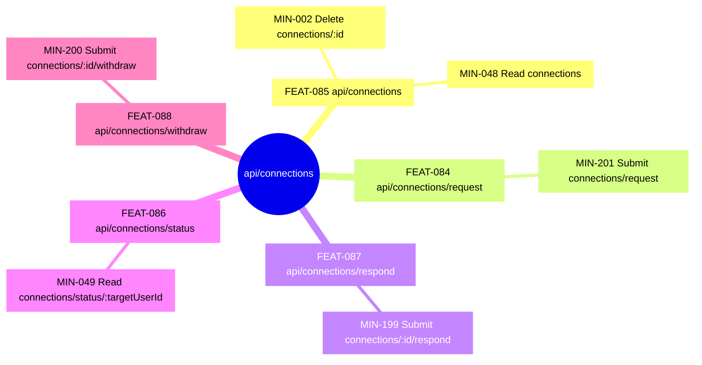
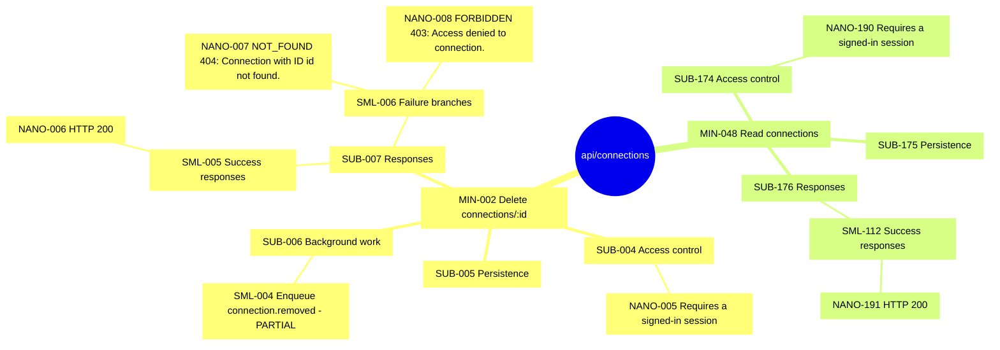
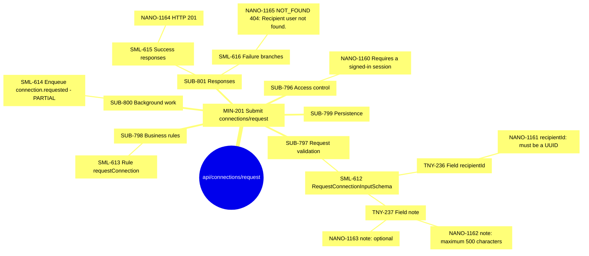
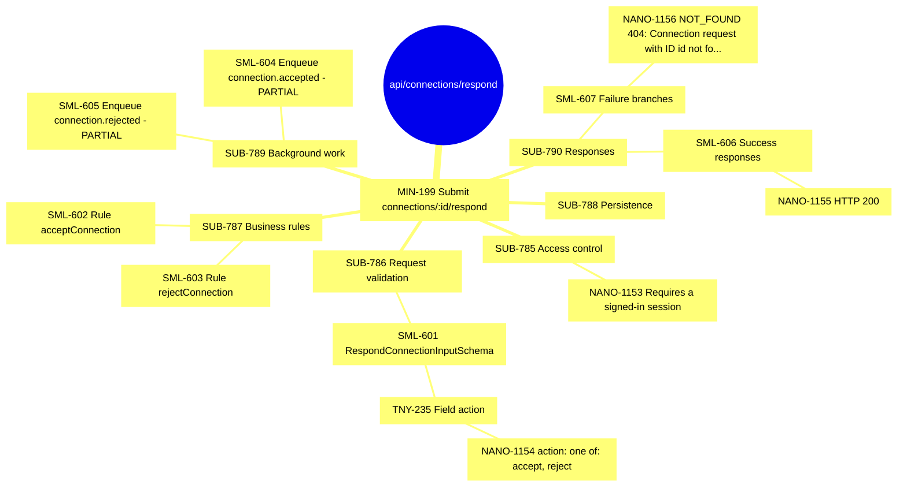
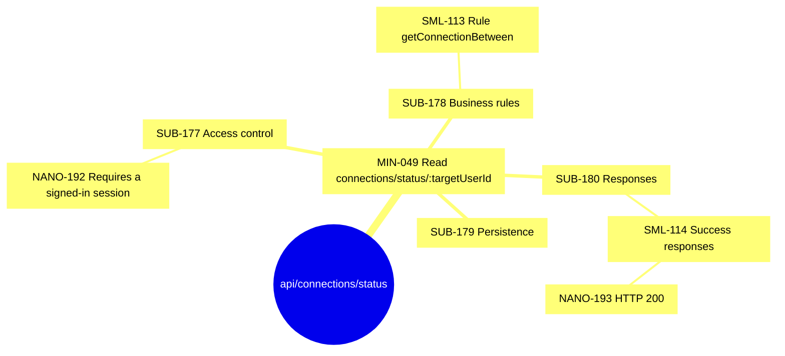
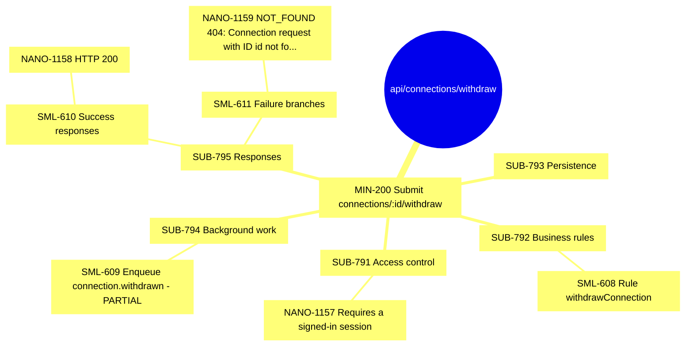

# api/connections (MOD-079)

Generated by `project-mindmap/tools/catalog.py` from `master/MASTER_PROJECT_GRAPH.json` at commit `9b3032f`. Do not edit by hand. Back to the [feature catalog](../FEATURE_CATALOG.md).

**Application:** apps/api (MOD-001). **Purpose:** API module: routes under /api/v1/connections in apps/api/src/server.ts.

**Nodes by level:** MODULE 1, MAJOR 5, MINOR 6, SUB 28, SMALL 22, TINY 3, NANO 21. **Status:** IMPLEMENTED 81, PARTIALLY_IMPLEMENTED 5. **Verification:** PATH_LEVEL 64, UNKNOWN 5, VERIFIED 11.

**User roles that reach it:** authenticated.

**Known gaps:** MIN-002 no first-party web caller found; MIN-049 no first-party web caller found; MIN-200 no first-party web caller found.

**Called from (web screens and components):** FEAT-173 Screen /network

## Module map (to minor features)

## FEAT-085 api/connections

api/connections

| ID       | Level | Parent   | Name                                                 | Description                                                                                                                                               | Status                | Verification | Evidence                                   | Related                               |
| -------- | ----- | -------- | ---------------------------------------------------- | --------------------------------------------------------------------------------------------------------------------------------------------------------- | --------------------- | ------------ | ------------------------------------------ | ------------------------------------- |
| FEAT-085 | MAJOR | MOD-079  | api/connections                                      |                                                                                                                                                           | IMPLEMENTED           |              | apps/api/src/server.ts:6547                |                                       |
| MIN-002  | MINOR | FEAT-085 | Delete connections/:id                               | DELETE /api/v1/connections/:id for any signed-in session; durable (PostgreSQL); responds 200; 2 failure branch(es). Gaps: no first-party web caller found | IMPLEMENTED           | VERIFIED     | apps/api/src/server.ts:6723                | API-139, TEST-115, TEST-225           |
| SUB-004  | SUB   | MIN-002  | Access control                                       | Who may call DELETE /api/v1/connections/:id: any signed-in session.                                                                                       | IMPLEMENTED           | PATH_LEVEL   | apps/api/src/server.ts:6723                |                                       |
| NANO-005 | NANO  | SUB-004  | Requires a signed-in session                         | Requests without a valid session token are rejected with 401 UNAUTHENTICATED.                                                                             | IMPLEMENTED           | PATH_LEVEL   | apps/api/src/server.ts:6723                | ROLE-001                              |
| SUB-005  | SUB   | MIN-002  | Persistence                                          | Durable: writes go through the PostgreSQL store; store calls connections.remove.                                                                          | IMPLEMENTED           | PATH_LEVEL   | apps/api/src/server.ts:6723                |                                       |
| SUB-006  | SUB   | MIN-002  | Background work                                      | Enqueues 1 background job kind(s) in background_jobs for apps/worker.                                                                                     | IMPLEMENTED           | PATH_LEVEL   | apps/api/src/server.ts:6723                |                                       |
| SML-004  | SMALL | SUB-006  | Enqueue connection.removed                           | Dispatches job:connection.removed; worker handler: recordEvent (no-op: marks the event recorded).                                                         | PARTIALLY_IMPLEMENTED | UNKNOWN      | packages/domain/src/background-jobs.ts:171 | SVC-015                               |
| SUB-007  | SUB   | MIN-002  | Responses                                            | Success 200; 2 explicit failure branch(es) besides validation and access errors.                                                                          | IMPLEMENTED           | PATH_LEVEL   | apps/api/src/server.ts:6723                |                                       |
| SML-005  | SMALL | SUB-007  | Success responses                                    | HTTP 200.                                                                                                                                                 | IMPLEMENTED           | PATH_LEVEL   | apps/api/src/server.ts:6723                |                                       |
| NANO-006 | NANO  | SML-005  | HTTP 200                                             | Replies 200 when the operation succeeds.                                                                                                                  | IMPLEMENTED           | PATH_LEVEL   | apps/api/src/server.ts:6723                |                                       |
| SML-006  | SMALL | SUB-007  | Failure branches                                     | 2 DomainError branch(es) in the handler, mapped to HTTP by the global error handler.                                                                      | IMPLEMENTED           | PATH_LEVEL   | apps/api/src/server.ts:6723                |                                       |
| NANO-007 | NANO  | SML-006  | NOT_FOUND 404: Connection with ID "${id}" not found. | Throws DomainError(NOT_FOUND) "Connection with ID "${id}" not found." -> HTTP 404.                                                                        | IMPLEMENTED           | PATH_LEVEL   | apps/api/src/server.ts:6731                | ERR-141                               |
| NANO-008 | NANO  | SML-006  | FORBIDDEN 403: Access denied to connection.          | Throws DomainError(FORBIDDEN) "Access denied to connection." -> HTTP 403.                                                                                 | IMPLEMENTED           | PATH_LEVEL   | apps/api/src/server.ts:6735                | ERR-142                               |
| MIN-048  | MINOR | FEAT-085 | Read connections                                     | GET /api/v1/connections for any signed-in session; durable (PostgreSQL); responds 200.                                                                    | IMPLEMENTED           | VERIFIED     | apps/api/src/server.ts:6547                | API-135, TEST-101, TEST-115, TEST-225 |
| SUB-174  | SUB   | MIN-048  | Access control                                       | Who may call GET /api/v1/connections: any signed-in session.                                                                                              | IMPLEMENTED           | PATH_LEVEL   | apps/api/src/server.ts:6547                |                                       |
| NANO-190 | NANO  | SUB-174  | Requires a signed-in session                         | Requests without a valid session token are rejected with 401 UNAUTHENTICATED.                                                                             | IMPLEMENTED           | PATH_LEVEL   | apps/api/src/server.ts:6547                | ROLE-001                              |
| SUB-175  | SUB   | MIN-048  | Persistence                                          | Durable: writes go through the PostgreSQL store.                                                                                                          | IMPLEMENTED           | PATH_LEVEL   | apps/api/src/server.ts:6547                |                                       |
| SUB-176  | SUB   | MIN-048  | Responses                                            | Success 200; 0 explicit failure branch(es) besides validation and access errors.                                                                          | IMPLEMENTED           | PATH_LEVEL   | apps/api/src/server.ts:6547                |                                       |
| SML-112  | SMALL | SUB-176  | Success responses                                    | HTTP 200.                                                                                                                                                 | IMPLEMENTED           | PATH_LEVEL   | apps/api/src/server.ts:6547                |                                       |
| NANO-191 | NANO  | SML-112  | HTTP 200                                             | Replies 200 when the operation succeeds.                                                                                                                  | IMPLEMENTED           | PATH_LEVEL   | apps/api/src/server.ts:6547                |                                       |

## FEAT-084 api/connections/request

api/connections/request

| ID        | Level | Parent   | Name                                     | Description                                                                                                                                                                            | Status                | Verification | Evidence                                   | Related                                                       |
| --------- | ----- | -------- | ---------------------------------------- | -------------------------------------------------------------------------------------------------------------------------------------------------------------------------------------- | --------------------- | ------------ | ------------------------------------------ | ------------------------------------------------------------- |
| FEAT-084  | MAJOR | MOD-079  | api/connections/request                  |                                                                                                                                                                                        | IMPLEMENTED           |              | apps/api/src/server.ts:6477                |                                                               |
| MIN-201   | MINOR | FEAT-084 | Submit connections/request               | POST /api/v1/connections/request for any signed-in session; validates RequestConnectionInputSchema; calls requestConnection; durable (PostgreSQL); responds 201; 1 failure branch(es). | IMPLEMENTED           | VERIFIED     | apps/api/src/server.ts:6477                | API-134, TEST-096, TEST-101, TEST-113, TEST-115, TEST-116 ... |
| SUB-796   | SUB   | MIN-201  | Access control                           | Who may call POST /api/v1/connections/request: any signed-in session.                                                                                                                  | IMPLEMENTED           | PATH_LEVEL   | apps/api/src/server.ts:6477                |                                                               |
| NANO-1160 | NANO  | SUB-796  | Requires a signed-in session             | Requests without a valid session token are rejected with 401 UNAUTHENTICATED.                                                                                                          | IMPLEMENTED           | PATH_LEVEL   | apps/api/src/server.ts:6477                | ROLE-001                                                      |
| SUB-797   | SUB   | MIN-201  | Request validation                       | The request is parsed with RequestConnectionInputSchema; a failure returns 400 with field details before any business logic runs.                                                      | IMPLEMENTED           | PATH_LEVEL   | apps/api/src/server.ts:6477                |                                                               |
| SML-612   | SMALL | SUB-797  | RequestConnectionInputSchema             | RequestConnectionInputSchema: 2 field(s)                                                                                                                                               | IMPLEMENTED           | PATH_LEVEL   | packages/contracts/src/index.ts:521        | SCH-039                                                       |
| TNY-236   | TINY  | SML-612  | Field recipientId                        | recipientId (string, required): must be a UUID                                                                                                                                         | IMPLEMENTED           | PATH_LEVEL   | packages/contracts/src/index.ts:522        |                                                               |
| NANO-1161 | NANO  | TNY-236  | recipientId: must be a UUID              | recipientId must be a UUID.                                                                                                                                                            | IMPLEMENTED           | PATH_LEVEL   | packages/contracts/src/index.ts:522        |                                                               |
| TNY-237   | TINY  | SML-612  | Field note                               | note (string, optional): maximum 500 characters; optional                                                                                                                              | IMPLEMENTED           | PATH_LEVEL   | packages/contracts/src/index.ts:523        |                                                               |
| NANO-1162 | NANO  | TNY-237  | note: maximum 500 characters             | note maximum 500 characters.                                                                                                                                                           | IMPLEMENTED           | PATH_LEVEL   | packages/contracts/src/index.ts:523        |                                                               |
| NANO-1163 | NANO  | TNY-237  | note: optional                           | note optional.                                                                                                                                                                         | IMPLEMENTED           | PATH_LEVEL   | packages/contracts/src/index.ts:523        |                                                               |
| SUB-798   | SUB   | MIN-201  | Business rules                           | Domain functions from packages/domain called by the handler (1).                                                                                                                       | IMPLEMENTED           | PATH_LEVEL   | apps/api/src/server.ts:6477                |                                                               |
| SML-613   | SMALL | SUB-798  | Rule requestConnection                   | Calls requestConnection (packages/domain/src/networking.ts). Rule status IMPLEMENTED; its own tests: VERIFIED.                                                                         | IMPLEMENTED           | VERIFIED     | packages/domain/src/networking.ts:32       | RULE-154                                                      |
| SUB-799   | SUB   | MIN-201  | Persistence                              | Durable: writes go through the PostgreSQL store; store calls connections.insert.                                                                                                       | IMPLEMENTED           | PATH_LEVEL   | apps/api/src/server.ts:6477                |                                                               |
| SUB-800   | SUB   | MIN-201  | Background work                          | Enqueues 1 background job kind(s) in background_jobs for apps/worker.                                                                                                                  | IMPLEMENTED           | PATH_LEVEL   | apps/api/src/server.ts:6477                |                                                               |
| SML-614   | SMALL | SUB-800  | Enqueue connection.requested             | Dispatches job:connection.requested; worker handler: recordEvent (no-op: marks the event recorded).                                                                                    | PARTIALLY_IMPLEMENTED | UNKNOWN      | packages/domain/src/background-jobs.ts:171 | SVC-017                                                       |
| SUB-801   | SUB   | MIN-201  | Responses                                | Success 201; 1 explicit failure branch(es) besides validation and access errors.                                                                                                       | IMPLEMENTED           | PATH_LEVEL   | apps/api/src/server.ts:6477                |                                                               |
| SML-615   | SMALL | SUB-801  | Success responses                        | HTTP 201.                                                                                                                                                                              | IMPLEMENTED           | PATH_LEVEL   | apps/api/src/server.ts:6477                |                                                               |
| NANO-1164 | NANO  | SML-615  | HTTP 201                                 | Replies 201 when the operation succeeds.                                                                                                                                               | IMPLEMENTED           | PATH_LEVEL   | apps/api/src/server.ts:6477                |                                                               |
| SML-616   | SMALL | SUB-801  | Failure branches                         | 1 DomainError branch(es) in the handler, mapped to HTTP by the global error handler.                                                                                                   | IMPLEMENTED           | PATH_LEVEL   | apps/api/src/server.ts:6477                |                                                               |
| NANO-1165 | NANO  | SML-616  | NOT_FOUND 404: Recipient user not found. | Throws DomainError(NOT_FOUND) "Recipient user not found." -> HTTP 404.                                                                                                                 | IMPLEMENTED           | PATH_LEVEL   | apps/api/src/server.ts:6488                | ERR-139                                                       |

## FEAT-087 api/connections/respond

api/connections/respond

| ID        | Level | Parent   | Name                                                         | Description                                                                                                                                                                                                 | Status                | Verification | Evidence                                   | Related                                                       |
| --------- | ----- | -------- | ------------------------------------------------------------ | ----------------------------------------------------------------------------------------------------------------------------------------------------------------------------------------------------------- | --------------------- | ------------ | ------------------------------------------ | ------------------------------------------------------------- |
| FEAT-087  | MAJOR | MOD-079  | api/connections/respond                                      |                                                                                                                                                                                                             | IMPLEMENTED           |              | apps/api/src/server.ts:6616                |                                                               |
| MIN-199   | MINOR | FEAT-087 | Submit connections/:id/respond                               | POST /api/v1/connections/:id/respond for any signed-in session; validates RespondConnectionInputSchema; calls acceptConnection, rejectConnection; durable (PostgreSQL); responds 200; 1 failure branch(es). | IMPLEMENTED           | VERIFIED     | apps/api/src/server.ts:6616                | API-137, TEST-096, TEST-101, TEST-113, TEST-115, TEST-116 ... |
| SUB-785   | SUB   | MIN-199  | Access control                                               | Who may call POST /api/v1/connections/:id/respond: any signed-in session.                                                                                                                                   | IMPLEMENTED           | PATH_LEVEL   | apps/api/src/server.ts:6616                |                                                               |
| NANO-1153 | NANO  | SUB-785  | Requires a signed-in session                                 | Requests without a valid session token are rejected with 401 UNAUTHENTICATED.                                                                                                                               | IMPLEMENTED           | PATH_LEVEL   | apps/api/src/server.ts:6616                | ROLE-001                                                      |
| SUB-786   | SUB   | MIN-199  | Request validation                                           | The request is parsed with RespondConnectionInputSchema; a failure returns 400 with field details before any business logic runs.                                                                           | IMPLEMENTED           | PATH_LEVEL   | apps/api/src/server.ts:6616                |                                                               |
| SML-601   | SMALL | SUB-786  | RespondConnectionInputSchema                                 | RespondConnectionInputSchema: 1 field(s)                                                                                                                                                                    | IMPLEMENTED           | PATH_LEVEL   | packages/contracts/src/index.ts:528        | SCH-040                                                       |
| TNY-235   | TINY  | SML-601  | Field action                                                 | action (enum, required): one of: accept, reject                                                                                                                                                             | IMPLEMENTED           | PATH_LEVEL   | packages/contracts/src/index.ts:529        |                                                               |
| NANO-1154 | NANO  | TNY-235  | action: one of: accept, reject                               | action one of: accept, reject.                                                                                                                                                                              | IMPLEMENTED           | PATH_LEVEL   | packages/contracts/src/index.ts:529        |                                                               |
| SUB-787   | SUB   | MIN-199  | Business rules                                               | Domain functions from packages/domain called by the handler (2).                                                                                                                                            | IMPLEMENTED           | PATH_LEVEL   | apps/api/src/server.ts:6616                |                                                               |
| SML-602   | SMALL | SUB-787  | Rule acceptConnection                                        | Calls acceptConnection (packages/domain/src/networking.ts). Rule status IMPLEMENTED; its own tests: VERIFIED.                                                                                               | IMPLEMENTED           | VERIFIED     | packages/domain/src/networking.ts:84       | RULE-155                                                      |
| SML-603   | SMALL | SUB-787  | Rule rejectConnection                                        | Calls rejectConnection (packages/domain/src/networking.ts). Rule status IMPLEMENTED; its own tests: VERIFIED.                                                                                               | IMPLEMENTED           | VERIFIED     | packages/domain/src/networking.ts:109      | RULE-156                                                      |
| SUB-788   | SUB   | MIN-199  | Persistence                                                  | Durable: writes go through the PostgreSQL store; store calls connections.update.                                                                                                                            | IMPLEMENTED           | PATH_LEVEL   | apps/api/src/server.ts:6616                |                                                               |
| SUB-789   | SUB   | MIN-199  | Background work                                              | Enqueues 2 background job kind(s) in background_jobs for apps/worker.                                                                                                                                       | IMPLEMENTED           | PATH_LEVEL   | apps/api/src/server.ts:6616                |                                                               |
| SML-604   | SMALL | SUB-789  | Enqueue connection.accepted                                  | Dispatches job:connection.accepted; worker handler: recordEvent (no-op: marks the event recorded).                                                                                                          | PARTIALLY_IMPLEMENTED | UNKNOWN      | packages/domain/src/background-jobs.ts:171 | SVC-014                                                       |
| SML-605   | SMALL | SUB-789  | Enqueue connection.rejected                                  | Dispatches job:connection.rejected; worker handler: recordEvent (no-op: marks the event recorded).                                                                                                          | PARTIALLY_IMPLEMENTED | UNKNOWN      | packages/domain/src/background-jobs.ts:171 | SVC-016                                                       |
| SUB-790   | SUB   | MIN-199  | Responses                                                    | Success 200; 1 explicit failure branch(es) besides validation and access errors.                                                                                                                            | IMPLEMENTED           | PATH_LEVEL   | apps/api/src/server.ts:6616                |                                                               |
| SML-606   | SMALL | SUB-790  | Success responses                                            | HTTP 200.                                                                                                                                                                                                   | IMPLEMENTED           | PATH_LEVEL   | apps/api/src/server.ts:6616                |                                                               |
| NANO-1155 | NANO  | SML-606  | HTTP 200                                                     | Replies 200 when the operation succeeds.                                                                                                                                                                    | IMPLEMENTED           | PATH_LEVEL   | apps/api/src/server.ts:6616                |                                                               |
| SML-607   | SMALL | SUB-790  | Failure branches                                             | 1 DomainError branch(es) in the handler, mapped to HTTP by the global error handler.                                                                                                                        | IMPLEMENTED           | PATH_LEVEL   | apps/api/src/server.ts:6616                |                                                               |
| NANO-1156 | NANO  | SML-607  | NOT_FOUND 404: Connection request with ID "${id}" not found. | Throws DomainError(NOT_FOUND) "Connection request with ID "${id}" not found." -> HTTP 404.                                                                                                                  | IMPLEMENTED           | PATH_LEVEL   | apps/api/src/server.ts:6624                | ERR-140                                                       |

## FEAT-086 api/connections/status

api/connections/status

| ID       | Level | Parent   | Name                                  | Description                                                                                                                                                                   | Status      | Verification | Evidence                              | Related                               |
| -------- | ----- | -------- | ------------------------------------- | ----------------------------------------------------------------------------------------------------------------------------------------------------------------------------- | ----------- | ------------ | ------------------------------------- | ------------------------------------- |
| FEAT-086 | MAJOR | MOD-079  | api/connections/status                |                                                                                                                                                                               | IMPLEMENTED |              | apps/api/src/server.ts:6594           |                                       |
| MIN-049  | MINOR | FEAT-086 | Read connections/status/:targetUserId | GET /api/v1/connections/status/:targetUserId for any signed-in session; calls getConnectionBetween; durable (PostgreSQL); responds 200. Gaps: no first-party web caller found | IMPLEMENTED | VERIFIED     | apps/api/src/server.ts:6594           | API-136, TEST-115, TEST-206, TEST-225 |
| SUB-177  | SUB   | MIN-049  | Access control                        | Who may call GET /api/v1/connections/status/:targetUserId: any signed-in session.                                                                                             | IMPLEMENTED | PATH_LEVEL   | apps/api/src/server.ts:6594           |                                       |
| NANO-192 | NANO  | SUB-177  | Requires a signed-in session          | Requests without a valid session token are rejected with 401 UNAUTHENTICATED.                                                                                                 | IMPLEMENTED | PATH_LEVEL   | apps/api/src/server.ts:6594           | ROLE-001                              |
| SUB-178  | SUB   | MIN-049  | Business rules                        | Domain functions from packages/domain called by the handler (1).                                                                                                              | IMPLEMENTED | PATH_LEVEL   | apps/api/src/server.ts:6594           |                                       |
| SML-113  | SMALL | SUB-178  | Rule getConnectionBetween             | Calls getConnectionBetween (packages/domain/src/networking.ts). Rule status IMPLEMENTED; its own tests: VERIFIED.                                                             | IMPLEMENTED | VERIFIED     | packages/domain/src/networking.ts:168 | RULE-159                              |
| SUB-179  | SUB   | MIN-049  | Persistence                           | Durable: writes go through the PostgreSQL store.                                                                                                                              | IMPLEMENTED | PATH_LEVEL   | apps/api/src/server.ts:6594           |                                       |
| SUB-180  | SUB   | MIN-049  | Responses                             | Success 200; 0 explicit failure branch(es) besides validation and access errors.                                                                                              | IMPLEMENTED | PATH_LEVEL   | apps/api/src/server.ts:6594           |                                       |
| SML-114  | SMALL | SUB-180  | Success responses                     | HTTP 200.                                                                                                                                                                     | IMPLEMENTED | PATH_LEVEL   | apps/api/src/server.ts:6594           |                                       |
| NANO-193 | NANO  | SML-114  | HTTP 200                              | Replies 200 when the operation succeeds.                                                                                                                                      | IMPLEMENTED | PATH_LEVEL   | apps/api/src/server.ts:6594           |                                       |

## FEAT-088 api/connections/withdraw

api/connections/withdraw

| ID        | Level | Parent   | Name                                                         | Description                                                                                                                                                                                | Status                | Verification | Evidence                                   | Related           |
| --------- | ----- | -------- | ------------------------------------------------------------ | ------------------------------------------------------------------------------------------------------------------------------------------------------------------------------------------ | --------------------- | ------------ | ------------------------------------------ | ----------------- |
| FEAT-088  | MAJOR | MOD-079  | api/connections/withdraw                                     |                                                                                                                                                                                            | IMPLEMENTED           |              | apps/api/src/server.ts:6686                |                   |
| MIN-200   | MINOR | FEAT-088 | Submit connections/:id/withdraw                              | POST /api/v1/connections/:id/withdraw for any signed-in session; calls withdrawConnection; durable (PostgreSQL); responds 200; 1 failure branch(es). Gaps: no first-party web caller found | IMPLEMENTED           | VERIFIED     | apps/api/src/server.ts:6686                | API-138, TEST-115 |
| SUB-791   | SUB   | MIN-200  | Access control                                               | Who may call POST /api/v1/connections/:id/withdraw: any signed-in session.                                                                                                                 | IMPLEMENTED           | PATH_LEVEL   | apps/api/src/server.ts:6686                |                   |
| NANO-1157 | NANO  | SUB-791  | Requires a signed-in session                                 | Requests without a valid session token are rejected with 401 UNAUTHENTICATED.                                                                                                              | IMPLEMENTED           | PATH_LEVEL   | apps/api/src/server.ts:6686                | ROLE-001          |
| SUB-792   | SUB   | MIN-200  | Business rules                                               | Domain functions from packages/domain called by the handler (1).                                                                                                                           | IMPLEMENTED           | PATH_LEVEL   | apps/api/src/server.ts:6686                |                   |
| SML-608   | SMALL | SUB-792  | Rule withdrawConnection                                      | Calls withdrawConnection (packages/domain/src/networking.ts). Rule status IMPLEMENTED; its own tests: VERIFIED.                                                                            | IMPLEMENTED           | VERIFIED     | packages/domain/src/networking.ts:133      | RULE-157          |
| SUB-793   | SUB   | MIN-200  | Persistence                                                  | Durable: writes go through the PostgreSQL store; store calls connections.update.                                                                                                           | IMPLEMENTED           | PATH_LEVEL   | apps/api/src/server.ts:6686                |                   |
| SUB-794   | SUB   | MIN-200  | Background work                                              | Enqueues 1 background job kind(s) in background_jobs for apps/worker.                                                                                                                      | IMPLEMENTED           | PATH_LEVEL   | apps/api/src/server.ts:6686                |                   |
| SML-609   | SMALL | SUB-794  | Enqueue connection.withdrawn                                 | Dispatches job:connection.withdrawn; worker handler: recordEvent (no-op: marks the event recorded).                                                                                        | PARTIALLY_IMPLEMENTED | UNKNOWN      | packages/domain/src/background-jobs.ts:171 | SVC-018           |
| SUB-795   | SUB   | MIN-200  | Responses                                                    | Success 200; 1 explicit failure branch(es) besides validation and access errors.                                                                                                           | IMPLEMENTED           | PATH_LEVEL   | apps/api/src/server.ts:6686                |                   |
| SML-610   | SMALL | SUB-795  | Success responses                                            | HTTP 200.                                                                                                                                                                                  | IMPLEMENTED           | PATH_LEVEL   | apps/api/src/server.ts:6686                |                   |
| NANO-1158 | NANO  | SML-610  | HTTP 200                                                     | Replies 200 when the operation succeeds.                                                                                                                                                   | IMPLEMENTED           | PATH_LEVEL   | apps/api/src/server.ts:6686                |                   |
| SML-611   | SMALL | SUB-795  | Failure branches                                             | 1 DomainError branch(es) in the handler, mapped to HTTP by the global error handler.                                                                                                       | IMPLEMENTED           | PATH_LEVEL   | apps/api/src/server.ts:6686                |                   |
| NANO-1159 | NANO  | SML-611  | NOT_FOUND 404: Connection request with ID "${id}" not found. | Throws DomainError(NOT_FOUND) "Connection request with ID "${id}" not found." -> HTTP 404.                                                                                                 | IMPLEMENTED           | PATH_LEVEL   | apps/api/src/server.ts:6694                | ERR-140           |
