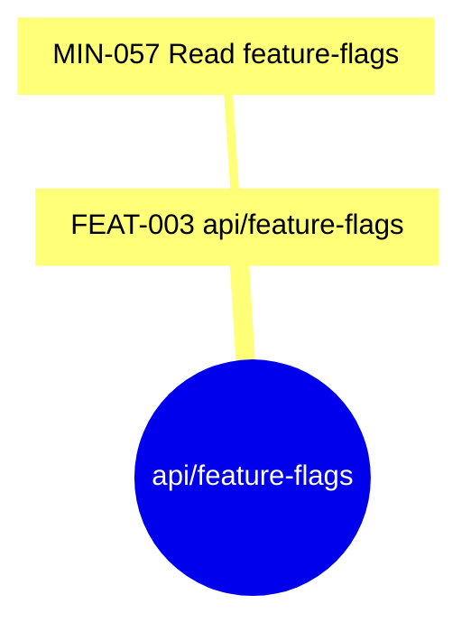
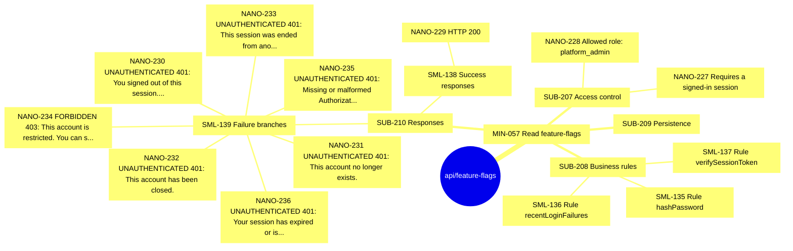

# api/feature-flags (MOD-054)

Generated by `project-mindmap/tools/catalog.py` from `master/MASTER_PROJECT_GRAPH.json` at commit `9b3032f`. Do not edit by hand. Back to the [feature catalog](../FEATURE_CATALOG.md).

**Application:** apps/api (MOD-001). **Purpose:** API module: routes under /api/v1/feature-flags in apps/api/src/server.ts.

**Nodes by level:** MODULE 1, MAJOR 1, MINOR 1, SUB 4, SMALL 5, NANO 10. **Status:** IMPLEMENTED 22. **Verification:** PATH_LEVEL 13, UNKNOWN 1, VERIFIED 6.

**User roles that reach it:** platform_admin.

**Known gaps:** MIN-057 no first-party web caller found.

## Module map (to minor features)

## FEAT-003 api/feature-flags

api/feature-flags

| ID       | Level | Parent   | Name                                                                                 | Description                                                                                                                                                                                                                                 | Status      | Verification | Evidence                        | Related                                         |
| -------- | ----- | -------- | ------------------------------------------------------------------------------------ | ------------------------------------------------------------------------------------------------------------------------------------------------------------------------------------------------------------------------------------------- | ----------- | ------------ | ------------------------------- | ----------------------------------------------- |
| FEAT-003 | MAJOR | MOD-054  | api/feature-flags                                                                    |                                                                                                                                                                                                                                             | IMPLEMENTED |              | apps/api/src/server.ts:861      |                                                 |
| MIN-057  | MINOR | FEAT-003 | Read feature-flags                                                                   | Public Feature Flags Route GET /api/v1/feature-flags for roles platform_admin; calls hashPassword, recentLoginFailures, verifySessionToken; durable (PostgreSQL); responds 200; 7 failure branch(es). Gaps: no first-party web caller found | IMPLEMENTED | VERIFIED     | apps/api/src/server.ts:861      | API-004, TEST-083, TEST-087, TEST-141, TEST-145 |
| SUB-207  | SUB   | MIN-057  | Access control                                                                       | Who may call GET /api/v1/feature-flags: roles platform_admin.                                                                                                                                                                               | IMPLEMENTED | PATH_LEVEL   | apps/api/src/server.ts:861      |                                                 |
| NANO-227 | NANO  | SUB-207  | Requires a signed-in session                                                         | Requests without a valid session token are rejected with 401 UNAUTHENTICATED.                                                                                                                                                               | IMPLEMENTED | PATH_LEVEL   | apps/api/src/server.ts:861      | ROLE-001                                        |
| NANO-228 | NANO  | SUB-207  | Allowed role: platform_admin                                                         | platform_admin is one of the roles allowed here (platform_admin); a caller holding none of them is rejected with 403.                                                                                                                       | IMPLEMENTED | PATH_LEVEL   | apps/api/src/server.ts:861      | ROLE-008                                        |
| SUB-208  | SUB   | MIN-057  | Business rules                                                                       | Domain functions from packages/domain called by the handler (3).                                                                                                                                                                            | IMPLEMENTED | PATH_LEVEL   | apps/api/src/server.ts:861      |                                                 |
| SML-135  | SMALL | SUB-208  | Rule hashPassword                                                                    | Calls hashPassword (packages/domain/src/auth.ts). Rule status IMPLEMENTED; its own tests: VERIFIED.                                                                                                                                         | IMPLEMENTED | VERIFIED     | packages/domain/src/auth.ts:58  | RULE-049                                        |
| SML-136  | SMALL | SUB-208  | Rule recentLoginFailures                                                             | Calls recentLoginFailures (packages/domain/src/auth.ts). Rule status IMPLEMENTED; its own tests: VERIFIED.                                                                                                                                  | IMPLEMENTED | VERIFIED     | packages/domain/src/auth.ts:102 | RULE-052                                        |
| SML-137  | SMALL | SUB-208  | Rule verifySessionToken                                                              | Calls verifySessionToken (packages/domain/src/auth.ts). Rule status IMPLEMENTED; its own tests: UNKNOWN.                                                                                                                                    | IMPLEMENTED | UNKNOWN      | packages/domain/src/auth.ts:168 | RULE-055                                        |
| SUB-209  | SUB   | MIN-057  | Persistence                                                                          | Durable: writes go through the PostgreSQL store; store calls featureFlags.list.                                                                                                                                                             | IMPLEMENTED | PATH_LEVEL   | apps/api/src/server.ts:861      |                                                 |
| SUB-210  | SUB   | MIN-057  | Responses                                                                            | Success 200; 7 explicit failure branch(es) besides validation and access errors.                                                                                                                                                            | IMPLEMENTED | PATH_LEVEL   | apps/api/src/server.ts:861      |                                                 |
| SML-138  | SMALL | SUB-210  | Success responses                                                                    | HTTP 200 (implicit).                                                                                                                                                                                                                        | IMPLEMENTED | PATH_LEVEL   | apps/api/src/server.ts:861      |                                                 |
| NANO-229 | NANO  | SML-138  | HTTP 200                                                                             | Replies 200 when the operation succeeds (implicit default).                                                                                                                                                                                 | IMPLEMENTED | PATH_LEVEL   | apps/api/src/server.ts:861      |                                                 |
| SML-139  | SMALL | SUB-210  | Failure branches                                                                     | 7 DomainError branch(es) in the handler, mapped to HTTP by the global error handler.                                                                                                                                                        | IMPLEMENTED | PATH_LEVEL   | apps/api/src/server.ts:861      |                                                 |
| NANO-230 | NANO  | SML-139  | UNAUTHENTICATED 401: You signed out of this session. Sign in again.                  | Throws DomainError(UNAUTHENTICATED) "You signed out of this session. Sign in again." -> HTTP 401.                                                                                                                                           | IMPLEMENTED | VERIFIED     | apps/api/src/server.ts:910      | ERR-001, TEST-146                               |
| NANO-231 | NANO  | SML-139  | UNAUTHENTICATED 401: This account no longer exists.                                  | Throws DomainError(UNAUTHENTICATED) "This account no longer exists." -> HTTP 401.                                                                                                                                                           | IMPLEMENTED | VERIFIED     | apps/api/src/server.ts:921      | ERR-002, TEST-150                               |
| NANO-232 | NANO  | SML-139  | UNAUTHENTICATED 401: This account has been closed.                                   | Throws DomainError(UNAUTHENTICATED) "This account has been closed." -> HTTP 401.                                                                                                                                                            | IMPLEMENTED | PATH_LEVEL   | apps/api/src/server.ts:927      | ERR-003                                         |
| NANO-233 | NANO  | SML-139  | UNAUTHENTICATED 401: This session was ended from another device. Sign in again.      | Throws DomainError(UNAUTHENTICATED) "This session was ended from another device. Sign in again." -> HTTP 401.                                                                                                                               | IMPLEMENTED | VERIFIED     | apps/api/src/server.ts:936      | ERR-004, TEST-164, TEST-142, TEST-146, TEST-056 |
| NANO-234 | NANO  | SML-139  | FORBIDDEN 403: This account is restricted. You can still export or delete your data. | Throws DomainError(FORBIDDEN) "This account is restricted. You can still export or delete your data." -> HTTP 403.                                                                                                                          | IMPLEMENTED | PATH_LEVEL   | apps/api/src/server.ts:944      | ERR-005                                         |
| NANO-235 | NANO  | SML-139  | UNAUTHENTICATED 401: Missing or malformed Authorization header.                      | Throws DomainError(UNAUTHENTICATED) "Missing or malformed Authorization header." -> HTTP 401.                                                                                                                                               | IMPLEMENTED | PATH_LEVEL   | apps/api/src/server.ts:958      | ERR-006                                         |
| NANO-236 | NANO  | SML-139  | UNAUTHENTICATED 401: Your session has expired or is no longer valid. Sign in again.  | Throws DomainError(UNAUTHENTICATED) "Your session has expired or is no longer valid. Sign in again." -> HTTP 401.                                                                                                                           | IMPLEMENTED | PATH_LEVEL   | apps/api/src/server.ts:963      | ERR-007                                         |
