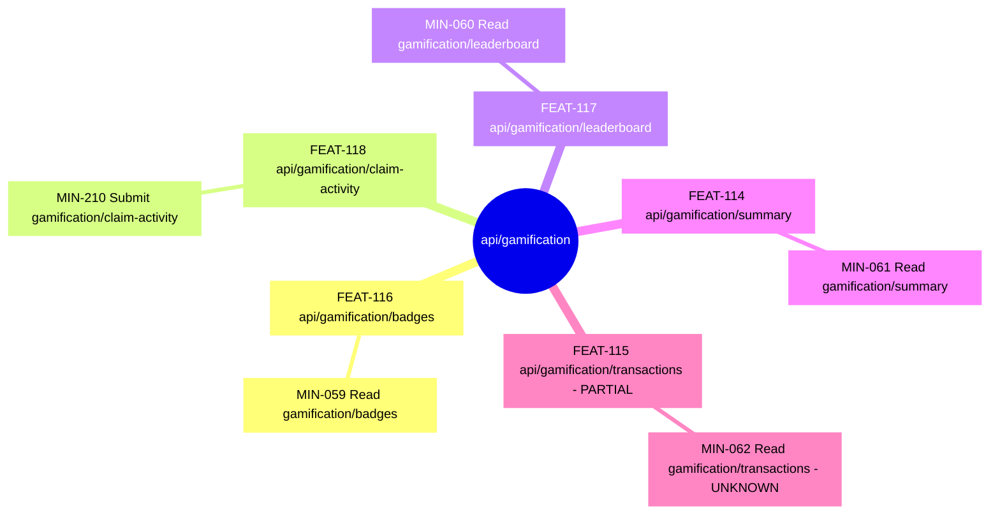
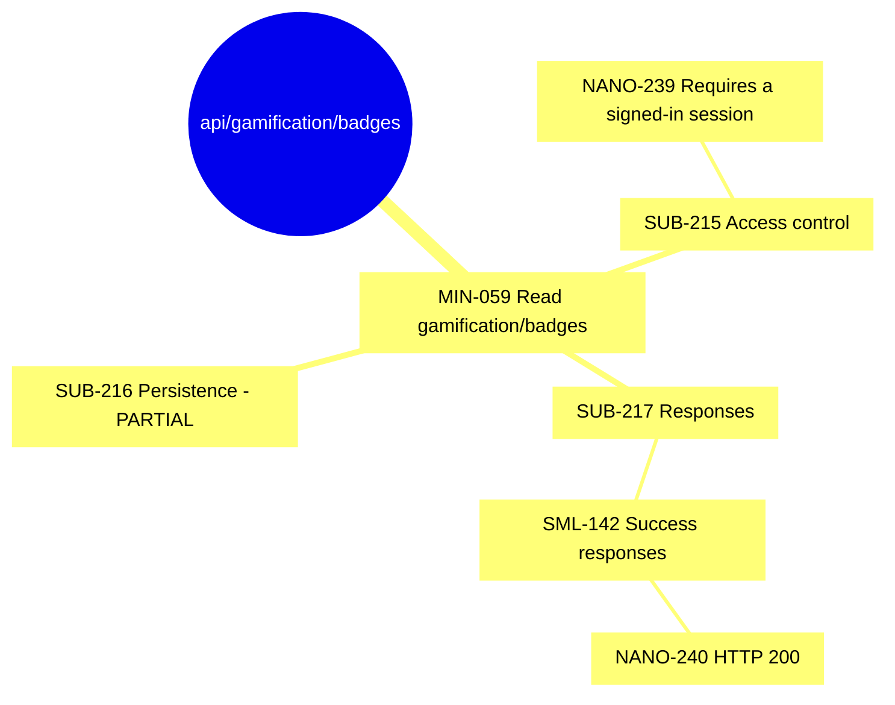
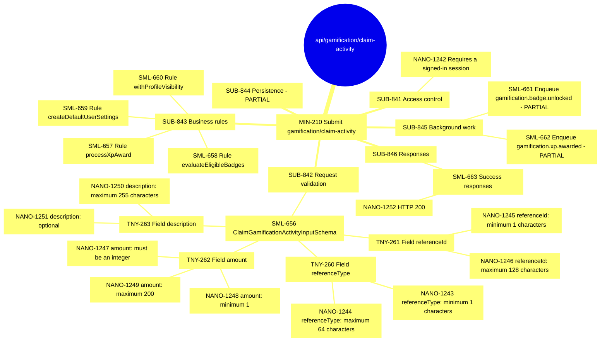
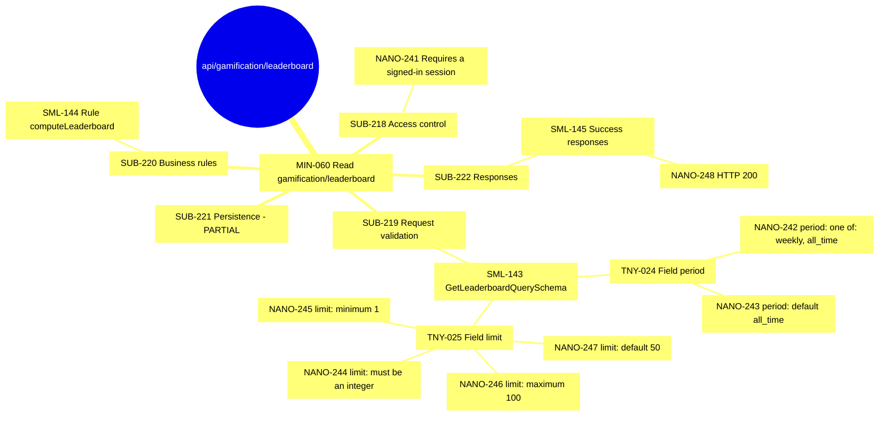
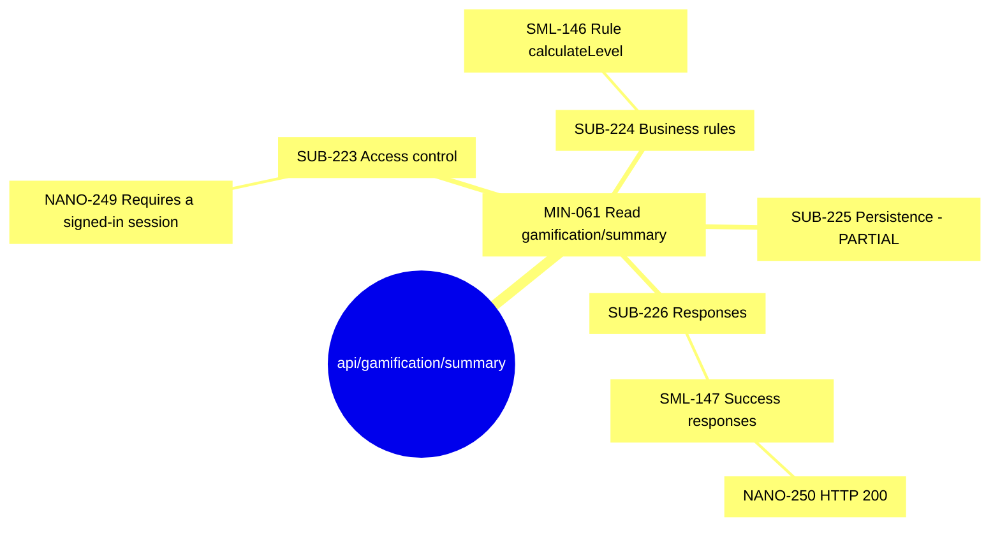
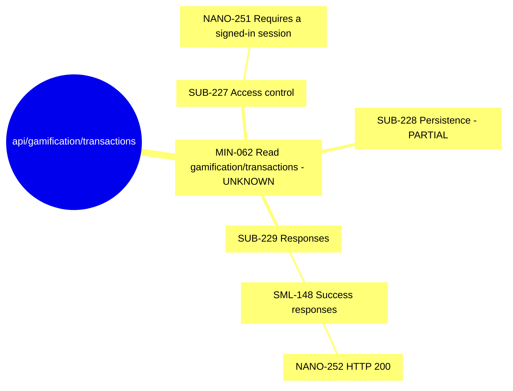

# api/gamification (MOD-088)

Generated by `project-mindmap/tools/catalog.py` from `master/MASTER_PROJECT_GRAPH.json` at commit `9b3032f`. Do not edit by hand. Back to the [feature catalog](../FEATURE_CATALOG.md).

**Application:** apps/api (MOD-001). **Purpose:** API module: routes under /api/v1/gamification in apps/api/src/server.ts.

**Nodes by level:** MODULE 1, MAJOR 5, MINOR 5, SUB 21, SMALL 15, TINY 6, NANO 25. **Status:** IMPLEMENTED 68, PARTIALLY_IMPLEMENTED 9, UNKNOWN 1. **Verification:** PATH_LEVEL 59, UNKNOWN 2, VERIFIED 11.

**User roles that reach it:** authenticated.

**Known gaps:** MIN-059 ephemeral: state held in process memory, lost on restart; MIN-059 no first-party web caller found; MIN-210 ephemeral: state held in process memory, lost on restart; MIN-210 no first-party web caller found; MIN-060 ephemeral: state held in process memory, lost on restart; MIN-060 no first-party web caller found; MIN-061 ephemeral: state held in process memory, lost on restart; MIN-061 no first-party web caller found; MIN-062 ephemeral: state held in process memory, lost on restart; MIN-062 no first-party web caller found.

## Module map (to minor features)

## FEAT-116 api/gamification/badges

api/gamification/badges

| ID       | Level | Parent   | Name                         | Description                                                                                                                                                                                          | Status                | Verification | Evidence                    | Related           |
| -------- | ----- | -------- | ---------------------------- | ---------------------------------------------------------------------------------------------------------------------------------------------------------------------------------------------------- | --------------------- | ------------ | --------------------------- | ----------------- |
| FEAT-116 | MAJOR | MOD-088  | api/gamification/badges      |                                                                                                                                                                                                      | IMPLEMENTED           |              | apps/api/src/server.ts:9942 |                   |
| MIN-059  | MINOR | FEAT-116 | Read gamification/badges     | GET /api/v1/gamification/badges for any signed-in session; ephemeral (process memory); responds 200. Gaps: ephemeral: state held in process memory, lost on restart; no first-party web caller found | IMPLEMENTED           | VERIFIED     | apps/api/src/server.ts:9942 | API-209, TEST-105 |
| SUB-215  | SUB   | MIN-059  | Access control               | Who may call GET /api/v1/gamification/badges: any signed-in session.                                                                                                                                 | IMPLEMENTED           | PATH_LEVEL   | apps/api/src/server.ts:9942 |                   |
| NANO-239 | NANO  | SUB-215  | Requires a signed-in session | Requests without a valid session token are rejected with 401 UNAUTHENTICATED.                                                                                                                        | IMPLEMENTED           | PATH_LEVEL   | apps/api/src/server.ts:9942 | ROLE-001          |
| SUB-216  | SUB   | MIN-059  | Persistence                  | Ephemeral: state lives in API process memory and is lost on restart.                                                                                                                                 | PARTIALLY_IMPLEMENTED | PATH_LEVEL   | apps/api/src/server.ts:9942 |                   |
| SUB-217  | SUB   | MIN-059  | Responses                    | Success 200; 0 explicit failure branch(es) besides validation and access errors.                                                                                                                     | IMPLEMENTED           | PATH_LEVEL   | apps/api/src/server.ts:9942 |                   |
| SML-142  | SMALL | SUB-217  | Success responses            | HTTP 200.                                                                                                                                                                                            | IMPLEMENTED           | PATH_LEVEL   | apps/api/src/server.ts:9942 |                   |
| NANO-240 | NANO  | SML-142  | HTTP 200                     | Replies 200 when the operation succeeds.                                                                                                                                                             | IMPLEMENTED           | PATH_LEVEL   | apps/api/src/server.ts:9942 |                   |

## FEAT-118 api/gamification/claim-activity

api/gamification/claim-activity

| ID        | Level | Parent   | Name                                 | Description                                                                                                                                                                                                                                                                                                                                                   | Status                | Verification | Evidence                                   | Related                     |
| --------- | ----- | -------- | ------------------------------------ | ------------------------------------------------------------------------------------------------------------------------------------------------------------------------------------------------------------------------------------------------------------------------------------------------------------------------------------------------------------- | --------------------- | ------------ | ------------------------------------------ | --------------------------- |
| FEAT-118  | MAJOR | MOD-088  | api/gamification/claim-activity      |                                                                                                                                                                                                                                                                                                                                                               | IMPLEMENTED           |              | apps/api/src/server.ts:9998                |                             |
| MIN-210   | MINOR | FEAT-118 | Submit gamification/claim-activity   | POST /api/v1/gamification/claim-activity for any signed-in session; validates ClaimGamificationActivityInputSchema; calls processXpAward, evaluateEligibleBadges, createDefaultUserSettings, withProfileVisibility; ephemeral (process memory); responds 200. Gaps: ephemeral: state held in process memory, lost on restart; no first-party web caller found | IMPLEMENTED           | VERIFIED     | apps/api/src/server.ts:9998                | API-211, TEST-105, TEST-183 |
| SUB-841   | SUB   | MIN-210  | Access control                       | Who may call POST /api/v1/gamification/claim-activity: any signed-in session.                                                                                                                                                                                                                                                                                 | IMPLEMENTED           | PATH_LEVEL   | apps/api/src/server.ts:9998                |                             |
| NANO-1242 | NANO  | SUB-841  | Requires a signed-in session         | Requests without a valid session token are rejected with 401 UNAUTHENTICATED.                                                                                                                                                                                                                                                                                 | IMPLEMENTED           | PATH_LEVEL   | apps/api/src/server.ts:9998                | ROLE-001                    |
| SUB-842   | SUB   | MIN-210  | Request validation                   | The request is parsed with ClaimGamificationActivityInputSchema; a failure returns 400 with field details before any business logic runs.                                                                                                                                                                                                                     | IMPLEMENTED           | PATH_LEVEL   | apps/api/src/server.ts:9998                |                             |
| SML-656   | SMALL | SUB-842  | ClaimGamificationActivityInputSchema | ClaimGamificationActivityInputSchema: 4 field(s)                                                                                                                                                                                                                                                                                                              | IMPLEMENTED           | PATH_LEVEL   | packages/contracts/src/index.ts:570        | SCH-044                     |
| TNY-260   | TINY  | SML-656  | Field referenceType                  | referenceType (string, required): minimum 1 characters; maximum 64 characters                                                                                                                                                                                                                                                                                 | IMPLEMENTED           | PATH_LEVEL   | packages/contracts/src/index.ts:571        |                             |
| NANO-1243 | NANO  | TNY-260  | referenceType: minimum 1 characters  | referenceType minimum 1 characters.                                                                                                                                                                                                                                                                                                                           | IMPLEMENTED           | PATH_LEVEL   | packages/contracts/src/index.ts:571        |                             |
| NANO-1244 | NANO  | TNY-260  | referenceType: maximum 64 characters | referenceType maximum 64 characters.                                                                                                                                                                                                                                                                                                                          | IMPLEMENTED           | PATH_LEVEL   | packages/contracts/src/index.ts:571        |                             |
| TNY-261   | TINY  | SML-656  | Field referenceId                    | referenceId (string, required): minimum 1 characters; maximum 128 characters                                                                                                                                                                                                                                                                                  | IMPLEMENTED           | PATH_LEVEL   | packages/contracts/src/index.ts:572        |                             |
| NANO-1245 | NANO  | TNY-261  | referenceId: minimum 1 characters    | referenceId minimum 1 characters.                                                                                                                                                                                                                                                                                                                             | IMPLEMENTED           | PATH_LEVEL   | packages/contracts/src/index.ts:572        |                             |
| NANO-1246 | NANO  | TNY-261  | referenceId: maximum 128 characters  | referenceId maximum 128 characters.                                                                                                                                                                                                                                                                                                                           | IMPLEMENTED           | PATH_LEVEL   | packages/contracts/src/index.ts:572        |                             |
| TNY-262   | TINY  | SML-656  | Field amount                         | amount (number, required): must be an integer; minimum 1; maximum 200                                                                                                                                                                                                                                                                                         | IMPLEMENTED           | PATH_LEVEL   | packages/contracts/src/index.ts:573        |                             |
| NANO-1247 | NANO  | TNY-262  | amount: must be an integer           | amount must be an integer.                                                                                                                                                                                                                                                                                                                                    | IMPLEMENTED           | PATH_LEVEL   | packages/contracts/src/index.ts:573        |                             |
| NANO-1248 | NANO  | TNY-262  | amount: minimum 1                    | amount minimum 1.                                                                                                                                                                                                                                                                                                                                             | IMPLEMENTED           | PATH_LEVEL   | packages/contracts/src/index.ts:573        |                             |
| NANO-1249 | NANO  | TNY-262  | amount: maximum 200                  | amount maximum 200.                                                                                                                                                                                                                                                                                                                                           | IMPLEMENTED           | PATH_LEVEL   | packages/contracts/src/index.ts:573        |                             |
| TNY-263   | TINY  | SML-656  | Field description                    | description (string, optional): maximum 255 characters; optional                                                                                                                                                                                                                                                                                              | IMPLEMENTED           | PATH_LEVEL   | packages/contracts/src/index.ts:574        |                             |
| NANO-1250 | NANO  | TNY-263  | description: maximum 255 characters  | description maximum 255 characters.                                                                                                                                                                                                                                                                                                                           | IMPLEMENTED           | PATH_LEVEL   | packages/contracts/src/index.ts:574        |                             |
| NANO-1251 | NANO  | TNY-263  | description: optional                | description optional.                                                                                                                                                                                                                                                                                                                                         | IMPLEMENTED           | PATH_LEVEL   | packages/contracts/src/index.ts:574        |                             |
| SUB-843   | SUB   | MIN-210  | Business rules                       | Domain functions from packages/domain called by the handler (4).                                                                                                                                                                                                                                                                                              | IMPLEMENTED           | PATH_LEVEL   | apps/api/src/server.ts:9998                |                             |
| SML-657   | SMALL | SUB-843  | Rule processXpAward                  | Calls processXpAward (packages/domain/src/gamification.ts). Rule status IMPLEMENTED; its own tests: VERIFIED.                                                                                                                                                                                                                                                 | IMPLEMENTED           | VERIFIED     | packages/domain/src/gamification.ts:204    | RULE-106                    |
| SML-658   | SMALL | SUB-843  | Rule evaluateEligibleBadges          | Calls evaluateEligibleBadges (packages/domain/src/gamification.ts). Rule status IMPLEMENTED; its own tests: VERIFIED.                                                                                                                                                                                                                                         | IMPLEMENTED           | VERIFIED     | packages/domain/src/gamification.ts:295    | RULE-107                    |
| SML-659   | SMALL | SUB-843  | Rule createDefaultUserSettings       | Calls createDefaultUserSettings (packages/domain/src/settings.ts). Rule status IMPLEMENTED; its own tests: VERIFIED.                                                                                                                                                                                                                                          | IMPLEMENTED           | VERIFIED     | packages/domain/src/settings.ts:104        | RULE-212                    |
| SML-660   | SMALL | SUB-843  | Rule withProfileVisibility           | Calls withProfileVisibility (packages/domain/src/settings.ts). Rule status IMPLEMENTED; its own tests: VERIFIED.                                                                                                                                                                                                                                              | IMPLEMENTED           | VERIFIED     | packages/domain/src/settings.ts:134        | RULE-213                    |
| SUB-844   | SUB   | MIN-210  | Persistence                          | Ephemeral: state lives in API process memory and is lost on restart; store calls accountMetadata.getSettings, accountMetadata.saveSettings.                                                                                                                                                                                                                   | PARTIALLY_IMPLEMENTED | PATH_LEVEL   | apps/api/src/server.ts:9998                |                             |
| SUB-845   | SUB   | MIN-210  | Background work                      | Enqueues 2 background job kind(s) in background_jobs for apps/worker.                                                                                                                                                                                                                                                                                         | IMPLEMENTED           | PATH_LEVEL   | apps/api/src/server.ts:9998                |                             |
| SML-661   | SMALL | SUB-845  | Enqueue gamification.badge.unlocked  | Dispatches job:gamification.badge.unlocked; worker handler: recordEvent (no-op: marks the event recorded).                                                                                                                                                                                                                                                    | PARTIALLY_IMPLEMENTED | UNKNOWN      | packages/domain/src/background-jobs.ts:171 | SVC-021                     |
| SML-662   | SMALL | SUB-845  | Enqueue gamification.xp.awarded      | Dispatches job:gamification.xp.awarded; worker handler: recordEvent (no-op: marks the event recorded).                                                                                                                                                                                                                                                        | PARTIALLY_IMPLEMENTED | UNKNOWN      | packages/domain/src/background-jobs.ts:171 | SVC-022                     |
| SUB-846   | SUB   | MIN-210  | Responses                            | Success 200; 0 explicit failure branch(es) besides validation and access errors.                                                                                                                                                                                                                                                                              | IMPLEMENTED           | PATH_LEVEL   | apps/api/src/server.ts:9998                |                             |
| SML-663   | SMALL | SUB-846  | Success responses                    | HTTP 200.                                                                                                                                                                                                                                                                                                                                                     | IMPLEMENTED           | PATH_LEVEL   | apps/api/src/server.ts:9998                |                             |
| NANO-1252 | NANO  | SML-663  | HTTP 200                             | Replies 200 when the operation succeeds.                                                                                                                                                                                                                                                                                                                      | IMPLEMENTED           | PATH_LEVEL   | apps/api/src/server.ts:9998                |                             |

## FEAT-117 api/gamification/leaderboard

api/gamification/leaderboard

| ID       | Level | Parent   | Name                             | Description                                                                                                                                                                                                                                                              | Status                | Verification | Evidence                                | Related                     |
| -------- | ----- | -------- | -------------------------------- | ------------------------------------------------------------------------------------------------------------------------------------------------------------------------------------------------------------------------------------------------------------------------ | --------------------- | ------------ | --------------------------------------- | --------------------------- |
| FEAT-117 | MAJOR | MOD-088  | api/gamification/leaderboard     |                                                                                                                                                                                                                                                                          | IMPLEMENTED           |              | apps/api/src/server.ts:9956             |                             |
| MIN-060  | MINOR | FEAT-117 | Read gamification/leaderboard    | GET /api/v1/gamification/leaderboard for any signed-in session; validates GetLeaderboardQuerySchema; calls computeLeaderboard; ephemeral (process memory); responds 200. Gaps: ephemeral: state held in process memory, lost on restart; no first-party web caller found | IMPLEMENTED           | VERIFIED     | apps/api/src/server.ts:9956             | API-210, TEST-105, TEST-183 |
| SUB-218  | SUB   | MIN-060  | Access control                   | Who may call GET /api/v1/gamification/leaderboard: any signed-in session.                                                                                                                                                                                                | IMPLEMENTED           | PATH_LEVEL   | apps/api/src/server.ts:9956             |                             |
| NANO-241 | NANO  | SUB-218  | Requires a signed-in session     | Requests without a valid session token are rejected with 401 UNAUTHENTICATED.                                                                                                                                                                                            | IMPLEMENTED           | PATH_LEVEL   | apps/api/src/server.ts:9956             | ROLE-001                    |
| SUB-219  | SUB   | MIN-060  | Request validation               | The request is parsed with GetLeaderboardQuerySchema; a failure returns 400 with field details before any business logic runs.                                                                                                                                           | IMPLEMENTED           | PATH_LEVEL   | apps/api/src/server.ts:9956             |                             |
| SML-143  | SMALL | SUB-219  | GetLeaderboardQuerySchema        | GetLeaderboardQuerySchema: 2 field(s)                                                                                                                                                                                                                                    | IMPLEMENTED           | PATH_LEVEL   | packages/contracts/src/index.ts:579     | SCH-045                     |
| TNY-024  | TINY  | SML-143  | Field period                     | period (enum, optional): one of: weekly, all_time; default 'all_time'                                                                                                                                                                                                    | IMPLEMENTED           | PATH_LEVEL   | packages/contracts/src/index.ts:580     |                             |
| NANO-242 | NANO  | TNY-024  | period: one of: weekly, all_time | period one of: weekly, all_time.                                                                                                                                                                                                                                         | IMPLEMENTED           | PATH_LEVEL   | packages/contracts/src/index.ts:580     |                             |
| NANO-243 | NANO  | TNY-024  | period: default 'all_time'       | period default 'all_time'; message "all_time".                                                                                                                                                                                                                           | IMPLEMENTED           | PATH_LEVEL   | packages/contracts/src/index.ts:580     |                             |
| TNY-025  | TINY  | SML-143  | Field limit                      | limit (number, optional): must be an integer; minimum 1; maximum 100; default 50                                                                                                                                                                                         | IMPLEMENTED           | PATH_LEVEL   | packages/contracts/src/index.ts:581     |                             |
| NANO-244 | NANO  | TNY-025  | limit: must be an integer        | limit must be an integer.                                                                                                                                                                                                                                                | IMPLEMENTED           | PATH_LEVEL   | packages/contracts/src/index.ts:581     |                             |
| NANO-245 | NANO  | TNY-025  | limit: minimum 1                 | limit minimum 1.                                                                                                                                                                                                                                                         | IMPLEMENTED           | PATH_LEVEL   | packages/contracts/src/index.ts:581     |                             |
| NANO-246 | NANO  | TNY-025  | limit: maximum 100               | limit maximum 100.                                                                                                                                                                                                                                                       | IMPLEMENTED           | PATH_LEVEL   | packages/contracts/src/index.ts:581     |                             |
| NANO-247 | NANO  | TNY-025  | limit: default 50                | limit default 50.                                                                                                                                                                                                                                                        | IMPLEMENTED           | PATH_LEVEL   | packages/contracts/src/index.ts:581     |                             |
| SUB-220  | SUB   | MIN-060  | Business rules                   | Domain functions from packages/domain called by the handler (1).                                                                                                                                                                                                         | IMPLEMENTED           | PATH_LEVEL   | apps/api/src/server.ts:9956             |                             |
| SML-144  | SMALL | SUB-220  | Rule computeLeaderboard          | Calls computeLeaderboard (packages/domain/src/gamification.ts). Rule status IMPLEMENTED; its own tests: VERIFIED.                                                                                                                                                        | IMPLEMENTED           | VERIFIED     | packages/domain/src/gamification.ts:359 | RULE-108                    |
| SUB-221  | SUB   | MIN-060  | Persistence                      | Ephemeral: state lives in API process memory and is lost on restart.                                                                                                                                                                                                     | PARTIALLY_IMPLEMENTED | PATH_LEVEL   | apps/api/src/server.ts:9956             |                             |
| SUB-222  | SUB   | MIN-060  | Responses                        | Success 200; 0 explicit failure branch(es) besides validation and access errors.                                                                                                                                                                                         | IMPLEMENTED           | PATH_LEVEL   | apps/api/src/server.ts:9956             |                             |
| SML-145  | SMALL | SUB-222  | Success responses                | HTTP 200.                                                                                                                                                                                                                                                                | IMPLEMENTED           | PATH_LEVEL   | apps/api/src/server.ts:9956             |                             |
| NANO-248 | NANO  | SML-145  | HTTP 200                         | Replies 200 when the operation succeeds.                                                                                                                                                                                                                                 | IMPLEMENTED           | PATH_LEVEL   | apps/api/src/server.ts:9956             |                             |

## FEAT-114 api/gamification/summary

api/gamification/summary

| ID       | Level | Parent   | Name                         | Description                                                                                                                                                                                                                 | Status                | Verification | Evidence                                | Related                               |
| -------- | ----- | -------- | ---------------------------- | --------------------------------------------------------------------------------------------------------------------------------------------------------------------------------------------------------------------------- | --------------------- | ------------ | --------------------------------------- | ------------------------------------- |
| FEAT-114 | MAJOR | MOD-088  | api/gamification/summary     |                                                                                                                                                                                                                             | IMPLEMENTED           |              | apps/api/src/server.ts:9912             |                                       |
| MIN-061  | MINOR | FEAT-114 | Read gamification/summary    | GET /api/v1/gamification/summary for any signed-in session; calls calculateLevel; ephemeral (process memory); responds 200. Gaps: ephemeral: state held in process memory, lost on restart; no first-party web caller found | IMPLEMENTED           | VERIFIED     | apps/api/src/server.ts:9912             | API-207, TEST-105, TEST-150, TEST-183 |
| SUB-223  | SUB   | MIN-061  | Access control               | Who may call GET /api/v1/gamification/summary: any signed-in session.                                                                                                                                                       | IMPLEMENTED           | PATH_LEVEL   | apps/api/src/server.ts:9912             |                                       |
| NANO-249 | NANO  | SUB-223  | Requires a signed-in session | Requests without a valid session token are rejected with 401 UNAUTHENTICATED.                                                                                                                                               | IMPLEMENTED           | PATH_LEVEL   | apps/api/src/server.ts:9912             | ROLE-001                              |
| SUB-224  | SUB   | MIN-061  | Business rules               | Domain functions from packages/domain called by the handler (1).                                                                                                                                                            | IMPLEMENTED           | PATH_LEVEL   | apps/api/src/server.ts:9912             |                                       |
| SML-146  | SMALL | SUB-224  | Rule calculateLevel          | Calls calculateLevel (packages/domain/src/gamification.ts). Rule status IMPLEMENTED; its own tests: VERIFIED.                                                                                                               | IMPLEMENTED           | VERIFIED     | packages/domain/src/gamification.ts:112 | RULE-104                              |
| SUB-225  | SUB   | MIN-061  | Persistence                  | Ephemeral: state lives in API process memory and is lost on restart.                                                                                                                                                        | PARTIALLY_IMPLEMENTED | PATH_LEVEL   | apps/api/src/server.ts:9912             |                                       |
| SUB-226  | SUB   | MIN-061  | Responses                    | Success 200; 0 explicit failure branch(es) besides validation and access errors.                                                                                                                                            | IMPLEMENTED           | PATH_LEVEL   | apps/api/src/server.ts:9912             |                                       |
| SML-147  | SMALL | SUB-226  | Success responses            | HTTP 200.                                                                                                                                                                                                                   | IMPLEMENTED           | PATH_LEVEL   | apps/api/src/server.ts:9912             |                                       |
| NANO-250 | NANO  | SML-147  | HTTP 200                     | Replies 200 when the operation succeeds.                                                                                                                                                                                    | IMPLEMENTED           | PATH_LEVEL   | apps/api/src/server.ts:9912             |                                       |

## FEAT-115 api/gamification/transactions

api/gamification/transactions

| ID       | Level | Parent   | Name                           | Description                                                                                                                                                                                                | Status                | Verification | Evidence                    | Related           |
| -------- | ----- | -------- | ------------------------------ | ---------------------------------------------------------------------------------------------------------------------------------------------------------------------------------------------------------- | --------------------- | ------------ | --------------------------- | ----------------- |
| FEAT-115 | MAJOR | MOD-088  | api/gamification/transactions  |                                                                                                                                                                                                            | PARTIALLY_IMPLEMENTED |              | apps/api/src/server.ts:9936 |                   |
| MIN-062  | MINOR | FEAT-115 | Read gamification/transactions | GET /api/v1/gamification/transactions for any signed-in session; ephemeral (process memory); responds 200. Gaps: ephemeral: state held in process memory, lost on restart; no first-party web caller found | UNKNOWN               | VERIFIED     | apps/api/src/server.ts:9936 | API-208, TEST-105 |
| SUB-227  | SUB   | MIN-062  | Access control                 | Who may call GET /api/v1/gamification/transactions: any signed-in session.                                                                                                                                 | IMPLEMENTED           | PATH_LEVEL   | apps/api/src/server.ts:9936 |                   |
| NANO-251 | NANO  | SUB-227  | Requires a signed-in session   | Requests without a valid session token are rejected with 401 UNAUTHENTICATED.                                                                                                                              | IMPLEMENTED           | PATH_LEVEL   | apps/api/src/server.ts:9936 | ROLE-001          |
| SUB-228  | SUB   | MIN-062  | Persistence                    | Ephemeral: state lives in API process memory and is lost on restart.                                                                                                                                       | PARTIALLY_IMPLEMENTED | PATH_LEVEL   | apps/api/src/server.ts:9936 |                   |
| SUB-229  | SUB   | MIN-062  | Responses                      | Success 200; 0 explicit failure branch(es) besides validation and access errors.                                                                                                                           | IMPLEMENTED           | PATH_LEVEL   | apps/api/src/server.ts:9936 |                   |
| SML-148  | SMALL | SUB-229  | Success responses              | HTTP 200.                                                                                                                                                                                                  | IMPLEMENTED           | PATH_LEVEL   | apps/api/src/server.ts:9936 |                   |
| NANO-252 | NANO  | SML-148  | HTTP 200                       | Replies 200 when the operation succeeds.                                                                                                                                                                   | IMPLEMENTED           | PATH_LEVEL   | apps/api/src/server.ts:9936 |                   |
