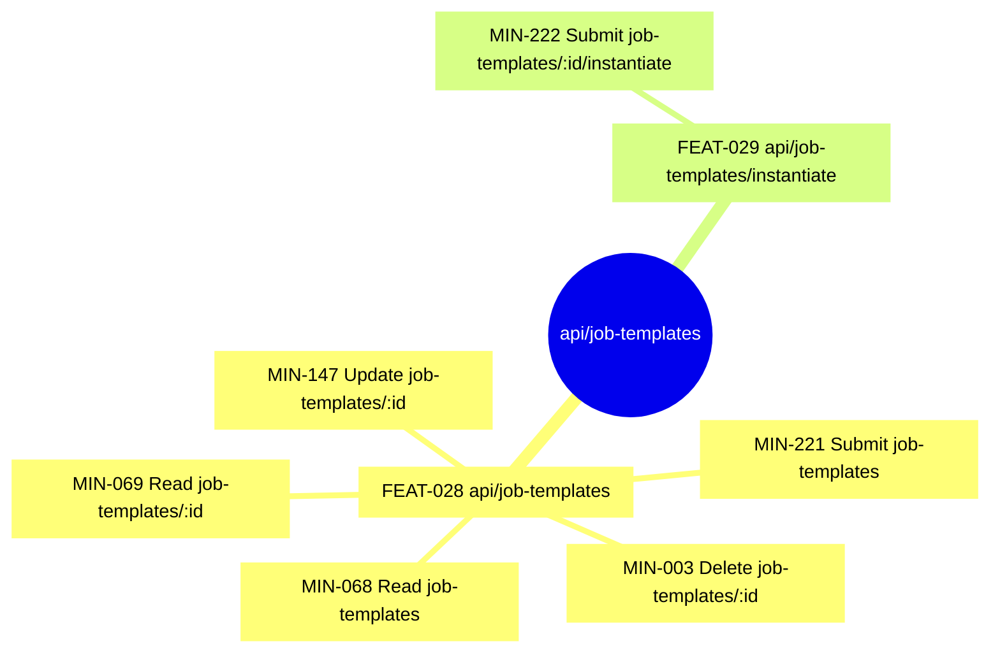
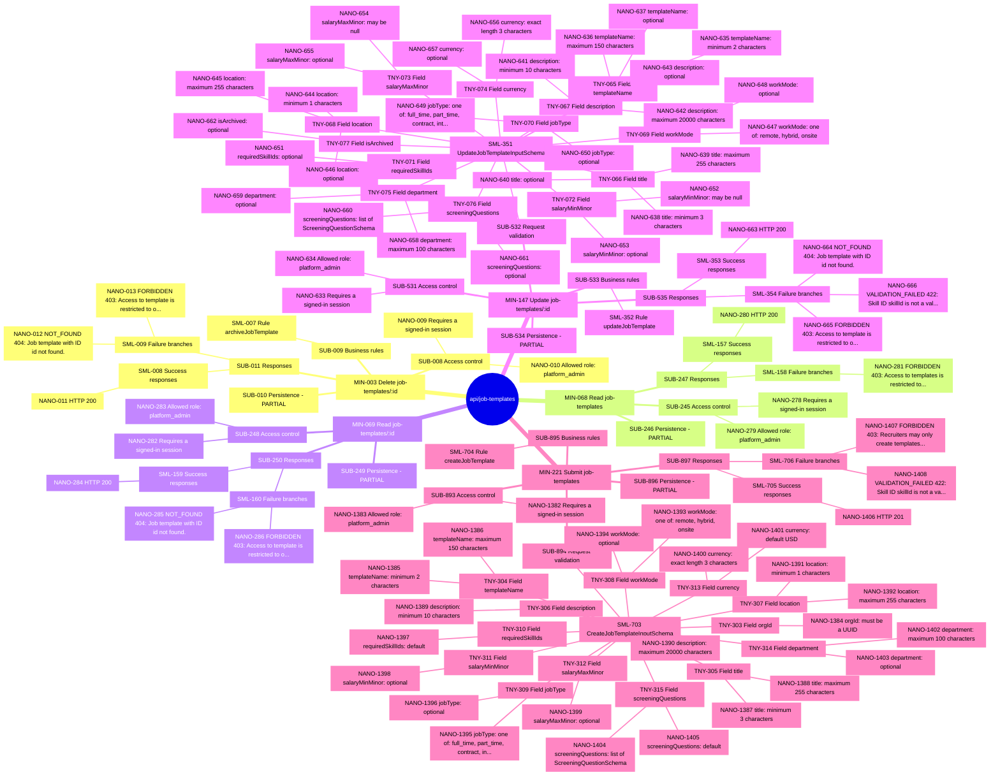
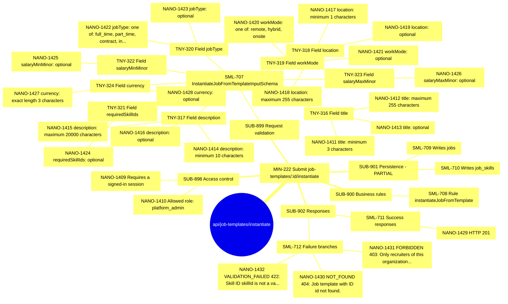

# api/job-templates (MOD-061)

Generated by `project-mindmap/tools/catalog.py` from `master/MASTER_PROJECT_GRAPH.json` at commit `9b3032f`. Do not edit by hand. Back to the [feature catalog](../FEATURE_CATALOG.md).

**Application:** apps/api (MOD-001). **Purpose:** API module: routes under /api/v1/job-templates in apps/api/src/server.ts.

**Nodes by level:** MODULE 1, MAJOR 2, MINOR 6, SUB 25, SMALL 21, TINY 35, NANO 99. **Status:** IMPLEMENTED 183, PARTIALLY_IMPLEMENTED 6. **Verification:** PATH_LEVEL 176, VERIFIED 10.

**User roles that reach it:** platform_admin.

**Known gaps:** MIN-003 ephemeral: state held in process memory, lost on restart; MIN-003 no first-party web caller found; MIN-068 ephemeral: state held in process memory, lost on restart; MIN-068 no first-party web caller found; MIN-069 ephemeral: state held in process memory, lost on restart; MIN-069 no first-party web caller found; MIN-147 ephemeral: state held in process memory, lost on restart; MIN-147 no first-party web caller found; MIN-221 ephemeral: state held in process memory, lost on restart; MIN-221 no first-party web caller found; MIN-222 ephemeral: state held in process memory, lost on restart; MIN-222 no first-party web caller found.

## Module map (to minor features)

## FEAT-028 api/job-templates

api/job-templates

| ID        | Level | Parent   | Name                                                                                  | Description                                                                                                                                                                                                                                                                                                                                      | Status                | Verification | Evidence                                 | Related                     |
| --------- | ----- | -------- | ------------------------------------------------------------------------------------- | ------------------------------------------------------------------------------------------------------------------------------------------------------------------------------------------------------------------------------------------------------------------------------------------------------------------------------------------------ | --------------------- | ------------ | ---------------------------------------- | --------------------------- |
| FEAT-028  | MAJOR | MOD-061  | api/job-templates                                                                     |                                                                                                                                                                                                                                                                                                                                                  | IMPLEMENTED           |              | apps/api/src/server.ts:2186              |                             |
| MIN-003   | MINOR | FEAT-028 | Delete job-templates/:id                                                              | DELETE /api/v1/job-templates/:id for roles platform_admin; calls archiveJobTemplate; ephemeral (process memory); responds 200; 2 failure branch(es). Gaps: ephemeral: state held in process memory, lost on restart; no first-party web caller found                                                                                             | IMPLEMENTED           | VERIFIED     | apps/api/src/server.ts:2404              | API-039, TEST-108, TEST-186 |
| SUB-008   | SUB   | MIN-003  | Access control                                                                        | Who may call DELETE /api/v1/job-templates/:id: roles platform_admin.                                                                                                                                                                                                                                                                             | IMPLEMENTED           | PATH_LEVEL   | apps/api/src/server.ts:2404              |                             |
| NANO-009  | NANO  | SUB-008  | Requires a signed-in session                                                          | Requests without a valid session token are rejected with 401 UNAUTHENTICATED.                                                                                                                                                                                                                                                                    | IMPLEMENTED           | PATH_LEVEL   | apps/api/src/server.ts:2404              | ROLE-001                    |
| NANO-010  | NANO  | SUB-008  | Allowed role: platform_admin                                                          | platform_admin is one of the roles allowed here (platform_admin); a caller holding none of them is rejected with 403.                                                                                                                                                                                                                            | IMPLEMENTED           | PATH_LEVEL   | apps/api/src/server.ts:2404              | ROLE-008                    |
| SUB-009   | SUB   | MIN-003  | Business rules                                                                        | Domain functions from packages/domain called by the handler (1).                                                                                                                                                                                                                                                                                 | IMPLEMENTED           | PATH_LEVEL   | apps/api/src/server.ts:2404              |                             |
| SML-007   | SMALL | SUB-009  | Rule archiveJobTemplate                                                               | Calls archiveJobTemplate (packages/domain/src/job-templates.ts). Rule status IMPLEMENTED; its own tests: VERIFIED.                                                                                                                                                                                                                               | IMPLEMENTED           | VERIFIED     | packages/domain/src/job-templates.ts:261 | RULE-125                    |
| SUB-010   | SUB   | MIN-003  | Persistence                                                                           | Ephemeral: state lives in API process memory and is lost on restart.                                                                                                                                                                                                                                                                             | PARTIALLY_IMPLEMENTED | PATH_LEVEL   | apps/api/src/server.ts:2404              |                             |
| SUB-011   | SUB   | MIN-003  | Responses                                                                             | Success 200; 2 explicit failure branch(es) besides validation and access errors.                                                                                                                                                                                                                                                                 | IMPLEMENTED           | PATH_LEVEL   | apps/api/src/server.ts:2404              |                             |
| SML-008   | SMALL | SUB-011  | Success responses                                                                     | HTTP 200.                                                                                                                                                                                                                                                                                                                                        | IMPLEMENTED           | PATH_LEVEL   | apps/api/src/server.ts:2404              |                             |
| NANO-011  | NANO  | SML-008  | HTTP 200                                                                              | Replies 200 when the operation succeeds.                                                                                                                                                                                                                                                                                                         | IMPLEMENTED           | PATH_LEVEL   | apps/api/src/server.ts:2404              |                             |
| SML-009   | SMALL | SUB-011  | Failure branches                                                                      | 2 DomainError branch(es) in the handler, mapped to HTTP by the global error handler.                                                                                                                                                                                                                                                             | IMPLEMENTED           | PATH_LEVEL   | apps/api/src/server.ts:2404              |                             |
| NANO-012  | NANO  | SML-009  | NOT_FOUND 404: Job template with ID ${id} not found.                                  | Throws DomainError(NOT_FOUND) "Job template with ID ${id} not found." -> HTTP 404.                                                                                                                                                                                                                                                               | IMPLEMENTED           | PATH_LEVEL   | apps/api/src/server.ts:2412              | ERR-041                     |
| NANO-013  | NANO  | SML-009  | FORBIDDEN 403: Access to template is restricted to organization members (BR-12).      | Throws DomainError(FORBIDDEN) "Access to template is restricted to organization members (BR-12)." -> HTTP 403.                                                                                                                                                                                                                                   | IMPLEMENTED           | PATH_LEVEL   | apps/api/src/server.ts:2420              | ERR-042                     |
| MIN-068   | MINOR | FEAT-028 | Read job-templates                                                                    | GET /api/v1/job-templates for roles platform_admin; ephemeral (process memory); responds 200; 1 failure branch(es). Gaps: ephemeral: state held in process memory, lost on restart; no first-party web caller found                                                                                                                              | IMPLEMENTED           | VERIFIED     | apps/api/src/server.ts:2253              | API-036, TEST-108           |
| SUB-245   | SUB   | MIN-068  | Access control                                                                        | Who may call GET /api/v1/job-templates: roles platform_admin.                                                                                                                                                                                                                                                                                    | IMPLEMENTED           | PATH_LEVEL   | apps/api/src/server.ts:2253              |                             |
| NANO-278  | NANO  | SUB-245  | Requires a signed-in session                                                          | Requests without a valid session token are rejected with 401 UNAUTHENTICATED.                                                                                                                                                                                                                                                                    | IMPLEMENTED           | PATH_LEVEL   | apps/api/src/server.ts:2253              | ROLE-001                    |
| NANO-279  | NANO  | SUB-245  | Allowed role: platform_admin                                                          | platform_admin is one of the roles allowed here (platform_admin); a caller holding none of them is rejected with 403.                                                                                                                                                                                                                            | IMPLEMENTED           | PATH_LEVEL   | apps/api/src/server.ts:2253              | ROLE-008                    |
| SUB-246   | SUB   | MIN-068  | Persistence                                                                           | Ephemeral: state lives in API process memory and is lost on restart.                                                                                                                                                                                                                                                                             | PARTIALLY_IMPLEMENTED | PATH_LEVEL   | apps/api/src/server.ts:2253              |                             |
| SUB-247   | SUB   | MIN-068  | Responses                                                                             | Success 200; 1 explicit failure branch(es) besides validation and access errors.                                                                                                                                                                                                                                                                 | IMPLEMENTED           | PATH_LEVEL   | apps/api/src/server.ts:2253              |                             |
| SML-157   | SMALL | SUB-247  | Success responses                                                                     | HTTP 200.                                                                                                                                                                                                                                                                                                                                        | IMPLEMENTED           | PATH_LEVEL   | apps/api/src/server.ts:2253              |                             |
| NANO-280  | NANO  | SML-157  | HTTP 200                                                                              | Replies 200 when the operation succeeds.                                                                                                                                                                                                                                                                                                         | IMPLEMENTED           | PATH_LEVEL   | apps/api/src/server.ts:2253              |                             |
| SML-158   | SMALL | SUB-247  | Failure branches                                                                      | 1 DomainError branch(es) in the handler, mapped to HTTP by the global error handler.                                                                                                                                                                                                                                                             | IMPLEMENTED           | PATH_LEVEL   | apps/api/src/server.ts:2253              |                             |
| NANO-281  | NANO  | SML-158  | FORBIDDEN 403: Access to templates is restricted to organization members (BR-12).     | Throws DomainError(FORBIDDEN) "Access to templates is restricted to organization members (BR-12)." -> HTTP 403.                                                                                                                                                                                                                                  | IMPLEMENTED           | PATH_LEVEL   | apps/api/src/server.ts:2269              | ERR-040                     |
| MIN-069   | MINOR | FEAT-028 | Read job-templates/:id                                                                | GET /api/v1/job-templates/:id for roles platform_admin; ephemeral (process memory); responds 200; 2 failure branch(es). Gaps: ephemeral: state held in process memory, lost on restart; no first-party web caller found                                                                                                                          | IMPLEMENTED           | VERIFIED     | apps/api/src/server.ts:2294              | API-037, TEST-108, TEST-186 |
| SUB-248   | SUB   | MIN-069  | Access control                                                                        | Who may call GET /api/v1/job-templates/:id: roles platform_admin.                                                                                                                                                                                                                                                                                | IMPLEMENTED           | PATH_LEVEL   | apps/api/src/server.ts:2294              |                             |
| NANO-282  | NANO  | SUB-248  | Requires a signed-in session                                                          | Requests without a valid session token are rejected with 401 UNAUTHENTICATED.                                                                                                                                                                                                                                                                    | IMPLEMENTED           | PATH_LEVEL   | apps/api/src/server.ts:2294              | ROLE-001                    |
| NANO-283  | NANO  | SUB-248  | Allowed role: platform_admin                                                          | platform_admin is one of the roles allowed here (platform_admin); a caller holding none of them is rejected with 403.                                                                                                                                                                                                                            | IMPLEMENTED           | PATH_LEVEL   | apps/api/src/server.ts:2294              | ROLE-008                    |
| SUB-249   | SUB   | MIN-069  | Persistence                                                                           | Ephemeral: state lives in API process memory and is lost on restart.                                                                                                                                                                                                                                                                             | PARTIALLY_IMPLEMENTED | PATH_LEVEL   | apps/api/src/server.ts:2294              |                             |
| SUB-250   | SUB   | MIN-069  | Responses                                                                             | Success 200; 2 explicit failure branch(es) besides validation and access errors.                                                                                                                                                                                                                                                                 | IMPLEMENTED           | PATH_LEVEL   | apps/api/src/server.ts:2294              |                             |
| SML-159   | SMALL | SUB-250  | Success responses                                                                     | HTTP 200.                                                                                                                                                                                                                                                                                                                                        | IMPLEMENTED           | PATH_LEVEL   | apps/api/src/server.ts:2294              |                             |
| NANO-284  | NANO  | SML-159  | HTTP 200                                                                              | Replies 200 when the operation succeeds.                                                                                                                                                                                                                                                                                                         | IMPLEMENTED           | PATH_LEVEL   | apps/api/src/server.ts:2294              |                             |
| SML-160   | SMALL | SUB-250  | Failure branches                                                                      | 2 DomainError branch(es) in the handler, mapped to HTTP by the global error handler.                                                                                                                                                                                                                                                             | IMPLEMENTED           | PATH_LEVEL   | apps/api/src/server.ts:2294              |                             |
| NANO-285  | NANO  | SML-160  | NOT_FOUND 404: Job template with ID ${id} not found.                                  | Throws DomainError(NOT_FOUND) "Job template with ID ${id} not found." -> HTTP 404.                                                                                                                                                                                                                                                               | IMPLEMENTED           | PATH_LEVEL   | apps/api/src/server.ts:2302              | ERR-041                     |
| NANO-286  | NANO  | SML-160  | FORBIDDEN 403: Access to template is restricted to organization members (BR-12).      | Throws DomainError(FORBIDDEN) "Access to template is restricted to organization members (BR-12)." -> HTTP 403.                                                                                                                                                                                                                                   | IMPLEMENTED           | PATH_LEVEL   | apps/api/src/server.ts:2310              | ERR-042                     |
| MIN-147   | MINOR | FEAT-028 | Update job-templates/:id                                                              | PATCH /api/v1/job-templates/:id for roles platform_admin; validates UpdateJobTemplateInputSchema; calls updateJobTemplate; ephemeral (process memory); responds 200; 3 failure branch(es). Gaps: ephemeral: state held in process memory, lost on restart; no first-party web caller found                                                       | IMPLEMENTED           | VERIFIED     | apps/api/src/server.ts:2320              | API-038, TEST-108, TEST-186 |
| SUB-531   | SUB   | MIN-147  | Access control                                                                        | Who may call PATCH /api/v1/job-templates/:id: roles platform_admin.                                                                                                                                                                                                                                                                              | IMPLEMENTED           | PATH_LEVEL   | apps/api/src/server.ts:2320              |                             |
| NANO-633  | NANO  | SUB-531  | Requires a signed-in session                                                          | Requests without a valid session token are rejected with 401 UNAUTHENTICATED.                                                                                                                                                                                                                                                                    | IMPLEMENTED           | PATH_LEVEL   | apps/api/src/server.ts:2320              | ROLE-001                    |
| NANO-634  | NANO  | SUB-531  | Allowed role: platform_admin                                                          | platform_admin is one of the roles allowed here (platform_admin); a caller holding none of them is rejected with 403.                                                                                                                                                                                                                            | IMPLEMENTED           | PATH_LEVEL   | apps/api/src/server.ts:2320              | ROLE-008                    |
| SUB-532   | SUB   | MIN-147  | Request validation                                                                    | The request is parsed with UpdateJobTemplateInputSchema; a failure returns 400 with field details before any business logic runs.                                                                                                                                                                                                                | IMPLEMENTED           | PATH_LEVEL   | apps/api/src/server.ts:2320              |                             |
| SML-351   | SMALL | SUB-532  | UpdateJobTemplateInputSchema                                                          | UpdateJobTemplateInputSchema: 13 field(s)                                                                                                                                                                                                                                                                                                        | IMPLEMENTED           | PATH_LEVEL   | packages/contracts/src/index.ts:986      | SCH-079                     |
| TNY-065   | TINY  | SML-351  | Field templateName                                                                    | templateName (string, optional): minimum 2 characters; maximum 150 characters; optional                                                                                                                                                                                                                                                          | IMPLEMENTED           | PATH_LEVEL   | packages/contracts/src/index.ts:987      |                             |
| NANO-635  | NANO  | TNY-065  | templateName: minimum 2 characters                                                    | templateName minimum 2 characters.                                                                                                                                                                                                                                                                                                               | IMPLEMENTED           | PATH_LEVEL   | packages/contracts/src/index.ts:987      |                             |
| NANO-636  | NANO  | TNY-065  | templateName: maximum 150 characters                                                  | templateName maximum 150 characters.                                                                                                                                                                                                                                                                                                             | IMPLEMENTED           | PATH_LEVEL   | packages/contracts/src/index.ts:987      |                             |
| NANO-637  | NANO  | TNY-065  | templateName: optional                                                                | templateName optional.                                                                                                                                                                                                                                                                                                                           | IMPLEMENTED           | PATH_LEVEL   | packages/contracts/src/index.ts:987      |                             |
| TNY-066   | TINY  | SML-351  | Field title                                                                           | title (string, optional): minimum 3 characters; maximum 255 characters; optional                                                                                                                                                                                                                                                                 | IMPLEMENTED           | PATH_LEVEL   | packages/contracts/src/index.ts:988      |                             |
| NANO-638  | NANO  | TNY-066  | title: minimum 3 characters                                                           | title minimum 3 characters.                                                                                                                                                                                                                                                                                                                      | IMPLEMENTED           | PATH_LEVEL   | packages/contracts/src/index.ts:988      |                             |
| NANO-639  | NANO  | TNY-066  | title: maximum 255 characters                                                         | title maximum 255 characters.                                                                                                                                                                                                                                                                                                                    | IMPLEMENTED           | PATH_LEVEL   | packages/contracts/src/index.ts:988      |                             |
| NANO-640  | NANO  | TNY-066  | title: optional                                                                       | title optional.                                                                                                                                                                                                                                                                                                                                  | IMPLEMENTED           | PATH_LEVEL   | packages/contracts/src/index.ts:988      |                             |
| TNY-067   | TINY  | SML-351  | Field description                                                                     | description (string, optional): minimum 10 characters; maximum 20000 characters; optional                                                                                                                                                                                                                                                        | IMPLEMENTED           | PATH_LEVEL   | packages/contracts/src/index.ts:989      |                             |
| NANO-641  | NANO  | TNY-067  | description: minimum 10 characters                                                    | description minimum 10 characters.                                                                                                                                                                                                                                                                                                               | IMPLEMENTED           | PATH_LEVEL   | packages/contracts/src/index.ts:989      |                             |
| NANO-642  | NANO  | TNY-067  | description: maximum 20000 characters                                                 | description maximum 20000 characters.                                                                                                                                                                                                                                                                                                            | IMPLEMENTED           | PATH_LEVEL   | packages/contracts/src/index.ts:989      |                             |
| NANO-643  | NANO  | TNY-067  | description: optional                                                                 | description optional.                                                                                                                                                                                                                                                                                                                            | IMPLEMENTED           | PATH_LEVEL   | packages/contracts/src/index.ts:989      |                             |
| TNY-068   | TINY  | SML-351  | Field location                                                                        | location (string, optional): minimum 1 characters; maximum 255 characters; optional                                                                                                                                                                                                                                                              | IMPLEMENTED           | PATH_LEVEL   | packages/contracts/src/index.ts:990      |                             |
| NANO-644  | NANO  | TNY-068  | location: minimum 1 characters                                                        | location minimum 1 characters.                                                                                                                                                                                                                                                                                                                   | IMPLEMENTED           | PATH_LEVEL   | packages/contracts/src/index.ts:990      |                             |
| NANO-645  | NANO  | TNY-068  | location: maximum 255 characters                                                      | location maximum 255 characters.                                                                                                                                                                                                                                                                                                                 | IMPLEMENTED           | PATH_LEVEL   | packages/contracts/src/index.ts:990      |                             |
| NANO-646  | NANO  | TNY-068  | location: optional                                                                    | location optional.                                                                                                                                                                                                                                                                                                                               | IMPLEMENTED           | PATH_LEVEL   | packages/contracts/src/index.ts:990      |                             |
| TNY-069   | TINY  | SML-351  | Field workMode                                                                        | workMode (enum, optional): one of: remote, hybrid, onsite; optional                                                                                                                                                                                                                                                                              | IMPLEMENTED           | PATH_LEVEL   | packages/contracts/src/index.ts:991      |                             |
| NANO-647  | NANO  | TNY-069  | workMode: one of: remote, hybrid, onsite                                              | workMode one of: remote, hybrid, onsite.                                                                                                                                                                                                                                                                                                         | IMPLEMENTED           | PATH_LEVEL   | packages/contracts/src/index.ts:991      |                             |
| NANO-648  | NANO  | TNY-069  | workMode: optional                                                                    | workMode optional.                                                                                                                                                                                                                                                                                                                               | IMPLEMENTED           | PATH_LEVEL   | packages/contracts/src/index.ts:991      |                             |
| TNY-070   | TINY  | SML-351  | Field jobType                                                                         | jobType (enum, optional): one of: full_time, part_time, contract, internship; optional                                                                                                                                                                                                                                                           | IMPLEMENTED           | PATH_LEVEL   | packages/contracts/src/index.ts:992      |                             |
| NANO-649  | NANO  | TNY-070  | jobType: one of: full_time, part_time, contract, internship                           | jobType one of: full_time, part_time, contract, internship.                                                                                                                                                                                                                                                                                      | IMPLEMENTED           | PATH_LEVEL   | packages/contracts/src/index.ts:992      |                             |
| NANO-650  | NANO  | TNY-070  | jobType: optional                                                                     | jobType optional.                                                                                                                                                                                                                                                                                                                                | IMPLEMENTED           | PATH_LEVEL   | packages/contracts/src/index.ts:992      |                             |
| TNY-071   | TINY  | SML-351  | Field requiredSkillIds                                                                | requiredSkillIds (uniqueIdList(), optional): optional                                                                                                                                                                                                                                                                                            | IMPLEMENTED           | PATH_LEVEL   | packages/contracts/src/index.ts:993      |                             |
| NANO-651  | NANO  | TNY-071  | requiredSkillIds: optional                                                            | requiredSkillIds optional.                                                                                                                                                                                                                                                                                                                       | IMPLEMENTED           | PATH_LEVEL   | packages/contracts/src/index.ts:993      |                             |
| TNY-072   | TINY  | SML-351  | Field salaryMinMinor                                                                  | salaryMinMinor (salaryMinor(), optional): may be null; optional                                                                                                                                                                                                                                                                                  | IMPLEMENTED           | PATH_LEVEL   | packages/contracts/src/index.ts:994      |                             |
| NANO-652  | NANO  | TNY-072  | salaryMinMinor: may be null                                                           | salaryMinMinor may be null.                                                                                                                                                                                                                                                                                                                      | IMPLEMENTED           | PATH_LEVEL   | packages/contracts/src/index.ts:994      |                             |
| NANO-653  | NANO  | TNY-072  | salaryMinMinor: optional                                                              | salaryMinMinor optional.                                                                                                                                                                                                                                                                                                                         | IMPLEMENTED           | PATH_LEVEL   | packages/contracts/src/index.ts:994      |                             |
| TNY-073   | TINY  | SML-351  | Field salaryMaxMinor                                                                  | salaryMaxMinor (salaryMinor(), optional): may be null; optional                                                                                                                                                                                                                                                                                  | IMPLEMENTED           | PATH_LEVEL   | packages/contracts/src/index.ts:995      |                             |
| NANO-654  | NANO  | TNY-073  | salaryMaxMinor: may be null                                                           | salaryMaxMinor may be null.                                                                                                                                                                                                                                                                                                                      | IMPLEMENTED           | PATH_LEVEL   | packages/contracts/src/index.ts:995      |                             |
| NANO-655  | NANO  | TNY-073  | salaryMaxMinor: optional                                                              | salaryMaxMinor optional.                                                                                                                                                                                                                                                                                                                         | IMPLEMENTED           | PATH_LEVEL   | packages/contracts/src/index.ts:995      |                             |
| TNY-074   | TINY  | SML-351  | Field currency                                                                        | currency (string, optional): exact length 3 characters; optional                                                                                                                                                                                                                                                                                 | IMPLEMENTED           | PATH_LEVEL   | packages/contracts/src/index.ts:996      |                             |
| NANO-656  | NANO  | TNY-074  | currency: exact length 3 characters                                                   | currency exact length 3 characters.                                                                                                                                                                                                                                                                                                              | IMPLEMENTED           | PATH_LEVEL   | packages/contracts/src/index.ts:996      |                             |
| NANO-657  | NANO  | TNY-074  | currency: optional                                                                    | currency optional.                                                                                                                                                                                                                                                                                                                               | IMPLEMENTED           | PATH_LEVEL   | packages/contracts/src/index.ts:996      |                             |
| TNY-075   | TINY  | SML-351  | Field department                                                                      | department (string, optional): maximum 100 characters; optional                                                                                                                                                                                                                                                                                  | IMPLEMENTED           | PATH_LEVEL   | packages/contracts/src/index.ts:997      |                             |
| NANO-658  | NANO  | TNY-075  | department: maximum 100 characters                                                    | department maximum 100 characters.                                                                                                                                                                                                                                                                                                               | IMPLEMENTED           | PATH_LEVEL   | packages/contracts/src/index.ts:997      |                             |
| NANO-659  | NANO  | TNY-075  | department: optional                                                                  | department optional.                                                                                                                                                                                                                                                                                                                             | IMPLEMENTED           | PATH_LEVEL   | packages/contracts/src/index.ts:997      |                             |
| TNY-076   | TINY  | SML-351  | Field screeningQuestions                                                              | screeningQuestions (array, optional): list of ScreeningQuestionSchema; optional                                                                                                                                                                                                                                                                  | IMPLEMENTED           | PATH_LEVEL   | packages/contracts/src/index.ts:998      |                             |
| NANO-660  | NANO  | TNY-076  | screeningQuestions: list of ScreeningQuestionSchema                                   | screeningQuestions list of ScreeningQuestionSchema.                                                                                                                                                                                                                                                                                              | IMPLEMENTED           | PATH_LEVEL   | packages/contracts/src/index.ts:998      |                             |
| NANO-661  | NANO  | TNY-076  | screeningQuestions: optional                                                          | screeningQuestions optional.                                                                                                                                                                                                                                                                                                                     | IMPLEMENTED           | PATH_LEVEL   | packages/contracts/src/index.ts:998      |                             |
| TNY-077   | TINY  | SML-351  | Field isArchived                                                                      | isArchived (boolean, optional): optional                                                                                                                                                                                                                                                                                                         | IMPLEMENTED           | PATH_LEVEL   | packages/contracts/src/index.ts:999      |                             |
| NANO-662  | NANO  | TNY-077  | isArchived: optional                                                                  | isArchived optional.                                                                                                                                                                                                                                                                                                                             | IMPLEMENTED           | PATH_LEVEL   | packages/contracts/src/index.ts:999      |                             |
| SUB-533   | SUB   | MIN-147  | Business rules                                                                        | Domain functions from packages/domain called by the handler (1).                                                                                                                                                                                                                                                                                 | IMPLEMENTED           | PATH_LEVEL   | apps/api/src/server.ts:2320              |                             |
| SML-352   | SMALL | SUB-533  | Rule updateJobTemplate                                                                | Calls updateJobTemplate (packages/domain/src/job-templates.ts). Rule status IMPLEMENTED; its own tests: VERIFIED.                                                                                                                                                                                                                                | IMPLEMENTED           | VERIFIED     | packages/domain/src/job-templates.ts:172 | RULE-124                    |
| SUB-534   | SUB   | MIN-147  | Persistence                                                                           | Ephemeral: state lives in API process memory and is lost on restart.                                                                                                                                                                                                                                                                             | PARTIALLY_IMPLEMENTED | PATH_LEVEL   | apps/api/src/server.ts:2320              |                             |
| SUB-535   | SUB   | MIN-147  | Responses                                                                             | Success 200; 3 explicit failure branch(es) besides validation and access errors.                                                                                                                                                                                                                                                                 | IMPLEMENTED           | PATH_LEVEL   | apps/api/src/server.ts:2320              |                             |
| SML-353   | SMALL | SUB-535  | Success responses                                                                     | HTTP 200.                                                                                                                                                                                                                                                                                                                                        | IMPLEMENTED           | PATH_LEVEL   | apps/api/src/server.ts:2320              |                             |
| NANO-663  | NANO  | SML-353  | HTTP 200                                                                              | Replies 200 when the operation succeeds.                                                                                                                                                                                                                                                                                                         | IMPLEMENTED           | PATH_LEVEL   | apps/api/src/server.ts:2320              |                             |
| SML-354   | SMALL | SUB-535  | Failure branches                                                                      | 3 DomainError branch(es) in the handler, mapped to HTTP by the global error handler.                                                                                                                                                                                                                                                             | IMPLEMENTED           | PATH_LEVEL   | apps/api/src/server.ts:2320              |                             |
| NANO-664  | NANO  | SML-354  | NOT_FOUND 404: Job template with ID ${id} not found.                                  | Throws DomainError(NOT_FOUND) "Job template with ID ${id} not found." -> HTTP 404.                                                                                                                                                                                                                                                               | IMPLEMENTED           | PATH_LEVEL   | apps/api/src/server.ts:2329              | ERR-041                     |
| NANO-665  | NANO  | SML-354  | FORBIDDEN 403: Access to template is restricted to organization members (BR-12).      | Throws DomainError(FORBIDDEN) "Access to template is restricted to organization members (BR-12)." -> HTTP 403.                                                                                                                                                                                                                                   | IMPLEMENTED           | PATH_LEVEL   | apps/api/src/server.ts:2337              | ERR-042                     |
| NANO-666  | NANO  | SML-354  | VALIDATION_FAILED 422: Skill ID ${skillId} is not a valid canonical skill (BR-144).   | Throws DomainError(VALIDATION_FAILED) "Skill ID ${skillId} is not a valid canonical skill (BR-144)." -> HTTP 422.                                                                                                                                                                                                                                | IMPLEMENTED           | PATH_LEVEL   | apps/api/src/server.ts:2346              | ERR-039                     |
| MIN-221   | MINOR | FEAT-028 | Submit job-templates                                                                  | Job Templates Endpoints (F-37, F-05, BR-01, BR-12, BR-144) POST /api/v1/job-templates for roles platform_admin; validates CreateJobTemplateInputSchema; calls createJobTemplate; ephemeral (process memory); responds 201; 2 failure branch(es). Gaps: ephemeral: state held in process memory, lost on restart; no first-party web caller found | IMPLEMENTED           | VERIFIED     | apps/api/src/server.ts:2186              | API-035, TEST-108, TEST-186 |
| SUB-893   | SUB   | MIN-221  | Access control                                                                        | Who may call POST /api/v1/job-templates: roles platform_admin.                                                                                                                                                                                                                                                                                   | IMPLEMENTED           | PATH_LEVEL   | apps/api/src/server.ts:2186              |                             |
| NANO-1382 | NANO  | SUB-893  | Requires a signed-in session                                                          | Requests without a valid session token are rejected with 401 UNAUTHENTICATED.                                                                                                                                                                                                                                                                    | IMPLEMENTED           | PATH_LEVEL   | apps/api/src/server.ts:2186              | ROLE-001                    |
| NANO-1383 | NANO  | SUB-893  | Allowed role: platform_admin                                                          | platform_admin is one of the roles allowed here (platform_admin); a caller holding none of them is rejected with 403.                                                                                                                                                                                                                            | IMPLEMENTED           | PATH_LEVEL   | apps/api/src/server.ts:2186              | ROLE-008                    |
| SUB-894   | SUB   | MIN-221  | Request validation                                                                    | The request is parsed with CreateJobTemplateInputSchema; a failure returns 400 with field details before any business logic runs.                                                                                                                                                                                                                | IMPLEMENTED           | PATH_LEVEL   | apps/api/src/server.ts:2186              |                             |
| SML-703   | SMALL | SUB-894  | CreateJobTemplateInputSchema                                                          | CreateJobTemplateInputSchema: 13 field(s)                                                                                                                                                                                                                                                                                                        | IMPLEMENTED           | PATH_LEVEL   | packages/contracts/src/index.ts:968      | SCH-078                     |
| TNY-303   | TINY  | SML-703  | Field orgId                                                                           | orgId (string, required): must be a UUID                                                                                                                                                                                                                                                                                                         | IMPLEMENTED           | PATH_LEVEL   | packages/contracts/src/index.ts:969      |                             |
| NANO-1384 | NANO  | TNY-303  | orgId: must be a UUID                                                                 | orgId must be a UUID.                                                                                                                                                                                                                                                                                                                            | IMPLEMENTED           | PATH_LEVEL   | packages/contracts/src/index.ts:969      |                             |
| TNY-304   | TINY  | SML-703  | Field templateName                                                                    | templateName (string, required): minimum 2 characters; maximum 150 characters                                                                                                                                                                                                                                                                    | IMPLEMENTED           | PATH_LEVEL   | packages/contracts/src/index.ts:970      |                             |
| NANO-1385 | NANO  | TNY-304  | templateName: minimum 2 characters                                                    | templateName minimum 2 characters.                                                                                                                                                                                                                                                                                                               | IMPLEMENTED           | PATH_LEVEL   | packages/contracts/src/index.ts:970      |                             |
| NANO-1386 | NANO  | TNY-304  | templateName: maximum 150 characters                                                  | templateName maximum 150 characters.                                                                                                                                                                                                                                                                                                             | IMPLEMENTED           | PATH_LEVEL   | packages/contracts/src/index.ts:970      |                             |
| TNY-305   | TINY  | SML-703  | Field title                                                                           | title (string, required): minimum 3 characters; maximum 255 characters                                                                                                                                                                                                                                                                           | IMPLEMENTED           | PATH_LEVEL   | packages/contracts/src/index.ts:971      |                             |
| NANO-1387 | NANO  | TNY-305  | title: minimum 3 characters                                                           | title minimum 3 characters.                                                                                                                                                                                                                                                                                                                      | IMPLEMENTED           | PATH_LEVEL   | packages/contracts/src/index.ts:971      |                             |
| NANO-1388 | NANO  | TNY-305  | title: maximum 255 characters                                                         | title maximum 255 characters.                                                                                                                                                                                                                                                                                                                    | IMPLEMENTED           | PATH_LEVEL   | packages/contracts/src/index.ts:971      |                             |
| TNY-306   | TINY  | SML-703  | Field description                                                                     | description (string, required): minimum 10 characters; maximum 20000 characters                                                                                                                                                                                                                                                                  | IMPLEMENTED           | PATH_LEVEL   | packages/contracts/src/index.ts:972      |                             |
| NANO-1389 | NANO  | TNY-306  | description: minimum 10 characters                                                    | description minimum 10 characters.                                                                                                                                                                                                                                                                                                               | IMPLEMENTED           | PATH_LEVEL   | packages/contracts/src/index.ts:972      |                             |
| NANO-1390 | NANO  | TNY-306  | description: maximum 20000 characters                                                 | description maximum 20000 characters.                                                                                                                                                                                                                                                                                                            | IMPLEMENTED           | PATH_LEVEL   | packages/contracts/src/index.ts:972      |                             |
| TNY-307   | TINY  | SML-703  | Field location                                                                        | location (string, required): minimum 1 characters; maximum 255 characters                                                                                                                                                                                                                                                                        | IMPLEMENTED           | PATH_LEVEL   | packages/contracts/src/index.ts:973      |                             |
| NANO-1391 | NANO  | TNY-307  | location: minimum 1 characters                                                        | location minimum 1 characters.                                                                                                                                                                                                                                                                                                                   | IMPLEMENTED           | PATH_LEVEL   | packages/contracts/src/index.ts:973      |                             |
| NANO-1392 | NANO  | TNY-307  | location: maximum 255 characters                                                      | location maximum 255 characters.                                                                                                                                                                                                                                                                                                                 | IMPLEMENTED           | PATH_LEVEL   | packages/contracts/src/index.ts:973      |                             |
| TNY-308   | TINY  | SML-703  | Field workMode                                                                        | workMode (enum, optional): one of: remote, hybrid, onsite; optional                                                                                                                                                                                                                                                                              | IMPLEMENTED           | PATH_LEVEL   | packages/contracts/src/index.ts:974      |                             |
| NANO-1393 | NANO  | TNY-308  | workMode: one of: remote, hybrid, onsite                                              | workMode one of: remote, hybrid, onsite.                                                                                                                                                                                                                                                                                                         | IMPLEMENTED           | PATH_LEVEL   | packages/contracts/src/index.ts:974      |                             |
| NANO-1394 | NANO  | TNY-308  | workMode: optional                                                                    | workMode optional.                                                                                                                                                                                                                                                                                                                               | IMPLEMENTED           | PATH_LEVEL   | packages/contracts/src/index.ts:974      |                             |
| TNY-309   | TINY  | SML-703  | Field jobType                                                                         | jobType (enum, optional): one of: full_time, part_time, contract, internship; optional                                                                                                                                                                                                                                                           | IMPLEMENTED           | PATH_LEVEL   | packages/contracts/src/index.ts:975      |                             |
| NANO-1395 | NANO  | TNY-309  | jobType: one of: full_time, part_time, contract, internship                           | jobType one of: full_time, part_time, contract, internship.                                                                                                                                                                                                                                                                                      | IMPLEMENTED           | PATH_LEVEL   | packages/contracts/src/index.ts:975      |                             |
| NANO-1396 | NANO  | TNY-309  | jobType: optional                                                                     | jobType optional.                                                                                                                                                                                                                                                                                                                                | IMPLEMENTED           | PATH_LEVEL   | packages/contracts/src/index.ts:975      |                             |
| TNY-310   | TINY  | SML-703  | Field requiredSkillIds                                                                | requiredSkillIds (uniqueIdList(), optional): default []                                                                                                                                                                                                                                                                                          | IMPLEMENTED           | PATH_LEVEL   | packages/contracts/src/index.ts:976      |                             |
| NANO-1397 | NANO  | TNY-310  | requiredSkillIds: default []                                                          | requiredSkillIds default [].                                                                                                                                                                                                                                                                                                                     | IMPLEMENTED           | PATH_LEVEL   | packages/contracts/src/index.ts:976      |                             |
| TNY-311   | TINY  | SML-703  | Field salaryMinMinor                                                                  | salaryMinMinor (salaryMinor(), optional): optional                                                                                                                                                                                                                                                                                               | IMPLEMENTED           | PATH_LEVEL   | packages/contracts/src/index.ts:977      |                             |
| NANO-1398 | NANO  | TNY-311  | salaryMinMinor: optional                                                              | salaryMinMinor optional.                                                                                                                                                                                                                                                                                                                         | IMPLEMENTED           | PATH_LEVEL   | packages/contracts/src/index.ts:977      |                             |
| TNY-312   | TINY  | SML-703  | Field salaryMaxMinor                                                                  | salaryMaxMinor (salaryMinor(), optional): optional                                                                                                                                                                                                                                                                                               | IMPLEMENTED           | PATH_LEVEL   | packages/contracts/src/index.ts:978      |                             |
| NANO-1399 | NANO  | TNY-312  | salaryMaxMinor: optional                                                              | salaryMaxMinor optional.                                                                                                                                                                                                                                                                                                                         | IMPLEMENTED           | PATH_LEVEL   | packages/contracts/src/index.ts:978      |                             |
| TNY-313   | TINY  | SML-703  | Field currency                                                                        | currency (string, optional): exact length 3 characters; default 'USD'                                                                                                                                                                                                                                                                            | IMPLEMENTED           | PATH_LEVEL   | packages/contracts/src/index.ts:979      |                             |
| NANO-1400 | NANO  | TNY-313  | currency: exact length 3 characters                                                   | currency exact length 3 characters.                                                                                                                                                                                                                                                                                                              | IMPLEMENTED           | PATH_LEVEL   | packages/contracts/src/index.ts:979      |                             |
| NANO-1401 | NANO  | TNY-313  | currency: default 'USD'                                                               | currency default 'USD'; message "USD".                                                                                                                                                                                                                                                                                                           | IMPLEMENTED           | PATH_LEVEL   | packages/contracts/src/index.ts:979      |                             |
| TNY-314   | TINY  | SML-703  | Field department                                                                      | department (string, optional): maximum 100 characters; optional                                                                                                                                                                                                                                                                                  | IMPLEMENTED           | PATH_LEVEL   | packages/contracts/src/index.ts:980      |                             |
| NANO-1402 | NANO  | TNY-314  | department: maximum 100 characters                                                    | department maximum 100 characters.                                                                                                                                                                                                                                                                                                               | IMPLEMENTED           | PATH_LEVEL   | packages/contracts/src/index.ts:980      |                             |
| NANO-1403 | NANO  | TNY-314  | department: optional                                                                  | department optional.                                                                                                                                                                                                                                                                                                                             | IMPLEMENTED           | PATH_LEVEL   | packages/contracts/src/index.ts:980      |                             |
| TNY-315   | TINY  | SML-703  | Field screeningQuestions                                                              | screeningQuestions (array, optional): list of ScreeningQuestionSchema; default []                                                                                                                                                                                                                                                                | IMPLEMENTED           | PATH_LEVEL   | packages/contracts/src/index.ts:981      |                             |
| NANO-1404 | NANO  | TNY-315  | screeningQuestions: list of ScreeningQuestionSchema                                   | screeningQuestions list of ScreeningQuestionSchema.                                                                                                                                                                                                                                                                                              | IMPLEMENTED           | PATH_LEVEL   | packages/contracts/src/index.ts:981      |                             |
| NANO-1405 | NANO  | TNY-315  | screeningQuestions: default []                                                        | screeningQuestions default [].                                                                                                                                                                                                                                                                                                                   | IMPLEMENTED           | PATH_LEVEL   | packages/contracts/src/index.ts:981      |                             |
| SUB-895   | SUB   | MIN-221  | Business rules                                                                        | Domain functions from packages/domain called by the handler (1).                                                                                                                                                                                                                                                                                 | IMPLEMENTED           | PATH_LEVEL   | apps/api/src/server.ts:2186              |                             |
| SML-704   | SMALL | SUB-895  | Rule createJobTemplate                                                                | Calls createJobTemplate (packages/domain/src/job-templates.ts). Rule status IMPLEMENTED; its own tests: VERIFIED.                                                                                                                                                                                                                                | IMPLEMENTED           | VERIFIED     | packages/domain/src/job-templates.ts:96  | RULE-123                    |
| SUB-896   | SUB   | MIN-221  | Persistence                                                                           | Ephemeral: state lives in API process memory and is lost on restart.                                                                                                                                                                                                                                                                             | PARTIALLY_IMPLEMENTED | PATH_LEVEL   | apps/api/src/server.ts:2186              |                             |
| SUB-897   | SUB   | MIN-221  | Responses                                                                             | Success 201; 2 explicit failure branch(es) besides validation and access errors.                                                                                                                                                                                                                                                                 | IMPLEMENTED           | PATH_LEVEL   | apps/api/src/server.ts:2186              |                             |
| SML-705   | SMALL | SUB-897  | Success responses                                                                     | HTTP 201.                                                                                                                                                                                                                                                                                                                                        | IMPLEMENTED           | PATH_LEVEL   | apps/api/src/server.ts:2186              |                             |
| NANO-1406 | NANO  | SML-705  | HTTP 201                                                                              | Replies 201 when the operation succeeds.                                                                                                                                                                                                                                                                                                         | IMPLEMENTED           | PATH_LEVEL   | apps/api/src/server.ts:2186              |                             |
| SML-706   | SMALL | SUB-897  | Failure branches                                                                      | 2 DomainError branch(es) in the handler, mapped to HTTP by the global error handler.                                                                                                                                                                                                                                                             | IMPLEMENTED           | PATH_LEVEL   | apps/api/src/server.ts:2186              |                             |
| NANO-1407 | NANO  | SML-706  | FORBIDDEN 403: Recruiters may only create templates for their assigned organization ( | Throws DomainError(FORBIDDEN) "Recruiters may only create templates for their assigned organization (BR-12)." -> HTTP 403.                                                                                                                                                                                                                       | IMPLEMENTED           | PATH_LEVEL   | apps/api/src/server.ts:2195              | ERR-038                     |
| NANO-1408 | NANO  | SML-706  | VALIDATION_FAILED 422: Skill ID ${skillId} is not a valid canonical skill (BR-144).   | Throws DomainError(VALIDATION_FAILED) "Skill ID ${skillId} is not a valid canonical skill (BR-144)." -> HTTP 422.                                                                                                                                                                                                                                | IMPLEMENTED           | PATH_LEVEL   | apps/api/src/server.ts:2204              | ERR-039                     |

## FEAT-029 api/job-templates/instantiate

api/job-templates/instantiate

| ID        | Level | Parent   | Name                                                                                  | Description                                                                                                                                                                                                                                                                                                                                      | Status                | Verification | Evidence                                                  | Related                     |
| --------- | ----- | -------- | ------------------------------------------------------------------------------------- | ------------------------------------------------------------------------------------------------------------------------------------------------------------------------------------------------------------------------------------------------------------------------------------------------------------------------------------------------ | --------------------- | ------------ | --------------------------------------------------------- | --------------------------- |
| FEAT-029  | MAJOR | MOD-061  | api/job-templates/instantiate                                                         |                                                                                                                                                                                                                                                                                                                                                  | IMPLEMENTED           |              | apps/api/src/server.ts:2451                               |                             |
| MIN-222   | MINOR | FEAT-029 | Submit job-templates/:id/instantiate                                                  | POST /api/v1/job-templates/:id/instantiate for roles platform_admin; validates InstantiateJobFromTemplateInputSchema; calls instantiateJobFromTemplate; ephemeral (process memory); writes jobs, job_skills; responds 201; 3 failure branch(es). Gaps: ephemeral: state held in process memory, lost on restart; no first-party web caller found | IMPLEMENTED           | VERIFIED     | apps/api/src/server.ts:2451                               | API-040, TEST-108, TEST-186 |
| SUB-898   | SUB   | MIN-222  | Access control                                                                        | Who may call POST /api/v1/job-templates/:id/instantiate: roles platform_admin.                                                                                                                                                                                                                                                                   | IMPLEMENTED           | PATH_LEVEL   | apps/api/src/server.ts:2451                               |                             |
| NANO-1409 | NANO  | SUB-898  | Requires a signed-in session                                                          | Requests without a valid session token are rejected with 401 UNAUTHENTICATED.                                                                                                                                                                                                                                                                    | IMPLEMENTED           | PATH_LEVEL   | apps/api/src/server.ts:2451                               | ROLE-001                    |
| NANO-1410 | NANO  | SUB-898  | Allowed role: platform_admin                                                          | platform_admin is one of the roles allowed here (platform_admin); a caller holding none of them is rejected with 403.                                                                                                                                                                                                                            | IMPLEMENTED           | PATH_LEVEL   | apps/api/src/server.ts:2451                               | ROLE-008                    |
| SUB-899   | SUB   | MIN-222  | Request validation                                                                    | The request is parsed with InstantiateJobFromTemplateInputSchema; a failure returns 400 with field details before any business logic runs.                                                                                                                                                                                                       | IMPLEMENTED           | PATH_LEVEL   | apps/api/src/server.ts:2451                               |                             |
| SML-707   | SMALL | SUB-899  | InstantiateJobFromTemplateInputSchema                                                 | InstantiateJobFromTemplateInputSchema: 9 field(s)                                                                                                                                                                                                                                                                                                | IMPLEMENTED           | PATH_LEVEL   | packages/contracts/src/index.ts:1004                      | SCH-080                     |
| TNY-316   | TINY  | SML-707  | Field title                                                                           | title (string, optional): minimum 3 characters; maximum 255 characters; optional                                                                                                                                                                                                                                                                 | IMPLEMENTED           | PATH_LEVEL   | packages/contracts/src/index.ts:1005                      |                             |
| NANO-1411 | NANO  | TNY-316  | title: minimum 3 characters                                                           | title minimum 3 characters.                                                                                                                                                                                                                                                                                                                      | IMPLEMENTED           | PATH_LEVEL   | packages/contracts/src/index.ts:1005                      |                             |
| NANO-1412 | NANO  | TNY-316  | title: maximum 255 characters                                                         | title maximum 255 characters.                                                                                                                                                                                                                                                                                                                    | IMPLEMENTED           | PATH_LEVEL   | packages/contracts/src/index.ts:1005                      |                             |
| NANO-1413 | NANO  | TNY-316  | title: optional                                                                       | title optional.                                                                                                                                                                                                                                                                                                                                  | IMPLEMENTED           | PATH_LEVEL   | packages/contracts/src/index.ts:1005                      |                             |
| TNY-317   | TINY  | SML-707  | Field description                                                                     | description (string, optional): minimum 10 characters; maximum 20000 characters; optional                                                                                                                                                                                                                                                        | IMPLEMENTED           | PATH_LEVEL   | packages/contracts/src/index.ts:1006                      |                             |
| NANO-1414 | NANO  | TNY-317  | description: minimum 10 characters                                                    | description minimum 10 characters.                                                                                                                                                                                                                                                                                                               | IMPLEMENTED           | PATH_LEVEL   | packages/contracts/src/index.ts:1006                      |                             |
| NANO-1415 | NANO  | TNY-317  | description: maximum 20000 characters                                                 | description maximum 20000 characters.                                                                                                                                                                                                                                                                                                            | IMPLEMENTED           | PATH_LEVEL   | packages/contracts/src/index.ts:1006                      |                             |
| NANO-1416 | NANO  | TNY-317  | description: optional                                                                 | description optional.                                                                                                                                                                                                                                                                                                                            | IMPLEMENTED           | PATH_LEVEL   | packages/contracts/src/index.ts:1006                      |                             |
| TNY-318   | TINY  | SML-707  | Field location                                                                        | location (string, optional): minimum 1 characters; maximum 255 characters; optional                                                                                                                                                                                                                                                              | IMPLEMENTED           | PATH_LEVEL   | packages/contracts/src/index.ts:1007                      |                             |
| NANO-1417 | NANO  | TNY-318  | location: minimum 1 characters                                                        | location minimum 1 characters.                                                                                                                                                                                                                                                                                                                   | IMPLEMENTED           | PATH_LEVEL   | packages/contracts/src/index.ts:1007                      |                             |
| NANO-1418 | NANO  | TNY-318  | location: maximum 255 characters                                                      | location maximum 255 characters.                                                                                                                                                                                                                                                                                                                 | IMPLEMENTED           | PATH_LEVEL   | packages/contracts/src/index.ts:1007                      |                             |
| NANO-1419 | NANO  | TNY-318  | location: optional                                                                    | location optional.                                                                                                                                                                                                                                                                                                                               | IMPLEMENTED           | PATH_LEVEL   | packages/contracts/src/index.ts:1007                      |                             |
| TNY-319   | TINY  | SML-707  | Field workMode                                                                        | workMode (enum, optional): one of: remote, hybrid, onsite; optional                                                                                                                                                                                                                                                                              | IMPLEMENTED           | PATH_LEVEL   | packages/contracts/src/index.ts:1008                      |                             |
| NANO-1420 | NANO  | TNY-319  | workMode: one of: remote, hybrid, onsite                                              | workMode one of: remote, hybrid, onsite.                                                                                                                                                                                                                                                                                                         | IMPLEMENTED           | PATH_LEVEL   | packages/contracts/src/index.ts:1008                      |                             |
| NANO-1421 | NANO  | TNY-319  | workMode: optional                                                                    | workMode optional.                                                                                                                                                                                                                                                                                                                               | IMPLEMENTED           | PATH_LEVEL   | packages/contracts/src/index.ts:1008                      |                             |
| TNY-320   | TINY  | SML-707  | Field jobType                                                                         | jobType (enum, optional): one of: full_time, part_time, contract, internship; optional                                                                                                                                                                                                                                                           | IMPLEMENTED           | PATH_LEVEL   | packages/contracts/src/index.ts:1009                      |                             |
| NANO-1422 | NANO  | TNY-320  | jobType: one of: full_time, part_time, contract, internship                           | jobType one of: full_time, part_time, contract, internship.                                                                                                                                                                                                                                                                                      | IMPLEMENTED           | PATH_LEVEL   | packages/contracts/src/index.ts:1009                      |                             |
| NANO-1423 | NANO  | TNY-320  | jobType: optional                                                                     | jobType optional.                                                                                                                                                                                                                                                                                                                                | IMPLEMENTED           | PATH_LEVEL   | packages/contracts/src/index.ts:1009                      |                             |
| TNY-321   | TINY  | SML-707  | Field requiredSkillIds                                                                | requiredSkillIds (uniqueIdList(), optional): optional                                                                                                                                                                                                                                                                                            | IMPLEMENTED           | PATH_LEVEL   | packages/contracts/src/index.ts:1010                      |                             |
| NANO-1424 | NANO  | TNY-321  | requiredSkillIds: optional                                                            | requiredSkillIds optional.                                                                                                                                                                                                                                                                                                                       | IMPLEMENTED           | PATH_LEVEL   | packages/contracts/src/index.ts:1010                      |                             |
| TNY-322   | TINY  | SML-707  | Field salaryMinMinor                                                                  | salaryMinMinor (salaryMinor(), optional): optional                                                                                                                                                                                                                                                                                               | IMPLEMENTED           | PATH_LEVEL   | packages/contracts/src/index.ts:1011                      |                             |
| NANO-1425 | NANO  | TNY-322  | salaryMinMinor: optional                                                              | salaryMinMinor optional.                                                                                                                                                                                                                                                                                                                         | IMPLEMENTED           | PATH_LEVEL   | packages/contracts/src/index.ts:1011                      |                             |
| TNY-323   | TINY  | SML-707  | Field salaryMaxMinor                                                                  | salaryMaxMinor (salaryMinor(), optional): optional                                                                                                                                                                                                                                                                                               | IMPLEMENTED           | PATH_LEVEL   | packages/contracts/src/index.ts:1012                      |                             |
| NANO-1426 | NANO  | TNY-323  | salaryMaxMinor: optional                                                              | salaryMaxMinor optional.                                                                                                                                                                                                                                                                                                                         | IMPLEMENTED           | PATH_LEVEL   | packages/contracts/src/index.ts:1012                      |                             |
| TNY-324   | TINY  | SML-707  | Field currency                                                                        | currency (string, optional): exact length 3 characters; optional                                                                                                                                                                                                                                                                                 | IMPLEMENTED           | PATH_LEVEL   | packages/contracts/src/index.ts:1013                      |                             |
| NANO-1427 | NANO  | TNY-324  | currency: exact length 3 characters                                                   | currency exact length 3 characters.                                                                                                                                                                                                                                                                                                              | IMPLEMENTED           | PATH_LEVEL   | packages/contracts/src/index.ts:1013                      |                             |
| NANO-1428 | NANO  | TNY-324  | currency: optional                                                                    | currency optional.                                                                                                                                                                                                                                                                                                                               | IMPLEMENTED           | PATH_LEVEL   | packages/contracts/src/index.ts:1013                      |                             |
| SUB-900   | SUB   | MIN-222  | Business rules                                                                        | Domain functions from packages/domain called by the handler (1).                                                                                                                                                                                                                                                                                 | IMPLEMENTED           | PATH_LEVEL   | apps/api/src/server.ts:2451                               |                             |
| SML-708   | SMALL | SUB-900  | Rule instantiateJobFromTemplate                                                       | Calls instantiateJobFromTemplate (packages/domain/src/job-templates.ts). Rule status IMPLEMENTED; its own tests: VERIFIED.                                                                                                                                                                                                                       | IMPLEMENTED           | VERIFIED     | packages/domain/src/job-templates.ts:268                  | RULE-126                    |
| SUB-901   | SUB   | MIN-222  | Persistence                                                                           | Ephemeral: state lives in API process memory and is lost on restart.                                                                                                                                                                                                                                                                             | PARTIALLY_IMPLEMENTED | PATH_LEVEL   | apps/api/src/server.ts:2451                               |                             |
| SML-709   | SMALL | SUB-901  | Writes jobs                                                                           | Writes table jobs (00001_core_schema.sql).                                                                                                                                                                                                                                                                                                       | IMPLEMENTED           | PATH_LEVEL   | supabase/migrations/00001_core_schema.sql:167             | DB-006                      |
| SML-710   | SMALL | SUB-901  | Writes job_skills                                                                     | Writes table job_skills (00003_jobs_applications_schema.sql).                                                                                                                                                                                                                                                                                    | IMPLEMENTED           | PATH_LEVEL   | supabase/migrations/00003_jobs_applications_schema.sql:24 | DB-013                      |
| SUB-902   | SUB   | MIN-222  | Responses                                                                             | Success 201; 3 explicit failure branch(es) besides validation and access errors.                                                                                                                                                                                                                                                                 | IMPLEMENTED           | PATH_LEVEL   | apps/api/src/server.ts:2451                               |                             |
| SML-711   | SMALL | SUB-902  | Success responses                                                                     | HTTP 201.                                                                                                                                                                                                                                                                                                                                        | IMPLEMENTED           | PATH_LEVEL   | apps/api/src/server.ts:2451                               |                             |
| NANO-1429 | NANO  | SML-711  | HTTP 201                                                                              | Replies 201 when the operation succeeds.                                                                                                                                                                                                                                                                                                         | IMPLEMENTED           | PATH_LEVEL   | apps/api/src/server.ts:2451                               |                             |
| SML-712   | SMALL | SUB-902  | Failure branches                                                                      | 3 DomainError branch(es) in the handler, mapped to HTTP by the global error handler.                                                                                                                                                                                                                                                             | IMPLEMENTED           | PATH_LEVEL   | apps/api/src/server.ts:2451                               |                             |
| NANO-1430 | NANO  | SML-712  | NOT_FOUND 404: Job template with ID ${id} not found.                                  | Throws DomainError(NOT_FOUND) "Job template with ID ${id} not found." -> HTTP 404.                                                                                                                                                                                                                                                               | IMPLEMENTED           | PATH_LEVEL   | apps/api/src/server.ts:2460                               | ERR-041                     |
| NANO-1431 | NANO  | SML-712  | FORBIDDEN 403: Only recruiters of this organization can instantiate jobs from its tem | Throws DomainError(FORBIDDEN) "Only recruiters of this organization can instantiate jobs from its templates (BR-12)." -> HTTP 403.                                                                                                                                                                                                               | IMPLEMENTED           | PATH_LEVEL   | apps/api/src/server.ts:2468                               | ERR-043                     |
| NANO-1432 | NANO  | SML-712  | VALIDATION_FAILED 422: Skill ID ${skillId} is not a valid canonical skill (BR-144).   | Throws DomainError(VALIDATION_FAILED) "Skill ID ${skillId} is not a valid canonical skill (BR-144)." -> HTTP 422.                                                                                                                                                                                                                                | IMPLEMENTED           | PATH_LEVEL   | apps/api/src/server.ts:2477                               | ERR-039                     |
