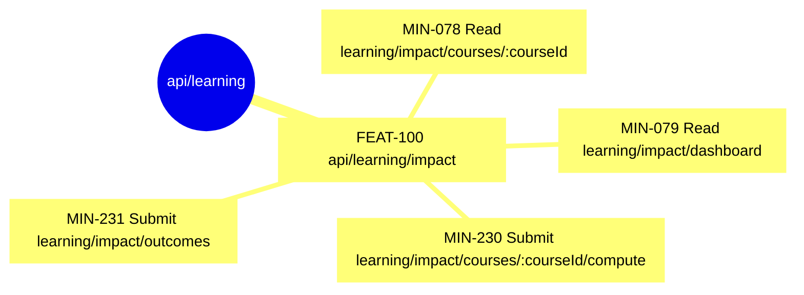
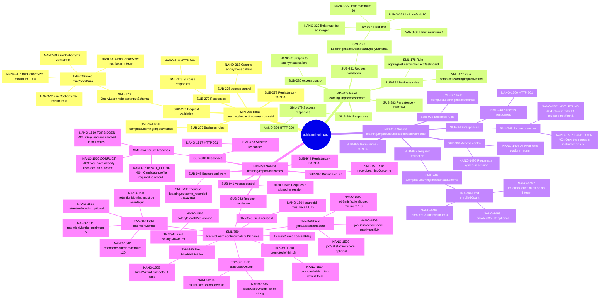

# api/learning (MOD-083)

Generated by `project-mindmap/tools/catalog.py` from `master/MASTER_PROJECT_GRAPH.json` at commit `9b3032f`. Do not edit by hand. Back to the [feature catalog](../FEATURE_CATALOG.md).

**Application:** apps/api (MOD-001). **Purpose:** API module: routes under /api/v1/learning in apps/api/src/server.ts.

**Nodes by level:** MODULE 1, MAJOR 1, MINOR 4, SUB 21, SMALL 16, TINY 11, NANO 38. **Status:** IMPLEMENTED 87, PARTIALLY_IMPLEMENTED 5. **Verification:** PATH_LEVEL 80, UNKNOWN 1, VERIFIED 9.

**User roles that reach it:** anonymous, authenticated, platform_admin.

**Known gaps:** MIN-078 ephemeral: state held in process memory, lost on restart; MIN-078 no first-party web caller found; MIN-079 ephemeral: state held in process memory, lost on restart; MIN-079 no first-party web caller found; MIN-230 ephemeral: state held in process memory, lost on restart; MIN-230 no first-party web caller found; MIN-231 ephemeral: state held in process memory, lost on restart; MIN-231 no first-party web caller found.

## Module map (to minor features)

## FEAT-100 api/learning/impact

api/learning/impact

| ID        | Level | Parent   | Name                                                                                  | Description                                                                                                                                                                                                                                                                                                                                                                                                        | Status                | Verification | Evidence                                   | Related                               |
| --------- | ----- | -------- | ------------------------------------------------------------------------------------- | ------------------------------------------------------------------------------------------------------------------------------------------------------------------------------------------------------------------------------------------------------------------------------------------------------------------------------------------------------------------------------------------------------------------ | --------------------- | ------------ | ------------------------------------------ | ------------------------------------- |
| FEAT-100  | MAJOR | MOD-083  | api/learning/impact                                                                   |                                                                                                                                                                                                                                                                                                                                                                                                                    | IMPLEMENTED           |              | apps/api/src/server.ts:7972                |                                       |
| MIN-078   | MINOR | FEAT-100 | Read learning/impact/courses/:courseId                                                | 2. Get Course Learning Impact Metrics (F-153, F-114, BR-189, BR-193, OD-51) GET /api/v1/learning/impact/courses/:courseId for anyone (public); validates QueryLearningImpactInputSchema; calls computeLearningImpactMetrics; ephemeral (process memory); responds 200. Gaps: ephemeral: state held in process memory, lost on restart; no first-party web caller found                                             | IMPLEMENTED           | VERIFIED     | apps/api/src/server.ts:8050                | API-169, TEST-110, TEST-145, TEST-188 |
| SUB-275   | SUB   | MIN-078  | Access control                                                                        | Who may call GET /api/v1/learning/impact/courses/:courseId: anyone (public).                                                                                                                                                                                                                                                                                                                                       | IMPLEMENTED           | PATH_LEVEL   | apps/api/src/server.ts:8050                |                                       |
| NANO-313  | NANO  | SUB-275  | Open to anonymous callers                                                             | auth: public.                                                                                                                                                                                                                                                                                                                                                                                                      | IMPLEMENTED           | PATH_LEVEL   | apps/api/src/server.ts:8050                | ROLE-001                              |
| SUB-276   | SUB   | MIN-078  | Request validation                                                                    | The request is parsed with QueryLearningImpactInputSchema; a failure returns 400 with field details before any business logic runs.                                                                                                                                                                                                                                                                                | IMPLEMENTED           | PATH_LEVEL   | apps/api/src/server.ts:8050                |                                       |
| SML-173   | SMALL | SUB-276  | QueryLearningImpactInputSchema                                                        | QueryLearningImpactInputSchema: 1 field(s)                                                                                                                                                                                                                                                                                                                                                                         | IMPLEMENTED           | PATH_LEVEL   | packages/contracts/src/index.ts:1584       | SCH-125                               |
| TNY-026   | TINY  | SML-173  | Field minCohortSize                                                                   | minCohortSize (number, optional): must be an integer; minimum 0; maximum 1000; default 30                                                                                                                                                                                                                                                                                                                          | IMPLEMENTED           | PATH_LEVEL   | packages/contracts/src/index.ts:1586       |                                       |
| NANO-314  | NANO  | TNY-026  | minCohortSize: must be an integer                                                     | minCohortSize must be an integer.                                                                                                                                                                                                                                                                                                                                                                                  | IMPLEMENTED           | PATH_LEVEL   | packages/contracts/src/index.ts:1586       |                                       |
| NANO-315  | NANO  | TNY-026  | minCohortSize: minimum 0                                                              | minCohortSize minimum 0.                                                                                                                                                                                                                                                                                                                                                                                           | IMPLEMENTED           | PATH_LEVEL   | packages/contracts/src/index.ts:1586       |                                       |
| NANO-316  | NANO  | TNY-026  | minCohortSize: maximum 1000                                                           | minCohortSize maximum 1000.                                                                                                                                                                                                                                                                                                                                                                                        | IMPLEMENTED           | PATH_LEVEL   | packages/contracts/src/index.ts:1586       |                                       |
| NANO-317  | NANO  | TNY-026  | minCohortSize: default 30                                                             | minCohortSize default 30.                                                                                                                                                                                                                                                                                                                                                                                          | IMPLEMENTED           | PATH_LEVEL   | packages/contracts/src/index.ts:1586       |                                       |
| SUB-277   | SUB   | MIN-078  | Business rules                                                                        | Domain functions from packages/domain called by the handler (1).                                                                                                                                                                                                                                                                                                                                                   | IMPLEMENTED           | PATH_LEVEL   | apps/api/src/server.ts:8050                |                                       |
| SML-174   | SMALL | SUB-277  | Rule computeLearningImpactMetrics                                                     | Calls computeLearningImpactMetrics (packages/domain/src/learning-impact.ts). Rule status IMPLEMENTED; its own tests: VERIFIED.                                                                                                                                                                                                                                                                                     | IMPLEMENTED           | VERIFIED     | packages/domain/src/learning-impact.ts:150 | RULE-131                              |
| SUB-278   | SUB   | MIN-078  | Persistence                                                                           | Ephemeral: state lives in API process memory and is lost on restart.                                                                                                                                                                                                                                                                                                                                               | PARTIALLY_IMPLEMENTED | PATH_LEVEL   | apps/api/src/server.ts:8050                |                                       |
| SUB-279   | SUB   | MIN-078  | Responses                                                                             | Success 200; 0 explicit failure branch(es) besides validation and access errors.                                                                                                                                                                                                                                                                                                                                   | IMPLEMENTED           | PATH_LEVEL   | apps/api/src/server.ts:8050                |                                       |
| SML-175   | SMALL | SUB-279  | Success responses                                                                     | HTTP 200.                                                                                                                                                                                                                                                                                                                                                                                                          | IMPLEMENTED           | PATH_LEVEL   | apps/api/src/server.ts:8050                |                                       |
| NANO-318  | NANO  | SML-175  | HTTP 200                                                                              | Replies 200 when the operation succeeds.                                                                                                                                                                                                                                                                                                                                                                           | IMPLEMENTED           | PATH_LEVEL   | apps/api/src/server.ts:8050                |                                       |
| MIN-079   | MINOR | FEAT-100 | Read learning/impact/dashboard                                                        | 4. Learning Impact Platform Dashboard (F-153) GET /api/v1/learning/impact/dashboard for anyone (public); validates LearningImpactDashboardQuerySchema; calls computeLearningImpactMetrics, aggregateLearningImpactDashboard; ephemeral (process memory); responds 200. Gaps: ephemeral: state held in process memory, lost on restart; no first-party web caller found                                             | IMPLEMENTED           | VERIFIED     | apps/api/src/server.ts:8129                | API-171, TEST-110, TEST-145, TEST-188 |
| SUB-280   | SUB   | MIN-079  | Access control                                                                        | Who may call GET /api/v1/learning/impact/dashboard: anyone (public).                                                                                                                                                                                                                                                                                                                                               | IMPLEMENTED           | PATH_LEVEL   | apps/api/src/server.ts:8129                |                                       |
| NANO-319  | NANO  | SUB-280  | Open to anonymous callers                                                             | auth: public.                                                                                                                                                                                                                                                                                                                                                                                                      | IMPLEMENTED           | PATH_LEVEL   | apps/api/src/server.ts:8129                | ROLE-001                              |
| SUB-281   | SUB   | MIN-079  | Request validation                                                                    | The request is parsed with LearningImpactDashboardQuerySchema; a failure returns 400 with field details before any business logic runs.                                                                                                                                                                                                                                                                            | IMPLEMENTED           | PATH_LEVEL   | apps/api/src/server.ts:8129                |                                       |
| SML-176   | SMALL | SUB-281  | LearningImpactDashboardQuerySchema                                                    | LearningImpactDashboardQuerySchema: 1 field(s)                                                                                                                                                                                                                                                                                                                                                                     | IMPLEMENTED           | PATH_LEVEL   | packages/contracts/src/index.ts:1597       | SCH-127                               |
| TNY-027   | TINY  | SML-176  | Field limit                                                                           | limit (number, optional): must be an integer; minimum 1; maximum 50; default 10                                                                                                                                                                                                                                                                                                                                    | IMPLEMENTED           | PATH_LEVEL   | packages/contracts/src/index.ts:1598       |                                       |
| NANO-320  | NANO  | TNY-027  | limit: must be an integer                                                             | limit must be an integer.                                                                                                                                                                                                                                                                                                                                                                                          | IMPLEMENTED           | PATH_LEVEL   | packages/contracts/src/index.ts:1598       |                                       |
| NANO-321  | NANO  | TNY-027  | limit: minimum 1                                                                      | limit minimum 1.                                                                                                                                                                                                                                                                                                                                                                                                   | IMPLEMENTED           | PATH_LEVEL   | packages/contracts/src/index.ts:1598       |                                       |
| NANO-322  | NANO  | TNY-027  | limit: maximum 50                                                                     | limit maximum 50.                                                                                                                                                                                                                                                                                                                                                                                                  | IMPLEMENTED           | PATH_LEVEL   | packages/contracts/src/index.ts:1598       |                                       |
| NANO-323  | NANO  | TNY-027  | limit: default 10                                                                     | limit default 10.                                                                                                                                                                                                                                                                                                                                                                                                  | IMPLEMENTED           | PATH_LEVEL   | packages/contracts/src/index.ts:1598       |                                       |
| SUB-282   | SUB   | MIN-079  | Business rules                                                                        | Domain functions from packages/domain called by the handler (2).                                                                                                                                                                                                                                                                                                                                                   | IMPLEMENTED           | PATH_LEVEL   | apps/api/src/server.ts:8129                |                                       |
| SML-177   | SMALL | SUB-282  | Rule computeLearningImpactMetrics                                                     | Calls computeLearningImpactMetrics (packages/domain/src/learning-impact.ts). Rule status IMPLEMENTED; its own tests: VERIFIED.                                                                                                                                                                                                                                                                                     | IMPLEMENTED           | VERIFIED     | packages/domain/src/learning-impact.ts:150 | RULE-131                              |
| SML-178   | SMALL | SUB-282  | Rule aggregateLearningImpactDashboard                                                 | Calls aggregateLearningImpactDashboard (packages/domain/src/learning-impact.ts). Rule status IMPLEMENTED; its own tests: VERIFIED.                                                                                                                                                                                                                                                                                 | IMPLEMENTED           | VERIFIED     | packages/domain/src/learning-impact.ts:253 | RULE-132                              |
| SUB-283   | SUB   | MIN-079  | Persistence                                                                           | Ephemeral: state lives in API process memory and is lost on restart.                                                                                                                                                                                                                                                                                                                                               | PARTIALLY_IMPLEMENTED | PATH_LEVEL   | apps/api/src/server.ts:8129                |                                       |
| SUB-284   | SUB   | MIN-079  | Responses                                                                             | Success 200; 0 explicit failure branch(es) besides validation and access errors.                                                                                                                                                                                                                                                                                                                                   | IMPLEMENTED           | PATH_LEVEL   | apps/api/src/server.ts:8129                |                                       |
| SML-179   | SMALL | SUB-284  | Success responses                                                                     | HTTP 200.                                                                                                                                                                                                                                                                                                                                                                                                          | IMPLEMENTED           | PATH_LEVEL   | apps/api/src/server.ts:8129                |                                       |
| NANO-324  | NANO  | SML-179  | HTTP 200                                                                              | Replies 200 when the operation succeeds.                                                                                                                                                                                                                                                                                                                                                                           | IMPLEMENTED           | PATH_LEVEL   | apps/api/src/server.ts:8129                |                                       |
| MIN-230   | MINOR | FEAT-100 | Submit learning/impact/courses/:courseId/compute                                      | 3. Compute/Recompute Course Impact Metrics (Instructor / Admin authority, BR-191) POST /api/v1/learning/impact/courses/:courseId/compute for roles platform_admin; validates ComputeLearningImpactInputSchema; calls computeLearningImpactMetrics; ephemeral (process memory); responds 201; 2 failure branch(es). Gaps: ephemeral: state held in process memory, lost on restart; no first-party web caller found | IMPLEMENTED           | VERIFIED     | apps/api/src/server.ts:8083                | API-170, TEST-110, TEST-188           |
| SUB-936   | SUB   | MIN-230  | Access control                                                                        | Who may call POST /api/v1/learning/impact/courses/:courseId/compute: roles platform_admin.                                                                                                                                                                                                                                                                                                                         | IMPLEMENTED           | PATH_LEVEL   | apps/api/src/server.ts:8083                |                                       |
| NANO-1495 | NANO  | SUB-936  | Requires a signed-in session                                                          | Requests without a valid session token are rejected with 401 UNAUTHENTICATED.                                                                                                                                                                                                                                                                                                                                      | IMPLEMENTED           | PATH_LEVEL   | apps/api/src/server.ts:8083                | ROLE-001                              |
| NANO-1496 | NANO  | SUB-936  | Allowed role: platform_admin                                                          | platform_admin is one of the roles allowed here (platform_admin); a caller holding none of them is rejected with 403.                                                                                                                                                                                                                                                                                              | IMPLEMENTED           | PATH_LEVEL   | apps/api/src/server.ts:8083                | ROLE-008                              |
| SUB-937   | SUB   | MIN-230  | Request validation                                                                    | The request is parsed with ComputeLearningImpactInputSchema; a failure returns 400 with field details before any business logic runs.                                                                                                                                                                                                                                                                              | IMPLEMENTED           | PATH_LEVEL   | apps/api/src/server.ts:8083                |                                       |
| SML-746   | SMALL | SUB-937  | ComputeLearningImpactInputSchema                                                      | ComputeLearningImpactInputSchema: 1 field(s)                                                                                                                                                                                                                                                                                                                                                                       | IMPLEMENTED           | PATH_LEVEL   | packages/contracts/src/index.ts:1591       | SCH-126                               |
| TNY-344   | TINY  | SML-746  | Field enrolledCount                                                                   | enrolledCount (number, optional): must be an integer; minimum 0; optional                                                                                                                                                                                                                                                                                                                                          | IMPLEMENTED           | PATH_LEVEL   | packages/contracts/src/index.ts:1592       |                                       |
| NANO-1497 | NANO  | TNY-344  | enrolledCount: must be an integer                                                     | enrolledCount must be an integer.                                                                                                                                                                                                                                                                                                                                                                                  | IMPLEMENTED           | PATH_LEVEL   | packages/contracts/src/index.ts:1592       |                                       |
| NANO-1498 | NANO  | TNY-344  | enrolledCount: minimum 0                                                              | enrolledCount minimum 0.                                                                                                                                                                                                                                                                                                                                                                                           | IMPLEMENTED           | PATH_LEVEL   | packages/contracts/src/index.ts:1592       |                                       |
| NANO-1499 | NANO  | TNY-344  | enrolledCount: optional                                                               | enrolledCount optional.                                                                                                                                                                                                                                                                                                                                                                                            | IMPLEMENTED           | PATH_LEVEL   | packages/contracts/src/index.ts:1592       |                                       |
| SUB-938   | SUB   | MIN-230  | Business rules                                                                        | Domain functions from packages/domain called by the handler (1).                                                                                                                                                                                                                                                                                                                                                   | IMPLEMENTED           | PATH_LEVEL   | apps/api/src/server.ts:8083                |                                       |
| SML-747   | SMALL | SUB-938  | Rule computeLearningImpactMetrics                                                     | Calls computeLearningImpactMetrics (packages/domain/src/learning-impact.ts). Rule status IMPLEMENTED; its own tests: VERIFIED.                                                                                                                                                                                                                                                                                     | IMPLEMENTED           | VERIFIED     | packages/domain/src/learning-impact.ts:150 | RULE-131                              |
| SUB-939   | SUB   | MIN-230  | Persistence                                                                           | Ephemeral: state lives in API process memory and is lost on restart.                                                                                                                                                                                                                                                                                                                                               | PARTIALLY_IMPLEMENTED | PATH_LEVEL   | apps/api/src/server.ts:8083                |                                       |
| SUB-940   | SUB   | MIN-230  | Responses                                                                             | Success 201; 2 explicit failure branch(es) besides validation and access errors.                                                                                                                                                                                                                                                                                                                                   | IMPLEMENTED           | PATH_LEVEL   | apps/api/src/server.ts:8083                |                                       |
| SML-748   | SMALL | SUB-940  | Success responses                                                                     | HTTP 201.                                                                                                                                                                                                                                                                                                                                                                                                          | IMPLEMENTED           | PATH_LEVEL   | apps/api/src/server.ts:8083                |                                       |
| NANO-1500 | NANO  | SML-748  | HTTP 201                                                                              | Replies 201 when the operation succeeds.                                                                                                                                                                                                                                                                                                                                                                           | IMPLEMENTED           | PATH_LEVEL   | apps/api/src/server.ts:8083                |                                       |
| SML-749   | SMALL | SUB-940  | Failure branches                                                                      | 2 DomainError branch(es) in the handler, mapped to HTTP by the global error handler.                                                                                                                                                                                                                                                                                                                               | IMPLEMENTED           | PATH_LEVEL   | apps/api/src/server.ts:8083                |                                       |
| NANO-1501 | NANO  | SML-749  | NOT_FOUND 404: Course with ID "${courseId}" not found.                                | Throws DomainError(NOT_FOUND) "Course with ID "${courseId}" not found." -> HTTP 404.                                                                                                                                                                                                                                                                                                                               | IMPLEMENTED           | PATH_LEVEL   | apps/api/src/server.ts:8092                | ERR-163                               |
| NANO-1502 | NANO  | SML-749  | FORBIDDEN 403: Only the course's instructor or a platform admin can recompute its imp | Throws DomainError(FORBIDDEN) "Only the course's instructor or a platform admin can recompute its impact metrics." -> HTTP 403.                                                                                                                                                                                                                                                                                    | IMPLEMENTED           | PATH_LEVEL   | apps/api/src/server.ts:8098                | ERR-164                               |
| MIN-231   | MINOR | FEAT-100 | Submit learning/impact/outcomes                                                       | 1. Record Learner Career Outcome (F-114, BR-190) POST /api/v1/learning/impact/outcomes for any signed-in session; validates RecordLearningOutcomeInputSchema; calls recordLearningOutcome; ephemeral (process memory); responds 201; 3 failure branch(es). Gaps: ephemeral: state held in process memory, lost on restart; no first-party web caller found                                                         | IMPLEMENTED           | VERIFIED     | apps/api/src/server.ts:7972                | API-168, TEST-110, TEST-188           |
| SUB-941   | SUB   | MIN-231  | Access control                                                                        | Who may call POST /api/v1/learning/impact/outcomes: any signed-in session.                                                                                                                                                                                                                                                                                                                                         | IMPLEMENTED           | PATH_LEVEL   | apps/api/src/server.ts:7972                |                                       |
| NANO-1503 | NANO  | SUB-941  | Requires a signed-in session                                                          | Requests without a valid session token are rejected with 401 UNAUTHENTICATED.                                                                                                                                                                                                                                                                                                                                      | IMPLEMENTED           | PATH_LEVEL   | apps/api/src/server.ts:7972                | ROLE-001                              |
| SUB-942   | SUB   | MIN-231  | Request validation                                                                    | The request is parsed with RecordLearningOutcomeInputSchema; a failure returns 400 with field details before any business logic runs.                                                                                                                                                                                                                                                                              | IMPLEMENTED           | PATH_LEVEL   | apps/api/src/server.ts:7972                |                                       |
| SML-750   | SMALL | SUB-942  | RecordLearningOutcomeInputSchema                                                      | RecordLearningOutcomeInputSchema: 8 field(s)                                                                                                                                                                                                                                                                                                                                                                       | IMPLEMENTED           | PATH_LEVEL   | packages/contracts/src/index.ts:1571       | SCH-124                               |
| TNY-345   | TINY  | SML-750  | Field courseId                                                                        | courseId (string, required): must be a UUID                                                                                                                                                                                                                                                                                                                                                                        | IMPLEMENTED           | PATH_LEVEL   | packages/contracts/src/index.ts:1572       |                                       |
| NANO-1504 | NANO  | TNY-345  | courseId: must be a UUID                                                              | courseId must be a UUID.                                                                                                                                                                                                                                                                                                                                                                                           | IMPLEMENTED           | PATH_LEVEL   | packages/contracts/src/index.ts:1572       |                                       |
| TNY-346   | TINY  | SML-750  | Field hiredWithin12m                                                                  | hiredWithin12m (boolean, optional): default false                                                                                                                                                                                                                                                                                                                                                                  | IMPLEMENTED           | PATH_LEVEL   | packages/contracts/src/index.ts:1573       |                                       |
| NANO-1505 | NANO  | TNY-346  | hiredWithin12m: default false                                                         | hiredWithin12m default false.                                                                                                                                                                                                                                                                                                                                                                                      | IMPLEMENTED           | PATH_LEVEL   | packages/contracts/src/index.ts:1573       |                                       |
| TNY-347   | TINY  | SML-750  | Field salaryGrowthPct                                                                 | salaryGrowthPct (number, optional): optional                                                                                                                                                                                                                                                                                                                                                                       | IMPLEMENTED           | PATH_LEVEL   | packages/contracts/src/index.ts:1574       |                                       |
| NANO-1506 | NANO  | TNY-347  | salaryGrowthPct: optional                                                             | salaryGrowthPct optional.                                                                                                                                                                                                                                                                                                                                                                                          | IMPLEMENTED           | PATH_LEVEL   | packages/contracts/src/index.ts:1574       |                                       |
| TNY-348   | TINY  | SML-750  | Field jobSatisfactionScore                                                            | jobSatisfactionScore (number, optional): minimum 1.0; maximum 5.0; optional                                                                                                                                                                                                                                                                                                                                        | IMPLEMENTED           | PATH_LEVEL   | packages/contracts/src/index.ts:1575       |                                       |
| NANO-1507 | NANO  | TNY-348  | jobSatisfactionScore: minimum 1.0                                                     | jobSatisfactionScore minimum 1.0.                                                                                                                                                                                                                                                                                                                                                                                  | IMPLEMENTED           | PATH_LEVEL   | packages/contracts/src/index.ts:1575       |                                       |
| NANO-1508 | NANO  | TNY-348  | jobSatisfactionScore: maximum 5.0                                                     | jobSatisfactionScore maximum 5.0.                                                                                                                                                                                                                                                                                                                                                                                  | IMPLEMENTED           | PATH_LEVEL   | packages/contracts/src/index.ts:1575       |                                       |
| NANO-1509 | NANO  | TNY-348  | jobSatisfactionScore: optional                                                        | jobSatisfactionScore optional.                                                                                                                                                                                                                                                                                                                                                                                     | IMPLEMENTED           | PATH_LEVEL   | packages/contracts/src/index.ts:1575       |                                       |
| TNY-349   | TINY  | SML-750  | Field retentionMonths                                                                 | retentionMonths (number, optional): must be an integer; minimum 0; maximum 120; optional                                                                                                                                                                                                                                                                                                                           | IMPLEMENTED           | PATH_LEVEL   | packages/contracts/src/index.ts:1576       |                                       |
| NANO-1510 | NANO  | TNY-349  | retentionMonths: must be an integer                                                   | retentionMonths must be an integer.                                                                                                                                                                                                                                                                                                                                                                                | IMPLEMENTED           | PATH_LEVEL   | packages/contracts/src/index.ts:1576       |                                       |
| NANO-1511 | NANO  | TNY-349  | retentionMonths: minimum 0                                                            | retentionMonths minimum 0.                                                                                                                                                                                                                                                                                                                                                                                         | IMPLEMENTED           | PATH_LEVEL   | packages/contracts/src/index.ts:1576       |                                       |
| NANO-1512 | NANO  | TNY-349  | retentionMonths: maximum 120                                                          | retentionMonths maximum 120.                                                                                                                                                                                                                                                                                                                                                                                       | IMPLEMENTED           | PATH_LEVEL   | packages/contracts/src/index.ts:1576       |                                       |
| NANO-1513 | NANO  | TNY-349  | retentionMonths: optional                                                             | retentionMonths optional.                                                                                                                                                                                                                                                                                                                                                                                          | IMPLEMENTED           | PATH_LEVEL   | packages/contracts/src/index.ts:1576       |                                       |
| TNY-350   | TINY  | SML-750  | Field promotedWithin18m                                                               | promotedWithin18m (boolean, optional): default false                                                                                                                                                                                                                                                                                                                                                               | IMPLEMENTED           | PATH_LEVEL   | packages/contracts/src/index.ts:1577       |                                       |
| NANO-1514 | NANO  | TNY-350  | promotedWithin18m: default false                                                      | promotedWithin18m default false.                                                                                                                                                                                                                                                                                                                                                                                   | IMPLEMENTED           | PATH_LEVEL   | packages/contracts/src/index.ts:1577       |                                       |
| TNY-351   | TINY  | SML-750  | Field skillsUsedOnJob                                                                 | skillsUsedOnJob (array, optional): list of string; default []                                                                                                                                                                                                                                                                                                                                                      | IMPLEMENTED           | PATH_LEVEL   | packages/contracts/src/index.ts:1578       |                                       |
| NANO-1515 | NANO  | TNY-351  | skillsUsedOnJob: list of string                                                       | skillsUsedOnJob list of string.                                                                                                                                                                                                                                                                                                                                                                                    | IMPLEMENTED           | PATH_LEVEL   | packages/contracts/src/index.ts:1578       |                                       |
| NANO-1516 | NANO  | TNY-351  | skillsUsedOnJob: default []                                                           | skillsUsedOnJob default [].                                                                                                                                                                                                                                                                                                                                                                                        | IMPLEMENTED           | PATH_LEVEL   | packages/contracts/src/index.ts:1578       |                                       |
| TNY-352   | TINY  | SML-750  | Field consentFlag                                                                     | consentFlag (boolean, required)                                                                                                                                                                                                                                                                                                                                                                                    | IMPLEMENTED           | PATH_LEVEL   | packages/contracts/src/index.ts:1579       |                                       |
| SUB-943   | SUB   | MIN-231  | Business rules                                                                        | Domain functions from packages/domain called by the handler (1).                                                                                                                                                                                                                                                                                                                                                   | IMPLEMENTED           | PATH_LEVEL   | apps/api/src/server.ts:7972                |                                       |
| SML-751   | SMALL | SUB-943  | Rule recordLearningOutcome                                                            | Calls recordLearningOutcome (packages/domain/src/learning-impact.ts). Rule status IMPLEMENTED; its own tests: VERIFIED.                                                                                                                                                                                                                                                                                            | IMPLEMENTED           | VERIFIED     | packages/domain/src/learning-impact.ts:75  | RULE-130                              |
| SUB-944   | SUB   | MIN-231  | Persistence                                                                           | Ephemeral: state lives in API process memory and is lost on restart.                                                                                                                                                                                                                                                                                                                                               | PARTIALLY_IMPLEMENTED | PATH_LEVEL   | apps/api/src/server.ts:7972                |                                       |
| SUB-945   | SUB   | MIN-231  | Background work                                                                       | Enqueues 1 background job kind(s) in background_jobs for apps/worker.                                                                                                                                                                                                                                                                                                                                              | IMPLEMENTED           | PATH_LEVEL   | apps/api/src/server.ts:7972                |                                       |
| SML-752   | SMALL | SUB-945  | Enqueue learning.outcome_recorded                                                     | Dispatches job:learning.outcome_recorded; worker handler: recordEvent (no-op: marks the event recorded).                                                                                                                                                                                                                                                                                                           | PARTIALLY_IMPLEMENTED | UNKNOWN      | packages/domain/src/background-jobs.ts:171 | SVC-028                               |
| SUB-946   | SUB   | MIN-231  | Responses                                                                             | Success 201; 3 explicit failure branch(es) besides validation and access errors.                                                                                                                                                                                                                                                                                                                                   | IMPLEMENTED           | PATH_LEVEL   | apps/api/src/server.ts:7972                |                                       |
| SML-753   | SMALL | SUB-946  | Success responses                                                                     | HTTP 201.                                                                                                                                                                                                                                                                                                                                                                                                          | IMPLEMENTED           | PATH_LEVEL   | apps/api/src/server.ts:7972                |                                       |
| NANO-1517 | NANO  | SML-753  | HTTP 201                                                                              | Replies 201 when the operation succeeds.                                                                                                                                                                                                                                                                                                                                                                           | IMPLEMENTED           | PATH_LEVEL   | apps/api/src/server.ts:7972                |                                       |
| SML-754   | SMALL | SUB-946  | Failure branches                                                                      | 3 DomainError branch(es) in the handler, mapped to HTTP by the global error handler.                                                                                                                                                                                                                                                                                                                               | IMPLEMENTED           | PATH_LEVEL   | apps/api/src/server.ts:7972                |                                       |
| NANO-1518 | NANO  | SML-754  | NOT_FOUND 404: Candidate profile required to record learning outcome.                 | Throws DomainError(NOT_FOUND) "Candidate profile required to record learning outcome." -> HTTP 404.                                                                                                                                                                                                                                                                                                                | IMPLEMENTED           | PATH_LEVEL   | apps/api/src/server.ts:7976                | ERR-160                               |
| NANO-1519 | NANO  | SML-754  | FORBIDDEN 403: Only learners enrolled in this course can record an outcome for it.    | Throws DomainError(FORBIDDEN) "Only learners enrolled in this course can record an outcome for it." -> HTTP 403.                                                                                                                                                                                                                                                                                                   | IMPLEMENTED           | PATH_LEVEL   | apps/api/src/server.ts:7986                | ERR-161                               |
| NANO-1520 | NANO  | SML-754  | CONFLICT 409: You have already recorded an outcome for this course.                   | Throws DomainError(CONFLICT) "You have already recorded an outcome for this course." -> HTTP 409.                                                                                                                                                                                                                                                                                                                  | IMPLEMENTED           | PATH_LEVEL   | apps/api/src/server.ts:8005                | ERR-162                               |
