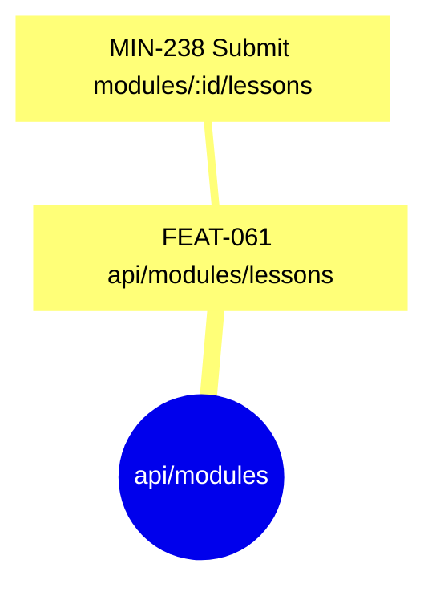
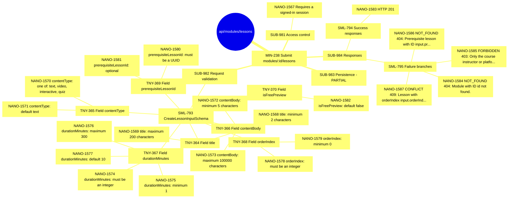

# api/modules (MOD-072)

Generated by `project-mindmap/tools/catalog.py` from `master/MASTER_PROJECT_GRAPH.json` at commit `9b3032f`. Do not edit by hand. Back to the [feature catalog](../FEATURE_CATALOG.md).

**Application:** apps/api (MOD-001). **Purpose:** API module: routes under /api/v1/modules in apps/api/src/server.ts.

**Nodes by level:** MODULE 1, MAJOR 1, MINOR 1, SUB 4, SMALL 3, TINY 7, NANO 21. **Status:** IMPLEMENTED 37, PARTIALLY_IMPLEMENTED 1. **Verification:** PATH_LEVEL 35, VERIFIED 1.

**User roles that reach it:** authenticated.

**Known gaps:** MIN-238 ephemeral: state held in process memory, lost on restart; MIN-238 no first-party web caller found.

## Module map (to minor features)

## FEAT-061 api/modules/lessons

api/modules/lessons

| ID        | Level | Parent   | Name                                                                                  | Description                                                                                                                                                                                                                                                    | Status                | Verification | Evidence                            | Related           |
| --------- | ----- | -------- | ------------------------------------------------------------------------------------- | -------------------------------------------------------------------------------------------------------------------------------------------------------------------------------------------------------------------------------------------------------------- | --------------------- | ------------ | ----------------------------------- | ----------------- |
| FEAT-061  | MAJOR | MOD-072  | api/modules/lessons                                                                   |                                                                                                                                                                                                                                                                | IMPLEMENTED           |              | apps/api/src/server.ts:5125         |                   |
| MIN-238   | MINOR | FEAT-061 | Submit modules/:id/lessons                                                            | POST /api/v1/modules/:id/lessons for any signed-in session; validates CreateLessonInputSchema; ephemeral (process memory); responds 201; 4 failure branch(es). Gaps: ephemeral: state held in process memory, lost on restart; no first-party web caller found | IMPLEMENTED           | VERIFIED     | apps/api/src/server.ts:5125         | API-102, TEST-111 |
| SUB-981   | SUB   | MIN-238  | Access control                                                                        | Who may call POST /api/v1/modules/:id/lessons: any signed-in session.                                                                                                                                                                                          | IMPLEMENTED           | PATH_LEVEL   | apps/api/src/server.ts:5125         |                   |
| NANO-1567 | NANO  | SUB-981  | Requires a signed-in session                                                          | Requests without a valid session token are rejected with 401 UNAUTHENTICATED.                                                                                                                                                                                  | IMPLEMENTED           | PATH_LEVEL   | apps/api/src/server.ts:5125         | ROLE-001          |
| SUB-982   | SUB   | MIN-238  | Request validation                                                                    | The request is parsed with CreateLessonInputSchema; a failure returns 400 with field details before any business logic runs.                                                                                                                                   | IMPLEMENTED           | PATH_LEVEL   | apps/api/src/server.ts:5125         |                   |
| SML-793   | SMALL | SUB-982  | CreateLessonInputSchema                                                               | CreateLessonInputSchema: 7 field(s)                                                                                                                                                                                                                            | IMPLEMENTED           | PATH_LEVEL   | packages/contracts/src/index.ts:377 | SCH-025           |
| TNY-364   | TINY  | SML-793  | Field title                                                                           | title (string, required): minimum 2 characters; maximum 200 characters                                                                                                                                                                                         | IMPLEMENTED           | PATH_LEVEL   | packages/contracts/src/index.ts:378 |                   |
| NANO-1568 | NANO  | TNY-364  | title: minimum 2 characters                                                           | title minimum 2 characters.                                                                                                                                                                                                                                    | IMPLEMENTED           | PATH_LEVEL   | packages/contracts/src/index.ts:378 |                   |
| NANO-1569 | NANO  | TNY-364  | title: maximum 200 characters                                                         | title maximum 200 characters.                                                                                                                                                                                                                                  | IMPLEMENTED           | PATH_LEVEL   | packages/contracts/src/index.ts:378 |                   |
| TNY-365   | TINY  | SML-793  | Field contentType                                                                     | contentType (enum, optional): one of: text, video, interactive, quiz; default 'text'                                                                                                                                                                           | IMPLEMENTED           | PATH_LEVEL   | packages/contracts/src/index.ts:379 |                   |
| NANO-1570 | NANO  | TNY-365  | contentType: one of: text, video, interactive, quiz                                   | contentType one of: text, video, interactive, quiz.                                                                                                                                                                                                            | IMPLEMENTED           | PATH_LEVEL   | packages/contracts/src/index.ts:379 |                   |
| NANO-1571 | NANO  | TNY-365  | contentType: default 'text'                                                           | contentType default 'text'; message "text".                                                                                                                                                                                                                    | IMPLEMENTED           | PATH_LEVEL   | packages/contracts/src/index.ts:379 |                   |
| TNY-366   | TINY  | SML-793  | Field contentBody                                                                     | contentBody (string, required): minimum 5 characters; maximum 100000 characters                                                                                                                                                                                | IMPLEMENTED           | PATH_LEVEL   | packages/contracts/src/index.ts:380 |                   |
| NANO-1572 | NANO  | TNY-366  | contentBody: minimum 5 characters                                                     | contentBody minimum 5 characters.                                                                                                                                                                                                                              | IMPLEMENTED           | PATH_LEVEL   | packages/contracts/src/index.ts:380 |                   |
| NANO-1573 | NANO  | TNY-366  | contentBody: maximum 100000 characters                                                | contentBody maximum 100000 characters.                                                                                                                                                                                                                         | IMPLEMENTED           | PATH_LEVEL   | packages/contracts/src/index.ts:380 |                   |
| TNY-367   | TINY  | SML-793  | Field durationMinutes                                                                 | durationMinutes (number, optional): must be an integer; minimum 1; maximum 300; default 10                                                                                                                                                                     | IMPLEMENTED           | PATH_LEVEL   | packages/contracts/src/index.ts:381 |                   |
| NANO-1574 | NANO  | TNY-367  | durationMinutes: must be an integer                                                   | durationMinutes must be an integer.                                                                                                                                                                                                                            | IMPLEMENTED           | PATH_LEVEL   | packages/contracts/src/index.ts:381 |                   |
| NANO-1575 | NANO  | TNY-367  | durationMinutes: minimum 1                                                            | durationMinutes minimum 1.                                                                                                                                                                                                                                     | IMPLEMENTED           | PATH_LEVEL   | packages/contracts/src/index.ts:381 |                   |
| NANO-1576 | NANO  | TNY-367  | durationMinutes: maximum 300                                                          | durationMinutes maximum 300.                                                                                                                                                                                                                                   | IMPLEMENTED           | PATH_LEVEL   | packages/contracts/src/index.ts:381 |                   |
| NANO-1577 | NANO  | TNY-367  | durationMinutes: default 10                                                           | durationMinutes default 10.                                                                                                                                                                                                                                    | IMPLEMENTED           | PATH_LEVEL   | packages/contracts/src/index.ts:381 |                   |
| TNY-368   | TINY  | SML-793  | Field orderIndex                                                                      | orderIndex (number, required): must be an integer; minimum 0                                                                                                                                                                                                   | IMPLEMENTED           | PATH_LEVEL   | packages/contracts/src/index.ts:382 |                   |
| NANO-1578 | NANO  | TNY-368  | orderIndex: must be an integer                                                        | orderIndex must be an integer.                                                                                                                                                                                                                                 | IMPLEMENTED           | PATH_LEVEL   | packages/contracts/src/index.ts:382 |                   |
| NANO-1579 | NANO  | TNY-368  | orderIndex: minimum 0                                                                 | orderIndex minimum 0.                                                                                                                                                                                                                                          | IMPLEMENTED           | PATH_LEVEL   | packages/contracts/src/index.ts:382 |                   |
| TNY-369   | TINY  | SML-793  | Field prerequisiteLessonId                                                            | prerequisiteLessonId (string, optional): must be a UUID; optional                                                                                                                                                                                              | IMPLEMENTED           | PATH_LEVEL   | packages/contracts/src/index.ts:383 |                   |
| NANO-1580 | NANO  | TNY-369  | prerequisiteLessonId: must be a UUID                                                  | prerequisiteLessonId must be a UUID.                                                                                                                                                                                                                           | IMPLEMENTED           | PATH_LEVEL   | packages/contracts/src/index.ts:383 |                   |
| NANO-1581 | NANO  | TNY-369  | prerequisiteLessonId: optional                                                        | prerequisiteLessonId optional.                                                                                                                                                                                                                                 | IMPLEMENTED           | PATH_LEVEL   | packages/contracts/src/index.ts:383 |                   |
| TNY-370   | TINY  | SML-793  | Field isFreePreview                                                                   | isFreePreview (boolean, optional): default false                                                                                                                                                                                                               | IMPLEMENTED           | PATH_LEVEL   | packages/contracts/src/index.ts:384 |                   |
| NANO-1582 | NANO  | TNY-370  | isFreePreview: default false                                                          | isFreePreview default false.                                                                                                                                                                                                                                   | IMPLEMENTED           | PATH_LEVEL   | packages/contracts/src/index.ts:384 |                   |
| SUB-983   | SUB   | MIN-238  | Persistence                                                                           | Ephemeral: state lives in API process memory and is lost on restart.                                                                                                                                                                                           | PARTIALLY_IMPLEMENTED | PATH_LEVEL   | apps/api/src/server.ts:5125         |                   |
| SUB-984   | SUB   | MIN-238  | Responses                                                                             | Success 201; 4 explicit failure branch(es) besides validation and access errors.                                                                                                                                                                               | IMPLEMENTED           | PATH_LEVEL   | apps/api/src/server.ts:5125         |                   |
| SML-794   | SMALL | SUB-984  | Success responses                                                                     | HTTP 201.                                                                                                                                                                                                                                                      | IMPLEMENTED           | PATH_LEVEL   | apps/api/src/server.ts:5125         |                   |
| NANO-1583 | NANO  | SML-794  | HTTP 201                                                                              | Replies 201 when the operation succeeds.                                                                                                                                                                                                                       | IMPLEMENTED           | PATH_LEVEL   | apps/api/src/server.ts:5125         |                   |
| SML-795   | SMALL | SUB-984  | Failure branches                                                                      | 4 DomainError branch(es) in the handler, mapped to HTTP by the global error handler.                                                                                                                                                                           | IMPLEMENTED           | PATH_LEVEL   | apps/api/src/server.ts:5125         |                   |
| NANO-1584 | NANO  | SML-795  | NOT_FOUND 404: Module with ID "${id}" not found.                                      | Throws DomainError(NOT_FOUND) "Module with ID "${id}" not found." -> HTTP 404.                                                                                                                                                                                 | IMPLEMENTED           | PATH_LEVEL   | apps/api/src/server.ts:5132         | ERR-113           |
| NANO-1585 | NANO  | SML-795  | FORBIDDEN 403: Only the course instructor or platform admin can add lessons.          | Throws DomainError(FORBIDDEN) "Only the course instructor or platform admin can add lessons." -> HTTP 403.                                                                                                                                                     | IMPLEMENTED           | PATH_LEVEL   | apps/api/src/server.ts:5141         | ERR-114           |
| NANO-1586 | NANO  | SML-795  | NOT_FOUND 404: Prerequisite lesson with ID "${input.prerequisiteLessonId}" not found. | Throws DomainError(NOT_FOUND) "Prerequisite lesson with ID "${input.prerequisiteLessonId}" not found." -> HTTP 404.                                                                                                                                            | IMPLEMENTED           | PATH_LEVEL   | apps/api/src/server.ts:5149         | ERR-115           |
| NANO-1587 | NANO  | SML-795  | CONFLICT 409: Lesson with orderIndex ${input.orderIndex} already exists in this modu  | Throws DomainError(CONFLICT) "Lesson with orderIndex ${input.orderIndex} already exists in this module." -> HTTP 409.                                                                                                                                          | IMPLEMENTED           | PATH_LEVEL   | apps/api/src/server.ts:5159         | ERR-116           |
