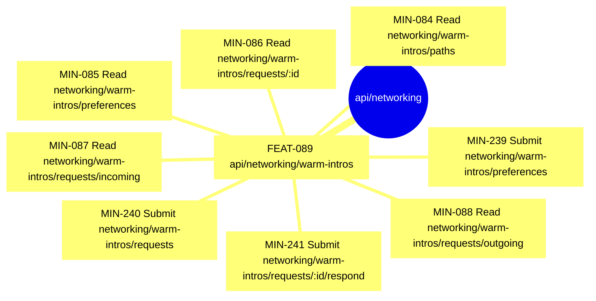

# api/networking (MOD-080)

Generated by `project-mindmap/tools/catalog.py` from `master/MASTER_PROJECT_GRAPH.json` at commit `9b3032f`. Do not edit by hand. Back to the [feature catalog](../FEATURE_CATALOG.md).

**Application:** apps/api (MOD-001). **Purpose:** API module: routes under /api/v1/networking in apps/api/src/server.ts.

**Nodes by level:** MODULE 1, MAJOR 1, MINOR 8, SUB 30, SMALL 17, TINY 9, NANO 34. **Status:** IMPLEMENTED 92, PARTIALLY_IMPLEMENTED 8. **Verification:** PATH_LEVEL 87, VERIFIED 11.

**User roles that reach it:** authenticated, platform_admin.

**Known gaps:** MIN-084 ephemeral: state held in process memory, lost on restart; MIN-084 no first-party web caller found; MIN-085 ephemeral: state held in process memory, lost on restart; MIN-085 no first-party web caller found; MIN-086 ephemeral: state held in process memory, lost on restart; MIN-086 no first-party web caller found; MIN-087 ephemeral: state held in process memory, lost on restart; MIN-087 no first-party web caller found; MIN-088 ephemeral: state held in process memory, lost on restart; MIN-088 no first-party web caller found; MIN-239 ephemeral: state held in process memory, lost on restart; MIN-239 no first-party web caller found; MIN-240 ephemeral: state held in process memory, lost on restart; MIN-240 no first-party web caller found; MIN-241 ephemeral: state held in process memory, lost on restart; MIN-241 no first-party web caller found.

## Module map (to minor features)

## FEAT-089 api/networking/warm-intros

api/networking/warm-intros

```mermaid
mindmap
  root((api/networking/warm-intros))
    MIN_084[MIN-084 Read networking/warm-intros/paths]
      SUB_299[SUB-299 Access control]
        NANO_337[NANO-337 Requires a signed-in session]
      SUB_300[SUB-300 Business rules]
        SML_187[SML-187 Rule discoverWarmIntroPaths]
      SUB_301[SUB-301 Persistence - PARTIAL]
      SUB_302[SUB-302 Responses]
        SML_188[SML-188 Success responses]
          NANO_338[NANO-338 HTTP 200]
        SML_189[SML-189 Failure branches]
          NANO_339[NANO-339 VALIDATION_FAILED 422: targetUserId query parameter...]
    MIN_085[MIN-085 Read networking/warm-intros/preferences]
      SUB_303[SUB-303 Access control]
        NANO_340[NANO-340 Requires a signed-in session]
      SUB_304[SUB-304 Persistence - PARTIAL]
      SUB_305[SUB-305 Responses]
        SML_190[SML-190 Success responses]
          NANO_341[NANO-341 HTTP 200]
    MIN_086[MIN-086 Read networking/warm-intros/requests/:id]
      SUB_306[SUB-306 Access control]
        NANO_342[NANO-342 Requires a signed-in session]
        NANO_343[NANO-343 Allowed role: platform_admin]
      SUB_307[SUB-307 Persistence - PARTIAL]
      SUB_308[SUB-308 Responses]
        SML_191[SML-191 Success responses]
          NANO_344[NANO-344 HTTP 200]
        SML_192[SML-192 Failure branches]
          NANO_345[NANO-345 NOT_FOUND 404: Warm intro request with ID id not found.]
          NANO_346[NANO-346 FORBIDDEN 403: Access denied to this introduction re...]
    MIN_087[MIN-087 Read networking/warm-intros/requests/incoming]
      SUB_309[SUB-309 Access control]
        NANO_347[NANO-347 Requires a signed-in session]
      SUB_310[SUB-310 Persistence - PARTIAL]
      SUB_311[SUB-311 Responses]
        SML_193[SML-193 Success responses]
          NANO_348[NANO-348 HTTP 200]
    MIN_088[MIN-088 Read networking/warm-intros/requests/outgoing]
      SUB_312[SUB-312 Access control]
        NANO_349[NANO-349 Requires a signed-in session]
      SUB_313[SUB-313 Persistence - PARTIAL]
      SUB_314[SUB-314 Responses]
        SML_194[SML-194 Success responses]
          NANO_350[NANO-350 HTTP 200]
    MIN_239[MIN-239 Submit networking/warm-intros/preferences]
      SUB_985[SUB-985 Access control]
        NANO_1588[NANO-1588 Requires a signed-in session]
      SUB_986[SUB-986 Request validation]
        SML_796[SML-796 UpdateWarmIntroPreferencesInputSchema]
          TNY_371[TNY-371 Field optOutIntroducer]
            NANO_1589[NANO-1589 optOutIntroducer: optional]
          TNY_372[TNY-372 Field blockAllIncomingIntros]
            NANO_1590[NANO-1590 blockAllIncomingIntros: optional]
          TNY_373[TNY-373 Field blockedUserIds]
            NANO_1591[NANO-1591 blockedUserIds: list of string]
            NANO_1592[NANO-1592 blockedUserIds: optional]
      SUB_987[SUB-987 Persistence - PARTIAL]
      SUB_988[SUB-988 Responses]
        SML_797[SML-797 Success responses]
          NANO_1593[NANO-1593 HTTP 200]
    MIN_240[MIN-240 Submit networking/warm-intros/requests]
      SUB_989[SUB-989 Access control]
        NANO_1594[NANO-1594 Requires a signed-in session]
      SUB_990[SUB-990 Request validation]
        SML_798[SML-798 CreateWarmIntroRequestInputSchema]
          TNY_374[TNY-374 Field targetUserId]
            NANO_1595[NANO-1595 targetUserId: must be a UUID]
          TNY_375[TNY-375 Field introducerUserId]
            NANO_1596[NANO-1596 introducerUserId: must be a UUID]
          TNY_376[TNY-376 Field purpose]
            NANO_1597[NANO-1597 purpose: minimum 1 characters]
            NANO_1598[NANO-1598 purpose: maximum 200 characters]
          TNY_377[TNY-377 Field note]
            NANO_1599[NANO-1599 note: minimum 1 characters]
            NANO_1600[NANO-1600 note: maximum 500 characters]
      SUB_991[SUB-991 Business rules]
        SML_799[SML-799 Rule createWarmIntroRequest]
      SUB_992[SUB-992 Persistence - PARTIAL]
      SUB_993[SUB-993 Responses]
        SML_800[SML-800 Success responses]
          NANO_1601[NANO-1601 HTTP 201]
    MIN_241[MIN-241 Submit networking/warm-intros/requests/:id/respond]
      SUB_994[SUB-994 Access control]
        NANO_1602[NANO-1602 Requires a signed-in session]
      SUB_995[SUB-995 Request validation]
        SML_801[SML-801 RespondWarmIntroRequestInputSchema]
          TNY_378[TNY-378 Field decision]
            NANO_1603[NANO-1603 decision: one of: approve, decline]
          TNY_379[TNY-379 Field reason]
            NANO_1604[NANO-1604 reason: maximum 500 characters]
            NANO_1605[NANO-1605 reason: optional]
      SUB_996[SUB-996 Business rules]
        SML_802[SML-802 Rule respondToIntroRequest]
      SUB_997[SUB-997 Persistence - PARTIAL]
      SUB_998[SUB-998 Responses]
        SML_803[SML-803 Success responses]
          NANO_1606[NANO-1606 HTTP 200]
        SML_804[SML-804 Failure branches]
          NANO_1607[NANO-1607 NOT_FOUND 404: Warm intro request with ID id not fo...]
```

| ID        | Level | Parent   | Name                                                             | Description                                                                                                                                                                                                                                                                                                                    | Status                | Verification | Evidence                                      | Related                               |
| --------- | ----- | -------- | ---------------------------------------------------------------- | ------------------------------------------------------------------------------------------------------------------------------------------------------------------------------------------------------------------------------------------------------------------------------------------------------------------------------ | --------------------- | ------------ | --------------------------------------------- | ------------------------------------- |
| FEAT-089  | MAJOR | MOD-080  | api/networking/warm-intros                                       |                                                                                                                                                                                                                                                                                                                                | IMPLEMENTED           |              | apps/api/src/server.ts:6791                   |                                       |
| MIN-084   | MINOR | FEAT-089 | Read networking/warm-intros/paths                                | GET /api/v1/networking/warm-intros/paths for any signed-in session; calls discoverWarmIntroPaths; ephemeral (process memory); responds 200; 1 failure branch(es). Gaps: ephemeral: state held in process memory, lost on restart; no first-party web caller found                                                              | IMPLEMENTED           | VERIFIED     | apps/api/src/server.ts:6833                   | API-142, TEST-138, TEST-219           |
| SUB-299   | SUB   | MIN-084  | Access control                                                   | Who may call GET /api/v1/networking/warm-intros/paths: any signed-in session.                                                                                                                                                                                                                                                  | IMPLEMENTED           | PATH_LEVEL   | apps/api/src/server.ts:6833                   |                                       |
| NANO-337  | NANO  | SUB-299  | Requires a signed-in session                                     | Requests without a valid session token are rejected with 401 UNAUTHENTICATED.                                                                                                                                                                                                                                                  | IMPLEMENTED           | PATH_LEVEL   | apps/api/src/server.ts:6833                   | ROLE-001                              |
| SUB-300   | SUB   | MIN-084  | Business rules                                                   | Domain functions from packages/domain called by the handler (1).                                                                                                                                                                                                                                                               | IMPLEMENTED           | PATH_LEVEL   | apps/api/src/server.ts:6833                   |                                       |
| SML-187   | SMALL | SUB-300  | Rule discoverWarmIntroPaths                                      | Calls discoverWarmIntroPaths (packages/domain/src/warm-introductions.ts). Rule status IMPLEMENTED; its own tests: VERIFIED.                                                                                                                                                                                                    | IMPLEMENTED           | VERIFIED     | packages/domain/src/warm-introductions.ts:50  | RULE-262                              |
| SUB-301   | SUB   | MIN-084  | Persistence                                                      | Ephemeral: state lives in API process memory and is lost on restart.                                                                                                                                                                                                                                                           | PARTIALLY_IMPLEMENTED | PATH_LEVEL   | apps/api/src/server.ts:6833                   |                                       |
| SUB-302   | SUB   | MIN-084  | Responses                                                        | Success 200; 1 explicit failure branch(es) besides validation and access errors.                                                                                                                                                                                                                                               | IMPLEMENTED           | PATH_LEVEL   | apps/api/src/server.ts:6833                   |                                       |
| SML-188   | SMALL | SUB-302  | Success responses                                                | HTTP 200.                                                                                                                                                                                                                                                                                                                      | IMPLEMENTED           | PATH_LEVEL   | apps/api/src/server.ts:6833                   |                                       |
| NANO-338  | NANO  | SML-188  | HTTP 200                                                         | Replies 200 when the operation succeeds.                                                                                                                                                                                                                                                                                       | IMPLEMENTED           | PATH_LEVEL   | apps/api/src/server.ts:6833                   |                                       |
| SML-189   | SMALL | SUB-302  | Failure branches                                                 | 1 DomainError branch(es) in the handler, mapped to HTTP by the global error handler.                                                                                                                                                                                                                                           | IMPLEMENTED           | PATH_LEVEL   | apps/api/src/server.ts:6833                   |                                       |
| NANO-339  | NANO  | SML-189  | VALIDATION_FAILED 422: targetUserId query parameter is required. | Throws DomainError(VALIDATION_FAILED) "targetUserId query parameter is required." -> HTTP 422.                                                                                                                                                                                                                                 | IMPLEMENTED           | PATH_LEVEL   | apps/api/src/server.ts:6839                   | ERR-143                               |
| MIN-085   | MINOR | FEAT-089 | Read networking/warm-intros/preferences                          | GET /api/v1/networking/warm-intros/preferences for any signed-in session; ephemeral (process memory); responds 200. Gaps: ephemeral: state held in process memory, lost on restart; no first-party web caller found                                                                                                            | IMPLEMENTED           | VERIFIED     | apps/api/src/server.ts:6818                   | API-141, TEST-125                     |
| SUB-303   | SUB   | MIN-085  | Access control                                                   | Who may call GET /api/v1/networking/warm-intros/preferences: any signed-in session.                                                                                                                                                                                                                                            | IMPLEMENTED           | PATH_LEVEL   | apps/api/src/server.ts:6818                   |                                       |
| NANO-340  | NANO  | SUB-303  | Requires a signed-in session                                     | Requests without a valid session token are rejected with 401 UNAUTHENTICATED.                                                                                                                                                                                                                                                  | IMPLEMENTED           | PATH_LEVEL   | apps/api/src/server.ts:6818                   | ROLE-001                              |
| SUB-304   | SUB   | MIN-085  | Persistence                                                      | Ephemeral: state lives in API process memory and is lost on restart.                                                                                                                                                                                                                                                           | PARTIALLY_IMPLEMENTED | PATH_LEVEL   | apps/api/src/server.ts:6818                   |                                       |
| SUB-305   | SUB   | MIN-085  | Responses                                                        | Success 200; 0 explicit failure branch(es) besides validation and access errors.                                                                                                                                                                                                                                               | IMPLEMENTED           | PATH_LEVEL   | apps/api/src/server.ts:6818                   |                                       |
| SML-190   | SMALL | SUB-305  | Success responses                                                | HTTP 200.                                                                                                                                                                                                                                                                                                                      | IMPLEMENTED           | PATH_LEVEL   | apps/api/src/server.ts:6818                   |                                       |
| NANO-341  | NANO  | SML-190  | HTTP 200                                                         | Replies 200 when the operation succeeds.                                                                                                                                                                                                                                                                                       | IMPLEMENTED           | PATH_LEVEL   | apps/api/src/server.ts:6818                   |                                       |
| MIN-086   | MINOR | FEAT-089 | Read networking/warm-intros/requests/:id                         | GET /api/v1/networking/warm-intros/requests/:id for roles platform_admin; ephemeral (process memory); responds 200; 2 failure branch(es). Gaps: ephemeral: state held in process memory, lost on restart; no first-party web caller found                                                                                      | IMPLEMENTED           | VERIFIED     | apps/api/src/server.ts:6956                   | API-146, TEST-138, TEST-219           |
| SUB-306   | SUB   | MIN-086  | Access control                                                   | Who may call GET /api/v1/networking/warm-intros/requests/:id: roles platform_admin.                                                                                                                                                                                                                                            | IMPLEMENTED           | PATH_LEVEL   | apps/api/src/server.ts:6956                   |                                       |
| NANO-342  | NANO  | SUB-306  | Requires a signed-in session                                     | Requests without a valid session token are rejected with 401 UNAUTHENTICATED.                                                                                                                                                                                                                                                  | IMPLEMENTED           | PATH_LEVEL   | apps/api/src/server.ts:6956                   | ROLE-001                              |
| NANO-343  | NANO  | SUB-306  | Allowed role: platform_admin                                     | platform_admin is one of the roles allowed here (platform_admin); a caller holding none of them is rejected with 403.                                                                                                                                                                                                          | IMPLEMENTED           | PATH_LEVEL   | apps/api/src/server.ts:6956                   | ROLE-008                              |
| SUB-307   | SUB   | MIN-086  | Persistence                                                      | Ephemeral: state lives in API process memory and is lost on restart.                                                                                                                                                                                                                                                           | PARTIALLY_IMPLEMENTED | PATH_LEVEL   | apps/api/src/server.ts:6956                   |                                       |
| SUB-308   | SUB   | MIN-086  | Responses                                                        | Success 200; 2 explicit failure branch(es) besides validation and access errors.                                                                                                                                                                                                                                               | IMPLEMENTED           | PATH_LEVEL   | apps/api/src/server.ts:6956                   |                                       |
| SML-191   | SMALL | SUB-308  | Success responses                                                | HTTP 200.                                                                                                                                                                                                                                                                                                                      | IMPLEMENTED           | PATH_LEVEL   | apps/api/src/server.ts:6956                   |                                       |
| NANO-344  | NANO  | SML-191  | HTTP 200                                                         | Replies 200 when the operation succeeds.                                                                                                                                                                                                                                                                                       | IMPLEMENTED           | PATH_LEVEL   | apps/api/src/server.ts:6956                   |                                       |
| SML-192   | SMALL | SUB-308  | Failure branches                                                 | 2 DomainError branch(es) in the handler, mapped to HTTP by the global error handler.                                                                                                                                                                                                                                           | IMPLEMENTED           | PATH_LEVEL   | apps/api/src/server.ts:6956                   |                                       |
| NANO-345  | NANO  | SML-192  | NOT_FOUND 404: Warm intro request with ID ${id} not found.       | Throws DomainError(NOT_FOUND) "Warm intro request with ID ${id} not found." -> HTTP 404.                                                                                                                                                                                                                                       | IMPLEMENTED           | PATH_LEVEL   | apps/api/src/server.ts:6964                   | ERR-144                               |
| NANO-346  | NANO  | SML-192  | FORBIDDEN 403: Access denied to this introduction request.       | Throws DomainError(FORBIDDEN) "Access denied to this introduction request." -> HTTP 403.                                                                                                                                                                                                                                       | IMPLEMENTED           | PATH_LEVEL   | apps/api/src/server.ts:6975                   | ERR-145                               |
| MIN-087   | MINOR | FEAT-089 | Read networking/warm-intros/requests/incoming                    | GET /api/v1/networking/warm-intros/requests/incoming for any signed-in session; ephemeral (process memory); responds 200. Gaps: ephemeral: state held in process memory, lost on restart; no first-party web caller found                                                                                                      | IMPLEMENTED           | VERIFIED     | apps/api/src/server.ts:6938                   | API-144, TEST-138                     |
| SUB-309   | SUB   | MIN-087  | Access control                                                   | Who may call GET /api/v1/networking/warm-intros/requests/incoming: any signed-in session.                                                                                                                                                                                                                                      | IMPLEMENTED           | PATH_LEVEL   | apps/api/src/server.ts:6938                   |                                       |
| NANO-347  | NANO  | SUB-309  | Requires a signed-in session                                     | Requests without a valid session token are rejected with 401 UNAUTHENTICATED.                                                                                                                                                                                                                                                  | IMPLEMENTED           | PATH_LEVEL   | apps/api/src/server.ts:6938                   | ROLE-001                              |
| SUB-310   | SUB   | MIN-087  | Persistence                                                      | Ephemeral: state lives in API process memory and is lost on restart.                                                                                                                                                                                                                                                           | PARTIALLY_IMPLEMENTED | PATH_LEVEL   | apps/api/src/server.ts:6938                   |                                       |
| SUB-311   | SUB   | MIN-087  | Responses                                                        | Success 200; 0 explicit failure branch(es) besides validation and access errors.                                                                                                                                                                                                                                               | IMPLEMENTED           | PATH_LEVEL   | apps/api/src/server.ts:6938                   |                                       |
| SML-193   | SMALL | SUB-311  | Success responses                                                | HTTP 200.                                                                                                                                                                                                                                                                                                                      | IMPLEMENTED           | PATH_LEVEL   | apps/api/src/server.ts:6938                   |                                       |
| NANO-348  | NANO  | SML-193  | HTTP 200                                                         | Replies 200 when the operation succeeds.                                                                                                                                                                                                                                                                                       | IMPLEMENTED           | PATH_LEVEL   | apps/api/src/server.ts:6938                   |                                       |
| MIN-088   | MINOR | FEAT-089 | Read networking/warm-intros/requests/outgoing                    | GET /api/v1/networking/warm-intros/requests/outgoing for any signed-in session; ephemeral (process memory); responds 200. Gaps: ephemeral: state held in process memory, lost on restart; no first-party web caller found                                                                                                      | IMPLEMENTED           | VERIFIED     | apps/api/src/server.ts:6947                   | API-145, TEST-138                     |
| SUB-312   | SUB   | MIN-088  | Access control                                                   | Who may call GET /api/v1/networking/warm-intros/requests/outgoing: any signed-in session.                                                                                                                                                                                                                                      | IMPLEMENTED           | PATH_LEVEL   | apps/api/src/server.ts:6947                   |                                       |
| NANO-349  | NANO  | SUB-312  | Requires a signed-in session                                     | Requests without a valid session token are rejected with 401 UNAUTHENTICATED.                                                                                                                                                                                                                                                  | IMPLEMENTED           | PATH_LEVEL   | apps/api/src/server.ts:6947                   | ROLE-001                              |
| SUB-313   | SUB   | MIN-088  | Persistence                                                      | Ephemeral: state lives in API process memory and is lost on restart.                                                                                                                                                                                                                                                           | PARTIALLY_IMPLEMENTED | PATH_LEVEL   | apps/api/src/server.ts:6947                   |                                       |
| SUB-314   | SUB   | MIN-088  | Responses                                                        | Success 200; 0 explicit failure branch(es) besides validation and access errors.                                                                                                                                                                                                                                               | IMPLEMENTED           | PATH_LEVEL   | apps/api/src/server.ts:6947                   |                                       |
| SML-194   | SMALL | SUB-314  | Success responses                                                | HTTP 200.                                                                                                                                                                                                                                                                                                                      | IMPLEMENTED           | PATH_LEVEL   | apps/api/src/server.ts:6947                   |                                       |
| NANO-350  | NANO  | SML-194  | HTTP 200                                                         | Replies 200 when the operation succeeds.                                                                                                                                                                                                                                                                                       | IMPLEMENTED           | PATH_LEVEL   | apps/api/src/server.ts:6947                   |                                       |
| MIN-239   | MINOR | FEAT-089 | Submit networking/warm-intros/preferences                        | POST /api/v1/networking/warm-intros/preferences for any signed-in session; validates UpdateWarmIntroPreferencesInputSchema; ephemeral (process memory); responds 200. Gaps: ephemeral: state held in process memory, lost on restart; no first-party web caller found                                                          | IMPLEMENTED           | VERIFIED     | apps/api/src/server.ts:6791                   | API-140, TEST-125, TEST-138, TEST-219 |
| SUB-985   | SUB   | MIN-239  | Access control                                                   | Who may call POST /api/v1/networking/warm-intros/preferences: any signed-in session.                                                                                                                                                                                                                                           | IMPLEMENTED           | PATH_LEVEL   | apps/api/src/server.ts:6791                   |                                       |
| NANO-1588 | NANO  | SUB-985  | Requires a signed-in session                                     | Requests without a valid session token are rejected with 401 UNAUTHENTICATED.                                                                                                                                                                                                                                                  | IMPLEMENTED           | PATH_LEVEL   | apps/api/src/server.ts:6791                   | ROLE-001                              |
| SUB-986   | SUB   | MIN-239  | Request validation                                               | The request is parsed with UpdateWarmIntroPreferencesInputSchema; a failure returns 400 with field details before any business logic runs.                                                                                                                                                                                     | IMPLEMENTED           | PATH_LEVEL   | apps/api/src/server.ts:6791                   |                                       |
| SML-796   | SMALL | SUB-986  | UpdateWarmIntroPreferencesInputSchema                            | UpdateWarmIntroPreferencesInputSchema: 3 field(s)                                                                                                                                                                                                                                                                              | IMPLEMENTED           | PATH_LEVEL   | packages/contracts/src/index.ts:1263          | SCH-096                               |
| TNY-371   | TINY  | SML-796  | Field optOutIntroducer                                           | optOutIntroducer (boolean, optional): optional                                                                                                                                                                                                                                                                                 | IMPLEMENTED           | PATH_LEVEL   | packages/contracts/src/index.ts:1264          |                                       |
| NANO-1589 | NANO  | TNY-371  | optOutIntroducer: optional                                       | optOutIntroducer optional.                                                                                                                                                                                                                                                                                                     | IMPLEMENTED           | PATH_LEVEL   | packages/contracts/src/index.ts:1264          |                                       |
| TNY-372   | TINY  | SML-796  | Field blockAllIncomingIntros                                     | blockAllIncomingIntros (boolean, optional): optional                                                                                                                                                                                                                                                                           | IMPLEMENTED           | PATH_LEVEL   | packages/contracts/src/index.ts:1265          |                                       |
| NANO-1590 | NANO  | TNY-372  | blockAllIncomingIntros: optional                                 | blockAllIncomingIntros optional.                                                                                                                                                                                                                                                                                               | IMPLEMENTED           | PATH_LEVEL   | packages/contracts/src/index.ts:1265          |                                       |
| TNY-373   | TINY  | SML-796  | Field blockedUserIds                                             | blockedUserIds (array, optional): list of string; optional                                                                                                                                                                                                                                                                     | IMPLEMENTED           | PATH_LEVEL   | packages/contracts/src/index.ts:1266          |                                       |
| NANO-1591 | NANO  | TNY-373  | blockedUserIds: list of string                                   | blockedUserIds list of string.                                                                                                                                                                                                                                                                                                 | IMPLEMENTED           | PATH_LEVEL   | packages/contracts/src/index.ts:1266          |                                       |
| NANO-1592 | NANO  | TNY-373  | blockedUserIds: optional                                         | blockedUserIds optional.                                                                                                                                                                                                                                                                                                       | IMPLEMENTED           | PATH_LEVEL   | packages/contracts/src/index.ts:1266          |                                       |
| SUB-987   | SUB   | MIN-239  | Persistence                                                      | Ephemeral: state lives in API process memory and is lost on restart.                                                                                                                                                                                                                                                           | PARTIALLY_IMPLEMENTED | PATH_LEVEL   | apps/api/src/server.ts:6791                   |                                       |
| SUB-988   | SUB   | MIN-239  | Responses                                                        | Success 200; 0 explicit failure branch(es) besides validation and access errors.                                                                                                                                                                                                                                               | IMPLEMENTED           | PATH_LEVEL   | apps/api/src/server.ts:6791                   |                                       |
| SML-797   | SMALL | SUB-988  | Success responses                                                | HTTP 200.                                                                                                                                                                                                                                                                                                                      | IMPLEMENTED           | PATH_LEVEL   | apps/api/src/server.ts:6791                   |                                       |
| NANO-1593 | NANO  | SML-797  | HTTP 200                                                         | Replies 200 when the operation succeeds.                                                                                                                                                                                                                                                                                       | IMPLEMENTED           | PATH_LEVEL   | apps/api/src/server.ts:6791                   |                                       |
| MIN-240   | MINOR | FEAT-089 | Submit networking/warm-intros/requests                           | POST /api/v1/networking/warm-intros/requests for any signed-in session; validates CreateWarmIntroRequestInputSchema; calls createWarmIntroRequest; ephemeral (process memory); responds 201. Gaps: ephemeral: state held in process memory, lost on restart; no first-party web caller found                                   | IMPLEMENTED           | VERIFIED     | apps/api/src/server.ts:6859                   | API-143, TEST-138, TEST-219           |
| SUB-989   | SUB   | MIN-240  | Access control                                                   | Who may call POST /api/v1/networking/warm-intros/requests: any signed-in session.                                                                                                                                                                                                                                              | IMPLEMENTED           | PATH_LEVEL   | apps/api/src/server.ts:6859                   |                                       |
| NANO-1594 | NANO  | SUB-989  | Requires a signed-in session                                     | Requests without a valid session token are rejected with 401 UNAUTHENTICATED.                                                                                                                                                                                                                                                  | IMPLEMENTED           | PATH_LEVEL   | apps/api/src/server.ts:6859                   | ROLE-001                              |
| SUB-990   | SUB   | MIN-240  | Request validation                                               | The request is parsed with CreateWarmIntroRequestInputSchema; a failure returns 400 with field details before any business logic runs.                                                                                                                                                                                         | IMPLEMENTED           | PATH_LEVEL   | apps/api/src/server.ts:6859                   |                                       |
| SML-798   | SMALL | SUB-990  | CreateWarmIntroRequestInputSchema                                | CreateWarmIntroRequestInputSchema: 4 field(s)                                                                                                                                                                                                                                                                                  | IMPLEMENTED           | PATH_LEVEL   | packages/contracts/src/index.ts:1271          | SCH-097                               |
| TNY-374   | TINY  | SML-798  | Field targetUserId                                               | targetUserId (string, required): must be a UUID                                                                                                                                                                                                                                                                                | IMPLEMENTED           | PATH_LEVEL   | packages/contracts/src/index.ts:1272          |                                       |
| NANO-1595 | NANO  | TNY-374  | targetUserId: must be a UUID                                     | targetUserId must be a UUID.                                                                                                                                                                                                                                                                                                   | IMPLEMENTED           | PATH_LEVEL   | packages/contracts/src/index.ts:1272          |                                       |
| TNY-375   | TINY  | SML-798  | Field introducerUserId                                           | introducerUserId (string, required): must be a UUID                                                                                                                                                                                                                                                                            | IMPLEMENTED           | PATH_LEVEL   | packages/contracts/src/index.ts:1273          |                                       |
| NANO-1596 | NANO  | TNY-375  | introducerUserId: must be a UUID                                 | introducerUserId must be a UUID.                                                                                                                                                                                                                                                                                               | IMPLEMENTED           | PATH_LEVEL   | packages/contracts/src/index.ts:1273          |                                       |
| TNY-376   | TINY  | SML-798  | Field purpose                                                    | purpose (string, required): minimum 1 characters; maximum 200 characters                                                                                                                                                                                                                                                       | IMPLEMENTED           | PATH_LEVEL   | packages/contracts/src/index.ts:1274          |                                       |
| NANO-1597 | NANO  | TNY-376  | purpose: minimum 1 characters                                    | purpose minimum 1 characters.                                                                                                                                                                                                                                                                                                  | IMPLEMENTED           | PATH_LEVEL   | packages/contracts/src/index.ts:1274          |                                       |
| NANO-1598 | NANO  | TNY-376  | purpose: maximum 200 characters                                  | purpose maximum 200 characters.                                                                                                                                                                                                                                                                                                | IMPLEMENTED           | PATH_LEVEL   | packages/contracts/src/index.ts:1274          |                                       |
| TNY-377   | TINY  | SML-798  | Field note                                                       | note (string, required): minimum 1 characters; maximum 500 characters                                                                                                                                                                                                                                                          | IMPLEMENTED           | PATH_LEVEL   | packages/contracts/src/index.ts:1275          |                                       |
| NANO-1599 | NANO  | TNY-377  | note: minimum 1 characters                                       | note minimum 1 characters.                                                                                                                                                                                                                                                                                                     | IMPLEMENTED           | PATH_LEVEL   | packages/contracts/src/index.ts:1275          |                                       |
| NANO-1600 | NANO  | TNY-377  | note: maximum 500 characters                                     | note maximum 500 characters.                                                                                                                                                                                                                                                                                                   | IMPLEMENTED           | PATH_LEVEL   | packages/contracts/src/index.ts:1275          |                                       |
| SUB-991   | SUB   | MIN-240  | Business rules                                                   | Domain functions from packages/domain called by the handler (1).                                                                                                                                                                                                                                                               | IMPLEMENTED           | PATH_LEVEL   | apps/api/src/server.ts:6859                   |                                       |
| SML-799   | SMALL | SUB-991  | Rule createWarmIntroRequest                                      | Calls createWarmIntroRequest (packages/domain/src/warm-introductions.ts). Rule status IMPLEMENTED; its own tests: VERIFIED.                                                                                                                                                                                                    | IMPLEMENTED           | VERIFIED     | packages/domain/src/warm-introductions.ts:98  | RULE-263                              |
| SUB-992   | SUB   | MIN-240  | Persistence                                                      | Ephemeral: state lives in API process memory and is lost on restart.                                                                                                                                                                                                                                                           | PARTIALLY_IMPLEMENTED | PATH_LEVEL   | apps/api/src/server.ts:6859                   |                                       |
| SUB-993   | SUB   | MIN-240  | Responses                                                        | Success 201; 0 explicit failure branch(es) besides validation and access errors.                                                                                                                                                                                                                                               | IMPLEMENTED           | PATH_LEVEL   | apps/api/src/server.ts:6859                   |                                       |
| SML-800   | SMALL | SUB-993  | Success responses                                                | HTTP 201.                                                                                                                                                                                                                                                                                                                      | IMPLEMENTED           | PATH_LEVEL   | apps/api/src/server.ts:6859                   |                                       |
| NANO-1601 | NANO  | SML-800  | HTTP 201                                                         | Replies 201 when the operation succeeds.                                                                                                                                                                                                                                                                                       | IMPLEMENTED           | PATH_LEVEL   | apps/api/src/server.ts:6859                   |                                       |
| MIN-241   | MINOR | FEAT-089 | Submit networking/warm-intros/requests/:id/respond               | POST /api/v1/networking/warm-intros/requests/:id/respond for any signed-in session; validates RespondWarmIntroRequestInputSchema; calls respondToIntroRequest; ephemeral (process memory); responds 200; 1 failure branch(es). Gaps: ephemeral: state held in process memory, lost on restart; no first-party web caller found | IMPLEMENTED           | VERIFIED     | apps/api/src/server.ts:6982                   | API-147, TEST-138, TEST-219           |
| SUB-994   | SUB   | MIN-241  | Access control                                                   | Who may call POST /api/v1/networking/warm-intros/requests/:id/respond: any signed-in session.                                                                                                                                                                                                                                  | IMPLEMENTED           | PATH_LEVEL   | apps/api/src/server.ts:6982                   |                                       |
| NANO-1602 | NANO  | SUB-994  | Requires a signed-in session                                     | Requests without a valid session token are rejected with 401 UNAUTHENTICATED.                                                                                                                                                                                                                                                  | IMPLEMENTED           | PATH_LEVEL   | apps/api/src/server.ts:6982                   | ROLE-001                              |
| SUB-995   | SUB   | MIN-241  | Request validation                                               | The request is parsed with RespondWarmIntroRequestInputSchema; a failure returns 400 with field details before any business logic runs.                                                                                                                                                                                        | IMPLEMENTED           | PATH_LEVEL   | apps/api/src/server.ts:6982                   |                                       |
| SML-801   | SMALL | SUB-995  | RespondWarmIntroRequestInputSchema                               | RespondWarmIntroRequestInputSchema: 2 field(s)                                                                                                                                                                                                                                                                                 | IMPLEMENTED           | PATH_LEVEL   | packages/contracts/src/index.ts:1280          | SCH-098                               |
| TNY-378   | TINY  | SML-801  | Field decision                                                   | decision (enum, required): one of: approve, decline                                                                                                                                                                                                                                                                            | IMPLEMENTED           | PATH_LEVEL   | packages/contracts/src/index.ts:1281          |                                       |
| NANO-1603 | NANO  | TNY-378  | decision: one of: approve, decline                               | decision one of: approve, decline.                                                                                                                                                                                                                                                                                             | IMPLEMENTED           | PATH_LEVEL   | packages/contracts/src/index.ts:1281          |                                       |
| TNY-379   | TINY  | SML-801  | Field reason                                                     | reason (string, optional): maximum 500 characters; optional                                                                                                                                                                                                                                                                    | IMPLEMENTED           | PATH_LEVEL   | packages/contracts/src/index.ts:1282          |                                       |
| NANO-1604 | NANO  | TNY-379  | reason: maximum 500 characters                                   | reason maximum 500 characters.                                                                                                                                                                                                                                                                                                 | IMPLEMENTED           | PATH_LEVEL   | packages/contracts/src/index.ts:1282          |                                       |
| NANO-1605 | NANO  | TNY-379  | reason: optional                                                 | reason optional.                                                                                                                                                                                                                                                                                                               | IMPLEMENTED           | PATH_LEVEL   | packages/contracts/src/index.ts:1282          |                                       |
| SUB-996   | SUB   | MIN-241  | Business rules                                                   | Domain functions from packages/domain called by the handler (1).                                                                                                                                                                                                                                                               | IMPLEMENTED           | PATH_LEVEL   | apps/api/src/server.ts:6982                   |                                       |
| SML-802   | SMALL | SUB-996  | Rule respondToIntroRequest                                       | Calls respondToIntroRequest (packages/domain/src/warm-introductions.ts). Rule status IMPLEMENTED; its own tests: VERIFIED.                                                                                                                                                                                                     | IMPLEMENTED           | VERIFIED     | packages/domain/src/warm-introductions.ts:177 | RULE-264                              |
| SUB-997   | SUB   | MIN-241  | Persistence                                                      | Ephemeral: state lives in API process memory and is lost on restart.                                                                                                                                                                                                                                                           | PARTIALLY_IMPLEMENTED | PATH_LEVEL   | apps/api/src/server.ts:6982                   |                                       |
| SUB-998   | SUB   | MIN-241  | Responses                                                        | Success 200; 1 explicit failure branch(es) besides validation and access errors.                                                                                                                                                                                                                                               | IMPLEMENTED           | PATH_LEVEL   | apps/api/src/server.ts:6982                   |                                       |
| SML-803   | SMALL | SUB-998  | Success responses                                                | HTTP 200.                                                                                                                                                                                                                                                                                                                      | IMPLEMENTED           | PATH_LEVEL   | apps/api/src/server.ts:6982                   |                                       |
| NANO-1606 | NANO  | SML-803  | HTTP 200                                                         | Replies 200 when the operation succeeds.                                                                                                                                                                                                                                                                                       | IMPLEMENTED           | PATH_LEVEL   | apps/api/src/server.ts:6982                   |                                       |
| SML-804   | SMALL | SUB-998  | Failure branches                                                 | 1 DomainError branch(es) in the handler, mapped to HTTP by the global error handler.                                                                                                                                                                                                                                           | IMPLEMENTED           | PATH_LEVEL   | apps/api/src/server.ts:6982                   |                                       |
| NANO-1607 | NANO  | SML-804  | NOT_FOUND 404: Warm intro request with ID ${id} not found.       | Throws DomainError(NOT_FOUND) "Warm intro request with ID ${id} not found." -> HTTP 404.                                                                                                                                                                                                                                       | IMPLEMENTED           | PATH_LEVEL   | apps/api/src/server.ts:6991                   | ERR-144                               |
