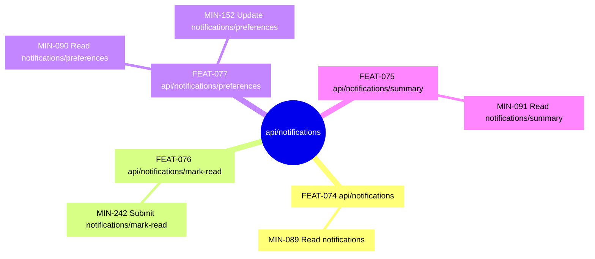
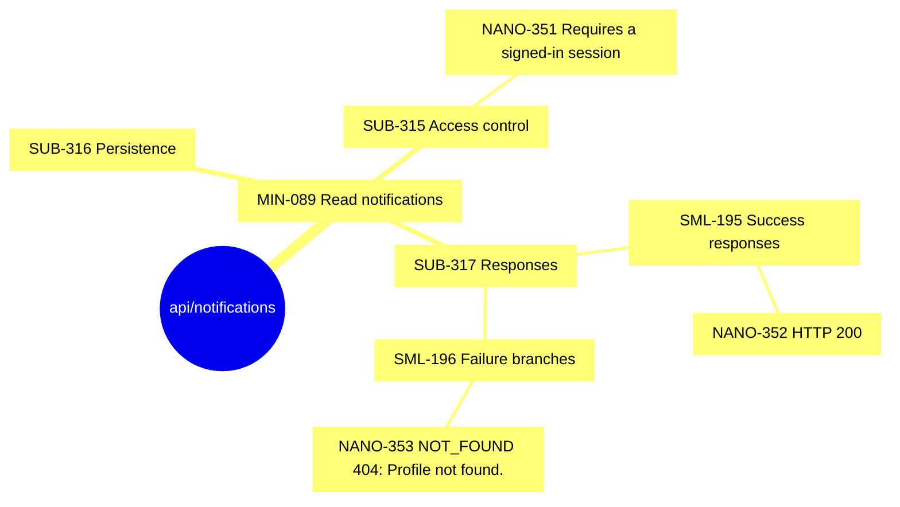
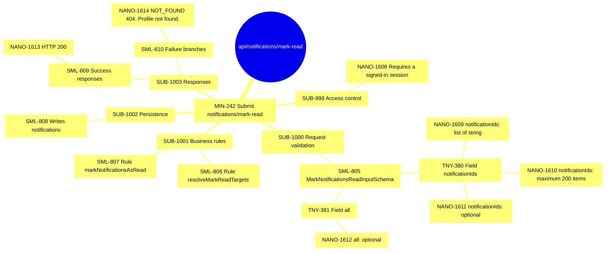
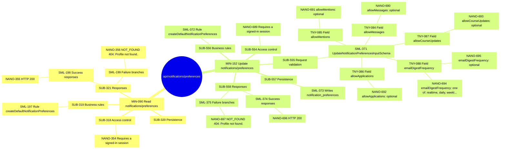
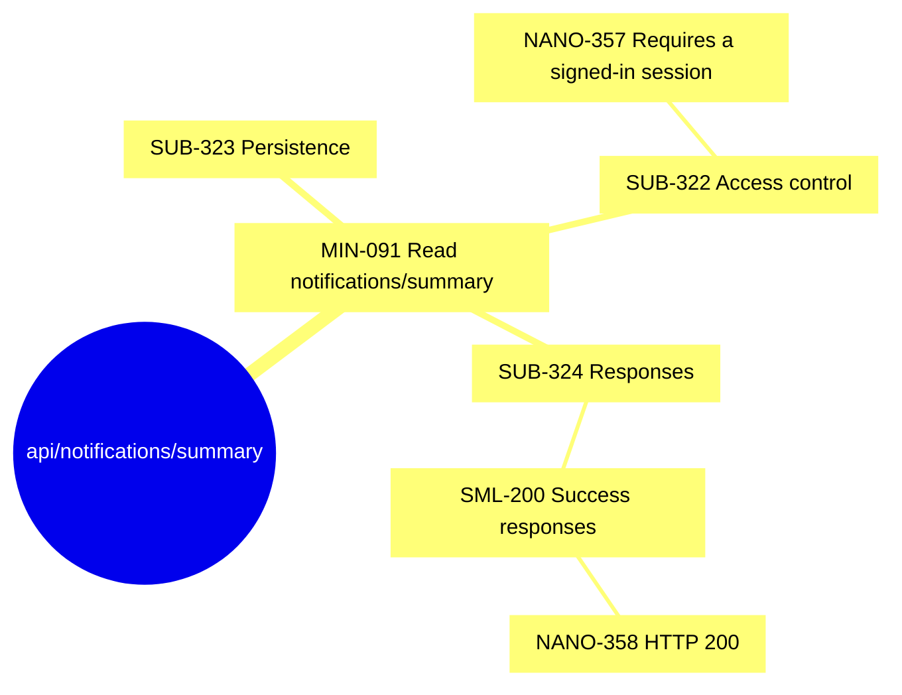

# api/notifications (MOD-077)

Generated by `project-mindmap/tools/catalog.py` from `master/MASTER_PROJECT_GRAPH.json` at commit `9b3032f`. Do not edit by hand. Back to the [feature catalog](../FEATURE_CATALOG.md).

**Application:** apps/api (MOD-001). **Purpose:** API module: routes under /api/v1/notifications in apps/api/src/server.ts.

**Nodes by level:** MODULE 1, MAJOR 4, MINOR 5, SUB 20, SMALL 17, TINY 7, NANO 24. **Status:** IMPLEMENTED 78. **Verification:** PATH_LEVEL 64, VERIFIED 9.

**User roles that reach it:** authenticated.

**Known gaps:** MIN-090 no first-party web caller found; MIN-152 no first-party web caller found.

**Called from (web screens and components):** FEAT-174 Screen /notifications

## Module map (to minor features)

## FEAT-074 api/notifications

api/notifications

| ID       | Level | Parent   | Name                              | Description                                                                                                                                                 | Status      | Verification | Evidence                    | Related                                                       |
| -------- | ----- | -------- | --------------------------------- | ----------------------------------------------------------------------------------------------------------------------------------------------------------- | ----------- | ------------ | --------------------------- | ------------------------------------------------------------- |
| FEAT-074 | MAJOR | MOD-077  | api/notifications                 |                                                                                                                                                             | IMPLEMENTED |              | apps/api/src/server.ts:5978 |                                                               |
| MIN-089  | MINOR | FEAT-074 | Read notifications                | Notification Center Endpoints (F-14, BR-120) GET /api/v1/notifications for any signed-in session; durable (PostgreSQL); responds 200; 1 failure branch(es). | IMPLEMENTED | VERIFIED     | apps/api/src/server.ts:5978 | API-117, TEST-097, TEST-112, TEST-115, TEST-116, TEST-150 ... |
| SUB-315  | SUB   | MIN-089  | Access control                    | Who may call GET /api/v1/notifications: any signed-in session.                                                                                              | IMPLEMENTED | PATH_LEVEL   | apps/api/src/server.ts:5978 |                                                               |
| NANO-351 | NANO  | SUB-315  | Requires a signed-in session      | Requests without a valid session token are rejected with 401 UNAUTHENTICATED.                                                                               | IMPLEMENTED | PATH_LEVEL   | apps/api/src/server.ts:5978 | ROLE-001                                                      |
| SUB-316  | SUB   | MIN-089  | Persistence                       | Durable: writes go through the PostgreSQL store.                                                                                                            | IMPLEMENTED | PATH_LEVEL   | apps/api/src/server.ts:5978 |                                                               |
| SUB-317  | SUB   | MIN-089  | Responses                         | Success 200; 1 explicit failure branch(es) besides validation and access errors.                                                                            | IMPLEMENTED | PATH_LEVEL   | apps/api/src/server.ts:5978 |                                                               |
| SML-195  | SMALL | SUB-317  | Success responses                 | HTTP 200.                                                                                                                                                   | IMPLEMENTED | PATH_LEVEL   | apps/api/src/server.ts:5978 |                                                               |
| NANO-352 | NANO  | SML-195  | HTTP 200                          | Replies 200 when the operation succeeds.                                                                                                                    | IMPLEMENTED | PATH_LEVEL   | apps/api/src/server.ts:5978 |                                                               |
| SML-196  | SMALL | SUB-317  | Failure branches                  | 1 DomainError branch(es) in the handler, mapped to HTTP by the global error handler.                                                                        | IMPLEMENTED | PATH_LEVEL   | apps/api/src/server.ts:5978 |                                                               |
| NANO-353 | NANO  | SML-196  | NOT_FOUND 404: Profile not found. | Throws DomainError(NOT_FOUND) "Profile not found." -> HTTP 404.                                                                                             | IMPLEMENTED | PATH_LEVEL   | apps/api/src/server.ts:5987 | ERR-015                                                       |

## FEAT-076 api/notifications/mark-read

api/notifications/mark-read

| ID        | Level | Parent   | Name                               | Description                                                                                                                                                                                                                                        | Status      | Verification | Evidence                                             | Related                                         |
| --------- | ----- | -------- | ---------------------------------- | -------------------------------------------------------------------------------------------------------------------------------------------------------------------------------------------------------------------------------------------------- | ----------- | ------------ | ---------------------------------------------------- | ----------------------------------------------- |
| FEAT-076  | MAJOR | MOD-077  | api/notifications/mark-read        |                                                                                                                                                                                                                                                    | IMPLEMENTED |              | apps/api/src/server.ts:6018                          |                                                 |
| MIN-242   | MINOR | FEAT-076 | Submit notifications/mark-read     | POST /api/v1/notifications/mark-read for any signed-in session; validates MarkNotificationsReadInputSchema; calls resolveMarkReadTargets, markNotificationsAsRead; durable (PostgreSQL); writes notifications; responds 200; 1 failure branch(es). | IMPLEMENTED | VERIFIED     | apps/api/src/server.ts:6018                          | API-119, TEST-097, TEST-116, TEST-156, TEST-191 |
| SUB-999   | SUB   | MIN-242  | Access control                     | Who may call POST /api/v1/notifications/mark-read: any signed-in session.                                                                                                                                                                          | IMPLEMENTED | PATH_LEVEL   | apps/api/src/server.ts:6018                          |                                                 |
| NANO-1608 | NANO  | SUB-999  | Requires a signed-in session       | Requests without a valid session token are rejected with 401 UNAUTHENTICATED.                                                                                                                                                                      | IMPLEMENTED | PATH_LEVEL   | apps/api/src/server.ts:6018                          | ROLE-001                                        |
| SUB-1000  | SUB   | MIN-242  | Request validation                 | The request is parsed with MarkNotificationsReadInputSchema; a failure returns 400 with field details before any business logic runs.                                                                                                              | IMPLEMENTED | PATH_LEVEL   | apps/api/src/server.ts:6018                          |                                                 |
| SML-805   | SMALL | SUB-1000 | MarkNotificationsReadInputSchema   | MarkNotificationsReadInputSchema: 2 field(s)                                                                                                                                                                                                       | IMPLEMENTED | PATH_LEVEL   | packages/contracts/src/index.ts:423                  | SCH-029                                         |
| TNY-380   | TINY  | SML-805  | Field notificationIds              | notificationIds (array, optional): list of string; maximum 200 items; optional                                                                                                                                                                     | IMPLEMENTED | PATH_LEVEL   | packages/contracts/src/index.ts:424                  |                                                 |
| NANO-1609 | NANO  | TNY-380  | notificationIds: list of string    | notificationIds list of string.                                                                                                                                                                                                                    | IMPLEMENTED | PATH_LEVEL   | packages/contracts/src/index.ts:424                  |                                                 |
| NANO-1610 | NANO  | TNY-380  | notificationIds: maximum 200 items | notificationIds maximum 200 items.                                                                                                                                                                                                                 | IMPLEMENTED | PATH_LEVEL   | packages/contracts/src/index.ts:424                  |                                                 |
| NANO-1611 | NANO  | TNY-380  | notificationIds: optional          | notificationIds optional.                                                                                                                                                                                                                          | IMPLEMENTED | PATH_LEVEL   | packages/contracts/src/index.ts:424                  |                                                 |
| TNY-381   | TINY  | SML-805  | Field all                          | all (boolean, optional): optional                                                                                                                                                                                                                  | IMPLEMENTED | PATH_LEVEL   | packages/contracts/src/index.ts:425                  |                                                 |
| NANO-1612 | NANO  | TNY-381  | all: optional                      | all optional.                                                                                                                                                                                                                                      | IMPLEMENTED | PATH_LEVEL   | packages/contracts/src/index.ts:425                  |                                                 |
| SUB-1001  | SUB   | MIN-242  | Business rules                     | Domain functions from packages/domain called by the handler (2).                                                                                                                                                                                   | IMPLEMENTED | PATH_LEVEL   | apps/api/src/server.ts:6018                          |                                                 |
| SML-806   | SMALL | SUB-1001 | Rule resolveMarkReadTargets        | Calls resolveMarkReadTargets (packages/domain/src/notifications.ts). Rule status IMPLEMENTED; its own tests: VERIFIED.                                                                                                                             | IMPLEMENTED | VERIFIED     | packages/domain/src/notifications.ts:149             | RULE-163                                        |
| SML-807   | SMALL | SUB-1001 | Rule markNotificationsAsRead       | Calls markNotificationsAsRead (packages/domain/src/notifications.ts). Rule status IMPLEMENTED; its own tests: VERIFIED.                                                                                                                            | IMPLEMENTED | VERIFIED     | packages/domain/src/notifications.ts:168             | RULE-164                                        |
| SUB-1002  | SUB   | MIN-242  | Persistence                        | Durable: writes go through the PostgreSQL store.                                                                                                                                                                                                   | IMPLEMENTED | PATH_LEVEL   | apps/api/src/server.ts:6018                          |                                                 |
| SML-808   | SMALL | SUB-1002 | Writes notifications               | Writes table notifications (00007_notifications_schema.sql).                                                                                                                                                                                       | IMPLEMENTED | PATH_LEVEL   | supabase/migrations/00007_notifications_schema.sql:6 | DB-029                                          |
| SUB-1003  | SUB   | MIN-242  | Responses                          | Success 200; 1 explicit failure branch(es) besides validation and access errors.                                                                                                                                                                   | IMPLEMENTED | PATH_LEVEL   | apps/api/src/server.ts:6018                          |                                                 |
| SML-809   | SMALL | SUB-1003 | Success responses                  | HTTP 200.                                                                                                                                                                                                                                          | IMPLEMENTED | PATH_LEVEL   | apps/api/src/server.ts:6018                          |                                                 |
| NANO-1613 | NANO  | SML-809  | HTTP 200                           | Replies 200 when the operation succeeds.                                                                                                                                                                                                           | IMPLEMENTED | PATH_LEVEL   | apps/api/src/server.ts:6018                          |                                                 |
| SML-810   | SMALL | SUB-1003 | Failure branches                   | 1 DomainError branch(es) in the handler, mapped to HTTP by the global error handler.                                                                                                                                                               | IMPLEMENTED | PATH_LEVEL   | apps/api/src/server.ts:6018                          |                                                 |
| NANO-1614 | NANO  | SML-810  | NOT_FOUND 404: Profile not found.  | Throws DomainError(NOT_FOUND) "Profile not found." -> HTTP 404.                                                                                                                                                                                    | IMPLEMENTED | PATH_LEVEL   | apps/api/src/server.ts:6022                          | ERR-015                                         |

## FEAT-077 api/notifications/preferences

api/notifications/preferences

| ID       | Level | Parent   | Name                                                         | Description                                                                                                                                                                                                                                                                                         | Status      | Verification | Evidence                                              | Related                                         |
| -------- | ----- | -------- | ------------------------------------------------------------ | --------------------------------------------------------------------------------------------------------------------------------------------------------------------------------------------------------------------------------------------------------------------------------------------------- | ----------- | ------------ | ----------------------------------------------------- | ----------------------------------------------- |
| FEAT-077 | MAJOR | MOD-077  | api/notifications/preferences                                |                                                                                                                                                                                                                                                                                                     | IMPLEMENTED |              | apps/api/src/server.ts:6048                           |                                                 |
| MIN-090  | MINOR | FEAT-077 | Read notifications/preferences                               | GET /api/v1/notifications/preferences for any signed-in session; calls createDefaultNotificationPreferences; durable (PostgreSQL); responds 200; 1 failure branch(es). Gaps: no first-party web caller found                                                                                        | IMPLEMENTED | VERIFIED     | apps/api/src/server.ts:6048                           | API-120, TEST-097, TEST-116, TEST-156           |
| SUB-318  | SUB   | MIN-090  | Access control                                               | Who may call GET /api/v1/notifications/preferences: any signed-in session.                                                                                                                                                                                                                          | IMPLEMENTED | PATH_LEVEL   | apps/api/src/server.ts:6048                           |                                                 |
| NANO-354 | NANO  | SUB-318  | Requires a signed-in session                                 | Requests without a valid session token are rejected with 401 UNAUTHENTICATED.                                                                                                                                                                                                                       | IMPLEMENTED | PATH_LEVEL   | apps/api/src/server.ts:6048                           | ROLE-001                                        |
| SUB-319  | SUB   | MIN-090  | Business rules                                               | Domain functions from packages/domain called by the handler (1).                                                                                                                                                                                                                                    | IMPLEMENTED | PATH_LEVEL   | apps/api/src/server.ts:6048                           |                                                 |
| SML-197  | SMALL | SUB-319  | Rule createDefaultNotificationPreferences                    | Calls createDefaultNotificationPreferences (packages/domain/src/notifications.ts). Rule status IMPLEMENTED; its own tests: VERIFIED.                                                                                                                                                                | IMPLEMENTED | VERIFIED     | packages/domain/src/notifications.ts:70               | RULE-160                                        |
| SUB-320  | SUB   | MIN-090  | Persistence                                                  | Durable: writes go through the PostgreSQL store.                                                                                                                                                                                                                                                    | IMPLEMENTED | PATH_LEVEL   | apps/api/src/server.ts:6048                           |                                                 |
| SUB-321  | SUB   | MIN-090  | Responses                                                    | Success 200; 1 explicit failure branch(es) besides validation and access errors.                                                                                                                                                                                                                    | IMPLEMENTED | PATH_LEVEL   | apps/api/src/server.ts:6048                           |                                                 |
| SML-198  | SMALL | SUB-321  | Success responses                                            | HTTP 200.                                                                                                                                                                                                                                                                                           | IMPLEMENTED | PATH_LEVEL   | apps/api/src/server.ts:6048                           |                                                 |
| NANO-355 | NANO  | SML-198  | HTTP 200                                                     | Replies 200 when the operation succeeds.                                                                                                                                                                                                                                                            | IMPLEMENTED | PATH_LEVEL   | apps/api/src/server.ts:6048                           |                                                 |
| SML-199  | SMALL | SUB-321  | Failure branches                                             | 1 DomainError branch(es) in the handler, mapped to HTTP by the global error handler.                                                                                                                                                                                                                | IMPLEMENTED | PATH_LEVEL   | apps/api/src/server.ts:6048                           |                                                 |
| NANO-356 | NANO  | SML-199  | NOT_FOUND 404: Profile not found.                            | Throws DomainError(NOT_FOUND) "Profile not found." -> HTTP 404.                                                                                                                                                                                                                                     | IMPLEMENTED | PATH_LEVEL   | apps/api/src/server.ts:6052                           | ERR-015                                         |
| MIN-152  | MINOR | FEAT-077 | Update notifications/preferences                             | PATCH /api/v1/notifications/preferences for any signed-in session; validates UpdateNotificationPreferencesInputSchema; calls createDefaultNotificationPreferences; durable (PostgreSQL); writes notification_preferences; responds 200; 1 failure branch(es). Gaps: no first-party web caller found | IMPLEMENTED | VERIFIED     | apps/api/src/server.ts:6064                           | API-121, TEST-097, TEST-116, TEST-156, TEST-191 |
| SUB-554  | SUB   | MIN-152  | Access control                                               | Who may call PATCH /api/v1/notifications/preferences: any signed-in session.                                                                                                                                                                                                                        | IMPLEMENTED | PATH_LEVEL   | apps/api/src/server.ts:6064                           |                                                 |
| NANO-689 | NANO  | SUB-554  | Requires a signed-in session                                 | Requests without a valid session token are rejected with 401 UNAUTHENTICATED.                                                                                                                                                                                                                       | IMPLEMENTED | PATH_LEVEL   | apps/api/src/server.ts:6064                           | ROLE-001                                        |
| SUB-555  | SUB   | MIN-152  | Request validation                                           | The request is parsed with UpdateNotificationPreferencesInputSchema; a failure returns 400 with field details before any business logic runs.                                                                                                                                                       | IMPLEMENTED | PATH_LEVEL   | apps/api/src/server.ts:6064                           |                                                 |
| SML-371  | SMALL | SUB-555  | UpdateNotificationPreferencesInputSchema                     | UpdateNotificationPreferencesInputSchema: 5 field(s)                                                                                                                                                                                                                                                | IMPLEMENTED | PATH_LEVEL   | packages/contracts/src/index.ts:430                   | SCH-030                                         |
| TNY-084  | TINY  | SML-371  | Field allowMessages                                          | allowMessages (boolean, optional): optional                                                                                                                                                                                                                                                         | IMPLEMENTED | PATH_LEVEL   | packages/contracts/src/index.ts:431                   |                                                 |
| NANO-690 | NANO  | TNY-084  | allowMessages: optional                                      | allowMessages optional.                                                                                                                                                                                                                                                                             | IMPLEMENTED | PATH_LEVEL   | packages/contracts/src/index.ts:431                   |                                                 |
| TNY-085  | TINY  | SML-371  | Field allowMentions                                          | allowMentions (boolean, optional): optional                                                                                                                                                                                                                                                         | IMPLEMENTED | PATH_LEVEL   | packages/contracts/src/index.ts:432                   |                                                 |
| NANO-691 | NANO  | TNY-085  | allowMentions: optional                                      | allowMentions optional.                                                                                                                                                                                                                                                                             | IMPLEMENTED | PATH_LEVEL   | packages/contracts/src/index.ts:432                   |                                                 |
| TNY-086  | TINY  | SML-371  | Field allowApplications                                      | allowApplications (boolean, optional): optional                                                                                                                                                                                                                                                     | IMPLEMENTED | PATH_LEVEL   | packages/contracts/src/index.ts:433                   |                                                 |
| NANO-692 | NANO  | TNY-086  | allowApplications: optional                                  | allowApplications optional.                                                                                                                                                                                                                                                                         | IMPLEMENTED | PATH_LEVEL   | packages/contracts/src/index.ts:433                   |                                                 |
| TNY-087  | TINY  | SML-371  | Field allowCourseUpdates                                     | allowCourseUpdates (boolean, optional): optional                                                                                                                                                                                                                                                    | IMPLEMENTED | PATH_LEVEL   | packages/contracts/src/index.ts:434                   |                                                 |
| NANO-693 | NANO  | TNY-087  | allowCourseUpdates: optional                                 | allowCourseUpdates optional.                                                                                                                                                                                                                                                                        | IMPLEMENTED | PATH_LEVEL   | packages/contracts/src/index.ts:434                   |                                                 |
| TNY-088  | TINY  | SML-371  | Field emailDigestFrequency                                   | emailDigestFrequency (enum, optional): one of: realtime, daily, weekly, never; optional                                                                                                                                                                                                             | IMPLEMENTED | PATH_LEVEL   | packages/contracts/src/index.ts:435                   |                                                 |
| NANO-694 | NANO  | TNY-088  | emailDigestFrequency: one of: realtime, daily, weekly, never | emailDigestFrequency one of: realtime, daily, weekly, never.                                                                                                                                                                                                                                        | IMPLEMENTED | PATH_LEVEL   | packages/contracts/src/index.ts:435                   |                                                 |
| NANO-695 | NANO  | TNY-088  | emailDigestFrequency: optional                               | emailDigestFrequency optional.                                                                                                                                                                                                                                                                      | IMPLEMENTED | PATH_LEVEL   | packages/contracts/src/index.ts:435                   |                                                 |
| SUB-556  | SUB   | MIN-152  | Business rules                                               | Domain functions from packages/domain called by the handler (1).                                                                                                                                                                                                                                    | IMPLEMENTED | PATH_LEVEL   | apps/api/src/server.ts:6064                           |                                                 |
| SML-372  | SMALL | SUB-556  | Rule createDefaultNotificationPreferences                    | Calls createDefaultNotificationPreferences (packages/domain/src/notifications.ts). Rule status IMPLEMENTED; its own tests: VERIFIED.                                                                                                                                                                | IMPLEMENTED | VERIFIED     | packages/domain/src/notifications.ts:70               | RULE-160                                        |
| SUB-557  | SUB   | MIN-152  | Persistence                                                  | Durable: writes go through the PostgreSQL store.                                                                                                                                                                                                                                                    | IMPLEMENTED | PATH_LEVEL   | apps/api/src/server.ts:6064                           |                                                 |
| SML-373  | SMALL | SUB-557  | Writes notification_preferences                              | Writes table notification_preferences (00007_notifications_schema.sql).                                                                                                                                                                                                                             | IMPLEMENTED | PATH_LEVEL   | supabase/migrations/00007_notifications_schema.sql:24 | DB-030                                          |
| SUB-558  | SUB   | MIN-152  | Responses                                                    | Success 200; 1 explicit failure branch(es) besides validation and access errors.                                                                                                                                                                                                                    | IMPLEMENTED | PATH_LEVEL   | apps/api/src/server.ts:6064                           |                                                 |
| SML-374  | SMALL | SUB-558  | Success responses                                            | HTTP 200.                                                                                                                                                                                                                                                                                           | IMPLEMENTED | PATH_LEVEL   | apps/api/src/server.ts:6064                           |                                                 |
| NANO-696 | NANO  | SML-374  | HTTP 200                                                     | Replies 200 when the operation succeeds.                                                                                                                                                                                                                                                            | IMPLEMENTED | PATH_LEVEL   | apps/api/src/server.ts:6064                           |                                                 |
| SML-375  | SMALL | SUB-558  | Failure branches                                             | 1 DomainError branch(es) in the handler, mapped to HTTP by the global error handler.                                                                                                                                                                                                                | IMPLEMENTED | PATH_LEVEL   | apps/api/src/server.ts:6064                           |                                                 |
| NANO-697 | NANO  | SML-375  | NOT_FOUND 404: Profile not found.                            | Throws DomainError(NOT_FOUND) "Profile not found." -> HTTP 404.                                                                                                                                                                                                                                     | IMPLEMENTED | PATH_LEVEL   | apps/api/src/server.ts:6070                           | ERR-015                                         |

## FEAT-075 api/notifications/summary

api/notifications/summary

| ID       | Level | Parent   | Name                         | Description                                                                                                                                                           | Status      | Verification | Evidence                    | Related                                         |
| -------- | ----- | -------- | ---------------------------- | --------------------------------------------------------------------------------------------------------------------------------------------------------------------- | ----------- | ------------ | --------------------------- | ----------------------------------------------- |
| FEAT-075 | MAJOR | MOD-077  | api/notifications/summary    |                                                                                                                                                                       | IMPLEMENTED |              | apps/api/src/server.ts:6009 |                                                 |
| MIN-091  | MINOR | FEAT-075 | Read notifications/summary   | The header badge: one small read on every page, instead of the list. GET /api/v1/notifications/summary for any signed-in session; durable (PostgreSQL); responds 200. | IMPLEMENTED | VERIFIED     | apps/api/src/server.ts:6009 | API-118, TEST-056, TEST-097, TEST-112, TEST-156 |
| SUB-322  | SUB   | MIN-091  | Access control               | Who may call GET /api/v1/notifications/summary: any signed-in session.                                                                                                | IMPLEMENTED | PATH_LEVEL   | apps/api/src/server.ts:6009 |                                                 |
| NANO-357 | NANO  | SUB-322  | Requires a signed-in session | Requests without a valid session token are rejected with 401 UNAUTHENTICATED.                                                                                         | IMPLEMENTED | PATH_LEVEL   | apps/api/src/server.ts:6009 | ROLE-001                                        |
| SUB-323  | SUB   | MIN-091  | Persistence                  | Durable: writes go through the PostgreSQL store.                                                                                                                      | IMPLEMENTED | PATH_LEVEL   | apps/api/src/server.ts:6009 |                                                 |
| SUB-324  | SUB   | MIN-091  | Responses                    | Success 200; 0 explicit failure branch(es) besides validation and access errors.                                                                                      | IMPLEMENTED | PATH_LEVEL   | apps/api/src/server.ts:6009 |                                                 |
| SML-200  | SMALL | SUB-324  | Success responses            | HTTP 200.                                                                                                                                                             | IMPLEMENTED | PATH_LEVEL   | apps/api/src/server.ts:6009 |                                                 |
| NANO-358 | NANO  | SML-200  | HTTP 200                     | Replies 200 when the operation succeeds.                                                                                                                              | IMPLEMENTED | PATH_LEVEL   | apps/api/src/server.ts:6009 |                                                 |
