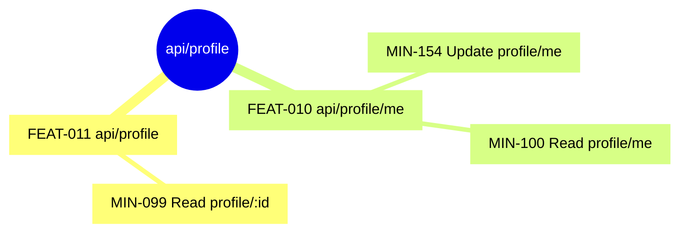
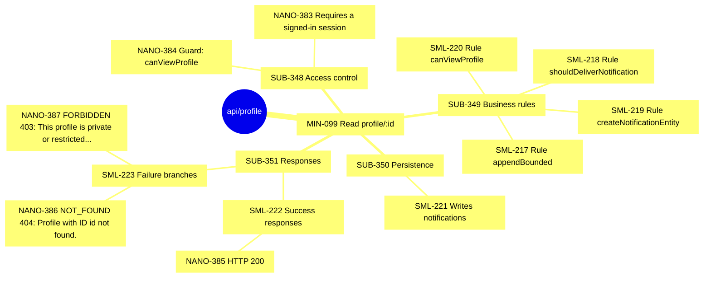
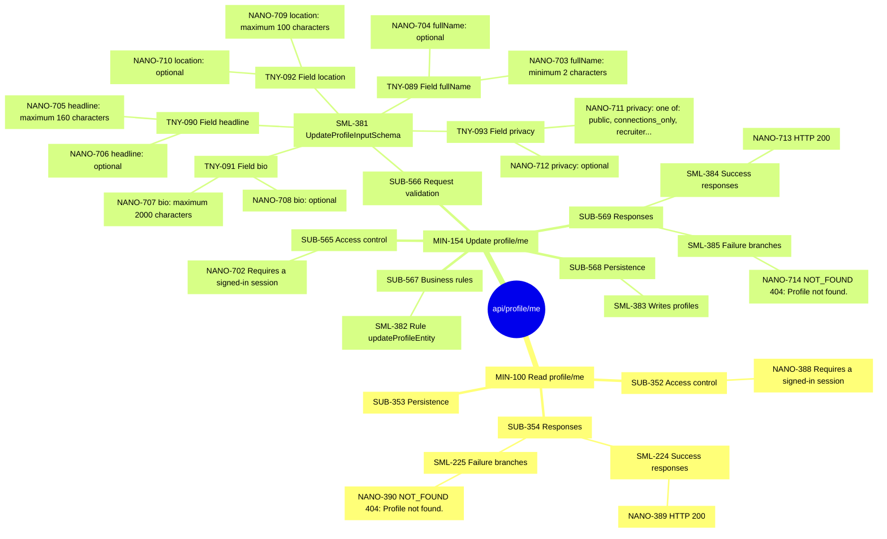

# api/profile (MOD-056)

Generated by `project-mindmap/tools/catalog.py` from `master/MASTER_PROJECT_GRAPH.json` at commit `9b3032f`. Do not edit by hand. Back to the [feature catalog](../FEATURE_CATALOG.md).

**Application:** apps/api (MOD-001). **Purpose:** API module: routes under /api/v1/profile in apps/api/src/server.ts.

**Nodes by level:** MODULE 1, MAJOR 2, MINOR 3, SUB 12, SMALL 14, TINY 5, NANO 21. **Status:** IMPLEMENTED 58. **Verification:** PATH_LEVEL 47, UNKNOWN 1, VERIFIED 7.

**User roles that reach it:** authenticated.

**Known gaps:** MIN-099 no first-party web caller found; MIN-100 no first-party web caller found.

**Called from (web screens and components):** FEAT-177 Screen /profile

## Module map (to minor features)

## FEAT-011 api/profile

api/profile

| ID       | Level | Parent   | Name                                                                      | Description                                                                                                                                                                                                                                                        | Status      | Verification | Evidence                                             | Related                                                       |
| -------- | ----- | -------- | ------------------------------------------------------------------------- | ------------------------------------------------------------------------------------------------------------------------------------------------------------------------------------------------------------------------------------------------------------------ | ----------- | ------------ | ---------------------------------------------------- | ------------------------------------------------------------- |
| FEAT-011 | MAJOR | MOD-056  | api/profile                                                               |                                                                                                                                                                                                                                                                    | IMPLEMENTED |              | apps/api/src/server.ts:1348                          |                                                               |
| MIN-099  | MINOR | FEAT-011 | Read profile/:id                                                          | GET /api/v1/profile/:id for any signed-in session; calls appendBounded, shouldDeliverNotification, createNotificationEntity, canViewProfile; durable (PostgreSQL); writes notifications; responds 200; 2 failure branch(es). Gaps: no first-party web caller found | IMPLEMENTED | VERIFIED     | apps/api/src/server.ts:1348                          | API-013, TEST-082, TEST-090, TEST-096, TEST-102, TEST-104 ... |
| SUB-348  | SUB   | MIN-099  | Access control                                                            | Who may call GET /api/v1/profile/:id: any signed-in session.                                                                                                                                                                                                       | IMPLEMENTED | PATH_LEVEL   | apps/api/src/server.ts:1348                          |                                                               |
| NANO-383 | NANO  | SUB-348  | Requires a signed-in session                                              | Requests without a valid session token are rejected with 401 UNAUTHENTICATED.                                                                                                                                                                                      | IMPLEMENTED | PATH_LEVEL   | apps/api/src/server.ts:1348                          | ROLE-001                                                      |
| NANO-384 | NANO  | SUB-348  | Guard: canViewProfile                                                     | Guard canViewProfile must pass before the handler runs.                                                                                                                                                                                                            | IMPLEMENTED | PATH_LEVEL   | apps/api/src/server.ts:1348                          |                                                               |
| SUB-349  | SUB   | MIN-099  | Business rules                                                            | Domain functions from packages/domain called by the handler (4).                                                                                                                                                                                                   | IMPLEMENTED | PATH_LEVEL   | apps/api/src/server.ts:1348                          |                                                               |
| SML-217  | SMALL | SUB-349  | Rule appendBounded                                                        | Calls appendBounded (packages/domain/src/analytics.ts). Rule status IMPLEMENTED; its own tests: VERIFIED.                                                                                                                                                          | IMPLEMENTED | VERIFIED     | packages/domain/src/analytics.ts:183                 | RULE-029                                                      |
| SML-218  | SMALL | SUB-349  | Rule shouldDeliverNotification                                            | Calls shouldDeliverNotification (packages/domain/src/notifications.ts). Rule status IMPLEMENTED; its own tests: VERIFIED.                                                                                                                                          | IMPLEMENTED | VERIFIED     | packages/domain/src/notifications.ts:89              | RULE-161                                                      |
| SML-219  | SMALL | SUB-349  | Rule createNotificationEntity                                             | Calls createNotificationEntity (packages/domain/src/notifications.ts). Rule status IMPLEMENTED; its own tests: VERIFIED.                                                                                                                                           | IMPLEMENTED | VERIFIED     | packages/domain/src/notifications.ts:117             | RULE-162                                                      |
| SML-220  | SMALL | SUB-349  | Rule canViewProfile                                                       | Calls canViewProfile (packages/domain/src/profile.ts). Rule status IMPLEMENTED; its own tests: VERIFIED.                                                                                                                                                           | IMPLEMENTED | VERIFIED     | packages/domain/src/profile.ts:36                    | RULE-178                                                      |
| SUB-350  | SUB   | MIN-099  | Persistence                                                               | Durable: writes go through the PostgreSQL store.                                                                                                                                                                                                                   | IMPLEMENTED | PATH_LEVEL   | apps/api/src/server.ts:1348                          |                                                               |
| SML-221  | SMALL | SUB-350  | Writes notifications                                                      | Writes table notifications (00007_notifications_schema.sql).                                                                                                                                                                                                       | IMPLEMENTED | PATH_LEVEL   | supabase/migrations/00007_notifications_schema.sql:6 | DB-029                                                        |
| SUB-351  | SUB   | MIN-099  | Responses                                                                 | Success 200; 2 explicit failure branch(es) besides validation and access errors.                                                                                                                                                                                   | IMPLEMENTED | PATH_LEVEL   | apps/api/src/server.ts:1348                          |                                                               |
| SML-222  | SMALL | SUB-351  | Success responses                                                         | HTTP 200.                                                                                                                                                                                                                                                          | IMPLEMENTED | PATH_LEVEL   | apps/api/src/server.ts:1348                          |                                                               |
| NANO-385 | NANO  | SML-222  | HTTP 200                                                                  | Replies 200 when the operation succeeds.                                                                                                                                                                                                                           | IMPLEMENTED | PATH_LEVEL   | apps/api/src/server.ts:1348                          |                                                               |
| SML-223  | SMALL | SUB-351  | Failure branches                                                          | 2 DomainError branch(es) in the handler, mapped to HTTP by the global error handler.                                                                                                                                                                               | IMPLEMENTED | PATH_LEVEL   | apps/api/src/server.ts:1348                          |                                                               |
| NANO-386 | NANO  | SML-223  | NOT_FOUND 404: Profile with ID ${id} not found.                           | Throws DomainError(NOT_FOUND) "Profile with ID ${id} not found." -> HTTP 404.                                                                                                                                                                                      | IMPLEMENTED | PATH_LEVEL   | apps/api/src/server.ts:1354                          | ERR-016                                                       |
| NANO-387 | NANO  | SML-223  | FORBIDDEN 403: This profile is private or restricted to authorized roles. | Throws DomainError(FORBIDDEN) "This profile is private or restricted to authorized roles." -> HTTP 403.                                                                                                                                                            | IMPLEMENTED | PATH_LEVEL   | apps/api/src/server.ts:1365                          | ERR-017                                                       |

## FEAT-010 api/profile/me

api/profile/me

| ID       | Level | Parent   | Name                                                                | Description                                                                                                                                                                                   | Status      | Verification | Evidence                                      | Related                                                       |
| -------- | ----- | -------- | ------------------------------------------------------------------- | --------------------------------------------------------------------------------------------------------------------------------------------------------------------------------------------- | ----------- | ------------ | --------------------------------------------- | ------------------------------------------------------------- |
| FEAT-010 | MAJOR | MOD-056  | api/profile/me                                                      |                                                                                                                                                                                               | IMPLEMENTED |              | apps/api/src/server.ts:1324                   |                                                               |
| MIN-100  | MINOR | FEAT-010 | Read profile/me                                                     | Profile Routes GET /api/v1/profile/me for any signed-in session; durable (PostgreSQL); responds 200; 1 failure branch(es). Gaps: no first-party web caller found                              | IMPLEMENTED | VERIFIED     | apps/api/src/server.ts:1324                   | API-011, TEST-082, TEST-090, TEST-096, TEST-102, TEST-104 ... |
| SUB-352  | SUB   | MIN-100  | Access control                                                      | Who may call GET /api/v1/profile/me: any signed-in session.                                                                                                                                   | IMPLEMENTED | PATH_LEVEL   | apps/api/src/server.ts:1324                   |                                                               |
| NANO-388 | NANO  | SUB-352  | Requires a signed-in session                                        | Requests without a valid session token are rejected with 401 UNAUTHENTICATED.                                                                                                                 | IMPLEMENTED | PATH_LEVEL   | apps/api/src/server.ts:1324                   | ROLE-001                                                      |
| SUB-353  | SUB   | MIN-100  | Persistence                                                         | Durable: writes go through the PostgreSQL store.                                                                                                                                              | IMPLEMENTED | PATH_LEVEL   | apps/api/src/server.ts:1324                   |                                                               |
| SUB-354  | SUB   | MIN-100  | Responses                                                           | Success 200; 1 explicit failure branch(es) besides validation and access errors.                                                                                                              | IMPLEMENTED | PATH_LEVEL   | apps/api/src/server.ts:1324                   |                                                               |
| SML-224  | SMALL | SUB-354  | Success responses                                                   | HTTP 200.                                                                                                                                                                                     | IMPLEMENTED | PATH_LEVEL   | apps/api/src/server.ts:1324                   |                                                               |
| NANO-389 | NANO  | SML-224  | HTTP 200                                                            | Replies 200 when the operation succeeds.                                                                                                                                                      | IMPLEMENTED | PATH_LEVEL   | apps/api/src/server.ts:1324                   |                                                               |
| SML-225  | SMALL | SUB-354  | Failure branches                                                    | 1 DomainError branch(es) in the handler, mapped to HTTP by the global error handler.                                                                                                          | IMPLEMENTED | PATH_LEVEL   | apps/api/src/server.ts:1324                   |                                                               |
| NANO-390 | NANO  | SML-225  | NOT_FOUND 404: Profile not found.                                   | Throws DomainError(NOT_FOUND) "Profile not found." -> HTTP 404.                                                                                                                               | IMPLEMENTED | PATH_LEVEL   | apps/api/src/server.ts:1328                   | ERR-015                                                       |
| MIN-154  | MINOR | FEAT-010 | Update profile/me                                                   | PATCH /api/v1/profile/me for any signed-in session; validates UpdateProfileInputSchema; calls updateProfileEntity; durable (PostgreSQL); writes profiles; responds 200; 1 failure branch(es). | IMPLEMENTED | VERIFIED     | apps/api/src/server.ts:1333                   | API-012, TEST-082, TEST-090, TEST-091, TEST-096, TEST-104 ... |
| SUB-565  | SUB   | MIN-154  | Access control                                                      | Who may call PATCH /api/v1/profile/me: any signed-in session.                                                                                                                                 | IMPLEMENTED | PATH_LEVEL   | apps/api/src/server.ts:1333                   |                                                               |
| NANO-702 | NANO  | SUB-565  | Requires a signed-in session                                        | Requests without a valid session token are rejected with 401 UNAUTHENTICATED.                                                                                                                 | IMPLEMENTED | PATH_LEVEL   | apps/api/src/server.ts:1333                   | ROLE-001                                                      |
| SUB-566  | SUB   | MIN-154  | Request validation                                                  | The request is parsed with UpdateProfileInputSchema; a failure returns 400 with field details before any business logic runs.                                                                 | IMPLEMENTED | PATH_LEVEL   | apps/api/src/server.ts:1333                   |                                                               |
| SML-381  | SMALL | SUB-566  | UpdateProfileInputSchema                                            | UpdateProfileInputSchema: 5 field(s)                                                                                                                                                          | IMPLEMENTED | PATH_LEVEL   | packages/contracts/src/index.ts:133           | SCH-007                                                       |
| TNY-089  | TINY  | SML-381  | Field fullName                                                      | fullName (string, optional): minimum 2 characters; optional                                                                                                                                   | IMPLEMENTED | PATH_LEVEL   | packages/contracts/src/index.ts:134           |                                                               |
| NANO-703 | NANO  | TNY-089  | fullName: minimum 2 characters                                      | fullName minimum 2 characters.                                                                                                                                                                | IMPLEMENTED | PATH_LEVEL   | packages/contracts/src/index.ts:134           |                                                               |
| NANO-704 | NANO  | TNY-089  | fullName: optional                                                  | fullName optional.                                                                                                                                                                            | IMPLEMENTED | PATH_LEVEL   | packages/contracts/src/index.ts:134           |                                                               |
| TNY-090  | TINY  | SML-381  | Field headline                                                      | headline (string, optional): maximum 160 characters; optional                                                                                                                                 | IMPLEMENTED | PATH_LEVEL   | packages/contracts/src/index.ts:135           |                                                               |
| NANO-705 | NANO  | TNY-090  | headline: maximum 160 characters                                    | headline maximum 160 characters.                                                                                                                                                              | IMPLEMENTED | PATH_LEVEL   | packages/contracts/src/index.ts:135           |                                                               |
| NANO-706 | NANO  | TNY-090  | headline: optional                                                  | headline optional.                                                                                                                                                                            | IMPLEMENTED | PATH_LEVEL   | packages/contracts/src/index.ts:135           |                                                               |
| TNY-091  | TINY  | SML-381  | Field bio                                                           | bio (string, optional): maximum 2000 characters; optional                                                                                                                                     | IMPLEMENTED | PATH_LEVEL   | packages/contracts/src/index.ts:136           |                                                               |
| NANO-707 | NANO  | TNY-091  | bio: maximum 2000 characters                                        | bio maximum 2000 characters.                                                                                                                                                                  | IMPLEMENTED | PATH_LEVEL   | packages/contracts/src/index.ts:136           |                                                               |
| NANO-708 | NANO  | TNY-091  | bio: optional                                                       | bio optional.                                                                                                                                                                                 | IMPLEMENTED | PATH_LEVEL   | packages/contracts/src/index.ts:136           |                                                               |
| TNY-092  | TINY  | SML-381  | Field location                                                      | location (string, optional): maximum 100 characters; optional                                                                                                                                 | IMPLEMENTED | PATH_LEVEL   | packages/contracts/src/index.ts:137           |                                                               |
| NANO-709 | NANO  | TNY-092  | location: maximum 100 characters                                    | location maximum 100 characters.                                                                                                                                                              | IMPLEMENTED | PATH_LEVEL   | packages/contracts/src/index.ts:137           |                                                               |
| NANO-710 | NANO  | TNY-092  | location: optional                                                  | location optional.                                                                                                                                                                            | IMPLEMENTED | PATH_LEVEL   | packages/contracts/src/index.ts:137           |                                                               |
| TNY-093  | TINY  | SML-381  | Field privacy                                                       | privacy (enum, optional): one of: public, connections_only, recruiters_only, private; optional                                                                                                | IMPLEMENTED | PATH_LEVEL   | packages/contracts/src/index.ts:138           |                                                               |
| NANO-711 | NANO  | TNY-093  | privacy: one of: public, connections_only, recruiters_only, private | privacy one of: public, connections_only, recruiters_only, private.                                                                                                                           | IMPLEMENTED | PATH_LEVEL   | packages/contracts/src/index.ts:138           |                                                               |
| NANO-712 | NANO  | TNY-093  | privacy: optional                                                   | privacy optional.                                                                                                                                                                             | IMPLEMENTED | PATH_LEVEL   | packages/contracts/src/index.ts:138           |                                                               |
| SUB-567  | SUB   | MIN-154  | Business rules                                                      | Domain functions from packages/domain called by the handler (1).                                                                                                                              | IMPLEMENTED | PATH_LEVEL   | apps/api/src/server.ts:1333                   |                                                               |
| SML-382  | SMALL | SUB-567  | Rule updateProfileEntity                                            | Calls updateProfileEntity (packages/domain/src/profile.ts). Rule status IMPLEMENTED; its own tests: UNKNOWN.                                                                                  | IMPLEMENTED | UNKNOWN      | packages/domain/src/profile.ts:15             | RULE-177                                                      |
| SUB-568  | SUB   | MIN-154  | Persistence                                                         | Durable: writes go through the PostgreSQL store.                                                                                                                                              | IMPLEMENTED | PATH_LEVEL   | apps/api/src/server.ts:1333                   |                                                               |
| SML-383  | SMALL | SUB-568  | Writes profiles                                                     | Writes table profiles (00001_core_schema.sql).                                                                                                                                                | IMPLEMENTED | PATH_LEVEL   | supabase/migrations/00001_core_schema.sql:114 | DB-002                                                        |
| SUB-569  | SUB   | MIN-154  | Responses                                                           | Success 200; 1 explicit failure branch(es) besides validation and access errors.                                                                                                              | IMPLEMENTED | PATH_LEVEL   | apps/api/src/server.ts:1333                   |                                                               |
| SML-384  | SMALL | SUB-569  | Success responses                                                   | HTTP 200.                                                                                                                                                                                     | IMPLEMENTED | PATH_LEVEL   | apps/api/src/server.ts:1333                   |                                                               |
| NANO-713 | NANO  | SML-384  | HTTP 200                                                            | Replies 200 when the operation succeeds.                                                                                                                                                      | IMPLEMENTED | PATH_LEVEL   | apps/api/src/server.ts:1333                   |                                                               |
| SML-385  | SMALL | SUB-569  | Failure branches                                                    | 1 DomainError branch(es) in the handler, mapped to HTTP by the global error handler.                                                                                                          | IMPLEMENTED | PATH_LEVEL   | apps/api/src/server.ts:1333                   |                                                               |
| NANO-714 | NANO  | SML-385  | NOT_FOUND 404: Profile not found.                                   | Throws DomainError(NOT_FOUND) "Profile not found." -> HTTP 404.                                                                                                                               | IMPLEMENTED | PATH_LEVEL   | apps/api/src/server.ts:1339                   | ERR-015                                                       |
