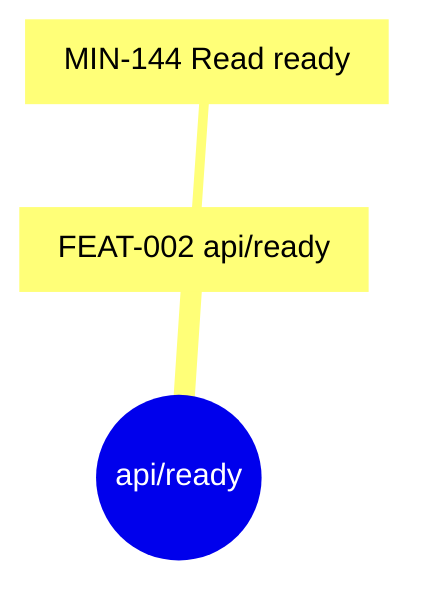
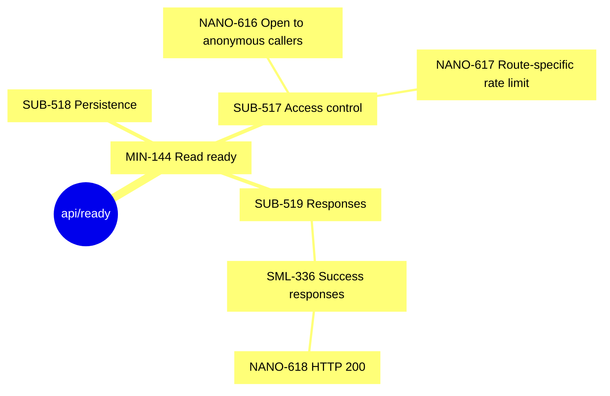

# api/ready (MOD-053)

Generated by `project-mindmap/tools/catalog.py` from `master/MASTER_PROJECT_GRAPH.json` at commit `9b3032f`. Do not edit by hand. Back to the [feature catalog](../FEATURE_CATALOG.md).

**Application:** apps/api (MOD-001). **Purpose:** API module: routes under /api/v1/ready in apps/api/src/server.ts.

**Nodes by level:** MODULE 1, MAJOR 1, MINOR 1, SUB 3, SMALL 1, NANO 3. **Status:** IMPLEMENTED 10. **Verification:** PATH_LEVEL 7, VERIFIED 1.

**User roles that reach it:** anonymous.

**Known gaps:** MIN-144 no first-party web caller found.

## Module map (to minor features)

## FEAT-002 api/ready

api/ready

| ID       | Level | Parent   | Name                      | Description                                                                                               | Status      | Verification | Evidence                   | Related                     |
| -------- | ----- | -------- | ------------------------- | --------------------------------------------------------------------------------------------------------- | ----------- | ------------ | -------------------------- | --------------------------- |
| FEAT-002 | MAJOR | MOD-053  | api/ready                 |                                                                                                           | IMPLEMENTED |              | apps/api/src/server.ts:807 |                             |
| MIN-144  | MINOR | FEAT-002 | Read ready                | GET /ready for anyone (public); durable (PostgreSQL); responds 200. Gaps: no first-party web caller found | IMPLEMENTED | VERIFIED     | apps/api/src/server.ts:807 | API-002, TEST-087, TEST-161 |
| SUB-517  | SUB   | MIN-144  | Access control            | Who may call GET /ready: anyone (public).                                                                 | IMPLEMENTED | PATH_LEVEL   | apps/api/src/server.ts:807 |                             |
| NANO-616 | NANO  | SUB-517  | Open to anonymous callers | auth: public.                                                                                             | IMPLEMENTED | PATH_LEVEL   | apps/api/src/server.ts:807 | ROLE-001                    |
| NANO-617 | NANO  | SUB-517  | Route-specific rate limit | This route sets its own rate-limit configuration (429 when exceeded).                                     | IMPLEMENTED | PATH_LEVEL   | apps/api/src/server.ts:807 |                             |
| SUB-518  | SUB   | MIN-144  | Persistence               | Durable: writes go through the PostgreSQL store.                                                          | IMPLEMENTED | PATH_LEVEL   | apps/api/src/server.ts:807 |                             |
| SUB-519  | SUB   | MIN-144  | Responses                 | Success 200; 0 explicit failure branch(es) besides validation and access errors.                          | IMPLEMENTED | PATH_LEVEL   | apps/api/src/server.ts:807 |                             |
| SML-336  | SMALL | SUB-519  | Success responses         | HTTP 200 (implicit).                                                                                      | IMPLEMENTED | PATH_LEVEL   | apps/api/src/server.ts:807 |                             |
| NANO-618 | NANO  | SML-336  | HTTP 200                  | Replies 200 when the operation succeeds (implicit default).                                               | IMPLEMENTED | PATH_LEVEL   | apps/api/src/server.ts:807 |                             |
