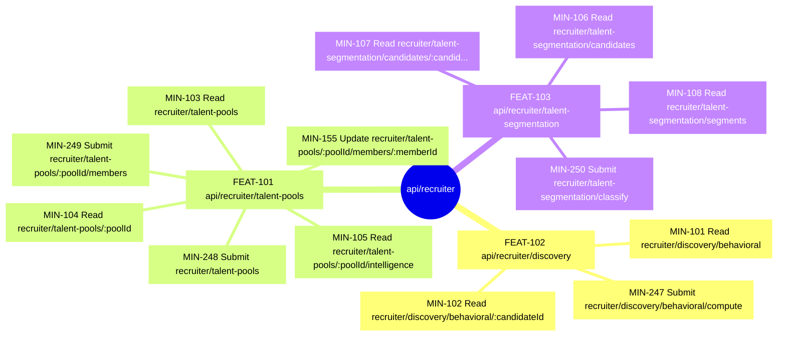
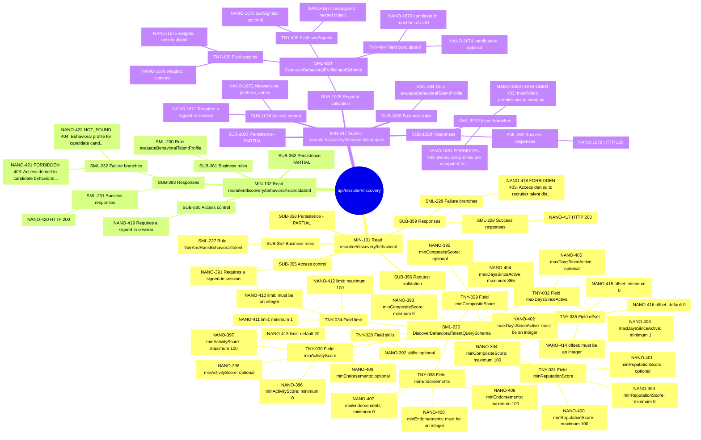

# api/recruiter (MOD-084)

Generated by `project-mindmap/tools/catalog.py` from `master/MASTER_PROJECT_GRAPH.json` at commit `9b3032f`. Do not edit by hand. Back to the [feature catalog](../FEATURE_CATALOG.md).

**Application:** apps/api (MOD-001). **Purpose:** API module: routes under /api/v1/recruiter in apps/api/src/server.ts.

**Nodes by level:** MODULE 1, MAJOR 3, MINOR 13, SUB 59, SMALL 47, TINY 42, NANO 170. **Status:** IMPLEMENTED 322, PARTIALLY_IMPLEMENTED 13. **Verification:** PATH_LEVEL 306, VERIFIED 25.

**User roles that reach it:** authenticated, institution_admin, platform_admin.

**Known gaps:** MIN-101 ephemeral: state held in process memory, lost on restart; MIN-101 no first-party web caller found; MIN-102 ephemeral: state held in process memory, lost on restart; MIN-102 no first-party web caller found; MIN-247 ephemeral: state held in process memory, lost on restart; MIN-247 no first-party web caller found; MIN-103 ephemeral: state held in process memory, lost on restart; MIN-103 no first-party web caller found; MIN-104 ephemeral: state held in process memory, lost on restart; MIN-104 no first-party web caller found; MIN-105 ephemeral: state held in process memory, lost on restart; MIN-105 no first-party web caller found; MIN-155 ephemeral: state held in process memory, lost on restart; MIN-155 no first-party web caller found; MIN-248 ephemeral: state held in process memory, lost on restart; MIN-248 no first-party web caller found; MIN-249 ephemeral: state held in process memory, lost on restart; MIN-249 no first-party web caller found; MIN-106 ephemeral: state held in process memory, lost on restart; MIN-106 no first-party web caller found; MIN-107 ephemeral: state held in process memory, lost on restart; MIN-107 no first-party web caller found; MIN-108 ephemeral: state held in process memory, lost on restart; MIN-108 no first-party web caller found; MIN-250 ephemeral: state held in process memory, lost on restart; MIN-250 no first-party web caller found.

## Module map (to minor features)

## FEAT-102 api/recruiter/discovery

api/recruiter/discovery

| ID        | Level | Parent   | Name                                                                                  | Description                                                                                                                                                                                                                                                                                                                                                                                         | Status                | Verification | Evidence                                               | Related                     |
| --------- | ----- | -------- | ------------------------------------------------------------------------------------- | --------------------------------------------------------------------------------------------------------------------------------------------------------------------------------------------------------------------------------------------------------------------------------------------------------------------------------------------------------------------------------------------------- | --------------------- | ------------ | ------------------------------------------------------ | --------------------------- |
| FEAT-102  | MAJOR | MOD-084  | api/recruiter/discovery                                                               |                                                                                                                                                                                                                                                                                                                                                                                                     | IMPLEMENTED           |              | apps/api/src/server.ts:8627                            |                             |
| MIN-101   | MINOR | FEAT-102 | Read recruiter/discovery/behavioral                                                   | 2. Discover & Rank Candidates by Behavioral Signals (F-159, F-146, F-130) GET /api/v1/recruiter/discovery/behavioral for any signed-in session; validates DiscoverBehavioralTalentQuerySchema; calls filterAndRankBehavioralTalent; ephemeral (process memory); responds 200; 1 failure branch(es). Gaps: ephemeral: state held in process memory, lost on restart; no first-party web caller found | IMPLEMENTED           | VERIFIED     | apps/api/src/server.ts:8678                            | API-179, TEST-091, TEST-172 |
| SUB-355   | SUB   | MIN-101  | Access control                                                                        | Who may call GET /api/v1/recruiter/discovery/behavioral: any signed-in session.                                                                                                                                                                                                                                                                                                                     | IMPLEMENTED           | PATH_LEVEL   | apps/api/src/server.ts:8678                            |                             |
| NANO-391  | NANO  | SUB-355  | Requires a signed-in session                                                          | Requests without a valid session token are rejected with 401 UNAUTHENTICATED.                                                                                                                                                                                                                                                                                                                       | IMPLEMENTED           | PATH_LEVEL   | apps/api/src/server.ts:8678                            | ROLE-001                    |
| SUB-356   | SUB   | MIN-101  | Request validation                                                                    | The request is parsed with DiscoverBehavioralTalentQuerySchema; a failure returns 400 with field details before any business logic runs.                                                                                                                                                                                                                                                            | IMPLEMENTED           | PATH_LEVEL   | apps/api/src/server.ts:8678                            |                             |
| SML-226   | SMALL | SUB-356  | DiscoverBehavioralTalentQuerySchema                                                   | DiscoverBehavioralTalentQuerySchema: 8 field(s)                                                                                                                                                                                                                                                                                                                                                     | IMPLEMENTED           | PATH_LEVEL   | packages/contracts/src/index.ts:1650                   | SCH-132                     |
| TNY-028   | TINY  | SML-226  | Field skills                                                                          | skills (string, optional): optional                                                                                                                                                                                                                                                                                                                                                                 | IMPLEMENTED           | PATH_LEVEL   | packages/contracts/src/index.ts:1651                   |                             |
| NANO-392  | NANO  | TNY-028  | skills: optional                                                                      | skills optional.                                                                                                                                                                                                                                                                                                                                                                                    | IMPLEMENTED           | PATH_LEVEL   | packages/contracts/src/index.ts:1651                   |                             |
| TNY-029   | TINY  | SML-226  | Field minCompositeScore                                                               | minCompositeScore (number, optional): minimum 0; maximum 100; optional                                                                                                                                                                                                                                                                                                                              | IMPLEMENTED           | PATH_LEVEL   | packages/contracts/src/index.ts:1652                   |                             |
| NANO-393  | NANO  | TNY-029  | minCompositeScore: minimum 0                                                          | minCompositeScore minimum 0.                                                                                                                                                                                                                                                                                                                                                                        | IMPLEMENTED           | PATH_LEVEL   | packages/contracts/src/index.ts:1652                   |                             |
| NANO-394  | NANO  | TNY-029  | minCompositeScore: maximum 100                                                        | minCompositeScore maximum 100.                                                                                                                                                                                                                                                                                                                                                                      | IMPLEMENTED           | PATH_LEVEL   | packages/contracts/src/index.ts:1652                   |                             |
| NANO-395  | NANO  | TNY-029  | minCompositeScore: optional                                                           | minCompositeScore optional.                                                                                                                                                                                                                                                                                                                                                                         | IMPLEMENTED           | PATH_LEVEL   | packages/contracts/src/index.ts:1652                   |                             |
| TNY-030   | TINY  | SML-226  | Field minActivityScore                                                                | minActivityScore (number, optional): minimum 0; maximum 100; optional                                                                                                                                                                                                                                                                                                                               | IMPLEMENTED           | PATH_LEVEL   | packages/contracts/src/index.ts:1653                   |                             |
| NANO-396  | NANO  | TNY-030  | minActivityScore: minimum 0                                                           | minActivityScore minimum 0.                                                                                                                                                                                                                                                                                                                                                                         | IMPLEMENTED           | PATH_LEVEL   | packages/contracts/src/index.ts:1653                   |                             |
| NANO-397  | NANO  | TNY-030  | minActivityScore: maximum 100                                                         | minActivityScore maximum 100.                                                                                                                                                                                                                                                                                                                                                                       | IMPLEMENTED           | PATH_LEVEL   | packages/contracts/src/index.ts:1653                   |                             |
| NANO-398  | NANO  | TNY-030  | minActivityScore: optional                                                            | minActivityScore optional.                                                                                                                                                                                                                                                                                                                                                                          | IMPLEMENTED           | PATH_LEVEL   | packages/contracts/src/index.ts:1653                   |                             |
| TNY-031   | TINY  | SML-226  | Field minReputationScore                                                              | minReputationScore (number, optional): minimum 0; maximum 100; optional                                                                                                                                                                                                                                                                                                                             | IMPLEMENTED           | PATH_LEVEL   | packages/contracts/src/index.ts:1654                   |                             |
| NANO-399  | NANO  | TNY-031  | minReputationScore: minimum 0                                                         | minReputationScore minimum 0.                                                                                                                                                                                                                                                                                                                                                                       | IMPLEMENTED           | PATH_LEVEL   | packages/contracts/src/index.ts:1654                   |                             |
| NANO-400  | NANO  | TNY-031  | minReputationScore: maximum 100                                                       | minReputationScore maximum 100.                                                                                                                                                                                                                                                                                                                                                                     | IMPLEMENTED           | PATH_LEVEL   | packages/contracts/src/index.ts:1654                   |                             |
| NANO-401  | NANO  | TNY-031  | minReputationScore: optional                                                          | minReputationScore optional.                                                                                                                                                                                                                                                                                                                                                                        | IMPLEMENTED           | PATH_LEVEL   | packages/contracts/src/index.ts:1654                   |                             |
| TNY-032   | TINY  | SML-226  | Field maxDaysSinceActive                                                              | maxDaysSinceActive (number, optional): must be an integer; minimum 1; maximum 365; optional                                                                                                                                                                                                                                                                                                         | IMPLEMENTED           | PATH_LEVEL   | packages/contracts/src/index.ts:1655                   |                             |
| NANO-402  | NANO  | TNY-032  | maxDaysSinceActive: must be an integer                                                | maxDaysSinceActive must be an integer.                                                                                                                                                                                                                                                                                                                                                              | IMPLEMENTED           | PATH_LEVEL   | packages/contracts/src/index.ts:1655                   |                             |
| NANO-403  | NANO  | TNY-032  | maxDaysSinceActive: minimum 1                                                         | maxDaysSinceActive minimum 1.                                                                                                                                                                                                                                                                                                                                                                       | IMPLEMENTED           | PATH_LEVEL   | packages/contracts/src/index.ts:1655                   |                             |
| NANO-404  | NANO  | TNY-032  | maxDaysSinceActive: maximum 365                                                       | maxDaysSinceActive maximum 365.                                                                                                                                                                                                                                                                                                                                                                     | IMPLEMENTED           | PATH_LEVEL   | packages/contracts/src/index.ts:1655                   |                             |
| NANO-405  | NANO  | TNY-032  | maxDaysSinceActive: optional                                                          | maxDaysSinceActive optional.                                                                                                                                                                                                                                                                                                                                                                        | IMPLEMENTED           | PATH_LEVEL   | packages/contracts/src/index.ts:1655                   |                             |
| TNY-033   | TINY  | SML-226  | Field minEndorsements                                                                 | minEndorsements (number, optional): must be an integer; minimum 0; maximum 100; optional                                                                                                                                                                                                                                                                                                            | IMPLEMENTED           | PATH_LEVEL   | packages/contracts/src/index.ts:1656                   |                             |
| NANO-406  | NANO  | TNY-033  | minEndorsements: must be an integer                                                   | minEndorsements must be an integer.                                                                                                                                                                                                                                                                                                                                                                 | IMPLEMENTED           | PATH_LEVEL   | packages/contracts/src/index.ts:1656                   |                             |
| NANO-407  | NANO  | TNY-033  | minEndorsements: minimum 0                                                            | minEndorsements minimum 0.                                                                                                                                                                                                                                                                                                                                                                          | IMPLEMENTED           | PATH_LEVEL   | packages/contracts/src/index.ts:1656                   |                             |
| NANO-408  | NANO  | TNY-033  | minEndorsements: maximum 100                                                          | minEndorsements maximum 100.                                                                                                                                                                                                                                                                                                                                                                        | IMPLEMENTED           | PATH_LEVEL   | packages/contracts/src/index.ts:1656                   |                             |
| NANO-409  | NANO  | TNY-033  | minEndorsements: optional                                                             | minEndorsements optional.                                                                                                                                                                                                                                                                                                                                                                           | IMPLEMENTED           | PATH_LEVEL   | packages/contracts/src/index.ts:1656                   |                             |
| TNY-034   | TINY  | SML-226  | Field limit                                                                           | limit (number, optional): must be an integer; minimum 1; maximum 100; default 20                                                                                                                                                                                                                                                                                                                    | IMPLEMENTED           | PATH_LEVEL   | packages/contracts/src/index.ts:1657                   |                             |
| NANO-410  | NANO  | TNY-034  | limit: must be an integer                                                             | limit must be an integer.                                                                                                                                                                                                                                                                                                                                                                           | IMPLEMENTED           | PATH_LEVEL   | packages/contracts/src/index.ts:1657                   |                             |
| NANO-411  | NANO  | TNY-034  | limit: minimum 1                                                                      | limit minimum 1.                                                                                                                                                                                                                                                                                                                                                                                    | IMPLEMENTED           | PATH_LEVEL   | packages/contracts/src/index.ts:1657                   |                             |
| NANO-412  | NANO  | TNY-034  | limit: maximum 100                                                                    | limit maximum 100.                                                                                                                                                                                                                                                                                                                                                                                  | IMPLEMENTED           | PATH_LEVEL   | packages/contracts/src/index.ts:1657                   |                             |
| NANO-413  | NANO  | TNY-034  | limit: default 20                                                                     | limit default 20.                                                                                                                                                                                                                                                                                                                                                                                   | IMPLEMENTED           | PATH_LEVEL   | packages/contracts/src/index.ts:1657                   |                             |
| TNY-035   | TINY  | SML-226  | Field offset                                                                          | offset (number, optional): must be an integer; minimum 0; default 0                                                                                                                                                                                                                                                                                                                                 | IMPLEMENTED           | PATH_LEVEL   | packages/contracts/src/index.ts:1658                   |                             |
| NANO-414  | NANO  | TNY-035  | offset: must be an integer                                                            | offset must be an integer.                                                                                                                                                                                                                                                                                                                                                                          | IMPLEMENTED           | PATH_LEVEL   | packages/contracts/src/index.ts:1658                   |                             |
| NANO-415  | NANO  | TNY-035  | offset: minimum 0                                                                     | offset minimum 0.                                                                                                                                                                                                                                                                                                                                                                                   | IMPLEMENTED           | PATH_LEVEL   | packages/contracts/src/index.ts:1658                   |                             |
| NANO-416  | NANO  | TNY-035  | offset: default 0                                                                     | offset default 0.                                                                                                                                                                                                                                                                                                                                                                                   | IMPLEMENTED           | PATH_LEVEL   | packages/contracts/src/index.ts:1658                   |                             |
| SUB-357   | SUB   | MIN-101  | Business rules                                                                        | Domain functions from packages/domain called by the handler (1).                                                                                                                                                                                                                                                                                                                                    | IMPLEMENTED           | PATH_LEVEL   | apps/api/src/server.ts:8678                            |                             |
| SML-227   | SMALL | SUB-357  | Rule filterAndRankBehavioralTalent                                                    | Calls filterAndRankBehavioralTalent (packages/domain/src/behavioral-talent-discovery.ts). Rule status IMPLEMENTED; its own tests: VERIFIED.                                                                                                                                                                                                                                                         | IMPLEMENTED           | VERIFIED     | packages/domain/src/behavioral-talent-discovery.ts:207 | RULE-069                    |
| SUB-358   | SUB   | MIN-101  | Persistence                                                                           | Ephemeral: state lives in API process memory and is lost on restart.                                                                                                                                                                                                                                                                                                                                | PARTIALLY_IMPLEMENTED | PATH_LEVEL   | apps/api/src/server.ts:8678                            |                             |
| SUB-359   | SUB   | MIN-101  | Responses                                                                             | Success 200; 1 explicit failure branch(es) besides validation and access errors.                                                                                                                                                                                                                                                                                                                    | IMPLEMENTED           | PATH_LEVEL   | apps/api/src/server.ts:8678                            |                             |
| SML-228   | SMALL | SUB-359  | Success responses                                                                     | HTTP 200.                                                                                                                                                                                                                                                                                                                                                                                           | IMPLEMENTED           | PATH_LEVEL   | apps/api/src/server.ts:8678                            |                             |
| NANO-417  | NANO  | SML-228  | HTTP 200                                                                              | Replies 200 when the operation succeeds.                                                                                                                                                                                                                                                                                                                                                            | IMPLEMENTED           | PATH_LEVEL   | apps/api/src/server.ts:8678                            |                             |
| SML-229   | SMALL | SUB-359  | Failure branches                                                                      | 1 DomainError branch(es) in the handler, mapped to HTTP by the global error handler.                                                                                                                                                                                                                                                                                                                | IMPLEMENTED           | PATH_LEVEL   | apps/api/src/server.ts:8678                            |                             |
| NANO-418  | NANO  | SML-229  | FORBIDDEN 403: Access denied to recruiter talent discovery.                           | Throws DomainError(FORBIDDEN) "Access denied to recruiter talent discovery." -> HTTP 403.                                                                                                                                                                                                                                                                                                           | IMPLEMENTED           | PATH_LEVEL   | apps/api/src/server.ts:8700                            | ERR-175                     |
| MIN-102   | MINOR | FEAT-102 | Read recruiter/discovery/behavioral/:candidateId                                      | 3. Get Behavioral Profile Breakdown for Candidate (F-159) GET /api/v1/recruiter/discovery/behavioral/:candidateId for any signed-in session; calls evaluateBehavioralTalentProfile; ephemeral (process memory); responds 200; 2 failure branch(es). Gaps: ephemeral: state held in process memory, lost on restart; no first-party web caller found                                                 | IMPLEMENTED           | VERIFIED     | apps/api/src/server.ts:8733                            | API-180, TEST-091, TEST-172 |
| SUB-360   | SUB   | MIN-102  | Access control                                                                        | Who may call GET /api/v1/recruiter/discovery/behavioral/:candidateId: any signed-in session.                                                                                                                                                                                                                                                                                                        | IMPLEMENTED           | PATH_LEVEL   | apps/api/src/server.ts:8733                            |                             |
| NANO-419  | NANO  | SUB-360  | Requires a signed-in session                                                          | Requests without a valid session token are rejected with 401 UNAUTHENTICATED.                                                                                                                                                                                                                                                                                                                       | IMPLEMENTED           | PATH_LEVEL   | apps/api/src/server.ts:8733                            | ROLE-001                    |
| SUB-361   | SUB   | MIN-102  | Business rules                                                                        | Domain functions from packages/domain called by the handler (1).                                                                                                                                                                                                                                                                                                                                    | IMPLEMENTED           | PATH_LEVEL   | apps/api/src/server.ts:8733                            |                             |
| SML-230   | SMALL | SUB-361  | Rule evaluateBehavioralTalentProfile                                                  | Calls evaluateBehavioralTalentProfile (packages/domain/src/behavioral-talent-discovery.ts). Rule status IMPLEMENTED; its own tests: VERIFIED.                                                                                                                                                                                                                                                       | IMPLEMENTED           | VERIFIED     | packages/domain/src/behavioral-talent-discovery.ts:161 | RULE-068                    |
| SUB-362   | SUB   | MIN-102  | Persistence                                                                           | Ephemeral: state lives in API process memory and is lost on restart.                                                                                                                                                                                                                                                                                                                                | PARTIALLY_IMPLEMENTED | PATH_LEVEL   | apps/api/src/server.ts:8733                            |                             |
| SUB-363   | SUB   | MIN-102  | Responses                                                                             | Success 200; 2 explicit failure branch(es) besides validation and access errors.                                                                                                                                                                                                                                                                                                                    | IMPLEMENTED           | PATH_LEVEL   | apps/api/src/server.ts:8733                            |                             |
| SML-231   | SMALL | SUB-363  | Success responses                                                                     | HTTP 200.                                                                                                                                                                                                                                                                                                                                                                                           | IMPLEMENTED           | PATH_LEVEL   | apps/api/src/server.ts:8733                            |                             |
| NANO-420  | NANO  | SML-231  | HTTP 200                                                                              | Replies 200 when the operation succeeds.                                                                                                                                                                                                                                                                                                                                                            | IMPLEMENTED           | PATH_LEVEL   | apps/api/src/server.ts:8733                            |                             |
| SML-232   | SMALL | SUB-363  | Failure branches                                                                      | 2 DomainError branch(es) in the handler, mapped to HTTP by the global error handler.                                                                                                                                                                                                                                                                                                                | IMPLEMENTED           | PATH_LEVEL   | apps/api/src/server.ts:8733                            |                             |
| NANO-421  | NANO  | SML-232  | FORBIDDEN 403: Access denied to candidate behavioral profile.                         | Throws DomainError(FORBIDDEN) "Access denied to candidate behavioral profile." -> HTTP 403.                                                                                                                                                                                                                                                                                                         | IMPLEMENTED           | PATH_LEVEL   | apps/api/src/server.ts:8743                            | ERR-176                     |
| NANO-422  | NANO  | SML-232  | NOT_FOUND 404: Behavioral profile for candidate "${candidateId}" not found.           | Throws DomainError(NOT_FOUND) "Behavioral profile for candidate "${candidateId}" not found." -> HTTP 404.                                                                                                                                                                                                                                                                                           | IMPLEMENTED           | PATH_LEVEL   | apps/api/src/server.ts:8755                            | ERR-177                     |
| MIN-247   | MINOR | FEAT-102 | Submit recruiter/discovery/behavioral/compute                                         | 1. Compute or Update Behavioral Talent Profile (F-159) POST /api/v1/recruiter/discovery/behavioral/compute for roles platform_admin; validates ComputeBehavioralProfileInputSchema; calls evaluateBehavioralTalentProfile; ephemeral (process memory); responds 200; 2 failure branch(es). Gaps: ephemeral: state held in process memory, lost on restart; no first-party web caller found          | IMPLEMENTED           | VERIFIED     | apps/api/src/server.ts:8627                            | API-178, TEST-091, TEST-172 |
| SUB-1024  | SUB   | MIN-247  | Access control                                                                        | Who may call POST /api/v1/recruiter/discovery/behavioral/compute: roles platform_admin.                                                                                                                                                                                                                                                                                                             | IMPLEMENTED           | PATH_LEVEL   | apps/api/src/server.ts:8627                            |                             |
| NANO-1671 | NANO  | SUB-1024 | Requires a signed-in session                                                          | Requests without a valid session token are rejected with 401 UNAUTHENTICATED.                                                                                                                                                                                                                                                                                                                       | IMPLEMENTED           | PATH_LEVEL   | apps/api/src/server.ts:8627                            | ROLE-001                    |
| NANO-1672 | NANO  | SUB-1024 | Allowed role: platform_admin                                                          | platform_admin is one of the roles allowed here (platform_admin); a caller holding none of them is rejected with 403.                                                                                                                                                                                                                                                                               | IMPLEMENTED           | PATH_LEVEL   | apps/api/src/server.ts:8627                            | ROLE-008                    |
| SUB-1025  | SUB   | MIN-247  | Request validation                                                                    | The request is parsed with ComputeBehavioralProfileInputSchema; a failure returns 400 with field details before any business logic runs.                                                                                                                                                                                                                                                            | IMPLEMENTED           | PATH_LEVEL   | apps/api/src/server.ts:8627                            |                             |
| SML-830   | SMALL | SUB-1025 | ComputeBehavioralProfileInputSchema                                                   | ComputeBehavioralProfileInputSchema: 3 field(s)                                                                                                                                                                                                                                                                                                                                                     | IMPLEMENTED           | PATH_LEVEL   | packages/contracts/src/index.ts:1663                   | SCH-133                     |
| TNY-404   | TINY  | SML-830  | Field candidateId                                                                     | candidateId (string, optional): must be a UUID; optional                                                                                                                                                                                                                                                                                                                                            | IMPLEMENTED           | PATH_LEVEL   | packages/contracts/src/index.ts:1664                   |                             |
| NANO-1673 | NANO  | TNY-404  | candidateId: must be a UUID                                                           | candidateId must be a UUID.                                                                                                                                                                                                                                                                                                                                                                         | IMPLEMENTED           | PATH_LEVEL   | packages/contracts/src/index.ts:1664                   |                             |
| NANO-1674 | NANO  | TNY-404  | candidateId: optional                                                                 | candidateId optional.                                                                                                                                                                                                                                                                                                                                                                               | IMPLEMENTED           | PATH_LEVEL   | packages/contracts/src/index.ts:1664                   |                             |
| TNY-405   | TINY  | SML-830  | Field weights                                                                         | weights (object, optional): nested object; optional                                                                                                                                                                                                                                                                                                                                                 | IMPLEMENTED           | PATH_LEVEL   | packages/contracts/src/index.ts:1665                   |                             |
| NANO-1675 | NANO  | TNY-405  | weights: nested object                                                                | weights nested object.                                                                                                                                                                                                                                                                                                                                                                              | IMPLEMENTED           | PATH_LEVEL   | packages/contracts/src/index.ts:1665                   |                             |
| NANO-1676 | NANO  | TNY-405  | weights: optional                                                                     | weights optional.                                                                                                                                                                                                                                                                                                                                                                                   | IMPLEMENTED           | PATH_LEVEL   | packages/contracts/src/index.ts:1665                   |                             |
| TNY-406   | TINY  | SML-830  | Field rawSignals                                                                      | rawSignals (object, optional): nested object; optional                                                                                                                                                                                                                                                                                                                                              | IMPLEMENTED           | PATH_LEVEL   | packages/contracts/src/index.ts:1674                   |                             |
| NANO-1677 | NANO  | TNY-406  | rawSignals: nested object                                                             | rawSignals nested object.                                                                                                                                                                                                                                                                                                                                                                           | IMPLEMENTED           | PATH_LEVEL   | packages/contracts/src/index.ts:1674                   |                             |
| NANO-1678 | NANO  | TNY-406  | rawSignals: optional                                                                  | rawSignals optional.                                                                                                                                                                                                                                                                                                                                                                                | IMPLEMENTED           | PATH_LEVEL   | packages/contracts/src/index.ts:1674                   |                             |
| SUB-1026  | SUB   | MIN-247  | Business rules                                                                        | Domain functions from packages/domain called by the handler (1).                                                                                                                                                                                                                                                                                                                                    | IMPLEMENTED           | PATH_LEVEL   | apps/api/src/server.ts:8627                            |                             |
| SML-831   | SMALL | SUB-1026 | Rule evaluateBehavioralTalentProfile                                                  | Calls evaluateBehavioralTalentProfile (packages/domain/src/behavioral-talent-discovery.ts). Rule status IMPLEMENTED; its own tests: VERIFIED.                                                                                                                                                                                                                                                       | IMPLEMENTED           | VERIFIED     | packages/domain/src/behavioral-talent-discovery.ts:161 | RULE-068                    |
| SUB-1027  | SUB   | MIN-247  | Persistence                                                                           | Ephemeral: state lives in API process memory and is lost on restart.                                                                                                                                                                                                                                                                                                                                | PARTIALLY_IMPLEMENTED | PATH_LEVEL   | apps/api/src/server.ts:8627                            |                             |
| SUB-1028  | SUB   | MIN-247  | Responses                                                                             | Success 200; 2 explicit failure branch(es) besides validation and access errors.                                                                                                                                                                                                                                                                                                                    | IMPLEMENTED           | PATH_LEVEL   | apps/api/src/server.ts:8627                            |                             |
| SML-832   | SMALL | SUB-1028 | Success responses                                                                     | HTTP 200.                                                                                                                                                                                                                                                                                                                                                                                           | IMPLEMENTED           | PATH_LEVEL   | apps/api/src/server.ts:8627                            |                             |
| NANO-1679 | NANO  | SML-832  | HTTP 200                                                                              | Replies 200 when the operation succeeds.                                                                                                                                                                                                                                                                                                                                                            | IMPLEMENTED           | PATH_LEVEL   | apps/api/src/server.ts:8627                            |                             |
| SML-833   | SMALL | SUB-1028 | Failure branches                                                                      | 2 DomainError branch(es) in the handler, mapped to HTTP by the global error handler.                                                                                                                                                                                                                                                                                                                | IMPLEMENTED           | PATH_LEVEL   | apps/api/src/server.ts:8627                            |                             |
| NANO-1680 | NANO  | SML-833  | FORBIDDEN 403: Insufficient permissions to compute behavioral profile for other candi | Throws DomainError(FORBIDDEN) "Insufficient permissions to compute behavioral profile for other candidates." -> HTTP 403.                                                                                                                                                                                                                                                                           | IMPLEMENTED           | PATH_LEVEL   | apps/api/src/server.ts:8638                            | ERR-173                     |
| NANO-1681 | NANO  | SML-833  | FORBIDDEN 403: Behavioral profiles are computed from recorded activity; supplied sign | Throws DomainError(FORBIDDEN) "Behavioral profiles are computed from recorded activity; supplied signals are accepted from platform admins only." -> HTTP 403.                                                                                                                                                                                                                                      | IMPLEMENTED           | PATH_LEVEL   | apps/api/src/server.ts:8647                            | ERR-174                     |

## FEAT-101 api/recruiter/talent-pools

api/recruiter/talent-pools

```mermaid
mindmap
  root((api/recruiter/talent-pools))
    MIN_103[MIN-103 Read recruiter/talent-pools]
      SUB_364[SUB-364 Access control]
        NANO_423[NANO-423 Requires a signed-in session]
        NANO_424[NANO-424 Allowed role: platform_admin]
      SUB_365[SUB-365 Persistence - PARTIAL]
      SUB_366[SUB-366 Responses]
        SML_233[SML-233 Success responses]
          NANO_425[NANO-425 HTTP 200]
        SML_234[SML-234 Failure branches]
          NANO_426[NANO-426 FORBIDDEN 403: User does not belong to any organizat...]
          NANO_427[NANO-427 FORBIDDEN 403: Access denied to organization talent...]
    MIN_104[MIN-104 Read recruiter/talent-pools/:poolId]
      SUB_367[SUB-367 Access control]
        NANO_428[NANO-428 Requires a signed-in session]
        NANO_429[NANO-429 Allowed role: platform_admin]
      SUB_368[SUB-368 Persistence - PARTIAL]
      SUB_369[SUB-369 Responses]
        SML_235[SML-235 Success responses]
          NANO_430[NANO-430 HTTP 200]
        SML_236[SML-236 Failure branches]
          NANO_431[NANO-431 NOT_FOUND 404: Talent pool with ID poolId not found.]
          NANO_432[NANO-432 FORBIDDEN 403: Access denied to this talent pool.]
    MIN_105[MIN-105 Read recruiter/talent-pools/:poolId/intelligence]
      SUB_370[SUB-370 Access control]
        NANO_433[NANO-433 Requires a signed-in session]
        NANO_434[NANO-434 Allowed role: platform_admin]
        NANO_435[NANO-435 Guard: canViewProfile]
      SUB_371[SUB-371 Request validation]
        SML_237[SML-237 QueryPoolIntelligenceInputSchema]
          TNY_036[TNY-036 Field kThreshold]
            NANO_436[NANO-436 kThreshold: must be an integer]
            NANO_437[NANO-437 kThreshold: minimum 5]
            NANO_438[NANO-438 kThreshold: maximum 50]
            NANO_439[NANO-439 kThreshold: default 10]
      SUB_372[SUB-372 Business rules]
        SML_238[SML-238 Rule canViewProfile]
        SML_239[SML-239 Rule generateTalentPoolIntelligence]
      SUB_373[SUB-373 Persistence - PARTIAL]
      SUB_374[SUB-374 Responses]
        SML_240[SML-240 Success responses]
          NANO_440[NANO-440 HTTP 200]
        SML_241[SML-241 Failure branches]
          NANO_441[NANO-441 NOT_FOUND 404: Talent pool with ID poolId not found.]
          NANO_442[NANO-442 FORBIDDEN 403: Access denied to this talent pool.]
          NANO_443[NANO-443 NOT_FOUND 404: Candidate candidateId not found.]
          NANO_444[NANO-444 FORBIDDEN 403: This candidate has not applied to you...]
    MIN_155[MIN-155 Update recruiter/talent-pools/:poolId/members/:memberId]
      SUB_570[SUB-570 Access control]
        NANO_715[NANO-715 Requires a signed-in session]
        NANO_716[NANO-716 Allowed role: platform_admin]
      SUB_571[SUB-571 Request validation]
        SML_386[SML-386 UpdatePoolMemberStatusInputSchema]
          TNY_094[TNY-094 Field status]
            NANO_717[NANO-717 status: one of: sourced, contacted, screening, inter...]
      SUB_572[SUB-572 Business rules]
        SML_387[SML-387 Rule updatePoolMemberStatus]
      SUB_573[SUB-573 Persistence - PARTIAL]
      SUB_574[SUB-574 Responses]
        SML_388[SML-388 Success responses]
          NANO_718[NANO-718 HTTP 200]
        SML_389[SML-389 Failure branches]
          NANO_719[NANO-719 NOT_FOUND 404: Talent pool with ID poolId not found.]
          NANO_720[NANO-720 FORBIDDEN 403: Access denied to this talent pool.]
          NANO_721[NANO-721 NOT_FOUND 404: Talent pool member with ID memberId n...]
    MIN_248[MIN-248 Submit recruiter/talent-pools]
      SUB_1029[SUB-1029 Access control]
        NANO_1682[NANO-1682 Requires a signed-in session]
        NANO_1683[NANO-1683 Allowed role: platform_admin]
      SUB_1030[SUB-1030 Request validation]
        SML_834[SML-834 CreateTalentPoolInputSchema]
          TNY_407[TNY-407 Field orgId]
            NANO_1684[NANO-1684 orgId: must be a UUID]
            NANO_1685[NANO-1685 orgId: optional]
          TNY_408[TNY-408 Field name]
            NANO_1686[NANO-1686 name: minimum 1 characters]
            NANO_1687[NANO-1687 name: maximum 120 characters]
          TNY_409[TNY-409 Field description]
            NANO_1688[NANO-1688 description: maximum 500 characters]
            NANO_1689[NANO-1689 description: optional]
          TNY_410[TNY-410 Field targetRole]
            NANO_1690[NANO-1690 targetRole: maximum 120 characters]
            NANO_1691[NANO-1691 targetRole: optional]
          TNY_411[TNY-411 Field targetSkills]
            NANO_1692[NANO-1692 targetSkills: list of string]
            NANO_1693[NANO-1693 targetSkills: default]
      SUB_1031[SUB-1031 Business rules]
        SML_835[SML-835 Rule createTalentPool]
      SUB_1032[SUB-1032 Persistence - PARTIAL]
      SUB_1033[SUB-1033 Responses]
        SML_836[SML-836 Success responses]
          NANO_1694[NANO-1694 HTTP 201]
        SML_837[SML-837 Failure branches]
          NANO_1695[NANO-1695 FORBIDDEN 403: User does not belong to any organiza...]
          NANO_1696[NANO-1696 FORBIDDEN 403: Access denied to organization talent...]
    MIN_249[MIN-249 Submit recruiter/talent-pools/:poolId/members]
      SUB_1034[SUB-1034 Access control]
        NANO_1697[NANO-1697 Requires a signed-in session]
        NANO_1698[NANO-1698 Allowed role: platform_admin]
      SUB_1035[SUB-1035 Request validation]
        SML_838[SML-838 AddPoolMemberInputSchema]
          TNY_412[TNY-412 Field candidateId]
            NANO_1699[NANO-1699 candidateId: must be a UUID]
          TNY_413[TNY-413 Field source]
            NANO_1700[NANO-1700 source: one of: search, referral, inbound_applicati...]
            NANO_1701[NANO-1701 source: default search]
          TNY_414[TNY-414 Field costMinorUnits]
            NANO_1702[NANO-1702 costMinorUnits: must be an integer]
            NANO_1703[NANO-1703 costMinorUnits: minimum 0]
            NANO_1704[NANO-1704 costMinorUnits: default 0]
          TNY_415[TNY-415 Field notes]
            NANO_1705[NANO-1705 notes: maximum 500 characters]
            NANO_1706[NANO-1706 notes: optional]
      SUB_1036[SUB-1036 Business rules]
        SML_839[SML-839 Rule addCandidateToPool]
      SUB_1037[SUB-1037 Persistence - PARTIAL]
      SUB_1038[SUB-1038 Responses]
        SML_840[SML-840 Success responses]
          NANO_1707[NANO-1707 HTTP 201]
        SML_841[SML-841 Failure branches]
          NANO_1708[NANO-1708 NOT_FOUND 404: Talent pool with ID poolId not found.]
          NANO_1709[NANO-1709 FORBIDDEN 403: Access denied to this talent pool.]
          NANO_1710[NANO-1710 CONFLICT 409: Candidate is already a member of this...]
```

| ID        | Level | Parent   | Name                                                                                  | Description                                                                                                                                                                                                                                                                                                                                                                                     | Status                | Verification | Evidence                                            | Related                     |
| --------- | ----- | -------- | ------------------------------------------------------------------------------------- | ----------------------------------------------------------------------------------------------------------------------------------------------------------------------------------------------------------------------------------------------------------------------------------------------------------------------------------------------------------------------------------------------- | --------------------- | ------------ | --------------------------------------------------- | --------------------------- |
| FEAT-101  | MAJOR | MOD-084  | api/recruiter/talent-pools                                                            |                                                                                                                                                                                                                                                                                                                                                                                                 | IMPLEMENTED           |              | apps/api/src/server.ts:8158                         |                             |
| MIN-103   | MINOR | FEAT-101 | Read recruiter/talent-pools                                                           | 2. List Organization Talent Pools GET /api/v1/recruiter/talent-pools for roles platform_admin; ephemeral (process memory); responds 200; 2 failure branch(es). Gaps: ephemeral: state held in process memory, lost on restart; no first-party web caller found                                                                                                                                  | IMPLEMENTED           | VERIFIED     | apps/api/src/server.ts:8208                         | API-173, TEST-135, TEST-214 |
| SUB-364   | SUB   | MIN-103  | Access control                                                                        | Who may call GET /api/v1/recruiter/talent-pools: roles platform_admin.                                                                                                                                                                                                                                                                                                                          | IMPLEMENTED           | PATH_LEVEL   | apps/api/src/server.ts:8208                         |                             |
| NANO-423  | NANO  | SUB-364  | Requires a signed-in session                                                          | Requests without a valid session token are rejected with 401 UNAUTHENTICATED.                                                                                                                                                                                                                                                                                                                   | IMPLEMENTED           | PATH_LEVEL   | apps/api/src/server.ts:8208                         | ROLE-001                    |
| NANO-424  | NANO  | SUB-364  | Allowed role: platform_admin                                                          | platform_admin is one of the roles allowed here (platform_admin); a caller holding none of them is rejected with 403.                                                                                                                                                                                                                                                                           | IMPLEMENTED           | PATH_LEVEL   | apps/api/src/server.ts:8208                         | ROLE-008                    |
| SUB-365   | SUB   | MIN-103  | Persistence                                                                           | Ephemeral: state lives in API process memory and is lost on restart.                                                                                                                                                                                                                                                                                                                            | PARTIALLY_IMPLEMENTED | PATH_LEVEL   | apps/api/src/server.ts:8208                         |                             |
| SUB-366   | SUB   | MIN-103  | Responses                                                                             | Success 200; 2 explicit failure branch(es) besides validation and access errors.                                                                                                                                                                                                                                                                                                                | IMPLEMENTED           | PATH_LEVEL   | apps/api/src/server.ts:8208                         |                             |
| SML-233   | SMALL | SUB-366  | Success responses                                                                     | HTTP 200.                                                                                                                                                                                                                                                                                                                                                                                       | IMPLEMENTED           | PATH_LEVEL   | apps/api/src/server.ts:8208                         |                             |
| NANO-425  | NANO  | SML-233  | HTTP 200                                                                              | Replies 200 when the operation succeeds.                                                                                                                                                                                                                                                                                                                                                        | IMPLEMENTED           | PATH_LEVEL   | apps/api/src/server.ts:8208                         |                             |
| SML-234   | SMALL | SUB-366  | Failure branches                                                                      | 2 DomainError branch(es) in the handler, mapped to HTTP by the global error handler.                                                                                                                                                                                                                                                                                                            | IMPLEMENTED           | PATH_LEVEL   | apps/api/src/server.ts:8208                         |                             |
| NANO-426  | NANO  | SML-234  | FORBIDDEN 403: User does not belong to any organization.                              | Throws DomainError(FORBIDDEN) "User does not belong to any organization." -> HTTP 403.                                                                                                                                                                                                                                                                                                          | IMPLEMENTED           | PATH_LEVEL   | apps/api/src/server.ts:8221                         | ERR-165                     |
| NANO-427  | NANO  | SML-234  | FORBIDDEN 403: Access denied to organization talent pools.                            | Throws DomainError(FORBIDDEN) "Access denied to organization talent pools." -> HTTP 403.                                                                                                                                                                                                                                                                                                        | IMPLEMENTED           | PATH_LEVEL   | apps/api/src/server.ts:8227                         | ERR-166                     |
| MIN-104   | MINOR | FEAT-101 | Read recruiter/talent-pools/:poolId                                                   | 3. Get Talent Pool Details GET /api/v1/recruiter/talent-pools/:poolId for roles platform_admin; ephemeral (process memory); responds 200; 2 failure branch(es). Gaps: ephemeral: state held in process memory, lost on restart; no first-party web caller found                                                                                                                                 | IMPLEMENTED           | VERIFIED     | apps/api/src/server.ts:8248                         | API-174, TEST-135           |
| SUB-367   | SUB   | MIN-104  | Access control                                                                        | Who may call GET /api/v1/recruiter/talent-pools/:poolId: roles platform_admin.                                                                                                                                                                                                                                                                                                                  | IMPLEMENTED           | PATH_LEVEL   | apps/api/src/server.ts:8248                         |                             |
| NANO-428  | NANO  | SUB-367  | Requires a signed-in session                                                          | Requests without a valid session token are rejected with 401 UNAUTHENTICATED.                                                                                                                                                                                                                                                                                                                   | IMPLEMENTED           | PATH_LEVEL   | apps/api/src/server.ts:8248                         | ROLE-001                    |
| NANO-429  | NANO  | SUB-367  | Allowed role: platform_admin                                                          | platform_admin is one of the roles allowed here (platform_admin); a caller holding none of them is rejected with 403.                                                                                                                                                                                                                                                                           | IMPLEMENTED           | PATH_LEVEL   | apps/api/src/server.ts:8248                         | ROLE-008                    |
| SUB-368   | SUB   | MIN-104  | Persistence                                                                           | Ephemeral: state lives in API process memory and is lost on restart.                                                                                                                                                                                                                                                                                                                            | PARTIALLY_IMPLEMENTED | PATH_LEVEL   | apps/api/src/server.ts:8248                         |                             |
| SUB-369   | SUB   | MIN-104  | Responses                                                                             | Success 200; 2 explicit failure branch(es) besides validation and access errors.                                                                                                                                                                                                                                                                                                                | IMPLEMENTED           | PATH_LEVEL   | apps/api/src/server.ts:8248                         |                             |
| SML-235   | SMALL | SUB-369  | Success responses                                                                     | HTTP 200.                                                                                                                                                                                                                                                                                                                                                                                       | IMPLEMENTED           | PATH_LEVEL   | apps/api/src/server.ts:8248                         |                             |
| NANO-430  | NANO  | SML-235  | HTTP 200                                                                              | Replies 200 when the operation succeeds.                                                                                                                                                                                                                                                                                                                                                        | IMPLEMENTED           | PATH_LEVEL   | apps/api/src/server.ts:8248                         |                             |
| SML-236   | SMALL | SUB-369  | Failure branches                                                                      | 2 DomainError branch(es) in the handler, mapped to HTTP by the global error handler.                                                                                                                                                                                                                                                                                                            | IMPLEMENTED           | PATH_LEVEL   | apps/api/src/server.ts:8248                         |                             |
| NANO-431  | NANO  | SML-236  | NOT_FOUND 404: Talent pool with ID "${poolId}" not found.                             | Throws DomainError(NOT_FOUND) "Talent pool with ID "${poolId}" not found." -> HTTP 404.                                                                                                                                                                                                                                                                                                         | IMPLEMENTED           | PATH_LEVEL   | apps/api/src/server.ts:8255                         | ERR-167                     |
| NANO-432  | NANO  | SML-236  | FORBIDDEN 403: Access denied to this talent pool.                                     | Throws DomainError(FORBIDDEN) "Access denied to this talent pool." -> HTTP 403.                                                                                                                                                                                                                                                                                                                 | IMPLEMENTED           | PATH_LEVEL   | apps/api/src/server.ts:8262                         | ERR-168                     |
| MIN-105   | MINOR | FEAT-101 | Read recruiter/talent-pools/:poolId/intelligence                                      | 6. Compute Talent Pool Intelligence (F-158) GET /api/v1/recruiter/talent-pools/:poolId/intelligence for roles platform_admin; validates QueryPoolIntelligenceInputSchema; calls canViewProfile, generateTalentPoolIntelligence; ephemeral (process memory); responds 200; 4 failure branch(es). Gaps: ephemeral: state held in process memory, lost on restart; no first-party web caller found | IMPLEMENTED           | VERIFIED     | apps/api/src/server.ts:8414                         | API-177, TEST-135, TEST-214 |
| SUB-370   | SUB   | MIN-105  | Access control                                                                        | Who may call GET /api/v1/recruiter/talent-pools/:poolId/intelligence: roles platform_admin.                                                                                                                                                                                                                                                                                                     | IMPLEMENTED           | PATH_LEVEL   | apps/api/src/server.ts:8414                         |                             |
| NANO-433  | NANO  | SUB-370  | Requires a signed-in session                                                          | Requests without a valid session token are rejected with 401 UNAUTHENTICATED.                                                                                                                                                                                                                                                                                                                   | IMPLEMENTED           | PATH_LEVEL   | apps/api/src/server.ts:8414                         | ROLE-001                    |
| NANO-434  | NANO  | SUB-370  | Allowed role: platform_admin                                                          | platform_admin is one of the roles allowed here (platform_admin); a caller holding none of them is rejected with 403.                                                                                                                                                                                                                                                                           | IMPLEMENTED           | PATH_LEVEL   | apps/api/src/server.ts:8414                         | ROLE-008                    |
| NANO-435  | NANO  | SUB-370  | Guard: canViewProfile                                                                 | Guard canViewProfile must pass before the handler runs.                                                                                                                                                                                                                                                                                                                                         | IMPLEMENTED           | PATH_LEVEL   | apps/api/src/server.ts:8414                         |                             |
| SUB-371   | SUB   | MIN-105  | Request validation                                                                    | The request is parsed with QueryPoolIntelligenceInputSchema; a failure returns 400 with field details before any business logic runs.                                                                                                                                                                                                                                                           | IMPLEMENTED           | PATH_LEVEL   | apps/api/src/server.ts:8414                         |                             |
| SML-237   | SMALL | SUB-371  | QueryPoolIntelligenceInputSchema                                                      | QueryPoolIntelligenceInputSchema: 1 field(s)                                                                                                                                                                                                                                                                                                                                                    | IMPLEMENTED           | PATH_LEVEL   | packages/contracts/src/index.ts:1641                | SCH-131                     |
| TNY-036   | TINY  | SML-237  | Field kThreshold                                                                      | kThreshold (number, optional): must be an integer; minimum 5; maximum 50; default 10                                                                                                                                                                                                                                                                                                            | IMPLEMENTED           | PATH_LEVEL   | packages/contracts/src/index.ts:1642                |                             |
| NANO-436  | NANO  | TNY-036  | kThreshold: must be an integer                                                        | kThreshold must be an integer.                                                                                                                                                                                                                                                                                                                                                                  | IMPLEMENTED           | PATH_LEVEL   | packages/contracts/src/index.ts:1642                |                             |
| NANO-437  | NANO  | TNY-036  | kThreshold: minimum 5                                                                 | kThreshold minimum 5.                                                                                                                                                                                                                                                                                                                                                                           | IMPLEMENTED           | PATH_LEVEL   | packages/contracts/src/index.ts:1642                |                             |
| NANO-438  | NANO  | TNY-036  | kThreshold: maximum 50                                                                | kThreshold maximum 50.                                                                                                                                                                                                                                                                                                                                                                          | IMPLEMENTED           | PATH_LEVEL   | packages/contracts/src/index.ts:1642                |                             |
| NANO-439  | NANO  | TNY-036  | kThreshold: default 10                                                                | kThreshold default 10.                                                                                                                                                                                                                                                                                                                                                                          | IMPLEMENTED           | PATH_LEVEL   | packages/contracts/src/index.ts:1642                |                             |
| SUB-372   | SUB   | MIN-105  | Business rules                                                                        | Domain functions from packages/domain called by the handler (2).                                                                                                                                                                                                                                                                                                                                | IMPLEMENTED           | PATH_LEVEL   | apps/api/src/server.ts:8414                         |                             |
| SML-238   | SMALL | SUB-372  | Rule canViewProfile                                                                   | Calls canViewProfile (packages/domain/src/profile.ts). Rule status IMPLEMENTED; its own tests: VERIFIED.                                                                                                                                                                                                                                                                                        | IMPLEMENTED           | VERIFIED     | packages/domain/src/profile.ts:36                   | RULE-178                    |
| SML-239   | SMALL | SUB-372  | Rule generateTalentPoolIntelligence                                                   | Calls generateTalentPoolIntelligence (packages/domain/src/talent-pool-intelligence.ts). Rule status IMPLEMENTED; its own tests: VERIFIED.                                                                                                                                                                                                                                                       | IMPLEMENTED           | VERIFIED     | packages/domain/src/talent-pool-intelligence.ts:491 | RULE-244                    |
| SUB-373   | SUB   | MIN-105  | Persistence                                                                           | Ephemeral: state lives in API process memory and is lost on restart.                                                                                                                                                                                                                                                                                                                            | PARTIALLY_IMPLEMENTED | PATH_LEVEL   | apps/api/src/server.ts:8414                         |                             |
| SUB-374   | SUB   | MIN-105  | Responses                                                                             | Success 200; 4 explicit failure branch(es) besides validation and access errors.                                                                                                                                                                                                                                                                                                                | IMPLEMENTED           | PATH_LEVEL   | apps/api/src/server.ts:8414                         |                             |
| SML-240   | SMALL | SUB-374  | Success responses                                                                     | HTTP 200.                                                                                                                                                                                                                                                                                                                                                                                       | IMPLEMENTED           | PATH_LEVEL   | apps/api/src/server.ts:8414                         |                             |
| NANO-440  | NANO  | SML-240  | HTTP 200                                                                              | Replies 200 when the operation succeeds.                                                                                                                                                                                                                                                                                                                                                        | IMPLEMENTED           | PATH_LEVEL   | apps/api/src/server.ts:8414                         |                             |
| SML-241   | SMALL | SUB-374  | Failure branches                                                                      | 4 DomainError branch(es) in the handler, mapped to HTTP by the global error handler.                                                                                                                                                                                                                                                                                                            | IMPLEMENTED           | PATH_LEVEL   | apps/api/src/server.ts:8414                         |                             |
| NANO-441  | NANO  | SML-241  | NOT_FOUND 404: Talent pool with ID "${poolId}" not found.                             | Throws DomainError(NOT_FOUND) "Talent pool with ID "${poolId}" not found." -> HTTP 404.                                                                                                                                                                                                                                                                                                         | IMPLEMENTED           | PATH_LEVEL   | apps/api/src/server.ts:8427                         | ERR-167                     |
| NANO-442  | NANO  | SML-241  | FORBIDDEN 403: Access denied to this talent pool.                                     | Throws DomainError(FORBIDDEN) "Access denied to this talent pool." -> HTTP 403.                                                                                                                                                                                                                                                                                                                 | IMPLEMENTED           | PATH_LEVEL   | apps/api/src/server.ts:8434                         | ERR-168                     |
| NANO-443  | NANO  | SML-241  | NOT_FOUND 404: Candidate "${candidateId}" not found.                                  | Throws DomainError(NOT_FOUND) "Candidate "${candidateId}" not found." -> HTTP 404.                                                                                                                                                                                                                                                                                                              | IMPLEMENTED           | PATH_LEVEL   | apps/api/src/server.ts:8616                         | ERR-171                     |
| NANO-444  | NANO  | SML-241  | FORBIDDEN 403: This candidate has not applied to your company and is not visible to r | Throws DomainError(FORBIDDEN) "This candidate has not applied to your company and is not visible to recruiters." -> HTTP 403.                                                                                                                                                                                                                                                                   | IMPLEMENTED           | PATH_LEVEL   | apps/api/src/server.ts:8619                         | ERR-172                     |
| MIN-155   | MINOR | FEAT-101 | Update recruiter/talent-pools/:poolId/members/:memberId                               | 5. Update Talent Pool Member Status PATCH /api/v1/recruiter/talent-pools/:poolId/members/:memberId for roles platform_admin; validates UpdatePoolMemberStatusInputSchema; calls updatePoolMemberStatus; ephemeral (process memory); responds 200; 3 failure branch(es). Gaps: ephemeral: state held in process memory, lost on restart; no first-party web caller found                         | IMPLEMENTED           | VERIFIED     | apps/api/src/server.ts:8367                         | API-176, TEST-135, TEST-214 |
| SUB-570   | SUB   | MIN-155  | Access control                                                                        | Who may call PATCH /api/v1/recruiter/talent-pools/:poolId/members/:memberId: roles platform_admin.                                                                                                                                                                                                                                                                                              | IMPLEMENTED           | PATH_LEVEL   | apps/api/src/server.ts:8367                         |                             |
| NANO-715  | NANO  | SUB-570  | Requires a signed-in session                                                          | Requests without a valid session token are rejected with 401 UNAUTHENTICATED.                                                                                                                                                                                                                                                                                                                   | IMPLEMENTED           | PATH_LEVEL   | apps/api/src/server.ts:8367                         | ROLE-001                    |
| NANO-716  | NANO  | SUB-570  | Allowed role: platform_admin                                                          | platform_admin is one of the roles allowed here (platform_admin); a caller holding none of them is rejected with 403.                                                                                                                                                                                                                                                                           | IMPLEMENTED           | PATH_LEVEL   | apps/api/src/server.ts:8367                         | ROLE-008                    |
| SUB-571   | SUB   | MIN-155  | Request validation                                                                    | The request is parsed with UpdatePoolMemberStatusInputSchema; a failure returns 400 with field details before any business logic runs.                                                                                                                                                                                                                                                          | IMPLEMENTED           | PATH_LEVEL   | apps/api/src/server.ts:8367                         |                             |
| SML-386   | SMALL | SUB-571  | UpdatePoolMemberStatusInputSchema                                                     | UpdatePoolMemberStatusInputSchema: 1 field(s)                                                                                                                                                                                                                                                                                                                                                   | IMPLEMENTED           | PATH_LEVEL   | packages/contracts/src/index.ts:1627                | SCH-130                     |
| TNY-094   | TINY  | SML-386  | Field status                                                                          | status (enum, required): one of: sourced, contacted, screening, interviewing, offered, hired, archived                                                                                                                                                                                                                                                                                          | IMPLEMENTED           | PATH_LEVEL   | packages/contracts/src/index.ts:1628                |                             |
| NANO-717  | NANO  | TNY-094  | status: one of: sourced, contacted, screening, interviewing, offered, hired, archived | status one of: sourced, contacted, screening, interviewing, offered, hired, archived.                                                                                                                                                                                                                                                                                                           | IMPLEMENTED           | PATH_LEVEL   | packages/contracts/src/index.ts:1628                |                             |
| SUB-572   | SUB   | MIN-155  | Business rules                                                                        | Domain functions from packages/domain called by the handler (1).                                                                                                                                                                                                                                                                                                                                | IMPLEMENTED           | PATH_LEVEL   | apps/api/src/server.ts:8367                         |                             |
| SML-387   | SMALL | SUB-572  | Rule updatePoolMemberStatus                                                           | Calls updatePoolMemberStatus (packages/domain/src/talent-pool-intelligence.ts). Rule status IMPLEMENTED; its own tests: VERIFIED.                                                                                                                                                                                                                                                               | IMPLEMENTED           | VERIFIED     | packages/domain/src/talent-pool-intelligence.ts:223 | RULE-238                    |
| SUB-573   | SUB   | MIN-155  | Persistence                                                                           | Ephemeral: state lives in API process memory and is lost on restart.                                                                                                                                                                                                                                                                                                                            | PARTIALLY_IMPLEMENTED | PATH_LEVEL   | apps/api/src/server.ts:8367                         |                             |
| SUB-574   | SUB   | MIN-155  | Responses                                                                             | Success 200; 3 explicit failure branch(es) besides validation and access errors.                                                                                                                                                                                                                                                                                                                | IMPLEMENTED           | PATH_LEVEL   | apps/api/src/server.ts:8367                         |                             |
| SML-388   | SMALL | SUB-574  | Success responses                                                                     | HTTP 200.                                                                                                                                                                                                                                                                                                                                                                                       | IMPLEMENTED           | PATH_LEVEL   | apps/api/src/server.ts:8367                         |                             |
| NANO-718  | NANO  | SML-388  | HTTP 200                                                                              | Replies 200 when the operation succeeds.                                                                                                                                                                                                                                                                                                                                                        | IMPLEMENTED           | PATH_LEVEL   | apps/api/src/server.ts:8367                         |                             |
| SML-389   | SMALL | SUB-574  | Failure branches                                                                      | 3 DomainError branch(es) in the handler, mapped to HTTP by the global error handler.                                                                                                                                                                                                                                                                                                            | IMPLEMENTED           | PATH_LEVEL   | apps/api/src/server.ts:8367                         |                             |
| NANO-719  | NANO  | SML-389  | NOT_FOUND 404: Talent pool with ID "${poolId}" not found.                             | Throws DomainError(NOT_FOUND) "Talent pool with ID "${poolId}" not found." -> HTTP 404.                                                                                                                                                                                                                                                                                                         | IMPLEMENTED           | PATH_LEVEL   | apps/api/src/server.ts:8377                         | ERR-167                     |
| NANO-720  | NANO  | SML-389  | FORBIDDEN 403: Access denied to this talent pool.                                     | Throws DomainError(FORBIDDEN) "Access denied to this talent pool." -> HTTP 403.                                                                                                                                                                                                                                                                                                                 | IMPLEMENTED           | PATH_LEVEL   | apps/api/src/server.ts:8384                         | ERR-168                     |
| NANO-721  | NANO  | SML-389  | NOT_FOUND 404: Talent pool member with ID "${memberId}" not found in this pool.       | Throws DomainError(NOT_FOUND) "Talent pool member with ID "${memberId}" not found in this pool." -> HTTP 404.                                                                                                                                                                                                                                                                                   | IMPLEMENTED           | PATH_LEVEL   | apps/api/src/server.ts:8389                         | ERR-170                     |
| MIN-248   | MINOR | FEAT-101 | Submit recruiter/talent-pools                                                         | 1. Create Talent Pool (F-158, F-92) POST /api/v1/recruiter/talent-pools for roles platform_admin; validates CreateTalentPoolInputSchema; calls createTalentPool; ephemeral (process memory); responds 201; 2 failure branch(es). Gaps: ephemeral: state held in process memory, lost on restart; no first-party web caller found                                                                | IMPLEMENTED           | VERIFIED     | apps/api/src/server.ts:8158                         | API-172, TEST-135, TEST-214 |
| SUB-1029  | SUB   | MIN-248  | Access control                                                                        | Who may call POST /api/v1/recruiter/talent-pools: roles platform_admin.                                                                                                                                                                                                                                                                                                                         | IMPLEMENTED           | PATH_LEVEL   | apps/api/src/server.ts:8158                         |                             |
| NANO-1682 | NANO  | SUB-1029 | Requires a signed-in session                                                          | Requests without a valid session token are rejected with 401 UNAUTHENTICATED.                                                                                                                                                                                                                                                                                                                   | IMPLEMENTED           | PATH_LEVEL   | apps/api/src/server.ts:8158                         | ROLE-001                    |
| NANO-1683 | NANO  | SUB-1029 | Allowed role: platform_admin                                                          | platform_admin is one of the roles allowed here (platform_admin); a caller holding none of them is rejected with 403.                                                                                                                                                                                                                                                                           | IMPLEMENTED           | PATH_LEVEL   | apps/api/src/server.ts:8158                         | ROLE-008                    |
| SUB-1030  | SUB   | MIN-248  | Request validation                                                                    | The request is parsed with CreateTalentPoolInputSchema; a failure returns 400 with field details before any business logic runs.                                                                                                                                                                                                                                                                | IMPLEMENTED           | PATH_LEVEL   | apps/api/src/server.ts:8158                         |                             |
| SML-834   | SMALL | SUB-1030 | CreateTalentPoolInputSchema                                                           | CreateTalentPoolInputSchema: 5 field(s)                                                                                                                                                                                                                                                                                                                                                         | IMPLEMENTED           | PATH_LEVEL   | packages/contracts/src/index.ts:1606                | SCH-128                     |
| TNY-407   | TINY  | SML-834  | Field orgId                                                                           | orgId (string, optional): must be a UUID; optional                                                                                                                                                                                                                                                                                                                                              | IMPLEMENTED           | PATH_LEVEL   | packages/contracts/src/index.ts:1607                |                             |
| NANO-1684 | NANO  | TNY-407  | orgId: must be a UUID                                                                 | orgId must be a UUID.                                                                                                                                                                                                                                                                                                                                                                           | IMPLEMENTED           | PATH_LEVEL   | packages/contracts/src/index.ts:1607                |                             |
| NANO-1685 | NANO  | TNY-407  | orgId: optional                                                                       | orgId optional.                                                                                                                                                                                                                                                                                                                                                                                 | IMPLEMENTED           | PATH_LEVEL   | packages/contracts/src/index.ts:1607                |                             |
| TNY-408   | TINY  | SML-834  | Field name                                                                            | name (string, required): minimum 1 characters; maximum 120 characters                                                                                                                                                                                                                                                                                                                           | IMPLEMENTED           | PATH_LEVEL   | packages/contracts/src/index.ts:1608                |                             |
| NANO-1686 | NANO  | TNY-408  | name: minimum 1 characters                                                            | name minimum 1 characters.                                                                                                                                                                                                                                                                                                                                                                      | IMPLEMENTED           | PATH_LEVEL   | packages/contracts/src/index.ts:1608                |                             |
| NANO-1687 | NANO  | TNY-408  | name: maximum 120 characters                                                          | name maximum 120 characters.                                                                                                                                                                                                                                                                                                                                                                    | IMPLEMENTED           | PATH_LEVEL   | packages/contracts/src/index.ts:1608                |                             |
| TNY-409   | TINY  | SML-834  | Field description                                                                     | description (string, optional): maximum 500 characters; optional                                                                                                                                                                                                                                                                                                                                | IMPLEMENTED           | PATH_LEVEL   | packages/contracts/src/index.ts:1609                |                             |
| NANO-1688 | NANO  | TNY-409  | description: maximum 500 characters                                                   | description maximum 500 characters.                                                                                                                                                                                                                                                                                                                                                             | IMPLEMENTED           | PATH_LEVEL   | packages/contracts/src/index.ts:1609                |                             |
| NANO-1689 | NANO  | TNY-409  | description: optional                                                                 | description optional.                                                                                                                                                                                                                                                                                                                                                                           | IMPLEMENTED           | PATH_LEVEL   | packages/contracts/src/index.ts:1609                |                             |
| TNY-410   | TINY  | SML-834  | Field targetRole                                                                      | targetRole (string, optional): maximum 120 characters; optional                                                                                                                                                                                                                                                                                                                                 | IMPLEMENTED           | PATH_LEVEL   | packages/contracts/src/index.ts:1610                |                             |
| NANO-1690 | NANO  | TNY-410  | targetRole: maximum 120 characters                                                    | targetRole maximum 120 characters.                                                                                                                                                                                                                                                                                                                                                              | IMPLEMENTED           | PATH_LEVEL   | packages/contracts/src/index.ts:1610                |                             |
| NANO-1691 | NANO  | TNY-410  | targetRole: optional                                                                  | targetRole optional.                                                                                                                                                                                                                                                                                                                                                                            | IMPLEMENTED           | PATH_LEVEL   | packages/contracts/src/index.ts:1610                |                             |
| TNY-411   | TINY  | SML-834  | Field targetSkills                                                                    | targetSkills (array, optional): list of string; default []                                                                                                                                                                                                                                                                                                                                      | IMPLEMENTED           | PATH_LEVEL   | packages/contracts/src/index.ts:1611                |                             |
| NANO-1692 | NANO  | TNY-411  | targetSkills: list of string                                                          | targetSkills list of string.                                                                                                                                                                                                                                                                                                                                                                    | IMPLEMENTED           | PATH_LEVEL   | packages/contracts/src/index.ts:1611                |                             |
| NANO-1693 | NANO  | TNY-411  | targetSkills: default []                                                              | targetSkills default [].                                                                                                                                                                                                                                                                                                                                                                        | IMPLEMENTED           | PATH_LEVEL   | packages/contracts/src/index.ts:1611                |                             |
| SUB-1031  | SUB   | MIN-248  | Business rules                                                                        | Domain functions from packages/domain called by the handler (1).                                                                                                                                                                                                                                                                                                                                | IMPLEMENTED           | PATH_LEVEL   | apps/api/src/server.ts:8158                         |                             |
| SML-835   | SMALL | SUB-1031 | Rule createTalentPool                                                                 | Calls createTalentPool (packages/domain/src/talent-pool-intelligence.ts). Rule status IMPLEMENTED; its own tests: VERIFIED.                                                                                                                                                                                                                                                                     | IMPLEMENTED           | VERIFIED     | packages/domain/src/talent-pool-intelligence.ts:156 | RULE-236                    |
| SUB-1032  | SUB   | MIN-248  | Persistence                                                                           | Ephemeral: state lives in API process memory and is lost on restart.                                                                                                                                                                                                                                                                                                                            | PARTIALLY_IMPLEMENTED | PATH_LEVEL   | apps/api/src/server.ts:8158                         |                             |
| SUB-1033  | SUB   | MIN-248  | Responses                                                                             | Success 201; 2 explicit failure branch(es) besides validation and access errors.                                                                                                                                                                                                                                                                                                                | IMPLEMENTED           | PATH_LEVEL   | apps/api/src/server.ts:8158                         |                             |
| SML-836   | SMALL | SUB-1033 | Success responses                                                                     | HTTP 201.                                                                                                                                                                                                                                                                                                                                                                                       | IMPLEMENTED           | PATH_LEVEL   | apps/api/src/server.ts:8158                         |                             |
| NANO-1694 | NANO  | SML-836  | HTTP 201                                                                              | Replies 201 when the operation succeeds.                                                                                                                                                                                                                                                                                                                                                        | IMPLEMENTED           | PATH_LEVEL   | apps/api/src/server.ts:8158                         |                             |
| SML-837   | SMALL | SUB-1033 | Failure branches                                                                      | 2 DomainError branch(es) in the handler, mapped to HTTP by the global error handler.                                                                                                                                                                                                                                                                                                            | IMPLEMENTED           | PATH_LEVEL   | apps/api/src/server.ts:8158                         |                             |
| NANO-1695 | NANO  | SML-837  | FORBIDDEN 403: User does not belong to any organization.                              | Throws DomainError(FORBIDDEN) "User does not belong to any organization." -> HTTP 403.                                                                                                                                                                                                                                                                                                          | IMPLEMENTED           | PATH_LEVEL   | apps/api/src/server.ts:8170                         | ERR-165                     |
| NANO-1696 | NANO  | SML-837  | FORBIDDEN 403: Access denied to organization talent pools.                            | Throws DomainError(FORBIDDEN) "Access denied to organization talent pools." -> HTTP 403.                                                                                                                                                                                                                                                                                                        | IMPLEMENTED           | PATH_LEVEL   | apps/api/src/server.ts:8176                         | ERR-166                     |
| MIN-249   | MINOR | FEAT-101 | Submit recruiter/talent-pools/:poolId/members                                         | 4. Add Candidate to Talent Pool (F-158, F-92, BR-064) POST /api/v1/recruiter/talent-pools/:poolId/members for roles platform_admin; validates AddPoolMemberInputSchema; calls addCandidateToPool; ephemeral (process memory); responds 201; 3 failure branch(es). Gaps: ephemeral: state held in process memory, lost on restart; no first-party web caller found                               | IMPLEMENTED           | VERIFIED     | apps/api/src/server.ts:8275                         | API-175, TEST-135, TEST-214 |
| SUB-1034  | SUB   | MIN-249  | Access control                                                                        | Who may call POST /api/v1/recruiter/talent-pools/:poolId/members: roles platform_admin.                                                                                                                                                                                                                                                                                                         | IMPLEMENTED           | PATH_LEVEL   | apps/api/src/server.ts:8275                         |                             |
| NANO-1697 | NANO  | SUB-1034 | Requires a signed-in session                                                          | Requests without a valid session token are rejected with 401 UNAUTHENTICATED.                                                                                                                                                                                                                                                                                                                   | IMPLEMENTED           | PATH_LEVEL   | apps/api/src/server.ts:8275                         | ROLE-001                    |
| NANO-1698 | NANO  | SUB-1034 | Allowed role: platform_admin                                                          | platform_admin is one of the roles allowed here (platform_admin); a caller holding none of them is rejected with 403.                                                                                                                                                                                                                                                                           | IMPLEMENTED           | PATH_LEVEL   | apps/api/src/server.ts:8275                         | ROLE-008                    |
| SUB-1035  | SUB   | MIN-249  | Request validation                                                                    | The request is parsed with AddPoolMemberInputSchema; a failure returns 400 with field details before any business logic runs.                                                                                                                                                                                                                                                                   | IMPLEMENTED           | PATH_LEVEL   | apps/api/src/server.ts:8275                         |                             |
| SML-838   | SMALL | SUB-1035 | AddPoolMemberInputSchema                                                              | AddPoolMemberInputSchema: 4 field(s)                                                                                                                                                                                                                                                                                                                                                            | IMPLEMENTED           | PATH_LEVEL   | packages/contracts/src/index.ts:1616                | SCH-129                     |
| TNY-412   | TINY  | SML-838  | Field candidateId                                                                     | candidateId (string, required): must be a UUID                                                                                                                                                                                                                                                                                                                                                  | IMPLEMENTED           | PATH_LEVEL   | packages/contracts/src/index.ts:1617                |                             |
| NANO-1699 | NANO  | TNY-412  | candidateId: must be a UUID                                                           | candidateId must be a UUID.                                                                                                                                                                                                                                                                                                                                                                     | IMPLEMENTED           | PATH_LEVEL   | packages/contracts/src/index.ts:1617                |                             |
| TNY-413   | TINY  | SML-838  | Field source                                                                          | source (enum, optional): one of: search, referral, inbound_application, alumni, outreach; default 'search'                                                                                                                                                                                                                                                                                      | IMPLEMENTED           | PATH_LEVEL   | packages/contracts/src/index.ts:1618                |                             |
| NANO-1700 | NANO  | TNY-413  | source: one of: search, referral, inbound_application, alumni, outreach               | source one of: search, referral, inbound_application, alumni, outreach.                                                                                                                                                                                                                                                                                                                         | IMPLEMENTED           | PATH_LEVEL   | packages/contracts/src/index.ts:1618                |                             |
| NANO-1701 | NANO  | TNY-413  | source: default 'search'                                                              | source default 'search'; message "search".                                                                                                                                                                                                                                                                                                                                                      | IMPLEMENTED           | PATH_LEVEL   | packages/contracts/src/index.ts:1618                |                             |
| TNY-414   | TINY  | SML-838  | Field costMinorUnits                                                                  | costMinorUnits (number, optional): must be an integer; minimum 0; default 0                                                                                                                                                                                                                                                                                                                     | IMPLEMENTED           | PATH_LEVEL   | packages/contracts/src/index.ts:1621                |                             |
| NANO-1702 | NANO  | TNY-414  | costMinorUnits: must be an integer                                                    | costMinorUnits must be an integer.                                                                                                                                                                                                                                                                                                                                                              | IMPLEMENTED           | PATH_LEVEL   | packages/contracts/src/index.ts:1621                |                             |
| NANO-1703 | NANO  | TNY-414  | costMinorUnits: minimum 0                                                             | costMinorUnits minimum 0.                                                                                                                                                                                                                                                                                                                                                                       | IMPLEMENTED           | PATH_LEVEL   | packages/contracts/src/index.ts:1621                |                             |
| NANO-1704 | NANO  | TNY-414  | costMinorUnits: default 0                                                             | costMinorUnits default 0.                                                                                                                                                                                                                                                                                                                                                                       | IMPLEMENTED           | PATH_LEVEL   | packages/contracts/src/index.ts:1621                |                             |
| TNY-415   | TINY  | SML-838  | Field notes                                                                           | notes (string, optional): maximum 500 characters; optional                                                                                                                                                                                                                                                                                                                                      | IMPLEMENTED           | PATH_LEVEL   | packages/contracts/src/index.ts:1622                |                             |
| NANO-1705 | NANO  | TNY-415  | notes: maximum 500 characters                                                         | notes maximum 500 characters.                                                                                                                                                                                                                                                                                                                                                                   | IMPLEMENTED           | PATH_LEVEL   | packages/contracts/src/index.ts:1622                |                             |
| NANO-1706 | NANO  | TNY-415  | notes: optional                                                                       | notes optional.                                                                                                                                                                                                                                                                                                                                                                                 | IMPLEMENTED           | PATH_LEVEL   | packages/contracts/src/index.ts:1622                |                             |
| SUB-1036  | SUB   | MIN-249  | Business rules                                                                        | Domain functions from packages/domain called by the handler (1).                                                                                                                                                                                                                                                                                                                                | IMPLEMENTED           | PATH_LEVEL   | apps/api/src/server.ts:8275                         |                             |
| SML-839   | SMALL | SUB-1036 | Rule addCandidateToPool                                                               | Calls addCandidateToPool (packages/domain/src/talent-pool-intelligence.ts). Rule status IMPLEMENTED; its own tests: VERIFIED.                                                                                                                                                                                                                                                                   | IMPLEMENTED           | VERIFIED     | packages/domain/src/talent-pool-intelligence.ts:189 | RULE-237                    |
| SUB-1037  | SUB   | MIN-249  | Persistence                                                                           | Ephemeral: state lives in API process memory and is lost on restart.                                                                                                                                                                                                                                                                                                                            | PARTIALLY_IMPLEMENTED | PATH_LEVEL   | apps/api/src/server.ts:8275                         |                             |
| SUB-1038  | SUB   | MIN-249  | Responses                                                                             | Success 201; 3 explicit failure branch(es) besides validation and access errors.                                                                                                                                                                                                                                                                                                                | IMPLEMENTED           | PATH_LEVEL   | apps/api/src/server.ts:8275                         |                             |
| SML-840   | SMALL | SUB-1038 | Success responses                                                                     | HTTP 201.                                                                                                                                                                                                                                                                                                                                                                                       | IMPLEMENTED           | PATH_LEVEL   | apps/api/src/server.ts:8275                         |                             |
| NANO-1707 | NANO  | SML-840  | HTTP 201                                                                              | Replies 201 when the operation succeeds.                                                                                                                                                                                                                                                                                                                                                        | IMPLEMENTED           | PATH_LEVEL   | apps/api/src/server.ts:8275                         |                             |
| SML-841   | SMALL | SUB-1038 | Failure branches                                                                      | 3 DomainError branch(es) in the handler, mapped to HTTP by the global error handler.                                                                                                                                                                                                                                                                                                            | IMPLEMENTED           | PATH_LEVEL   | apps/api/src/server.ts:8275                         |                             |
| NANO-1708 | NANO  | SML-841  | NOT_FOUND 404: Talent pool with ID "${poolId}" not found.                             | Throws DomainError(NOT_FOUND) "Talent pool with ID "${poolId}" not found." -> HTTP 404.                                                                                                                                                                                                                                                                                                         | IMPLEMENTED           | PATH_LEVEL   | apps/api/src/server.ts:8282                         | ERR-167                     |
| NANO-1709 | NANO  | SML-841  | FORBIDDEN 403: Access denied to this talent pool.                                     | Throws DomainError(FORBIDDEN) "Access denied to this talent pool." -> HTTP 403.                                                                                                                                                                                                                                                                                                                 | IMPLEMENTED           | PATH_LEVEL   | apps/api/src/server.ts:8289                         | ERR-168                     |
| NANO-1710 | NANO  | SML-841  | CONFLICT 409: Candidate is already a member of this talent pool.                      | Throws DomainError(CONFLICT) "Candidate is already a member of this talent pool." -> HTTP 409.                                                                                                                                                                                                                                                                                                  | IMPLEMENTED           | PATH_LEVEL   | apps/api/src/server.ts:8295                         | ERR-169                     |

## FEAT-103 api/recruiter/talent-segmentation

api/recruiter/talent-segmentation

```mermaid
mindmap
  root((api/recruiter/talent-segmentation))
    MIN_106[MIN-106 Read recruiter/talent-segmentation/candidates]
      SUB_375[SUB-375 Access control]
        NANO_445[NANO-445 Requires a signed-in session]
      SUB_376[SUB-376 Request validation]
        SML_242[SML-242 FilterSegmentedTalentQuerySchema]
          TNY_037[TNY-037 Field specialization]
            NANO_446[NANO-446 specialization: optional]
          TNY_038[TNY-038 Field seniorityTier]
            NANO_447[NANO-447 seniorityTier: optional]
          TNY_039[TNY-039 Field engagementSegment]
            NANO_448[NANO-448 engagementSegment: optional]
          TNY_040[TNY-040 Field readinessBand]
            NANO_449[NANO-449 readinessBand: optional]
          TNY_041[TNY-041 Field minConfidenceScore]
            NANO_450[NANO-450 minConfidenceScore: minimum 0]
            NANO_451[NANO-451 minConfidenceScore: maximum 100]
            NANO_452[NANO-452 minConfidenceScore: optional]
          TNY_042[TNY-042 Field minYearsOfExperience]
            NANO_453[NANO-453 minYearsOfExperience: minimum 0]
            NANO_454[NANO-454 minYearsOfExperience: maximum 50]
            NANO_455[NANO-455 minYearsOfExperience: optional]
          TNY_043[TNY-043 Field maxYearsOfExperience]
            NANO_456[NANO-456 maxYearsOfExperience: minimum 0]
            NANO_457[NANO-457 maxYearsOfExperience: maximum 50]
            NANO_458[NANO-458 maxYearsOfExperience: optional]
          TNY_044[TNY-044 Field limit]
            NANO_459[NANO-459 limit: must be an integer]
            NANO_460[NANO-460 limit: minimum 1]
            NANO_461[NANO-461 limit: maximum 100]
            NANO_462[NANO-462 limit: default 20]
          TNY_045[TNY-045 Field offset]
            NANO_463[NANO-463 offset: must be an integer]
            NANO_464[NANO-464 offset: minimum 0]
            NANO_465[NANO-465 offset: default 0]
      SUB_377[SUB-377 Business rules]
        SML_243[SML-243 Rule filterSegmentedTalent]
      SUB_378[SUB-378 Persistence - PARTIAL]
      SUB_379[SUB-379 Responses]
        SML_244[SML-244 Success responses]
          NANO_466[NANO-466 HTTP 200]
        SML_245[SML-245 Failure branches]
          NANO_467[NANO-467 FORBIDDEN 403: Access denied to recruiter talent seg...]
    MIN_107[MIN-107 Read recruiter/talent-segmentation/candidates/:candid...]
      SUB_380[SUB-380 Access control]
        NANO_468[NANO-468 Requires a signed-in session]
        NANO_469[NANO-469 Allowed role: institution_admin]
        NANO_470[NANO-470 Allowed role: platform_admin]
      SUB_381[SUB-381 Business rules]
        SML_246[SML-246 Rule classifyCandidate]
      SUB_382[SUB-382 Persistence - PARTIAL]
      SUB_383[SUB-383 Responses]
        SML_247[SML-247 Success responses]
          NANO_471[NANO-471 HTTP 200]
        SML_248[SML-248 Failure branches]
          NANO_472[NANO-472 FORBIDDEN 403: Access denied to candidate segmentati...]
          NANO_473[NANO-473 NOT_FOUND 404: Candidate with ID candidateId not found.]
    MIN_108[MIN-108 Read recruiter/talent-segmentation/segments]
      SUB_384[SUB-384 Access control]
        NANO_474[NANO-474 Requires a signed-in session]
      SUB_385[SUB-385 Request validation]
        SML_249[SML-249 QuerySegmentDistributionInputSchema]
          TNY_046[TNY-046 Field kThreshold]
            NANO_475[NANO-475 kThreshold: must be an integer]
            NANO_476[NANO-476 kThreshold: minimum 5]
            NANO_477[NANO-477 kThreshold: maximum 50]
            NANO_478[NANO-478 kThreshold: default 10]
      SUB_386[SUB-386 Business rules]
        SML_250[SML-250 Rule aggregateSegmentDistribution]
      SUB_387[SUB-387 Persistence - PARTIAL]
      SUB_388[SUB-388 Responses]
        SML_251[SML-251 Success responses]
          NANO_479[NANO-479 HTTP 200]
        SML_252[SML-252 Failure branches]
          NANO_480[NANO-480 FORBIDDEN 403: Access denied to recruiter talent seg...]
    MIN_250[MIN-250 Submit recruiter/talent-segmentation/classify]
      SUB_1039[SUB-1039 Access control]
        NANO_1711[NANO-1711 Requires a signed-in session]
        NANO_1712[NANO-1712 Allowed role: platform_admin]
      SUB_1040[SUB-1040 Request validation]
        SML_842[SML-842 ClassifyCandidateInputSchema]
          TNY_416[TNY-416 Field candidateId]
            NANO_1713[NANO-1713 candidateId: must be a UUID]
            NANO_1714[NANO-1714 candidateId: optional]
          TNY_417[TNY-417 Field skills]
            NANO_1715[NANO-1715 skills: list of string]
            NANO_1716[NANO-1716 skills: optional]
          TNY_418[TNY-418 Field yearsOfExperience]
            NANO_1717[NANO-1717 yearsOfExperience: minimum 0]
            NANO_1718[NANO-1718 yearsOfExperience: maximum 60]
            NANO_1719[NANO-1719 yearsOfExperience: optional]
          TNY_419[TNY-419 Field lastActiveDays]
            NANO_1720[NANO-1720 lastActiveDays: must be an integer]
            NANO_1721[NANO-1721 lastActiveDays: minimum 0]
            NANO_1722[NANO-1722 lastActiveDays: maximum 1000]
            NANO_1723[NANO-1723 lastActiveDays: optional]
          TNY_420[TNY-420 Field isStealthMode]
            NANO_1724[NANO-1724 isStealthMode: optional]
          TNY_421[TNY-421 Field recentApplicationCount]
            NANO_1725[NANO-1725 recentApplicationCount: must be an integer]
            NANO_1726[NANO-1726 recentApplicationCount: minimum 0]
            NANO_1727[NANO-1727 recentApplicationCount: optional]
          TNY_422[TNY-422 Field verifiedEvidenceCount]
            NANO_1728[NANO-1728 verifiedEvidenceCount: must be an integer]
            NANO_1729[NANO-1729 verifiedEvidenceCount: minimum 0]
            NANO_1730[NANO-1730 verifiedEvidenceCount: optional]
          TNY_423[TNY-423 Field assessmentsPassedCount]
            NANO_1731[NANO-1731 assessmentsPassedCount: must be an integer]
            NANO_1732[NANO-1732 assessmentsPassedCount: minimum 0]
            NANO_1733[NANO-1733 assessmentsPassedCount: optional]
          TNY_424[TNY-424 Field skillDecayRiskCount]
            NANO_1734[NANO-1734 skillDecayRiskCount: must be an integer]
            NANO_1735[NANO-1735 skillDecayRiskCount: minimum 0]
            NANO_1736[NANO-1736 skillDecayRiskCount: optional]
          TNY_425[TNY-425 Field milestoneReadinessScore]
            NANO_1737[NANO-1737 milestoneReadinessScore: minimum 0]
            NANO_1738[NANO-1738 milestoneReadinessScore: maximum 100]
            NANO_1739[NANO-1739 milestoneReadinessScore: optional]
      SUB_1041[SUB-1041 Business rules]
        SML_843[SML-843 Rule classifyCandidate]
      SUB_1042[SUB-1042 Persistence - PARTIAL]
      SUB_1043[SUB-1043 Responses]
        SML_844[SML-844 Success responses]
          NANO_1740[NANO-1740 HTTP 200]
        SML_845[SML-845 Failure branches]
          NANO_1741[NANO-1741 FORBIDDEN 403: Insufficient permissions to classify...]
          NANO_1742[NANO-1742 FORBIDDEN 403: measured.join , are measured from th...]
          NANO_1743[NANO-1743 FORBIDDEN 403: Only the candidate or a platform adm...]
```

| ID        | Level | Parent   | Name                                                                                  | Description                                                                                                                                                                                                                                                                                                                                                                                                      | Status                | Verification | Evidence                                       | Related                               |
| --------- | ----- | -------- | ------------------------------------------------------------------------------------- | ---------------------------------------------------------------------------------------------------------------------------------------------------------------------------------------------------------------------------------------------------------------------------------------------------------------------------------------------------------------------------------------------------------------- | --------------------- | ------------ | ---------------------------------------------- | ------------------------------------- |
| FEAT-103  | MAJOR | MOD-084  | api/recruiter/talent-segmentation                                                     |                                                                                                                                                                                                                                                                                                                                                                                                                  | IMPLEMENTED           |              | apps/api/src/server.ts:8855                    |                                       |
| MIN-106   | MINOR | FEAT-103 | Read recruiter/talent-segmentation/candidates                                         | 3. Filter and List Segmented Talent Candidates (F-160) GET /api/v1/recruiter/talent-segmentation/candidates for any signed-in session; validates FilterSegmentedTalentQuerySchema; calls filterSegmentedTalent; ephemeral (process memory); responds 200; 1 failure branch(es). Gaps: ephemeral: state held in process memory, lost on restart; no first-party web caller found                                  | IMPLEMENTED           | VERIFIED     | apps/api/src/server.ts:8953                    | API-183, TEST-124, TEST-136, TEST-215 |
| SUB-375   | SUB   | MIN-106  | Access control                                                                        | Who may call GET /api/v1/recruiter/talent-segmentation/candidates: any signed-in session.                                                                                                                                                                                                                                                                                                                        | IMPLEMENTED           | PATH_LEVEL   | apps/api/src/server.ts:8953                    |                                       |
| NANO-445  | NANO  | SUB-375  | Requires a signed-in session                                                          | Requests without a valid session token are rejected with 401 UNAUTHENTICATED.                                                                                                                                                                                                                                                                                                                                    | IMPLEMENTED           | PATH_LEVEL   | apps/api/src/server.ts:8953                    | ROLE-001                              |
| SUB-376   | SUB   | MIN-106  | Request validation                                                                    | The request is parsed with FilterSegmentedTalentQuerySchema; a failure returns 400 with field details before any business logic runs.                                                                                                                                                                                                                                                                            | IMPLEMENTED           | PATH_LEVEL   | apps/api/src/server.ts:8953                    |                                       |
| SML-242   | SMALL | SUB-376  | FilterSegmentedTalentQuerySchema                                                      | FilterSegmentedTalentQuerySchema: 9 field(s)                                                                                                                                                                                                                                                                                                                                                                     | IMPLEMENTED           | PATH_LEVEL   | packages/contracts/src/index.ts:1721           | SCH-136                               |
| TNY-037   | TINY  | SML-242  | Field specialization                                                                  | specialization (string, optional): optional                                                                                                                                                                                                                                                                                                                                                                      | IMPLEMENTED           | PATH_LEVEL   | packages/contracts/src/index.ts:1722           |                                       |
| NANO-446  | NANO  | TNY-037  | specialization: optional                                                              | specialization optional.                                                                                                                                                                                                                                                                                                                                                                                         | IMPLEMENTED           | PATH_LEVEL   | packages/contracts/src/index.ts:1722           |                                       |
| TNY-038   | TINY  | SML-242  | Field seniorityTier                                                                   | seniorityTier (string, optional): optional                                                                                                                                                                                                                                                                                                                                                                       | IMPLEMENTED           | PATH_LEVEL   | packages/contracts/src/index.ts:1723           |                                       |
| NANO-447  | NANO  | TNY-038  | seniorityTier: optional                                                               | seniorityTier optional.                                                                                                                                                                                                                                                                                                                                                                                          | IMPLEMENTED           | PATH_LEVEL   | packages/contracts/src/index.ts:1723           |                                       |
| TNY-039   | TINY  | SML-242  | Field engagementSegment                                                               | engagementSegment (string, optional): optional                                                                                                                                                                                                                                                                                                                                                                   | IMPLEMENTED           | PATH_LEVEL   | packages/contracts/src/index.ts:1724           |                                       |
| NANO-448  | NANO  | TNY-039  | engagementSegment: optional                                                           | engagementSegment optional.                                                                                                                                                                                                                                                                                                                                                                                      | IMPLEMENTED           | PATH_LEVEL   | packages/contracts/src/index.ts:1724           |                                       |
| TNY-040   | TINY  | SML-242  | Field readinessBand                                                                   | readinessBand (string, optional): optional                                                                                                                                                                                                                                                                                                                                                                       | IMPLEMENTED           | PATH_LEVEL   | packages/contracts/src/index.ts:1725           |                                       |
| NANO-449  | NANO  | TNY-040  | readinessBand: optional                                                               | readinessBand optional.                                                                                                                                                                                                                                                                                                                                                                                          | IMPLEMENTED           | PATH_LEVEL   | packages/contracts/src/index.ts:1725           |                                       |
| TNY-041   | TINY  | SML-242  | Field minConfidenceScore                                                              | minConfidenceScore (number, optional): minimum 0; maximum 100; optional                                                                                                                                                                                                                                                                                                                                          | IMPLEMENTED           | PATH_LEVEL   | packages/contracts/src/index.ts:1726           |                                       |
| NANO-450  | NANO  | TNY-041  | minConfidenceScore: minimum 0                                                         | minConfidenceScore minimum 0.                                                                                                                                                                                                                                                                                                                                                                                    | IMPLEMENTED           | PATH_LEVEL   | packages/contracts/src/index.ts:1726           |                                       |
| NANO-451  | NANO  | TNY-041  | minConfidenceScore: maximum 100                                                       | minConfidenceScore maximum 100.                                                                                                                                                                                                                                                                                                                                                                                  | IMPLEMENTED           | PATH_LEVEL   | packages/contracts/src/index.ts:1726           |                                       |
| NANO-452  | NANO  | TNY-041  | minConfidenceScore: optional                                                          | minConfidenceScore optional.                                                                                                                                                                                                                                                                                                                                                                                     | IMPLEMENTED           | PATH_LEVEL   | packages/contracts/src/index.ts:1726           |                                       |
| TNY-042   | TINY  | SML-242  | Field minYearsOfExperience                                                            | minYearsOfExperience (number, optional): minimum 0; maximum 50; optional                                                                                                                                                                                                                                                                                                                                         | IMPLEMENTED           | PATH_LEVEL   | packages/contracts/src/index.ts:1727           |                                       |
| NANO-453  | NANO  | TNY-042  | minYearsOfExperience: minimum 0                                                       | minYearsOfExperience minimum 0.                                                                                                                                                                                                                                                                                                                                                                                  | IMPLEMENTED           | PATH_LEVEL   | packages/contracts/src/index.ts:1727           |                                       |
| NANO-454  | NANO  | TNY-042  | minYearsOfExperience: maximum 50                                                      | minYearsOfExperience maximum 50.                                                                                                                                                                                                                                                                                                                                                                                 | IMPLEMENTED           | PATH_LEVEL   | packages/contracts/src/index.ts:1727           |                                       |
| NANO-455  | NANO  | TNY-042  | minYearsOfExperience: optional                                                        | minYearsOfExperience optional.                                                                                                                                                                                                                                                                                                                                                                                   | IMPLEMENTED           | PATH_LEVEL   | packages/contracts/src/index.ts:1727           |                                       |
| TNY-043   | TINY  | SML-242  | Field maxYearsOfExperience                                                            | maxYearsOfExperience (number, optional): minimum 0; maximum 50; optional                                                                                                                                                                                                                                                                                                                                         | IMPLEMENTED           | PATH_LEVEL   | packages/contracts/src/index.ts:1728           |                                       |
| NANO-456  | NANO  | TNY-043  | maxYearsOfExperience: minimum 0                                                       | maxYearsOfExperience minimum 0.                                                                                                                                                                                                                                                                                                                                                                                  | IMPLEMENTED           | PATH_LEVEL   | packages/contracts/src/index.ts:1728           |                                       |
| NANO-457  | NANO  | TNY-043  | maxYearsOfExperience: maximum 50                                                      | maxYearsOfExperience maximum 50.                                                                                                                                                                                                                                                                                                                                                                                 | IMPLEMENTED           | PATH_LEVEL   | packages/contracts/src/index.ts:1728           |                                       |
| NANO-458  | NANO  | TNY-043  | maxYearsOfExperience: optional                                                        | maxYearsOfExperience optional.                                                                                                                                                                                                                                                                                                                                                                                   | IMPLEMENTED           | PATH_LEVEL   | packages/contracts/src/index.ts:1728           |                                       |
| TNY-044   | TINY  | SML-242  | Field limit                                                                           | limit (number, optional): must be an integer; minimum 1; maximum 100; default 20                                                                                                                                                                                                                                                                                                                                 | IMPLEMENTED           | PATH_LEVEL   | packages/contracts/src/index.ts:1729           |                                       |
| NANO-459  | NANO  | TNY-044  | limit: must be an integer                                                             | limit must be an integer.                                                                                                                                                                                                                                                                                                                                                                                        | IMPLEMENTED           | PATH_LEVEL   | packages/contracts/src/index.ts:1729           |                                       |
| NANO-460  | NANO  | TNY-044  | limit: minimum 1                                                                      | limit minimum 1.                                                                                                                                                                                                                                                                                                                                                                                                 | IMPLEMENTED           | PATH_LEVEL   | packages/contracts/src/index.ts:1729           |                                       |
| NANO-461  | NANO  | TNY-044  | limit: maximum 100                                                                    | limit maximum 100.                                                                                                                                                                                                                                                                                                                                                                                               | IMPLEMENTED           | PATH_LEVEL   | packages/contracts/src/index.ts:1729           |                                       |
| NANO-462  | NANO  | TNY-044  | limit: default 20                                                                     | limit default 20.                                                                                                                                                                                                                                                                                                                                                                                                | IMPLEMENTED           | PATH_LEVEL   | packages/contracts/src/index.ts:1729           |                                       |
| TNY-045   | TINY  | SML-242  | Field offset                                                                          | offset (number, optional): must be an integer; minimum 0; default 0                                                                                                                                                                                                                                                                                                                                              | IMPLEMENTED           | PATH_LEVEL   | packages/contracts/src/index.ts:1730           |                                       |
| NANO-463  | NANO  | TNY-045  | offset: must be an integer                                                            | offset must be an integer.                                                                                                                                                                                                                                                                                                                                                                                       | IMPLEMENTED           | PATH_LEVEL   | packages/contracts/src/index.ts:1730           |                                       |
| NANO-464  | NANO  | TNY-045  | offset: minimum 0                                                                     | offset minimum 0.                                                                                                                                                                                                                                                                                                                                                                                                | IMPLEMENTED           | PATH_LEVEL   | packages/contracts/src/index.ts:1730           |                                       |
| NANO-465  | NANO  | TNY-045  | offset: default 0                                                                     | offset default 0.                                                                                                                                                                                                                                                                                                                                                                                                | IMPLEMENTED           | PATH_LEVEL   | packages/contracts/src/index.ts:1730           |                                       |
| SUB-377   | SUB   | MIN-106  | Business rules                                                                        | Domain functions from packages/domain called by the handler (1).                                                                                                                                                                                                                                                                                                                                                 | IMPLEMENTED           | PATH_LEVEL   | apps/api/src/server.ts:8953                    |                                       |
| SML-243   | SMALL | SUB-377  | Rule filterSegmentedTalent                                                            | Calls filterSegmentedTalent (packages/domain/src/talent-segmentation.ts). Rule status IMPLEMENTED; its own tests: VERIFIED.                                                                                                                                                                                                                                                                                      | IMPLEMENTED           | VERIFIED     | packages/domain/src/talent-segmentation.ts:405 | RULE-251                              |
| SUB-378   | SUB   | MIN-106  | Persistence                                                                           | Ephemeral: state lives in API process memory and is lost on restart.                                                                                                                                                                                                                                                                                                                                             | PARTIALLY_IMPLEMENTED | PATH_LEVEL   | apps/api/src/server.ts:8953                    |                                       |
| SUB-379   | SUB   | MIN-106  | Responses                                                                             | Success 200; 1 explicit failure branch(es) besides validation and access errors.                                                                                                                                                                                                                                                                                                                                 | IMPLEMENTED           | PATH_LEVEL   | apps/api/src/server.ts:8953                    |                                       |
| SML-244   | SMALL | SUB-379  | Success responses                                                                     | HTTP 200.                                                                                                                                                                                                                                                                                                                                                                                                        | IMPLEMENTED           | PATH_LEVEL   | apps/api/src/server.ts:8953                    |                                       |
| NANO-466  | NANO  | SML-244  | HTTP 200                                                                              | Replies 200 when the operation succeeds.                                                                                                                                                                                                                                                                                                                                                                         | IMPLEMENTED           | PATH_LEVEL   | apps/api/src/server.ts:8953                    |                                       |
| SML-245   | SMALL | SUB-379  | Failure branches                                                                      | 1 DomainError branch(es) in the handler, mapped to HTTP by the global error handler.                                                                                                                                                                                                                                                                                                                             | IMPLEMENTED           | PATH_LEVEL   | apps/api/src/server.ts:8953                    |                                       |
| NANO-467  | NANO  | SML-245  | FORBIDDEN 403: Access denied to recruiter talent segmentation.                        | Throws DomainError(FORBIDDEN) "Access denied to recruiter talent segmentation." -> HTTP 403.                                                                                                                                                                                                                                                                                                                     | IMPLEMENTED           | PATH_LEVEL   | apps/api/src/server.ts:8976                    | ERR-181                               |
| MIN-107   | MINOR | FEAT-103 | Read recruiter/talent-segmentation/candidates/:candidateId                            | 4. Get Candidate Segmentation Profile Breakdown (F-160) GET /api/v1/recruiter/talent-segmentation/candidates/:candidateId for roles institution_admin, platform_admin; calls classifyCandidate; ephemeral (process memory); responds 200; 2 failure branch(es). Gaps: ephemeral: state held in process memory, lost on restart; no first-party web caller found                                                  | IMPLEMENTED           | VERIFIED     | apps/api/src/server.ts:9016                    | API-184, TEST-136, TEST-215           |
| SUB-380   | SUB   | MIN-107  | Access control                                                                        | Who may call GET /api/v1/recruiter/talent-segmentation/candidates/:candidateId: roles institution_admin, platform_admin.                                                                                                                                                                                                                                                                                         | IMPLEMENTED           | PATH_LEVEL   | apps/api/src/server.ts:9016                    |                                       |
| NANO-468  | NANO  | SUB-380  | Requires a signed-in session                                                          | Requests without a valid session token are rejected with 401 UNAUTHENTICATED.                                                                                                                                                                                                                                                                                                                                    | IMPLEMENTED           | PATH_LEVEL   | apps/api/src/server.ts:9016                    | ROLE-001                              |
| NANO-469  | NANO  | SUB-380  | Allowed role: institution_admin                                                       | institution_admin is one of the roles allowed here (institution_admin, platform_admin); a caller holding none of them is rejected with 403.                                                                                                                                                                                                                                                                      | IMPLEMENTED           | PATH_LEVEL   | apps/api/src/server.ts:9016                    | ROLE-007                              |
| NANO-470  | NANO  | SUB-380  | Allowed role: platform_admin                                                          | platform_admin is one of the roles allowed here (institution_admin, platform_admin); a caller holding none of them is rejected with 403.                                                                                                                                                                                                                                                                         | IMPLEMENTED           | PATH_LEVEL   | apps/api/src/server.ts:9016                    | ROLE-008                              |
| SUB-381   | SUB   | MIN-107  | Business rules                                                                        | Domain functions from packages/domain called by the handler (1).                                                                                                                                                                                                                                                                                                                                                 | IMPLEMENTED           | PATH_LEVEL   | apps/api/src/server.ts:9016                    |                                       |
| SML-246   | SMALL | SUB-381  | Rule classifyCandidate                                                                | Calls classifyCandidate (packages/domain/src/talent-segmentation.ts). Rule status IMPLEMENTED; its own tests: VERIFIED.                                                                                                                                                                                                                                                                                          | IMPLEMENTED           | VERIFIED     | packages/domain/src/talent-segmentation.ts:281 | RULE-249                              |
| SUB-382   | SUB   | MIN-107  | Persistence                                                                           | Ephemeral: state lives in API process memory and is lost on restart.                                                                                                                                                                                                                                                                                                                                             | PARTIALLY_IMPLEMENTED | PATH_LEVEL   | apps/api/src/server.ts:9016                    |                                       |
| SUB-383   | SUB   | MIN-107  | Responses                                                                             | Success 200; 2 explicit failure branch(es) besides validation and access errors.                                                                                                                                                                                                                                                                                                                                 | IMPLEMENTED           | PATH_LEVEL   | apps/api/src/server.ts:9016                    |                                       |
| SML-247   | SMALL | SUB-383  | Success responses                                                                     | HTTP 200.                                                                                                                                                                                                                                                                                                                                                                                                        | IMPLEMENTED           | PATH_LEVEL   | apps/api/src/server.ts:9016                    |                                       |
| NANO-471  | NANO  | SML-247  | HTTP 200                                                                              | Replies 200 when the operation succeeds.                                                                                                                                                                                                                                                                                                                                                                         | IMPLEMENTED           | PATH_LEVEL   | apps/api/src/server.ts:9016                    |                                       |
| SML-248   | SMALL | SUB-383  | Failure branches                                                                      | 2 DomainError branch(es) in the handler, mapped to HTTP by the global error handler.                                                                                                                                                                                                                                                                                                                             | IMPLEMENTED           | PATH_LEVEL   | apps/api/src/server.ts:9016                    |                                       |
| NANO-472  | NANO  | SML-248  | FORBIDDEN 403: Access denied to candidate segmentation profile.                       | Throws DomainError(FORBIDDEN) "Access denied to candidate segmentation profile." -> HTTP 403.                                                                                                                                                                                                                                                                                                                    | IMPLEMENTED           | PATH_LEVEL   | apps/api/src/server.ts:9026                    | ERR-182                               |
| NANO-473  | NANO  | SML-248  | NOT_FOUND 404: Candidate with ID "${candidateId}" not found.                          | Throws DomainError(NOT_FOUND) "Candidate with ID "${candidateId}" not found." -> HTTP 404.                                                                                                                                                                                                                                                                                                                       | IMPLEMENTED           | PATH_LEVEL   | apps/api/src/server.ts:9037                    | ERR-183                               |
| MIN-108   | MINOR | FEAT-103 | Read recruiter/talent-segmentation/segments                                           | 2. Query Aggregate Talent Segment Distribution with K-Anonymity (F-160, BR-200) GET /api/v1/recruiter/talent-segmentation/segments for any signed-in session; validates QuerySegmentDistributionInputSchema; calls aggregateSegmentDistribution; ephemeral (process memory); responds 200; 1 failure branch(es). Gaps: ephemeral: state held in process memory, lost on restart; no first-party web caller found | IMPLEMENTED           | VERIFIED     | apps/api/src/server.ts:8928                    | API-182, TEST-136, TEST-215           |
| SUB-384   | SUB   | MIN-108  | Access control                                                                        | Who may call GET /api/v1/recruiter/talent-segmentation/segments: any signed-in session.                                                                                                                                                                                                                                                                                                                          | IMPLEMENTED           | PATH_LEVEL   | apps/api/src/server.ts:8928                    |                                       |
| NANO-474  | NANO  | SUB-384  | Requires a signed-in session                                                          | Requests without a valid session token are rejected with 401 UNAUTHENTICATED.                                                                                                                                                                                                                                                                                                                                    | IMPLEMENTED           | PATH_LEVEL   | apps/api/src/server.ts:8928                    | ROLE-001                              |
| SUB-385   | SUB   | MIN-108  | Request validation                                                                    | The request is parsed with QuerySegmentDistributionInputSchema; a failure returns 400 with field details before any business logic runs.                                                                                                                                                                                                                                                                         | IMPLEMENTED           | PATH_LEVEL   | apps/api/src/server.ts:8928                    |                                       |
| SML-249   | SMALL | SUB-385  | QuerySegmentDistributionInputSchema                                                   | QuerySegmentDistributionInputSchema: 1 field(s)                                                                                                                                                                                                                                                                                                                                                                  | IMPLEMENTED           | PATH_LEVEL   | packages/contracts/src/index.ts:1715           | SCH-135                               |
| TNY-046   | TINY  | SML-249  | Field kThreshold                                                                      | kThreshold (number, optional): must be an integer; minimum 5; maximum 50; default 10                                                                                                                                                                                                                                                                                                                             | IMPLEMENTED           | PATH_LEVEL   | packages/contracts/src/index.ts:1716           |                                       |
| NANO-475  | NANO  | TNY-046  | kThreshold: must be an integer                                                        | kThreshold must be an integer.                                                                                                                                                                                                                                                                                                                                                                                   | IMPLEMENTED           | PATH_LEVEL   | packages/contracts/src/index.ts:1716           |                                       |
| NANO-476  | NANO  | TNY-046  | kThreshold: minimum 5                                                                 | kThreshold minimum 5.                                                                                                                                                                                                                                                                                                                                                                                            | IMPLEMENTED           | PATH_LEVEL   | packages/contracts/src/index.ts:1716           |                                       |
| NANO-477  | NANO  | TNY-046  | kThreshold: maximum 50                                                                | kThreshold maximum 50.                                                                                                                                                                                                                                                                                                                                                                                           | IMPLEMENTED           | PATH_LEVEL   | packages/contracts/src/index.ts:1716           |                                       |
| NANO-478  | NANO  | TNY-046  | kThreshold: default 10                                                                | kThreshold default 10.                                                                                                                                                                                                                                                                                                                                                                                           | IMPLEMENTED           | PATH_LEVEL   | packages/contracts/src/index.ts:1716           |                                       |
| SUB-386   | SUB   | MIN-108  | Business rules                                                                        | Domain functions from packages/domain called by the handler (1).                                                                                                                                                                                                                                                                                                                                                 | IMPLEMENTED           | PATH_LEVEL   | apps/api/src/server.ts:8928                    |                                       |
| SML-250   | SMALL | SUB-386  | Rule aggregateSegmentDistribution                                                     | Calls aggregateSegmentDistribution (packages/domain/src/talent-segmentation.ts). Rule status IMPLEMENTED; its own tests: VERIFIED.                                                                                                                                                                                                                                                                               | IMPLEMENTED           | VERIFIED     | packages/domain/src/talent-segmentation.ts:363 | RULE-250                              |
| SUB-387   | SUB   | MIN-108  | Persistence                                                                           | Ephemeral: state lives in API process memory and is lost on restart.                                                                                                                                                                                                                                                                                                                                             | PARTIALLY_IMPLEMENTED | PATH_LEVEL   | apps/api/src/server.ts:8928                    |                                       |
| SUB-388   | SUB   | MIN-108  | Responses                                                                             | Success 200; 1 explicit failure branch(es) besides validation and access errors.                                                                                                                                                                                                                                                                                                                                 | IMPLEMENTED           | PATH_LEVEL   | apps/api/src/server.ts:8928                    |                                       |
| SML-251   | SMALL | SUB-388  | Success responses                                                                     | HTTP 200.                                                                                                                                                                                                                                                                                                                                                                                                        | IMPLEMENTED           | PATH_LEVEL   | apps/api/src/server.ts:8928                    |                                       |
| NANO-479  | NANO  | SML-251  | HTTP 200                                                                              | Replies 200 when the operation succeeds.                                                                                                                                                                                                                                                                                                                                                                         | IMPLEMENTED           | PATH_LEVEL   | apps/api/src/server.ts:8928                    |                                       |
| SML-252   | SMALL | SUB-388  | Failure branches                                                                      | 1 DomainError branch(es) in the handler, mapped to HTTP by the global error handler.                                                                                                                                                                                                                                                                                                                             | IMPLEMENTED           | PATH_LEVEL   | apps/api/src/server.ts:8928                    |                                       |
| NANO-480  | NANO  | SML-252  | FORBIDDEN 403: Access denied to recruiter talent segmentation.                        | Throws DomainError(FORBIDDEN) "Access denied to recruiter talent segmentation." -> HTTP 403.                                                                                                                                                                                                                                                                                                                     | IMPLEMENTED           | PATH_LEVEL   | apps/api/src/server.ts:8941                    | ERR-181                               |
| MIN-250   | MINOR | FEAT-103 | Submit recruiter/talent-segmentation/classify                                         | 1. Classify Candidate into Multidimensional Talent Segments (F-160) POST /api/v1/recruiter/talent-segmentation/classify for roles platform_admin; validates ClassifyCandidateInputSchema; calls classifyCandidate; ephemeral (process memory); responds 200; 3 failure branch(es). Gaps: ephemeral: state held in process memory, lost on restart; no first-party web caller found                               | IMPLEMENTED           | VERIFIED     | apps/api/src/server.ts:8855                    | API-181, TEST-124, TEST-136, TEST-215 |
| SUB-1039  | SUB   | MIN-250  | Access control                                                                        | Who may call POST /api/v1/recruiter/talent-segmentation/classify: roles platform_admin.                                                                                                                                                                                                                                                                                                                          | IMPLEMENTED           | PATH_LEVEL   | apps/api/src/server.ts:8855                    |                                       |
| NANO-1711 | NANO  | SUB-1039 | Requires a signed-in session                                                          | Requests without a valid session token are rejected with 401 UNAUTHENTICATED.                                                                                                                                                                                                                                                                                                                                    | IMPLEMENTED           | PATH_LEVEL   | apps/api/src/server.ts:8855                    | ROLE-001                              |
| NANO-1712 | NANO  | SUB-1039 | Allowed role: platform_admin                                                          | platform_admin is one of the roles allowed here (platform_admin); a caller holding none of them is rejected with 403.                                                                                                                                                                                                                                                                                            | IMPLEMENTED           | PATH_LEVEL   | apps/api/src/server.ts:8855                    | ROLE-008                              |
| SUB-1040  | SUB   | MIN-250  | Request validation                                                                    | The request is parsed with ClassifyCandidateInputSchema; a failure returns 400 with field details before any business logic runs.                                                                                                                                                                                                                                                                                | IMPLEMENTED           | PATH_LEVEL   | apps/api/src/server.ts:8855                    |                                       |
| SML-842   | SMALL | SUB-1040 | ClassifyCandidateInputSchema                                                          | ClassifyCandidateInputSchema: 10 field(s)                                                                                                                                                                                                                                                                                                                                                                        | IMPLEMENTED           | PATH_LEVEL   | packages/contracts/src/index.ts:1700           | SCH-134                               |
| TNY-416   | TINY  | SML-842  | Field candidateId                                                                     | candidateId (string, optional): must be a UUID; optional                                                                                                                                                                                                                                                                                                                                                         | IMPLEMENTED           | PATH_LEVEL   | packages/contracts/src/index.ts:1701           |                                       |
| NANO-1713 | NANO  | TNY-416  | candidateId: must be a UUID                                                           | candidateId must be a UUID.                                                                                                                                                                                                                                                                                                                                                                                      | IMPLEMENTED           | PATH_LEVEL   | packages/contracts/src/index.ts:1701           |                                       |
| NANO-1714 | NANO  | TNY-416  | candidateId: optional                                                                 | candidateId optional.                                                                                                                                                                                                                                                                                                                                                                                            | IMPLEMENTED           | PATH_LEVEL   | packages/contracts/src/index.ts:1701           |                                       |
| TNY-417   | TINY  | SML-842  | Field skills                                                                          | skills (array, optional): list of string; optional                                                                                                                                                                                                                                                                                                                                                               | IMPLEMENTED           | PATH_LEVEL   | packages/contracts/src/index.ts:1702           |                                       |
| NANO-1715 | NANO  | TNY-417  | skills: list of string                                                                | skills list of string.                                                                                                                                                                                                                                                                                                                                                                                           | IMPLEMENTED           | PATH_LEVEL   | packages/contracts/src/index.ts:1702           |                                       |
| NANO-1716 | NANO  | TNY-417  | skills: optional                                                                      | skills optional.                                                                                                                                                                                                                                                                                                                                                                                                 | IMPLEMENTED           | PATH_LEVEL   | packages/contracts/src/index.ts:1702           |                                       |
| TNY-418   | TINY  | SML-842  | Field yearsOfExperience                                                               | yearsOfExperience (number, optional): minimum 0; maximum 60; optional                                                                                                                                                                                                                                                                                                                                            | IMPLEMENTED           | PATH_LEVEL   | packages/contracts/src/index.ts:1703           |                                       |
| NANO-1717 | NANO  | TNY-418  | yearsOfExperience: minimum 0                                                          | yearsOfExperience minimum 0.                                                                                                                                                                                                                                                                                                                                                                                     | IMPLEMENTED           | PATH_LEVEL   | packages/contracts/src/index.ts:1703           |                                       |
| NANO-1718 | NANO  | TNY-418  | yearsOfExperience: maximum 60                                                         | yearsOfExperience maximum 60.                                                                                                                                                                                                                                                                                                                                                                                    | IMPLEMENTED           | PATH_LEVEL   | packages/contracts/src/index.ts:1703           |                                       |
| NANO-1719 | NANO  | TNY-418  | yearsOfExperience: optional                                                           | yearsOfExperience optional.                                                                                                                                                                                                                                                                                                                                                                                      | IMPLEMENTED           | PATH_LEVEL   | packages/contracts/src/index.ts:1703           |                                       |
| TNY-419   | TINY  | SML-842  | Field lastActiveDays                                                                  | lastActiveDays (number, optional): must be an integer; minimum 0; maximum 1000; optional                                                                                                                                                                                                                                                                                                                         | IMPLEMENTED           | PATH_LEVEL   | packages/contracts/src/index.ts:1704           |                                       |
| NANO-1720 | NANO  | TNY-419  | lastActiveDays: must be an integer                                                    | lastActiveDays must be an integer.                                                                                                                                                                                                                                                                                                                                                                               | IMPLEMENTED           | PATH_LEVEL   | packages/contracts/src/index.ts:1704           |                                       |
| NANO-1721 | NANO  | TNY-419  | lastActiveDays: minimum 0                                                             | lastActiveDays minimum 0.                                                                                                                                                                                                                                                                                                                                                                                        | IMPLEMENTED           | PATH_LEVEL   | packages/contracts/src/index.ts:1704           |                                       |
| NANO-1722 | NANO  | TNY-419  | lastActiveDays: maximum 1000                                                          | lastActiveDays maximum 1000.                                                                                                                                                                                                                                                                                                                                                                                     | IMPLEMENTED           | PATH_LEVEL   | packages/contracts/src/index.ts:1704           |                                       |
| NANO-1723 | NANO  | TNY-419  | lastActiveDays: optional                                                              | lastActiveDays optional.                                                                                                                                                                                                                                                                                                                                                                                         | IMPLEMENTED           | PATH_LEVEL   | packages/contracts/src/index.ts:1704           |                                       |
| TNY-420   | TINY  | SML-842  | Field isStealthMode                                                                   | isStealthMode (boolean, optional): optional                                                                                                                                                                                                                                                                                                                                                                      | IMPLEMENTED           | PATH_LEVEL   | packages/contracts/src/index.ts:1705           |                                       |
| NANO-1724 | NANO  | TNY-420  | isStealthMode: optional                                                               | isStealthMode optional.                                                                                                                                                                                                                                                                                                                                                                                          | IMPLEMENTED           | PATH_LEVEL   | packages/contracts/src/index.ts:1705           |                                       |
| TNY-421   | TINY  | SML-842  | Field recentApplicationCount                                                          | recentApplicationCount (number, optional): must be an integer; minimum 0; optional                                                                                                                                                                                                                                                                                                                               | IMPLEMENTED           | PATH_LEVEL   | packages/contracts/src/index.ts:1706           |                                       |
| NANO-1725 | NANO  | TNY-421  | recentApplicationCount: must be an integer                                            | recentApplicationCount must be an integer.                                                                                                                                                                                                                                                                                                                                                                       | IMPLEMENTED           | PATH_LEVEL   | packages/contracts/src/index.ts:1706           |                                       |
| NANO-1726 | NANO  | TNY-421  | recentApplicationCount: minimum 0                                                     | recentApplicationCount minimum 0.                                                                                                                                                                                                                                                                                                                                                                                | IMPLEMENTED           | PATH_LEVEL   | packages/contracts/src/index.ts:1706           |                                       |
| NANO-1727 | NANO  | TNY-421  | recentApplicationCount: optional                                                      | recentApplicationCount optional.                                                                                                                                                                                                                                                                                                                                                                                 | IMPLEMENTED           | PATH_LEVEL   | packages/contracts/src/index.ts:1706           |                                       |
| TNY-422   | TINY  | SML-842  | Field verifiedEvidenceCount                                                           | verifiedEvidenceCount (number, optional): must be an integer; minimum 0; optional                                                                                                                                                                                                                                                                                                                                | IMPLEMENTED           | PATH_LEVEL   | packages/contracts/src/index.ts:1707           |                                       |
| NANO-1728 | NANO  | TNY-422  | verifiedEvidenceCount: must be an integer                                             | verifiedEvidenceCount must be an integer.                                                                                                                                                                                                                                                                                                                                                                        | IMPLEMENTED           | PATH_LEVEL   | packages/contracts/src/index.ts:1707           |                                       |
| NANO-1729 | NANO  | TNY-422  | verifiedEvidenceCount: minimum 0                                                      | verifiedEvidenceCount minimum 0.                                                                                                                                                                                                                                                                                                                                                                                 | IMPLEMENTED           | PATH_LEVEL   | packages/contracts/src/index.ts:1707           |                                       |
| NANO-1730 | NANO  | TNY-422  | verifiedEvidenceCount: optional                                                       | verifiedEvidenceCount optional.                                                                                                                                                                                                                                                                                                                                                                                  | IMPLEMENTED           | PATH_LEVEL   | packages/contracts/src/index.ts:1707           |                                       |
| TNY-423   | TINY  | SML-842  | Field assessmentsPassedCount                                                          | assessmentsPassedCount (number, optional): must be an integer; minimum 0; optional                                                                                                                                                                                                                                                                                                                               | IMPLEMENTED           | PATH_LEVEL   | packages/contracts/src/index.ts:1708           |                                       |
| NANO-1731 | NANO  | TNY-423  | assessmentsPassedCount: must be an integer                                            | assessmentsPassedCount must be an integer.                                                                                                                                                                                                                                                                                                                                                                       | IMPLEMENTED           | PATH_LEVEL   | packages/contracts/src/index.ts:1708           |                                       |
| NANO-1732 | NANO  | TNY-423  | assessmentsPassedCount: minimum 0                                                     | assessmentsPassedCount minimum 0.                                                                                                                                                                                                                                                                                                                                                                                | IMPLEMENTED           | PATH_LEVEL   | packages/contracts/src/index.ts:1708           |                                       |
| NANO-1733 | NANO  | TNY-423  | assessmentsPassedCount: optional                                                      | assessmentsPassedCount optional.                                                                                                                                                                                                                                                                                                                                                                                 | IMPLEMENTED           | PATH_LEVEL   | packages/contracts/src/index.ts:1708           |                                       |
| TNY-424   | TINY  | SML-842  | Field skillDecayRiskCount                                                             | skillDecayRiskCount (number, optional): must be an integer; minimum 0; optional                                                                                                                                                                                                                                                                                                                                  | IMPLEMENTED           | PATH_LEVEL   | packages/contracts/src/index.ts:1709           |                                       |
| NANO-1734 | NANO  | TNY-424  | skillDecayRiskCount: must be an integer                                               | skillDecayRiskCount must be an integer.                                                                                                                                                                                                                                                                                                                                                                          | IMPLEMENTED           | PATH_LEVEL   | packages/contracts/src/index.ts:1709           |                                       |
| NANO-1735 | NANO  | TNY-424  | skillDecayRiskCount: minimum 0                                                        | skillDecayRiskCount minimum 0.                                                                                                                                                                                                                                                                                                                                                                                   | IMPLEMENTED           | PATH_LEVEL   | packages/contracts/src/index.ts:1709           |                                       |
| NANO-1736 | NANO  | TNY-424  | skillDecayRiskCount: optional                                                         | skillDecayRiskCount optional.                                                                                                                                                                                                                                                                                                                                                                                    | IMPLEMENTED           | PATH_LEVEL   | packages/contracts/src/index.ts:1709           |                                       |
| TNY-425   | TINY  | SML-842  | Field milestoneReadinessScore                                                         | milestoneReadinessScore (number, optional): minimum 0; maximum 100; optional                                                                                                                                                                                                                                                                                                                                     | IMPLEMENTED           | PATH_LEVEL   | packages/contracts/src/index.ts:1710           |                                       |
| NANO-1737 | NANO  | TNY-425  | milestoneReadinessScore: minimum 0                                                    | milestoneReadinessScore minimum 0.                                                                                                                                                                                                                                                                                                                                                                               | IMPLEMENTED           | PATH_LEVEL   | packages/contracts/src/index.ts:1710           |                                       |
| NANO-1738 | NANO  | TNY-425  | milestoneReadinessScore: maximum 100                                                  | milestoneReadinessScore maximum 100.                                                                                                                                                                                                                                                                                                                                                                             | IMPLEMENTED           | PATH_LEVEL   | packages/contracts/src/index.ts:1710           |                                       |
| NANO-1739 | NANO  | TNY-425  | milestoneReadinessScore: optional                                                     | milestoneReadinessScore optional.                                                                                                                                                                                                                                                                                                                                                                                | IMPLEMENTED           | PATH_LEVEL   | packages/contracts/src/index.ts:1710           |                                       |
| SUB-1041  | SUB   | MIN-250  | Business rules                                                                        | Domain functions from packages/domain called by the handler (1).                                                                                                                                                                                                                                                                                                                                                 | IMPLEMENTED           | PATH_LEVEL   | apps/api/src/server.ts:8855                    |                                       |
| SML-843   | SMALL | SUB-1041 | Rule classifyCandidate                                                                | Calls classifyCandidate (packages/domain/src/talent-segmentation.ts). Rule status IMPLEMENTED; its own tests: VERIFIED.                                                                                                                                                                                                                                                                                          | IMPLEMENTED           | VERIFIED     | packages/domain/src/talent-segmentation.ts:281 | RULE-249                              |
| SUB-1042  | SUB   | MIN-250  | Persistence                                                                           | Ephemeral: state lives in API process memory and is lost on restart.                                                                                                                                                                                                                                                                                                                                             | PARTIALLY_IMPLEMENTED | PATH_LEVEL   | apps/api/src/server.ts:8855                    |                                       |
| SUB-1043  | SUB   | MIN-250  | Responses                                                                             | Success 200; 3 explicit failure branch(es) besides validation and access errors.                                                                                                                                                                                                                                                                                                                                 | IMPLEMENTED           | PATH_LEVEL   | apps/api/src/server.ts:8855                    |                                       |
| SML-844   | SMALL | SUB-1043 | Success responses                                                                     | HTTP 200.                                                                                                                                                                                                                                                                                                                                                                                                        | IMPLEMENTED           | PATH_LEVEL   | apps/api/src/server.ts:8855                    |                                       |
| NANO-1740 | NANO  | SML-844  | HTTP 200                                                                              | Replies 200 when the operation succeeds.                                                                                                                                                                                                                                                                                                                                                                         | IMPLEMENTED           | PATH_LEVEL   | apps/api/src/server.ts:8855                    |                                       |
| SML-845   | SMALL | SUB-1043 | Failure branches                                                                      | 3 DomainError branch(es) in the handler, mapped to HTTP by the global error handler.                                                                                                                                                                                                                                                                                                                             | IMPLEMENTED           | PATH_LEVEL   | apps/api/src/server.ts:8855                    |                                       |
| NANO-1741 | NANO  | SML-845  | FORBIDDEN 403: Insufficient permissions to classify other candidates.                 | Throws DomainError(FORBIDDEN) "Insufficient permissions to classify other candidates." -> HTTP 403.                                                                                                                                                                                                                                                                                                              | IMPLEMENTED           | PATH_LEVEL   | apps/api/src/server.ts:8866                    | ERR-178                               |
| NANO-1742 | NANO  | SML-845  | FORBIDDEN 403: ${measured.join(', ')} are measured from the candidate's records; only | Throws DomainError(FORBIDDEN) "${measured.join(', ')} are measured from the candidate's records; only a platform admin can supply them." -> HTTP 403.                                                                                                                                                                                                                                                            | IMPLEMENTED           | PATH_LEVEL   | apps/api/src/server.ts:8894                    | ERR-179                               |
| NANO-1743 | NANO  | SML-845  | FORBIDDEN 403: Only the candidate or a platform admin can supply ${declared.join(', ' | Throws DomainError(FORBIDDEN) "Only the candidate or a platform admin can supply ${declared.join(', ')}; recruiters classify from recorded data." -> HTTP 403.                                                                                                                                                                                                                                                   | IMPLEMENTED           | PATH_LEVEL   | apps/api/src/server.ts:8900                    | ERR-180                               |
