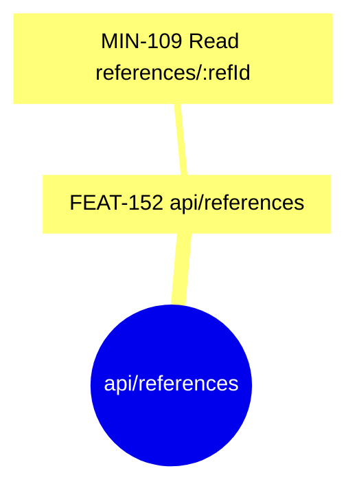
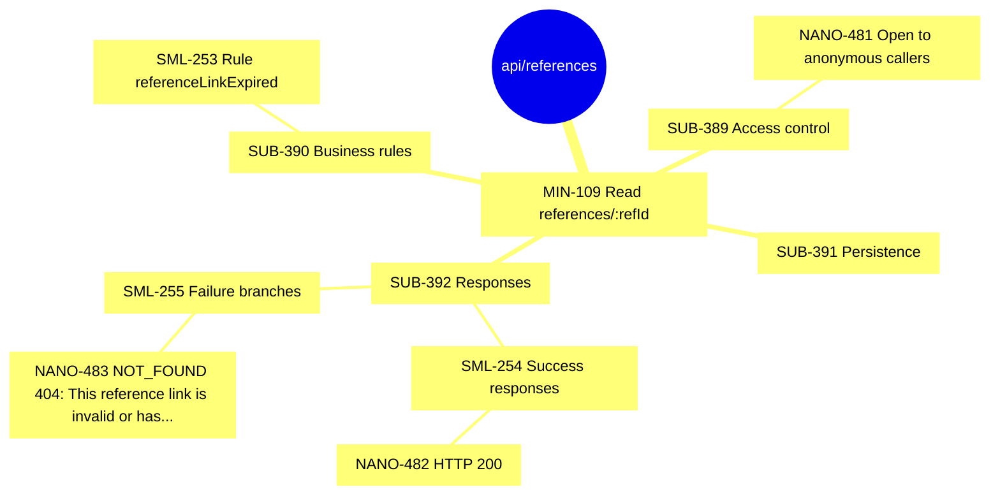

# api/references (MOD-095)

Generated by `project-mindmap/tools/catalog.py` from `master/MASTER_PROJECT_GRAPH.json` at commit `9b3032f`. Do not edit by hand. Back to the [feature catalog](../FEATURE_CATALOG.md).

**Application:** apps/api (MOD-001). **Purpose:** API module: routes under /api/v1/references in apps/api/src/server.ts.

**Nodes by level:** MODULE 1, MAJOR 1, MINOR 1, SUB 4, SMALL 3, NANO 3. **Status:** IMPLEMENTED 13. **Verification:** PATH_LEVEL 9, UNKNOWN 1, VERIFIED 1.

**User roles that reach it:** anonymous.

**Called from (web screens and components):** FEAT-178 Screen /reference/:id

## Module map (to minor features)

## FEAT-152 api/references

api/references

| ID       | Level | Parent   | Name                                                            | Description                                                                                                                                                                                                                                                                         | Status      | Verification | Evidence                                      | Related                                                       |
| -------- | ----- | -------- | --------------------------------------------------------------- | ----------------------------------------------------------------------------------------------------------------------------------------------------------------------------------------------------------------------------------------------------------------------------------- | ----------- | ------------ | --------------------------------------------- | ------------------------------------------------------------- |
| FEAT-152 | MAJOR | MOD-095  | api/references                                                  |                                                                                                                                                                                                                                                                                     | IMPLEMENTED |              | apps/api/src/server.ts:13107                  |                                                               |
| MIN-109  | MINOR | FEAT-152 | Read references/:refId                                          | Referee-facing: what am I being asked to vouch for? Requires the emailed token (sent as a header so it stays out of URLs and access logs). GET /api/v1/references/:refId for anyone (public); calls referenceLinkExpired; durable (PostgreSQL); responds 200; 1 failure branch(es). | IMPLEMENTED | VERIFIED     | apps/api/src/server.ts:13107                  | API-274, TEST-097, TEST-139, TEST-140, TEST-145, TEST-151 ... |
| SUB-389  | SUB   | MIN-109  | Access control                                                  | Who may call GET /api/v1/references/:refId: anyone (public).                                                                                                                                                                                                                        | IMPLEMENTED | PATH_LEVEL   | apps/api/src/server.ts:13107                  |                                                               |
| NANO-481 | NANO  | SUB-389  | Open to anonymous callers                                       | auth: public.                                                                                                                                                                                                                                                                       | IMPLEMENTED | PATH_LEVEL   | apps/api/src/server.ts:13107                  | ROLE-001                                                      |
| SUB-390  | SUB   | MIN-109  | Business rules                                                  | Domain functions from packages/domain called by the handler (1).                                                                                                                                                                                                                    | IMPLEMENTED | PATH_LEVEL   | apps/api/src/server.ts:13107                  |                                                               |
| SML-253  | SMALL | SUB-390  | Rule referenceLinkExpired                                       | Calls referenceLinkExpired (packages/domain/src/work-history-graph.ts). Rule status IMPLEMENTED; its own tests: UNKNOWN.                                                                                                                                                            | IMPLEMENTED | UNKNOWN      | packages/domain/src/work-history-graph.ts:589 | RULE-276                                                      |
| SUB-391  | SUB   | MIN-109  | Persistence                                                     | Durable: writes go through the PostgreSQL store.                                                                                                                                                                                                                                    | IMPLEMENTED | PATH_LEVEL   | apps/api/src/server.ts:13107                  |                                                               |
| SUB-392  | SUB   | MIN-109  | Responses                                                       | Success 200; 1 explicit failure branch(es) besides validation and access errors.                                                                                                                                                                                                    | IMPLEMENTED | PATH_LEVEL   | apps/api/src/server.ts:13107                  |                                                               |
| SML-254  | SMALL | SUB-392  | Success responses                                               | HTTP 200.                                                                                                                                                                                                                                                                           | IMPLEMENTED | PATH_LEVEL   | apps/api/src/server.ts:13107                  |                                                               |
| NANO-482 | NANO  | SML-254  | HTTP 200                                                        | Replies 200 when the operation succeeds.                                                                                                                                                                                                                                            | IMPLEMENTED | PATH_LEVEL   | apps/api/src/server.ts:13107                  |                                                               |
| SML-255  | SMALL | SUB-392  | Failure branches                                                | 1 DomainError branch(es) in the handler, mapped to HTTP by the global error handler.                                                                                                                                                                                                | IMPLEMENTED | PATH_LEVEL   | apps/api/src/server.ts:13107                  |                                                               |
| NANO-483 | NANO  | SML-255  | NOT_FOUND 404: This reference link is invalid or has been used. | Throws DomainError(NOT_FOUND) "This reference link is invalid or has been used." -> HTTP 404.                                                                                                                                                                                       | IMPLEMENTED | PATH_LEVEL   | apps/api/src/server.ts:13122                  | ERR-246                                                       |
