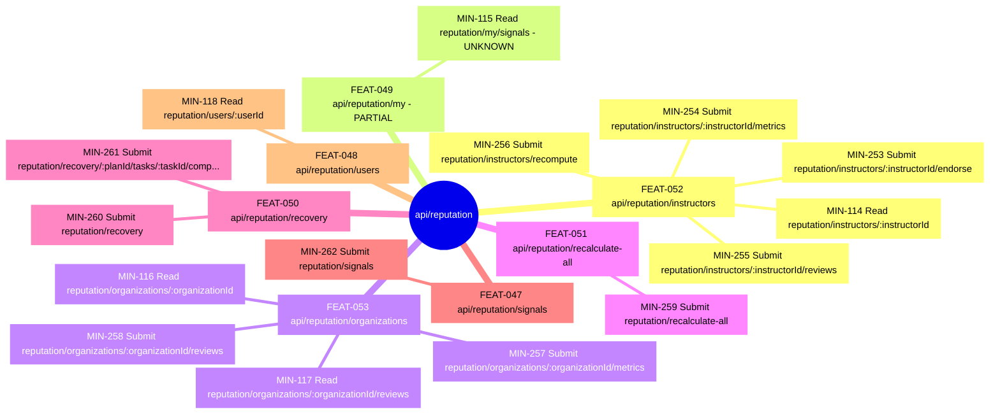
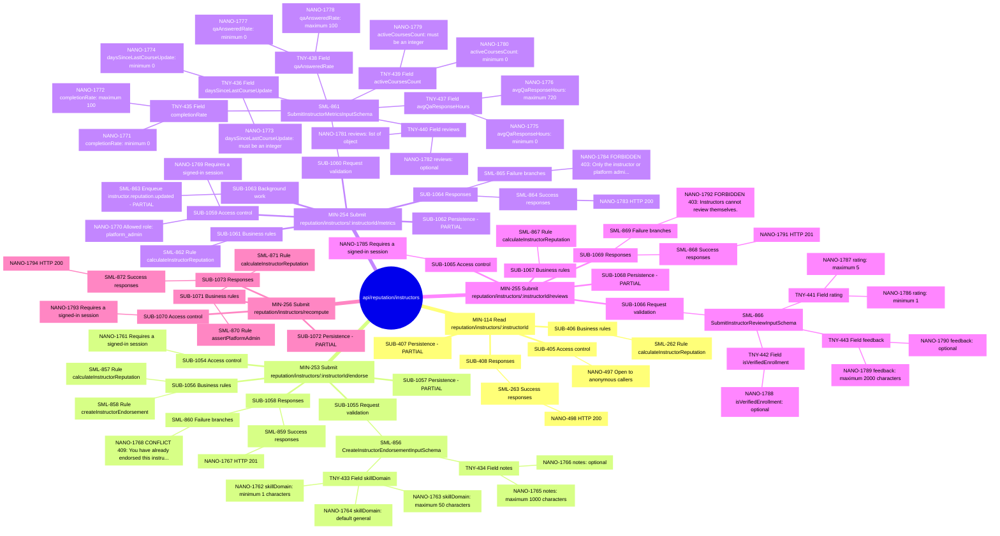
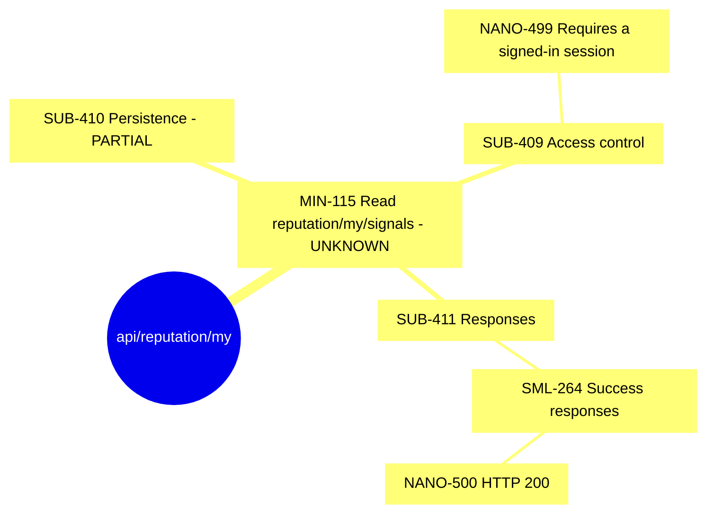
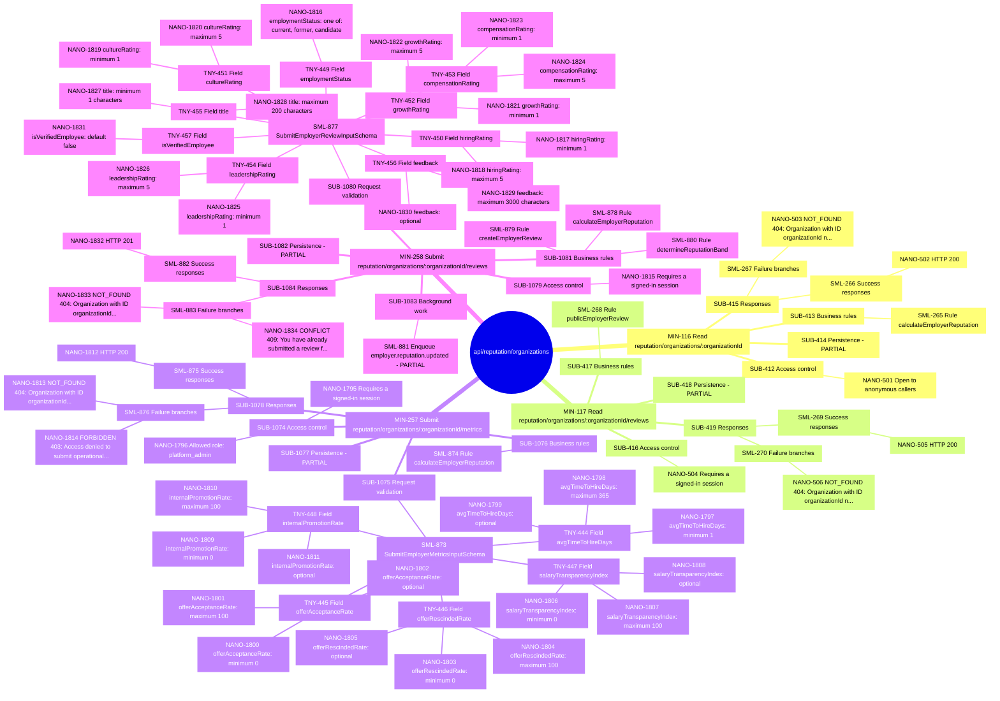
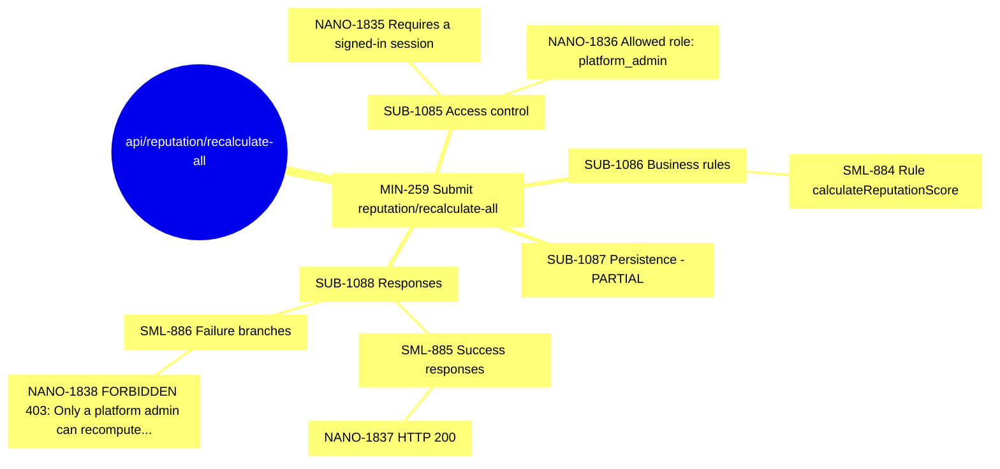
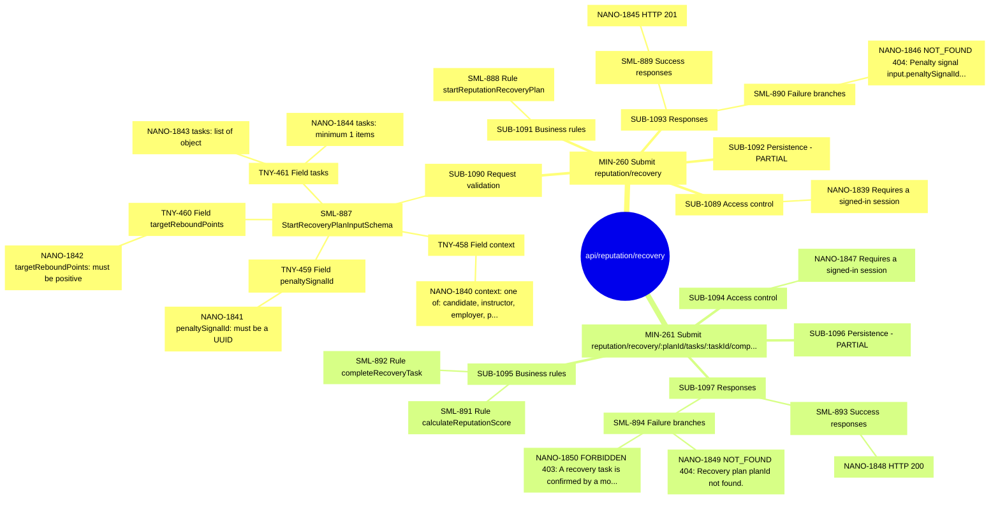
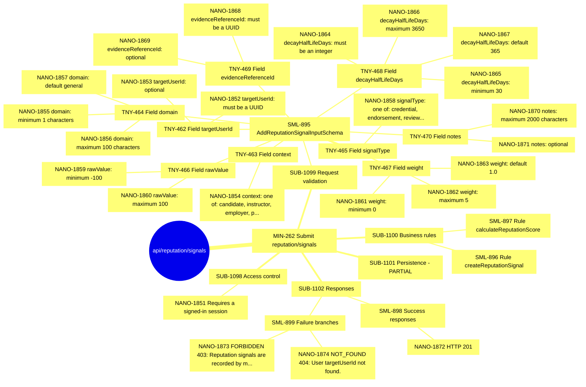
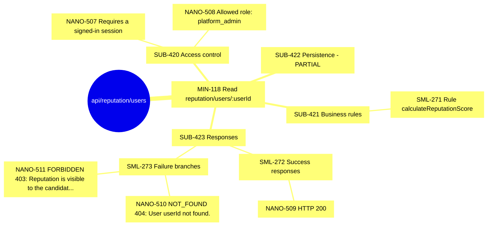

# api/reputation (MOD-067)

Generated by `project-mindmap/tools/catalog.py` from `master/MASTER_PROJECT_GRAPH.json` at commit `9b3032f`. Do not edit by hand. Back to the [feature catalog](../FEATURE_CATALOG.md).

**Application:** apps/api (MOD-001). **Purpose:** API module: routes under /api/v1/reputation in apps/api/src/server.ts.

**Nodes by level:** MODULE 1, MAJOR 7, MINOR 15, SUB 68, SMALL 56, TINY 38, NANO 129. **Status:** IMPLEMENTED 294, PARTIALLY_IMPLEMENTED 19, UNKNOWN 1. **Verification:** PATH_LEVEL 269, UNKNOWN 2, VERIFIED 35.

**User roles that reach it:** anonymous, authenticated, platform_admin.

**Known gaps:** MIN-114 ephemeral: state held in process memory, lost on restart; MIN-114 no first-party web caller found; MIN-253 ephemeral: state held in process memory, lost on restart; MIN-253 no first-party web caller found; MIN-254 ephemeral: state held in process memory, lost on restart; MIN-254 no first-party web caller found; MIN-255 ephemeral: state held in process memory, lost on restart; MIN-255 no first-party web caller found; MIN-256 ephemeral: state held in process memory, lost on restart; MIN-256 no first-party web caller found; MIN-115 ephemeral: state held in process memory, lost on restart; MIN-115 no first-party web caller found; MIN-116 ephemeral: state held in process memory, lost on restart; MIN-116 no first-party web caller found; MIN-117 ephemeral: state held in process memory, lost on restart; MIN-117 no first-party web caller found; MIN-257 ephemeral: state held in process memory, lost on restart; MIN-257 no first-party web caller found; MIN-258 ephemeral: state held in process memory, lost on restart; MIN-258 no first-party web caller found; MIN-259 ephemeral: state held in process memory, lost on restart; MIN-259 no first-party web caller found; MIN-260 ephemeral: state held in process memory, lost on restart; MIN-260 no first-party web caller found; MIN-261 ephemeral: state held in process memory, lost on restart; MIN-261 no first-party web caller found; MIN-262 ephemeral: state held in process memory, lost on restart; MIN-262 no first-party web caller found; MIN-118 ephemeral: state held in process memory, lost on restart; MIN-118 no first-party web caller found.

## Module map (to minor features)

## FEAT-052 api/reputation/instructors

api/reputation/instructors

| ID        | Level | Parent   | Name                                                                                  | Description                                                                                                                                                                                                                                                                                                                                                                                                                  | Status                | Verification | Evidence                                         | Related                                         |
| --------- | ----- | -------- | ------------------------------------------------------------------------------------- | ---------------------------------------------------------------------------------------------------------------------------------------------------------------------------------------------------------------------------------------------------------------------------------------------------------------------------------------------------------------------------------------------------------------------------- | --------------------- | ------------ | ------------------------------------------------ | ----------------------------------------------- |
| FEAT-052  | MAJOR | MOD-067  | api/reputation/instructors                                                            |                                                                                                                                                                                                                                                                                                                                                                                                                              | IMPLEMENTED           |              | apps/api/src/server.ts:4331                      |                                                 |
| MIN-114   | MINOR | FEAT-052 | Read reputation/instructors/:instructorId                                             | 1. Get Transparent Instructor Reputation Breakdown (F-148) GET /api/v1/reputation/instructors/:instructorId for anyone (public); calls calculateInstructorReputation; ephemeral (process memory); responds 200. Gaps: ephemeral: state held in process memory, lost on restart; no first-party web caller found                                                                                                              | IMPLEMENTED           | VERIFIED     | apps/api/src/server.ts:4331                      | API-082, TEST-106, TEST-126, TEST-145, TEST-185 |
| SUB-405   | SUB   | MIN-114  | Access control                                                                        | Who may call GET /api/v1/reputation/instructors/:instructorId: anyone (public).                                                                                                                                                                                                                                                                                                                                              | IMPLEMENTED           | PATH_LEVEL   | apps/api/src/server.ts:4331                      |                                                 |
| NANO-497  | NANO  | SUB-405  | Open to anonymous callers                                                             | auth: public.                                                                                                                                                                                                                                                                                                                                                                                                                | IMPLEMENTED           | PATH_LEVEL   | apps/api/src/server.ts:4331                      | ROLE-001                                        |
| SUB-406   | SUB   | MIN-114  | Business rules                                                                        | Domain functions from packages/domain called by the handler (1).                                                                                                                                                                                                                                                                                                                                                             | IMPLEMENTED           | PATH_LEVEL   | apps/api/src/server.ts:4331                      |                                                 |
| SML-262   | SMALL | SUB-406  | Rule calculateInstructorReputation                                                    | Calls calculateInstructorReputation (packages/domain/src/instructor-reputation.ts). Rule status IMPLEMENTED; its own tests: VERIFIED.                                                                                                                                                                                                                                                                                        | IMPLEMENTED           | VERIFIED     | packages/domain/src/instructor-reputation.ts:208 | RULE-121                                        |
| SUB-407   | SUB   | MIN-114  | Persistence                                                                           | Ephemeral: state lives in API process memory and is lost on restart.                                                                                                                                                                                                                                                                                                                                                         | PARTIALLY_IMPLEMENTED | PATH_LEVEL   | apps/api/src/server.ts:4331                      |                                                 |
| SUB-408   | SUB   | MIN-114  | Responses                                                                             | Success 200; 0 explicit failure branch(es) besides validation and access errors.                                                                                                                                                                                                                                                                                                                                             | IMPLEMENTED           | PATH_LEVEL   | apps/api/src/server.ts:4331                      |                                                 |
| SML-263   | SMALL | SUB-408  | Success responses                                                                     | HTTP 200.                                                                                                                                                                                                                                                                                                                                                                                                                    | IMPLEMENTED           | PATH_LEVEL   | apps/api/src/server.ts:4331                      |                                                 |
| NANO-498  | NANO  | SML-263  | HTTP 200                                                                              | Replies 200 when the operation succeeds.                                                                                                                                                                                                                                                                                                                                                                                     | IMPLEMENTED           | PATH_LEVEL   | apps/api/src/server.ts:4331                      |                                                 |
| MIN-253   | MINOR | FEAT-052 | Submit reputation/instructors/:instructorId/endorse                                   | 3. Endorse an Instructor (Peer Instructor or Admin) POST /api/v1/reputation/instructors/:instructorId/endorse for any signed-in session; validates CreateInstructorEndorsementInputSchema; calls calculateInstructorReputation, createInstructorEndorsement; ephemeral (process memory); responds 201; 1 failure branch(es). Gaps: ephemeral: state held in process memory, lost on restart; no first-party web caller found | IMPLEMENTED           | VERIFIED     | apps/api/src/server.ts:4412                      | API-084, TEST-106                               |
| SUB-1054  | SUB   | MIN-253  | Access control                                                                        | Who may call POST /api/v1/reputation/instructors/:instructorId/endorse: any signed-in session.                                                                                                                                                                                                                                                                                                                               | IMPLEMENTED           | PATH_LEVEL   | apps/api/src/server.ts:4412                      |                                                 |
| NANO-1761 | NANO  | SUB-1054 | Requires a signed-in session                                                          | Requests without a valid session token are rejected with 401 UNAUTHENTICATED.                                                                                                                                                                                                                                                                                                                                                | IMPLEMENTED           | PATH_LEVEL   | apps/api/src/server.ts:4412                      | ROLE-001                                        |
| SUB-1055  | SUB   | MIN-253  | Request validation                                                                    | The request is parsed with CreateInstructorEndorsementInputSchema; a failure returns 400 with field details before any business logic runs.                                                                                                                                                                                                                                                                                  | IMPLEMENTED           | PATH_LEVEL   | apps/api/src/server.ts:4412                      |                                                 |
| SML-856   | SMALL | SUB-1055 | CreateInstructorEndorsementInputSchema                                                | CreateInstructorEndorsementInputSchema: 2 field(s)                                                                                                                                                                                                                                                                                                                                                                           | IMPLEMENTED           | PATH_LEVEL   | packages/contracts/src/index.ts:1343             | SCH-103                                         |
| TNY-433   | TINY  | SML-856  | Field skillDomain                                                                     | skillDomain (string, optional): minimum 1 characters; maximum 50 characters; default 'general'                                                                                                                                                                                                                                                                                                                               | IMPLEMENTED           | PATH_LEVEL   | packages/contracts/src/index.ts:1344             |                                                 |
| NANO-1762 | NANO  | TNY-433  | skillDomain: minimum 1 characters                                                     | skillDomain minimum 1 characters.                                                                                                                                                                                                                                                                                                                                                                                            | IMPLEMENTED           | PATH_LEVEL   | packages/contracts/src/index.ts:1344             |                                                 |
| NANO-1763 | NANO  | TNY-433  | skillDomain: maximum 50 characters                                                    | skillDomain maximum 50 characters.                                                                                                                                                                                                                                                                                                                                                                                           | IMPLEMENTED           | PATH_LEVEL   | packages/contracts/src/index.ts:1344             |                                                 |
| NANO-1764 | NANO  | TNY-433  | skillDomain: default 'general'                                                        | skillDomain default 'general'; message "general".                                                                                                                                                                                                                                                                                                                                                                            | IMPLEMENTED           | PATH_LEVEL   | packages/contracts/src/index.ts:1344             |                                                 |
| TNY-434   | TINY  | SML-856  | Field notes                                                                           | notes (string, optional): maximum 1000 characters; optional                                                                                                                                                                                                                                                                                                                                                                  | IMPLEMENTED           | PATH_LEVEL   | packages/contracts/src/index.ts:1345             |                                                 |
| NANO-1765 | NANO  | TNY-434  | notes: maximum 1000 characters                                                        | notes maximum 1000 characters.                                                                                                                                                                                                                                                                                                                                                                                               | IMPLEMENTED           | PATH_LEVEL   | packages/contracts/src/index.ts:1345             |                                                 |
| NANO-1766 | NANO  | TNY-434  | notes: optional                                                                       | notes optional.                                                                                                                                                                                                                                                                                                                                                                                                              | IMPLEMENTED           | PATH_LEVEL   | packages/contracts/src/index.ts:1345             |                                                 |
| SUB-1056  | SUB   | MIN-253  | Business rules                                                                        | Domain functions from packages/domain called by the handler (2).                                                                                                                                                                                                                                                                                                                                                             | IMPLEMENTED           | PATH_LEVEL   | apps/api/src/server.ts:4412                      |                                                 |
| SML-857   | SMALL | SUB-1056 | Rule calculateInstructorReputation                                                    | Calls calculateInstructorReputation (packages/domain/src/instructor-reputation.ts). Rule status IMPLEMENTED; its own tests: VERIFIED.                                                                                                                                                                                                                                                                                        | IMPLEMENTED           | VERIFIED     | packages/domain/src/instructor-reputation.ts:208 | RULE-121                                        |
| SML-858   | SMALL | SUB-1056 | Rule createInstructorEndorsement                                                      | Calls createInstructorEndorsement (packages/domain/src/instructor-reputation.ts). Rule status IMPLEMENTED; its own tests: VERIFIED.                                                                                                                                                                                                                                                                                          | IMPLEMENTED           | VERIFIED     | packages/domain/src/instructor-reputation.ts:321 | RULE-122                                        |
| SUB-1057  | SUB   | MIN-253  | Persistence                                                                           | Ephemeral: state lives in API process memory and is lost on restart.                                                                                                                                                                                                                                                                                                                                                         | PARTIALLY_IMPLEMENTED | PATH_LEVEL   | apps/api/src/server.ts:4412                      |                                                 |
| SUB-1058  | SUB   | MIN-253  | Responses                                                                             | Success 201; 1 explicit failure branch(es) besides validation and access errors.                                                                                                                                                                                                                                                                                                                                             | IMPLEMENTED           | PATH_LEVEL   | apps/api/src/server.ts:4412                      |                                                 |
| SML-859   | SMALL | SUB-1058 | Success responses                                                                     | HTTP 201.                                                                                                                                                                                                                                                                                                                                                                                                                    | IMPLEMENTED           | PATH_LEVEL   | apps/api/src/server.ts:4412                      |                                                 |
| NANO-1767 | NANO  | SML-859  | HTTP 201                                                                              | Replies 201 when the operation succeeds.                                                                                                                                                                                                                                                                                                                                                                                     | IMPLEMENTED           | PATH_LEVEL   | apps/api/src/server.ts:4412                      |                                                 |
| SML-860   | SMALL | SUB-1058 | Failure branches                                                                      | 1 DomainError branch(es) in the handler, mapped to HTTP by the global error handler.                                                                                                                                                                                                                                                                                                                                         | IMPLEMENTED           | PATH_LEVEL   | apps/api/src/server.ts:4412                      |                                                 |
| NANO-1768 | NANO  | SML-860  | CONFLICT 409: You have already endorsed this instructor for this skill domain.        | Throws DomainError(CONFLICT) "You have already endorsed this instructor for this skill domain." -> HTTP 409.                                                                                                                                                                                                                                                                                                                 | IMPLEMENTED           | PATH_LEVEL   | apps/api/src/server.ts:4432                      | ERR-095                                         |
| MIN-254   | MINOR | FEAT-052 | Submit reputation/instructors/:instructorId/metrics                                   | 2. Submit Operational Telemetry / Metrics (Instructor or Admin) POST /api/v1/reputation/instructors/:instructorId/metrics for roles platform_admin; validates SubmitInstructorMetricsInputSchema; calls calculateInstructorReputation; ephemeral (process memory); responds 200; 1 failure branch(es). Gaps: ephemeral: state held in process memory, lost on restart; no first-party web caller found                       | IMPLEMENTED           | VERIFIED     | apps/api/src/server.ts:4358                      | API-083, TEST-106, TEST-185                     |
| SUB-1059  | SUB   | MIN-254  | Access control                                                                        | Who may call POST /api/v1/reputation/instructors/:instructorId/metrics: roles platform_admin.                                                                                                                                                                                                                                                                                                                                | IMPLEMENTED           | PATH_LEVEL   | apps/api/src/server.ts:4358                      |                                                 |
| NANO-1769 | NANO  | SUB-1059 | Requires a signed-in session                                                          | Requests without a valid session token are rejected with 401 UNAUTHENTICATED.                                                                                                                                                                                                                                                                                                                                                | IMPLEMENTED           | PATH_LEVEL   | apps/api/src/server.ts:4358                      | ROLE-001                                        |
| NANO-1770 | NANO  | SUB-1059 | Allowed role: platform_admin                                                          | platform_admin is one of the roles allowed here (platform_admin); a caller holding none of them is rejected with 403.                                                                                                                                                                                                                                                                                                        | IMPLEMENTED           | PATH_LEVEL   | apps/api/src/server.ts:4358                      | ROLE-008                                        |
| SUB-1060  | SUB   | MIN-254  | Request validation                                                                    | The request is parsed with SubmitInstructorMetricsInputSchema; a failure returns 400 with field details before any business logic runs.                                                                                                                                                                                                                                                                                      | IMPLEMENTED           | PATH_LEVEL   | apps/api/src/server.ts:4358                      |                                                 |
| SML-861   | SMALL | SUB-1060 | SubmitInstructorMetricsInputSchema                                                    | SubmitInstructorMetricsInputSchema: 6 field(s)                                                                                                                                                                                                                                                                                                                                                                               | IMPLEMENTED           | PATH_LEVEL   | packages/contracts/src/index.ts:1323             | SCH-102                                         |
| TNY-435   | TINY  | SML-861  | Field completionRate                                                                  | completionRate (number, required): minimum 0; maximum 100                                                                                                                                                                                                                                                                                                                                                                    | IMPLEMENTED           | PATH_LEVEL   | packages/contracts/src/index.ts:1324             |                                                 |
| NANO-1771 | NANO  | TNY-435  | completionRate: minimum 0                                                             | completionRate minimum 0.                                                                                                                                                                                                                                                                                                                                                                                                    | IMPLEMENTED           | PATH_LEVEL   | packages/contracts/src/index.ts:1324             |                                                 |
| NANO-1772 | NANO  | TNY-435  | completionRate: maximum 100                                                           | completionRate maximum 100.                                                                                                                                                                                                                                                                                                                                                                                                  | IMPLEMENTED           | PATH_LEVEL   | packages/contracts/src/index.ts:1324             |                                                 |
| TNY-436   | TINY  | SML-861  | Field daysSinceLastCourseUpdate                                                       | daysSinceLastCourseUpdate (number, required): must be an integer; minimum 0                                                                                                                                                                                                                                                                                                                                                  | IMPLEMENTED           | PATH_LEVEL   | packages/contracts/src/index.ts:1325             |                                                 |
| NANO-1773 | NANO  | TNY-436  | daysSinceLastCourseUpdate: must be an integer                                         | daysSinceLastCourseUpdate must be an integer.                                                                                                                                                                                                                                                                                                                                                                                | IMPLEMENTED           | PATH_LEVEL   | packages/contracts/src/index.ts:1325             |                                                 |
| NANO-1774 | NANO  | TNY-436  | daysSinceLastCourseUpdate: minimum 0                                                  | daysSinceLastCourseUpdate minimum 0.                                                                                                                                                                                                                                                                                                                                                                                         | IMPLEMENTED           | PATH_LEVEL   | packages/contracts/src/index.ts:1325             |                                                 |
| TNY-437   | TINY  | SML-861  | Field avgQaResponseHours                                                              | avgQaResponseHours (number, required): minimum 0; maximum 720                                                                                                                                                                                                                                                                                                                                                                | IMPLEMENTED           | PATH_LEVEL   | packages/contracts/src/index.ts:1326             |                                                 |
| NANO-1775 | NANO  | TNY-437  | avgQaResponseHours: minimum 0                                                         | avgQaResponseHours minimum 0.                                                                                                                                                                                                                                                                                                                                                                                                | IMPLEMENTED           | PATH_LEVEL   | packages/contracts/src/index.ts:1326             |                                                 |
| NANO-1776 | NANO  | TNY-437  | avgQaResponseHours: maximum 720                                                       | avgQaResponseHours maximum 720.                                                                                                                                                                                                                                                                                                                                                                                              | IMPLEMENTED           | PATH_LEVEL   | packages/contracts/src/index.ts:1326             |                                                 |
| TNY-438   | TINY  | SML-861  | Field qaAnsweredRate                                                                  | qaAnsweredRate (number, required): minimum 0; maximum 100                                                                                                                                                                                                                                                                                                                                                                    | IMPLEMENTED           | PATH_LEVEL   | packages/contracts/src/index.ts:1327             |                                                 |
| NANO-1777 | NANO  | TNY-438  | qaAnsweredRate: minimum 0                                                             | qaAnsweredRate minimum 0.                                                                                                                                                                                                                                                                                                                                                                                                    | IMPLEMENTED           | PATH_LEVEL   | packages/contracts/src/index.ts:1327             |                                                 |
| NANO-1778 | NANO  | TNY-438  | qaAnsweredRate: maximum 100                                                           | qaAnsweredRate maximum 100.                                                                                                                                                                                                                                                                                                                                                                                                  | IMPLEMENTED           | PATH_LEVEL   | packages/contracts/src/index.ts:1327             |                                                 |
| TNY-439   | TINY  | SML-861  | Field activeCoursesCount                                                              | activeCoursesCount (number, required): must be an integer; minimum 0                                                                                                                                                                                                                                                                                                                                                         | IMPLEMENTED           | PATH_LEVEL   | packages/contracts/src/index.ts:1328             |                                                 |
| NANO-1779 | NANO  | TNY-439  | activeCoursesCount: must be an integer                                                | activeCoursesCount must be an integer.                                                                                                                                                                                                                                                                                                                                                                                       | IMPLEMENTED           | PATH_LEVEL   | packages/contracts/src/index.ts:1328             |                                                 |
| NANO-1780 | NANO  | TNY-439  | activeCoursesCount: minimum 0                                                         | activeCoursesCount minimum 0.                                                                                                                                                                                                                                                                                                                                                                                                | IMPLEMENTED           | PATH_LEVEL   | packages/contracts/src/index.ts:1328             |                                                 |
| TNY-440   | TINY  | SML-861  | Field reviews                                                                         | reviews (array, optional): list of object; optional                                                                                                                                                                                                                                                                                                                                                                          | IMPLEMENTED           | PATH_LEVEL   | packages/contracts/src/index.ts:1329             |                                                 |
| NANO-1781 | NANO  | TNY-440  | reviews: list of object                                                               | reviews list of object.                                                                                                                                                                                                                                                                                                                                                                                                      | IMPLEMENTED           | PATH_LEVEL   | packages/contracts/src/index.ts:1329             |                                                 |
| NANO-1782 | NANO  | TNY-440  | reviews: optional                                                                     | reviews optional.                                                                                                                                                                                                                                                                                                                                                                                                            | IMPLEMENTED           | PATH_LEVEL   | packages/contracts/src/index.ts:1329             |                                                 |
| SUB-1061  | SUB   | MIN-254  | Business rules                                                                        | Domain functions from packages/domain called by the handler (1).                                                                                                                                                                                                                                                                                                                                                             | IMPLEMENTED           | PATH_LEVEL   | apps/api/src/server.ts:4358                      |                                                 |
| SML-862   | SMALL | SUB-1061 | Rule calculateInstructorReputation                                                    | Calls calculateInstructorReputation (packages/domain/src/instructor-reputation.ts). Rule status IMPLEMENTED; its own tests: VERIFIED.                                                                                                                                                                                                                                                                                        | IMPLEMENTED           | VERIFIED     | packages/domain/src/instructor-reputation.ts:208 | RULE-121                                        |
| SUB-1062  | SUB   | MIN-254  | Persistence                                                                           | Ephemeral: state lives in API process memory and is lost on restart.                                                                                                                                                                                                                                                                                                                                                         | PARTIALLY_IMPLEMENTED | PATH_LEVEL   | apps/api/src/server.ts:4358                      |                                                 |
| SUB-1063  | SUB   | MIN-254  | Background work                                                                       | Enqueues 1 background job kind(s) in background_jobs for apps/worker.                                                                                                                                                                                                                                                                                                                                                        | IMPLEMENTED           | PATH_LEVEL   | apps/api/src/server.ts:4358                      |                                                 |
| SML-863   | SMALL | SUB-1063 | Enqueue instructor.reputation.updated                                                 | Dispatches job:instructor.reputation.updated; worker handler: recordEvent (no-op: marks the event recorded).                                                                                                                                                                                                                                                                                                                 | PARTIALLY_IMPLEMENTED | UNKNOWN      | packages/domain/src/background-jobs.ts:171       | SVC-027                                         |
| SUB-1064  | SUB   | MIN-254  | Responses                                                                             | Success 200; 1 explicit failure branch(es) besides validation and access errors.                                                                                                                                                                                                                                                                                                                                             | IMPLEMENTED           | PATH_LEVEL   | apps/api/src/server.ts:4358                      |                                                 |
| SML-864   | SMALL | SUB-1064 | Success responses                                                                     | HTTP 200.                                                                                                                                                                                                                                                                                                                                                                                                                    | IMPLEMENTED           | PATH_LEVEL   | apps/api/src/server.ts:4358                      |                                                 |
| NANO-1783 | NANO  | SML-864  | HTTP 200                                                                              | Replies 200 when the operation succeeds.                                                                                                                                                                                                                                                                                                                                                                                     | IMPLEMENTED           | PATH_LEVEL   | apps/api/src/server.ts:4358                      |                                                 |
| SML-865   | SMALL | SUB-1064 | Failure branches                                                                      | 1 DomainError branch(es) in the handler, mapped to HTTP by the global error handler.                                                                                                                                                                                                                                                                                                                                         | IMPLEMENTED           | PATH_LEVEL   | apps/api/src/server.ts:4358                      |                                                 |
| NANO-1784 | NANO  | SML-865  | FORBIDDEN 403: Only the instructor or platform administrator can update operational m | Throws DomainError(FORBIDDEN) "Only the instructor or platform administrator can update operational metrics." -> HTTP 403.                                                                                                                                                                                                                                                                                                   | IMPLEMENTED           | PATH_LEVEL   | apps/api/src/server.ts:4368                      | ERR-094                                         |
| MIN-255   | MINOR | FEAT-052 | Submit reputation/instructors/:instructorId/reviews                                   | 4. Submit Student Review with Anti-Manipulation Outlier Trimming POST /api/v1/reputation/instructors/:instructorId/reviews for any signed-in session; validates SubmitInstructorReviewInputSchema; calls calculateInstructorReputation; ephemeral (process memory); responds 201; 1 failure branch(es). Gaps: ephemeral: state held in process memory, lost on restart; no first-party web caller found                      | IMPLEMENTED           | VERIFIED     | apps/api/src/server.ts:4462                      | API-085, TEST-106, TEST-126, TEST-185           |
| SUB-1065  | SUB   | MIN-255  | Access control                                                                        | Who may call POST /api/v1/reputation/instructors/:instructorId/reviews: any signed-in session.                                                                                                                                                                                                                                                                                                                               | IMPLEMENTED           | PATH_LEVEL   | apps/api/src/server.ts:4462                      |                                                 |
| NANO-1785 | NANO  | SUB-1065 | Requires a signed-in session                                                          | Requests without a valid session token are rejected with 401 UNAUTHENTICATED.                                                                                                                                                                                                                                                                                                                                                | IMPLEMENTED           | PATH_LEVEL   | apps/api/src/server.ts:4462                      | ROLE-001                                        |
| SUB-1066  | SUB   | MIN-255  | Request validation                                                                    | The request is parsed with SubmitInstructorReviewInputSchema; a failure returns 400 with field details before any business logic runs.                                                                                                                                                                                                                                                                                       | IMPLEMENTED           | PATH_LEVEL   | apps/api/src/server.ts:4462                      |                                                 |
| SML-866   | SMALL | SUB-1066 | SubmitInstructorReviewInputSchema                                                     | SubmitInstructorReviewInputSchema: 3 field(s)                                                                                                                                                                                                                                                                                                                                                                                | IMPLEMENTED           | PATH_LEVEL   | packages/contracts/src/index.ts:1352             | SCH-104                                         |
| TNY-441   | TINY  | SML-866  | Field rating                                                                          | rating (number, required): minimum 1; maximum 5                                                                                                                                                                                                                                                                                                                                                                              | IMPLEMENTED           | PATH_LEVEL   | packages/contracts/src/index.ts:1353             |                                                 |
| NANO-1786 | NANO  | TNY-441  | rating: minimum 1                                                                     | rating minimum 1.                                                                                                                                                                                                                                                                                                                                                                                                            | IMPLEMENTED           | PATH_LEVEL   | packages/contracts/src/index.ts:1353             |                                                 |
| NANO-1787 | NANO  | TNY-441  | rating: maximum 5                                                                     | rating maximum 5.                                                                                                                                                                                                                                                                                                                                                                                                            | IMPLEMENTED           | PATH_LEVEL   | packages/contracts/src/index.ts:1353             |                                                 |
| TNY-442   | TINY  | SML-866  | Field isVerifiedEnrollment                                                            | isVerifiedEnrollment (boolean, optional): optional                                                                                                                                                                                                                                                                                                                                                                           | IMPLEMENTED           | PATH_LEVEL   | packages/contracts/src/index.ts:1355             |                                                 |
| NANO-1788 | NANO  | TNY-442  | isVerifiedEnrollment: optional                                                        | isVerifiedEnrollment optional.                                                                                                                                                                                                                                                                                                                                                                                               | IMPLEMENTED           | PATH_LEVEL   | packages/contracts/src/index.ts:1355             |                                                 |
| TNY-443   | TINY  | SML-866  | Field feedback                                                                        | feedback (string, optional): maximum 2000 characters; optional                                                                                                                                                                                                                                                                                                                                                               | IMPLEMENTED           | PATH_LEVEL   | packages/contracts/src/index.ts:1356             |                                                 |
| NANO-1789 | NANO  | TNY-443  | feedback: maximum 2000 characters                                                     | feedback maximum 2000 characters.                                                                                                                                                                                                                                                                                                                                                                                            | IMPLEMENTED           | PATH_LEVEL   | packages/contracts/src/index.ts:1356             |                                                 |
| NANO-1790 | NANO  | TNY-443  | feedback: optional                                                                    | feedback optional.                                                                                                                                                                                                                                                                                                                                                                                                           | IMPLEMENTED           | PATH_LEVEL   | packages/contracts/src/index.ts:1356             |                                                 |
| SUB-1067  | SUB   | MIN-255  | Business rules                                                                        | Domain functions from packages/domain called by the handler (1).                                                                                                                                                                                                                                                                                                                                                             | IMPLEMENTED           | PATH_LEVEL   | apps/api/src/server.ts:4462                      |                                                 |
| SML-867   | SMALL | SUB-1067 | Rule calculateInstructorReputation                                                    | Calls calculateInstructorReputation (packages/domain/src/instructor-reputation.ts). Rule status IMPLEMENTED; its own tests: VERIFIED.                                                                                                                                                                                                                                                                                        | IMPLEMENTED           | VERIFIED     | packages/domain/src/instructor-reputation.ts:208 | RULE-121                                        |
| SUB-1068  | SUB   | MIN-255  | Persistence                                                                           | Ephemeral: state lives in API process memory and is lost on restart.                                                                                                                                                                                                                                                                                                                                                         | PARTIALLY_IMPLEMENTED | PATH_LEVEL   | apps/api/src/server.ts:4462                      |                                                 |
| SUB-1069  | SUB   | MIN-255  | Responses                                                                             | Success 201; 1 explicit failure branch(es) besides validation and access errors.                                                                                                                                                                                                                                                                                                                                             | IMPLEMENTED           | PATH_LEVEL   | apps/api/src/server.ts:4462                      |                                                 |
| SML-868   | SMALL | SUB-1069 | Success responses                                                                     | HTTP 201.                                                                                                                                                                                                                                                                                                                                                                                                                    | IMPLEMENTED           | PATH_LEVEL   | apps/api/src/server.ts:4462                      |                                                 |
| NANO-1791 | NANO  | SML-868  | HTTP 201                                                                              | Replies 201 when the operation succeeds.                                                                                                                                                                                                                                                                                                                                                                                     | IMPLEMENTED           | PATH_LEVEL   | apps/api/src/server.ts:4462                      |                                                 |
| SML-869   | SMALL | SUB-1069 | Failure branches                                                                      | 1 DomainError branch(es) in the handler, mapped to HTTP by the global error handler.                                                                                                                                                                                                                                                                                                                                         | IMPLEMENTED           | PATH_LEVEL   | apps/api/src/server.ts:4462                      |                                                 |
| NANO-1792 | NANO  | SML-869  | FORBIDDEN 403: Instructors cannot review themselves.                                  | Throws DomainError(FORBIDDEN) "Instructors cannot review themselves." -> HTTP 403.                                                                                                                                                                                                                                                                                                                                           | IMPLEMENTED           | PATH_LEVEL   | apps/api/src/server.ts:4470                      | ERR-096                                         |
| MIN-256   | MINOR | FEAT-052 | Submit reputation/instructors/recompute                                               | 5. Nightly Batch Recalculation (SSOT F-148 Acceptance) POST /api/v1/reputation/instructors/recompute for any signed-in session; calls assertPlatformAdmin, calculateInstructorReputation; ephemeral (process memory); responds 200. Gaps: ephemeral: state held in process memory, lost on restart; no first-party web caller found                                                                                          | IMPLEMENTED           | VERIFIED     | apps/api/src/server.ts:4511                      | API-086, TEST-106                               |
| SUB-1070  | SUB   | MIN-256  | Access control                                                                        | Who may call POST /api/v1/reputation/instructors/recompute: any signed-in session.                                                                                                                                                                                                                                                                                                                                           | IMPLEMENTED           | PATH_LEVEL   | apps/api/src/server.ts:4511                      |                                                 |
| NANO-1793 | NANO  | SUB-1070 | Requires a signed-in session                                                          | Requests without a valid session token are rejected with 401 UNAUTHENTICATED.                                                                                                                                                                                                                                                                                                                                                | IMPLEMENTED           | PATH_LEVEL   | apps/api/src/server.ts:4511                      | ROLE-001                                        |
| SUB-1071  | SUB   | MIN-256  | Business rules                                                                        | Domain functions from packages/domain called by the handler (2).                                                                                                                                                                                                                                                                                                                                                             | IMPLEMENTED           | PATH_LEVEL   | apps/api/src/server.ts:4511                      |                                                 |
| SML-870   | SMALL | SUB-1071 | Rule assertPlatformAdmin                                                              | Calls assertPlatformAdmin (packages/domain/src/admin.ts). Rule status IMPLEMENTED; its own tests: VERIFIED.                                                                                                                                                                                                                                                                                                                  | IMPLEMENTED           | VERIFIED     | packages/domain/src/admin.ts:44                  | RULE-005                                        |
| SML-871   | SMALL | SUB-1071 | Rule calculateInstructorReputation                                                    | Calls calculateInstructorReputation (packages/domain/src/instructor-reputation.ts). Rule status IMPLEMENTED; its own tests: VERIFIED.                                                                                                                                                                                                                                                                                        | IMPLEMENTED           | VERIFIED     | packages/domain/src/instructor-reputation.ts:208 | RULE-121                                        |
| SUB-1072  | SUB   | MIN-256  | Persistence                                                                           | Ephemeral: state lives in API process memory and is lost on restart.                                                                                                                                                                                                                                                                                                                                                         | PARTIALLY_IMPLEMENTED | PATH_LEVEL   | apps/api/src/server.ts:4511                      |                                                 |
| SUB-1073  | SUB   | MIN-256  | Responses                                                                             | Success 200; 0 explicit failure branch(es) besides validation and access errors.                                                                                                                                                                                                                                                                                                                                             | IMPLEMENTED           | PATH_LEVEL   | apps/api/src/server.ts:4511                      |                                                 |
| SML-872   | SMALL | SUB-1073 | Success responses                                                                     | HTTP 200.                                                                                                                                                                                                                                                                                                                                                                                                                    | IMPLEMENTED           | PATH_LEVEL   | apps/api/src/server.ts:4511                      |                                                 |
| NANO-1794 | NANO  | SML-872  | HTTP 200                                                                              | Replies 200 when the operation succeeds.                                                                                                                                                                                                                                                                                                                                                                                     | IMPLEMENTED           | PATH_LEVEL   | apps/api/src/server.ts:4511                      |                                                 |

## FEAT-049 api/reputation/my

api/reputation/my

| ID       | Level | Parent   | Name                         | Description                                                                                                                                                                                            | Status                | Verification | Evidence                    | Related                     |
| -------- | ----- | -------- | ---------------------------- | ------------------------------------------------------------------------------------------------------------------------------------------------------------------------------------------------------ | --------------------- | ------------ | --------------------------- | --------------------------- |
| FEAT-049 | MAJOR | MOD-067  | api/reputation/my            |                                                                                                                                                                                                        | PARTIALLY_IMPLEMENTED |              | apps/api/src/server.ts:4174 |                             |
| MIN-115  | MINOR | FEAT-049 | Read reputation/my/signals   | GET /api/v1/reputation/my/signals for any signed-in session; ephemeral (process memory); responds 200. Gaps: ephemeral: state held in process memory, lost on restart; no first-party web caller found | UNKNOWN               | VERIFIED     | apps/api/src/server.ts:4174 | API-078, TEST-121, TEST-203 |
| SUB-409  | SUB   | MIN-115  | Access control               | Who may call GET /api/v1/reputation/my/signals: any signed-in session.                                                                                                                                 | IMPLEMENTED           | PATH_LEVEL   | apps/api/src/server.ts:4174 |                             |
| NANO-499 | NANO  | SUB-409  | Requires a signed-in session | Requests without a valid session token are rejected with 401 UNAUTHENTICATED.                                                                                                                          | IMPLEMENTED           | PATH_LEVEL   | apps/api/src/server.ts:4174 | ROLE-001                    |
| SUB-410  | SUB   | MIN-115  | Persistence                  | Ephemeral: state lives in API process memory and is lost on restart.                                                                                                                                   | PARTIALLY_IMPLEMENTED | PATH_LEVEL   | apps/api/src/server.ts:4174 |                             |
| SUB-411  | SUB   | MIN-115  | Responses                    | Success 200; 0 explicit failure branch(es) besides validation and access errors.                                                                                                                       | IMPLEMENTED           | PATH_LEVEL   | apps/api/src/server.ts:4174 |                             |
| SML-264  | SMALL | SUB-411  | Success responses            | HTTP 200.                                                                                                                                                                                              | IMPLEMENTED           | PATH_LEVEL   | apps/api/src/server.ts:4174 |                             |
| NANO-500 | NANO  | SML-264  | HTTP 200                     | Replies 200 when the operation succeeds.                                                                                                                                                               | IMPLEMENTED           | PATH_LEVEL   | apps/api/src/server.ts:4174 |                             |

## FEAT-053 api/reputation/organizations

api/reputation/organizations

| ID        | Level | Parent   | Name                                                                          | Description                                                                                                                                                                                                                                                                                                                                                                                                     | Status                | Verification | Evidence                                       | Related                               |
| --------- | ----- | -------- | ----------------------------------------------------------------------------- | --------------------------------------------------------------------------------------------------------------------------------------------------------------------------------------------------------------------------------------------------------------------------------------------------------------------------------------------------------------------------------------------------------------- | --------------------- | ------------ | ---------------------------------------------- | ------------------------------------- |
| FEAT-053  | MAJOR | MOD-067  | api/reputation/organizations                                                  |                                                                                                                                                                                                                                                                                                                                                                                                                 | IMPLEMENTED           |              | apps/api/src/server.ts:4542                    |                                       |
| MIN-116   | MINOR | FEAT-053 | Read reputation/organizations/:organizationId                                 | 1. Get Employer Reputation Profile & Factor Breakdown GET /api/v1/reputation/organizations/:organizationId for anyone (public); calls calculateEmployerReputation; ephemeral (process memory); responds 200; 1 failure branch(es). Gaps: ephemeral: state held in process memory, lost on restart; no first-party web caller found                                                                              | IMPLEMENTED           | VERIFIED     | apps/api/src/server.ts:4542                    | API-087, TEST-100, TEST-145, TEST-180 |
| SUB-412   | SUB   | MIN-116  | Access control                                                                | Who may call GET /api/v1/reputation/organizations/:organizationId: anyone (public).                                                                                                                                                                                                                                                                                                                             | IMPLEMENTED           | PATH_LEVEL   | apps/api/src/server.ts:4542                    |                                       |
| NANO-501  | NANO  | SUB-412  | Open to anonymous callers                                                     | auth: public.                                                                                                                                                                                                                                                                                                                                                                                                   | IMPLEMENTED           | PATH_LEVEL   | apps/api/src/server.ts:4542                    | ROLE-001                              |
| SUB-413   | SUB   | MIN-116  | Business rules                                                                | Domain functions from packages/domain called by the handler (1).                                                                                                                                                                                                                                                                                                                                                | IMPLEMENTED           | PATH_LEVEL   | apps/api/src/server.ts:4542                    |                                       |
| SML-265   | SMALL | SUB-413  | Rule calculateEmployerReputation                                              | Calls calculateEmployerReputation (packages/domain/src/employer-reputation.ts). Rule status IMPLEMENTED; its own tests: VERIFIED.                                                                                                                                                                                                                                                                               | IMPLEMENTED           | VERIFIED     | packages/domain/src/employer-reputation.ts:163 | RULE-093                              |
| SUB-414   | SUB   | MIN-116  | Persistence                                                                   | Ephemeral: state lives in API process memory and is lost on restart.                                                                                                                                                                                                                                                                                                                                            | PARTIALLY_IMPLEMENTED | PATH_LEVEL   | apps/api/src/server.ts:4542                    |                                       |
| SUB-415   | SUB   | MIN-116  | Responses                                                                     | Success 200; 1 explicit failure branch(es) besides validation and access errors.                                                                                                                                                                                                                                                                                                                                | IMPLEMENTED           | PATH_LEVEL   | apps/api/src/server.ts:4542                    |                                       |
| SML-266   | SMALL | SUB-415  | Success responses                                                             | HTTP 200.                                                                                                                                                                                                                                                                                                                                                                                                       | IMPLEMENTED           | PATH_LEVEL   | apps/api/src/server.ts:4542                    |                                       |
| NANO-502  | NANO  | SML-266  | HTTP 200                                                                      | Replies 200 when the operation succeeds.                                                                                                                                                                                                                                                                                                                                                                        | IMPLEMENTED           | PATH_LEVEL   | apps/api/src/server.ts:4542                    |                                       |
| SML-267   | SMALL | SUB-415  | Failure branches                                                              | 1 DomainError branch(es) in the handler, mapped to HTTP by the global error handler.                                                                                                                                                                                                                                                                                                                            | IMPLEMENTED           | PATH_LEVEL   | apps/api/src/server.ts:4542                    |                                       |
| NANO-503  | NANO  | SML-267  | NOT_FOUND 404: Organization with ID "${organizationId}" not found.            | Throws DomainError(NOT_FOUND) "Organization with ID "${organizationId}" not found." -> HTTP 404.                                                                                                                                                                                                                                                                                                                | IMPLEMENTED           | PATH_LEVEL   | apps/api/src/server.ts:4549                    | ERR-097                               |
| MIN-117   | MINOR | FEAT-053 | Read reputation/organizations/:organizationId/reviews                         | 4. List Reviews for Employer GET /api/v1/reputation/organizations/:organizationId/reviews for any signed-in session; calls publicEmployerReview; ephemeral (process memory); responds 200; 1 failure branch(es). Gaps: ephemeral: state held in process memory, lost on restart; no first-party web caller found                                                                                                | IMPLEMENTED           | VERIFIED     | apps/api/src/server.ts:4694                    | API-090, TEST-100, TEST-145, TEST-180 |
| SUB-416   | SUB   | MIN-117  | Access control                                                                | Who may call GET /api/v1/reputation/organizations/:organizationId/reviews: any signed-in session.                                                                                                                                                                                                                                                                                                               | IMPLEMENTED           | PATH_LEVEL   | apps/api/src/server.ts:4694                    |                                       |
| NANO-504  | NANO  | SUB-416  | Requires a signed-in session                                                  | Requests without a valid session token are rejected with 401 UNAUTHENTICATED.                                                                                                                                                                                                                                                                                                                                   | IMPLEMENTED           | PATH_LEVEL   | apps/api/src/server.ts:4694                    | ROLE-001                              |
| SUB-417   | SUB   | MIN-117  | Business rules                                                                | Domain functions from packages/domain called by the handler (1).                                                                                                                                                                                                                                                                                                                                                | IMPLEMENTED           | PATH_LEVEL   | apps/api/src/server.ts:4694                    |                                       |
| SML-268   | SMALL | SUB-417  | Rule publicEmployerReview                                                     | Calls publicEmployerReview (packages/domain/src/employer-reputation.ts). Rule status IMPLEMENTED; its own tests: VERIFIED.                                                                                                                                                                                                                                                                                      | IMPLEMENTED           | VERIFIED     | packages/domain/src/employer-reputation.ts:61  | RULE-089                              |
| SUB-418   | SUB   | MIN-117  | Persistence                                                                   | Ephemeral: state lives in API process memory and is lost on restart.                                                                                                                                                                                                                                                                                                                                            | PARTIALLY_IMPLEMENTED | PATH_LEVEL   | apps/api/src/server.ts:4694                    |                                       |
| SUB-419   | SUB   | MIN-117  | Responses                                                                     | Success 200; 1 explicit failure branch(es) besides validation and access errors.                                                                                                                                                                                                                                                                                                                                | IMPLEMENTED           | PATH_LEVEL   | apps/api/src/server.ts:4694                    |                                       |
| SML-269   | SMALL | SUB-419  | Success responses                                                             | HTTP 200.                                                                                                                                                                                                                                                                                                                                                                                                       | IMPLEMENTED           | PATH_LEVEL   | apps/api/src/server.ts:4694                    |                                       |
| NANO-505  | NANO  | SML-269  | HTTP 200                                                                      | Replies 200 when the operation succeeds.                                                                                                                                                                                                                                                                                                                                                                        | IMPLEMENTED           | PATH_LEVEL   | apps/api/src/server.ts:4694                    |                                       |
| SML-270   | SMALL | SUB-419  | Failure branches                                                              | 1 DomainError branch(es) in the handler, mapped to HTTP by the global error handler.                                                                                                                                                                                                                                                                                                                            | IMPLEMENTED           | PATH_LEVEL   | apps/api/src/server.ts:4694                    |                                       |
| NANO-506  | NANO  | SML-270  | NOT_FOUND 404: Organization with ID "${organizationId}" not found.            | Throws DomainError(NOT_FOUND) "Organization with ID "${organizationId}" not found." -> HTTP 404.                                                                                                                                                                                                                                                                                                                | IMPLEMENTED           | PATH_LEVEL   | apps/api/src/server.ts:4701                    | ERR-097                               |
| MIN-257   | MINOR | FEAT-053 | Submit reputation/organizations/:organizationId/metrics                       | 3. Submit Operational Metrics for Employer POST /api/v1/reputation/organizations/:organizationId/metrics for roles platform_admin; validates SubmitEmployerMetricsInputSchema; calls calculateEmployerReputation; ephemeral (process memory); responds 200; 2 failure branch(es). Gaps: ephemeral: state held in process memory, lost on restart; no first-party web caller found                               | IMPLEMENTED           | VERIFIED     | apps/api/src/server.ts:4649                    | API-089, TEST-100, TEST-180           |
| SUB-1074  | SUB   | MIN-257  | Access control                                                                | Who may call POST /api/v1/reputation/organizations/:organizationId/metrics: roles platform_admin.                                                                                                                                                                                                                                                                                                               | IMPLEMENTED           | PATH_LEVEL   | apps/api/src/server.ts:4649                    |                                       |
| NANO-1795 | NANO  | SUB-1074 | Requires a signed-in session                                                  | Requests without a valid session token are rejected with 401 UNAUTHENTICATED.                                                                                                                                                                                                                                                                                                                                   | IMPLEMENTED           | PATH_LEVEL   | apps/api/src/server.ts:4649                    | ROLE-001                              |
| NANO-1796 | NANO  | SUB-1074 | Allowed role: platform_admin                                                  | platform_admin is one of the roles allowed here (platform_admin); a caller holding none of them is rejected with 403.                                                                                                                                                                                                                                                                                           | IMPLEMENTED           | PATH_LEVEL   | apps/api/src/server.ts:4649                    | ROLE-008                              |
| SUB-1075  | SUB   | MIN-257  | Request validation                                                            | The request is parsed with SubmitEmployerMetricsInputSchema; a failure returns 400 with field details before any business logic runs.                                                                                                                                                                                                                                                                           | IMPLEMENTED           | PATH_LEVEL   | apps/api/src/server.ts:4649                    |                                       |
| SML-873   | SMALL | SUB-1075 | SubmitEmployerMetricsInputSchema                                              | SubmitEmployerMetricsInputSchema: 5 field(s)                                                                                                                                                                                                                                                                                                                                                                    | IMPLEMENTED           | PATH_LEVEL   | packages/contracts/src/index.ts:1452           | SCH-114                               |
| TNY-444   | TINY  | SML-873  | Field avgTimeToHireDays                                                       | avgTimeToHireDays (number, optional): minimum 1; maximum 365; optional                                                                                                                                                                                                                                                                                                                                          | IMPLEMENTED           | PATH_LEVEL   | packages/contracts/src/index.ts:1453           |                                       |
| NANO-1797 | NANO  | TNY-444  | avgTimeToHireDays: minimum 1                                                  | avgTimeToHireDays minimum 1.                                                                                                                                                                                                                                                                                                                                                                                    | IMPLEMENTED           | PATH_LEVEL   | packages/contracts/src/index.ts:1453           |                                       |
| NANO-1798 | NANO  | TNY-444  | avgTimeToHireDays: maximum 365                                                | avgTimeToHireDays maximum 365.                                                                                                                                                                                                                                                                                                                                                                                  | IMPLEMENTED           | PATH_LEVEL   | packages/contracts/src/index.ts:1453           |                                       |
| NANO-1799 | NANO  | TNY-444  | avgTimeToHireDays: optional                                                   | avgTimeToHireDays optional.                                                                                                                                                                                                                                                                                                                                                                                     | IMPLEMENTED           | PATH_LEVEL   | packages/contracts/src/index.ts:1453           |                                       |
| TNY-445   | TINY  | SML-873  | Field offerAcceptanceRate                                                     | offerAcceptanceRate (number, optional): minimum 0; maximum 100; optional                                                                                                                                                                                                                                                                                                                                        | IMPLEMENTED           | PATH_LEVEL   | packages/contracts/src/index.ts:1454           |                                       |
| NANO-1800 | NANO  | TNY-445  | offerAcceptanceRate: minimum 0                                                | offerAcceptanceRate minimum 0.                                                                                                                                                                                                                                                                                                                                                                                  | IMPLEMENTED           | PATH_LEVEL   | packages/contracts/src/index.ts:1454           |                                       |
| NANO-1801 | NANO  | TNY-445  | offerAcceptanceRate: maximum 100                                              | offerAcceptanceRate maximum 100.                                                                                                                                                                                                                                                                                                                                                                                | IMPLEMENTED           | PATH_LEVEL   | packages/contracts/src/index.ts:1454           |                                       |
| NANO-1802 | NANO  | TNY-445  | offerAcceptanceRate: optional                                                 | offerAcceptanceRate optional.                                                                                                                                                                                                                                                                                                                                                                                   | IMPLEMENTED           | PATH_LEVEL   | packages/contracts/src/index.ts:1454           |                                       |
| TNY-446   | TINY  | SML-873  | Field offerRescindedRate                                                      | offerRescindedRate (number, optional): minimum 0; maximum 100; optional                                                                                                                                                                                                                                                                                                                                         | IMPLEMENTED           | PATH_LEVEL   | packages/contracts/src/index.ts:1455           |                                       |
| NANO-1803 | NANO  | TNY-446  | offerRescindedRate: minimum 0                                                 | offerRescindedRate minimum 0.                                                                                                                                                                                                                                                                                                                                                                                   | IMPLEMENTED           | PATH_LEVEL   | packages/contracts/src/index.ts:1455           |                                       |
| NANO-1804 | NANO  | TNY-446  | offerRescindedRate: maximum 100                                               | offerRescindedRate maximum 100.                                                                                                                                                                                                                                                                                                                                                                                 | IMPLEMENTED           | PATH_LEVEL   | packages/contracts/src/index.ts:1455           |                                       |
| NANO-1805 | NANO  | TNY-446  | offerRescindedRate: optional                                                  | offerRescindedRate optional.                                                                                                                                                                                                                                                                                                                                                                                    | IMPLEMENTED           | PATH_LEVEL   | packages/contracts/src/index.ts:1455           |                                       |
| TNY-447   | TINY  | SML-873  | Field salaryTransparencyIndex                                                 | salaryTransparencyIndex (number, optional): minimum 0; maximum 100; optional                                                                                                                                                                                                                                                                                                                                    | IMPLEMENTED           | PATH_LEVEL   | packages/contracts/src/index.ts:1456           |                                       |
| NANO-1806 | NANO  | TNY-447  | salaryTransparencyIndex: minimum 0                                            | salaryTransparencyIndex minimum 0.                                                                                                                                                                                                                                                                                                                                                                              | IMPLEMENTED           | PATH_LEVEL   | packages/contracts/src/index.ts:1456           |                                       |
| NANO-1807 | NANO  | TNY-447  | salaryTransparencyIndex: maximum 100                                          | salaryTransparencyIndex maximum 100.                                                                                                                                                                                                                                                                                                                                                                            | IMPLEMENTED           | PATH_LEVEL   | packages/contracts/src/index.ts:1456           |                                       |
| NANO-1808 | NANO  | TNY-447  | salaryTransparencyIndex: optional                                             | salaryTransparencyIndex optional.                                                                                                                                                                                                                                                                                                                                                                               | IMPLEMENTED           | PATH_LEVEL   | packages/contracts/src/index.ts:1456           |                                       |
| TNY-448   | TINY  | SML-873  | Field internalPromotionRate                                                   | internalPromotionRate (number, optional): minimum 0; maximum 100; optional                                                                                                                                                                                                                                                                                                                                      | IMPLEMENTED           | PATH_LEVEL   | packages/contracts/src/index.ts:1457           |                                       |
| NANO-1809 | NANO  | TNY-448  | internalPromotionRate: minimum 0                                              | internalPromotionRate minimum 0.                                                                                                                                                                                                                                                                                                                                                                                | IMPLEMENTED           | PATH_LEVEL   | packages/contracts/src/index.ts:1457           |                                       |
| NANO-1810 | NANO  | TNY-448  | internalPromotionRate: maximum 100                                            | internalPromotionRate maximum 100.                                                                                                                                                                                                                                                                                                                                                                              | IMPLEMENTED           | PATH_LEVEL   | packages/contracts/src/index.ts:1457           |                                       |
| NANO-1811 | NANO  | TNY-448  | internalPromotionRate: optional                                               | internalPromotionRate optional.                                                                                                                                                                                                                                                                                                                                                                                 | IMPLEMENTED           | PATH_LEVEL   | packages/contracts/src/index.ts:1457           |                                       |
| SUB-1076  | SUB   | MIN-257  | Business rules                                                                | Domain functions from packages/domain called by the handler (1).                                                                                                                                                                                                                                                                                                                                                | IMPLEMENTED           | PATH_LEVEL   | apps/api/src/server.ts:4649                    |                                       |
| SML-874   | SMALL | SUB-1076 | Rule calculateEmployerReputation                                              | Calls calculateEmployerReputation (packages/domain/src/employer-reputation.ts). Rule status IMPLEMENTED; its own tests: VERIFIED.                                                                                                                                                                                                                                                                               | IMPLEMENTED           | VERIFIED     | packages/domain/src/employer-reputation.ts:163 | RULE-093                              |
| SUB-1077  | SUB   | MIN-257  | Persistence                                                                   | Ephemeral: state lives in API process memory and is lost on restart.                                                                                                                                                                                                                                                                                                                                            | PARTIALLY_IMPLEMENTED | PATH_LEVEL   | apps/api/src/server.ts:4649                    |                                       |
| SUB-1078  | SUB   | MIN-257  | Responses                                                                     | Success 200; 2 explicit failure branch(es) besides validation and access errors.                                                                                                                                                                                                                                                                                                                                | IMPLEMENTED           | PATH_LEVEL   | apps/api/src/server.ts:4649                    |                                       |
| SML-875   | SMALL | SUB-1078 | Success responses                                                             | HTTP 200.                                                                                                                                                                                                                                                                                                                                                                                                       | IMPLEMENTED           | PATH_LEVEL   | apps/api/src/server.ts:4649                    |                                       |
| NANO-1812 | NANO  | SML-875  | HTTP 200                                                                      | Replies 200 when the operation succeeds.                                                                                                                                                                                                                                                                                                                                                                        | IMPLEMENTED           | PATH_LEVEL   | apps/api/src/server.ts:4649                    |                                       |
| SML-876   | SMALL | SUB-1078 | Failure branches                                                              | 2 DomainError branch(es) in the handler, mapped to HTTP by the global error handler.                                                                                                                                                                                                                                                                                                                            | IMPLEMENTED           | PATH_LEVEL   | apps/api/src/server.ts:4649                    |                                       |
| NANO-1813 | NANO  | SML-876  | NOT_FOUND 404: Organization with ID "${organizationId}" not found.            | Throws DomainError(NOT_FOUND) "Organization with ID "${organizationId}" not found." -> HTTP 404.                                                                                                                                                                                                                                                                                                                | IMPLEMENTED           | PATH_LEVEL   | apps/api/src/server.ts:4657                    | ERR-097                               |
| NANO-1814 | NANO  | SML-876  | FORBIDDEN 403: Access denied to submit operational metrics for this employer. | Throws DomainError(FORBIDDEN) "Access denied to submit operational metrics for this employer." -> HTTP 403.                                                                                                                                                                                                                                                                                                     | IMPLEMENTED           | PATH_LEVEL   | apps/api/src/server.ts:4664                    | ERR-099                               |
| MIN-258   | MINOR | FEAT-053 | Submit reputation/organizations/:organizationId/reviews                       | 2. Submit Employer Review POST /api/v1/reputation/organizations/:organizationId/reviews for any signed-in session; validates SubmitEmployerReviewInputSchema; calls calculateEmployerReputation, createEmployerReview, determineReputationBand; ephemeral (process memory); responds 201; 2 failure branch(es). Gaps: ephemeral: state held in process memory, lost on restart; no first-party web caller found | IMPLEMENTED           | VERIFIED     | apps/api/src/server.ts:4565                    | API-088, TEST-100, TEST-180           |
| SUB-1079  | SUB   | MIN-258  | Access control                                                                | Who may call POST /api/v1/reputation/organizations/:organizationId/reviews: any signed-in session.                                                                                                                                                                                                                                                                                                              | IMPLEMENTED           | PATH_LEVEL   | apps/api/src/server.ts:4565                    |                                       |
| NANO-1815 | NANO  | SUB-1079 | Requires a signed-in session                                                  | Requests without a valid session token are rejected with 401 UNAUTHENTICATED.                                                                                                                                                                                                                                                                                                                                   | IMPLEMENTED           | PATH_LEVEL   | apps/api/src/server.ts:4565                    | ROLE-001                              |
| SUB-1080  | SUB   | MIN-258  | Request validation                                                            | The request is parsed with SubmitEmployerReviewInputSchema; a failure returns 400 with field details before any business logic runs.                                                                                                                                                                                                                                                                            | IMPLEMENTED           | PATH_LEVEL   | apps/api/src/server.ts:4565                    |                                       |
| SML-877   | SMALL | SUB-1080 | SubmitEmployerReviewInputSchema                                               | SubmitEmployerReviewInputSchema: 9 field(s)                                                                                                                                                                                                                                                                                                                                                                     | IMPLEMENTED           | PATH_LEVEL   | packages/contracts/src/index.ts:1438           | SCH-113                               |
| TNY-449   | TINY  | SML-877  | Field employmentStatus                                                        | employmentStatus (enum, required): one of: current, former, candidate                                                                                                                                                                                                                                                                                                                                           | IMPLEMENTED           | PATH_LEVEL   | packages/contracts/src/index.ts:1439           |                                       |
| NANO-1816 | NANO  | TNY-449  | employmentStatus: one of: current, former, candidate                          | employmentStatus one of: current, former, candidate.                                                                                                                                                                                                                                                                                                                                                            | IMPLEMENTED           | PATH_LEVEL   | packages/contracts/src/index.ts:1439           |                                       |
| TNY-450   | TINY  | SML-877  | Field hiringRating                                                            | hiringRating (number, required): minimum 1; maximum 5                                                                                                                                                                                                                                                                                                                                                           | IMPLEMENTED           | PATH_LEVEL   | packages/contracts/src/index.ts:1440           |                                       |
| NANO-1817 | NANO  | TNY-450  | hiringRating: minimum 1                                                       | hiringRating minimum 1.                                                                                                                                                                                                                                                                                                                                                                                         | IMPLEMENTED           | PATH_LEVEL   | packages/contracts/src/index.ts:1440           |                                       |
| NANO-1818 | NANO  | TNY-450  | hiringRating: maximum 5                                                       | hiringRating maximum 5.                                                                                                                                                                                                                                                                                                                                                                                         | IMPLEMENTED           | PATH_LEVEL   | packages/contracts/src/index.ts:1440           |                                       |
| TNY-451   | TINY  | SML-877  | Field cultureRating                                                           | cultureRating (number, required): minimum 1; maximum 5                                                                                                                                                                                                                                                                                                                                                          | IMPLEMENTED           | PATH_LEVEL   | packages/contracts/src/index.ts:1441           |                                       |
| NANO-1819 | NANO  | TNY-451  | cultureRating: minimum 1                                                      | cultureRating minimum 1.                                                                                                                                                                                                                                                                                                                                                                                        | IMPLEMENTED           | PATH_LEVEL   | packages/contracts/src/index.ts:1441           |                                       |
| NANO-1820 | NANO  | TNY-451  | cultureRating: maximum 5                                                      | cultureRating maximum 5.                                                                                                                                                                                                                                                                                                                                                                                        | IMPLEMENTED           | PATH_LEVEL   | packages/contracts/src/index.ts:1441           |                                       |
| TNY-452   | TINY  | SML-877  | Field growthRating                                                            | growthRating (number, required): minimum 1; maximum 5                                                                                                                                                                                                                                                                                                                                                           | IMPLEMENTED           | PATH_LEVEL   | packages/contracts/src/index.ts:1442           |                                       |
| NANO-1821 | NANO  | TNY-452  | growthRating: minimum 1                                                       | growthRating minimum 1.                                                                                                                                                                                                                                                                                                                                                                                         | IMPLEMENTED           | PATH_LEVEL   | packages/contracts/src/index.ts:1442           |                                       |
| NANO-1822 | NANO  | TNY-452  | growthRating: maximum 5                                                       | growthRating maximum 5.                                                                                                                                                                                                                                                                                                                                                                                         | IMPLEMENTED           | PATH_LEVEL   | packages/contracts/src/index.ts:1442           |                                       |
| TNY-453   | TINY  | SML-877  | Field compensationRating                                                      | compensationRating (number, required): minimum 1; maximum 5                                                                                                                                                                                                                                                                                                                                                     | IMPLEMENTED           | PATH_LEVEL   | packages/contracts/src/index.ts:1443           |                                       |
| NANO-1823 | NANO  | TNY-453  | compensationRating: minimum 1                                                 | compensationRating minimum 1.                                                                                                                                                                                                                                                                                                                                                                                   | IMPLEMENTED           | PATH_LEVEL   | packages/contracts/src/index.ts:1443           |                                       |
| NANO-1824 | NANO  | TNY-453  | compensationRating: maximum 5                                                 | compensationRating maximum 5.                                                                                                                                                                                                                                                                                                                                                                                   | IMPLEMENTED           | PATH_LEVEL   | packages/contracts/src/index.ts:1443           |                                       |
| TNY-454   | TINY  | SML-877  | Field leadershipRating                                                        | leadershipRating (number, required): minimum 1; maximum 5                                                                                                                                                                                                                                                                                                                                                       | IMPLEMENTED           | PATH_LEVEL   | packages/contracts/src/index.ts:1444           |                                       |
| NANO-1825 | NANO  | TNY-454  | leadershipRating: minimum 1                                                   | leadershipRating minimum 1.                                                                                                                                                                                                                                                                                                                                                                                     | IMPLEMENTED           | PATH_LEVEL   | packages/contracts/src/index.ts:1444           |                                       |
| NANO-1826 | NANO  | TNY-454  | leadershipRating: maximum 5                                                   | leadershipRating maximum 5.                                                                                                                                                                                                                                                                                                                                                                                     | IMPLEMENTED           | PATH_LEVEL   | packages/contracts/src/index.ts:1444           |                                       |
| TNY-455   | TINY  | SML-877  | Field title                                                                   | title (string, required): minimum 1 characters; maximum 200 characters                                                                                                                                                                                                                                                                                                                                          | IMPLEMENTED           | PATH_LEVEL   | packages/contracts/src/index.ts:1445           |                                       |
| NANO-1827 | NANO  | TNY-455  | title: minimum 1 characters                                                   | title minimum 1 characters.                                                                                                                                                                                                                                                                                                                                                                                     | IMPLEMENTED           | PATH_LEVEL   | packages/contracts/src/index.ts:1445           |                                       |
| NANO-1828 | NANO  | TNY-455  | title: maximum 200 characters                                                 | title maximum 200 characters.                                                                                                                                                                                                                                                                                                                                                                                   | IMPLEMENTED           | PATH_LEVEL   | packages/contracts/src/index.ts:1445           |                                       |
| TNY-456   | TINY  | SML-877  | Field feedback                                                                | feedback (string, optional): maximum 3000 characters; optional                                                                                                                                                                                                                                                                                                                                                  | IMPLEMENTED           | PATH_LEVEL   | packages/contracts/src/index.ts:1446           |                                       |
| NANO-1829 | NANO  | TNY-456  | feedback: maximum 3000 characters                                             | feedback maximum 3000 characters.                                                                                                                                                                                                                                                                                                                                                                               | IMPLEMENTED           | PATH_LEVEL   | packages/contracts/src/index.ts:1446           |                                       |
| NANO-1830 | NANO  | TNY-456  | feedback: optional                                                            | feedback optional.                                                                                                                                                                                                                                                                                                                                                                                              | IMPLEMENTED           | PATH_LEVEL   | packages/contracts/src/index.ts:1446           |                                       |
| TNY-457   | TINY  | SML-877  | Field isVerifiedEmployee                                                      | isVerifiedEmployee (boolean, optional): default false                                                                                                                                                                                                                                                                                                                                                           | IMPLEMENTED           | PATH_LEVEL   | packages/contracts/src/index.ts:1447           |                                       |
| NANO-1831 | NANO  | TNY-457  | isVerifiedEmployee: default false                                             | isVerifiedEmployee default false.                                                                                                                                                                                                                                                                                                                                                                               | IMPLEMENTED           | PATH_LEVEL   | packages/contracts/src/index.ts:1447           |                                       |
| SUB-1081  | SUB   | MIN-258  | Business rules                                                                | Domain functions from packages/domain called by the handler (3).                                                                                                                                                                                                                                                                                                                                                | IMPLEMENTED           | PATH_LEVEL   | apps/api/src/server.ts:4565                    |                                       |
| SML-878   | SMALL | SUB-1081 | Rule calculateEmployerReputation                                              | Calls calculateEmployerReputation (packages/domain/src/employer-reputation.ts). Rule status IMPLEMENTED; its own tests: VERIFIED.                                                                                                                                                                                                                                                                               | IMPLEMENTED           | VERIFIED     | packages/domain/src/employer-reputation.ts:163 | RULE-093                              |
| SML-879   | SMALL | SUB-1081 | Rule createEmployerReview                                                     | Calls createEmployerReview (packages/domain/src/employer-reputation.ts). Rule status IMPLEMENTED; its own tests: VERIFIED.                                                                                                                                                                                                                                                                                      | IMPLEMENTED           | VERIFIED     | packages/domain/src/employer-reputation.ts:292 | RULE-094                              |
| SML-880   | SMALL | SUB-1081 | Rule determineReputationBand                                                  | Calls determineReputationBand (packages/domain/src/reputation-engine.ts). Rule status IMPLEMENTED; its own tests: VERIFIED.                                                                                                                                                                                                                                                                                     | IMPLEMENTED           | VERIFIED     | packages/domain/src/reputation-engine.ts:93    | RULE-182                              |
| SUB-1082  | SUB   | MIN-258  | Persistence                                                                   | Ephemeral: state lives in API process memory and is lost on restart.                                                                                                                                                                                                                                                                                                                                            | PARTIALLY_IMPLEMENTED | PATH_LEVEL   | apps/api/src/server.ts:4565                    |                                       |
| SUB-1083  | SUB   | MIN-258  | Background work                                                               | Enqueues 1 background job kind(s) in background_jobs for apps/worker.                                                                                                                                                                                                                                                                                                                                           | IMPLEMENTED           | PATH_LEVEL   | apps/api/src/server.ts:4565                    |                                       |
| SML-881   | SMALL | SUB-1083 | Enqueue employer.reputation.updated                                           | Dispatches job:employer.reputation.updated; worker handler: recordEvent (no-op: marks the event recorded).                                                                                                                                                                                                                                                                                                      | PARTIALLY_IMPLEMENTED | UNKNOWN      | packages/domain/src/background-jobs.ts:171     | SVC-019                               |
| SUB-1084  | SUB   | MIN-258  | Responses                                                                     | Success 201; 2 explicit failure branch(es) besides validation and access errors.                                                                                                                                                                                                                                                                                                                                | IMPLEMENTED           | PATH_LEVEL   | apps/api/src/server.ts:4565                    |                                       |
| SML-882   | SMALL | SUB-1084 | Success responses                                                             | HTTP 201.                                                                                                                                                                                                                                                                                                                                                                                                       | IMPLEMENTED           | PATH_LEVEL   | apps/api/src/server.ts:4565                    |                                       |
| NANO-1832 | NANO  | SML-882  | HTTP 201                                                                      | Replies 201 when the operation succeeds.                                                                                                                                                                                                                                                                                                                                                                        | IMPLEMENTED           | PATH_LEVEL   | apps/api/src/server.ts:4565                    |                                       |
| SML-883   | SMALL | SUB-1084 | Failure branches                                                              | 2 DomainError branch(es) in the handler, mapped to HTTP by the global error handler.                                                                                                                                                                                                                                                                                                                            | IMPLEMENTED           | PATH_LEVEL   | apps/api/src/server.ts:4565                    |                                       |
| NANO-1833 | NANO  | SML-883  | NOT_FOUND 404: Organization with ID "${organizationId}" not found.            | Throws DomainError(NOT_FOUND) "Organization with ID "${organizationId}" not found." -> HTTP 404.                                                                                                                                                                                                                                                                                                                | IMPLEMENTED           | PATH_LEVEL   | apps/api/src/server.ts:4573                    | ERR-097                               |
| NANO-1834 | NANO  | SML-883  | CONFLICT 409: You have already submitted a review for this employer.          | Throws DomainError(CONFLICT) "You have already submitted a review for this employer." -> HTTP 409.                                                                                                                                                                                                                                                                                                              | IMPLEMENTED           | PATH_LEVEL   | apps/api/src/server.ts:4581                    | ERR-098                               |

## FEAT-051 api/reputation/recalculate-all

api/reputation/recalculate-all

| ID        | Level | Parent   | Name                                                                       | Description                                                                                                                                                                                                                                                       | Status                | Verification | Evidence                                     | Related                     |
| --------- | ----- | -------- | -------------------------------------------------------------------------- | ----------------------------------------------------------------------------------------------------------------------------------------------------------------------------------------------------------------------------------------------------------------- | --------------------- | ------------ | -------------------------------------------- | --------------------------- |
| FEAT-051  | MAJOR | MOD-067  | api/reputation/recalculate-all                                             |                                                                                                                                                                                                                                                                   | IMPLEMENTED           |              | apps/api/src/server.ts:4276                  |                             |
| MIN-259   | MINOR | FEAT-051 | Submit reputation/recalculate-all                                          | POST /api/v1/reputation/recalculate-all for roles platform_admin; calls calculateReputationScore; ephemeral (process memory); responds 200; 1 failure branch(es). Gaps: ephemeral: state held in process memory, lost on restart; no first-party web caller found | IMPLEMENTED           | VERIFIED     | apps/api/src/server.ts:4276                  | API-081, TEST-121, TEST-203 |
| SUB-1085  | SUB   | MIN-259  | Access control                                                             | Who may call POST /api/v1/reputation/recalculate-all: roles platform_admin.                                                                                                                                                                                       | IMPLEMENTED           | PATH_LEVEL   | apps/api/src/server.ts:4276                  |                             |
| NANO-1835 | NANO  | SUB-1085 | Requires a signed-in session                                               | Requests without a valid session token are rejected with 401 UNAUTHENTICATED.                                                                                                                                                                                     | IMPLEMENTED           | PATH_LEVEL   | apps/api/src/server.ts:4276                  | ROLE-001                    |
| NANO-1836 | NANO  | SUB-1085 | Allowed role: platform_admin                                               | platform_admin is one of the roles allowed here (platform_admin); a caller holding none of them is rejected with 403.                                                                                                                                             | IMPLEMENTED           | PATH_LEVEL   | apps/api/src/server.ts:4276                  | ROLE-008                    |
| SUB-1086  | SUB   | MIN-259  | Business rules                                                             | Domain functions from packages/domain called by the handler (1).                                                                                                                                                                                                  | IMPLEMENTED           | PATH_LEVEL   | apps/api/src/server.ts:4276                  |                             |
| SML-884   | SMALL | SUB-1086 | Rule calculateReputationScore                                              | Calls calculateReputationScore (packages/domain/src/reputation-engine.ts). Rule status IMPLEMENTED; its own tests: VERIFIED.                                                                                                                                      | IMPLEMENTED           | VERIFIED     | packages/domain/src/reputation-engine.ts:146 | RULE-184                    |
| SUB-1087  | SUB   | MIN-259  | Persistence                                                                | Ephemeral: state lives in API process memory and is lost on restart.                                                                                                                                                                                              | PARTIALLY_IMPLEMENTED | PATH_LEVEL   | apps/api/src/server.ts:4276                  |                             |
| SUB-1088  | SUB   | MIN-259  | Responses                                                                  | Success 200; 1 explicit failure branch(es) besides validation and access errors.                                                                                                                                                                                  | IMPLEMENTED           | PATH_LEVEL   | apps/api/src/server.ts:4276                  |                             |
| SML-885   | SMALL | SUB-1088 | Success responses                                                          | HTTP 200.                                                                                                                                                                                                                                                         | IMPLEMENTED           | PATH_LEVEL   | apps/api/src/server.ts:4276                  |                             |
| NANO-1837 | NANO  | SML-885  | HTTP 200                                                                   | Replies 200 when the operation succeeds.                                                                                                                                                                                                                          | IMPLEMENTED           | PATH_LEVEL   | apps/api/src/server.ts:4276                  |                             |
| SML-886   | SMALL | SUB-1088 | Failure branches                                                           | 1 DomainError branch(es) in the handler, mapped to HTTP by the global error handler.                                                                                                                                                                              | IMPLEMENTED           | PATH_LEVEL   | apps/api/src/server.ts:4276                  |                             |
| NANO-1838 | NANO  | SML-886  | FORBIDDEN 403: Only a platform admin can recompute every reputation score. | Throws DomainError(FORBIDDEN) "Only a platform admin can recompute every reputation score." -> HTTP 403.                                                                                                                                                          | IMPLEMENTED           | PATH_LEVEL   | apps/api/src/server.ts:4283                  | ERR-093                     |

## FEAT-050 api/reputation/recovery

api/reputation/recovery

| ID        | Level | Parent   | Name                                                                          | Description                                                                                                                                                                                                                                                                                                      | Status                | Verification | Evidence                                     | Related                     |
| --------- | ----- | -------- | ----------------------------------------------------------------------------- | ---------------------------------------------------------------------------------------------------------------------------------------------------------------------------------------------------------------------------------------------------------------------------------------------------------------- | --------------------- | ------------ | -------------------------------------------- | --------------------------- |
| FEAT-050  | MAJOR | MOD-067  | api/reputation/recovery                                                       |                                                                                                                                                                                                                                                                                                                  | IMPLEMENTED           |              | apps/api/src/server.ts:4180                  |                             |
| MIN-260   | MINOR | FEAT-050 | Submit reputation/recovery                                                    | POST /api/v1/reputation/recovery for any signed-in session; validates StartRecoveryPlanInputSchema; calls startReputationRecoveryPlan; ephemeral (process memory); responds 201; 1 failure branch(es). Gaps: ephemeral: state held in process memory, lost on restart; no first-party web caller found           | IMPLEMENTED           | VERIFIED     | apps/api/src/server.ts:4180                  | API-079, TEST-121, TEST-203 |
| SUB-1089  | SUB   | MIN-260  | Access control                                                                | Who may call POST /api/v1/reputation/recovery: any signed-in session.                                                                                                                                                                                                                                            | IMPLEMENTED           | PATH_LEVEL   | apps/api/src/server.ts:4180                  |                             |
| NANO-1839 | NANO  | SUB-1089 | Requires a signed-in session                                                  | Requests without a valid session token are rejected with 401 UNAUTHENTICATED.                                                                                                                                                                                                                                    | IMPLEMENTED           | PATH_LEVEL   | apps/api/src/server.ts:4180                  | ROLE-001                    |
| SUB-1090  | SUB   | MIN-260  | Request validation                                                            | The request is parsed with StartRecoveryPlanInputSchema; a failure returns 400 with field details before any business logic runs.                                                                                                                                                                                | IMPLEMENTED           | PATH_LEVEL   | apps/api/src/server.ts:4180                  |                             |
| SML-887   | SMALL | SUB-1090 | StartRecoveryPlanInputSchema                                                  | StartRecoveryPlanInputSchema: 4 field(s)                                                                                                                                                                                                                                                                         | IMPLEMENTED           | PATH_LEVEL   | packages/contracts/src/index.ts:1244         | SCH-095                     |
| TNY-458   | TINY  | SML-887  | Field context                                                                 | context (enum, required): one of: candidate, instructor, employer, peer, community, mentor                                                                                                                                                                                                                       | IMPLEMENTED           | PATH_LEVEL   | packages/contracts/src/index.ts:1245         |                             |
| NANO-1840 | NANO  | TNY-458  | context: one of: candidate, instructor, employer, peer, community, mentor     | context one of: candidate, instructor, employer, peer, community, mentor.                                                                                                                                                                                                                                        | IMPLEMENTED           | PATH_LEVEL   | packages/contracts/src/index.ts:1245         |                             |
| TNY-459   | TINY  | SML-887  | Field penaltySignalId                                                         | penaltySignalId (string, required): must be a UUID                                                                                                                                                                                                                                                               | IMPLEMENTED           | PATH_LEVEL   | packages/contracts/src/index.ts:1246         |                             |
| NANO-1841 | NANO  | TNY-459  | penaltySignalId: must be a UUID                                               | penaltySignalId must be a UUID.                                                                                                                                                                                                                                                                                  | IMPLEMENTED           | PATH_LEVEL   | packages/contracts/src/index.ts:1246         |                             |
| TNY-460   | TINY  | SML-887  | Field targetReboundPoints                                                     | targetReboundPoints (number, required): must be positive                                                                                                                                                                                                                                                         | IMPLEMENTED           | PATH_LEVEL   | packages/contracts/src/index.ts:1247         |                             |
| NANO-1842 | NANO  | TNY-460  | targetReboundPoints: must be positive                                         | targetReboundPoints must be positive.                                                                                                                                                                                                                                                                            | IMPLEMENTED           | PATH_LEVEL   | packages/contracts/src/index.ts:1247         |                             |
| TNY-461   | TINY  | SML-887  | Field tasks                                                                   | tasks (array, required): list of object; minimum 1 items                                                                                                                                                                                                                                                         | IMPLEMENTED           | PATH_LEVEL   | packages/contracts/src/index.ts:1248         |                             |
| NANO-1843 | NANO  | TNY-461  | tasks: list of object                                                         | tasks list of object.                                                                                                                                                                                                                                                                                            | IMPLEMENTED           | PATH_LEVEL   | packages/contracts/src/index.ts:1248         |                             |
| NANO-1844 | NANO  | TNY-461  | tasks: minimum 1 items                                                        | tasks minimum 1 items.                                                                                                                                                                                                                                                                                           | IMPLEMENTED           | PATH_LEVEL   | packages/contracts/src/index.ts:1248         |                             |
| SUB-1091  | SUB   | MIN-260  | Business rules                                                                | Domain functions from packages/domain called by the handler (1).                                                                                                                                                                                                                                                 | IMPLEMENTED           | PATH_LEVEL   | apps/api/src/server.ts:4180                  |                             |
| SML-888   | SMALL | SUB-1091 | Rule startReputationRecoveryPlan                                              | Calls startReputationRecoveryPlan (packages/domain/src/reputation-engine.ts). Rule status IMPLEMENTED; its own tests: VERIFIED.                                                                                                                                                                                  | IMPLEMENTED           | VERIFIED     | packages/domain/src/reputation-engine.ts:203 | RULE-185                    |
| SUB-1092  | SUB   | MIN-260  | Persistence                                                                   | Ephemeral: state lives in API process memory and is lost on restart.                                                                                                                                                                                                                                             | PARTIALLY_IMPLEMENTED | PATH_LEVEL   | apps/api/src/server.ts:4180                  |                             |
| SUB-1093  | SUB   | MIN-260  | Responses                                                                     | Success 201; 1 explicit failure branch(es) besides validation and access errors.                                                                                                                                                                                                                                 | IMPLEMENTED           | PATH_LEVEL   | apps/api/src/server.ts:4180                  |                             |
| SML-889   | SMALL | SUB-1093 | Success responses                                                             | HTTP 201.                                                                                                                                                                                                                                                                                                        | IMPLEMENTED           | PATH_LEVEL   | apps/api/src/server.ts:4180                  |                             |
| NANO-1845 | NANO  | SML-889  | HTTP 201                                                                      | Replies 201 when the operation succeeds.                                                                                                                                                                                                                                                                         | IMPLEMENTED           | PATH_LEVEL   | apps/api/src/server.ts:4180                  |                             |
| SML-890   | SMALL | SUB-1093 | Failure branches                                                              | 1 DomainError branch(es) in the handler, mapped to HTTP by the global error handler.                                                                                                                                                                                                                             | IMPLEMENTED           | PATH_LEVEL   | apps/api/src/server.ts:4180                  |                             |
| NANO-1846 | NANO  | SML-890  | NOT_FOUND 404: Penalty signal ${input.penaltySignalId} not found.             | Throws DomainError(NOT_FOUND) "Penalty signal ${input.penaltySignalId} not found." -> HTTP 404.                                                                                                                                                                                                                  | IMPLEMENTED           | PATH_LEVEL   | apps/api/src/server.ts:4187                  | ERR-090                     |
| MIN-261   | MINOR | FEAT-050 | Submit reputation/recovery/:planId/tasks/:taskId/complete                     | POST /api/v1/reputation/recovery/:planId/tasks/:taskId/complete for any signed-in session; calls calculateReputationScore, completeRecoveryTask; ephemeral (process memory); responds 200; 2 failure branch(es). Gaps: ephemeral: state held in process memory, lost on restart; no first-party web caller found | IMPLEMENTED           | VERIFIED     | apps/api/src/server.ts:4211                  | API-080, TEST-121, TEST-203 |
| SUB-1094  | SUB   | MIN-261  | Access control                                                                | Who may call POST /api/v1/reputation/recovery/:planId/tasks/:taskId/complete: any signed-in session.                                                                                                                                                                                                             | IMPLEMENTED           | PATH_LEVEL   | apps/api/src/server.ts:4211                  |                             |
| NANO-1847 | NANO  | SUB-1094 | Requires a signed-in session                                                  | Requests without a valid session token are rejected with 401 UNAUTHENTICATED.                                                                                                                                                                                                                                    | IMPLEMENTED           | PATH_LEVEL   | apps/api/src/server.ts:4211                  | ROLE-001                    |
| SUB-1095  | SUB   | MIN-261  | Business rules                                                                | Domain functions from packages/domain called by the handler (2).                                                                                                                                                                                                                                                 | IMPLEMENTED           | PATH_LEVEL   | apps/api/src/server.ts:4211                  |                             |
| SML-891   | SMALL | SUB-1095 | Rule calculateReputationScore                                                 | Calls calculateReputationScore (packages/domain/src/reputation-engine.ts). Rule status IMPLEMENTED; its own tests: VERIFIED.                                                                                                                                                                                     | IMPLEMENTED           | VERIFIED     | packages/domain/src/reputation-engine.ts:146 | RULE-184                    |
| SML-892   | SMALL | SUB-1095 | Rule completeRecoveryTask                                                     | Calls completeRecoveryTask (packages/domain/src/reputation-engine.ts). Rule status IMPLEMENTED; its own tests: VERIFIED.                                                                                                                                                                                         | IMPLEMENTED           | VERIFIED     | packages/domain/src/reputation-engine.ts:242 | RULE-186                    |
| SUB-1096  | SUB   | MIN-261  | Persistence                                                                   | Ephemeral: state lives in API process memory and is lost on restart.                                                                                                                                                                                                                                             | PARTIALLY_IMPLEMENTED | PATH_LEVEL   | apps/api/src/server.ts:4211                  |                             |
| SUB-1097  | SUB   | MIN-261  | Responses                                                                     | Success 200; 2 explicit failure branch(es) besides validation and access errors.                                                                                                                                                                                                                                 | IMPLEMENTED           | PATH_LEVEL   | apps/api/src/server.ts:4211                  |                             |
| SML-893   | SMALL | SUB-1097 | Success responses                                                             | HTTP 200.                                                                                                                                                                                                                                                                                                        | IMPLEMENTED           | PATH_LEVEL   | apps/api/src/server.ts:4211                  |                             |
| NANO-1848 | NANO  | SML-893  | HTTP 200                                                                      | Replies 200 when the operation succeeds.                                                                                                                                                                                                                                                                         | IMPLEMENTED           | PATH_LEVEL   | apps/api/src/server.ts:4211                  |                             |
| SML-894   | SMALL | SUB-1097 | Failure branches                                                              | 2 DomainError branch(es) in the handler, mapped to HTTP by the global error handler.                                                                                                                                                                                                                             | IMPLEMENTED           | PATH_LEVEL   | apps/api/src/server.ts:4211                  |                             |
| NANO-1849 | NANO  | SML-894  | NOT_FOUND 404: Recovery plan ${planId} not found.                             | Throws DomainError(NOT_FOUND) "Recovery plan ${planId} not found." -> HTTP 404.                                                                                                                                                                                                                                  | IMPLEMENTED           | PATH_LEVEL   | apps/api/src/server.ts:4222                  | ERR-091                     |
| NANO-1850 | NANO  | SML-894  | FORBIDDEN 403: A recovery task is confirmed by a moderator or platform admin. | Throws DomainError(FORBIDDEN) "A recovery task is confirmed by a moderator or platform admin." -> HTTP 403.                                                                                                                                                                                                      | IMPLEMENTED           | PATH_LEVEL   | apps/api/src/server.ts:4228                  | ERR-092                     |

## FEAT-047 api/reputation/signals

api/reputation/signals

| ID        | Level | Parent   | Name                                                                                                  | Description                                                                                                                                                                                                                                                                                                                                                                                          | Status                | Verification | Evidence                                     | Related                     |
| --------- | ----- | -------- | ----------------------------------------------------------------------------------------------------- | ---------------------------------------------------------------------------------------------------------------------------------------------------------------------------------------------------------------------------------------------------------------------------------------------------------------------------------------------------------------------------------------------------- | --------------------- | ------------ | -------------------------------------------- | --------------------------- |
| FEAT-047  | MAJOR | MOD-067  | api/reputation/signals                                                                                |                                                                                                                                                                                                                                                                                                                                                                                                      | IMPLEMENTED           |              | apps/api/src/server.ts:4039                  |                             |
| MIN-262   | MINOR | FEAT-047 | Submit reputation/signals                                                                             | Multi-Context Reputation Engine Endpoints (F-144, S-03, BR-247..BR-254) POST /api/v1/reputation/signals for any signed-in session; validates AddReputationSignalInputSchema; calls createReputationSignal, calculateReputationScore; ephemeral (process memory); responds 201; 2 failure branch(es). Gaps: ephemeral: state held in process memory, lost on restart; no first-party web caller found | IMPLEMENTED           | VERIFIED     | apps/api/src/server.ts:4039                  | API-076, TEST-121, TEST-203 |
| SUB-1098  | SUB   | MIN-262  | Access control                                                                                        | Who may call POST /api/v1/reputation/signals: any signed-in session.                                                                                                                                                                                                                                                                                                                                 | IMPLEMENTED           | PATH_LEVEL   | apps/api/src/server.ts:4039                  |                             |
| NANO-1851 | NANO  | SUB-1098 | Requires a signed-in session                                                                          | Requests without a valid session token are rejected with 401 UNAUTHENTICATED.                                                                                                                                                                                                                                                                                                                        | IMPLEMENTED           | PATH_LEVEL   | apps/api/src/server.ts:4039                  | ROLE-001                    |
| SUB-1099  | SUB   | MIN-262  | Request validation                                                                                    | The request is parsed with AddReputationSignalInputSchema; a failure returns 400 with field details before any business logic runs.                                                                                                                                                                                                                                                                  | IMPLEMENTED           | PATH_LEVEL   | apps/api/src/server.ts:4039                  |                             |
| SML-895   | SMALL | SUB-1099 | AddReputationSignalInputSchema                                                                        | AddReputationSignalInputSchema: 9 field(s)                                                                                                                                                                                                                                                                                                                                                           | IMPLEMENTED           | PATH_LEVEL   | packages/contracts/src/index.ts:1222         | SCH-094                     |
| TNY-462   | TINY  | SML-895  | Field targetUserId                                                                                    | targetUserId (string, optional): must be a UUID; optional                                                                                                                                                                                                                                                                                                                                            | IMPLEMENTED           | PATH_LEVEL   | packages/contracts/src/index.ts:1223         |                             |
| NANO-1852 | NANO  | TNY-462  | targetUserId: must be a UUID                                                                          | targetUserId must be a UUID.                                                                                                                                                                                                                                                                                                                                                                         | IMPLEMENTED           | PATH_LEVEL   | packages/contracts/src/index.ts:1223         |                             |
| NANO-1853 | NANO  | TNY-462  | targetUserId: optional                                                                                | targetUserId optional.                                                                                                                                                                                                                                                                                                                                                                               | IMPLEMENTED           | PATH_LEVEL   | packages/contracts/src/index.ts:1223         |                             |
| TNY-463   | TINY  | SML-895  | Field context                                                                                         | context (enum, required): one of: candidate, instructor, employer, peer, community, mentor                                                                                                                                                                                                                                                                                                           | IMPLEMENTED           | PATH_LEVEL   | packages/contracts/src/index.ts:1224         |                             |
| NANO-1854 | NANO  | TNY-463  | context: one of: candidate, instructor, employer, peer, community, mentor                             | context one of: candidate, instructor, employer, peer, community, mentor.                                                                                                                                                                                                                                                                                                                            | IMPLEMENTED           | PATH_LEVEL   | packages/contracts/src/index.ts:1224         |                             |
| TNY-464   | TINY  | SML-895  | Field domain                                                                                          | domain (string, optional): minimum 1 characters; maximum 100 characters; default 'general'                                                                                                                                                                                                                                                                                                           | IMPLEMENTED           | PATH_LEVEL   | packages/contracts/src/index.ts:1225         |                             |
| NANO-1855 | NANO  | TNY-464  | domain: minimum 1 characters                                                                          | domain minimum 1 characters.                                                                                                                                                                                                                                                                                                                                                                         | IMPLEMENTED           | PATH_LEVEL   | packages/contracts/src/index.ts:1225         |                             |
| NANO-1856 | NANO  | TNY-464  | domain: maximum 100 characters                                                                        | domain maximum 100 characters.                                                                                                                                                                                                                                                                                                                                                                       | IMPLEMENTED           | PATH_LEVEL   | packages/contracts/src/index.ts:1225         |                             |
| NANO-1857 | NANO  | TNY-464  | domain: default 'general'                                                                             | domain default 'general'; message "general".                                                                                                                                                                                                                                                                                                                                                         | IMPLEMENTED           | PATH_LEVEL   | packages/contracts/src/index.ts:1225         |                             |
| TNY-465   | TINY  | SML-895  | Field signalType                                                                                      | signalType (enum, required): one of: credential, endorsement, review, contribution, peer_feedback, assessment, penalty                                                                                                                                                                                                                                                                               | IMPLEMENTED           | PATH_LEVEL   | packages/contracts/src/index.ts:1226         |                             |
| NANO-1858 | NANO  | TNY-465  | signalType: one of: credential, endorsement, review, contribution, peer_feedback, assessment, penalty | signalType one of: credential, endorsement, review, contribution, peer_feedback, assessment, penalty.                                                                                                                                                                                                                                                                                                | IMPLEMENTED           | PATH_LEVEL   | packages/contracts/src/index.ts:1226         |                             |
| TNY-466   | TINY  | SML-895  | Field rawValue                                                                                        | rawValue (number, required): minimum -100; maximum 100                                                                                                                                                                                                                                                                                                                                               | IMPLEMENTED           | PATH_LEVEL   | packages/contracts/src/index.ts:1235         |                             |
| NANO-1859 | NANO  | TNY-466  | rawValue: minimum -100                                                                                | rawValue minimum -100.                                                                                                                                                                                                                                                                                                                                                                               | IMPLEMENTED           | PATH_LEVEL   | packages/contracts/src/index.ts:1235         |                             |
| NANO-1860 | NANO  | TNY-466  | rawValue: maximum 100                                                                                 | rawValue maximum 100.                                                                                                                                                                                                                                                                                                                                                                                | IMPLEMENTED           | PATH_LEVEL   | packages/contracts/src/index.ts:1235         |                             |
| TNY-467   | TINY  | SML-895  | Field weight                                                                                          | weight (number, optional): minimum 0; maximum 5; default 1.0                                                                                                                                                                                                                                                                                                                                         | IMPLEMENTED           | PATH_LEVEL   | packages/contracts/src/index.ts:1236         |                             |
| NANO-1861 | NANO  | TNY-467  | weight: minimum 0                                                                                     | weight minimum 0.                                                                                                                                                                                                                                                                                                                                                                                    | IMPLEMENTED           | PATH_LEVEL   | packages/contracts/src/index.ts:1236         |                             |
| NANO-1862 | NANO  | TNY-467  | weight: maximum 5                                                                                     | weight maximum 5.                                                                                                                                                                                                                                                                                                                                                                                    | IMPLEMENTED           | PATH_LEVEL   | packages/contracts/src/index.ts:1236         |                             |
| NANO-1863 | NANO  | TNY-467  | weight: default 1.0                                                                                   | weight default 1.0.                                                                                                                                                                                                                                                                                                                                                                                  | IMPLEMENTED           | PATH_LEVEL   | packages/contracts/src/index.ts:1236         |                             |
| TNY-468   | TINY  | SML-895  | Field decayHalfLifeDays                                                                               | decayHalfLifeDays (number, optional): must be an integer; minimum 30; maximum 3650; default 365                                                                                                                                                                                                                                                                                                      | IMPLEMENTED           | PATH_LEVEL   | packages/contracts/src/index.ts:1237         |                             |
| NANO-1864 | NANO  | TNY-468  | decayHalfLifeDays: must be an integer                                                                 | decayHalfLifeDays must be an integer.                                                                                                                                                                                                                                                                                                                                                                | IMPLEMENTED           | PATH_LEVEL   | packages/contracts/src/index.ts:1237         |                             |
| NANO-1865 | NANO  | TNY-468  | decayHalfLifeDays: minimum 30                                                                         | decayHalfLifeDays minimum 30.                                                                                                                                                                                                                                                                                                                                                                        | IMPLEMENTED           | PATH_LEVEL   | packages/contracts/src/index.ts:1237         |                             |
| NANO-1866 | NANO  | TNY-468  | decayHalfLifeDays: maximum 3650                                                                       | decayHalfLifeDays maximum 3650.                                                                                                                                                                                                                                                                                                                                                                      | IMPLEMENTED           | PATH_LEVEL   | packages/contracts/src/index.ts:1237         |                             |
| NANO-1867 | NANO  | TNY-468  | decayHalfLifeDays: default 365                                                                        | decayHalfLifeDays default 365.                                                                                                                                                                                                                                                                                                                                                                       | IMPLEMENTED           | PATH_LEVEL   | packages/contracts/src/index.ts:1237         |                             |
| TNY-469   | TINY  | SML-895  | Field evidenceReferenceId                                                                             | evidenceReferenceId (string, optional): must be a UUID; optional                                                                                                                                                                                                                                                                                                                                     | IMPLEMENTED           | PATH_LEVEL   | packages/contracts/src/index.ts:1238         |                             |
| NANO-1868 | NANO  | TNY-469  | evidenceReferenceId: must be a UUID                                                                   | evidenceReferenceId must be a UUID.                                                                                                                                                                                                                                                                                                                                                                  | IMPLEMENTED           | PATH_LEVEL   | packages/contracts/src/index.ts:1238         |                             |
| NANO-1869 | NANO  | TNY-469  | evidenceReferenceId: optional                                                                         | evidenceReferenceId optional.                                                                                                                                                                                                                                                                                                                                                                        | IMPLEMENTED           | PATH_LEVEL   | packages/contracts/src/index.ts:1238         |                             |
| TNY-470   | TINY  | SML-895  | Field notes                                                                                           | notes (string, optional): maximum 2000 characters; optional                                                                                                                                                                                                                                                                                                                                          | IMPLEMENTED           | PATH_LEVEL   | packages/contracts/src/index.ts:1239         |                             |
| NANO-1870 | NANO  | TNY-470  | notes: maximum 2000 characters                                                                        | notes maximum 2000 characters.                                                                                                                                                                                                                                                                                                                                                                       | IMPLEMENTED           | PATH_LEVEL   | packages/contracts/src/index.ts:1239         |                             |
| NANO-1871 | NANO  | TNY-470  | notes: optional                                                                                       | notes optional.                                                                                                                                                                                                                                                                                                                                                                                      | IMPLEMENTED           | PATH_LEVEL   | packages/contracts/src/index.ts:1239         |                             |
| SUB-1100  | SUB   | MIN-262  | Business rules                                                                                        | Domain functions from packages/domain called by the handler (2).                                                                                                                                                                                                                                                                                                                                     | IMPLEMENTED           | PATH_LEVEL   | apps/api/src/server.ts:4039                  |                             |
| SML-896   | SMALL | SUB-1100 | Rule createReputationSignal                                                                           | Calls createReputationSignal (packages/domain/src/reputation-engine.ts). Rule status IMPLEMENTED; its own tests: VERIFIED.                                                                                                                                                                                                                                                                           | IMPLEMENTED           | VERIFIED     | packages/domain/src/reputation-engine.ts:104 | RULE-183                    |
| SML-897   | SMALL | SUB-1100 | Rule calculateReputationScore                                                                         | Calls calculateReputationScore (packages/domain/src/reputation-engine.ts). Rule status IMPLEMENTED; its own tests: VERIFIED.                                                                                                                                                                                                                                                                         | IMPLEMENTED           | VERIFIED     | packages/domain/src/reputation-engine.ts:146 | RULE-184                    |
| SUB-1101  | SUB   | MIN-262  | Persistence                                                                                           | Ephemeral: state lives in API process memory and is lost on restart.                                                                                                                                                                                                                                                                                                                                 | PARTIALLY_IMPLEMENTED | PATH_LEVEL   | apps/api/src/server.ts:4039                  |                             |
| SUB-1102  | SUB   | MIN-262  | Responses                                                                                             | Success 201; 2 explicit failure branch(es) besides validation and access errors.                                                                                                                                                                                                                                                                                                                     | IMPLEMENTED           | PATH_LEVEL   | apps/api/src/server.ts:4039                  |                             |
| SML-898   | SMALL | SUB-1102 | Success responses                                                                                     | HTTP 201.                                                                                                                                                                                                                                                                                                                                                                                            | IMPLEMENTED           | PATH_LEVEL   | apps/api/src/server.ts:4039                  |                             |
| NANO-1872 | NANO  | SML-898  | HTTP 201                                                                                              | Replies 201 when the operation succeeds.                                                                                                                                                                                                                                                                                                                                                             | IMPLEMENTED           | PATH_LEVEL   | apps/api/src/server.ts:4039                  |                             |
| SML-899   | SMALL | SUB-1102 | Failure branches                                                                                      | 2 DomainError branch(es) in the handler, mapped to HTTP by the global error handler.                                                                                                                                                                                                                                                                                                                 | IMPLEMENTED           | PATH_LEVEL   | apps/api/src/server.ts:4039                  |                             |
| NANO-1873 | NANO  | SML-899  | FORBIDDEN 403: Reputation signals are recorded by moderators and platform admins.                     | Throws DomainError(FORBIDDEN) "Reputation signals are recorded by moderators and platform admins." -> HTTP 403.                                                                                                                                                                                                                                                                                      | IMPLEMENTED           | PATH_LEVEL   | apps/api/src/server.ts:4046                  | ERR-086                     |
| NANO-1874 | NANO  | SML-899  | NOT_FOUND 404: User ${targetUserId} not found.                                                        | Throws DomainError(NOT_FOUND) "User ${targetUserId} not found." -> HTTP 404.                                                                                                                                                                                                                                                                                                                         | IMPLEMENTED           | PATH_LEVEL   | apps/api/src/server.ts:4056                  | ERR-087                     |

## FEAT-048 api/reputation/users

api/reputation/users

| ID       | Level | Parent   | Name                                                                                  | Description                                                                                                                                                                                                                                                    | Status                | Verification | Evidence                                     | Related                               |
| -------- | ----- | -------- | ------------------------------------------------------------------------------------- | -------------------------------------------------------------------------------------------------------------------------------------------------------------------------------------------------------------------------------------------------------------- | --------------------- | ------------ | -------------------------------------------- | ------------------------------------- |
| FEAT-048 | MAJOR | MOD-067  | api/reputation/users                                                                  |                                                                                                                                                                                                                                                                | IMPLEMENTED           |              | apps/api/src/server.ts:4102                  |                                       |
| MIN-118  | MINOR | FEAT-048 | Read reputation/users/:userId                                                         | GET /api/v1/reputation/users/:userId for roles platform_admin; calls calculateReputationScore; ephemeral (process memory); responds 200; 2 failure branch(es). Gaps: ephemeral: state held in process memory, lost on restart; no first-party web caller found | IMPLEMENTED           | VERIFIED     | apps/api/src/server.ts:4102                  | API-077, TEST-121, TEST-122, TEST-203 |
| SUB-420  | SUB   | MIN-118  | Access control                                                                        | Who may call GET /api/v1/reputation/users/:userId: roles platform_admin.                                                                                                                                                                                       | IMPLEMENTED           | PATH_LEVEL   | apps/api/src/server.ts:4102                  |                                       |
| NANO-507 | NANO  | SUB-420  | Requires a signed-in session                                                          | Requests without a valid session token are rejected with 401 UNAUTHENTICATED.                                                                                                                                                                                  | IMPLEMENTED           | PATH_LEVEL   | apps/api/src/server.ts:4102                  | ROLE-001                              |
| NANO-508 | NANO  | SUB-420  | Allowed role: platform_admin                                                          | platform_admin is one of the roles allowed here (platform_admin); a caller holding none of them is rejected with 403.                                                                                                                                          | IMPLEMENTED           | PATH_LEVEL   | apps/api/src/server.ts:4102                  | ROLE-008                              |
| SUB-421  | SUB   | MIN-118  | Business rules                                                                        | Domain functions from packages/domain called by the handler (1).                                                                                                                                                                                               | IMPLEMENTED           | PATH_LEVEL   | apps/api/src/server.ts:4102                  |                                       |
| SML-271  | SMALL | SUB-421  | Rule calculateReputationScore                                                         | Calls calculateReputationScore (packages/domain/src/reputation-engine.ts). Rule status IMPLEMENTED; its own tests: VERIFIED.                                                                                                                                   | IMPLEMENTED           | VERIFIED     | packages/domain/src/reputation-engine.ts:146 | RULE-184                              |
| SUB-422  | SUB   | MIN-118  | Persistence                                                                           | Ephemeral: state lives in API process memory and is lost on restart.                                                                                                                                                                                           | PARTIALLY_IMPLEMENTED | PATH_LEVEL   | apps/api/src/server.ts:4102                  |                                       |
| SUB-423  | SUB   | MIN-118  | Responses                                                                             | Success 200; 2 explicit failure branch(es) besides validation and access errors.                                                                                                                                                                               | IMPLEMENTED           | PATH_LEVEL   | apps/api/src/server.ts:4102                  |                                       |
| SML-272  | SMALL | SUB-423  | Success responses                                                                     | HTTP 200.                                                                                                                                                                                                                                                      | IMPLEMENTED           | PATH_LEVEL   | apps/api/src/server.ts:4102                  |                                       |
| NANO-509 | NANO  | SML-272  | HTTP 200                                                                              | Replies 200 when the operation succeeds.                                                                                                                                                                                                                       | IMPLEMENTED           | PATH_LEVEL   | apps/api/src/server.ts:4102                  |                                       |
| SML-273  | SMALL | SUB-423  | Failure branches                                                                      | 2 DomainError branch(es) in the handler, mapped to HTTP by the global error handler.                                                                                                                                                                           | IMPLEMENTED           | PATH_LEVEL   | apps/api/src/server.ts:4102                  |                                       |
| NANO-510 | NANO  | SML-273  | NOT_FOUND 404: User ${userId} not found.                                              | Throws DomainError(NOT_FOUND) "User ${userId} not found." -> HTTP 404.                                                                                                                                                                                         | IMPLEMENTED           | PATH_LEVEL   | apps/api/src/server.ts:4117                  | ERR-088                               |
| NANO-511 | NANO  | SML-273  | FORBIDDEN 403: Reputation is visible to the candidate and to hiring teams they applie | Throws DomainError(FORBIDDEN) "Reputation is visible to the candidate and to hiring teams they applied to (BR-167)." -> HTTP 403.                                                                                                                              | IMPLEMENTED           | PATH_LEVEL   | apps/api/src/server.ts:4144                  | ERR-089                               |
