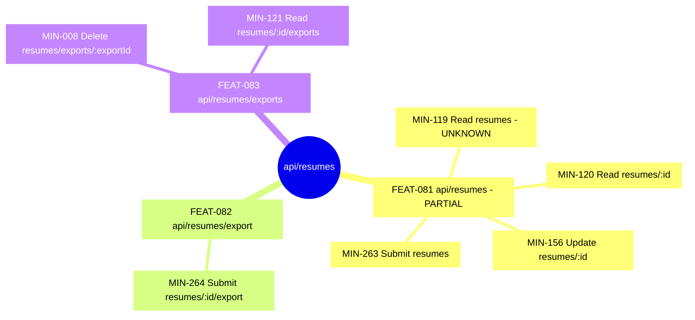
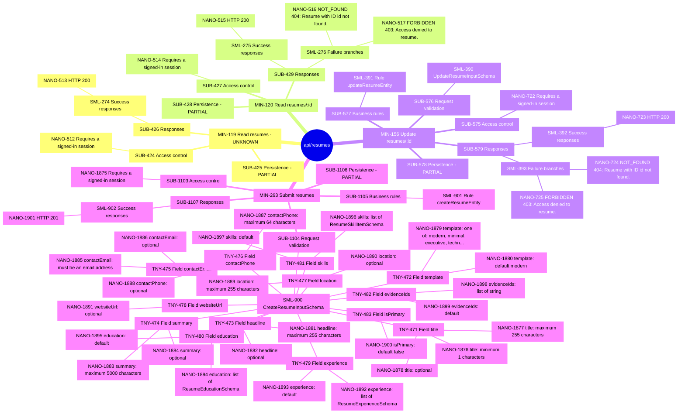
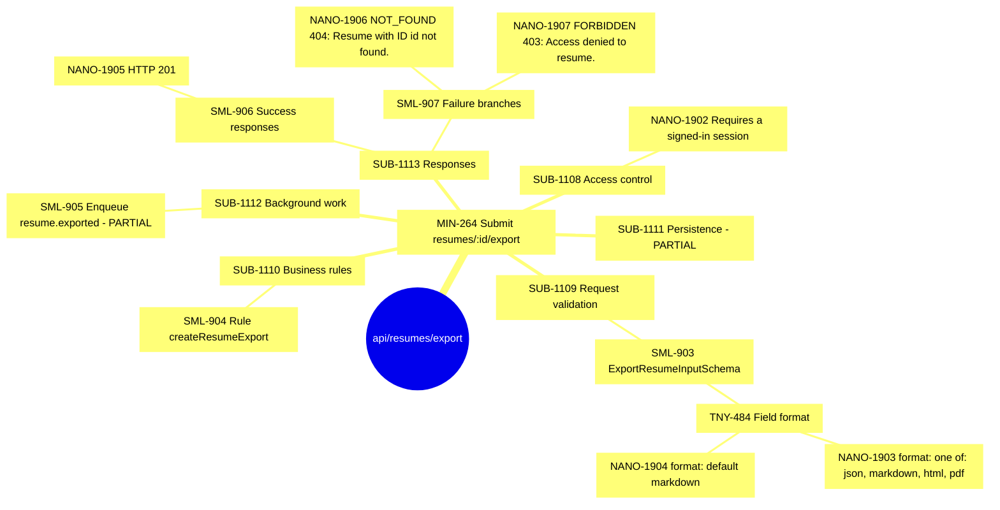
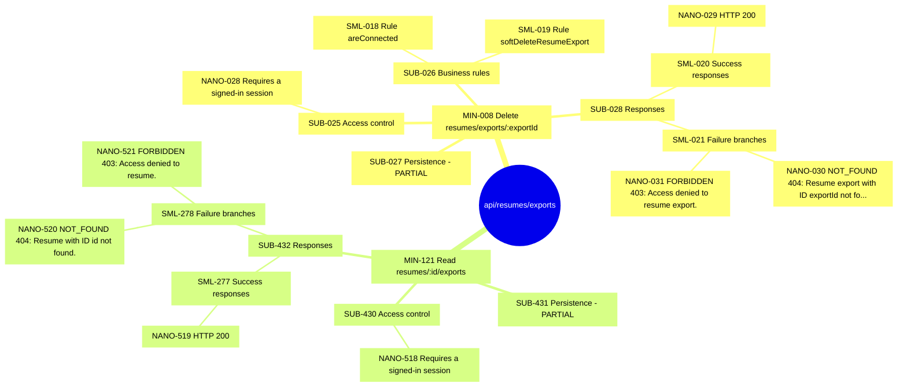

# api/resumes (MOD-078)

Generated by `project-mindmap/tools/catalog.py` from `master/MASTER_PROJECT_GRAPH.json` at commit `9b3032f`. Do not edit by hand. Back to the [feature catalog](../FEATURE_CATALOG.md).

**Application:** apps/api (MOD-001). **Purpose:** API module: routes under /api/v1/resumes in apps/api/src/server.ts.

**Nodes by level:** MODULE 1, MAJOR 3, MINOR 7, SUB 29, SMALL 21, TINY 14, NANO 51. **Status:** IMPLEMENTED 115, PARTIALLY_IMPLEMENTED 10, UNKNOWN 1. **Verification:** PATH_LEVEL 109, UNKNOWN 1, VERIFIED 12.

**User roles that reach it:** authenticated.

**Known gaps:** MIN-119 ephemeral: state held in process memory, lost on restart; MIN-120 ephemeral: state held in process memory, lost on restart; MIN-120 no first-party web caller found; MIN-156 ephemeral: state held in process memory, lost on restart; MIN-156 no first-party web caller found; MIN-263 ephemeral: state held in process memory, lost on restart; MIN-264 ephemeral: state held in process memory, lost on restart; MIN-264 no first-party web caller found; MIN-008 ephemeral: state held in process memory, lost on restart; MIN-008 no first-party web caller found; MIN-121 ephemeral: state held in process memory, lost on restart; MIN-121 no first-party web caller found.

**Called from (web screens and components):** FEAT-179 Screen /resumes

## Module map (to minor features)

## FEAT-081 api/resumes

api/resumes

| ID        | Level | Parent   | Name                                                    | Description                                                                                                                                                                                                                                                                       | Status                | Verification | Evidence                            | Related                                                       |
| --------- | ----- | -------- | ------------------------------------------------------- | --------------------------------------------------------------------------------------------------------------------------------------------------------------------------------------------------------------------------------------------------------------------------------- | --------------------- | ------------ | ----------------------------------- | ------------------------------------------------------------- |
| FEAT-081  | MAJOR | MOD-078  | api/resumes                                             |                                                                                                                                                                                                                                                                                   | PARTIALLY_IMPLEMENTED |              | apps/api/src/server.ts:6295         |                                                               |
| MIN-119   | MINOR | FEAT-081 | Read resumes                                            | GET /api/v1/resumes for any signed-in session; ephemeral (process memory); responds 200. Gaps: ephemeral: state held in process memory, lost on restart                                                                                                                           | UNKNOWN               | VERIFIED     | apps/api/src/server.ts:6309         | API-128, TEST-123, TEST-141, TEST-199, TEST-200, TEST-217 ... |
| SUB-424   | SUB   | MIN-119  | Access control                                          | Who may call GET /api/v1/resumes: any signed-in session.                                                                                                                                                                                                                          | IMPLEMENTED           | PATH_LEVEL   | apps/api/src/server.ts:6309         |                                                               |
| NANO-512  | NANO  | SUB-424  | Requires a signed-in session                            | Requests without a valid session token are rejected with 401 UNAUTHENTICATED.                                                                                                                                                                                                     | IMPLEMENTED           | PATH_LEVEL   | apps/api/src/server.ts:6309         | ROLE-001                                                      |
| SUB-425   | SUB   | MIN-119  | Persistence                                             | Ephemeral: state lives in API process memory and is lost on restart.                                                                                                                                                                                                              | PARTIALLY_IMPLEMENTED | PATH_LEVEL   | apps/api/src/server.ts:6309         |                                                               |
| SUB-426   | SUB   | MIN-119  | Responses                                               | Success 200; 0 explicit failure branch(es) besides validation and access errors.                                                                                                                                                                                                  | IMPLEMENTED           | PATH_LEVEL   | apps/api/src/server.ts:6309         |                                                               |
| SML-274   | SMALL | SUB-426  | Success responses                                       | HTTP 200.                                                                                                                                                                                                                                                                         | IMPLEMENTED           | PATH_LEVEL   | apps/api/src/server.ts:6309         |                                                               |
| NANO-513  | NANO  | SML-274  | HTTP 200                                                | Replies 200 when the operation succeeds.                                                                                                                                                                                                                                          | IMPLEMENTED           | PATH_LEVEL   | apps/api/src/server.ts:6309         |                                                               |
| MIN-120   | MINOR | FEAT-081 | Read resumes/:id                                        | GET /api/v1/resumes/:id for any signed-in session; ephemeral (process memory); responds 200; 2 failure branch(es). Gaps: ephemeral: state held in process memory, lost on restart; no first-party web caller found                                                                | IMPLEMENTED           | VERIFIED     | apps/api/src/server.ts:6315         | API-129, TEST-123, TEST-141                                   |
| SUB-427   | SUB   | MIN-120  | Access control                                          | Who may call GET /api/v1/resumes/:id: any signed-in session.                                                                                                                                                                                                                      | IMPLEMENTED           | PATH_LEVEL   | apps/api/src/server.ts:6315         |                                                               |
| NANO-514  | NANO  | SUB-427  | Requires a signed-in session                            | Requests without a valid session token are rejected with 401 UNAUTHENTICATED.                                                                                                                                                                                                     | IMPLEMENTED           | PATH_LEVEL   | apps/api/src/server.ts:6315         | ROLE-001                                                      |
| SUB-428   | SUB   | MIN-120  | Persistence                                             | Ephemeral: state lives in API process memory and is lost on restart.                                                                                                                                                                                                              | PARTIALLY_IMPLEMENTED | PATH_LEVEL   | apps/api/src/server.ts:6315         |                                                               |
| SUB-429   | SUB   | MIN-120  | Responses                                               | Success 200; 2 explicit failure branch(es) besides validation and access errors.                                                                                                                                                                                                  | IMPLEMENTED           | PATH_LEVEL   | apps/api/src/server.ts:6315         |                                                               |
| SML-275   | SMALL | SUB-429  | Success responses                                       | HTTP 200.                                                                                                                                                                                                                                                                         | IMPLEMENTED           | PATH_LEVEL   | apps/api/src/server.ts:6315         |                                                               |
| NANO-515  | NANO  | SML-275  | HTTP 200                                                | Replies 200 when the operation succeeds.                                                                                                                                                                                                                                          | IMPLEMENTED           | PATH_LEVEL   | apps/api/src/server.ts:6315         |                                                               |
| SML-276   | SMALL | SUB-429  | Failure branches                                        | 2 DomainError branch(es) in the handler, mapped to HTTP by the global error handler.                                                                                                                                                                                              | IMPLEMENTED           | PATH_LEVEL   | apps/api/src/server.ts:6315         |                                                               |
| NANO-516  | NANO  | SML-276  | NOT_FOUND 404: Resume with ID "${id}" not found.        | Throws DomainError(NOT_FOUND) "Resume with ID "${id}" not found." -> HTTP 404.                                                                                                                                                                                                    | IMPLEMENTED           | PATH_LEVEL   | apps/api/src/server.ts:6323         | ERR-136                                                       |
| NANO-517  | NANO  | SML-276  | FORBIDDEN 403: Access denied to resume.                 | Throws DomainError(FORBIDDEN) "Access denied to resume." -> HTTP 403.                                                                                                                                                                                                             | IMPLEMENTED           | PATH_LEVEL   | apps/api/src/server.ts:6327         | ERR-135                                                       |
| MIN-156   | MINOR | FEAT-081 | Update resumes/:id                                      | PATCH /api/v1/resumes/:id for any signed-in session; validates UpdateResumeInputSchema; calls updateResumeEntity; ephemeral (process memory); responds 200; 2 failure branch(es). Gaps: ephemeral: state held in process memory, lost on restart; no first-party web caller found | IMPLEMENTED           | VERIFIED     | apps/api/src/server.ts:6334         | API-130, TEST-123, TEST-141                                   |
| SUB-575   | SUB   | MIN-156  | Access control                                          | Who may call PATCH /api/v1/resumes/:id: any signed-in session.                                                                                                                                                                                                                    | IMPLEMENTED           | PATH_LEVEL   | apps/api/src/server.ts:6334         |                                                               |
| NANO-722  | NANO  | SUB-575  | Requires a signed-in session                            | Requests without a valid session token are rejected with 401 UNAUTHENTICATED.                                                                                                                                                                                                     | IMPLEMENTED           | PATH_LEVEL   | apps/api/src/server.ts:6334         | ROLE-001                                                      |
| SUB-576   | SUB   | MIN-156  | Request validation                                      | The request is parsed with UpdateResumeInputSchema; a failure returns 400 with field details before any business logic runs.                                                                                                                                                      | IMPLEMENTED           | PATH_LEVEL   | apps/api/src/server.ts:6334         |                                                               |
| SML-390   | SMALL | SUB-576  | UpdateResumeInputSchema                                 | UpdateResumeInputSchema = CreateResumeInputSchema.partial() (not a plain object; fields not decomposed)                                                                                                                                                                           | IMPLEMENTED           | PATH_LEVEL   | packages/contracts/src/index.ts:509 | SCH-037                                                       |
| SUB-577   | SUB   | MIN-156  | Business rules                                          | Domain functions from packages/domain called by the handler (1).                                                                                                                                                                                                                  | IMPLEMENTED           | PATH_LEVEL   | apps/api/src/server.ts:6334         |                                                               |
| SML-391   | SMALL | SUB-577  | Rule updateResumeEntity                                 | Calls updateResumeEntity (packages/domain/src/resumes.ts). Rule status IMPLEMENTED; its own tests: VERIFIED.                                                                                                                                                                      | IMPLEMENTED           | VERIFIED     | packages/domain/src/resumes.ts:101  | RULE-188                                                      |
| SUB-578   | SUB   | MIN-156  | Persistence                                             | Ephemeral: state lives in API process memory and is lost on restart.                                                                                                                                                                                                              | PARTIALLY_IMPLEMENTED | PATH_LEVEL   | apps/api/src/server.ts:6334         |                                                               |
| SUB-579   | SUB   | MIN-156  | Responses                                               | Success 200; 2 explicit failure branch(es) besides validation and access errors.                                                                                                                                                                                                  | IMPLEMENTED           | PATH_LEVEL   | apps/api/src/server.ts:6334         |                                                               |
| SML-392   | SMALL | SUB-579  | Success responses                                       | HTTP 200.                                                                                                                                                                                                                                                                         | IMPLEMENTED           | PATH_LEVEL   | apps/api/src/server.ts:6334         |                                                               |
| NANO-723  | NANO  | SML-392  | HTTP 200                                                | Replies 200 when the operation succeeds.                                                                                                                                                                                                                                          | IMPLEMENTED           | PATH_LEVEL   | apps/api/src/server.ts:6334         |                                                               |
| SML-393   | SMALL | SUB-579  | Failure branches                                        | 2 DomainError branch(es) in the handler, mapped to HTTP by the global error handler.                                                                                                                                                                                              | IMPLEMENTED           | PATH_LEVEL   | apps/api/src/server.ts:6334         |                                                               |
| NANO-724  | NANO  | SML-393  | NOT_FOUND 404: Resume with ID "${id}" not found.        | Throws DomainError(NOT_FOUND) "Resume with ID "${id}" not found." -> HTTP 404.                                                                                                                                                                                                    | IMPLEMENTED           | PATH_LEVEL   | apps/api/src/server.ts:6342         | ERR-136                                                       |
| NANO-725  | NANO  | SML-393  | FORBIDDEN 403: Access denied to resume.                 | Throws DomainError(FORBIDDEN) "Access denied to resume." -> HTTP 403.                                                                                                                                                                                                             | IMPLEMENTED           | PATH_LEVEL   | apps/api/src/server.ts:6346         | ERR-135                                                       |
| MIN-263   | MINOR | FEAT-081 | Submit resumes                                          | POST /api/v1/resumes for any signed-in session; validates CreateResumeInputSchema; calls createResumeEntity; ephemeral (process memory); responds 201. Gaps: ephemeral: state held in process memory, lost on restart                                                             | IMPLEMENTED           | VERIFIED     | apps/api/src/server.ts:6295         | API-127, TEST-123, TEST-126, TEST-141, TEST-206, TEST-224     |
| SUB-1103  | SUB   | MIN-263  | Access control                                          | Who may call POST /api/v1/resumes: any signed-in session.                                                                                                                                                                                                                         | IMPLEMENTED           | PATH_LEVEL   | apps/api/src/server.ts:6295         |                                                               |
| NANO-1875 | NANO  | SUB-1103 | Requires a signed-in session                            | Requests without a valid session token are rejected with 401 UNAUTHENTICATED.                                                                                                                                                                                                     | IMPLEMENTED           | PATH_LEVEL   | apps/api/src/server.ts:6295         | ROLE-001                                                      |
| SUB-1104  | SUB   | MIN-263  | Request validation                                      | The request is parsed with CreateResumeInputSchema; a failure returns 400 with field details before any business logic runs.                                                                                                                                                      | IMPLEMENTED           | PATH_LEVEL   | apps/api/src/server.ts:6295         |                                                               |
| SML-900   | SMALL | SUB-1104 | CreateResumeInputSchema                                 | CreateResumeInputSchema: 13 field(s)                                                                                                                                                                                                                                              | IMPLEMENTED           | PATH_LEVEL   | packages/contracts/src/index.ts:491 | SCH-036                                                       |
| TNY-471   | TINY  | SML-900  | Field title                                             | title (string, optional): minimum 1 characters; maximum 255 characters; optional                                                                                                                                                                                                  | IMPLEMENTED           | PATH_LEVEL   | packages/contracts/src/index.ts:492 |                                                               |
| NANO-1876 | NANO  | TNY-471  | title: minimum 1 characters                             | title minimum 1 characters.                                                                                                                                                                                                                                                       | IMPLEMENTED           | PATH_LEVEL   | packages/contracts/src/index.ts:492 |                                                               |
| NANO-1877 | NANO  | TNY-471  | title: maximum 255 characters                           | title maximum 255 characters.                                                                                                                                                                                                                                                     | IMPLEMENTED           | PATH_LEVEL   | packages/contracts/src/index.ts:492 |                                                               |
| NANO-1878 | NANO  | TNY-471  | title: optional                                         | title optional.                                                                                                                                                                                                                                                                   | IMPLEMENTED           | PATH_LEVEL   | packages/contracts/src/index.ts:492 |                                                               |
| TNY-472   | TINY  | SML-900  | Field template                                          | template (enum, optional): one of: modern, minimal, executive, technical; default 'modern'                                                                                                                                                                                        | IMPLEMENTED           | PATH_LEVEL   | packages/contracts/src/index.ts:493 |                                                               |
| NANO-1879 | NANO  | TNY-472  | template: one of: modern, minimal, executive, technical | template one of: modern, minimal, executive, technical.                                                                                                                                                                                                                           | IMPLEMENTED           | PATH_LEVEL   | packages/contracts/src/index.ts:493 |                                                               |
| NANO-1880 | NANO  | TNY-472  | template: default 'modern'                              | template default 'modern'; message "modern".                                                                                                                                                                                                                                      | IMPLEMENTED           | PATH_LEVEL   | packages/contracts/src/index.ts:493 |                                                               |
| TNY-473   | TINY  | SML-900  | Field headline                                          | headline (string, optional): maximum 255 characters; optional                                                                                                                                                                                                                     | IMPLEMENTED           | PATH_LEVEL   | packages/contracts/src/index.ts:494 |                                                               |
| NANO-1881 | NANO  | TNY-473  | headline: maximum 255 characters                        | headline maximum 255 characters.                                                                                                                                                                                                                                                  | IMPLEMENTED           | PATH_LEVEL   | packages/contracts/src/index.ts:494 |                                                               |
| NANO-1882 | NANO  | TNY-473  | headline: optional                                      | headline optional.                                                                                                                                                                                                                                                                | IMPLEMENTED           | PATH_LEVEL   | packages/contracts/src/index.ts:494 |                                                               |
| TNY-474   | TINY  | SML-900  | Field summary                                           | summary (string, optional): maximum 5000 characters; optional                                                                                                                                                                                                                     | IMPLEMENTED           | PATH_LEVEL   | packages/contracts/src/index.ts:495 |                                                               |
| NANO-1883 | NANO  | TNY-474  | summary: maximum 5000 characters                        | summary maximum 5000 characters.                                                                                                                                                                                                                                                  | IMPLEMENTED           | PATH_LEVEL   | packages/contracts/src/index.ts:495 |                                                               |
| NANO-1884 | NANO  | TNY-474  | summary: optional                                       | summary optional.                                                                                                                                                                                                                                                                 | IMPLEMENTED           | PATH_LEVEL   | packages/contracts/src/index.ts:495 |                                                               |
| TNY-475   | TINY  | SML-900  | Field contactEmail                                      | contactEmail (string, optional): must be an email address; optional                                                                                                                                                                                                               | IMPLEMENTED           | PATH_LEVEL   | packages/contracts/src/index.ts:496 |                                                               |
| NANO-1885 | NANO  | TNY-475  | contactEmail: must be an email address                  | contactEmail must be an email address.                                                                                                                                                                                                                                            | IMPLEMENTED           | PATH_LEVEL   | packages/contracts/src/index.ts:496 |                                                               |
| NANO-1886 | NANO  | TNY-475  | contactEmail: optional                                  | contactEmail optional.                                                                                                                                                                                                                                                            | IMPLEMENTED           | PATH_LEVEL   | packages/contracts/src/index.ts:496 |                                                               |
| TNY-476   | TINY  | SML-900  | Field contactPhone                                      | contactPhone (string, optional): maximum 64 characters; optional                                                                                                                                                                                                                  | IMPLEMENTED           | PATH_LEVEL   | packages/contracts/src/index.ts:497 |                                                               |
| NANO-1887 | NANO  | TNY-476  | contactPhone: maximum 64 characters                     | contactPhone maximum 64 characters.                                                                                                                                                                                                                                               | IMPLEMENTED           | PATH_LEVEL   | packages/contracts/src/index.ts:497 |                                                               |
| NANO-1888 | NANO  | TNY-476  | contactPhone: optional                                  | contactPhone optional.                                                                                                                                                                                                                                                            | IMPLEMENTED           | PATH_LEVEL   | packages/contracts/src/index.ts:497 |                                                               |
| TNY-477   | TINY  | SML-900  | Field location                                          | location (string, optional): maximum 255 characters; optional                                                                                                                                                                                                                     | IMPLEMENTED           | PATH_LEVEL   | packages/contracts/src/index.ts:498 |                                                               |
| NANO-1889 | NANO  | TNY-477  | location: maximum 255 characters                        | location maximum 255 characters.                                                                                                                                                                                                                                                  | IMPLEMENTED           | PATH_LEVEL   | packages/contracts/src/index.ts:498 |                                                               |
| NANO-1890 | NANO  | TNY-477  | location: optional                                      | location optional.                                                                                                                                                                                                                                                                | IMPLEMENTED           | PATH_LEVEL   | packages/contracts/src/index.ts:498 |                                                               |
| TNY-478   | TINY  | SML-900  | Field websiteUrl                                        | websiteUrl (httpUrl(), optional): optional                                                                                                                                                                                                                                        | IMPLEMENTED           | PATH_LEVEL   | packages/contracts/src/index.ts:499 |                                                               |
| NANO-1891 | NANO  | TNY-478  | websiteUrl: optional                                    | websiteUrl optional.                                                                                                                                                                                                                                                              | IMPLEMENTED           | PATH_LEVEL   | packages/contracts/src/index.ts:499 |                                                               |
| TNY-479   | TINY  | SML-900  | Field experience                                        | experience (array, optional): list of ResumeExperienceSchema; default []                                                                                                                                                                                                          | IMPLEMENTED           | PATH_LEVEL   | packages/contracts/src/index.ts:500 |                                                               |
| NANO-1892 | NANO  | TNY-479  | experience: list of ResumeExperienceSchema              | experience list of ResumeExperienceSchema.                                                                                                                                                                                                                                        | IMPLEMENTED           | PATH_LEVEL   | packages/contracts/src/index.ts:500 |                                                               |
| NANO-1893 | NANO  | TNY-479  | experience: default []                                  | experience default [].                                                                                                                                                                                                                                                            | IMPLEMENTED           | PATH_LEVEL   | packages/contracts/src/index.ts:500 |                                                               |
| TNY-480   | TINY  | SML-900  | Field education                                         | education (array, optional): list of ResumeEducationSchema; default []                                                                                                                                                                                                            | IMPLEMENTED           | PATH_LEVEL   | packages/contracts/src/index.ts:501 |                                                               |
| NANO-1894 | NANO  | TNY-480  | education: list of ResumeEducationSchema                | education list of ResumeEducationSchema.                                                                                                                                                                                                                                          | IMPLEMENTED           | PATH_LEVEL   | packages/contracts/src/index.ts:501 |                                                               |
| NANO-1895 | NANO  | TNY-480  | education: default []                                   | education default [].                                                                                                                                                                                                                                                             | IMPLEMENTED           | PATH_LEVEL   | packages/contracts/src/index.ts:501 |                                                               |
| TNY-481   | TINY  | SML-900  | Field skills                                            | skills (array, optional): list of ResumeSkillItemSchema; default []                                                                                                                                                                                                               | IMPLEMENTED           | PATH_LEVEL   | packages/contracts/src/index.ts:502 |                                                               |
| NANO-1896 | NANO  | TNY-481  | skills: list of ResumeSkillItemSchema                   | skills list of ResumeSkillItemSchema.                                                                                                                                                                                                                                             | IMPLEMENTED           | PATH_LEVEL   | packages/contracts/src/index.ts:502 |                                                               |
| NANO-1897 | NANO  | TNY-481  | skills: default []                                      | skills default [].                                                                                                                                                                                                                                                                | IMPLEMENTED           | PATH_LEVEL   | packages/contracts/src/index.ts:502 |                                                               |
| TNY-482   | TINY  | SML-900  | Field evidenceIds                                       | evidenceIds (array, optional): list of string; default []                                                                                                                                                                                                                         | IMPLEMENTED           | PATH_LEVEL   | packages/contracts/src/index.ts:503 |                                                               |
| NANO-1898 | NANO  | TNY-482  | evidenceIds: list of string                             | evidenceIds list of string.                                                                                                                                                                                                                                                       | IMPLEMENTED           | PATH_LEVEL   | packages/contracts/src/index.ts:503 |                                                               |
| NANO-1899 | NANO  | TNY-482  | evidenceIds: default []                                 | evidenceIds default [].                                                                                                                                                                                                                                                           | IMPLEMENTED           | PATH_LEVEL   | packages/contracts/src/index.ts:503 |                                                               |
| TNY-483   | TINY  | SML-900  | Field isPrimary                                         | isPrimary (boolean, optional): default false                                                                                                                                                                                                                                      | IMPLEMENTED           | PATH_LEVEL   | packages/contracts/src/index.ts:504 |                                                               |
| NANO-1900 | NANO  | TNY-483  | isPrimary: default false                                | isPrimary default false.                                                                                                                                                                                                                                                          | IMPLEMENTED           | PATH_LEVEL   | packages/contracts/src/index.ts:504 |                                                               |
| SUB-1105  | SUB   | MIN-263  | Business rules                                          | Domain functions from packages/domain called by the handler (1).                                                                                                                                                                                                                  | IMPLEMENTED           | PATH_LEVEL   | apps/api/src/server.ts:6295         |                                                               |
| SML-901   | SMALL | SUB-1105 | Rule createResumeEntity                                 | Calls createResumeEntity (packages/domain/src/resumes.ts). Rule status IMPLEMENTED; its own tests: VERIFIED.                                                                                                                                                                      | IMPLEMENTED           | VERIFIED     | packages/domain/src/resumes.ts:71   | RULE-187                                                      |
| SUB-1106  | SUB   | MIN-263  | Persistence                                             | Ephemeral: state lives in API process memory and is lost on restart.                                                                                                                                                                                                              | PARTIALLY_IMPLEMENTED | PATH_LEVEL   | apps/api/src/server.ts:6295         |                                                               |
| SUB-1107  | SUB   | MIN-263  | Responses                                               | Success 201; 0 explicit failure branch(es) besides validation and access errors.                                                                                                                                                                                                  | IMPLEMENTED           | PATH_LEVEL   | apps/api/src/server.ts:6295         |                                                               |
| SML-902   | SMALL | SUB-1107 | Success responses                                       | HTTP 201.                                                                                                                                                                                                                                                                         | IMPLEMENTED           | PATH_LEVEL   | apps/api/src/server.ts:6295         |                                                               |
| NANO-1901 | NANO  | SML-902  | HTTP 201                                                | Replies 201 when the operation succeeds.                                                                                                                                                                                                                                          | IMPLEMENTED           | PATH_LEVEL   | apps/api/src/server.ts:6295         |                                                               |

## FEAT-082 api/resumes/export

api/resumes/export

| ID        | Level | Parent   | Name                                             | Description                                                                                                                                                                                                                                                                             | Status                | Verification | Evidence                                   | Related                     |
| --------- | ----- | -------- | ------------------------------------------------ | --------------------------------------------------------------------------------------------------------------------------------------------------------------------------------------------------------------------------------------------------------------------------------------- | --------------------- | ------------ | ------------------------------------------ | --------------------------- |
| FEAT-082  | MAJOR | MOD-078  | api/resumes/export                               |                                                                                                                                                                                                                                                                                         | IMPLEMENTED           |              | apps/api/src/server.ts:6365                |                             |
| MIN-264   | MINOR | FEAT-082 | Submit resumes/:id/export                        | POST /api/v1/resumes/:id/export for any signed-in session; validates ExportResumeInputSchema; calls createResumeExport; ephemeral (process memory); responds 201; 2 failure branch(es). Gaps: ephemeral: state held in process memory, lost on restart; no first-party web caller found | IMPLEMENTED           | VERIFIED     | apps/api/src/server.ts:6365                | API-131, TEST-123, TEST-206 |
| SUB-1108  | SUB   | MIN-264  | Access control                                   | Who may call POST /api/v1/resumes/:id/export: any signed-in session.                                                                                                                                                                                                                    | IMPLEMENTED           | PATH_LEVEL   | apps/api/src/server.ts:6365                |                             |
| NANO-1902 | NANO  | SUB-1108 | Requires a signed-in session                     | Requests without a valid session token are rejected with 401 UNAUTHENTICATED.                                                                                                                                                                                                           | IMPLEMENTED           | PATH_LEVEL   | apps/api/src/server.ts:6365                | ROLE-001                    |
| SUB-1109  | SUB   | MIN-264  | Request validation                               | The request is parsed with ExportResumeInputSchema; a failure returns 400 with field details before any business logic runs.                                                                                                                                                            | IMPLEMENTED           | PATH_LEVEL   | apps/api/src/server.ts:6365                |                             |
| SML-903   | SMALL | SUB-1109 | ExportResumeInputSchema                          | ExportResumeInputSchema: 1 field(s)                                                                                                                                                                                                                                                     | IMPLEMENTED           | PATH_LEVEL   | packages/contracts/src/index.ts:512        | SCH-038                     |
| TNY-484   | TINY  | SML-903  | Field format                                     | format (enum, optional): one of: json, markdown, html, pdf; default 'markdown'                                                                                                                                                                                                          | IMPLEMENTED           | PATH_LEVEL   | packages/contracts/src/index.ts:513        |                             |
| NANO-1903 | NANO  | TNY-484  | format: one of: json, markdown, html, pdf        | format one of: json, markdown, html, pdf.                                                                                                                                                                                                                                               | IMPLEMENTED           | PATH_LEVEL   | packages/contracts/src/index.ts:513        |                             |
| NANO-1904 | NANO  | TNY-484  | format: default 'markdown'                       | format default 'markdown'; message "markdown".                                                                                                                                                                                                                                          | IMPLEMENTED           | PATH_LEVEL   | packages/contracts/src/index.ts:513        |                             |
| SUB-1110  | SUB   | MIN-264  | Business rules                                   | Domain functions from packages/domain called by the handler (1).                                                                                                                                                                                                                        | IMPLEMENTED           | PATH_LEVEL   | apps/api/src/server.ts:6365                |                             |
| SML-904   | SMALL | SUB-1110 | Rule createResumeExport                          | Calls createResumeExport (packages/domain/src/resumes.ts). Rule status IMPLEMENTED; its own tests: VERIFIED.                                                                                                                                                                            | IMPLEMENTED           | VERIFIED     | packages/domain/src/resumes.ts:202         | RULE-190                    |
| SUB-1111  | SUB   | MIN-264  | Persistence                                      | Ephemeral: state lives in API process memory and is lost on restart.                                                                                                                                                                                                                    | PARTIALLY_IMPLEMENTED | PATH_LEVEL   | apps/api/src/server.ts:6365                |                             |
| SUB-1112  | SUB   | MIN-264  | Background work                                  | Enqueues 1 background job kind(s) in background_jobs for apps/worker.                                                                                                                                                                                                                   | IMPLEMENTED           | PATH_LEVEL   | apps/api/src/server.ts:6365                |                             |
| SML-905   | SMALL | SUB-1112 | Enqueue resume.exported                          | Dispatches job:resume.exported; worker handler: recordEvent (no-op: marks the event recorded).                                                                                                                                                                                          | PARTIALLY_IMPLEMENTED | UNKNOWN      | packages/domain/src/background-jobs.ts:171 | SVC-039                     |
| SUB-1113  | SUB   | MIN-264  | Responses                                        | Success 201; 2 explicit failure branch(es) besides validation and access errors.                                                                                                                                                                                                        | IMPLEMENTED           | PATH_LEVEL   | apps/api/src/server.ts:6365                |                             |
| SML-906   | SMALL | SUB-1113 | Success responses                                | HTTP 201.                                                                                                                                                                                                                                                                               | IMPLEMENTED           | PATH_LEVEL   | apps/api/src/server.ts:6365                |                             |
| NANO-1905 | NANO  | SML-906  | HTTP 201                                         | Replies 201 when the operation succeeds.                                                                                                                                                                                                                                                | IMPLEMENTED           | PATH_LEVEL   | apps/api/src/server.ts:6365                |                             |
| SML-907   | SMALL | SUB-1113 | Failure branches                                 | 2 DomainError branch(es) in the handler, mapped to HTTP by the global error handler.                                                                                                                                                                                                    | IMPLEMENTED           | PATH_LEVEL   | apps/api/src/server.ts:6365                |                             |
| NANO-1906 | NANO  | SML-907  | NOT_FOUND 404: Resume with ID "${id}" not found. | Throws DomainError(NOT_FOUND) "Resume with ID "${id}" not found." -> HTTP 404.                                                                                                                                                                                                          | IMPLEMENTED           | PATH_LEVEL   | apps/api/src/server.ts:6373                | ERR-136                     |
| NANO-1907 | NANO  | SML-907  | FORBIDDEN 403: Access denied to resume.          | Throws DomainError(FORBIDDEN) "Access denied to resume." -> HTTP 403.                                                                                                                                                                                                                   | IMPLEMENTED           | PATH_LEVEL   | apps/api/src/server.ts:6377                | ERR-135                     |

## FEAT-083 api/resumes/exports

api/resumes/exports

| ID       | Level | Parent   | Name                                                          | Description                                                                                                                                                                                                                                                                     | Status                | Verification | Evidence                              | Related                     |
| -------- | ----- | -------- | ------------------------------------------------------------- | ------------------------------------------------------------------------------------------------------------------------------------------------------------------------------------------------------------------------------------------------------------------------------- | --------------------- | ------------ | ------------------------------------- | --------------------------- |
| FEAT-083 | MAJOR | MOD-078  | api/resumes/exports                                           |                                                                                                                                                                                                                                                                                 | IMPLEMENTED           |              | apps/api/src/server.ts:6406           |                             |
| MIN-008  | MINOR | FEAT-083 | Delete resumes/exports/:exportId                              | DELETE /api/v1/resumes/exports/:exportId for any signed-in session; calls areConnected, softDeleteResumeExport; ephemeral (process memory); responds 200; 2 failure branch(es). Gaps: ephemeral: state held in process memory, lost on restart; no first-party web caller found | IMPLEMENTED           | VERIFIED     | apps/api/src/server.ts:6434           | API-133, TEST-123, TEST-206 |
| SUB-025  | SUB   | MIN-008  | Access control                                                | Who may call DELETE /api/v1/resumes/exports/:exportId: any signed-in session.                                                                                                                                                                                                   | IMPLEMENTED           | PATH_LEVEL   | apps/api/src/server.ts:6434           |                             |
| NANO-028 | NANO  | SUB-025  | Requires a signed-in session                                  | Requests without a valid session token are rejected with 401 UNAUTHENTICATED.                                                                                                                                                                                                   | IMPLEMENTED           | PATH_LEVEL   | apps/api/src/server.ts:6434           | ROLE-001                    |
| SUB-026  | SUB   | MIN-008  | Business rules                                                | Domain functions from packages/domain called by the handler (2).                                                                                                                                                                                                                | IMPLEMENTED           | PATH_LEVEL   | apps/api/src/server.ts:6434           |                             |
| SML-018  | SMALL | SUB-026  | Rule areConnected                                             | Calls areConnected (packages/domain/src/networking.ts). Rule status IMPLEMENTED; its own tests: VERIFIED.                                                                                                                                                                       | IMPLEMENTED           | VERIFIED     | packages/domain/src/networking.ts:156 | RULE-158                    |
| SML-019  | SMALL | SUB-026  | Rule softDeleteResumeExport                                   | Calls softDeleteResumeExport (packages/domain/src/resumes.ts). Rule status IMPLEMENTED; its own tests: VERIFIED.                                                                                                                                                                | IMPLEMENTED           | VERIFIED     | packages/domain/src/resumes.ts:243    | RULE-191                    |
| SUB-027  | SUB   | MIN-008  | Persistence                                                   | Ephemeral: state lives in API process memory and is lost on restart.                                                                                                                                                                                                            | PARTIALLY_IMPLEMENTED | PATH_LEVEL   | apps/api/src/server.ts:6434           |                             |
| SUB-028  | SUB   | MIN-008  | Responses                                                     | Success 200; 2 explicit failure branch(es) besides validation and access errors.                                                                                                                                                                                                | IMPLEMENTED           | PATH_LEVEL   | apps/api/src/server.ts:6434           |                             |
| SML-020  | SMALL | SUB-028  | Success responses                                             | HTTP 200.                                                                                                                                                                                                                                                                       | IMPLEMENTED           | PATH_LEVEL   | apps/api/src/server.ts:6434           |                             |
| NANO-029 | NANO  | SML-020  | HTTP 200                                                      | Replies 200 when the operation succeeds.                                                                                                                                                                                                                                        | IMPLEMENTED           | PATH_LEVEL   | apps/api/src/server.ts:6434           |                             |
| SML-021  | SMALL | SUB-028  | Failure branches                                              | 2 DomainError branch(es) in the handler, mapped to HTTP by the global error handler.                                                                                                                                                                                            | IMPLEMENTED           | PATH_LEVEL   | apps/api/src/server.ts:6434           |                             |
| NANO-030 | NANO  | SML-021  | NOT_FOUND 404: Resume export with ID "${exportId}" not found. | Throws DomainError(NOT_FOUND) "Resume export with ID "${exportId}" not found." -> HTTP 404.                                                                                                                                                                                     | IMPLEMENTED           | PATH_LEVEL   | apps/api/src/server.ts:6442           | ERR-137                     |
| NANO-031 | NANO  | SML-021  | FORBIDDEN 403: Access denied to resume export.                | Throws DomainError(FORBIDDEN) "Access denied to resume export." -> HTTP 403.                                                                                                                                                                                                    | IMPLEMENTED           | PATH_LEVEL   | apps/api/src/server.ts:6446           | ERR-138                     |
| MIN-121  | MINOR | FEAT-083 | Read resumes/:id/exports                                      | GET /api/v1/resumes/:id/exports for any signed-in session; ephemeral (process memory); responds 200; 2 failure branch(es). Gaps: ephemeral: state held in process memory, lost on restart; no first-party web caller found                                                      | IMPLEMENTED           | VERIFIED     | apps/api/src/server.ts:6406           | API-132, TEST-123, TEST-206 |
| SUB-430  | SUB   | MIN-121  | Access control                                                | Who may call GET /api/v1/resumes/:id/exports: any signed-in session.                                                                                                                                                                                                            | IMPLEMENTED           | PATH_LEVEL   | apps/api/src/server.ts:6406           |                             |
| NANO-518 | NANO  | SUB-430  | Requires a signed-in session                                  | Requests without a valid session token are rejected with 401 UNAUTHENTICATED.                                                                                                                                                                                                   | IMPLEMENTED           | PATH_LEVEL   | apps/api/src/server.ts:6406           | ROLE-001                    |
| SUB-431  | SUB   | MIN-121  | Persistence                                                   | Ephemeral: state lives in API process memory and is lost on restart.                                                                                                                                                                                                            | PARTIALLY_IMPLEMENTED | PATH_LEVEL   | apps/api/src/server.ts:6406           |                             |
| SUB-432  | SUB   | MIN-121  | Responses                                                     | Success 200; 2 explicit failure branch(es) besides validation and access errors.                                                                                                                                                                                                | IMPLEMENTED           | PATH_LEVEL   | apps/api/src/server.ts:6406           |                             |
| SML-277  | SMALL | SUB-432  | Success responses                                             | HTTP 200.                                                                                                                                                                                                                                                                       | IMPLEMENTED           | PATH_LEVEL   | apps/api/src/server.ts:6406           |                             |
| NANO-519 | NANO  | SML-277  | HTTP 200                                                      | Replies 200 when the operation succeeds.                                                                                                                                                                                                                                        | IMPLEMENTED           | PATH_LEVEL   | apps/api/src/server.ts:6406           |                             |
| SML-278  | SMALL | SUB-432  | Failure branches                                              | 2 DomainError branch(es) in the handler, mapped to HTTP by the global error handler.                                                                                                                                                                                            | IMPLEMENTED           | PATH_LEVEL   | apps/api/src/server.ts:6406           |                             |
| NANO-520 | NANO  | SML-278  | NOT_FOUND 404: Resume with ID "${id}" not found.              | Throws DomainError(NOT_FOUND) "Resume with ID "${id}" not found." -> HTTP 404.                                                                                                                                                                                                  | IMPLEMENTED           | PATH_LEVEL   | apps/api/src/server.ts:6417           | ERR-136                     |
| NANO-521 | NANO  | SML-278  | FORBIDDEN 403: Access denied to resume.                       | Throws DomainError(FORBIDDEN) "Access denied to resume." -> HTTP 403.                                                                                                                                                                                                           | IMPLEMENTED           | PATH_LEVEL   | apps/api/src/server.ts:6421           | ERR-135                     |
