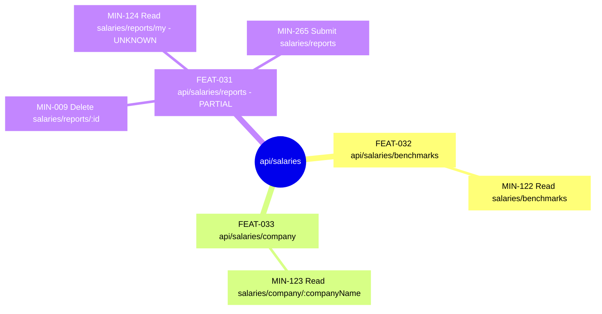
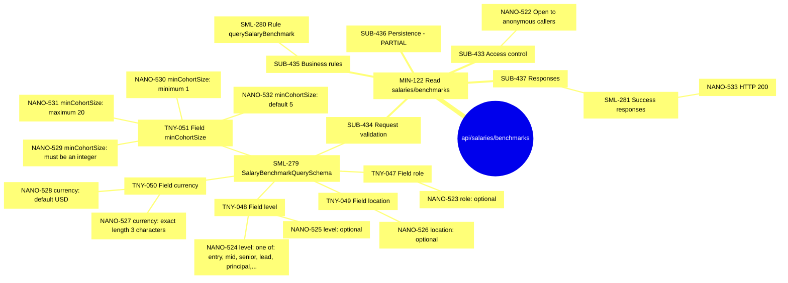
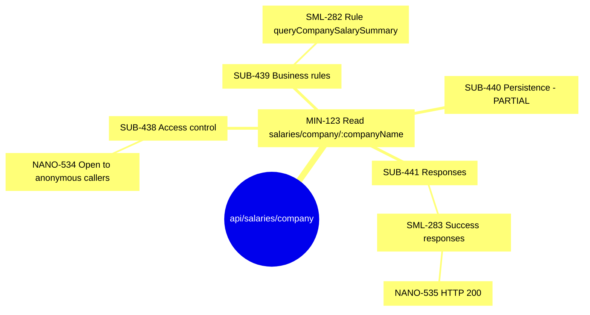
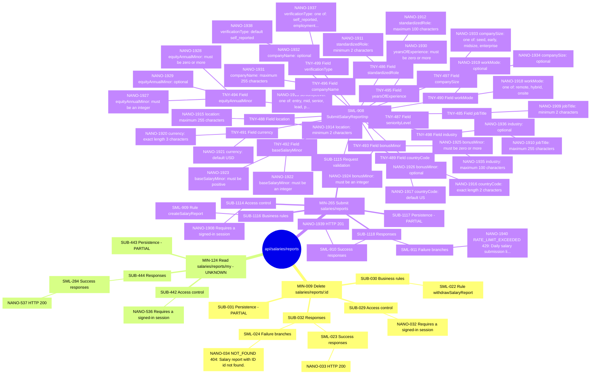

# api/salaries (MOD-062)

Generated by `project-mindmap/tools/catalog.py` from `master/MASTER_PROJECT_GRAPH.json` at commit `9b3032f`. Do not edit by hand. Back to the [feature catalog](../FEATURE_CATALOG.md).

**Application:** apps/api (MOD-001). **Purpose:** API module: routes under /api/v1/salaries in apps/api/src/server.ts.

**Nodes by level:** MODULE 1, MAJOR 3, MINOR 5, SUB 21, SMALL 13, TINY 20, NANO 52. **Status:** IMPLEMENTED 107, PARTIALLY_IMPLEMENTED 7, UNKNOWN 1. **Verification:** PATH_LEVEL 101, VERIFIED 10.

**User roles that reach it:** anonymous, authenticated.

**Known gaps:** MIN-122 ephemeral: state held in process memory, lost on restart; MIN-122 no first-party web caller found; MIN-123 ephemeral: state held in process memory, lost on restart; MIN-123 no first-party web caller found; MIN-009 ephemeral: state held in process memory, lost on restart; MIN-009 no first-party web caller found; MIN-124 ephemeral: state held in process memory, lost on restart; MIN-124 no first-party web caller found; MIN-265 ephemeral: state held in process memory, lost on restart; MIN-265 no first-party web caller found.

## Module map (to minor features)

## FEAT-032 api/salaries/benchmarks

api/salaries/benchmarks

| ID       | Level | Parent   | Name                                                                    | Description                                                                                                                                                                                                                                                      | Status                | Verification | Evidence                                       | Related                                         |
| -------- | ----- | -------- | ----------------------------------------------------------------------- | ---------------------------------------------------------------------------------------------------------------------------------------------------------------------------------------------------------------------------------------------------------------- | --------------------- | ------------ | ---------------------------------------------- | ----------------------------------------------- |
| FEAT-032 | MAJOR | MOD-062  | api/salaries/benchmarks                                                 |                                                                                                                                                                                                                                                                  | IMPLEMENTED           |              | apps/api/src/server.ts:2692                    |                                                 |
| MIN-122  | MINOR | FEAT-032 | Read salaries/benchmarks                                                | GET /api/v1/salaries/benchmarks for anyone (public); validates SalaryBenchmarkQuerySchema; calls querySalaryBenchmark; ephemeral (process memory); responds 200. Gaps: ephemeral: state held in process memory, lost on restart; no first-party web caller found | IMPLEMENTED           | VERIFIED     | apps/api/src/server.ts:2692                    | API-045, TEST-101, TEST-127, TEST-145, TEST-207 |
| SUB-433  | SUB   | MIN-122  | Access control                                                          | Who may call GET /api/v1/salaries/benchmarks: anyone (public).                                                                                                                                                                                                   | IMPLEMENTED           | PATH_LEVEL   | apps/api/src/server.ts:2692                    |                                                 |
| NANO-522 | NANO  | SUB-433  | Open to anonymous callers                                               | auth: public.                                                                                                                                                                                                                                                    | IMPLEMENTED           | PATH_LEVEL   | apps/api/src/server.ts:2692                    | ROLE-001                                        |
| SUB-434  | SUB   | MIN-122  | Request validation                                                      | The request is parsed with SalaryBenchmarkQuerySchema; a failure returns 400 with field details before any business logic runs.                                                                                                                                  | IMPLEMENTED           | PATH_LEVEL   | apps/api/src/server.ts:2692                    |                                                 |
| SML-279  | SMALL | SUB-434  | SalaryBenchmarkQuerySchema                                              | SalaryBenchmarkQuerySchema: 5 field(s)                                                                                                                                                                                                                           | IMPLEMENTED           | PATH_LEVEL   | packages/contracts/src/index.ts:1049           | SCH-083                                         |
| TNY-047  | TINY  | SML-279  | Field role                                                              | role (string, optional): optional                                                                                                                                                                                                                                | IMPLEMENTED           | PATH_LEVEL   | packages/contracts/src/index.ts:1050           |                                                 |
| NANO-523 | NANO  | TNY-047  | role: optional                                                          | role optional.                                                                                                                                                                                                                                                   | IMPLEMENTED           | PATH_LEVEL   | packages/contracts/src/index.ts:1050           |                                                 |
| TNY-048  | TINY  | SML-279  | Field level                                                             | level (enum, optional): one of: entry, mid, senior, lead, principal, director, executive; optional                                                                                                                                                               | IMPLEMENTED           | PATH_LEVEL   | packages/contracts/src/index.ts:1051           |                                                 |
| NANO-524 | NANO  | TNY-048  | level: one of: entry, mid, senior, lead, principal, director, executive | level one of: entry, mid, senior, lead, principal, director, executive.                                                                                                                                                                                          | IMPLEMENTED           | PATH_LEVEL   | packages/contracts/src/index.ts:1051           |                                                 |
| NANO-525 | NANO  | TNY-048  | level: optional                                                         | level optional.                                                                                                                                                                                                                                                  | IMPLEMENTED           | PATH_LEVEL   | packages/contracts/src/index.ts:1051           |                                                 |
| TNY-049  | TINY  | SML-279  | Field location                                                          | location (string, optional): optional                                                                                                                                                                                                                            | IMPLEMENTED           | PATH_LEVEL   | packages/contracts/src/index.ts:1054           |                                                 |
| NANO-526 | NANO  | TNY-049  | location: optional                                                      | location optional.                                                                                                                                                                                                                                               | IMPLEMENTED           | PATH_LEVEL   | packages/contracts/src/index.ts:1054           |                                                 |
| TNY-050  | TINY  | SML-279  | Field currency                                                          | currency (string, optional): exact length 3 characters; default 'USD'                                                                                                                                                                                            | IMPLEMENTED           | PATH_LEVEL   | packages/contracts/src/index.ts:1055           |                                                 |
| NANO-527 | NANO  | TNY-050  | currency: exact length 3 characters                                     | currency exact length 3 characters.                                                                                                                                                                                                                              | IMPLEMENTED           | PATH_LEVEL   | packages/contracts/src/index.ts:1055           |                                                 |
| NANO-528 | NANO  | TNY-050  | currency: default 'USD'                                                 | currency default 'USD'; message "USD".                                                                                                                                                                                                                           | IMPLEMENTED           | PATH_LEVEL   | packages/contracts/src/index.ts:1055           |                                                 |
| TNY-051  | TINY  | SML-279  | Field minCohortSize                                                     | minCohortSize (number, optional): must be an integer; minimum 1; maximum 20; default 5                                                                                                                                                                           | IMPLEMENTED           | PATH_LEVEL   | packages/contracts/src/index.ts:1057           |                                                 |
| NANO-529 | NANO  | TNY-051  | minCohortSize: must be an integer                                       | minCohortSize must be an integer.                                                                                                                                                                                                                                | IMPLEMENTED           | PATH_LEVEL   | packages/contracts/src/index.ts:1057           |                                                 |
| NANO-530 | NANO  | TNY-051  | minCohortSize: minimum 1                                                | minCohortSize minimum 1.                                                                                                                                                                                                                                         | IMPLEMENTED           | PATH_LEVEL   | packages/contracts/src/index.ts:1057           |                                                 |
| NANO-531 | NANO  | TNY-051  | minCohortSize: maximum 20                                               | minCohortSize maximum 20.                                                                                                                                                                                                                                        | IMPLEMENTED           | PATH_LEVEL   | packages/contracts/src/index.ts:1057           |                                                 |
| NANO-532 | NANO  | TNY-051  | minCohortSize: default 5                                                | minCohortSize default 5.                                                                                                                                                                                                                                         | IMPLEMENTED           | PATH_LEVEL   | packages/contracts/src/index.ts:1057           |                                                 |
| SUB-435  | SUB   | MIN-122  | Business rules                                                          | Domain functions from packages/domain called by the handler (1).                                                                                                                                                                                                 | IMPLEMENTED           | PATH_LEVEL   | apps/api/src/server.ts:2692                    |                                                 |
| SML-280  | SMALL | SUB-435  | Rule querySalaryBenchmark                                               | Calls querySalaryBenchmark (packages/domain/src/salary-intelligence.ts). Rule status IMPLEMENTED; its own tests: VERIFIED.                                                                                                                                       | IMPLEMENTED           | VERIFIED     | packages/domain/src/salary-intelligence.ts:317 | RULE-197                                        |
| SUB-436  | SUB   | MIN-122  | Persistence                                                             | Ephemeral: state lives in API process memory and is lost on restart.                                                                                                                                                                                             | PARTIALLY_IMPLEMENTED | PATH_LEVEL   | apps/api/src/server.ts:2692                    |                                                 |
| SUB-437  | SUB   | MIN-122  | Responses                                                               | Success 200; 0 explicit failure branch(es) besides validation and access errors.                                                                                                                                                                                 | IMPLEMENTED           | PATH_LEVEL   | apps/api/src/server.ts:2692                    |                                                 |
| SML-281  | SMALL | SUB-437  | Success responses                                                       | HTTP 200.                                                                                                                                                                                                                                                        | IMPLEMENTED           | PATH_LEVEL   | apps/api/src/server.ts:2692                    |                                                 |
| NANO-533 | NANO  | SML-281  | HTTP 200                                                                | Replies 200 when the operation succeeds.                                                                                                                                                                                                                         | IMPLEMENTED           | PATH_LEVEL   | apps/api/src/server.ts:2692                    |                                                 |

## FEAT-033 api/salaries/company

api/salaries/company

| ID       | Level | Parent   | Name                               | Description                                                                                                                                                                                                                               | Status                | Verification | Evidence                                       | Related                               |
| -------- | ----- | -------- | ---------------------------------- | ----------------------------------------------------------------------------------------------------------------------------------------------------------------------------------------------------------------------------------------- | --------------------- | ------------ | ---------------------------------------------- | ------------------------------------- |
| FEAT-033 | MAJOR | MOD-062  | api/salaries/company               |                                                                                                                                                                                                                                           | IMPLEMENTED           |              | apps/api/src/server.ts:2710                    |                                       |
| MIN-123  | MINOR | FEAT-033 | Read salaries/company/:companyName | GET /api/v1/salaries/company/:companyName for anyone (public); calls queryCompanySalarySummary; ephemeral (process memory); responds 200. Gaps: ephemeral: state held in process memory, lost on restart; no first-party web caller found | IMPLEMENTED           | VERIFIED     | apps/api/src/server.ts:2710                    | API-046, TEST-127, TEST-145, TEST-207 |
| SUB-438  | SUB   | MIN-123  | Access control                     | Who may call GET /api/v1/salaries/company/:companyName: anyone (public).                                                                                                                                                                  | IMPLEMENTED           | PATH_LEVEL   | apps/api/src/server.ts:2710                    |                                       |
| NANO-534 | NANO  | SUB-438  | Open to anonymous callers          | auth: public.                                                                                                                                                                                                                             | IMPLEMENTED           | PATH_LEVEL   | apps/api/src/server.ts:2710                    | ROLE-001                              |
| SUB-439  | SUB   | MIN-123  | Business rules                     | Domain functions from packages/domain called by the handler (1).                                                                                                                                                                          | IMPLEMENTED           | PATH_LEVEL   | apps/api/src/server.ts:2710                    |                                       |
| SML-282  | SMALL | SUB-439  | Rule queryCompanySalarySummary     | Calls queryCompanySalarySummary (packages/domain/src/salary-intelligence.ts). Rule status IMPLEMENTED; its own tests: VERIFIED.                                                                                                           | IMPLEMENTED           | VERIFIED     | packages/domain/src/salary-intelligence.ts:375 | RULE-198                              |
| SUB-440  | SUB   | MIN-123  | Persistence                        | Ephemeral: state lives in API process memory and is lost on restart.                                                                                                                                                                      | PARTIALLY_IMPLEMENTED | PATH_LEVEL   | apps/api/src/server.ts:2710                    |                                       |
| SUB-441  | SUB   | MIN-123  | Responses                          | Success 200; 0 explicit failure branch(es) besides validation and access errors.                                                                                                                                                          | IMPLEMENTED           | PATH_LEVEL   | apps/api/src/server.ts:2710                    |                                       |
| SML-283  | SMALL | SUB-441  | Success responses                  | HTTP 200.                                                                                                                                                                                                                                 | IMPLEMENTED           | PATH_LEVEL   | apps/api/src/server.ts:2710                    |                                       |
| NANO-535 | NANO  | SML-283  | HTTP 200                           | Replies 200 when the operation succeeds.                                                                                                                                                                                                  | IMPLEMENTED           | PATH_LEVEL   | apps/api/src/server.ts:2710                    |                                       |

## FEAT-031 api/salaries/reports

api/salaries/reports

| ID        | Level | Parent   | Name                                                                                | Description                                                                                                                                                                                                                                                                                                                                                                | Status                | Verification | Evidence                                       | Related                                          |
| --------- | ----- | -------- | ----------------------------------------------------------------------------------- | -------------------------------------------------------------------------------------------------------------------------------------------------------------------------------------------------------------------------------------------------------------------------------------------------------------------------------------------------------------------------- | --------------------- | ------------ | ---------------------------------------------- | ------------------------------------------------ |
| FEAT-031  | MAJOR | MOD-062  | api/salaries/reports                                                                |                                                                                                                                                                                                                                                                                                                                                                            | PARTIALLY_IMPLEMENTED |              | apps/api/src/server.ts:2592                    |                                                  |
| MIN-009   | MINOR | FEAT-031 | Delete salaries/reports/:id                                                         | DELETE /api/v1/salaries/reports/:id for any signed-in session; calls withdrawSalaryReport; ephemeral (process memory); responds 200; 1 failure branch(es). Gaps: ephemeral: state held in process memory, lost on restart; no first-party web caller found                                                                                                                 | IMPLEMENTED           | VERIFIED     | apps/api/src/server.ts:2660                    | API-044, TEST-127, TEST-207                      |
| SUB-029   | SUB   | MIN-009  | Access control                                                                      | Who may call DELETE /api/v1/salaries/reports/:id: any signed-in session.                                                                                                                                                                                                                                                                                                   | IMPLEMENTED           | PATH_LEVEL   | apps/api/src/server.ts:2660                    |                                                  |
| NANO-032  | NANO  | SUB-029  | Requires a signed-in session                                                        | Requests without a valid session token are rejected with 401 UNAUTHENTICATED.                                                                                                                                                                                                                                                                                              | IMPLEMENTED           | PATH_LEVEL   | apps/api/src/server.ts:2660                    | ROLE-001                                         |
| SUB-030   | SUB   | MIN-009  | Business rules                                                                      | Domain functions from packages/domain called by the handler (1).                                                                                                                                                                                                                                                                                                           | IMPLEMENTED           | PATH_LEVEL   | apps/api/src/server.ts:2660                    |                                                  |
| SML-022   | SMALL | SUB-030  | Rule withdrawSalaryReport                                                           | Calls withdrawSalaryReport (packages/domain/src/salary-intelligence.ts). Rule status IMPLEMENTED; its own tests: VERIFIED.                                                                                                                                                                                                                                                 | IMPLEMENTED           | VERIFIED     | packages/domain/src/salary-intelligence.ts:222 | RULE-195                                         |
| SUB-031   | SUB   | MIN-009  | Persistence                                                                         | Ephemeral: state lives in API process memory and is lost on restart.                                                                                                                                                                                                                                                                                                       | PARTIALLY_IMPLEMENTED | PATH_LEVEL   | apps/api/src/server.ts:2660                    |                                                  |
| SUB-032   | SUB   | MIN-009  | Responses                                                                           | Success 200; 1 explicit failure branch(es) besides validation and access errors.                                                                                                                                                                                                                                                                                           | IMPLEMENTED           | PATH_LEVEL   | apps/api/src/server.ts:2660                    |                                                  |
| SML-023   | SMALL | SUB-032  | Success responses                                                                   | HTTP 200.                                                                                                                                                                                                                                                                                                                                                                  | IMPLEMENTED           | PATH_LEVEL   | apps/api/src/server.ts:2660                    |                                                  |
| NANO-033  | NANO  | SML-023  | HTTP 200                                                                            | Replies 200 when the operation succeeds.                                                                                                                                                                                                                                                                                                                                   | IMPLEMENTED           | PATH_LEVEL   | apps/api/src/server.ts:2660                    |                                                  |
| SML-024   | SMALL | SUB-032  | Failure branches                                                                    | 1 DomainError branch(es) in the handler, mapped to HTTP by the global error handler.                                                                                                                                                                                                                                                                                       | IMPLEMENTED           | PATH_LEVEL   | apps/api/src/server.ts:2660                    |                                                  |
| NANO-034  | NANO  | SML-024  | NOT_FOUND 404: Salary report with ID ${id} not found.                               | Throws DomainError(NOT_FOUND) "Salary report with ID ${id} not found." -> HTTP 404.                                                                                                                                                                                                                                                                                        | IMPLEMENTED           | PATH_LEVEL   | apps/api/src/server.ts:2668                    | ERR-046                                          |
| MIN-124   | MINOR | FEAT-031 | Read salaries/reports/my                                                            | GET /api/v1/salaries/reports/my for any signed-in session; ephemeral (process memory); responds 200. Gaps: ephemeral: state held in process memory, lost on restart; no first-party web caller found                                                                                                                                                                       | UNKNOWN               | VERIFIED     | apps/api/src/server.ts:2654                    | API-043, TEST-127                                |
| SUB-442   | SUB   | MIN-124  | Access control                                                                      | Who may call GET /api/v1/salaries/reports/my: any signed-in session.                                                                                                                                                                                                                                                                                                       | IMPLEMENTED           | PATH_LEVEL   | apps/api/src/server.ts:2654                    |                                                  |
| NANO-536  | NANO  | SUB-442  | Requires a signed-in session                                                        | Requests without a valid session token are rejected with 401 UNAUTHENTICATED.                                                                                                                                                                                                                                                                                              | IMPLEMENTED           | PATH_LEVEL   | apps/api/src/server.ts:2654                    | ROLE-001                                         |
| SUB-443   | SUB   | MIN-124  | Persistence                                                                         | Ephemeral: state lives in API process memory and is lost on restart.                                                                                                                                                                                                                                                                                                       | PARTIALLY_IMPLEMENTED | PATH_LEVEL   | apps/api/src/server.ts:2654                    |                                                  |
| SUB-444   | SUB   | MIN-124  | Responses                                                                           | Success 200; 0 explicit failure branch(es) besides validation and access errors.                                                                                                                                                                                                                                                                                           | IMPLEMENTED           | PATH_LEVEL   | apps/api/src/server.ts:2654                    |                                                  |
| SML-284   | SMALL | SUB-444  | Success responses                                                                   | HTTP 200.                                                                                                                                                                                                                                                                                                                                                                  | IMPLEMENTED           | PATH_LEVEL   | apps/api/src/server.ts:2654                    |                                                  |
| NANO-537  | NANO  | SML-284  | HTTP 200                                                                            | Replies 200 when the operation succeeds.                                                                                                                                                                                                                                                                                                                                   | IMPLEMENTED           | PATH_LEVEL   | apps/api/src/server.ts:2654                    |                                                  |
| MIN-265   | MINOR | FEAT-031 | Submit salaries/reports                                                             | Salary Intelligence & Compensation Benchmarks Endpoints (F-86, BR-177..BR-183) POST /api/v1/salaries/reports for any signed-in session; validates SubmitSalaryReportInputSchema; calls createSalaryReport; ephemeral (process memory); responds 201; 1 failure branch(es). Gaps: ephemeral: state held in process memory, lost on restart; no first-party web caller found | IMPLEMENTED           | VERIFIED     | apps/api/src/server.ts:2592                    | API-042, TEST-101, TEST-127, TEST-207            |
| SUB-1114  | SUB   | MIN-265  | Access control                                                                      | Who may call POST /api/v1/salaries/reports: any signed-in session.                                                                                                                                                                                                                                                                                                         | IMPLEMENTED           | PATH_LEVEL   | apps/api/src/server.ts:2592                    |                                                  |
| NANO-1908 | NANO  | SUB-1114 | Requires a signed-in session                                                        | Requests without a valid session token are rejected with 401 UNAUTHENTICATED.                                                                                                                                                                                                                                                                                              | IMPLEMENTED           | PATH_LEVEL   | apps/api/src/server.ts:2592                    | ROLE-001                                         |
| SUB-1115  | SUB   | MIN-265  | Request validation                                                                  | The request is parsed with SubmitSalaryReportInputSchema; a failure returns 400 with field details before any business logic runs.                                                                                                                                                                                                                                         | IMPLEMENTED           | PATH_LEVEL   | apps/api/src/server.ts:2592                    |                                                  |
| SML-908   | SMALL | SUB-1115 | SubmitSalaryReportInputSchema                                                       | SubmitSalaryReportInputSchema: 15 field(s)                                                                                                                                                                                                                                                                                                                                 | IMPLEMENTED           | PATH_LEVEL   | packages/contracts/src/index.ts:1029           | SCH-082                                          |
| TNY-485   | TINY  | SML-908  | Field jobTitle                                                                      | jobTitle (string, required): minimum 2 characters; maximum 255 characters                                                                                                                                                                                                                                                                                                  | IMPLEMENTED           | PATH_LEVEL   | packages/contracts/src/index.ts:1030           |                                                  |
| NANO-1909 | NANO  | TNY-485  | jobTitle: minimum 2 characters                                                      | jobTitle minimum 2 characters.                                                                                                                                                                                                                                                                                                                                             | IMPLEMENTED           | PATH_LEVEL   | packages/contracts/src/index.ts:1030           |                                                  |
| NANO-1910 | NANO  | TNY-485  | jobTitle: maximum 255 characters                                                    | jobTitle maximum 255 characters.                                                                                                                                                                                                                                                                                                                                           | IMPLEMENTED           | PATH_LEVEL   | packages/contracts/src/index.ts:1030           |                                                  |
| TNY-486   | TINY  | SML-908  | Field standardizedRole                                                              | standardizedRole (string, required): minimum 2 characters; maximum 100 characters                                                                                                                                                                                                                                                                                          | IMPLEMENTED           | PATH_LEVEL   | packages/contracts/src/index.ts:1031           |                                                  |
| NANO-1911 | NANO  | TNY-486  | standardizedRole: minimum 2 characters                                              | standardizedRole minimum 2 characters.                                                                                                                                                                                                                                                                                                                                     | IMPLEMENTED           | PATH_LEVEL   | packages/contracts/src/index.ts:1031           |                                                  |
| NANO-1912 | NANO  | TNY-486  | standardizedRole: maximum 100 characters                                            | standardizedRole maximum 100 characters.                                                                                                                                                                                                                                                                                                                                   | IMPLEMENTED           | PATH_LEVEL   | packages/contracts/src/index.ts:1031           |                                                  |
| TNY-487   | TINY  | SML-908  | Field seniorityLevel                                                                | seniorityLevel (enum, required): one of: entry, mid, senior, lead, principal, director, executive                                                                                                                                                                                                                                                                          | IMPLEMENTED           | PATH_LEVEL   | packages/contracts/src/index.ts:1032           |                                                  |
| NANO-1913 | NANO  | TNY-487  | seniorityLevel: one of: entry, mid, senior, lead, principal, director, executive    | seniorityLevel one of: entry, mid, senior, lead, principal, director, executive.                                                                                                                                                                                                                                                                                           | IMPLEMENTED           | PATH_LEVEL   | packages/contracts/src/index.ts:1032           |                                                  |
| TNY-488   | TINY  | SML-908  | Field location                                                                      | location (string, required): minimum 2 characters; maximum 255 characters                                                                                                                                                                                                                                                                                                  | IMPLEMENTED           | PATH_LEVEL   | packages/contracts/src/index.ts:1033           |                                                  |
| NANO-1914 | NANO  | TNY-488  | location: minimum 2 characters                                                      | location minimum 2 characters.                                                                                                                                                                                                                                                                                                                                             | IMPLEMENTED           | PATH_LEVEL   | packages/contracts/src/index.ts:1033           |                                                  |
| NANO-1915 | NANO  | TNY-488  | location: maximum 255 characters                                                    | location maximum 255 characters.                                                                                                                                                                                                                                                                                                                                           | IMPLEMENTED           | PATH_LEVEL   | packages/contracts/src/index.ts:1033           |                                                  |
| TNY-489   | TINY  | SML-908  | Field countryCode                                                                   | countryCode (string, optional): exact length 2 characters; default 'US'                                                                                                                                                                                                                                                                                                    | IMPLEMENTED           | PATH_LEVEL   | packages/contracts/src/index.ts:1034           |                                                  |
| NANO-1916 | NANO  | TNY-489  | countryCode: exact length 2 characters                                              | countryCode exact length 2 characters.                                                                                                                                                                                                                                                                                                                                     | IMPLEMENTED           | PATH_LEVEL   | packages/contracts/src/index.ts:1034           |                                                  |
| NANO-1917 | NANO  | TNY-489  | countryCode: default 'US'                                                           | countryCode default 'US'.                                                                                                                                                                                                                                                                                                                                                  | IMPLEMENTED           | PATH_LEVEL   | packages/contracts/src/index.ts:1034           |                                                  |
| TNY-490   | TINY  | SML-908  | Field workMode                                                                      | workMode (enum, optional): one of: remote, hybrid, onsite; optional                                                                                                                                                                                                                                                                                                        | IMPLEMENTED           | PATH_LEVEL   | packages/contracts/src/index.ts:1035           |                                                  |
| NANO-1918 | NANO  | TNY-490  | workMode: one of: remote, hybrid, onsite                                            | workMode one of: remote, hybrid, onsite.                                                                                                                                                                                                                                                                                                                                   | IMPLEMENTED           | PATH_LEVEL   | packages/contracts/src/index.ts:1035           |                                                  |
| NANO-1919 | NANO  | TNY-490  | workMode: optional                                                                  | workMode optional.                                                                                                                                                                                                                                                                                                                                                         | IMPLEMENTED           | PATH_LEVEL   | packages/contracts/src/index.ts:1035           |                                                  |
| TNY-491   | TINY  | SML-908  | Field currency                                                                      | currency (string, optional): exact length 3 characters; default 'USD'                                                                                                                                                                                                                                                                                                      | IMPLEMENTED           | PATH_LEVEL   | packages/contracts/src/index.ts:1036           |                                                  |
| NANO-1920 | NANO  | TNY-491  | currency: exact length 3 characters                                                 | currency exact length 3 characters.                                                                                                                                                                                                                                                                                                                                        | IMPLEMENTED           | PATH_LEVEL   | packages/contracts/src/index.ts:1036           |                                                  |
| NANO-1921 | NANO  | TNY-491  | currency: default 'USD'                                                             | currency default 'USD'; message "USD".                                                                                                                                                                                                                                                                                                                                     | IMPLEMENTED           | PATH_LEVEL   | packages/contracts/src/index.ts:1036           |                                                  |
| TNY-492   | TINY  | SML-908  | Field baseSalaryMinor                                                               | baseSalaryMinor (number, required): must be an integer; must be positive                                                                                                                                                                                                                                                                                                   | IMPLEMENTED           | PATH_LEVEL   | packages/contracts/src/index.ts:1037           |                                                  |
| NANO-1922 | NANO  | TNY-492  | baseSalaryMinor: must be an integer                                                 | baseSalaryMinor must be an integer.                                                                                                                                                                                                                                                                                                                                        | IMPLEMENTED           | PATH_LEVEL   | packages/contracts/src/index.ts:1037           |                                                  |
| NANO-1923 | NANO  | TNY-492  | baseSalaryMinor: must be positive                                                   | baseSalaryMinor must be positive.                                                                                                                                                                                                                                                                                                                                          | IMPLEMENTED           | PATH_LEVEL   | packages/contracts/src/index.ts:1037           |                                                  |
| TNY-493   | TINY  | SML-908  | Field bonusMinor                                                                    | bonusMinor (number, optional): must be an integer; must be zero or more; optional                                                                                                                                                                                                                                                                                          | IMPLEMENTED           | PATH_LEVEL   | packages/contracts/src/index.ts:1038           |                                                  |
| NANO-1924 | NANO  | TNY-493  | bonusMinor: must be an integer                                                      | bonusMinor must be an integer.                                                                                                                                                                                                                                                                                                                                             | IMPLEMENTED           | PATH_LEVEL   | packages/contracts/src/index.ts:1038           |                                                  |
| NANO-1925 | NANO  | TNY-493  | bonusMinor: must be zero or more                                                    | bonusMinor must be zero or more.                                                                                                                                                                                                                                                                                                                                           | IMPLEMENTED           | PATH_LEVEL   | packages/contracts/src/index.ts:1038           |                                                  |
| NANO-1926 | NANO  | TNY-493  | bonusMinor: optional                                                                | bonusMinor optional.                                                                                                                                                                                                                                                                                                                                                       | IMPLEMENTED           | PATH_LEVEL   | packages/contracts/src/index.ts:1038           |                                                  |
| TNY-494   | TINY  | SML-908  | Field equityAnnualMinor                                                             | equityAnnualMinor (number, optional): must be an integer; must be zero or more; optional                                                                                                                                                                                                                                                                                   | IMPLEMENTED           | PATH_LEVEL   | packages/contracts/src/index.ts:1039           |                                                  |
| NANO-1927 | NANO  | TNY-494  | equityAnnualMinor: must be an integer                                               | equityAnnualMinor must be an integer.                                                                                                                                                                                                                                                                                                                                      | IMPLEMENTED           | PATH_LEVEL   | packages/contracts/src/index.ts:1039           |                                                  |
| NANO-1928 | NANO  | TNY-494  | equityAnnualMinor: must be zero or more                                             | equityAnnualMinor must be zero or more.                                                                                                                                                                                                                                                                                                                                    | IMPLEMENTED           | PATH_LEVEL   | packages/contracts/src/index.ts:1039           |                                                  |
| NANO-1929 | NANO  | TNY-494  | equityAnnualMinor: optional                                                         | equityAnnualMinor optional.                                                                                                                                                                                                                                                                                                                                                | IMPLEMENTED           | PATH_LEVEL   | packages/contracts/src/index.ts:1039           |                                                  |
| TNY-495   | TINY  | SML-908  | Field yearsOfExperience                                                             | yearsOfExperience (number, required): must be zero or more                                                                                                                                                                                                                                                                                                                 | IMPLEMENTED           | PATH_LEVEL   | packages/contracts/src/index.ts:1040           |                                                  |
| NANO-1930 | NANO  | TNY-495  | yearsOfExperience: must be zero or more                                             | yearsOfExperience must be zero or more.                                                                                                                                                                                                                                                                                                                                    | IMPLEMENTED           | PATH_LEVEL   | packages/contracts/src/index.ts:1040           |                                                  |
| TNY-496   | TINY  | SML-908  | Field companyName                                                                   | companyName (string, optional): maximum 255 characters; optional                                                                                                                                                                                                                                                                                                           | IMPLEMENTED           | PATH_LEVEL   | packages/contracts/src/index.ts:1041           |                                                  |
| NANO-1931 | NANO  | TNY-496  | companyName: maximum 255 characters                                                 | companyName maximum 255 characters.                                                                                                                                                                                                                                                                                                                                        | IMPLEMENTED           | PATH_LEVEL   | packages/contracts/src/index.ts:1041           |                                                  |
| NANO-1932 | NANO  | TNY-496  | companyName: optional                                                               | companyName optional.                                                                                                                                                                                                                                                                                                                                                      | IMPLEMENTED           | PATH_LEVEL   | packages/contracts/src/index.ts:1041           |                                                  |
| TNY-497   | TINY  | SML-908  | Field companySize                                                                   | companySize (enum, optional): one of: seed, early, midsize, enterprise; optional                                                                                                                                                                                                                                                                                           | IMPLEMENTED           | PATH_LEVEL   | packages/contracts/src/index.ts:1042           |                                                  |
| NANO-1933 | NANO  | TNY-497  | companySize: one of: seed, early, midsize, enterprise                               | companySize one of: seed, early, midsize, enterprise.                                                                                                                                                                                                                                                                                                                      | IMPLEMENTED           | PATH_LEVEL   | packages/contracts/src/index.ts:1042           |                                                  |
| NANO-1934 | NANO  | TNY-497  | companySize: optional                                                               | companySize optional.                                                                                                                                                                                                                                                                                                                                                      | IMPLEMENTED           | PATH_LEVEL   | packages/contracts/src/index.ts:1042           |                                                  |
| TNY-498   | TINY  | SML-908  | Field industry                                                                      | industry (string, optional): maximum 100 characters; optional                                                                                                                                                                                                                                                                                                              | IMPLEMENTED           | PATH_LEVEL   | packages/contracts/src/index.ts:1043           |                                                  |
| NANO-1935 | NANO  | TNY-498  | industry: maximum 100 characters                                                    | industry maximum 100 characters.                                                                                                                                                                                                                                                                                                                                           | IMPLEMENTED           | PATH_LEVEL   | packages/contracts/src/index.ts:1043           |                                                  |
| NANO-1936 | NANO  | TNY-498  | industry: optional                                                                  | industry optional.                                                                                                                                                                                                                                                                                                                                                         | IMPLEMENTED           | PATH_LEVEL   | packages/contracts/src/index.ts:1043           |                                                  |
| TNY-499   | TINY  | SML-908  | Field verificationType                                                              | verificationType (enum, optional): one of: self_reported, employment_verified; default 'self_reported'                                                                                                                                                                                                                                                                     | IMPLEMENTED           | PATH_LEVEL   | packages/contracts/src/index.ts:1044           |                                                  |
| NANO-1937 | NANO  | TNY-499  | verificationType: one of: self_reported, employment_verified                        | verificationType one of: self_reported, employment_verified.                                                                                                                                                                                                                                                                                                               | IMPLEMENTED           | PATH_LEVEL   | packages/contracts/src/index.ts:1044           |                                                  |
| NANO-1938 | NANO  | TNY-499  | verificationType: default 'self_reported'                                           | verificationType default 'self_reported'; message "self_reported".                                                                                                                                                                                                                                                                                                         | IMPLEMENTED           | VERIFIED     | packages/contracts/src/index.ts:1044           | TEST-207, TEST-101, TEST-103, TEST-127, TEST-053 |
| SUB-1116  | SUB   | MIN-265  | Business rules                                                                      | Domain functions from packages/domain called by the handler (1).                                                                                                                                                                                                                                                                                                           | IMPLEMENTED           | PATH_LEVEL   | apps/api/src/server.ts:2592                    |                                                  |
| SML-909   | SMALL | SUB-1116 | Rule createSalaryReport                                                             | Calls createSalaryReport (packages/domain/src/salary-intelligence.ts). Rule status IMPLEMENTED; its own tests: VERIFIED.                                                                                                                                                                                                                                                   | IMPLEMENTED           | VERIFIED     | packages/domain/src/salary-intelligence.ts:160 | RULE-194                                         |
| SUB-1117  | SUB   | MIN-265  | Persistence                                                                         | Ephemeral: state lives in API process memory and is lost on restart.                                                                                                                                                                                                                                                                                                       | PARTIALLY_IMPLEMENTED | PATH_LEVEL   | apps/api/src/server.ts:2592                    |                                                  |
| SUB-1118  | SUB   | MIN-265  | Responses                                                                           | Success 201; 1 explicit failure branch(es) besides validation and access errors.                                                                                                                                                                                                                                                                                           | IMPLEMENTED           | PATH_LEVEL   | apps/api/src/server.ts:2592                    |                                                  |
| SML-910   | SMALL | SUB-1118 | Success responses                                                                   | HTTP 201.                                                                                                                                                                                                                                                                                                                                                                  | IMPLEMENTED           | PATH_LEVEL   | apps/api/src/server.ts:2592                    |                                                  |
| NANO-1939 | NANO  | SML-910  | HTTP 201                                                                            | Replies 201 when the operation succeeds.                                                                                                                                                                                                                                                                                                                                   | IMPLEMENTED           | PATH_LEVEL   | apps/api/src/server.ts:2592                    |                                                  |
| SML-911   | SMALL | SUB-1118 | Failure branches                                                                    | 1 DomainError branch(es) in the handler, mapped to HTTP by the global error handler.                                                                                                                                                                                                                                                                                       | IMPLEMENTED           | PATH_LEVEL   | apps/api/src/server.ts:2592                    |                                                  |
| NANO-1940 | NANO  | SML-911  | RATE_LIMIT_EXCEEDED 429: Daily salary submission limit reached (5 submissions/day). | Throws DomainError(RATE_LIMIT_EXCEEDED) "Daily salary submission limit reached (5 submissions/day)." -> HTTP 429.                                                                                                                                                                                                                                                          | IMPLEMENTED           | PATH_LEVEL   | apps/api/src/server.ts:2600                    | ERR-045                                          |
