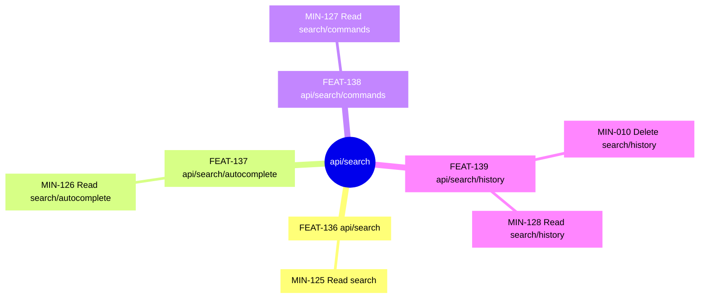
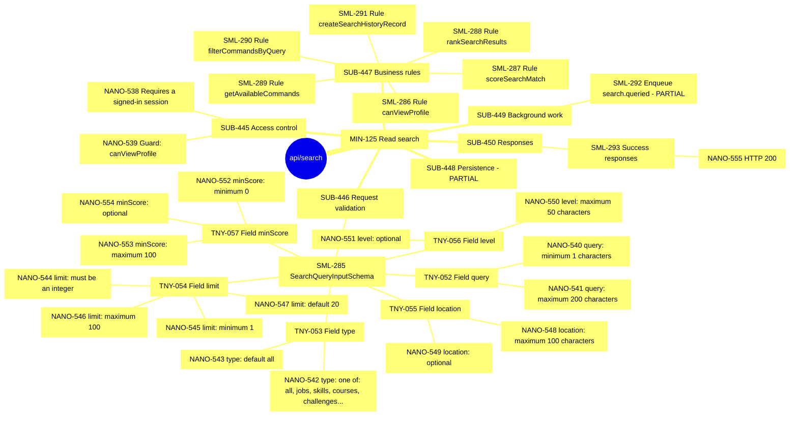
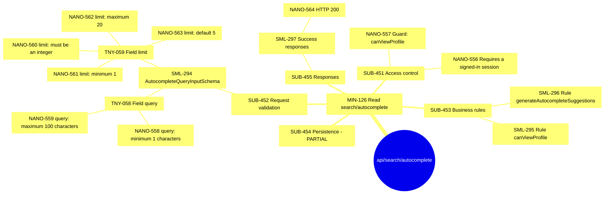
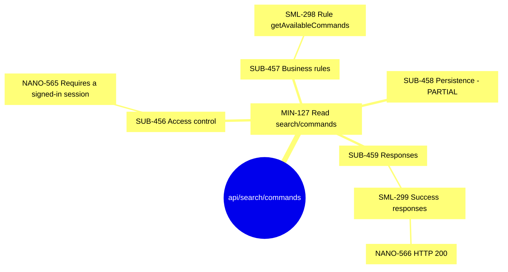
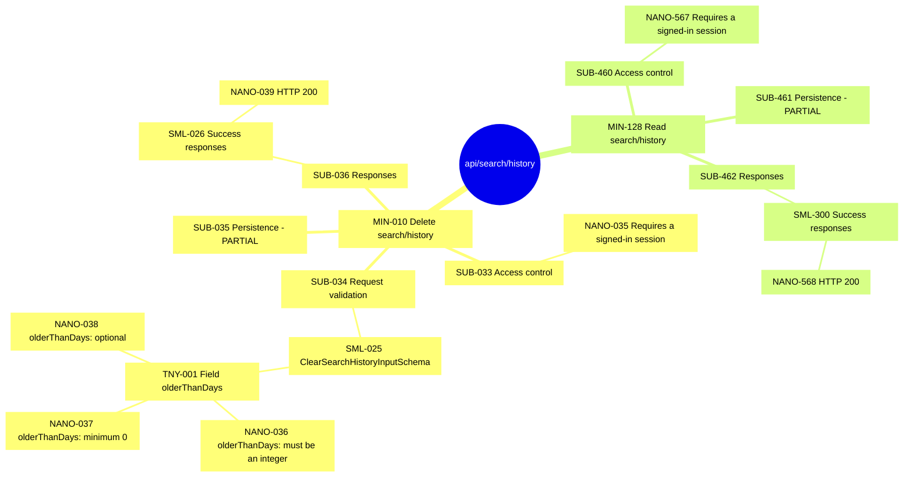

# api/search (MOD-092)

Generated by `project-mindmap/tools/catalog.py` from `master/MASTER_PROJECT_GRAPH.json` at commit `9b3032f`. Do not edit by hand. Back to the [feature catalog](../FEATURE_CATALOG.md).

**Application:** apps/api (MOD-001). **Purpose:** API module: routes under /api/v1/search in apps/api/src/server.ts.

**Nodes by level:** MODULE 1, MAJOR 4, MINOR 5, SUB 22, SMALL 18, TINY 9, NANO 36. **Status:** IMPLEMENTED 89, PARTIALLY_IMPLEMENTED 6. **Verification:** PATH_LEVEL 75, UNKNOWN 1, VERIFIED 14.

**User roles that reach it:** authenticated.

**Known gaps:** MIN-125 ephemeral: state held in process memory, lost on restart; MIN-126 ephemeral: state held in process memory, lost on restart; MIN-126 no first-party web caller found; MIN-127 ephemeral: state held in process memory, lost on restart; MIN-127 no first-party web caller found; MIN-010 ephemeral: state held in process memory, lost on restart; MIN-010 no first-party web caller found; MIN-128 ephemeral: state held in process memory, lost on restart; MIN-128 no first-party web caller found.

**Called from (web screens and components):** FEAT-173 Screen /network

## Module map (to minor features)

## FEAT-136 api/search

api/search

| ID       | Level | Parent   | Name                                                                                          | Description                                                                                                                                                                                                                                                                                                  | Status                | Verification | Evidence                                   | Related                                                   |
| -------- | ----- | -------- | --------------------------------------------------------------------------------------------- | ------------------------------------------------------------------------------------------------------------------------------------------------------------------------------------------------------------------------------------------------------------------------------------------------------------ | --------------------- | ------------ | ------------------------------------------ | --------------------------------------------------------- |
| FEAT-136 | MAJOR | MOD-092  | api/search                                                                                    |                                                                                                                                                                                                                                                                                                              | IMPLEMENTED           |              | apps/api/src/server.ts:11501               |                                                           |
| MIN-125  | MINOR | FEAT-136 | Read search                                                                                   | 1. Unified Multi-Entity Search GET /api/v1/search for any signed-in session; validates SearchQueryInputSchema; calls canViewProfile, scoreSearchMatch, rankSearchResults, getAvailableCommands ...; ephemeral (process memory); responds 200. Gaps: ephemeral: state held in process memory, lost on restart | IMPLEMENTED           | VERIFIED     | apps/api/src/server.ts:11501               | API-237, TEST-107, TEST-129, TEST-145, TEST-183, TEST-218 |
| SUB-445  | SUB   | MIN-125  | Access control                                                                                | Who may call GET /api/v1/search: any signed-in session.                                                                                                                                                                                                                                                      | IMPLEMENTED           | PATH_LEVEL   | apps/api/src/server.ts:11501               |                                                           |
| NANO-538 | NANO  | SUB-445  | Requires a signed-in session                                                                  | Requests without a valid session token are rejected with 401 UNAUTHENTICATED.                                                                                                                                                                                                                                | IMPLEMENTED           | PATH_LEVEL   | apps/api/src/server.ts:11501               | ROLE-001                                                  |
| NANO-539 | NANO  | SUB-445  | Guard: canViewProfile                                                                         | Guard canViewProfile must pass before the handler runs.                                                                                                                                                                                                                                                      | IMPLEMENTED           | PATH_LEVEL   | apps/api/src/server.ts:11501               |                                                           |
| SUB-446  | SUB   | MIN-125  | Request validation                                                                            | The request is parsed with SearchQueryInputSchema; a failure returns 400 with field details before any business logic runs.                                                                                                                                                                                  | IMPLEMENTED           | PATH_LEVEL   | apps/api/src/server.ts:11501               |                                                           |
| SML-285  | SMALL | SUB-446  | SearchQueryInputSchema                                                                        | SearchQueryInputSchema: 6 field(s)                                                                                                                                                                                                                                                                           | IMPLEMENTED           | PATH_LEVEL   | packages/contracts/src/index.ts:776        | SCH-060                                                   |
| TNY-052  | TINY  | SML-285  | Field query                                                                                   | query (string, required): minimum 1 characters; maximum 200 characters                                                                                                                                                                                                                                       | IMPLEMENTED           | PATH_LEVEL   | packages/contracts/src/index.ts:777        |                                                           |
| NANO-540 | NANO  | TNY-052  | query: minimum 1 characters                                                                   | query minimum 1 characters.                                                                                                                                                                                                                                                                                  | IMPLEMENTED           | PATH_LEVEL   | packages/contracts/src/index.ts:777        |                                                           |
| NANO-541 | NANO  | TNY-052  | query: maximum 200 characters                                                                 | query maximum 200 characters.                                                                                                                                                                                                                                                                                | IMPLEMENTED           | PATH_LEVEL   | packages/contracts/src/index.ts:777        |                                                           |
| TNY-053  | TINY  | SML-285  | Field type                                                                                    | type (enum, optional): one of: all, jobs, skills, courses, challenges, profiles, commands, companies, projects; default 'all'                                                                                                                                                                                | IMPLEMENTED           | PATH_LEVEL   | packages/contracts/src/index.ts:778        |                                                           |
| NANO-542 | NANO  | TNY-053  | type: one of: all, jobs, skills, courses, challenges, profiles, commands, companies, projects | type one of: all, jobs, skills, courses, challenges, profiles, commands, companies, projects.                                                                                                                                                                                                                | IMPLEMENTED           | PATH_LEVEL   | packages/contracts/src/index.ts:778        |                                                           |
| NANO-543 | NANO  | TNY-053  | type: default 'all'                                                                           | type default 'all'; message "all".                                                                                                                                                                                                                                                                           | IMPLEMENTED           | PATH_LEVEL   | packages/contracts/src/index.ts:778        |                                                           |
| TNY-054  | TINY  | SML-285  | Field limit                                                                                   | limit (number, optional): must be an integer; minimum 1; maximum 100; default 20                                                                                                                                                                                                                             | IMPLEMENTED           | PATH_LEVEL   | packages/contracts/src/index.ts:791        |                                                           |
| NANO-544 | NANO  | TNY-054  | limit: must be an integer                                                                     | limit must be an integer.                                                                                                                                                                                                                                                                                    | IMPLEMENTED           | PATH_LEVEL   | packages/contracts/src/index.ts:791        |                                                           |
| NANO-545 | NANO  | TNY-054  | limit: minimum 1                                                                              | limit minimum 1.                                                                                                                                                                                                                                                                                             | IMPLEMENTED           | PATH_LEVEL   | packages/contracts/src/index.ts:791        |                                                           |
| NANO-546 | NANO  | TNY-054  | limit: maximum 100                                                                            | limit maximum 100.                                                                                                                                                                                                                                                                                           | IMPLEMENTED           | PATH_LEVEL   | packages/contracts/src/index.ts:791        |                                                           |
| NANO-547 | NANO  | TNY-054  | limit: default 20                                                                             | limit default 20.                                                                                                                                                                                                                                                                                            | IMPLEMENTED           | PATH_LEVEL   | packages/contracts/src/index.ts:791        |                                                           |
| TNY-055  | TINY  | SML-285  | Field location                                                                                | location (string, optional): maximum 100 characters; optional                                                                                                                                                                                                                                                | IMPLEMENTED           | PATH_LEVEL   | packages/contracts/src/index.ts:792        |                                                           |
| NANO-548 | NANO  | TNY-055  | location: maximum 100 characters                                                              | location maximum 100 characters.                                                                                                                                                                                                                                                                             | IMPLEMENTED           | PATH_LEVEL   | packages/contracts/src/index.ts:792        |                                                           |
| NANO-549 | NANO  | TNY-055  | location: optional                                                                            | location optional.                                                                                                                                                                                                                                                                                           | IMPLEMENTED           | PATH_LEVEL   | packages/contracts/src/index.ts:792        |                                                           |
| TNY-056  | TINY  | SML-285  | Field level                                                                                   | level (string, optional): maximum 50 characters; optional                                                                                                                                                                                                                                                    | IMPLEMENTED           | PATH_LEVEL   | packages/contracts/src/index.ts:793        |                                                           |
| NANO-550 | NANO  | TNY-056  | level: maximum 50 characters                                                                  | level maximum 50 characters.                                                                                                                                                                                                                                                                                 | IMPLEMENTED           | PATH_LEVEL   | packages/contracts/src/index.ts:793        |                                                           |
| NANO-551 | NANO  | TNY-056  | level: optional                                                                               | level optional.                                                                                                                                                                                                                                                                                              | IMPLEMENTED           | PATH_LEVEL   | packages/contracts/src/index.ts:793        |                                                           |
| TNY-057  | TINY  | SML-285  | Field minScore                                                                                | minScore (number, optional): minimum 0; maximum 100; optional                                                                                                                                                                                                                                                | IMPLEMENTED           | PATH_LEVEL   | packages/contracts/src/index.ts:794        |                                                           |
| NANO-552 | NANO  | TNY-057  | minScore: minimum 0                                                                           | minScore minimum 0.                                                                                                                                                                                                                                                                                          | IMPLEMENTED           | PATH_LEVEL   | packages/contracts/src/index.ts:794        |                                                           |
| NANO-553 | NANO  | TNY-057  | minScore: maximum 100                                                                         | minScore maximum 100.                                                                                                                                                                                                                                                                                        | IMPLEMENTED           | PATH_LEVEL   | packages/contracts/src/index.ts:794        |                                                           |
| NANO-554 | NANO  | TNY-057  | minScore: optional                                                                            | minScore optional.                                                                                                                                                                                                                                                                                           | IMPLEMENTED           | PATH_LEVEL   | packages/contracts/src/index.ts:794        |                                                           |
| SUB-447  | SUB   | MIN-125  | Business rules                                                                                | Domain functions from packages/domain called by the handler (6).                                                                                                                                                                                                                                             | IMPLEMENTED           | PATH_LEVEL   | apps/api/src/server.ts:11501               |                                                           |
| SML-286  | SMALL | SUB-447  | Rule canViewProfile                                                                           | Calls canViewProfile (packages/domain/src/profile.ts). Rule status IMPLEMENTED; its own tests: VERIFIED.                                                                                                                                                                                                     | IMPLEMENTED           | VERIFIED     | packages/domain/src/profile.ts:36          | RULE-178                                                  |
| SML-287  | SMALL | SUB-447  | Rule scoreSearchMatch                                                                         | Calls scoreSearchMatch (packages/domain/src/search.ts). Rule status IMPLEMENTED; its own tests: VERIFIED.                                                                                                                                                                                                    | IMPLEMENTED           | VERIFIED     | packages/domain/src/search.ts:193          | RULE-206                                                  |
| SML-288  | SMALL | SUB-447  | Rule rankSearchResults                                                                        | Calls rankSearchResults (packages/domain/src/search.ts). Rule status IMPLEMENTED; its own tests: VERIFIED.                                                                                                                                                                                                   | IMPLEMENTED           | VERIFIED     | packages/domain/src/search.ts:260          | RULE-208                                                  |
| SML-289  | SMALL | SUB-447  | Rule getAvailableCommands                                                                     | Calls getAvailableCommands (packages/domain/src/search.ts). Rule status IMPLEMENTED; its own tests: VERIFIED.                                                                                                                                                                                                | IMPLEMENTED           | VERIFIED     | packages/domain/src/search.ts:272          | RULE-209                                                  |
| SML-290  | SMALL | SUB-447  | Rule filterCommandsByQuery                                                                    | Calls filterCommandsByQuery (packages/domain/src/search.ts). Rule status IMPLEMENTED; its own tests: VERIFIED.                                                                                                                                                                                               | IMPLEMENTED           | VERIFIED     | packages/domain/src/search.ts:284          | RULE-210                                                  |
| SML-291  | SMALL | SUB-447  | Rule createSearchHistoryRecord                                                                | Calls createSearchHistoryRecord (packages/domain/src/search.ts). Rule status IMPLEMENTED; its own tests: VERIFIED.                                                                                                                                                                                           | IMPLEMENTED           | VERIFIED     | packages/domain/src/search.ts:299          | RULE-211                                                  |
| SUB-448  | SUB   | MIN-125  | Persistence                                                                                   | Ephemeral: state lives in API process memory and is lost on restart.                                                                                                                                                                                                                                         | PARTIALLY_IMPLEMENTED | PATH_LEVEL   | apps/api/src/server.ts:11501               |                                                           |
| SUB-449  | SUB   | MIN-125  | Background work                                                                               | Enqueues 1 background job kind(s) in background_jobs for apps/worker.                                                                                                                                                                                                                                        | IMPLEMENTED           | PATH_LEVEL   | apps/api/src/server.ts:11501               |                                                           |
| SML-292  | SMALL | SUB-449  | Enqueue search.queried                                                                        | Dispatches job:search.queried; worker handler: recordEvent (no-op: marks the event recorded).                                                                                                                                                                                                                | PARTIALLY_IMPLEMENTED | UNKNOWN      | packages/domain/src/background-jobs.ts:171 | SVC-040                                                   |
| SUB-450  | SUB   | MIN-125  | Responses                                                                                     | Success 200; 0 explicit failure branch(es) besides validation and access errors.                                                                                                                                                                                                                             | IMPLEMENTED           | PATH_LEVEL   | apps/api/src/server.ts:11501               |                                                           |
| SML-293  | SMALL | SUB-450  | Success responses                                                                             | HTTP 200.                                                                                                                                                                                                                                                                                                    | IMPLEMENTED           | PATH_LEVEL   | apps/api/src/server.ts:11501               |                                                           |
| NANO-555 | NANO  | SML-293  | HTTP 200                                                                                      | Replies 200 when the operation succeeds.                                                                                                                                                                                                                                                                     | IMPLEMENTED           | PATH_LEVEL   | apps/api/src/server.ts:11501               |                                                           |

## FEAT-137 api/search/autocomplete

api/search/autocomplete

| ID       | Level | Parent   | Name                                 | Description                                                                                                                                                                                                                                                                                                                                 | Status                | Verification | Evidence                            | Related                               |
| -------- | ----- | -------- | ------------------------------------ | ------------------------------------------------------------------------------------------------------------------------------------------------------------------------------------------------------------------------------------------------------------------------------------------------------------------------------------------- | --------------------- | ------------ | ----------------------------------- | ------------------------------------- |
| FEAT-137 | MAJOR | MOD-092  | api/search/autocomplete              |                                                                                                                                                                                                                                                                                                                                             | IMPLEMENTED           |              | apps/api/src/server.ts:11753        |                                       |
| MIN-126  | MINOR | FEAT-137 | Read search/autocomplete             | 1b. Search Autocomplete (F-147, BR-265) GET /api/v1/search/autocomplete for any signed-in session; validates AutocompleteQueryInputSchema; calls canViewProfile, generateAutocompleteSuggestions; ephemeral (process memory); responds 200. Gaps: ephemeral: state held in process memory, lost on restart; no first-party web caller found | IMPLEMENTED           | VERIFIED     | apps/api/src/server.ts:11753        | API-238, TEST-129, TEST-145, TEST-218 |
| SUB-451  | SUB   | MIN-126  | Access control                       | Who may call GET /api/v1/search/autocomplete: any signed-in session.                                                                                                                                                                                                                                                                        | IMPLEMENTED           | PATH_LEVEL   | apps/api/src/server.ts:11753        |                                       |
| NANO-556 | NANO  | SUB-451  | Requires a signed-in session         | Requests without a valid session token are rejected with 401 UNAUTHENTICATED.                                                                                                                                                                                                                                                               | IMPLEMENTED           | PATH_LEVEL   | apps/api/src/server.ts:11753        | ROLE-001                              |
| NANO-557 | NANO  | SUB-451  | Guard: canViewProfile                | Guard canViewProfile must pass before the handler runs.                                                                                                                                                                                                                                                                                     | IMPLEMENTED           | PATH_LEVEL   | apps/api/src/server.ts:11753        |                                       |
| SUB-452  | SUB   | MIN-126  | Request validation                   | The request is parsed with AutocompleteQueryInputSchema; a failure returns 400 with field details before any business logic runs.                                                                                                                                                                                                           | IMPLEMENTED           | PATH_LEVEL   | apps/api/src/server.ts:11753        |                                       |
| SML-294  | SMALL | SUB-452  | AutocompleteQueryInputSchema         | AutocompleteQueryInputSchema: 2 field(s)                                                                                                                                                                                                                                                                                                    | IMPLEMENTED           | PATH_LEVEL   | packages/contracts/src/index.ts:799 | SCH-061                               |
| TNY-058  | TINY  | SML-294  | Field query                          | query (string, required): minimum 1 characters; maximum 100 characters                                                                                                                                                                                                                                                                      | IMPLEMENTED           | PATH_LEVEL   | packages/contracts/src/index.ts:800 |                                       |
| NANO-558 | NANO  | TNY-058  | query: minimum 1 characters          | query minimum 1 characters.                                                                                                                                                                                                                                                                                                                 | IMPLEMENTED           | PATH_LEVEL   | packages/contracts/src/index.ts:800 |                                       |
| NANO-559 | NANO  | TNY-058  | query: maximum 100 characters        | query maximum 100 characters.                                                                                                                                                                                                                                                                                                               | IMPLEMENTED           | PATH_LEVEL   | packages/contracts/src/index.ts:800 |                                       |
| TNY-059  | TINY  | SML-294  | Field limit                          | limit (number, optional): must be an integer; minimum 1; maximum 20; default 5                                                                                                                                                                                                                                                              | IMPLEMENTED           | PATH_LEVEL   | packages/contracts/src/index.ts:801 |                                       |
| NANO-560 | NANO  | TNY-059  | limit: must be an integer            | limit must be an integer.                                                                                                                                                                                                                                                                                                                   | IMPLEMENTED           | PATH_LEVEL   | packages/contracts/src/index.ts:801 |                                       |
| NANO-561 | NANO  | TNY-059  | limit: minimum 1                     | limit minimum 1.                                                                                                                                                                                                                                                                                                                            | IMPLEMENTED           | PATH_LEVEL   | packages/contracts/src/index.ts:801 |                                       |
| NANO-562 | NANO  | TNY-059  | limit: maximum 20                    | limit maximum 20.                                                                                                                                                                                                                                                                                                                           | IMPLEMENTED           | PATH_LEVEL   | packages/contracts/src/index.ts:801 |                                       |
| NANO-563 | NANO  | TNY-059  | limit: default 5                     | limit default 5.                                                                                                                                                                                                                                                                                                                            | IMPLEMENTED           | PATH_LEVEL   | packages/contracts/src/index.ts:801 |                                       |
| SUB-453  | SUB   | MIN-126  | Business rules                       | Domain functions from packages/domain called by the handler (2).                                                                                                                                                                                                                                                                            | IMPLEMENTED           | PATH_LEVEL   | apps/api/src/server.ts:11753        |                                       |
| SML-295  | SMALL | SUB-453  | Rule canViewProfile                  | Calls canViewProfile (packages/domain/src/profile.ts). Rule status IMPLEMENTED; its own tests: VERIFIED.                                                                                                                                                                                                                                    | IMPLEMENTED           | VERIFIED     | packages/domain/src/profile.ts:36   | RULE-178                              |
| SML-296  | SMALL | SUB-453  | Rule generateAutocompleteSuggestions | Calls generateAutocompleteSuggestions (packages/domain/src/search.ts). Rule status IMPLEMENTED; its own tests: VERIFIED.                                                                                                                                                                                                                    | IMPLEMENTED           | VERIFIED     | packages/domain/src/search.ts:229   | RULE-207                              |
| SUB-454  | SUB   | MIN-126  | Persistence                          | Ephemeral: state lives in API process memory and is lost on restart.                                                                                                                                                                                                                                                                        | PARTIALLY_IMPLEMENTED | PATH_LEVEL   | apps/api/src/server.ts:11753        |                                       |
| SUB-455  | SUB   | MIN-126  | Responses                            | Success 200; 0 explicit failure branch(es) besides validation and access errors.                                                                                                                                                                                                                                                            | IMPLEMENTED           | PATH_LEVEL   | apps/api/src/server.ts:11753        |                                       |
| SML-297  | SMALL | SUB-455  | Success responses                    | HTTP 200.                                                                                                                                                                                                                                                                                                                                   | IMPLEMENTED           | PATH_LEVEL   | apps/api/src/server.ts:11753        |                                       |
| NANO-564 | NANO  | SML-297  | HTTP 200                             | Replies 200 when the operation succeeds.                                                                                                                                                                                                                                                                                                    | IMPLEMENTED           | PATH_LEVEL   | apps/api/src/server.ts:11753        |                                       |

## FEAT-138 api/search/commands

api/search/commands

| ID       | Level | Parent   | Name                         | Description                                                                                                                                                                                                                                                                 | Status                | Verification | Evidence                          | Related                               |
| -------- | ----- | -------- | ---------------------------- | --------------------------------------------------------------------------------------------------------------------------------------------------------------------------------------------------------------------------------------------------------------------------- | --------------------- | ------------ | --------------------------------- | ------------------------------------- |
| FEAT-138 | MAJOR | MOD-092  | api/search/commands          |                                                                                                                                                                                                                                                                             | IMPLEMENTED           |              | apps/api/src/server.ts:11835      |                                       |
| MIN-127  | MINOR | FEAT-138 | Read search/commands         | 2. Get Available Commands (Command Palette ⌘K) GET /api/v1/search/commands for any signed-in session; calls getAvailableCommands; ephemeral (process memory); responds 200. Gaps: ephemeral: state held in process memory, lost on restart; no first-party web caller found | IMPLEMENTED           | VERIFIED     | apps/api/src/server.ts:11835      | API-239, TEST-129, TEST-145, TEST-183 |
| SUB-456  | SUB   | MIN-127  | Access control               | Who may call GET /api/v1/search/commands: any signed-in session.                                                                                                                                                                                                            | IMPLEMENTED           | PATH_LEVEL   | apps/api/src/server.ts:11835      |                                       |
| NANO-565 | NANO  | SUB-456  | Requires a signed-in session | Requests without a valid session token are rejected with 401 UNAUTHENTICATED.                                                                                                                                                                                               | IMPLEMENTED           | PATH_LEVEL   | apps/api/src/server.ts:11835      | ROLE-001                              |
| SUB-457  | SUB   | MIN-127  | Business rules               | Domain functions from packages/domain called by the handler (1).                                                                                                                                                                                                            | IMPLEMENTED           | PATH_LEVEL   | apps/api/src/server.ts:11835      |                                       |
| SML-298  | SMALL | SUB-457  | Rule getAvailableCommands    | Calls getAvailableCommands (packages/domain/src/search.ts). Rule status IMPLEMENTED; its own tests: VERIFIED.                                                                                                                                                               | IMPLEMENTED           | VERIFIED     | packages/domain/src/search.ts:272 | RULE-209                              |
| SUB-458  | SUB   | MIN-127  | Persistence                  | Ephemeral: state lives in API process memory and is lost on restart.                                                                                                                                                                                                        | PARTIALLY_IMPLEMENTED | PATH_LEVEL   | apps/api/src/server.ts:11835      |                                       |
| SUB-459  | SUB   | MIN-127  | Responses                    | Success 200; 0 explicit failure branch(es) besides validation and access errors.                                                                                                                                                                                            | IMPLEMENTED           | PATH_LEVEL   | apps/api/src/server.ts:11835      |                                       |
| SML-299  | SMALL | SUB-459  | Success responses            | HTTP 200.                                                                                                                                                                                                                                                                   | IMPLEMENTED           | PATH_LEVEL   | apps/api/src/server.ts:11835      |                                       |
| NANO-566 | NANO  | SML-299  | HTTP 200                     | Replies 200 when the operation succeeds.                                                                                                                                                                                                                                    | IMPLEMENTED           | PATH_LEVEL   | apps/api/src/server.ts:11835      |                                       |

## FEAT-139 api/search/history

api/search/history

| ID       | Level | Parent   | Name                              | Description                                                                                                                                                                                                                                                              | Status                | Verification | Evidence                            | Related           |
| -------- | ----- | -------- | --------------------------------- | ------------------------------------------------------------------------------------------------------------------------------------------------------------------------------------------------------------------------------------------------------------------------ | --------------------- | ------------ | ----------------------------------- | ----------------- |
| FEAT-139 | MAJOR | MOD-092  | api/search/history                |                                                                                                                                                                                                                                                                          | IMPLEMENTED           |              | apps/api/src/server.ts:11845        |                   |
| MIN-010  | MINOR | FEAT-139 | Delete search/history             | 4. Clear User Search History DELETE /api/v1/search/history for any signed-in session; validates ClearSearchHistoryInputSchema; ephemeral (process memory); responds 200. Gaps: ephemeral: state held in process memory, lost on restart; no first-party web caller found | IMPLEMENTED           | VERIFIED     | apps/api/src/server.ts:11855        | API-241, TEST-129 |
| SUB-033  | SUB   | MIN-010  | Access control                    | Who may call DELETE /api/v1/search/history: any signed-in session.                                                                                                                                                                                                       | IMPLEMENTED           | PATH_LEVEL   | apps/api/src/server.ts:11855        |                   |
| NANO-035 | NANO  | SUB-033  | Requires a signed-in session      | Requests without a valid session token are rejected with 401 UNAUTHENTICATED.                                                                                                                                                                                            | IMPLEMENTED           | PATH_LEVEL   | apps/api/src/server.ts:11855        | ROLE-001          |
| SUB-034  | SUB   | MIN-010  | Request validation                | The request is parsed with ClearSearchHistoryInputSchema; a failure returns 400 with field details before any business logic runs.                                                                                                                                       | IMPLEMENTED           | PATH_LEVEL   | apps/api/src/server.ts:11855        |                   |
| SML-025  | SMALL | SUB-034  | ClearSearchHistoryInputSchema     | ClearSearchHistoryInputSchema: 1 field(s)                                                                                                                                                                                                                                | IMPLEMENTED           | PATH_LEVEL   | packages/contracts/src/index.ts:806 | SCH-062           |
| TNY-001  | TINY  | SML-025  | Field olderThanDays               | olderThanDays (number, optional): must be an integer; minimum 0; optional                                                                                                                                                                                                | IMPLEMENTED           | PATH_LEVEL   | packages/contracts/src/index.ts:807 |                   |
| NANO-036 | NANO  | TNY-001  | olderThanDays: must be an integer | olderThanDays must be an integer.                                                                                                                                                                                                                                        | IMPLEMENTED           | PATH_LEVEL   | packages/contracts/src/index.ts:807 |                   |
| NANO-037 | NANO  | TNY-001  | olderThanDays: minimum 0          | olderThanDays minimum 0.                                                                                                                                                                                                                                                 | IMPLEMENTED           | PATH_LEVEL   | packages/contracts/src/index.ts:807 |                   |
| NANO-038 | NANO  | TNY-001  | olderThanDays: optional           | olderThanDays optional.                                                                                                                                                                                                                                                  | IMPLEMENTED           | PATH_LEVEL   | packages/contracts/src/index.ts:807 |                   |
| SUB-035  | SUB   | MIN-010  | Persistence                       | Ephemeral: state lives in API process memory and is lost on restart.                                                                                                                                                                                                     | PARTIALLY_IMPLEMENTED | PATH_LEVEL   | apps/api/src/server.ts:11855        |                   |
| SUB-036  | SUB   | MIN-010  | Responses                         | Success 200; 0 explicit failure branch(es) besides validation and access errors.                                                                                                                                                                                         | IMPLEMENTED           | PATH_LEVEL   | apps/api/src/server.ts:11855        |                   |
| SML-026  | SMALL | SUB-036  | Success responses                 | HTTP 200.                                                                                                                                                                                                                                                                | IMPLEMENTED           | PATH_LEVEL   | apps/api/src/server.ts:11855        |                   |
| NANO-039 | NANO  | SML-026  | HTTP 200                          | Replies 200 when the operation succeeds.                                                                                                                                                                                                                                 | IMPLEMENTED           | PATH_LEVEL   | apps/api/src/server.ts:11855        |                   |
| MIN-128  | MINOR | FEAT-139 | Read search/history               | 3. Get User Search History GET /api/v1/search/history for any signed-in session; ephemeral (process memory); responds 200. Gaps: ephemeral: state held in process memory, lost on restart; no first-party web caller found                                               | IMPLEMENTED           | VERIFIED     | apps/api/src/server.ts:11845        | API-240, TEST-129 |
| SUB-460  | SUB   | MIN-128  | Access control                    | Who may call GET /api/v1/search/history: any signed-in session.                                                                                                                                                                                                          | IMPLEMENTED           | PATH_LEVEL   | apps/api/src/server.ts:11845        |                   |
| NANO-567 | NANO  | SUB-460  | Requires a signed-in session      | Requests without a valid session token are rejected with 401 UNAUTHENTICATED.                                                                                                                                                                                            | IMPLEMENTED           | PATH_LEVEL   | apps/api/src/server.ts:11845        | ROLE-001          |
| SUB-461  | SUB   | MIN-128  | Persistence                       | Ephemeral: state lives in API process memory and is lost on restart.                                                                                                                                                                                                     | PARTIALLY_IMPLEMENTED | PATH_LEVEL   | apps/api/src/server.ts:11845        |                   |
| SUB-462  | SUB   | MIN-128  | Responses                         | Success 200; 0 explicit failure branch(es) besides validation and access errors.                                                                                                                                                                                         | IMPLEMENTED           | PATH_LEVEL   | apps/api/src/server.ts:11845        |                   |
| SML-300  | SMALL | SUB-462  | Success responses                 | HTTP 200.                                                                                                                                                                                                                                                                | IMPLEMENTED           | PATH_LEVEL   | apps/api/src/server.ts:11845        |                   |
| NANO-568 | NANO  | SML-300  | HTTP 200                          | Replies 200 when the operation succeeds.                                                                                                                                                                                                                                 | IMPLEMENTED           | PATH_LEVEL   | apps/api/src/server.ts:11845        |                   |
