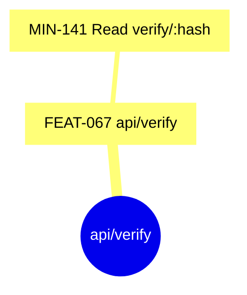
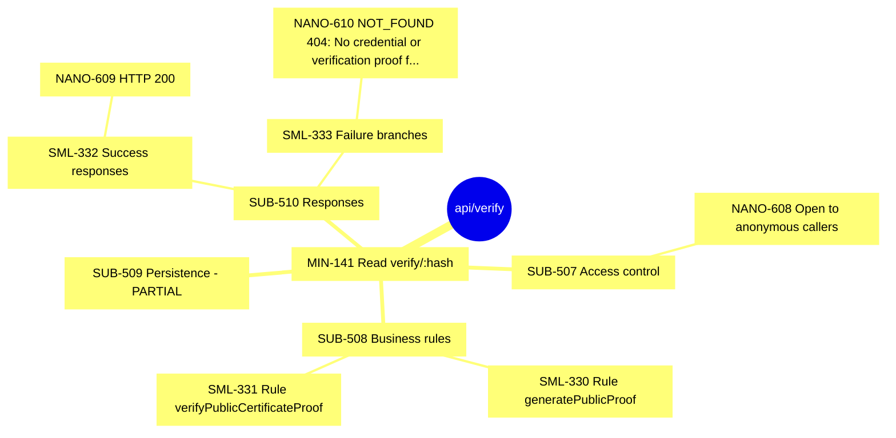

# api/verify (MOD-075)

Generated by `project-mindmap/tools/catalog.py` from `master/MASTER_PROJECT_GRAPH.json` at commit `9b3032f`. Do not edit by hand. Back to the [feature catalog](../FEATURE_CATALOG.md).

**Application:** apps/api (MOD-001). **Purpose:** API module: routes under /api/v1/verify in apps/api/src/server.ts.

**Nodes by level:** MODULE 1, MAJOR 1, MINOR 1, SUB 4, SMALL 4, NANO 3. **Status:** IMPLEMENTED 13, PARTIALLY_IMPLEMENTED 1. **Verification:** PATH_LEVEL 9, VERIFIED 3.

**User roles that reach it:** anonymous.

**Known gaps:** MIN-141 ephemeral: state held in process memory, lost on restart.

**Called from (web screens and components):** FEAT-183 Screen /verify/:hash

## Module map (to minor features)

## FEAT-067 api/verify

api/verify

| ID       | Level | Parent   | Name                                                                              | Description                                                                                                                                                                                                                                                                                                               | Status                | Verification | Evidence                            | Related                                                   |
| -------- | ----- | -------- | --------------------------------------------------------------------------------- | ------------------------------------------------------------------------------------------------------------------------------------------------------------------------------------------------------------------------------------------------------------------------------------------------------------------------- | --------------------- | ------------ | ----------------------------------- | --------------------------------------------------------- |
| FEAT-067 | MAJOR | MOD-075  | api/verify                                                                        |                                                                                                                                                                                                                                                                                                                           | IMPLEMENTED           |              | apps/api/src/server.ts:5492         |                                                           |
| MIN-141  | MINOR | FEAT-067 | Read verify/:hash                                                                 | Unified Public Zero-PII Verification Endpoint (SSOT 1132, S-02, BR-150, F-52, F-96) GET /api/v1/verify/:hash for anyone (public); calls generatePublicProof, verifyPublicCertificateProof; ephemeral (process memory); responds 200; 1 failure branch(es). Gaps: ephemeral: state held in process memory, lost on restart | IMPLEMENTED           | VERIFIED     | apps/api/src/server.ts:5492         | API-108, TEST-094, TEST-145, TEST-175, TEST-179, TEST-217 |
| SUB-507  | SUB   | MIN-141  | Access control                                                                    | Who may call GET /api/v1/verify/:hash: anyone (public).                                                                                                                                                                                                                                                                   | IMPLEMENTED           | PATH_LEVEL   | apps/api/src/server.ts:5492         |                                                           |
| NANO-608 | NANO  | SUB-507  | Open to anonymous callers                                                         | auth: public.                                                                                                                                                                                                                                                                                                             | IMPLEMENTED           | PATH_LEVEL   | apps/api/src/server.ts:5492         | ROLE-001                                                  |
| SUB-508  | SUB   | MIN-141  | Business rules                                                                    | Domain functions from packages/domain called by the handler (2).                                                                                                                                                                                                                                                          | IMPLEMENTED           | PATH_LEVEL   | apps/api/src/server.ts:5492         |                                                           |
| SML-330  | SMALL | SUB-508  | Rule generatePublicProof                                                          | Calls generatePublicProof (packages/domain/src/evidence.ts). Rule status IMPLEMENTED; its own tests: VERIFIED.                                                                                                                                                                                                            | IMPLEMENTED           | VERIFIED     | packages/domain/src/evidence.ts:397 | RULE-103                                                  |
| SML-331  | SMALL | SUB-508  | Rule verifyPublicCertificateProof                                                 | Calls verifyPublicCertificateProof (packages/domain/src/lms.ts). Rule status IMPLEMENTED; its own tests: VERIFIED.                                                                                                                                                                                                        | IMPLEMENTED           | VERIFIED     | packages/domain/src/lms.ts:371      | RULE-142                                                  |
| SUB-509  | SUB   | MIN-141  | Persistence                                                                       | Ephemeral: state lives in API process memory and is lost on restart.                                                                                                                                                                                                                                                      | PARTIALLY_IMPLEMENTED | PATH_LEVEL   | apps/api/src/server.ts:5492         |                                                           |
| SUB-510  | SUB   | MIN-141  | Responses                                                                         | Success 200; 1 explicit failure branch(es) besides validation and access errors.                                                                                                                                                                                                                                          | IMPLEMENTED           | PATH_LEVEL   | apps/api/src/server.ts:5492         |                                                           |
| SML-332  | SMALL | SUB-510  | Success responses                                                                 | HTTP 200.                                                                                                                                                                                                                                                                                                                 | IMPLEMENTED           | PATH_LEVEL   | apps/api/src/server.ts:5492         |                                                           |
| NANO-609 | NANO  | SML-332  | HTTP 200                                                                          | Replies 200 when the operation succeeds.                                                                                                                                                                                                                                                                                  | IMPLEMENTED           | PATH_LEVEL   | apps/api/src/server.ts:5492         |                                                           |
| SML-333  | SMALL | SUB-510  | Failure branches                                                                  | 1 DomainError branch(es) in the handler, mapped to HTTP by the global error handler.                                                                                                                                                                                                                                      | IMPLEMENTED           | PATH_LEVEL   | apps/api/src/server.ts:5492         |                                                           |
| NANO-610 | NANO  | SML-333  | NOT_FOUND 404: No credential or verification proof found matching hash "${hash}". | Throws DomainError(NOT_FOUND) "No credential or verification proof found matching hash "${hash}"." -> HTTP 404.                                                                                                                                                                                                           | IMPLEMENTED           | PATH_LEVEL   | apps/api/src/server.ts:5532         | ERR-125                                                   |
