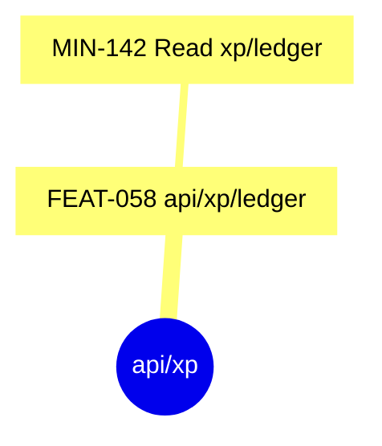
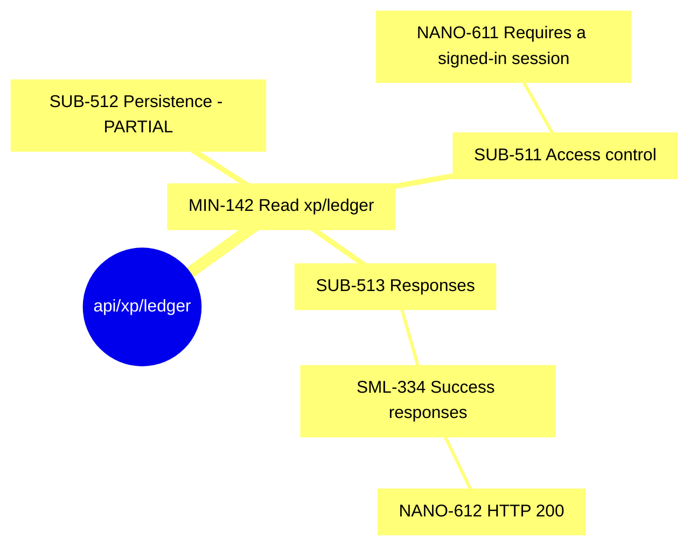

# api/xp (MOD-070)

Generated by `project-mindmap/tools/catalog.py` from `master/MASTER_PROJECT_GRAPH.json` at commit `9b3032f`. Do not edit by hand. Back to the [feature catalog](../FEATURE_CATALOG.md).

**Application:** apps/api (MOD-001). **Purpose:** API module: routes under /api/v1/xp in apps/api/src/server.ts.

**Nodes by level:** MODULE 1, MAJOR 1, MINOR 1, SUB 3, SMALL 1, NANO 2. **Status:** IMPLEMENTED 8, PARTIALLY_IMPLEMENTED 1. **Verification:** PATH_LEVEL 6, VERIFIED 1.

**User roles that reach it:** authenticated.

**Known gaps:** MIN-142 ephemeral: state held in process memory, lost on restart; MIN-142 no first-party web caller found.

## Module map (to minor features)

## FEAT-058 api/xp/ledger

api/xp/ledger

| ID       | Level | Parent   | Name                         | Description                                                                                                                                                                                                   | Status                | Verification | Evidence                    | Related           |
| -------- | ----- | -------- | ---------------------------- | ------------------------------------------------------------------------------------------------------------------------------------------------------------------------------------------------------------- | --------------------- | ------------ | --------------------------- | ----------------- |
| FEAT-058 | MAJOR | MOD-070  | api/xp/ledger                |                                                                                                                                                                                                               | IMPLEMENTED           |              | apps/api/src/server.ts:4931 |                   |
| MIN-142  | MINOR | FEAT-058 | Read xp/ledger               | XP Ledger Endpoint GET /api/v1/xp/ledger for any signed-in session; ephemeral (process memory); responds 200. Gaps: ephemeral: state held in process memory, lost on restart; no first-party web caller found | IMPLEMENTED           | VERIFIED     | apps/api/src/server.ts:4931 | API-097, TEST-095 |
| SUB-511  | SUB   | MIN-142  | Access control               | Who may call GET /api/v1/xp/ledger: any signed-in session.                                                                                                                                                    | IMPLEMENTED           | PATH_LEVEL   | apps/api/src/server.ts:4931 |                   |
| NANO-611 | NANO  | SUB-511  | Requires a signed-in session | Requests without a valid session token are rejected with 401 UNAUTHENTICATED.                                                                                                                                 | IMPLEMENTED           | PATH_LEVEL   | apps/api/src/server.ts:4931 | ROLE-001          |
| SUB-512  | SUB   | MIN-142  | Persistence                  | Ephemeral: state lives in API process memory and is lost on restart.                                                                                                                                          | PARTIALLY_IMPLEMENTED | PATH_LEVEL   | apps/api/src/server.ts:4931 |                   |
| SUB-513  | SUB   | MIN-142  | Responses                    | Success 200; 0 explicit failure branch(es) besides validation and access errors.                                                                                                                              | IMPLEMENTED           | PATH_LEVEL   | apps/api/src/server.ts:4931 |                   |
| SML-334  | SMALL | SUB-513  | Success responses            | HTTP 200.                                                                                                                                                                                                     | IMPLEMENTED           | PATH_LEVEL   | apps/api/src/server.ts:4931 |                   |
| NANO-612 | NANO  | SML-334  | HTTP 200                     | Replies 200 when the operation succeeds.                                                                                                                                                                      | IMPLEMENTED           | PATH_LEVEL   | apps/api/src/server.ts:4931 |                   |
