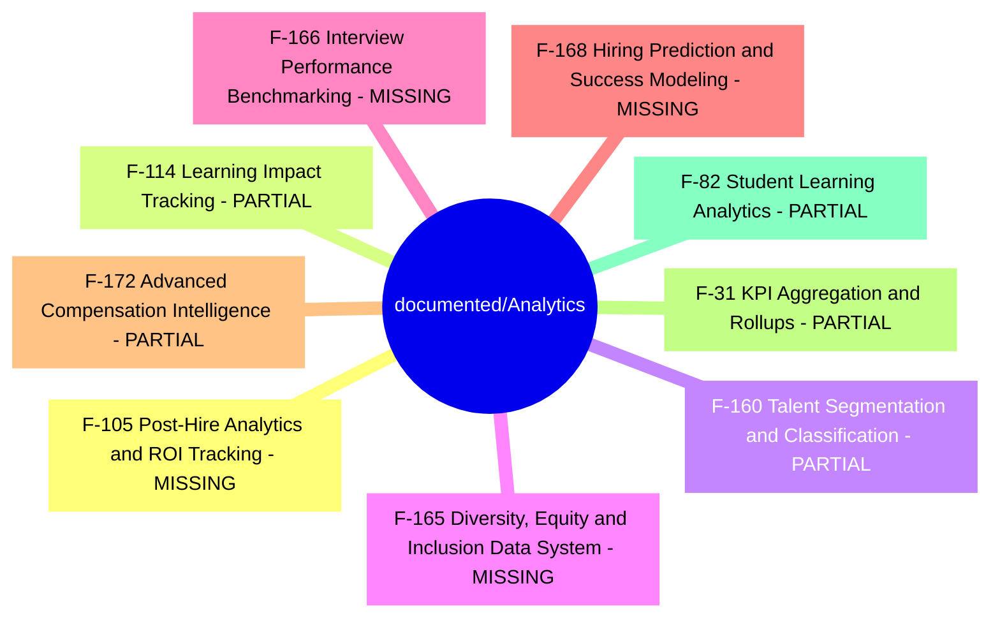

# documented/Analytics (MOD-219)

Generated by `project-mindmap/tools/catalog.py` from `master/MASTER_PROJECT_GRAPH.json` at commit `9b3032f`. Do not edit by hand. Back to the [feature catalog](../FEATURE_CATALOG.md).

**Application:** Documented scope (registry features) (APP-001). **Purpose:** Registry features in category 'Analytics'.

**Nodes by level:** MODULE 1, MAJOR 9. **Status:** NOT_IMPLEMENTED 4, PARTIALLY_IMPLEMENTED 5, UNKNOWN 1. **Verification:** UNKNOWN 1.

## Module map (to minor features)

## F-105 Post-Hire Analytics & ROI Tracking

Post-Hire Analytics & ROI Tracking

| ID    | Level | Parent  | Name                               | Description | Status          | Verification | Evidence                                | Related |
| ----- | ----- | ------- | ---------------------------------- | ----------- | --------------- | ------------ | --------------------------------------- | ------- |
| F-105 | MAJOR | MOD-219 | Post-Hire Analytics & ROI Tracking |             | NOT_IMPLEMENTED |              | docs/registries/FEATURE_REGISTRY.md:121 |         |

## F-114 Learning Impact Tracking

Learning Impact Tracking

| ID    | Level | Parent  | Name                     | Description | Status                | Verification | Evidence                                | Related |
| ----- | ----- | ------- | ------------------------ | ----------- | --------------------- | ------------ | --------------------------------------- | ------- |
| F-114 | MAJOR | MOD-219 | Learning Impact Tracking |             | PARTIALLY_IMPLEMENTED |              | docs/registries/FEATURE_REGISTRY.md:130 |         |

## F-160 Talent Segmentation & Classification

Talent Segmentation & Classification

| ID    | Level | Parent  | Name                                 | Description | Status                | Verification | Evidence                                | Related |
| ----- | ----- | ------- | ------------------------------------ | ----------- | --------------------- | ------------ | --------------------------------------- | ------- |
| F-160 | MAJOR | MOD-219 | Talent Segmentation & Classification |             | PARTIALLY_IMPLEMENTED |              | docs/registries/FEATURE_REGISTRY.md:186 |         |

## F-165 Diversity, Equity & Inclusion Data System

Diversity, Equity & Inclusion Data System

| ID    | Level | Parent  | Name                                      | Description | Status          | Verification | Evidence                                | Related |
| ----- | ----- | ------- | ----------------------------------------- | ----------- | --------------- | ------------ | --------------------------------------- | ------- |
| F-165 | MAJOR | MOD-219 | Diversity, Equity & Inclusion Data System |             | NOT_IMPLEMENTED |              | docs/registries/FEATURE_REGISTRY.md:191 |         |

## F-166 Interview Performance Benchmarking

Interview Performance Benchmarking

| ID    | Level | Parent  | Name                               | Description | Status          | Verification | Evidence                                | Related |
| ----- | ----- | ------- | ---------------------------------- | ----------- | --------------- | ------------ | --------------------------------------- | ------- |
| F-166 | MAJOR | MOD-219 | Interview Performance Benchmarking |             | NOT_IMPLEMENTED |              | docs/registries/FEATURE_REGISTRY.md:192 |         |

## F-168 Hiring Prediction & Success Modeling

Hiring Prediction & Success Modeling

| ID    | Level | Parent  | Name                                 | Description | Status          | Verification | Evidence                                | Related |
| ----- | ----- | ------- | ------------------------------------ | ----------- | --------------- | ------------ | --------------------------------------- | ------- |
| F-168 | MAJOR | MOD-219 | Hiring Prediction & Success Modeling |             | NOT_IMPLEMENTED |              | docs/registries/FEATURE_REGISTRY.md:194 |         |

## F-172 Advanced Compensation Intelligence

Advanced Compensation Intelligence

| ID    | Level | Parent  | Name                               | Description | Status                | Verification | Evidence                                | Related |
| ----- | ----- | ------- | ---------------------------------- | ----------- | --------------------- | ------------ | --------------------------------------- | ------- |
| F-172 | MAJOR | MOD-219 | Advanced Compensation Intelligence |             | PARTIALLY_IMPLEMENTED |              | docs/registries/FEATURE_REGISTRY.md:198 |         |

## F-31 KPI Aggregation & Rollups

KPI Aggregation & Rollups

| ID   | Level | Parent  | Name                      | Description | Status                | Verification | Evidence                               | Related |
| ---- | ----- | ------- | ------------------------- | ----------- | --------------------- | ------------ | -------------------------------------- | ------- |
| F-31 | MAJOR | MOD-219 | KPI Aggregation & Rollups |             | PARTIALLY_IMPLEMENTED |              | docs/registries/FEATURE_REGISTRY.md:47 |         |

## F-82 Student Learning Analytics

Student Learning Analytics

| ID   | Level | Parent  | Name                       | Description | Status                | Verification | Evidence                               | Related |
| ---- | ----- | ------- | -------------------------- | ----------- | --------------------- | ------------ | -------------------------------------- | ------- |
| F-82 | MAJOR | MOD-219 | Student Learning Analytics |             | PARTIALLY_IMPLEMENTED |              | docs/registries/FEATURE_REGISTRY.md:98 |         |
